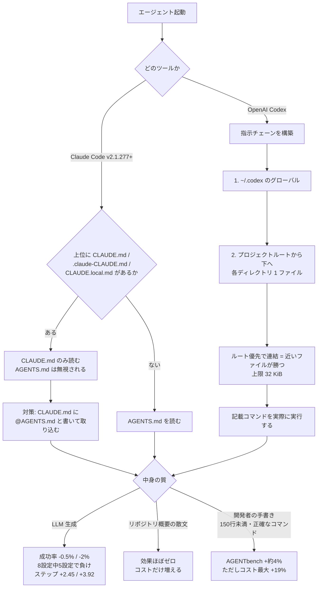
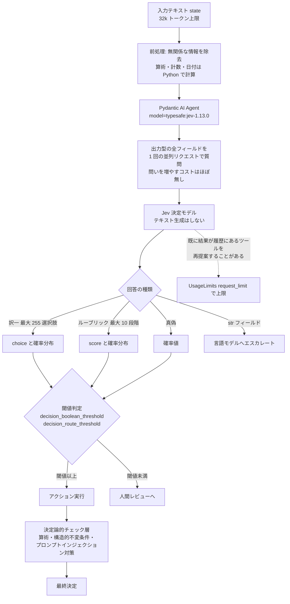

```mermaid
flowchart LR
    subgraph BEFORE["変更前: ボトルネックが下流に移動"]
        A1["エージェントが実装<br/>高速"] --> A2["大きな diff"]
        A2 --> A3["CI 同時実行上限で待機"]
        A3 --> A4["エージェントがポーリング<br/>10秒おきに状態確認"]
        A4 -->|"呼び出し 12 回"| A5["トークン 448,226<br/>エージェント時間 194.9 秒"]
    end

    subgraph AFTER["変更後: 上限引き上げ + ツール待機"]
        B1["同時実行上限を 4 から 16 へ"] --> B2["待機時間が減る"]
        B2 --> B3["ツール待機に切替<br/>完了まで 1 回で待つ"]
        B3 -->|"呼び出し 1 回"| B4["トークン 76,358<br/>エージェント時間 56.7 秒"]
    end

    A5 -.->|"診断: ランナー不足ではなく<br/>ワークフロー同時実行上限"| B1
    B4 --> GUARD{"副作用"}
    GUARD -->|"メモリ圧迫"| G1["同時実行を下げ戻す<br/>上限 32 より 16 が速い場合もある"]
    GUARD -->|"CI 高速化だけでは"| G2["トークンは一貫して減らない<br/>失敗+リトライでは増加も"]
    G1 --> METRIC["測る指標:<br/>検証済み変更 1 件あたりコスト"]
    G2 --> METRIC
```

# Daily Briefing 2026-10-13

## 1. AGENTS.md のベストプラクティス: テンプレート・実例・ガイド（原題: AGENTS.md Best Practices: Template, Examples, Guide）

- **URL**: https://www.betterclaw.io/blog/agents-md-best-practices
- **公開日**: 2026-06-11（最終更新 2026-10-05）
- **著者・媒体**: Shabnam Katoch（BetterClaw / Growth Head）

### 本文翻訳

AGENTS.md はリポジトリルートに置く Markdown ファイルで、コーディングエージェントにプロジェクト固有の指示を与える。採用リポジトリは 60,000 以上、Claude Code は v2.1.277 でこの形式に対応した。本稿の中心的な主張は単純である——**短く・具体的で・人間が手書きしたファイルが、長く汎用的なファイルに勝つ**。これは規則ではなく実践知として提示されている。

**何を書くか**。スタックとバージョン、ビルド・テスト・リントの正確なコマンド、コードスタイル（説明ではなく短い実例）、アーキテクチャ上の制約、触ってはいけない境界、git ワークフロー。逆に、長い散文、アーキテクチャ論、コードの解説は書くべきでない。**サイズは 150 行未満に収め、最初は 30〜50 行から始める**。

**典型的な 3 つの失敗**。(1) LLM にファイルを生成させる、(2) 規約を「説明する」だけで実例を示さない、(3) 更新を怠る。

**本当に効くのか**。効くが、手書きファイルに限る。根拠として ETH Zurich の研究（arXiv:2602.11988, 2026 年 2 月）が引かれる。4 つのエージェント×モデルの組を SWE-bench Lite と AGENTbench（12 リポジトリ・138 タスク）で評価した結果、コンテキストファイルは**推論コストを平均 20% 以上押し上げながら、タスク成功率を一般には改善しなかった**。LLM 生成ファイルは成功率を SWE-bench Lite で 0.5%、AGENTbench で 2% 低下させ、**8 設定中 5 設定で負け**、1 タスクあたり 2.45 ステップ・3.92 ステップを追加した。開発者が書いたファイルは AGENTbench で約 4% 改善したが、コストは最大 19% 増、ステップは 3.34 増えた。**リポジトリ概要の散文はほぼ無効果**だった。他に GitHub による 2,500 以上の agents.md 分析、Coldtea の調査（中央値 1,198 語・約 14 見出し）が引かれる——つまり現実のファイルは推奨より遥かに長い。

**AGENTS.md / CLAUDE.md / .cursorrules の使い分け**。まず AGENTS.md から始める。ツール固有ファイルは固有機能のためだけに追加し、併用するなら CLAUDE.md から AGENTS.md を import する。

**ツールの読み込み挙動**。Claude Code（v2.1.277, 2026-09-18）は、作業ディレクトリとその上位に CLAUDE.md / `.claude/CLAUDE.md` / CLAUDE.local.md が**存在しない場合にのみ** AGENTS.md を読む。CLAUDE.md に `@AGENTS.md` を書けば共有ファイルを取り込める。`/config` の "Project instructions" 設定で挙動を変更できる。AGENTS.override.md と AGENTS.local.md は無視する。OpenAI Codex は実行ごとに指示チェーンを構築する——`~/.codex` のグローバルファイル、次にプロジェクトルートから下へ各ディレクトリの 1 ファイル。ルート優先で連結されるため**近いファイルが優先**される。`AGENTS.override.md` はそのディレクトリのファイルを置き換える。結合上限はデフォルト 32 KiB（`project_doc_max_bytes`）。**Codex はファイル内のビルド・テストコマンドを実際に実行する**ため、事前検証が必須である。

**スコープと git**。グローバル（個人用）、リポジトリルート（共有）、サブディレクトリの 3 階層。ファイルはバージョン管理にコミットする。

**セキュリティ**。AGENTS.md はプロンプトインジェクションの攻撃面として扱い、**CI 設定と同じ厳しさで変更をレビューする**。他人のリポジトリにエージェントを向ける前に AGENTS.md を読むこと。

テンプレートは 50 行未満の汎用版と、Next.js ストアフロント / FastAPI 課金 API（金額は整数セントで扱う規則）/ pnpm + Turborepo モノレポ（import 方向の規則）の 3 例が示される。

### 重要ポイント
- **ETH Zurich の実測では、コンテキストファイルは推論コストを平均 20% 以上増やしながら成功率を一般には改善しなかった**。LLM 生成ファイルは 8 設定中 5 設定で成功率を下げた。AGENTS.md は「置けば効く」ものではない。
- 効果が出たのは**開発者が手書きしたファイル**のみ（AGENTbench で約 4% 改善、ただしコスト最大 19% 増）。**リポジトリ概要の散文は無効果**——つまりエージェントが自力で推論できることを書くのは純粋な損失。
- **150 行未満、開始は 30〜50 行**。現実の中央値は 1,198 語・約 14 見出しで、推奨から大きく外れている。
- Claude Code は CLAUDE.md が上位に 1 つでもあれば AGENTS.md を読まない。併用時は CLAUDE.md に `@AGENTS.md` を書いて明示的に取り込む必要がある。
- **Codex はファイル内のコマンドをそのまま実行する**。検証していないコマンドを書くことは、エージェントに壊れた手順を実行させることと同義。AGENTS.md はプロンプトインジェクション面として CI 設定並みにレビューする。

### 図解



### 現場での適用方法

**(1) 既存 CLAUDE.md を「150 行・手書き・コマンド先頭」に矯正するチェックリストを CLAUDE.md 自身に書く**

````markdown
## このファイル自身の管理規則

- **150 行を超えたら削る。** 新規追加時は「エージェントが自力で推論できないか」を自問し、
  推論できることは書かない（ETH Zurich 研究: リポジトリ概要の散文は効果ゼロ、コストのみ増）。
- **LLM に生成させない。** 規約は「説明」ではなく「実例」で示す。
- **コマンドは新しいシェルで実行して検証してから書く。** Codex は記載コマンドをそのまま実行する。
- **規約を変えた PR と同じ PR でこのファイルを更新する。** 陳腐化は欠落より悪い。
- **このファイルへの変更は CI 設定と同じ厳しさでレビューする**（プロンプトインジェクション面）。

## AGENTS.md との関係

AGENTS.md を併用する場合、Claude Code は CLAUDE.md が存在すると AGENTS.md を読まない。
共有ルールは AGENTS.md に置き、ここから取り込む:

@AGENTS.md
````

**(2) 50 行未満の AGENTS.md テンプレート（`<...>` を自リポジトリの値に置換）**

````markdown
# AGENTS.md

## スタック
- <言語とバージョン> / <フレームワークとバージョン> / <パッケージマネージャ>

## コマンド（検証済み）
```bash
<PKG> install            # セットアップ
<PKG> run build          # ビルド
<PKG> run test -- <PATH> # 単一ファイルのテスト
<PKG> run lint           # リント
<PKG> run typecheck      # 型チェック
```

## コードスタイル（説明せず実例で示す）
```ts
// 正: 関数コンポーネント + 名前付き export
export function UserCard({ user }: { user: User }) { ... }
```

## アーキテクチャ
- `<DIR_A>/` は `<DIR_B>/` を import してよい。逆方向は禁止。

## 触らない境界
- `<GENERATED_DIR>/` は生成物。手で編集せず `<PKG> run codegen` を使う。
- `<LEGACY_DIR>/` は凍結。変更前に人間に確認する。

## git
- Conventional Commits。squash merge。
````

**(3) AGENTS.md / CLAUDE.md の肥大化と未検証コマンドを機械的に検出する CI スクリプト**

```bash
#!/usr/bin/env bash
# scripts/check-agent-docs.sh — AGENTS.md / CLAUDE.md の衛生チェック
set -euo pipefail

LIMIT=150
status=0

for f in AGENTS.md CLAUDE.md; do
  [ -f "$f" ] || continue
  lines=$(wc -l < "$f")
  if [ "$lines" -gt "$LIMIT" ]; then
    echo "NG: $f は $lines 行（上限 $LIMIT 行）。推論可能な記述を削ること。"
    status=1
  else
    echo "OK: $f は $lines 行"
  fi
done

# Codex は記載コマンドを実行する。bash ブロック内の行が実在するかを軽く検査。
if [ -f AGENTS.md ]; then
  awk '/^```bash$/{f=1;next} /^```$/{f=0} f' AGENTS.md \
    | sed 's/#.*//' | awk 'NF' | awk '{print $1}' | sort -u \
    | while read -r cmd; do
        command -v "$cmd" >/dev/null 2>&1 \
          || echo "WARN: AGENTS.md のコマンド '$cmd' がこの環境で見つからない"
      done
fi

exit $status
```

**(4) 導入手順**

```bash
# 1. 現状を測る（まず自分のファイルが推奨から何行外れているか）
wc -l AGENTS.md CLAUDE.md 2>/dev/null

# 2. 書いてあるコマンドを新しいシェルで全部実行して検証する
#    （落ちるコマンドが1つでもあれば、それがエージェントの失敗の原因）

# 3. 「エージェントが自力で推論できる記述」を削る
#    - ディレクトリ構成の羅列、技術選定の背景、アーキテクチャ論 → 削除候補
#    - 正確なコマンド、import 方向、触らない境界、金額の単位 → 残す

# 4. CI に組み込む
chmod +x scripts/check-agent-docs.sh && ./scripts/check-agent-docs.sh
```

### 期待効果

開発者手書きのコンテキストファイルは AGENTbench で**約 4% の成功率改善**。逆に LLM 生成ファイルを排除するだけで、**SWE-bench Lite で 0.5%、AGENTbench で 2% の成功率低下と 1 タスクあたり 2.45〜3.92 ステップの無駄**を回避できる。リポジトリ概要の散文を削れば、効果ゼロのまま払っていた**推論コスト（平均 20% 以上の増分の一部）**がそのまま戻る。150 行への圧縮は、現実の中央値 1,198 語から見ると大幅な削減余地がある。

### 注意点

- **コンテキストファイルは一律には効かない**。ETH Zurich の研究では、開発者手書きでもコストが最大 19% 増え、ステップが 3.34 増えた。「成功率は上がるがコストも上がる」というトレードオフであり、タスク単価が厳しい環境では正味マイナスになり得る。
- 研究は SWE-bench Lite / AGENTbench（12 リポジトリ・138 タスク）という**バグ修正中心のベンチマーク**での結果であり、新規機能開発や大規模リファクタでの効果は測られていない。
- 本稿は BetterClaw（ビジネスエージェント構築ツール）の宣伝を含むプロモーション記事である。ただし引用されている研究とツール挙動の記述は独立に検証可能。
- Claude Code の読み込み優先順位は**バージョン依存**（v2.1.277 で AGENTS.md 対応、v2.1.281 以前はプラットフォーム制約あり）。チーム内でバージョンが揃っていないと、同じリポジトリで読まれるファイルが人によって違う。
- **Codex が記載コマンドを実行する**ことは便利さと危険さの両面を持つ。破壊的なコマンド（`rm -rf`、本番向け deploy 等）を例として書くべきでない。

## 2. AI でコーディングは速くなったが、デリバリパイプラインが追いつかなかった（原題: AI Made Coding Faster, and Our Delivery Pipeline Had to Catch Up）

- **URL**: https://dev.to/dnikolayev/ai-made-coding-faster-our-delivery-pipeline-had-to-catch-up-i81
- **公開日**: 2026-10-12
- **著者・媒体**: Dmytro Nikolayev（DEV Community）

### 本文翻訳

**ボトルネックは移動した**。コーディングエージェントで実装は速くなったが、律速は下流に移った。大きな diff を生成することは、それを注意深くレビューすることよりずっと速くなった。エージェントを増やすほど、CI のキャパシティが追いつかない限り「検証待ちの仕事」が積み上がる。著者はある停滞した PR 1 本で**週次 ChatGPT Pro 枠の約 30% を消費**した後、CI の同時実行数を引き上げた。

対策は複数の層に及んだ。コードを実行し出力を検査し失敗を可視化する**反復可能なテストハーネス**を整備し、カバレッジ要件は高く維持した。**レビューにエージェントを入れた**が、その指摘は「具体的なチェックに落ちたときだけ」価値があると評価した。デリバリ経路側では、検証の強化、独立した作業の分離、失敗調査の容易化を進め、後続では繰り返しのセットアップ、テスト計画、スケジューリング制約、検証済みデリバリへの引き渡しに手を入れた。

**診断**。タイミングの実測から、スループットを縛っていたのはランナー不足ではなく**ワークフローの同時実行上限**だった。テスト計画は小規模なローカル比較（各条件 2 回）で**約 123 秒から 24 秒**に短縮されたが、選択されたテストシャードの実行自体は約 151 秒かかった。保持された比較の 1 つでは、最適化の前後でカバレッジが一致した。追加の同時実行はメモリ圧迫を招いたため、同時実行設定を下げた。

**実験設定**。15 秒保持する同一ジョブ 4 本を、同時実行上限 1 と 4 で比較。オブザーバは状態確認の間に 10 秒スリープする。失敗シナリオは 1 ジョブが初回で失敗しリトライ 1 回を許可。ツールは Codex CLI 0.162.1、モデル `gpt-6-astra`（reasoning = max）、GitHub ホストの `ubuntu-latest`。パイロットは計画 12 試行のうち 11 が成功。

**パイロット結果（4 ジョブ、上限 1 対 4）**。ポーリング・失敗なしでエージェント時間 106.9 秒 → 56.2 秒、総トークン 383,550 → 101,314。ポーリング・1 回失敗とリトライで 152.4 秒 → 80.6 秒、236,116 → 353,069 トークン。ツール待機・1 回失敗とリトライで 153.1 秒 → 83.4 秒、128,201 → 127,844 トークン。

**スケーリング結果（32 ジョブ）**。上限 4 ではポーリング 194.9 秒 / ツール待機 194.8 秒、トークンは 448,226 / 179,956。上限 8 で 114.8 秒 / 123.4 秒、378,660 / 102,658。上限 16 で 74.7 秒 / 70.1 秒、127,924 / 123,233。上限 32 で 81.7 秒 / 56.7 秒、226,808 / 76,358。ポーリング方式のオブザーバ呼び出し回数は上限 4・8・16・32 でそれぞれ 12・7・4・4 回。**ツール待機方式は全セッションで呼び出し 1 回**。GitHub のホストジョブ同時実行デフォルト上限は Free が 20、Pro が 40。

**採算の例示**（未実測の試算）。月 60 ドルの追加キャパシティが 1,000 件の検証済み変更を支えるなら、1 変更あたり約 6 セントのエージェント支出を回避すれば元が取れる。

**結論**。小規模パイロットでは、CI を速くしても**トークンが一貫して減るわけではなかった**。一方で**ツール待機はスケーリングの全上限でポーリングより総トークンが少なかった**。著者は枠の改善をこの変更に帰属させることはできないとし、**「完了・検証済みの変更 1 件あたりのコスト」を測ることを推奨**している。

### 重要ポイント
- **律速はランナー数ではなくワークフロー同時実行上限だった**。タイミング実測で診断した点が重要——推測で runner を増やしても解決しない。上限 4 → 16 でエージェント時間は 194.9 秒 → 74.7 秒（約 62% 短縮）。
- **エージェントに CI を「ポーリング」させるのが最大の無駄**。ツール待機方式は全スケーリング条件で総トークンが少なく、上限 32 では 226,808 → 76,358 トークン（約 66% 削減）。呼び出し回数は 12 回 → 1 回。
- **CI を速くしてもトークンは一貫して減らなかった**。パイロットでは失敗+リトライ条件で逆に増えた（236,116 → 353,069）。「CI 高速化＝AI コスト削減」は成立しない。
- 同時実行を上げるとメモリ圧迫が起き、設定を下げ戻した。**上限 32 より 16 のほうがポーリング時間が短い**（74.7 秒 対 81.7 秒）という非単調性もある。
- 著者自身が改善を変更に帰属できないと認め、**「検証済み変更 1 件あたりコスト」を測れ**と結論している。測定指標の提案が本稿の最も再利用可能な部分。

### 図解



### 現場での適用方法

**(1) GitHub Actions の同時実行上限を実測してから上げる（診断スクリプト）**

```bash
#!/usr/bin/env bash
# scripts/diagnose-ci-concurrency.sh
# 「ランナー不足」か「ワークフロー同時実行上限」かを切り分ける。
# 直近の run のジョブ開始時刻を並べ、同時に走っていた本数の最大値を見る。
set -euo pipefail

REPO="<OWNER>/<REPO>"
WORKFLOW="<WORKFLOW_FILE.yml>"   # 例: ci.yml
RUNS=10

gh run list --repo "$REPO" --workflow "$WORKFLOW" --limit "$RUNS" \
    --json databaseId --jq '.[].databaseId' \
| while read -r run_id; do
    gh run view "$run_id" --repo "$REPO" \
      --json jobs --jq '.jobs[] | "\(.startedAt)\t\(.completedAt)\t\(.name)"'
  done > /tmp/ci-jobs.tsv

echo "ジョブ数: $(wc -l < /tmp/ci-jobs.tsv)"
echo "--- 同時実行の最大本数（開始/終了イベントを時系列に畳み込む） ---"
awk -F'\t' '{print $1"\t+1"; print $2"\t-1"}' /tmp/ci-jobs.tsv \
  | sort | awk -F'\t' '{c+=$2; if(c>m)m=c} END{print "最大同時実行:", m}'

echo "この値がプラン上限（Free 20 / Pro 40）やワークフローの max-parallel に"
echo "張り付いているなら上限が律速。張り付いていないならランナー以外を疑う。"
```

**(2) ワークフロー側で上限を明示する（`max-parallel` と concurrency group）**

```yaml
# .github/workflows/ci.yml
name: CI

# 同一ブランチの古い run は打ち切る（検証待ちキューを短くする）
concurrency:
  group: ci-${{ github.ref }}
  cancel-in-progress: true

jobs:
  test:
    runs-on: ubuntu-latest
    strategy:
      # 計測値に基づいて設定する。著者の実験では 16 が最良点で、
      # 32 に上げるとメモリ圧迫で逆に遅くなる場合があった。
      max-parallel: 16
      fail-fast: false
      matrix:
        shard: [1, 2, 3, 4, 5, 6, 7, 8]
    steps:
      - uses: actions/checkout@v4
      - run: <PKG> install
      - run: <PKG> run test -- --shard=${{ matrix.shard }}/8

  # 独立した作業は分離し、不要な直列化（needs）を作らない
  lint:
    runs-on: ubuntu-latest
    steps:
      - uses: actions/checkout@v4
      - run: <PKG> run lint
```

**(3) エージェントに CI をポーリングさせない——CLAUDE.md への追記例**

````markdown
## CI の待ち方（トークン浪費の最大要因）

CI の完了を待つとき、**状態を繰り返し確認（ポーリング）してはいけない**。
実測では 32 ジョブ時にポーリングは呼び出し 12 回・226,808 トークンを要したのに対し、
1 回のブロッキング待機は呼び出し 1 回・76,358 トークンで済んだ（約 66% 削減）。

- **正**: 完了までブロックする 1 回の呼び出しで待つ。
  ```bash
  gh run watch <RUN_ID> --repo <OWNER>/<REPO> --exit-status
  ```
- **誤**: `sleep` と状態確認を繰り返すループ。
- 待機中に他の作業を進める必要がある場合も、状態確認は**失敗通知が来たときだけ**行う。

## CI が遅いと感じたときの診断順序

1. `scripts/diagnose-ci-concurrency.sh` で最大同時実行数を測る。
2. プラン上限（Free 20 / Pro 40）や `max-parallel` に張り付いていれば上限が律速。
3. 張り付いていなければ、テスト計画・セットアップの繰り返し・不要な `needs` を疑う。
4. **同時実行を上げたらメモリ使用量を確認する。** 上げすぎると逆に遅くなる。
````

**(4) 著者推奨の指標「検証済み変更 1 件あたりコスト」を記録する**

```bash
#!/usr/bin/env bash
# scripts/cost-per-verified-change.sh
# 月次で「検証済み変更 1 件あたりのコスト」を出す。
# 著者の試算: 月 $60 の追加キャパシティが 1,000 変更を支えるなら、
# 1 変更あたり約 6 セントのエージェント支出を回避できれば元が取れる。
set -euo pipefail

REPO="<OWNER>/<REPO>"
SINCE="<YYYY-MM-DD>"
CI_SPEND_USD="<CI_MONTHLY_USD>"       # Actions 課金 + 追加キャパシティ
AGENT_SPEND_USD="<AGENT_MONTHLY_USD>" # エージェント API / サブスク費用

# 「検証済み変更」= CI を通って main にマージされた PR
merged=$(gh pr list --repo "$REPO" --state merged --base main \
           --search "merged:>=$SINCE" --limit 1000 --json number --jq 'length')

echo "検証済み変更: ${merged} 件"
python3 -I - "$merged" "$CI_SPEND_USD" "$AGENT_SPEND_USD" <<'PY'
import sys
n, ci, agent = int(sys.argv[1]), float(sys.argv[2]), float(sys.argv[3])
if n == 0:
    print("マージ済み PR が 0 件。期間を見直すこと。"); raise SystemExit(0)
print(f"CI コスト/変更      : ${ci/n:.3f}")
print(f"エージェントコスト/変更: ${agent/n:.3f}")
print(f"合計コスト/変更      : ${(ci+agent)/n:.3f}")
PY
```

### 期待効果

同時実行上限を 4 から 16 に引き上げた 32 ジョブの実測で、**エージェント時間が 194.9 秒 → 74.7 秒（約 62% 短縮）**。ポーリングをツール待機に置き換えると、上限 32 で**総トークンが 226,808 → 76,358（約 66% 削減）**、オブザーバ呼び出しが 12 回 → 1 回。パイロット（4 ジョブ、失敗なし）では上限 1 → 4 で**エージェント時間 106.9 秒 → 56.2 秒、トークン 383,550 → 101,314（約 74% 削減）**。著者の採算試算では、月 60 ドルの追加キャパシティは 1,000 変更に対し 1 件 6 セントの回避で損益分岐する。

### 注意点

- **実験は極小規模**。パイロットは各条件 2 回、計画 12 試行のうち 11 成功。15 秒保持のダミージョブであり、実際のテストスイートの挙動ではない。数値は方向性の示唆として扱うべきで、自環境での再測定が前提。
- **CI 高速化はトークン削減を保証しない**。失敗+リトライ条件では上限 1 → 4 でトークンが 236,116 → 353,069 に**増加**した。削減が確実に効いたのはポーリング除去の側。
- **同時実行の引き上げは非単調**。上限 32 はポーリング時間で上限 16 に負けており（81.7 秒 対 74.7 秒）、著者はメモリ圧迫で設定を下げ戻している。上げる前後でメモリを必ず観測する。
- 著者自身が「週次枠の改善をこの変更に帰属させることはできない」と明記している。**因果は確立されていない**。
- テスト計画の 123 秒 → 24 秒という短縮は、選択されたシャードの実行が約 151 秒かかる以上、全体への寄与は限定的。計画時間だけを見て勝ったと判断しないこと。
- 採算試算は**未実測の例示**であると本文に明記されている。

## 3. Pydantic AI の TypeSafe（Jev）プロバイダ: 決定モデルを型付きエージェントに組み込む（原題: TypeSafe (Jev) — Pydantic AI Models）

- **URL**: https://pydantic.dev/docs/ai/models/typesafe/
- **公開日**: 不明（直近数週間以内 / Jev 1.13 対応時点のドキュメント）
- **著者・媒体**: Pydantic AI 公式ドキュメント

### 本文翻訳

Jev は TypeSafe の**決定モデル（decision model）**である。テキストを生成するのではなく、与えられたテキストについて型付きの問いに確率または選択肢上の分布で答える。Pydantic AI では `TypeSafeModel` がモデルクラスで、`DecisionModel` を継承する。Jev 上のエージェントは構造化出力を返し、ツールを呼び出すこともできる。出力型・ツール・メッセージ履歴が Jev の「問い」にどう対応づけられるかは Decision models のページに説明がある。

**インストールと設定**。`pydantic-ai-slim` または `pydantic-ai` に `typesafe` エクストラを追加する（pip / uv）。API キーは TypeSafe アカウントから取得し、環境変数 `TYPESAFE_API_KEY` に設定する。モデル名は `typesafe:jev-latest` または `typesafe:jev-preview`——これらは**エイリアスであり TypeSafe のリリースに伴って指す先が変わる**。`jev-1.13.0` のようなバージョン付き ID も受け付ける。`ModelResponse.model_name` は実際に回答したバージョンを返す。**閾値をチューニングしたらバージョンを固定すること**。カスタムプロバイダは `provider=TypeSafeProvider(...)` に `api_key` または独自の `http_client` を渡す。TypeSafe SDK はデフォルトで 2 回リトライする。変更するには `RetryPolicy` を持つ `AsyncTypeSafeClient` を構築してプロバイダに渡す。

**モデル設定**。Jev にはサンプリング制御が存在しないため、`temperature` や `top_p` 等の設定は**無視される**。`timeout`、`extra_headers`、`extra_body` は転送される。`decision_boolean_threshold` と `decision_route_threshold` が確信度のバーを設定する。`typesafe_boolean_threshold` は非推奨のエイリアス。`typesafe_tool_call_threshold` は非推奨かつ無視される。

**コストと制限**。**並列質問**: Jev は 1 回の並列リクエストで出力型の全フィールドに回答するため、複数の問いを尋ねるコストは 1 つとほとんど変わらない。**255 選択肢**: 択一質問（ツールと出力型をまたぐ route 質問を含む）は 255 を超えると `UserError` で拒否される。**ルーブリック 10 段階**: ルーブリックは 10 段階が上限。**トークン制限**: `jev-1.13` では state + 最長の質問が 32k トークン、リクエスト全体が 64k。超過すると `ModelHTTPError`（`max_tokens_exceeded`）。**コンテキスト圧縮**: Jev のコンテキストウィンドウは 32k なので、`ctx.context_window_used` と圧縮プロセッサはこれを基準に動く。**要約は言語モデルが書く必要があり Jev には書けない**ため、`SummarizingCompaction` には別のモデルを渡す。

**既知の弱点（TypeSafe 公表分）**。**字義通りの読解**: Jev は文字通りの質問に答えるので、条件を正確に書き、境界ケースは criteria で扱う。**算術・計数・日付**: Python 側で計算し、その結果について Jev に尋ねる。**間接参照**: 多段の問いは精度が落ちる。**無関係なコンテキスト**: 無関係な詳細が増えるほど精度が落ちるので、入力を先にフィルタする。**敵対的テキスト**: 注入された指示が回答に影響し得るため、決定論的チェックと組み合わせる。**矛盾する criteria**: 質問と criteria が別方向を向くと精度が落ちる。**構造的不変条件**: ある質問とその否定の確率は 1 に和が揃うとは限らないため、そうした恒等式はコード側で強制する。**生成**: Jev はテキストを書かないので、`str` フィールドは言語モデルにエスカレートされる。

**Pydantic AI 側で観測された弱点**。履歴に結果が既にあるツールを再提案することがあるため、ツールを持つエージェントには `UsageLimits(request_limit=...)` を設定する。テキストが引数を提供していないツールを提案することがある。「答えられるか」を尋ねると、ほぼ全てを引き渡す（hand-off する）傾向がある。

ページは、**精度・ハンドオフ率・閾値は自前のラベル付きサンプルで測ってから依拠せよ**と助言している。

### 重要ポイント
- Jev はテキスト生成をしない「決定モデル」。Pydantic AI では `TypeSafeModel`（`DecisionModel` のサブクラス）として扱われ、**構造化出力の全フィールドを 1 回の並列リクエストで回答する**ため、問いを増やすコストがほぼゼロ。設計上「たくさん細かく聞く」のが正しい。
- **`temperature` 等のサンプリング設定は無視される**。代わりに `decision_boolean_threshold` / `decision_route_threshold` が制御点。`typesafe_tool_call_threshold` は非推奨かつ無視されるので、古いコードは確認が必要。
- 構造的な上限が明確: **択一は 255 選択肢、ルーブリックは 10 段階、state + 最長質問が 32k・全体 64k トークン**。超過は `UserError` または `ModelHTTPError(max_tokens_exceeded)` として現れる。
- **`jev-latest` / `jev-preview` はエイリアスで指す先が変わる**。閾値をチューニングしたら `jev-1.13.0` のように固定し、`ModelResponse.model_name` で実際の回答バージョンを記録する。
- Pydantic AI 固有の落とし穴として、**結果が履歴にあるツールを再提案する**ため `UsageLimits(request_limit=...)` が必須。また「答えられるか」と尋ねるとほぼ全件を人間/LLM に引き渡す傾向がある。

### 図解



### 現場での適用方法

**(1) Pydantic AI で Jev を安全に組み込む最小構成**

```python
# decision.py — Jev を「決定層」として使う最小構成
import os
from pydantic import BaseModel, Field
from pydantic_ai import Agent, UsageLimits
from pydantic_ai.models.typesafe import TypeSafeModel
from pydantic_ai.providers.typesafe import TypeSafeProvider

# 閾値をチューニングしたら必ずバージョンを固定する。
# typesafe:jev-latest はリリースで指す先が変わり、回答が変わりうる。
MODEL_ID = "jev-1.13.0"

model = TypeSafeModel(
    MODEL_ID,
    provider=TypeSafeProvider(api_key=os.environ["TYPESAFE_API_KEY"]),
)


class TriageDecision(BaseModel):
    """全フィールドが 1 回の並列リクエストで埋まる。細かく分けるほうが良い。"""

    is_security_related: bool = Field(
        description="この報告は認証・認可・データ漏洩のいずれかに該当するか"
    )
    is_reproducible: bool = Field(
        description="報告に再現手順が明示的に含まれているか"
    )
    severity: int = Field(
        ge=1, le=5,  # ルーブリックは最大 10 段階。5 段階に収める
        description=(
            "影響度。1=見た目のみ、2=軽微な機能不全、3=主要機能が使えない、"
            "4=データ不整合、5=本番停止またはデータ損失"
        ),
    )


agent = Agent(
    model,
    output_type=TriageDecision,
    # Jev は結果が履歴にあるツールを再提案することがある。必ず上限を設ける。
    model_settings={
        "decision_boolean_threshold": 0.85,  # 自前のラベル付きデータで決めること
        "timeout": 10.0,
    },
)


def triage(report_text: str) -> TriageDecision:
    # 無関係なコンテキストは精度を下げる。先に落とす。
    state = report_text.strip()[:20_000]  # state + 最長質問で 32k トークン上限

    result = agent.run_sync(state, usage_limits=UsageLimits(request_limit=3))

    # 回答バージョンを必ずログする（閾値はバージョンに紐づく）
    print(f"answered_by={result.response.model_name}")
    return result.output
```

**(2) Jev に聞いてはいけないことをコード側で担保するガード層**

```python
# guard.py — Jev の既知の弱点をコードで埋める
from datetime import date


def decide_escalation(report_text: str, opened_on: date, today: date) -> str:
    """算術・計数・日付は Python で計算し、その「結果」について Jev に尋ねる。"""

    # 誤: Jev に「この報告は 7 日以上前か」と尋ねる（日付はテキストとして読まれる）
    # 正: ここで計算する
    age_days = (today - opened_on).days
    is_stale = age_days >= 7

    d = triage(report_text)  # (1) の関数

    # 構造的不変条件はコードで強制する。
    # Jev はある質問とその否定の確率が 1 に和が揃うことを保証しない。
    if d.is_security_related and d.severity < 3:
        # セキュリティ案件は最低 severity 3 として扱う、という不変条件
        severity = 3
    else:
        severity = d.severity

    if d.is_security_related:
        return "security-oncall"
    if severity >= 4:
        return "immediate"
    if is_stale and severity >= 2:
        return "escalate-stale"
    if not d.is_reproducible:
        return "need-repro"
    return "normal-queue"
```

**(3) 閾値とハンドオフ率を自前データで測るオフライン評価**

```python
# eval_thresholds.py — 閾値は「自前のラベル付きサンプル」で決める
import json
from pathlib import Path

from decision import triage  # (1)

LABELS = Path("<EVAL_DATA_PATH>")  # 1 行 1 件の JSONL: {"text": ..., "severity": 3}


def main() -> None:
    rows = [json.loads(line) for line in LABELS.read_text().splitlines() if line]

    exact = off_by_one = 0
    for row in rows:
        pred = triage(row["text"])
        diff = abs(pred.severity - row["severity"])
        exact += diff == 0
        off_by_one += diff <= 1

    n = len(rows)
    print(f"n={n}")
    print(f"severity 完全一致率 : {exact / n:.1%}")
    print(f"severity ±1 以内    : {off_by_one / n:.1%}")
    print("この数値が業務で許容できる水準に届くまで、")
    print("criteria の文言と閾値を直す。届かないなら Jev を使わない判断も含める。")


if __name__ == "__main__":
    main()
```

**(4) CLAUDE.md への追記例（Jev を扱うリポジトリの規則）**

````markdown
## Jev（TypeSafe 決定モデル）を扱うときの規則

- **バージョンを固定する。** `typesafe:jev-latest` / `jev-preview` はエイリアスで、
  リリースごとに指す先が変わり回答も変わる。`jev-1.13.0` のように書き、
  `ModelResponse.model_name` を決定ログに必ず残す。
- **`temperature` 等のサンプリング設定は無視される。** 制御点は
  `decision_boolean_threshold` と `decision_route_threshold` のみ。
  `typesafe_tool_call_threshold` は非推奨かつ無視される。
- **算術・計数・日付・ソートを Jev に尋ねない。** Python で計算し、その結果を state に入れる。
- **問いは細かく分ける。** 出力型の全フィールドが 1 回の並列リクエストで答えられるため、
  質問を増やすコストはほぼゼロ。1 つの曖昧な問いより 5 つの明確な問いが良い。
- **上限を守る。** 択一は 255 選択肢まで、ルーブリックは 10 段階まで、
  state + 最長質問は 32k トークン、リクエスト全体は 64k トークン。
- **ツールを持つエージェントには `UsageLimits(request_limit=...)` を必ず設定する。**
  Jev は結果が履歴にあるツールを再提案することがある。
- **`str` フィールドを出力型に入れない。** Jev は生成できず、言語モデルにエスカレートされる。
- **state は敵対的入力として扱う。** 注入された指示が回答に影響し得るので、
  Jev の出力は必ず決定論的チェック層を通す。
- **`SummarizingCompaction` には別の言語モデルを渡す。** 要約は Jev には書けない。
````

### 期待効果

Jev の構造上の利点は**並列質問のコスト特性**にある。出力型の全フィールドが 1 回の並列リクエストで回答されるため、1 つの曖昧な問いを 5 つの明確な問いに分割しても**コストはほとんど増えない**。これは「曖昧さを質問の細分化で解消する」という設計を経済的に可能にする。また `decision_boolean_threshold` / `decision_route_threshold` による確信度ゲートは、低確信ケースだけを人間レビューに回す経路を 1 設定値で作れる。Pydantic AI 経由のため、既存の `BaseModel` 定義・ツール・コンテキスト圧縮の仕組みをそのまま流用できる。

### 注意点

- **このページは Pydantic AI のドキュメントであり、独立したベンチマークではない**。「期待効果」の多くは設計上の性質の記述で、業務精度の保証ではない。ページ自身が**精度・ハンドオフ率・閾値は自前のラベル付きサンプルで測ってから依拠せよ**と明記している。
- **閾値はモデルバージョンに紐づく**。`jev-latest` のままチューニングすると、TypeSafe のリリースで黙って回答が変わる。固定とログが必須。
- 弱点が多岐にわたる: 字義通りの読解、算術・計数・日付の不得手、多段の間接参照での精度低下、無関係コンテキストによる劣化、プロンプトインジェクションへの脆弱性、矛盾する criteria での劣化、質問とその否定の確率が 1 に和が揃わないこと。**これらはすべてコード側で埋める前提**であり、Jev 単体では成立しない。
- Pydantic AI 固有の問題として、**既に結果が履歴にあるツールを再提案する**、**テキストが引数を提供していないツールを提案する**、**「答えられるか」と尋ねるとほぼ全件をハンドオフする**という 3 点が観測されている。最後の性質は「Jev に自己判断させる」設計が機能しないことを意味する。
- `str` フィールドは言語モデルへエスカレートされるため、**出力型に文字列を混ぜると Jev のコスト・レイテンシ上の利点が失われる**。
- 非推奨設定（`typesafe_boolean_threshold` はエイリアス、`typesafe_tool_call_threshold` は無視）が残っており、既存コードが**黙って効かない設定を持っている**可能性がある。
