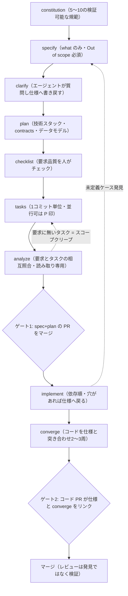
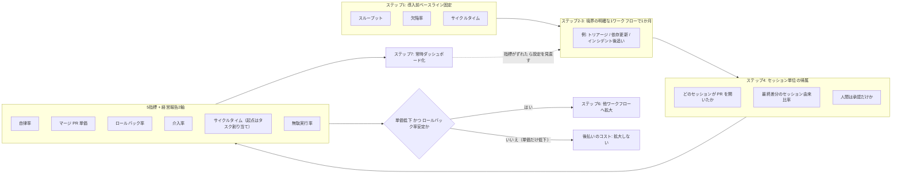
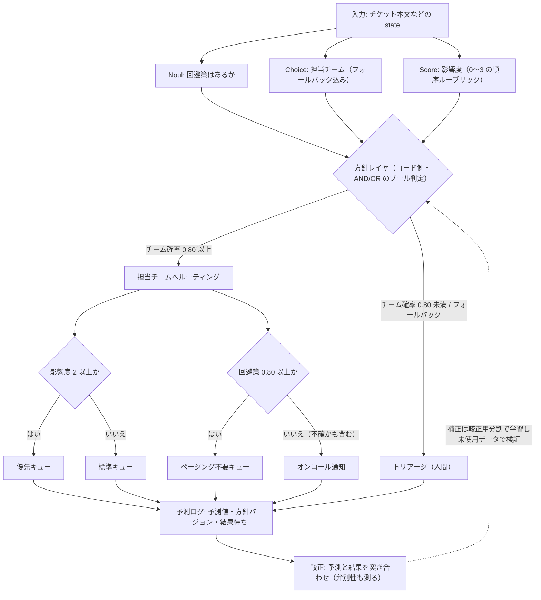

# Daily Briefing 2026-10-14

## 1. GitHub Spec Kit による仕様駆動開発: 実践ガイド（原題: Spec-Driven Development with GitHub Spec Kit: A Practical Guide）

- **URL**: https://vinitshahdeo.substack.com/p/spec-driven-development-github-spec-kit
- **公開日**: 2026-10-09
- **著者・媒体**: Vinit Shahdeo（Substack 個人ニュースレター）

### 本文翻訳

著者はウォレット/台帳、広告エクスチェンジ、流入制御といった「お金が動く」システムを扱うエンジニアリングチームを率いている。エージェント導入前、PR は3日で約300行だった。いまは1回の午後で約1,500行が出てくる。問題は量ではない。そのコードを生んだチャットセッションはもう消えており、レビュアーは差分から意図を逆算せねばならない。ボトルネックは「コードを書くこと」から「何を作るべきかを理解すること」へ移った。

従来の SDLC では仕様書はコードへ一度流れ込んだあと腐る。一方エージェントは、仕様の穴を黙って「ありそうな答え」で埋めてしまう。著者の例では「LLM ルータを作る」という3行のチケット（PLAT-212）に対し、(1)「処理できる」の判定基準、(2) タイムアウト時の挙動、(3) ストリーム途中の失敗（トークン重複）、(4) 予算枯渇時の扱い——4つの未回答の製品判断が残っていた。悪いのはコードではなく、3行の仕様である。

SDD では仕様が真実の源であり、コードは仕様から生成され、仕様に対して検証される。ルールは3つ。what と how を分離する。コードが存在する前に曖昧さを解消する。コードの方向が変わるなら同じ PR で仕様も変える。これはウォーターフォールでも「ドキュメントを増やすこと」でもない。仕様は小さく、機能単位で、エージェントがそこからビルドする入力そのものだ。

導入は `uv tool install specify-cli` のあと `specify init llm-router --integration claude`（integration のキーはエージェントごとに異なる）。リポジトリには `.specify/`（constitution とテンプレート）、エージェント用コマンド群、`specs/NNN-feature/` 配下に `spec.md` / `plan.md` / `data-model.md` / `contracts/` / `tasks.md` / `checklists/` が並ぶ。すべて素の Markdown である。

コマンドは constitution → specify → clarify → plan → checklist → tasks → analyze → implement → converge の9段。小さな機能は specify → plan → tasks → implement → converge の短経路、リスクの高い作業は全9段を通す。

constitution はリポジトリに一度だけ置く短く検証可能な規範だ。例として、生プロンプトをログに残さない、外部呼び出しにはタイムアウトとサーキットブレーカを付ける、コストは整数マイクロドルで追跡する、API 変更ではバージョンを上げる。5〜10個に絞り、チェック可能な書き方にし、変更はコードと同じようにレビューする。specify では技術用語を使わず、受け入れ基準に実数を入れ、必ず「Out of scope」節を書き、1仕様1機能とし、PM がレビューする。clarify はエージェントが質問し、その答えを仕様に書き戻す段で、著者はこれが最も価値が高いと言う。注目領域を指定でき、「まだ分からない」も有効な回答である。plan で初めて技術スタックが入り、リクエストフロー図・データモデル・constitution チェックを含む。契約（contracts）とデータモデルを最も厳しく見て、難所では代替案を出させる。checklist は要求そのものの品質確認で、人がチェックを付け、未チェック項目は実装をブロックする。tasks は1コミット単位の順序付きタスクで、並行可能なものに `[P]` が付き、受け入れ基準ごとに結合テストが対応する。著者の例では、あるタスクは clarify の回答があったからこそ存在している。analyze は読み取り専用の相互照合で、タスクのない要求はバグ、要求のないタスクはスコープクリープ。出力ではなく元ファイルを直す。implement は依存順に、可能ならフェーズ分けして進め、仕様が覆わないケースに当たったら止めて仕様を更新する。converge はコードを仕様・計画・タスクと突き合わせ、欠落をタスクとして追加する。2〜3周が普通で、その要約を PR に貼る。

既存コードベースへの導入は、`chore/adopt-speckit` のようなクリーンブランチで `specify init --here --force --integration claude` を実行し、diffstat を確認する。`--force` はファイルを追加するだけでアプリコードには触らない。constitution は既存の README・ADR・CI 設定から導き、仕様は「次の1機能」にだけ書く。変えてはいけないものを明示し、小さく低リスクな変更から始め、仕様を凍結された記録とするか生きた契約とするかを決めておく。

結果として、レビューは発見ではなく検証になり、コメントは「AC2 に合っていない」に変わった。発見作業がビルド前に移ったため手戻りが3周から1周になり、純速度が上がった。PM が仕様をレビューし、`[P]` により安全な並行作業ができ、仕様はオンボーディング資料と監査証跡になる。仕様はエージェント非依存なので、ツールを替えても手順は変わらない。チームのルールは3つ。PR ゲートを2つにする（先に spec+plan の PR をマージし、次にコード PR が仕様フォルダと converge 結果をリンクする）。仕様リンクのないソース変更は CI で落とす（ラベル付きの例外を除く）。お金・サービス横断・公開 API の作業は全経路を通す。

よくある失敗は、仕様に技術スタックを書く、最初の生成草案をそのまま受け入れる、clarify を飛ばす、仕様が大きすぎる（2ページ超なら分割）、仕様を触らずコードだけ直す、SDD を事後ドキュメントとして扱う。コストは、初日が遅くなること（仕様と計画に1〜2時間）、習慣の変更、ツールではなく規約での強制、生成仕様が膨らむこと、そして穴は依然として推測で埋められること。タイポ・設定・依存更新には使わず、バグ修正は Spec Kit 別系統のバグフロー（assess → fix → test）を使う。スパイクは仕様を省いてよいが、最終的な仕様に反映する。目安は「以前なら設計ドキュメントを書いた作業なら、いまは仕様を書く」。

### 重要ポイント

- エージェント時代の制約は生成量ではなく「意図の消失」。差分からは意図が復元できないため、仕様をレビュー対象の第一級成果物に昇格させる。
- clarify（エージェントが質問し、答えを仕様へ書き戻す）が最大の投資効率。3行チケットに潜む未決定事項を、コードが存在する前に顕在化させる。
- 運用上の要は「2段 PR ゲート」: spec+plan の PR を先にマージし、コード PR から仕様フォルダと converge 結果をリンクする。
- analyze の判定基準が明快: タスクのない要求はバグ、要求のないタスクはスコープクリープ。修正は出力ではなく元ファイルに入れる。
- 全段適用は「お金・サービス横断・公開 API」に限定し、他は短経路。タイポや依存更新に SDD を持ち込まない。

### 図解



### 現場での適用方法

**1) CLAUDE.md への追記例**（仕様先行を自分のリポジトリの規約にする）

````markdown
## 仕様駆動開発（SDD）の運用ルール

### 仕様が必要な変更
- お金が動く処理、サービス横断の変更、公開 API の変更: **全経路**（constitution → specify → clarify → plan → checklist → tasks → analyze → implement → converge）
- 単一サービス内の小さな機能: **短経路**（specify → plan → tasks → implement → converge）
- 仕様を書かない: タイポ、設定値、依存更新。バグ修正は assess → fix → test

### 仕様の書き方
- `specs/NNN-<feature>/spec.md` に **what と why のみ**。技術スタック・ライブラリ名・テーブル名は書かない（それは plan.md）
- 受け入れ基準には必ず実数を入れる（例: 「p95 で 800ms 未満」「リトライは最大3回」）
- **`## Out of scope` 節を必ず置く**
- 1仕様 = 1機能。2ページを超えたら分割する
- 仕様が不明なまま実装してはならない。曖昧さを見つけたら **実装を止めて質問し、答えを spec.md に書き戻す**

### コードを書くときの制約
- コードの方向が仕様と変わる場合、**同じ PR で spec.md も更新する**（事後ドキュメントは禁止）
- 受け入れ基準1つにつき結合テスト1つを対応させる
- 実装完了後に converge を回し、その要約を PR 本文に貼る
````

**2) スクリプト化の例**（仕様リンクのないソース変更を CI で落とす）

```bash
#!/usr/bin/env bash
# .github/scripts/require-spec-link.sh
# PR 本文に specs/NNN-*/ へのリンクが無いソース変更を落とす。
# ラベル "no-spec" が付いている PR は例外として通す。
set -euo pipefail

BASE_REF="${BASE_REF:-origin/main}"
SRC_GLOB="${SRC_GLOB:-src app lib}"       # 監視対象ディレクトリ
PR_BODY_FILE="${PR_BODY_FILE:-/tmp/pr_body.txt}"
PR_LABELS="${PR_LABELS:-}"                 # カンマ区切りで渡す

if [[ ",${PR_LABELS}," == *",no-spec,"* ]]; then
  echo "label 'no-spec' present: skip"; exit 0
fi

changed="$(git diff --name-only "${BASE_REF}"...HEAD -- ${SRC_GLOB} || true)"
if [[ -z "${changed}" ]]; then
  echo "no source changes: skip"; exit 0
fi

# PR 本文、またはこの PR に含まれるファイルパスのどちらかで仕様を参照していれば OK
if grep -Eq 'specs/[0-9]{3}-[a-z0-9-]+' "${PR_BODY_FILE}" \
  || git diff --name-only "${BASE_REF}"...HEAD | grep -Eq '^specs/[0-9]{3}-'; then
  echo "spec link found: ok"; exit 0
fi

cat >&2 <<MSG
ERROR: ソース変更に対応する仕様リンクがありません。
  - PR 本文に specs/NNN-<feature>/ へのリンクを追加する
  - または先に spec+plan の PR をマージする（2段ゲート）
  - 仕様不要な変更（タイポ/設定/依存更新）はラベル 'no-spec' を付ける
変更されたファイル:
${changed}
MSG
exit 1
```

```yaml
# .github/workflows/spec-gate.yml
name: spec-gate
on: pull_request
jobs:
  require-spec-link:
    runs-on: ubuntu-latest
    steps:
      - uses: actions/checkout@v4
        with: { fetch-depth: 0 }
      - name: write PR body
        run: printf '%s' "${{ github.event.pull_request.body }}" > /tmp/pr_body.txt
      - name: require spec link
        env:
          BASE_REF: origin/${{ github.event.pull_request.base.ref }}
          PR_LABELS: ${{ join(github.event.pull_request.labels.*.name, ',') }}
        run: |
          git fetch origin "${{ github.event.pull_request.base.ref }}"
          bash .github/scripts/require-spec-link.sh
```

**3) 既存リポジトリへの導入手順**

```bash
# 1. アプリコードに触らないブランチを切る
git checkout -b chore/adopt-speckit

# 2. Spec Kit を既存リポジトリに重ねる（--force はファイル追加のみ）
uv tool install specify-cli
specify init --here --force --integration claude   # codex / gemini 等は適宜

# 3. 何が追加されたかを必ず確認する
git diff --stat
git status --short

# 4. constitution は新規に発明せず、既存の README / ADR / CI 設定から抽出して書く
#    （例: .github/workflows/*.yml で既に強制している規約を 5〜10 行に落とす）
$EDITOR .specify/memory/constitution.md

# 5. 仕様は「次の1機能」だけ。既存機能を遡って仕様化しない
specify "<NEXT_FEATURE_DESCRIPTION>"
```

### 期待効果

- レビューの性質が「発見」から「検証」へ変わり、コメントが「AC2 に合っていない」という形に収束する（著者チームの観測）。
- 発見作業が実装前に移ることで**手戻りが3周から1周**に減り、初日のオーバーヘッド（仕様と計画に1〜2時間）を上回る純速度向上が得られたと報告されている。
- `tasks.md` の `[P]` 印により並行実行可能な作業が機械的に判別でき、複数エージェント/複数人での分割が安全になる。
- 仕様がエージェント非依存の Markdown なので、ツール（Claude Code / Codex / Gemini CLI 等）を替えてもプロセスを作り直す必要がない。副産物としてオンボーディング資料と監査証跡が残る。

### 注意点

- 強制力はツールではなく規約にある。本稿の CI ゲートのような仕組みを自分で入れないと、数週間で「コードだけ直して仕様は放置」に戻る。
- 生成された仕様は膨らみがちで、2ページを超えたら分割が必要。巨大な仕様はレビュー不能になり SDD の利点が消える。
- clarify を通しても穴は残り、残った穴はエージェントが黙って推測する。「仕様を書いたから安全」ではない。
- 初日は確実に遅くなる。タイポ・設定変更・依存更新に適用すると純粋なコストになる。
- Thoughtworks の Birgitta Böckeler による同種の試行（約2か月前）では、成果物のレビューに費やした時間で手で実装できたという逆の結果も報告されている。チームの規模とドメインのリスクを見て適用範囲を決める必要がある。

## 2. AI コーディングエージェントが機能していると本当に証明できる指標は何か（原題: What Metrics Actually Prove AI Coding Agents Are Working?）

- **URL**: https://www.warp.dev/articles/metrics-that-prove-ai-coding-agents-are-working
- **公開日**: 2026-08-31
- **著者・媒体**: Warp 公式ブログ（著者名の記載なし。自社製品 Warp Factories の宣伝を含むベンダーコンテンツ）

### 本文翻訳

単一の指標で AI コーディングエージェントが機能していることは示せない。本稿は5つの指標を同時に読み、席数や生の PR 数ではなく「エージェント導入前のベースライン」と比較せよと説く。

5つの指標は次の通り。**自律率（autonomy rate）** = 人手の書き直しなしにマージされたエージェント関与 PR ÷ エージェント関与 PR 総数。レビュアーが実質的なレビューをせず承認していると高く見えてしまう点に注意する。**マージ PR 単価（cost per merged PR）** = エージェントの総支出（トークン・計算） ÷ 期間内のマージ PR 数。PR サイズで正規化しない生のトークン支出は誤解を招く。**欠陥/ロールバック率** = 後に revert または hotfix されたエージェント作成 PR ÷ エージェント作成 PR 総数。観測窓が短いと、遅れて現れる回帰を見落とす。**介入率（intervention rate）** = 人間の引き取りが必要だったセッション ÷ 総セッション。完全な再実行だけを数えると、部分的な軌道修正を取りこぼす。**サイクルタイム** = タスク開始からマージまでの時間を、エージェント関与と人間のみで比較する。古いベースラインは比較そのものを歪める。

どの1行でもプラットフォームを評価してはならない。マージ PR 単価が低く、同時にロールバック率が高い組み合わせは勝利ではなく「後払いのコスト」である。

DORA 指標の扱いも整理されている。デプロイ頻度はおおむね使えるが、エージェントが小さな PR を量産すると膨らむため、変更失敗率と併せて読む。変更のリードタイムは、計測の起点を PR 作成ではなく**タスク割り当て時点**に置けばエージェントにも有効である。変更失敗率はそのまま使え、エージェント時代にはより重要で、ロールバック率に最も近い代理指標になる。サービス復旧時間は、インシデント対応が依然として人間主導であるため、エージェント指標としてはほぼ機能しない。

帰属（attribution）が次の論点だ。`git blame` では、ある変更がエージェント由来か開発者由来かを確実に判別できない。本稿はセッション単位の記録を推奨する。どのエージェントセッションがその PR を開いたか、最終差分のうちそのセッション由来の割合と後続の人間コミット由来の割合、そして人間がレビューで承認だけしたのか。この3点を取っておけば、数値は推定ではなく計測になる。

経営層への報告では、**無駄実行率（wasted-run rate）** = マージ PR に至らずに終わったエージェント実行の割合、を加える。マージ PR 単価と無駄実行率を並べ、導入前ベースラインと比較し、チーム別・ワークフロー別に分解して示す。総支出が増えていてもマージ PR 単価が横ばいか下がっているなら擁護できる。支出増と無駄実行率増が同時に起きているなら擁護できない。

落とし穴は2つ挙げられている。導入時に一度だけ測り、継続的なダッシュボードにしないこと。もう一つは、ベースラインをゼロとして扱い、チームの実際の導入前スループット・欠陥率・サイクルタイムを使わないことである。

実装手順は7段階。(1) スループット・欠陥率・サイクルタイムの導入前ベースラインを確定する。(2) トリアージ、依存更新、インシデント後追いなど境界の明確な1ワークフローを選ぶ。(3) そのワークフローで自律率・マージ単価・介入率を約1か月追跡する。(4) セッション単位の帰属を用意し、数値を計測に変える。(5) マージ PR 単価と無駄実行率をベースライン比で報告する。(6) 最初のワークフローがきれいに読めてから他へ広げる。(7) 指標を常時ダッシュボードとして維持し、既定のスコアラーで足りない部分にはカスタムスコアラーを足す。

数値としては、Warp 自身のエンジニアリングチームが factories 経由で PR の約 20〜30% を自動化していると述べている（同社ブログにおける自社の従来スループット比）。対象チームには最大 1 万ドル分の無償利用枠があるとも書かれている。記事は最後に、観測エージェントが各実行を採点し、指標がずれたときに設定変更の PR を出す自己改善ループにも触れている。

### 重要ポイント

- 指標は5つを束で読む。「マージ PR 単価が安い + ロールバック率が高い」は成功ではなく後払いのコストである。
- リードタイムの起点を PR 作成ではなく**タスク割り当て時点**に移すと、DORA のリードタイムがエージェント時代にも意味を持つ。時間短縮の効果はここに現れる。
- `git blame` は帰属に使えない。「どのセッションが PR を開いたか」「最終差分のうちセッション由来の割合」「人間は承認だけか」をセッション単位で記録する。
- 経営報告はマージ PR 単価と無駄実行率の2軸。支出増 + 単価横ばい/低下は擁護可能、支出増 + 無駄実行率増は擁護不可。
- ベースラインをゼロにしない。導入前の実スループット・欠陥率・サイクルタイムを先に固定し、境界の明確な1ワークフローで約1か月測ってから横展開する。

### 図解



### 現場での適用方法

**1) CLAUDE.md への追記例**（エージェント自身に帰属データを残させる）

````markdown
## PR を作るときの計測ルール

エージェントが PR を作成する場合、以下を必ず満たすこと。計測の前提が壊れるとこのリポジトリでは
エージェント導入の是非を判断できなくなる。

### 必須ラベル
- `agent-authored`: 差分の大半をエージェントが生成した PR
- `agent-assisted`: 人間主導でエージェントが部分的に関与した PR
- 人間のみの PR にはどちらも付けない（これがベースライン側の母数になる）

### PR 本文に必ず入れる計測ブロック
```
<!-- agent-metrics
session_id: <SESSION_ID>
task_started_at: <ISO8601>   # PR 作成時刻ではなく「タスク割り当て時刻」
human_takeover: yes|no        # 途中で人間が引き取ったか（部分的な軌道修正も yes）
-->
```

### 禁止事項
- 計測ブロックを省略した PR を作らない
- `task_started_at` に PR 作成時刻を入れない（リードタイムの起点はタスク割り当て時点）
````

**2) スクリプト化の例**（5指標 + 無駄実行率を GitHub から算出する）

```bash
#!/usr/bin/env bash
# scripts/agent-metrics.sh — 直近 N 日のエージェント指標を算出する
# 前提: gh CLI 認証済み、PR に agent-authored / agent-assisted ラベル運用あり
#       エージェント実行ログ（JSONL）に session_id と merged_pr を記録している
set -euo pipefail

REPO="${REPO:-<OWNER>/<REPO>}"
DAYS="${DAYS:-30}"
SPEND_USD="${SPEND_USD:-0}"                       # 期間内のエージェント総支出（トークン+計算）
RUN_LOG="${RUN_LOG:-<PATH_TO>/agent-runs.jsonl}"  # 1行1実行: {"session_id":...,"merged_pr":123|null}
SINCE="$(date -u -d "-${DAYS} days" +%Y-%m-%d)"

q() { gh pr list --repo "$REPO" --state merged --limit 1000 \
        --search "merged:>=${SINCE} $1" --json number --jq 'length'; }

AGENT_MERGED="$(q 'label:agent-authored')"
HUMAN_MERGED="$(q '-label:agent-authored -label:agent-assisted')"
# 人手の書き直しが入った PR は運用で 'human-rewrite' を付ける
REWRITTEN="$(q 'label:agent-authored label:human-rewrite')"
# revert / hotfix された PR は 'reverted' を付ける（観測窓は 14 日以上空けて再集計する）
REVERTED="$(q 'label:agent-authored label:reverted')"

TOTAL_RUNS="$(wc -l < "$RUN_LOG")"
WASTED_RUNS="$(grep -c '"merged_pr":null' "$RUN_LOG" || true)"
TAKEOVER="$(grep -c '"human_takeover":"yes"' "$RUN_LOG" || true)"

python3 - "$AGENT_MERGED" "$HUMAN_MERGED" "$REWRITTEN" "$REVERTED" \
          "$TOTAL_RUNS" "$WASTED_RUNS" "$TAKEOVER" "$SPEND_USD" <<'PY'
import sys
am, hm, rw, rv, runs, wasted, takeover, spend = (float(x) for x in sys.argv[1:9])
pct = lambda n, d: f"{100*n/d:.1f}%" if d else "n/a"
print(f"期間内マージ: エージェント {int(am)} / 人間のみ {int(hm)}（ベースライン母数）")
print(f"1. 自律率        : {pct(am-rw, am)}  （書き直しなしマージ / エージェント関与）")
print(f"2. マージPR単価  : {spend/am:.2f} USD/PR" if am else "2. マージPR単価  : n/a")
print(f"3. ロールバック率: {pct(rv, am)}  ※観測窓 14 日以上で再集計すること")
print(f"4. 介入率        : {pct(takeover, runs)}  （部分的な軌道修正も含める）")
print(f"5. 無駄実行率    : {pct(wasted, runs)}  （マージに至らず終了した実行）")
print("→ 単価低下とロールバック率上昇が同時なら「後払いのコスト」。拡大しない。")
PY
```

**3) 運用手順**（横展開の判断を機械的にする）

```bash
# 1. ベースラインを先に固定（エージェント導入前 90 日などの実測値をファイルに残す）
REPO=<OWNER>/<REPO> DAYS=90 bash scripts/agent-metrics.sh > metrics/baseline.txt

# 2. 境界の明確な 1 ワークフローだけでエージェントを運用する（例: 依存更新のみ）
#    この間、他ワークフローには広げない

# 3. 週次で同じスクリプトを回し、常時ダッシュボード化する（cron / CI スケジュール）
#    0 9 * * 1 cd <REPO_PATH> && SPEND_USD=$(cat metrics/spend-week.txt) \
#      bash scripts/agent-metrics.sh >> metrics/weekly.log

# 4. 1 か月後、baseline.txt と weekly.log を比較して拡大を判断する
#    拡大可: マージPR単価が横ばい or 低下 かつ ロールバック率がベースラインの欠陥率以下
#    拡大不可: 支出増 かつ 無駄実行率増
```

### 期待効果

- 「エージェントが今四半期 200 PR 出した」という無意味な報告を、ベースライン比のマージ PR 単価・無駄実行率という擁護可能な2軸に置き換えられる。
- リードタイムの起点をタスク割り当て時点に移すことで、「リリースまでの時間が本当に縮んだか」を PR 作成以降の見かけの速さと切り離して評価できる。
- セッション単位の帰属を入れると、`git blame` ベースの推測が計測に変わり、チーム別・ワークフロー別の分解が可能になる。
- 記事では Warp 自社チームが PR の約 20〜30% を自動化しているとしている（自社の従来スループット比、自己申告値）。

### 注意点

- 自社製品（Warp Factories）の宣伝を含むベンダーコンテンツであり、20〜30% や無償枠などの数値は自己申告。手法の骨格だけを借りるのが安全。
- 自律率は「レビュアーが実質レビューせず承認している」状態でも高く出る。自律率を単独の KPI にすると品質劣化を見逃す。
- ロールバック率は観測窓を短く取ると必ず低く見える。14 日以上空けた再集計を運用に組み込む必要がある。
- 介入率は「完全な再実行」だけを数えないこと。部分的な軌道修正を `human_takeover: yes` に含める定義をチームで先に合意しておく。
- ラベルと計測ブロックの運用が崩れると全指標が無効になる。CI でラベル欠落を検出するなどの強制が実質的に必須。

## 3. Jev を自分の役に立たせる — 検査可能な意思決定へ組み上げる（原題: Make Jev Work for You）

- **URL**: https://conikeec.substack.com/p/make-jev-work-for-you
- **公開日**: 2026-09-22
- **著者・媒体**: Chetan Conikee（Substack 個人ニュースレター。副題「Compose Jev into decisions you can inspect」）

### 本文翻訳

Jev のプリミティブは、意思決定に接続したときに初めて有用になる。本稿は6つの構成パターンを組み上げ、最後に較正（calibration）を扱う。なお記事中の出力・しきい値・重みはすべて説明用の例で、測定結果でも推奨設定でもないと明記されている。

**プリミティブを答えの形に合わせる。** Noul は1つの yes/no 命題を評価して確率を返す。0.85 は「命題が成り立つという信念」であって「深刻度 85%」ではない。Choice は与えた選択肢から1つを選び、選択・分布・確信度を返す。最大 255 選択肢をサポートし、フォールバックを必ず含めるべきである。Score は入力を 2〜10 段の順序付きルーブリック上に置く。スコアは 0 始まりのレベル添字の確率加重平均なので、4段なら 0〜3 の範囲になる。

**Noul のしきい値は「行動のコスト」を表現する。** 例として、0.20 以下は破棄、0.80 以上は採用、中間はレビューへ回す方針。採用しきい値を下げれば取りこぼしは減るが雑音も残り、上げれば量は減るが有用なものも捨てうる。しきい値はアプリケーション側の方針であり、0.50 という値でさえ意思決定コストの仮定を含んでいる。

**Choice と Score には別のルールが要る。** Choice の例: 最上位確率が 0.70 以上かつ2位との差が 0.25 以上のときだけ「Billing」を受理する（0.70 − 0.20 = 0.50 の例）。フォールバックと条件未達はレビューへ。Score の例: 等級2以上を優先キューへ。分布 [0.10, 0.20, 0.50, 0.20] は平均 1.80 なので標準キューに入る。平均が同じでも分布は異なりうるため、分布全体を保持すること。確信度は「集中度」であって測定された正しさではない。受理ルールは自分のデータで評価する必要がある。

**並列判断は方針（policy）で合流させる。** 「CSV エクスポートは失敗するが PDF は成功する」というチケットに対し、回避策の有無を Noul、担当チームを Choice、影響度を Score で独立に判定する。コード側で組み合わせる: チーム確率 0.80 以上ならルーティングを許可、影響度2以上なら優先度を上げ、回避策 0.80 以上ならページング不要のキューへ。受理されないチームはトリアージへ。回避策が不確かなものを「回避策がある証拠」として数えてはならない。各回答は互いに参照し合っておらず、これは統計的独立性を意味しない。

**カスケードは次の質問を変える。** 暖房の依頼は Choice（Heating / Plumbing / Other）を通り、受理されればコードが対応するルーブリックと天候データを読み込み、後段の Score を回す。文脈はコードが供給すべきで、モデルに発明させてはならない。レビュー分岐を含めてカスケード全体を評価する。前段の分類ミスは、後段の正しい判断までも歪める。依存する後続リクエストには前段の回答を明示的に含める。

**フィルタリングは後段が見るものを変える。** (1) Noul がタイトルとスニペットで検索結果をゲートする（緩めの例: 0.30 以上を残す）。(2) Score が生存者を関連度レベルで順位付けし、コードが件数またはトークン予算を適用する。(3) コードがページを取得し、2,000 文字・重なり 20% でチャンク化して候補にする。(4) Noul が各チャンクを選別する。(5) コードが重複部分を除去し、URL とオフセットを保持し、欠落箇所を印す。評価指標は「保持できた有用な根拠」と、フィルタ呼び出し・スクレイピング・整形のオーバーヘッドを含む総コスト。段は任意であり、判断1つで足りることもある。

**フラグで適格性を判定し、その後に Score が優先度を決める。** バックログ適格性の例: 明確性 0.80 以上かつ未解決依存の確率 0.20 以下。優先度の式の例（0〜4 スケール）は `priority = 0.7 × impact/4 + 0.3 × (1 − effort/4)`。影響度3・工数1なら 0.75。これは方針の指数であって成功確率ではなく、重みは仮定である。しきい値に対する AND/OR はブール方針の実装だが、確率を掛け合わせると同時確率のモデルを仮定することになる。

**階層は語彙を狭めてから検証する。** Finance / Legal / Other → （Finance なら）Invoice / Receipt / Other。両方の Choice 段で最上位確率 0.80 以上を要求する。選ばれた定義を文書と一緒に Noul の検証にかけ、0.80 以上なら保存を許可し、それ以外とフォールバックはレビューへ。貪欲な初手の選択は正解の経路を失いうるため、複数経路を保持するビームサーチも代替になる。

**有界ループは新しい根拠を使う。** Noul が「停止すべきか」を問う（例: 0.85）。停止しないなら Choice が Search / Fetch / Ask user / Stop を選び、Score が候補情報源を根拠価値で順位付けする。コードが行動を実行し、新しい根拠を記録し、予算（例: 3 回）を強制する。未解決はエスカレーションする。変化していない根拠を繰り返し判定しても情報は増えない。

**較正は予測と結果を比較することである。** 例: 0.80 の予測 100 件に対し陽性が 60 件なら、その群は自信過剰である。較正だけでは不十分で、全件に基準率を予測すれば較正は取れるが無用である。弁別性（discrimination）も測ること。Brier スコアは較正と弁別性が混ざるため、どちらかの純粋な指標ではない。結果はプリミティブに合わせて対応付ける。Score ではレベル分布か、定義されたイベント（例「レベル2以上」）を評価する。平均レベルは確率ではない。ラベルの意味も重要で、「モデルは拒否するか」と「この指示は危険か」は別の問いである。

**結果を漏らさずに予測を補正する。** オンラインでは、予測を記録し、現在の補正を適用し、行動し、結果を待ってから更新する。オフラインでは較正用の分割データで補正を学習し、触っていないデータで検証する。補正は良い決定ルールを保証しない。方針を適用した後のコスト・カバレッジ・誤り率を確認すること。結果の欠損はフィードバックを偏らせる（例: 残したページだけにラベルが付く）。可能なら棄却した項目もサンプリングする。

**文言と方針を適合させ、保存した構成をテストする。** 文言が対象を定義する。「同じ質問」「同じ情報ニーズ」「この Q&A サイト上の重複」といった変種を比較する。著者は Quora ベースの結果として、ある1つの文言が 24 変種の平均を上回った例と、文言の不一致が誤りと関連していた例を引く。これは普遍則ではなくテストの動機である。選択は開発データで行い、触っていないテストセットを残し、構成と根拠を成果物として保存する。結びの助言は「検査可能な意思決定を1つ作ることから始め、それを改善するために必要な結果を集めよ」。

### 重要ポイント

- 0.85 は「深刻度 85%」ではなく「命題への信念」。プリミティブ（Noul / Choice / Score）の返り値の意味を取り違えると方針全体が壊れる。
- しきい値はモデルの既定値ではなくアプリケーションの方針であり、「間違えたときのコスト」を表現する。Noul のしきい値を Choice の確信度に流用してはならない。
- Choice の受理条件は最上位確率だけでは不十分で、「2位との差」を併せて要求する。Score は平均値だけでなく分布全体を保持する（同じ平均でも分布は異なる）。
- 並列判断は互いを参照していないので、統計的独立性を仮定して確率を掛け合わせてはならない。しきい値に対する AND/OR というブール方針として組む。
- 較正だけでは不十分（基準率を返せば較正は取れる）。弁別性も測り、オフラインでは較正用分割で補正を学習し未使用データで検証する。棄却した項目のサンプリングで結果欠損の偏りを緩和する。

### 図解



### 現場での適用方法

**1) スクリプト化の例**（並列判断 → 方針レイヤ → 予測ログ。しきい値を1か所に集約する）

```python
#!/usr/bin/env python3
"""ticket_policy.py — 型付き判断を「検査可能な方針」に組み上げる最小実装。

前提: pip install typesafe-sdk / 環境変数 TYPESAFE_API_KEY
しきい値と重みはすべて POLICY に集約し、バージョンを付けてログに残す。
"""
import json, os, time, uuid
from dataclasses import dataclass, asdict
from typesafe import TypeSafe  # SDK 名は利用中のバージョンに合わせる

client = TypeSafe(api_key=os.environ["TYPESAFE_API_KEY"])
MODEL = "jev-1.13.0"  # しきい値を調整するならバージョンを固定する

# ── 方針はコード側の資産。モデル出力ではなく「間違えたコスト」から決める ──
POLICY = {
    "version": "2026-10-14.1",
    "team_min_prob": 0.80,      # Choice: 最上位確率の下限
    "team_min_margin": 0.25,    # Choice: 2 位との差の下限
    "impact_min_level": 2,      # Score: 優先キューへ上げる等級
    "workaround_min": 0.80,     # Noul: ページング不要と見なす下限
    "review_floor": 0.20,       # これ未満は破棄、下限〜上限の間は人間レビュー
}

@dataclass
class Decision:
    request_id: str
    model: str
    policy_version: str
    team: str | None
    team_prob: float
    team_margin: float
    impact_mean: float
    impact_dist: list[float]
    workaround_p: float
    route: str
    queue: str
    paging: bool

def judge(state: str) -> Decision:
    # 速度上の理由から、必要な質問は 1 回で投げる（並列質問はレイテンシをほぼ増やさない）
    res = client.systemone(
        model=MODEL,
        state=state,
        questions=[
            {"id": "team", "type": "choice",
             "question": "このチケットを担当すべきチームはどれか",
             "options": ["Billing", "Platform", "Mobile", "Other"]},  # フォールバック必須
            {"id": "impact", "type": "score",
             "question": "利用者への影響度",
             "levels": ["影響なし", "軽微", "業務に支障", "業務停止"]},  # 0〜3
            {"id": "workaround", "type": "noul",
             "question": "利用者が自力で回避できる手段が存在する"},
        ],
    )
    team = res["team"]
    probs = sorted(team["probabilities"].values(), reverse=True)
    top, second = probs[0], (probs[1] if len(probs) > 1 else 0.0)
    margin = top - second
    impact = res["impact"]
    wa = res["workaround"]["noul"]

    # ── 方針レイヤ: 確率の掛け算ではなく、しきい値に対するブール判定で組む ──
    accepted = (
        team["choice"] != "Other"
        and top >= POLICY["team_min_prob"]
        and margin >= POLICY["team_min_margin"]
    )
    route = team["choice"] if accepted else "triage"
    queue = "priority" if impact["score"] >= POLICY["impact_min_level"] else "standard"
    # 「回避策が不確か」を「回避策がある証拠」として数えない
    paging = not (wa >= POLICY["workaround_min"])

    return Decision(
        request_id=str(uuid.uuid4()), model=res.get("model", MODEL),
        policy_version=POLICY["version"],
        team=team["choice"] if accepted else None,
        team_prob=top, team_margin=margin,
        impact_mean=impact["score"], impact_dist=list(impact["probabilities"].values()),
        workaround_p=wa, route=route, queue=queue, paging=paging,
    )

def log(d: Decision, path: str = "decisions.jsonl") -> None:
    # 結果（outcome）は後から別プロセスで追記する。較正はこのログがないと始まらない
    with open(path, "a") as f:
        f.write(json.dumps({"ts": time.time(), **asdict(d), "outcome": None}) + "\n")

if __name__ == "__main__":
    d = judge("CSV エクスポートが失敗する。PDF エクスポートは成功する。")
    log(d)
    print(json.dumps(asdict(d), ensure_ascii=False, indent=2))
```

**2) スクリプト化の例**（較正チェック。弁別性も併せて見る）

```python
#!/usr/bin/env python3
"""calibration_report.py — decisions.jsonl の予測と結果を突き合わせる。
結果が埋まっていない行は除外する。棄却した項目もサンプリングして結果を入れること
（残したものだけにラベルが付くとフィードバックが偏る）。"""
import json, sys
from collections import defaultdict

rows = [json.loads(l) for l in open(sys.argv[1] if len(sys.argv) > 1 else "decisions.jsonl")]
rows = [r for r in rows if r.get("outcome") is not None]  # outcome: 1 / 0

# 1) 較正: 予測確率を 0.1 刻みのビンに入れ、予測平均と実測率を比べる
bins = defaultdict(list)
for r in rows:
    bins[round(r["workaround_p"], 1)].append(r["outcome"])
print("pred  n    実測率   ずれ")
for p in sorted(bins):
    ys = bins[p]
    rate = sum(ys) / len(ys)
    print(f"{p:.1f}  {len(ys):<4} {rate:.2f}    {rate - p:+.2f}")

# 2) 弁別性: 較正が取れていても基準率を返すだけなら無用。AUC で分離能力を見る
pos = [r["workaround_p"] for r in rows if r["outcome"] == 1]
neg = [r["workaround_p"] for r in rows if r["outcome"] == 0]
if pos and neg:
    wins = sum((a > b) + 0.5 * (a == b) for a in pos for b in neg)
    print(f"\nAUC = {wins / (len(pos) * len(neg)):.3f}  （0.5 = 無情報）")

# 3) Brier は較正と弁別性が混ざる。単独指標にしない
brier = sum((r["workaround_p"] - r["outcome"]) ** 2 for r in rows) / len(rows)
print(f"Brier = {brier:.3f}  （較正と弁別性の混合。分解して読む）")
```

**3) スキル化の例**（型付き判断の設計レビューを Claude Code のスキルにする）

````markdown
---
name: typed-decision-review
description: Jev 等の型付き判断モデル（choice/score/noul）を使うコードのレビュー用スキル。しきい値の流用、確率の掛け算、分布の破棄、較正ログの欠落といった定型の誤りを検出する。型付き判断を新規に組むとき、または既存の方針レイヤを変更するときに使う。
---

# 型付き判断の設計レビュー

## 使う場面
`choice` / `score` / `noul` の出力を分岐条件に使うコードを書く、または変更するとき。

## チェック項目

1. **返り値の意味**: `noul` の値を「深刻度」や「割合」として扱っていないか。`score` の平均を確率として扱っていないか（0 始まりレベル添字の加重平均であり、4 段なら 0〜3）。
2. **しきい値の出所**: しきい値がコード中に散在していないか。`POLICY` 等の1か所に集約され、バージョン文字列が付いているか。
3. **しきい値の流用禁止**: `noul` の 0.70 を `choice` の確信度 0.70 に流用していないか。プリミティブ間・ドメイン間でしきい値を使い回していないか。
4. **Choice の受理条件**: 最上位確率だけで受理していないか。2 位との差（margin）も要求しているか。`Other` 等のフォールバックが選択肢に含まれているか。
5. **分布の保持**: `score` の平均だけを保存して分布を捨てていないか（同じ平均でも分布は異なる）。
6. **合成の方法**: 複数の判断の確率を掛け合わせていないか（同時確率のモデルを暗黙に仮定することになる）。しきい値に対する AND/OR として組んでいるか。
7. **不確かさの扱い**: 「不確か」を「否定の証拠」として数えていないか（例: 回避策の確率が中間なのにページング不要と判定していない）。
8. **文脈の供給**: カスケード後段に必要なデータをコードが渡しているか。モデルに発明させていないか。前段の回答を後段の入力に明示的に含めているか。
9. **較正ログ**: 予測値・モデルバージョン・方針バージョン・結果欄を持つログを書いているか。棄却側の項目もサンプリングして結果を回収しているか。
10. **モデル固定**: しきい値を調整しているのにモデルバージョンが `*-latest` になっていないか。応答の `model` フィールドを記録しているか。

## 出力形式
上の各項目について「問題なし / 要修正（該当箇所と修正案）」を列挙し、最後に「このままでは較正できない点」を明示する。
````

### 期待効果

- しきい値と重みを `POLICY` に集約しバージョンを付けることで、方針変更の影響範囲が差分として見えるようになり、「検査可能な意思決定」になる。
- 並列判断を1回のリクエストにまとめる構成は、質問を増やしてもレイテンシがほとんど増えないという Jev の特性を活かせる（記事は構成パターンとして提示。数値は示していない）。
- 較正ログ（予測・方針バージョン・結果）を最初から残すと、後から補正を学習できる。記事の例では 0.80 の予測 100 件に対し陽性 60 件という形で自信過剰が検出できる。
- Noul によるフィルタ → Score による順位付け → コードによる予算適用の段構成により、後段（LLM 生成や人間レビュー）が見る入力の質と総コストを同時に管理できる。

### 注意点

- 記事中のしきい値・重み・分布はすべて説明用の例であり、測定結果でも推奨値でもない。自分のラベル付きデータで決め直す必要がある。
- 確信度は「分布の集中度」であって測定された正しさではない。確信度が高いことを正解の根拠にできない。
- 並列判断は互いを参照していないが、それは統計的独立性を意味しない。確率の掛け算は暗黙に同時確率モデルを仮定する。
- 較正だけを目標にすると、全件に基準率を返す無用なモデルでも満点が取れる。弁別性（AUC 等）を併せて測る。Brier スコアは両者の混合なので単独指標にしない。
- 結果の欠損はフィードバックを偏らせる（採用した項目にだけラベルが付く）。棄却側のサンプリングを運用に入れないと、補正が自己強化的に歪む。
- しきい値を調整するならモデルバージョンを固定し（例 `jev-1.13.0`）、応答の `model` フィールドをログに残す。較正はモデルバージョンに紐づく。
- カスケードの前段で分類を誤ると、後段の判断が正しくても結果は歪む。レビュー分岐を含めてカスケード全体を評価する。
