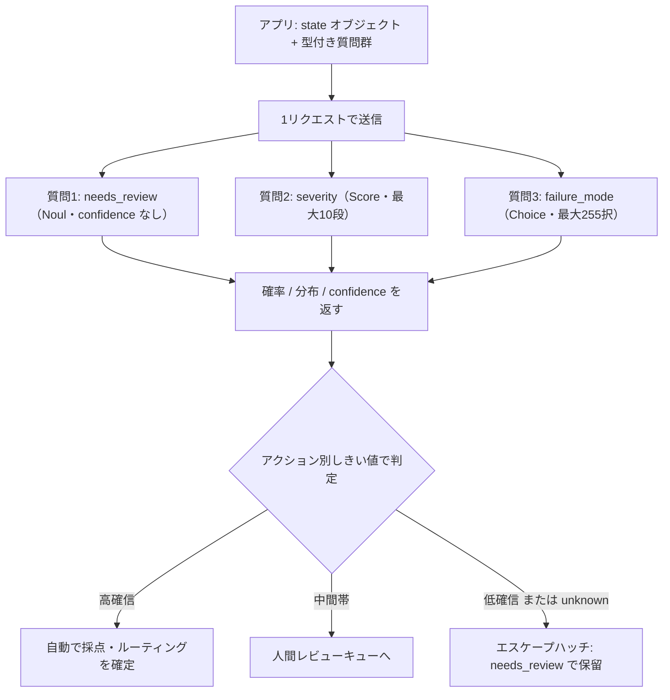
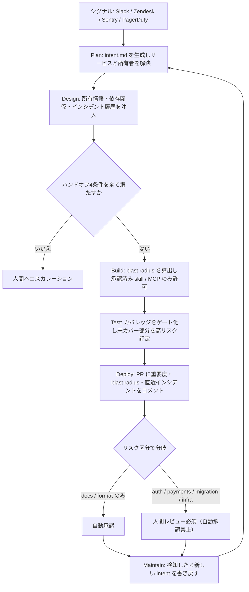
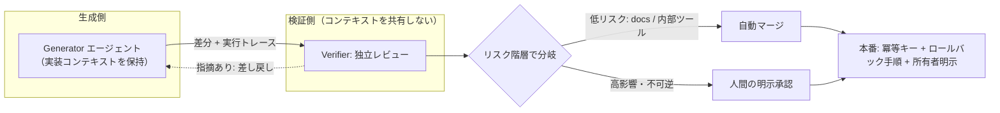

# Daily Briefing 2026-10-15

## 1. TypeSafe の Jev を評価（evals）に使う（原題: Using TypeSafe's Jev for evals）

- **URL**: https://langfuse.com/blog/2026-09-18-using-typesafes-jev-for-evals
- **公開日**: 2026-09-18
- **著者・媒体**: Annabell, Hassieb / Langfuse Blog

### 本文翻訳

TypeSafe がリリースした Jev は、テキスト生成ではなく「意思決定」に特化したモデルである。TypeSafe はフロンティアモデル比で 20〜200 倍高速、40〜400 倍安価だと主張している。返すのは推論文ではなく、確率付きの型付き回答だ。向いている用途はエージェントやツールのルーティング、ドキュメント・チケット分類、エスカレーション判定、そしてルーブリックの判定だけで足りる eval の採点である。

質問型は3種類ある。**Choice** は最大255個の選択肢から1つを選び、選択肢ごとの確率と confidence を返す。**Score** は最大10段の順序付きルーブリックで採点し、加重スコア・分布・confidence を返す。**Noul** は yes/no で、真である確率を返すが **confidence フィールドを持たない**。すべての回答で `confidence` を読むコードは二値質問で壊れる。

センチメント分類のデモでは、Jev は最大4つの分類を1パスで回答する。一方 GPT-5.6 Luna（high reasoning）は分類ごとに並列呼び出しが必要になる。記事はレイテンシと推定コストを比較し、Langfuse 上の公開トレースへリンクしている。

リクエスト形状が要点だ。1リクエストに state オブジェクトと複数の質問（例: `needs_review`、`severity`、`failure_mode`）を同梱できる。各質問は並列かつ独立に評価されるため、質問を増やしてもレイテンシはほとんど増えず、ある質問が他の回答を劣化させることもない。

eval 用途での強みは、原子的な質問と明示的な基準を書かざるを得なくなる点にある。基準が曖昧だと confidence が低く出るので、それ自体が評価器設計へのフィードバックになる。「ユーザーが不満を示したか」の例では、JSON で true/false を返す通常の LLM-as-a-judge プロンプトに対し、Jev では `inspect`・`scope`・true/false の判定基準（"includes" リスト付き）を持つ Noul 質問を使う。返り値が確率なので、高確信は自動採用、中間帯は人間レビュー、残りは破棄かフラグという3バンド運用ができる。

ベンチマークでは、Good Start Labs が 6,003 件のルーブリック判定を採点した。Jev は Claude Fable 5.1 の判定と 91.5% 一致し、100万判定あたり約 160 ドル。対して Fable 5.1 は約 33,000 ドル、GPT-5.6 Luna は約 400 ドル、Gemini 3.8 Flash は約 1,600 ドル。DeepSeek V4.1 Flash は 93.5% 一致で 260 ドルだった（第三者報告値）。

制約は3つ。**棄権できない**ため、強制二値では「最も間違いの少ない答え」を選んでしまう。`unknown` や `needs_review` といったエスケープハッチを設計する必要がある。**根拠を返さない**ため、低スコアのデバッグは自分が書いた基準の読み直しになり、監査対象や顧客向け用途では生成モデルを上に重ねることになる。**context rot** もあり、無関係な情報が state を埋めると精度が落ちる。コンテキスト上限は TypeSafe のモデルページが 64k、OpenRouter が 32K と矛盾しているため、設計前に確認すべきだ。

しきい値はアプリ側の判断である。記事の例では `needs_review` が 0.88 でキュー投入、`severity` は 1.89 で「誤った結果を返した」の一段にわずかに届かず、`failure_mode` は `missing_context` が 0.58 で首位だが `wrong_approach` が 0.24 あるため confidence が 0.51 にとどまり判定保留となる。

本番導入としては、TypeSafe 接続経由で Langfuse の judge として利用でき、評価器 UI で state と型付き質問を定義すると、各質問が対応する observation へスコアを書き込む。アクセスは waitlist 制で、OpenRouter と Vercel AI Gateway からも利用できる。

### 重要ポイント

- 1リクエストに state + 複数の型付き質問を同梱でき、各質問は並列・独立評価。質問追加のレイテンシコストがほぼ無い
- Noul（二値）は confidence を持たない。回答形に依存したパース処理は型ごとに分岐が必要
- 棄権機構が無いため、`unknown` / `needs_review` を選択肢として自前で用意するのが前提設計
- 6,003 件の第三者採点で Fable 5.1 と 91.5% 一致、コストは約 160 ドル/100万判定（Fable 5.1 は約 33,000 ドル）
- 基準が曖昧だと confidence が下がる＝評価器設計の欠陥が数値で可視化される

### 図解



### 現場での適用方法

**スクリプト化の例**: 3バンド運用とエスケープハッチを最初から組み込んだ判定ラッパ。`confidence` の有無を質問型で分岐させる点が実装上の要点である。

```python
# jev_judge.py  —  eval 判定を3バンドに振り分ける最小ラッパ
import os
import httpx

JEV_ENDPOINT = os.environ["JEV_ENDPOINT"]       # 例: <https://api.typesafe.ai/v1/systemone>
JEV_API_KEY = os.environ["JEV_API_KEY"]
JEV_MODEL = os.environ.get("JEV_MODEL", "<jev-model-version-pinned>")  # latest エイリアスは使わない

# アクションごとにしきい値を分ける（単一のグローバル値にしない）
THRESHOLDS = {
    "needs_review": {"auto": 0.85, "human": 0.60},
    "failure_mode": {"auto": 0.80, "human": 0.50},
}


def ask(state: dict, questions: list[dict]) -> dict:
    """state と型付き質問群を 1 リクエストで送る。質問は並列・独立評価される。"""
    res = httpx.post(
        JEV_ENDPOINT,
        headers={"Authorization": f"Bearer {JEV_API_KEY}"},
        json={"model": JEV_MODEL, "state": state, "questions": questions},
        timeout=30,
    )
    res.raise_for_status()
    return res.json()


def band(answer: dict, name: str) -> str:
    """auto / human / hold の3バンドに振り分ける。"""
    th = THRESHOLDS[name]
    # Noul（二値）は confidence を持たないので、真の確率で代替する
    score = answer.get("confidence")
    if score is None:
        p = answer.get("probability", 0.0)
        score = max(p, 1.0 - p)
    if answer.get("value") in ("unknown", "needs_review"):
        return "hold"          # エスケープハッチを明示的に優先
    if score >= th["auto"]:
        return "auto"
    if score >= th["human"]:
        return "human"
    return "hold"


if __name__ == "__main__":
    out = ask(
        state={"transcript": "<CONVERSATION_TEXT>", "tool_calls": "<TOOL_TRACE>"},
        questions=[
            {
                "name": "needs_review",
                "type": "noul",
                "inspect": "assistant の最終応答",
                "scope": "ユーザーが不満・やり直しを示したか",
                "true_criteria": {"includes": ["違う", "そうじゃない", "もう一度"]},
                "false_criteria": {"includes": ["ありがとう", "解決した"]},
            },
            {
                "name": "failure_mode",
                "type": "choice",
                # 棄権機構が無いので unknown を必ず選択肢に入れる
                "options": ["missing_context", "wrong_approach", "tool_error", "unknown"],
            },
        ],
    )
    for name, answer in out["answers"].items():
        print(name, answer.get("value"), "->", band(answer, name) if name in THRESHOLDS else "n/a")
```

**CLAUDE.md への追記例**: Jev を評価器として使う際のリポジトリルール。

````markdown
## Jev を judge として使うときのルール

- モデルバージョンは必ずピン留めする。`latest` エイリアスはしきい値の意味を変える
- 質問は原子的に分割する。1 質問に複数の判断を詰めない（confidence が下がるのは基準が曖昧なサイン）
- Choice / Score の選択肢には必ず `unknown` または `needs_review` を含める。Jev は棄権できない
- Noul（二値）の回答に `confidence` は存在しない。パース処理は質問型ごとに分岐させる
- しきい値はアクション単位で定義する（`THRESHOLDS` 辞書）。グローバルな単一カットオフは禁止
- state には判定に必要な最小限だけ入れる。無関係な情報は精度を落とす（context rot）
- 監査対象・顧客向けの判定結果をそのまま出さない。根拠文が必要な場面は生成モデルを上に重ねる
- 全呼び出しでモデル名と回答全体をログに残す。モデル変更とデータドリフトを切り分けるため
````

### 期待効果

高頻度・反復的な判定（ルーティング、分類、eval 採点）のコストを桁で下げられる。記事が引く第三者ベンチマークでは、100万判定あたり約 160 ドルで Claude Fable 5.1 の判定と 91.5% 一致した（Fable 5.1 は約 33,000 ドルで、約 200 分の 1）。質問を1リクエストに束ねられるため、分類ごとに並列呼び出しが必要なテキスト生成モデル構成よりレイテンシ面でも有利になる。基準が曖昧なときに confidence が下がる性質は、評価器の設計不良を数値で検出する副作用的な利点がある。

### 注意点

速度・コストの主張はベンダー発、一致率は初期の第三者ベンチマークであり、自分のデータで検証すべき数値である。棄権できない仕様は最大の落とし穴で、`unknown` を選択肢に入れ忘れると「最も間違いの少ない答え」が自信ありげに返る。根拠文が返らないため、監査証跡や顧客向け説明が要る用途では単体で使えない。コンテキスト上限は公式ページ（64k）と OpenRouter（32K）で記載が食い違っており、設計前の確認が必要。アクセスは waitlist 制である点も導入計画に影響する。

## 2. Anthropic の AI-Native SDLC プレイブックを実装する: そこへ到達するために何が必要か（原題: Implementing the Anthropic AI-Native SDLC Playbook: What do you need to get there?）

- **URL**: https://www.port.io/blog/anthropic-ai-native-sdlc-playbook
- **公開日**: 2026-08-28
- **著者・媒体**: Yonatan Boguslavski（Port CTO）/ Port Blog

### 本文翻訳

Anthropic の AI-Native SDLC プレイブックはプロセスを定義しているが、記事の主張は「それをスケールさせるにはプラットフォームが要る」である。変革の所有者はプラットフォームエンジニアリングであり、任意のエージェントの周囲にコンテキスト・ガバナンス・オーケストレーションを足す「プラットフォームハーネス」を据えるべきだとする。以下、各ステージで何を実装するかが具体的に示される。

**Plan**: Slack・Zendesk・Sentry・PagerDuty からのシグナルを `intent.md` という意図のファイルに変換する。エージェントを起動する前に、影響を受けるサービスとその所有者を解決しておく。

**Design**: サービスの所有情報、依存関係、インシデント履歴をコンテキストに引き込む。そして明文化されたハンドオフ規則を適用する——対象サービスが最上位ティアでないこと、blast radius（影響範囲）が高くないこと、未解決のインシデントが無いこと、優先度が critical でないこと。いずれかを満たさなければ人間へエスカレーションする。レビュアーは所有情報から選び、承認はチームが既に使っているツール上で行う。

**Build**: サービス依存関係から blast radius を算出し、自律作業を許す3番目の条件として使う。承認済みの skill と MCP サーバのレジストリを維持し、ポリシーを所有する skill への変更は該当する所有者（記事の例では CISO）へルーティングして承認まで保留する。

**Test**: テストカバレッジをゲートとして扱う。未カバーのコードはリスクが高いと評定される。クローズした各インシデントは、追跡される回帰テスト項目を1件生成し、書かれるまで可視のまま残る。

**Deploy**: PR にサービスの重要度、blast radius、直近のインシデントをコメントする。レビュアーは CODEOWNERS と直近のコミット履歴から選び、レビュー負荷を均す。ドキュメントとフォーマットのみの変更は自動承認する。auth、payments、マイグレーション、インフラは高リスクと評定する。重要サービスへの変更は決して自動承認しない。

**Maintain**: 問題を検知したらエージェントが新しい intent を書き、パイプラインへ差し戻す。書き戻しの記録を通じて、採用状況とボトルネックを追跡する。

数値面の指針も示される。過去の実作業から構築した 20〜50 ケース程度のテストスイートを持ち、コンテキストファイル・skill・hook のいずれかが変わったら再実行する。skill が機能していれば、ポリシー関連のレビューコメントはほぼゼロまで落ちるはずだ。各リポジトリには短いコンテキストファイルを置き、存在すること・サイズ上限・最近更新されていることをチェックする。作業はエージェントと人間の比率、ステージ分布、どこで滞留しているかで追跡する。

仕組みとして名前が挙がるのは、禁止操作をブロックする hook、エージェントの振る舞いを導く skill、evals、エージェント起動時に読まれるコンテキストファイル、CODEOWNERS データ、既存スキャナから取るカバレッジしきい値、承認済み skill / MCP サーバのレジストリである。

### 重要ポイント

- ハンドオフ規則を4条件（ティア・blast radius・未解決インシデント・優先度）で明文化し、満たさなければ人間へ回す
- blast radius をサービス依存グラフから算出し、自律作業を許可する判定条件として使う
- レビュアー選定を CODEOWNERS + 直近コミット履歴から自動化し、レビュー負荷を均す
- eval は過去の実作業から 20〜50 ケース。コンテキストファイル / skill / hook の変更をトリガに再実行する
- skill が効いていればポリシー指摘コメントはほぼゼロになる——これを skill の健全性指標として使う

### 図解



### 現場での適用方法

**スクリプト化の例**: ハンドオフ4条件を機械判定する PreToolUse 相当のゲート。サービスメタデータを JSON で持てば Port のような製品無しでも成立する。

```bash
#!/usr/bin/env bash
# .claude/hooks/handoff-gate.sh
# エージェントが自律的に変更を進めてよいかを4条件で判定する。
# 1つでも満たさなければ exit 1 で停止し、人間にエスカレーションする。
set -euo pipefail

SERVICE_CATALOG="${SERVICE_CATALOG:-<REPO_PATH>/ops/service-catalog.json}"
SERVICE="${1:?usage: handoff-gate.sh <service-name>}"

meta=$(jq -e --arg s "$SERVICE" '.[$s]' "$SERVICE_CATALOG") || {
  echo "BLOCK: サービス '$SERVICE' がカタログに未登録。所有者が不明なため自律実行しない" >&2
  exit 1
}

tier=$(jq -r '.tier' <<<"$meta")                 # tier1 が最上位
blast=$(jq -r '.blast_radius' <<<"$meta")        # low / medium / high
incidents=$(jq -r '.open_incidents' <<<"$meta")  # 整数
priority=$(jq -r '.priority' <<<"$meta")         # low / normal / critical

fail=0
[[ "$tier" == "tier1" ]]      && { echo "BLOCK: 最上位ティアのサービス" >&2; fail=1; }
[[ "$blast" == "high" ]]      && { echo "BLOCK: blast radius が high" >&2; fail=1; }
(( incidents > 0 ))           && { echo "BLOCK: 未解決インシデント $incidents 件" >&2; fail=1; }
[[ "$priority" == "critical" ]] && { echo "BLOCK: 優先度 critical" >&2; fail=1; }

if (( fail )); then
  owner=$(jq -r '.owner' <<<"$meta")
  echo "ESCALATE -> $owner（ハンドオフ条件を満たさないため人間レビューへ）" >&2
  exit 1
fi

echo "OK: $SERVICE は自律実行の4条件を満たす（tier=$tier blast=$blast incidents=$incidents priority=$priority）"
```

**CLAUDE.md への追記例**: リスク区分と自動承認の境界をリポジトリのルールとして固定する。

````markdown
## 変更のリスク区分と承認ポリシー

自動承認してよい変更:
- ドキュメントのみ（`docs/**`, `*.md`）
- フォーマットのみ（diff がフォーマッタ出力と一致する）

人間レビュー必須（自動承認を禁止する）:
- 認証・認可（`**/auth/**`）
- 決済（`**/payments/**`, `**/billing/**`）
- DB マイグレーション（`**/migrations/**`）
- インフラ定義（`*.tf`, `**/k8s/**`, `.github/workflows/**`）
- tier1 サービス配下の全変更

PR を作るときは必ず本文に以下を含める:
- 対象サービス名と所有者（`ops/service-catalog.json` から引く）
- blast radius（low / medium / high）
- 直近 30 日のインシデント件数
- カバレッジ差分。未カバー行を増やす変更は高リスクとして扱う

レビュアーは CODEOWNERS と直近コミット履歴から選び、1人に偏らせない。
インシデントをクローズしたら、必ず回帰テスト項目を 1 件起票する（テストが書かれるまでクローズしない）。
````

**運用手順**: eval スイートの再実行を変更検知に紐づける。

```bash
# 1. 過去の実作業から 20〜50 ケースの eval スイートを作る
mkdir -p <REPO_PATH>/evals/cases

# 2. コンテキストファイル / skill / hook が変わったら eval を再実行する
cat > <REPO_PATH>/.github/workflows/agent-evals.yml <<'YAML'
name: agent-evals
on:
  pull_request:
    paths:
      - 'CLAUDE.md'
      - 'AGENTS.md'
      - '.claude/skills/**'
      - '.claude/hooks/**'
jobs:
  evals:
    runs-on: ubuntu-latest
    steps:
      - uses: actions/checkout@v5
      - run: ./evals/run.sh            # 20〜50 ケースを流し、回帰したら fail
YAML

# 3. コンテキストファイルの健全性を常時チェックする
test -f <REPO_PATH>/CLAUDE.md
test "$(wc -c < <REPO_PATH>/CLAUDE.md)" -lt 8000          # サイズ上限
test -n "$(git log -1 --since='90 days ago' -- CLAUDE.md)" # 更新鮮度
```

### 期待効果

ハンドオフ判定が人の勘から4条件の機械判定に移るため、「どこまでエージェントに任せるか」の議論が PR ごとに再燃しなくなる。記事の指標を使えば、skill 導入の効果はポリシー関連レビューコメント数の減少（機能していればほぼゼロ）として観測でき、作業のエージェント／人間比率とステージ別滞留でボトルネックの位置が見える。カバレッジをゲート化し、クローズしたインシデントごとに回帰テスト項目を強制起票することで、インシデントがテスト資産に変換される。

### 注意点

ベンダー記事であり、blast radius のスコアリングやハンドオフ規則は自社製品の機能として提示されている。自前で実装するならサービスカタログ（所有者・ティア・依存・インシデント）の整備が前提条件で、ここが無いと全体が動かない。記事自身も「プロセスそのものは Anthropic のプレイブックを直接読め」と述べている。また 20〜50 ケースの eval は作る側のコストが小さくなく、過去の実作業から収集する運用が先に要る。自動承認の範囲を広げる判断は、信頼性・セキュリティ・来歴の制御が成熟してからにすべきである。

## 3. 実際に出荷されるエージェンティックワークフローの設計法（原題: How to design agentic workflows that actually ship）

- **URL**: https://www.coderabbit.ai/guides/how-to-design-agentic-workflows
- **公開日**: 2026-06-23
- **著者・媒体**: Brandon Gubitosa / CodeRabbit Guides

### 本文翻訳

エージェンティックワークフローが失敗するのはデモではなく、マージ境界である。出荷までたどり着くワークフローには、本番前に「独立したレビュー工程」が入っている。制約条件は生成ではなく検証側に移っている——これが記事の中心的主張である。

**なぜ壊れるのか**。エージェントは表層的な正しさは扱えるが、本番レベルの深い意味論を外す。引用される研究では、性能改善・テスト・機能追加の PR のマージ率が低い。Apiiro のデータでは、構文・ロジックのバグは減る一方で、権限昇格の経路が 322%、アーキテクチャ上の欠陥が 153% 増えたと報告されている。CodeRabbit 自身が 470 件の PR をレビューした結果では、AI が共著した PR は 1 PR あたり 10.83 件の指摘、人間のみの PR は 6.45 件だった。

**オーケストレーションと品質ゲートは別物である**。オーケストレーションは作業のルーティング、ツール呼び出しの順序付け、コンテキスト管理を行う。品質ゲートは、出力が下流へ進む前に検査するブロッキングのチェックポイントだ。重要なのは、ゲートが生成器から独立していなければならないという点である。生成器とコンテキストを共有するレビュアーは、生成器の盲点をそのまま受け継ぐ。多段チェーンではエラーが複合するため、マージ境界で捕まえるのが最も安い。

**生成と検証を分離する**。自己検証は構造的に弱い。記事は SAFE フレームワークの結果を引き、自己検証によって平均精度が 76.7% から 75.2% に下がったとする。扱われるパターンは Evaluator-Optimizer、Generator-Critic、Verifier（最も厳格な形で、生成器のコンテキストへアクセスできない）、Human-in-the-Loop である。AI コードレビューはこの Verifier の位置に置かれ、Abnormal AI が critical 深刻度のコメントに対し 65% 超の受容率を報告していると引用される。同時に、アラート疲れを避けるためシグナルの校正が必要だと強調している。

**本番投入のための制御**は3点。(1) **冪等性**: 書き込みにユニークキーを付け、リトライが操作を二重実行しないようにする。(2) **ロールバック経路**: 多段ワークフローが部分的に失敗したとき、何を巻き戻し、何を再試行し、何を隔離するかを文書化する。(3) **リスク階層化されたチェックポイント**: 低リスクなタスクは自動化してよいが、影響が大きいか不可逆な操作には明示的な人間の承認を要求する。

**追跡すべき指標**。信頼できるのは Change Failure Rate、欠陥流出率（Defect Escape Rate）、手戻り率と 7〜14 日以内のリバート、そして時間経過後のコード生存率。単体では誤解を招くのがデプロイ頻度。積極的に誤導するのがコード行数と PR 件数である。さらに、AI の PR は 90 パーセンタイルで 26 件の指摘を抱え、人間の PR の 12.3 件を大きく上回る。平均値は裾を隠すという指摘だ。2025 年の DORA レポートも引かれ、AI 採用はスループットを上げるがデリバリーの不安定性を増しうるとされる。

**安全な展開**。アクセス権は blast radius で区切り、最小エージェンシー（least agency）を適用する。CRM から読むエージェントに書き込み権限を与えてはならない。認可はモデル内ではなく下流で強制する。デプロイ時に所有者を明示し、各 PR に実行トレース全体を添付する。

結論として、生成が安価になった今、重要なのは本番前にコードが動くと証明することであり、記事はすべての PR に対する独立かつコンテキストを理解したレビューをその手段として位置づけている。

### 重要ポイント

- 検証器は生成器とコンテキストを共有してはならない。共有すると盲点を継承する（自己検証は精度 76.7%→75.2%）
- AI 共著 PR の指摘数は 1 PR あたり 10.83 件（人間のみ 6.45 件）。90 パーセンタイルでは 26 件対 12.3 件で裾が重い
- 欠陥の質が変わる: 構文・ロジックは減り、権限昇格経路 +322%、アーキテクチャ欠陥 +153%
- 指標はデプロイ頻度・LOC・PR 件数ではなく、CFR / 欠陥流出率 / 7〜14 日リバート / コード生存率で見る
- 冪等キー、ロールバック手順、リスク階層別の人間承認が本番投入の3条件

### 図解



### 現場での適用方法

**スキル化の例**: 生成器のコンテキストを持たない Verifier を skill として独立させる。要点は「差分と実行トレースだけを入力にし、実装時の会話や設計意図を読まない」ことである。

````markdown
---
name: independent-verifier
description: PR の差分と実行トレースのみを入力に、生成器のコンテキストを共有せず独立検証する。マージ前の品質ゲートとして使う。権限昇格経路・アーキテクチャ境界違反・冪等性・ロールバック経路を重点的に見る。
---

# Independent Verifier

## 原則

- **実装時の会話・設計メモ・エージェントの計画を読まない**。読むのは差分、テスト結果、実行トレースのみ
- 生成側の判断根拠を推測して補完しない。差分から読み取れないことは「不明」として指摘する
- 判定は PASS / NEEDS_WORK の二値。受け入れ基準はすべて false から始める（default-FAIL）

## 手順

1. `git diff origin/main...HEAD` で差分のみを取得する
2. 以下を順に検査し、該当があれば NEEDS_WORK とする
   - **権限昇格経路**: 認可チェックの削除・緩和、ロール判定の分岐追加、下流での認可省略
   - **アーキテクチャ境界**: レイヤを跨ぐ直接参照、ドメイン層からのインフラ依存、循環依存の新設
   - **冪等性**: 外部書き込みにユニークキーがあるか。リトライで二重実行しないか
   - **ロールバック経路**: 多段処理の部分失敗時に、巻き戻す対象・再試行する対象・隔離する対象が記述されているか
   - **最小エージェンシー**: 読み取りで足りる箇所に書き込み権限が付いていないか
   - **テスト**: 変更行がカバーされているか。未カバー行の増加は高リスク
3. 指摘には深刻度（critical / major / nit）を付ける。critical 以外でブロックしない（アラート疲れの回避）
4. 出力の最後に判定とリスク階層を書く

## 出力形式

```
判定: PASS | NEEDS_WORK
リスク階層: low | high
指摘:
- [critical] <ファイル>:<行> — <内容>
- [nit] <ファイル>:<行> — <内容>
```
````

**スクリプト化の例**: リスク階層で承認要件を切り替えるマージゲート。

```bash
#!/usr/bin/env bash
# scripts/merge-gate.sh — リスク階層で自動マージ可否を判定する
set -euo pipefail

BASE="${BASE:-origin/main}"
changed=$(git diff --name-only "$BASE"...HEAD)

# 高影響・不可逆な領域に触れていれば人間の明示承認を要求する
if echo "$changed" | grep -qE '(^|/)(auth|payments|billing|migrations)/|\.tf$|^\.github/workflows/'; then
  echo "RISK=high: 人間の明示承認が必要（自動マージ禁止）"
  exit 1
fi

# 低リスクでも、独立検証と実行トレースの添付は必須
test -f .verify/report.md || { echo "BLOCK: independent-verifier のレポートが無い"; exit 1; }
grep -q '^判定: PASS' .verify/report.md || { echo "BLOCK: 検証が PASS していない"; exit 1; }
test -f .verify/trace.jsonl || { echo "BLOCK: 実行トレースが添付されていない"; exit 1; }

echo "RISK=low: 自動マージ可"
```

**CLAUDE.md への追記例**: 計測対象を指標の質で明示的に区別する。

````markdown
## AI 活用の計測ルール

採用する指標（信頼できる）:
- Change Failure Rate
- 欠陥流出率（本番で初めて見つかった欠陥の割合）
- 手戻り率、および 7〜14 日以内のリバート件数
- コード生存率（マージ後 30 / 90 日で残っているコードの割合）

単体で使ってはいけない指標:
- デプロイ頻度（安定性と併読する）

目標値にしてはいけない指標:
- コード行数、PR 件数（増やすこと自体が目的化する）

分布で見る:
- PR あたり指摘件数は平均ではなく 90 パーセンタイルも併記する（AI PR は裾が重い）
````

### 期待効果

検証工程を生成器から独立させることで、自己検証の精度低下（76.7%→75.2%）を回避できる。記事が引く Abnormal AI の報告では、critical 深刻度のコメントに対して 65% 超の受容率が得られている。計測を CFR・欠陥流出率・7〜14 日リバート・コード生存率に寄せることで、デプロイ頻度だけが伸びて安定性が落ちる 2025 DORA 型の失敗を検知できる。冪等キーとロールバック手順の明文化は、多段ワークフローの部分失敗時の復旧コストを直接下げる。

### 注意点

AI コードレビュー製品のベンダーが書いたガイドであり、「独立レビューが答え」という結論は自社製品の位置づけと一致する。引用数値のうち Apiiro の増加率（+322% / +153%）や 470 PR の指摘件数は出典の母集団が限られ、自社の傾向として確認せずに使うべきではない。Verifier を厳格に分離すると、生成側の設計意図が伝わらないことによる誤検知が増えるため、深刻度の校正（critical 以外でブロックしない）を同時に入れないとアラート疲れでゲート自体が無視される。認可をモデル内で解決しようとせず下流で強制する設計は、既存システムの改修を伴う場合がある。
