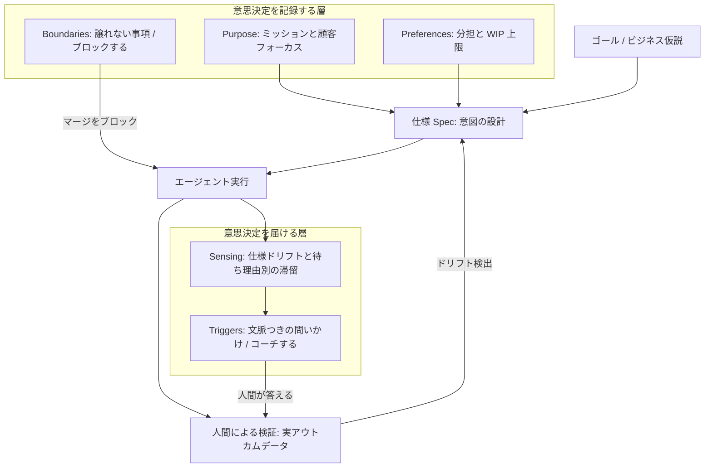
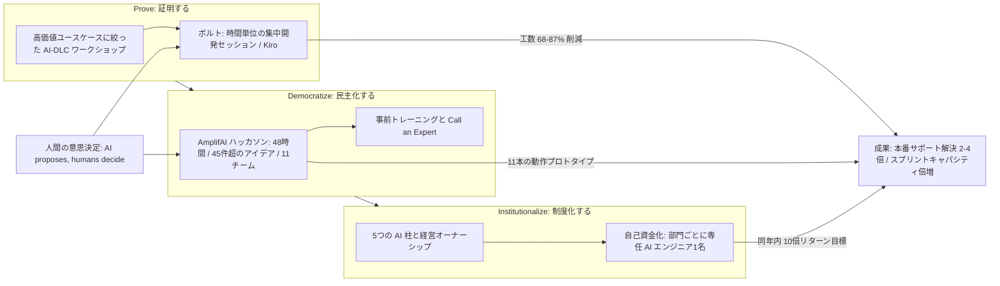
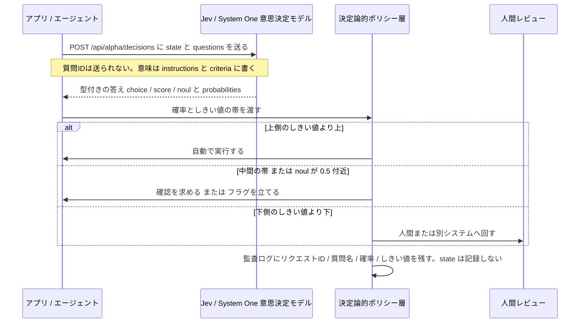

# Daily Briefing 2026-10-16

## 1. AIネイティブなエンジニアリング・オペレーティングモデルとは実際に何なのか（原題: What an AI-Native Engineering Operating Model Actually Looks Like）

- **URL**: https://yuvalyeret.com/blog/operating-system-for-ai-native-teams/
- **公開日**: 2026-06-30
- **著者・媒体**: Yuval Yeret（個人ブログ / Agentic Development Lifecycle シリーズ）

### 本文翻訳

多くの組織が copilot や開発エージェントに大規模投資し、コードはかつてないほど速く生成されている。にもかかわらず事業インパクトは横ばいだ。著者はその理由を、ボトルネックが「コードを書くこと」から**人間の意思決定遅延とレビュー能力**へ移動したのに、組織がツールと会議を足すだけで対応しているからだと述べる。必要なのは本物のオペレーティングモデル、すなわち (1) 人間の意図を仕様（スペック）のレベルで管理し、(2) チームの作業ルールを日々の作業フローの中に埋め込み、(3) 成功を検証済みのアウトカムで測る仕組みである。

中核となる転換は「構文の管理」から「意図の管理」への移行だ。エージェントが低レベルの実装（How）を吸収するため、人間には「何を（What）」の定義と「なぜ（Why）」の検証が残る。ここで生成行数・マージ済み PR 数・クローズしたチケット数だけを見る出力型の検査は誤導的である。著者はこれを「Requirements Theater」と呼び、「AI Theater」の主要な駆動因だとする。正しい検査は「システムの振る舞いがビジネス仮説と一致しているか」を問うものだ。

著者は 4 チーム・導入 2 か月後の複合事例を示す。週あたりマージ済み PR は約 40 件から 120 件超へ増えた。レビューキューには 31 件の未処理 PR があり、到着は 1 日約 17 件。Little の法則では平均待ち時間は 2 日未満となる。しかしこの平均が裾を隠していた。特定のレビュアやオーナーを必要とする項目は 8〜9 日待たされ、しかもそれらが重要なビジネス上の賭けを担っていた。顧客課題から検証済みアウトカムまでのリードタイムは約 3 週間から約 5 週間へ悪化した。増えた 14 日のうちレビュー待ちが説明するのは約 3 分の 1 にすぎず、残りはリリース承認プロセスの遅さと、マージから検証までのギャップ拡大に起因していた。

次に著者は人間の説明責任を 3 つに整理する。前提として**説明責任はエージェントへ移譲できない**。説明責任を負う者は意思決定を説明でき、結果を引き受け、後から方針を変えられる。エージェントは説明を生成できるが、結果を引き受けることも継続的に責任を問われることもできない。新しい役職は不要で、以下を能動的に保持すればよい。(1) **ビジネスアウトカムの所有** — 高コストな課題・制約・先行指標を定義し、エージェントに必要なビジネス文脈を与える。(2) **意図の設計** — 明確でアトミックな仕様を書く。仕様は今や高水準プログラミング言語であり、出力と言い争うより構造的整合性をレビューする方が重要だ。(3) **オペレーティングモデルのコーチング** — 人間とエージェントの分担を決め、未レビューの生成コードが積み上がる兆候に気づく。

実行面では、ゴールを仕様へ分解し、エージェントが実行し、人間が現実に照らして検証する「継続実行ループ」を回す。どのケイデンスでも次の 4 つの不変条件が成立していなければならない。(1) 大規模生成の前にリスク（影響範囲）を限定する、(2) 群がる前に「なぜ」で合意する、(3) ドリフトを小さな修正で済むうちに捉えられる頻度で学びを検査する、(4) 実際のアウトカムデータで検証するまで完了と数えない。フローのヒューリスティクスとして、WIP 上限は**チーム単位ではなく人間個人単位**で設ける。生成 PR を 5 件抱えた開発者はレビューしていない、流し読みして承認しているだけだ。Scrum を運用しているなら、イベントは維持したまま検査するデータを変えればよい。

モデルの骨格は「5 層アンビエントインテリジェンス」である。2 つの軸で構成され、**Boundaries / Purpose / Preferences** が意思決定を記録し、**Sensing / Triggers** がその意思決定を必要な瞬間に人へ届ける。Boundaries は譲れない事項と説明責任を扱い、エージェントの作業は決して完了と見なさない（検証計画と一致し、自動チェックを通り、人間のレビューを受ける）。Purpose はミッションと顧客フォーカスを示し、事業目標に資さない生成物を押し返す根拠になる。Preferences は作業種別ごとの既定モード（エージェント主導 / 拡張 / 人間主導）と WIP 上限・バッチサイズを定める。Sensing は仕様ドリフトと「待ち理由別の作業項目の滞留」を背景で検出し、特に**名前のついた人間を待っていることによる滞留が鍵となる先行指標**だ。Triggers は検出をリポジトリイベントへ接続し、行動できる人のもとへフィードバックを届ける（例: 3 つ目の仕様が始まった時点で WIP 上限を問う）。設計原則は明快で、**Boundaries はブロックし、Triggers はコーチする**。Boundaries は床であり、マージを止めてよい。Triggers は問いを投げ、答えは人間に委ねる。配置を誤るとモデルは劣化する。コーチすべき事項を境界にすると納期圧力で迂回され、ブロックすべき設定を好みに置くと回避される。

これを機械可読にするため、著者は `.team/operating-model.yaml` のサンプルを提示する。Boundaries には完了の定義（自動テスト通過、lint エラー 0、人間のレビュー承認、署名済み検証計画）、ステージング/本番リリースは人間承認、認証・顧客データアクセス・スキーマ移行は人間へエスカレーション、検証計画のないエージェント作成 PR はマージをブロック、を書く。Purpose は「顧客課題から検証済み本番解決までの時間短縮」を目標に、「出力量より検証済みアウトカム」を最適化対象に、「PR 件数は成功指標ではない」をアンチゴールに置く。Preferences は人間ドライバ 1 人あたり仕様 2 本、仕様は最大 1,500 トークン、差分は最大 400 行、既定モードは拡張、エージェント主導はテスト足場・依存更新・ドキュメント、人間主導はアーキテクチャ決定・価格ロジック・セキュリティ境界。Sensing と Triggers も同ファイルに記述する。数値は議論の出発点であり、1 か月使って調整すべきだと著者は断る。

実装は 3 階層に分かれる。**今日の標準ツールで動くもの**: CODEOWNERS、ブランチ保護、CI 上の完了定義チェック、Purpose と Preferences を置く `AGENTS.md` / `CLAUDE.md`。**1 日程度の接着コードが必要なもの**: 検証計画セクションの CI チェック、仕様ファイルのトークン数計測スクリプト、オープンな仕様 PR を数えるスケジュール実行の GitHub Action（3 本目の検知は Git イベントではないので何かが数える必要がある）。**まだ機構がないもの**: Sensing、特にドリフト検出。待ち理由別の滞留は Git とトラッカーのデータから構築可能で、週次のキュー深さ・項目年齢レポートは粗いが正直な近似になる。

最初の一手として著者は Boundaries の行から始めよと勧める。最も異論が少なく、既にある設定の上で動くからだ。各層の「何を書くか / どこに置くか / 機能していると分かる条件」は表で与えられる。Boundaries は CODEOWNERS・ブランチ保護・CI に置き、認証やスキーマの変更が指名された人間なしにマージできなくなれば機能している。Purpose は `AGENTS.md` の冒頭に置き、誰かが目的文を引用して生成物を却下したら機能している。Preferences は `.team/operating-model.yaml` に置き、委譲の議論が「書いてあるから」で素早く終われば機能している。Sensing は Git とトラッカー上のスケジュールジョブに置き、最も古い進行中項目とその待ち相手を言えれば機能している。Triggers は GitHub Action か pre-commit フックに置き、人がボットをミュートせずに問いに答えれば機能している。残りは痛みが出るまで後回しにし、モデル全体は一度に読み切れる大きさに保つ。

FAQ では「これは新しいフレームワークか」に対し、新しい役割・イベント・成果物は設定ファイル 1 枚以外にないと答える。Scrum のチームは Scrum を続け、検査するデータを変えるだけでよい。導入にトレーニングが必要ならファイルが大きくなりすぎた証拠だ。「エージェントが設定を無視したら」に対しては、一部は無視すると認めつつ、保証されるのは**フェイルクローズするマージ時の強制**だと述べる。結論は、AI Theater に陥っているなら問題はモデルではなくモデルを取り巻くオペレーティングモデルにある、というものだ。締めの一文は「作業が起きる場所にルールを埋め込めば、ルールを覚えておく必要はなくなる」。

### 重要ポイント
- ボトルネックはコード生成から**人間の意思決定遅延とレビュー能力**へ移った。PR 件数の増加（40→120 件/週）はリードタイム悪化（3 週→5 週）と同時に起こり得る。
- 平均待ち時間は裾を隠す。**「特定の人間を待っている」ことによる滞留**を待ち理由別に計測することが鍵となる先行指標。
- 説明責任はエージェントへ移譲できない。人間が保持すべきは「ビジネスアウトカムの所有」「意図（仕様）の設計」「オペレーティングモデルのコーチング」の 3 つ。
- 5 層モデル（Boundaries / Purpose / Preferences / Sensing / Triggers）のうち、**Boundaries はブロックし Triggers はコーチする**。配置を誤ると迂回・回避されて劣化する。
- WIP 上限はチームではなく**人間個人単位**。生成 PR を 5 件抱えた開発者はレビューではなく流し読み承認をしている。

### 図解



### 現場での適用方法

まず `.team/operating-model.yaml` を 1 枚置き、Boundaries だけを CI で強制する。

````markdown
```yaml
# <REPO_PATH>/.team/operating-model.yaml
boundaries:
  definition_of_done:
    - 自動テストが通ること
    - lint エラーが 0 であること
    - 人間のレビュー承認があること
    - 署名済みの検証計画があること
  human_approval_required:
    - staging および production へのリリース
  escalate_to_human:
    - 認証 / アイデンティティの変更
    - 顧客データへのアクセス
    - スキーママイグレーション
  block_merge_when:
    - エージェント作成 PR に検証計画セクションが無い

purpose:
  goal: 顧客課題から検証済み本番解決までの時間を短縮する
  optimize_for: 出力量ではなく検証済みアウトカム
  anti_goal: PR 件数は成功指標ではない

preferences:
  wip:
    active_specs_per_human_driver: 2        # 1か月使って調整する
  limits:
    max_spec_tokens: 1500
    max_diff_lines: 400
  default_mode: augmented                   # agent_led | augmented | human_led
  agent_led:
    - テストの足場づくり
    - 依存関係のアップグレード
    - ドキュメント
  human_led:
    - アーキテクチャ決定
    - 価格ロジック
    - セキュリティ境界

sensing:
  - 仕様ドリフト
  - 待ち理由別の作業項目の滞留

triggers:
  - when: 3本目の仕様が開始された
    ask: WIP 上限を超えています。どれを先に終わらせますか
  - when: 項目が24時間以上アクティブ
    ask: これは人間の判断を待っていますか
```
````

次に、検証計画の有無をマージ時にフェイルクローズで強制する CI チェックを足す（接着コードは 1 日程度）。

````markdown
```yaml
# <REPO_PATH>/.github/workflows/dod-check.yml
name: definition-of-done
on: [pull_request]
jobs:
  verification-plan:
    runs-on: ubuntu-latest
    steps:
      - name: PR 本文に検証計画があるか確認する
        env:
          BODY: ${{ github.event.pull_request.body }}
        run: |
          if ! printf '%s' "$BODY" | grep -qiE '^##+[[:space:]]*(検証計画|Verification Plan)'; then
            echo "検証計画セクションがありません。マージをブロックします。" >&2
            exit 1
          fi
```
````

Purpose と Preferences は `CLAUDE.md` の冒頭に写して、エージェント自身に読ませる。

````markdown
```markdown
## このリポジトリの目的（Purpose）

顧客課題から検証済み本番解決までの時間を短縮することが目的である。
出力量ではなく検証済みアウトカムを最適化する。**PR 件数は成功指標ではない。**
この目的に資さない生成物は、この節を引用して却下してよい。

## 分担と上限（Preferences）

- 既定モードは augmented（人間と協調）。
- エージェント主導でよい: テストの足場づくり / 依存更新 / ドキュメント。
- 人間主導を厳守する: アーキテクチャ決定 / 価格ロジック / セキュリティ境界。
- 1 仕様あたり最大 1,500 トークン、1 PR あたり差分最大 400 行を超えないこと。
  超える場合は分割を提案して停止する。
- 認証・顧客データ・スキーママイグレーションに触れる変更は、実装前に人間へエスカレーションする。
- PR 本文に必ず `## 検証計画` セクションを書く（無いと CI がマージをブロックする）。
```
````

Sensing の粗い近似として、週次でキュー深さと「待ち理由別の最古項目」を出すジョブを置く。

````markdown
```bash
#!/usr/bin/env bash
# <REPO_PATH>/scripts/queue-report.sh — 週次でレビューキューの裾を見る
set -euo pipefail
REPO="<OWNER>/<REPO>"

echo "## オープン PR の件数と最古の項目（レビュア待ちの裾を見る）"
gh pr list --repo "$REPO" --state open \
  --json number,title,createdAt,reviewRequests,isDraft \
  --limit 200 \
  | jq -r '
      map(select(.isDraft == false))
      | sort_by(.createdAt)
      | "オープン: \(length) 件",
        (.[0:5][] | "待機 \(((now - (.createdAt|fromdate)) / 86400) | floor) 日: #\(.number) \(.title) / 待ち相手: " +
          ((.reviewRequests | map(.login // .name) | join(",")) | if . == "" then "未指名" else . end))
    '
```
````

### 期待効果
- 出力指標ではなくアウトカム指標を検査することで、「PR 40→120 件/週」のような増加がリードタイム悪化（3 週→5 週）を隠すことを防げる。
- 待ち理由別の滞留を可視化すると、平均 2 日未満に埋もれていた 8〜9 日待ちの重要項目（＝主要なビジネス上の賭け）を名指しできる。
- Boundaries の CI 強制はエージェントの挙動に依存せずフェイルクローズで効くため、未レビューの生成コードが本番へ漏れる経路を閉じられる。
- 設定ファイルに分担と上限が書かれていることで、委譲に関する議論が短時間で決着する。

### 注意点
- 層の配置を誤ると劣化する。コーチすべき事項を Boundaries にすると納期圧力で迂回され、ブロックすべき事項を Preferences に置くと回避される。
- Preferences の数値（仕様 2 本、1,500 トークン、400 行）は著者自身が「議論して 1 か月使って調整せよ」と述べる出発点であり、そのまま採用する前提値ではない。
- Sensing、特に仕様ドリフトの検出は著者も「まだ機構がない」と認めている。週次レポートは粗い近似にとどまる。
- エージェントは設定を無視することがある。保証されるのはマージ時の強制だけなので、重要な制約は必ず CI とブランチ保護側に置く。
- 導入にトレーニングが必要な規模までモデルを育てると失敗する。一度に読み切れる大きさを保つこと。

## 2. ConnectiveRx が AI-DLC でイノベーションを加速した方法（原題: How ConnectiveRx Accelerated Innovation with AI-DLC）

- **URL**: https://aws.amazon.com/blogs/publicsector/how-connectiverx-accelerated-innovation-with-ai-dlc/
- **公開日**: 2026-09-20
- **著者・媒体**: Praveen Allam、David Caicedo、Rizwan Sarkhot、Sojung Lee / AWS Public Sector Blog

### 本文翻訳

本記事は、医療アクセス支援を手がける ConnectiveRx が AWS の AI-DLC（AI-Driven Development Lifecycle）を実際の製品開発に適用し、企業規模へ広げていった実装報告である。AI-DLC の中核原則は「**AI が提案し、人間が決める（AI proposes, humans decide）**」であり、人間の判断を外さないままサイクルタイムを圧縮することを狙う。

エンゲージメントは 3 つのフェーズで進んだ。第 1 の **Discovery and Planning** では、クロスファンクショナルなチームが製品ポートフォリオ全体を見渡し、価値の高いユースケースを特定した。第 2 の **AI-DLC Execution** では、小さなチームが「ボルト（bolt）」と呼ばれる集中的な開発セッションで作業した。ボルトは 2 週間スプリントではなく**時間単位で測られる密度の高い開発サイクル**であり、開発環境としては Kiro を用いた。第 3 の **Scale and Expand** で、対象をより多くの製品チームとより複雑なユースケースへ広げた。

働き方の変化として記事が強調するのは、ビジネスアナリスト・開発者・QA・エンジニアリングが**逐次ではなく並行して**動いた点である。Cloud Engineering シニアディレクターの Rizwan Sarkhot は「AI-DLC は、ConnectiveRx の実際のユースケースを使ってそのアプローチを検証する実践的な方法を与えてくれた」「際立っていたのは、クロスファンクショナルなチームがアイデアから形あるものへどれだけ速く到達できたかだ」と述べている。

普及の装置として使われたのが AmplifAI ハッカソンである。ニュージャージーの本社で 2 日間のハイブリッド形式で開催され、チームは 48 時間で動作するソリューションを構築した。45 件超のアイデアが提出され、11 チームが選抜された。AWS は開催前にトレーニングを提供し、当日は「Call an Expert」モデルによってオンデマンドでアーキテクチャの助言を受けられるようにした。成果として 11 本の機能するプロトタイプが生まれ、領域はサービスデスクの解決、患者の支払い可能性に関する会話型 AI、インテリジェントな監視、アイデンティティ管理の自動化にわたった。

測定された結果は次のとおりである。ユースケースあたりの工数は **68〜87% 削減**（約 180 時間から約 24 時間へ）。本番サポート課題の解決は **2〜4 倍高速化**。スプリントのキャパシティは**倍増**。2 日間で 11 本のプロトタイプ。全社的な提供キャパシティは **3 倍**になる見込みとされ、各部門には同年内に **10 倍のリターン**という目標が置かれた。Sarkhot は「68〜87% の工数削減は、実際の製品に対する実際の作業で、本番まで届けたものだ」「参加者は『なぜ昔のやり方に戻る必要があるのか』と言って帰っていった」と述べている。

記事はこの経験を再現可能な 3 段階のプレイブックとして提示する。(1) **Prove（証明する）** — 価値の高いユースケースに絞った AI-DLC ワークショップから始め、チームに工数削減を自分の手で体験させる。(2) **Democratize（民主化する）** — ワークショップ参加者から技術組織全体へ、ハッカソンとイネーブルメントプログラムを通じて広げる。(3) **Institutionalize（制度化する）** — 経営が所有する AI の柱、自己資金化モデル、専任 AI エンジニアを確立し、変革を自走させる。

制度化のためにConnectiveRx が設けた 5 つの柱は、(1) AI-DLC & Client Delivery（AI ネイティブな製品開発ワークフロー）、(2) AI-Ops Intelligent Operations（AI による本番サポートと予兆監視）、(3) AI-ITSM & Self-Service（社内 IT サービス管理への AI エージェント適用）、(4) Enterprise Intelligence & Data（AI による分析と意思決定）、(5) Governance & Enablement（経営がオーナーシップを持つ中央集権的な AI ガバナンス）である。自己資金化モデルでは**各部門に専任の AI エンジニアを 1 名配置**し、その部門が同年内に 10 倍のリターンを出すことを期待する。

なお記事は AI-DLC のフェーズ・儀式・実装ガイダンスの詳細については AWS の AI-DLC ホワイトペーパーを参照するよう案内しており、ボルト内部の進行手順やスペック成果物の具体形には踏み込んでいない。

### 重要ポイント
- 原則は「AI が提案し、人間が決める」。サイクルタイムを圧縮しても意思決定者は人間に残す。
- 「ボルト」は 2 週間スプリントの代替で、**時間単位**で測る集中開発セッション。BA・開発・QA が逐次ではなく並行で動く。
- 測定値はユースケースあたり工数 68〜87% 削減（約 180 時間→約 24 時間）、本番サポート解決 2〜4 倍、スプリントキャパシティ倍増。
- 普及は 3 段階（Prove → Democratize → Institutionalize）。ハッカソン（45 件超のアイデア、11 チーム、48 時間で 11 プロトタイプ）が民主化の装置。
- 制度化の要は 5 つの AI 柱と自己資金化モデル（各部門に専任 AI エンジニア 1 名、同年内 10 倍リターン目標）。

### 図解



### 現場での適用方法

ボルトを自チームで回すための運用手順。1 ボルト＝半日〜1 日に収め、「AI が提案し人間が決める」境界を各ステップに明示する。

1. **ボルト前日（30 分）**: 対象ユースケースを 1 つだけ選び、後述のボルト憲章を書く。工数のベースライン（従来なら何時間か）を必ず記録する。削減率を主張するにはこれが必要。
2. **ボルト開始（15 分）**: BA・開発・QA・運用を同じ場（または同じ通話）に集める。逐次の引き継ぎを禁止し、全員が並行で動く前提を確認する。
3. **提案フェーズ（60〜90 分）**: エージェントに仕様・設計案・テスト計画を**提案させる**。人間はこの間に受け入れ基準を固める。
4. **決定ゲート（15 分、人間のみ）**: 提案を採用・修正・却下する。決定とその理由をボルト憲章に追記する。ここを飛ばすと AI-DLC ではなくなる。
5. **構築フェーズ（残り時間）**: 決定済みスコープのみ実装。スコープ外の発見は「次のボルト候補」に積み、当日は触らない。
6. **ボルト終了（30 分）**: 実績工数を記録し、ベースラインと比較。動くものを本番相当環境まで届けられたかを確認する。
7. **週次**: 削減率と「人間が却下した提案の割合」の 2 つを並べて見る。後者が 0% に近いときは決定ゲートが形骸化している。

ボルト憲章のテンプレート。

````markdown
```markdown
# ボルト憲章: <ユースケース名>
- 日付 / 時間枠: <YYYY-MM-DD> <開始>-<終了>（時間単位で区切る）
- 参加者: BA=<NAME> / 開発=<NAME> / QA=<NAME> / 運用=<NAME>
- 従来工数のベースライン: <N> 時間（見積根拠: <過去類似案件 or 実測>）

## 解きたい課題と受け入れ基準
- 課題: <顧客 or 業務上の痛み>
- 受け入れ基準: <検証可能な条件を箇条書き>
- スコープ外（今日は触らない）: <明示>

## 人間が決める事項（エスカレーション境界）
- [ ] アーキテクチャ選択
- [ ] 患者/顧客データの取り扱い
- [ ] 本番リリースの可否

## AI の提案と人間の決定ログ
| 提案 | 決定（採用/修正/却下） | 理由 | 決定者 |
|------|----------------------|------|--------|
|      |                      |      |        |

## 結果
- 実績工数: <N> 時間 → 削減率: <N>%
- 本番相当環境まで到達したか: <はい/いいえ>
- 次のボルト候補: <積み残し>
```
````

エージェント側に「提案までは任せ、決定は人間」を守らせるための `CLAUDE.md` 追記例。

````markdown
```markdown
## ボルト運用時のルール（AI-DLC: AI proposes, humans decide）

- ボルト中は `docs/bolts/<DATE>-<SLUG>.md`（ボルト憲章）を唯一の合意記録とする。
  作業開始時に必ず読み、「スコープ外」に挙がった項目には触れない。
- 仕様・設計・テスト計画は**提案として**出力し、憲章の「AI の提案と人間の決定ログ」に
  追記する。決定欄が空のままの提案を実装に進めてはならない。
- 次のいずれかに触れる変更は、実装前に停止して人間へエスカレーションする:
  アーキテクチャ選択 / 患者・顧客データの取り扱い / 本番リリースの可否。
- スコープ外の改善案を見つけたら、実装せず憲章の「次のボルト候補」に 1 行で追記する。
- ボルト終了時に、受け入れ基準の各項目について満たした根拠（テスト名・実行結果）を列挙する。
```
````

### 期待効果
- 記事の実測では、ユースケースあたりの工数が 68〜87% 削減（約 180 時間→約 24 時間）、本番サポート課題の解決が 2〜4 倍高速化、スプリントキャパシティが倍増した。
- 48 時間のハッカソンで 11 本の動作プロトタイプ（サービスデスク解決、患者支払い可能性の会話型 AI、監視、アイデンティティ管理自動化）が生まれた。
- 全社的な提供キャパシティは 3 倍になる見込みとされ、部門単位では同年内 10 倍リターンが目標に置かれた。
- ベースライン工数を事前に記録する運用にすることで、削減率を後から主張ではなく実測として示せる。

### 注意点
- 公開されている数値は AWS のブログに掲載された自社・顧客申告値であり、独立検証ではない。自組織では必ず自前のベースラインで測り直すこと。
- 記事はボルト内部の進行手順やスペック成果物の具体形に踏み込んでいない（詳細は AI-DLC ホワイトペーパー参照とされる）。上記の手順は記事の記述から補って構成したもの。
- ハッカソンの成果は 11 本の「プロトタイプ」である。プロトタイプから本番運用までの保守・セキュリティレビューのコストは別勘定で見込む必要がある。
- 工数削減率はハッカソンや集中ワークショップという「AWS の支援とトレーニングが入った環境」で得られている。既存の大規模コードベースに対する通常運用では低く出る前提で計画する。
- 「各部門に専任 AI エンジニア 1 名 + 同年内 10 倍リターン」という自己資金化モデルは、経営のオーナーシップと採用余力がなければ成立しない。

## 3. Jev とは何か: TypeSafe の意思決定モデルを開発者向けに解説（原題: What Is Jev? TypeSafe's Decision Model Explained for Developers）

- **URL**: https://openrouter.ai/blog/insights/what-is-jev/
- **公開日**: 2026-09-21（2026-09-24 更新）
- **著者・媒体**: Kenny Rogers / OpenRouter Blog

### 本文翻訳

Jev は TypeSafe の「意思決定モデル」である。テキストの `state` と型付きの質問を送ると、生成文ではなく**型付きの答えと較正済み確率**が返る。TypeSafe はこのカテゴリを、Kahneman の速い・パターンマッチ的な思考にちなんで「System One」モデルと呼ぶ。答えはあらかじめ定義された集合から返るため、パースすべき自由記述テキストが存在しない。

質問のプリミティブは 3 種類ある。**Choice** は固定された選択肢から 1 つを選び、各選択肢の確率と信頼度（confidence）を返す。**Score** は記述した順序つきの水準でテキストを評価し、スコア・凡例（legend）・水準ごとの確率・信頼度を返す。スコアは水準インデックスの**確率加重平均**である。**Noul** は yes/no の命題が成り立つ確率を返し、独立した confidence フィールドを持たない。複数の質問を 1 リクエストに含められ、各答えは指定したキーの下に返る。

確率と信頼度の読み方には注意が要る。較正は**集合的にのみ**成立する。0.8 は「多数の呼び出しを通じてそうした答えのおよそ 80% が正しい」ことを意味し、個々の答えが確実であることを意味しない。Noul が 0.5 付近なら不確実性のシグナルであり、著者はその中間帯を追加質問か人間レビューの対象として扱うことを勧める。Choice と Score の confidence は**分布がどれだけ集中しているか**の指標であって、答えが正しいかどうかの指標ではない。確率は呼び出しごとにわずかに揺れるため、しきい値は厳密な値ではなく**帯（バンド）**で設定する。著者は数百件のラベル付き例からしきい値を選び、「自動で実行する」「注意して進める／確認を求める」「人間へ回す」の 3 帯に分けることを推奨する。

役割分担も明確だ。Jev はテキストを生成せず、推論過程を示さず、ツールを呼ばず、会話を保持せず、画像・音声・動画を扱わない。厳密な算術や日付計算はコード側で先に計算しておくべきである。監査ログには、リクエスト ID・質問名・確率・適用したしきい値を記録し、**`state` 自体は記録しない**（顧客データを含み得るため）ことを勧める。

本番での用途としては、ルーティングとトリアージ（キュー・担当・優先度）、大規模な分類とタグ付け、エージェントの動作のゲーティング（しきい値未満なら破壊的なツール呼び出しをブロックする）、LLM の下書きをポリシー文書に照らして検証すること、候補のランキングとフィルタリングが挙がる。逆に使うべきでない場面は、出力が文章である必要がある場合、入力が画像である場合、正規表現やデータベース参照で処理できるロジックの場合である。

アクセス方法は、OpenRouter の Decisions API（`https://openrouter.ai/api/alpha/decisions`）に対してモデル ID `typesafe/jev-1.13`（または別名 `~typesafe/jev-latest`）を指定する。リクエストは `model`・`state`・`questions` から成る。`state` は文字列・JSON オブジェクト・テキストの配列が使え、instructions の中からバックティックでオブジェクトのフィールド名を参照できる。**質問 ID はモデルへ送られない**ため、意味はすべて instructions と criteria に書く必要がある。Choice は `criteria` に選択肢キーと説明の対応を、Score は `criteria` に軽い順から重い順へ並べた水準の説明の配列（最大 10 水準）を渡す。Noul は yes/no の命題を疑問形で `instructions` に書く。

レスポンスは `model`・`answers`・`usage`・`id`・`provider` を含む。answers の各要素は型ごとに形が異なり、choice は `choice` と `probabilities` と `confidence`、score は `score` と `legend` と `probabilities` と `confidence`、noul は `noul`（confidence なし）を返す。スコア 1.15 は「0.85 × 1 + 0.15 × 2」のように水準インデックスの確率加重平均として算出される。`probabilities` は**キーで参照すること**。呼び出し間でキーの順序が変わり得るためである。なお OpenRouter の TypeScript SDK は `input_tokens` / `output_tokens` ではなく camelCase の `inputTokens` / `outputTokens` を返す。記事は raw HTTP、OpenRouter の TypeScript SDK、TypeSafe の TypeScript / Python SDK を OpenRouter に向ける例を示しており、API キーはサーバ側に保持せよと注意する。

価格と制限は、入力 100 万トークンあたり 0.042 ドルで出力は無料（2026-09-21 時点）。447 トークン・3 質問の呼び出しがおよそ 0.000019 ドルだったという実測が示される。コンテキストは OpenRouter の表示では 32k、TypeSafe の表示ではリクエストあたり合計 64k（`state` に 32k ＋最長の質問）である。制約として Jev はプロプライエタリで重みも論文も公開されておらず、入力はテキストのみ、出力は 3 つの答え型に限られる。

### 重要ポイント
- Jev は型付きの答え＋較正済み確率のみを返す「System One」モデル。自由記述が返らないためパース処理とパース失敗が消える。
- プリミティブは Choice（確率＋confidence）・Score（水準インデックスの確率加重平均）・Noul（yes/no 確率、confidence なし）の 3 種。1 リクエストに複数質問を同梱できる。
- 較正は**集合的にのみ**成立。confidence は分布の集中度であって正しさの指標ではない。Noul 0.5 付近は「第 3 の結果」として扱う。
- しきい値は厳密値ではなく帯で持つ。数百件のラベル付きデータで「自動実行／確認／人間へ」の 3 帯を校正する。
- 価格は入力 100 万トークンあたり 0.042 ドル・出力無料。447 トークン 3 質問で約 0.000019 ドルなので、全件スクリーニングに耐える単価。

### 図解



### 現場での適用方法

危険なツール呼び出しをゲーティングする最小実装。しきい値は帯で持ち、`state` はログに出さない。

````markdown
```python
# <REPO_PATH>/scripts/jev_gate.py — エージェントの破壊的操作を Jev でゲートする
# 実行: python3 -I scripts/jev_gate.py "DROP TABLE users;"
import json
import os
import sys
import urllib.request

ENDPOINT = "https://openrouter.ai/api/alpha/decisions"
MODEL = "typesafe/jev-1.13"          # 本番ではピン留めする。~typesafe/jev-latest は別名
ACT_ABOVE = 0.90                      # この帯より上: 自動実行
HUMAN_BELOW = 0.60                    # この帯より下: 人間へ
UNCERTAIN = (0.40, 0.60)              # noul がこの範囲なら「第3の結果」として扱う


def ask(state: str) -> dict:
    body = {
        "model": MODEL,
        "state": state,
        "questions": {
            # 質問IDはモデルへ送られない。意味は instructions / criteria に全部書く
            "destructive": {
                "type": "noul",
                "instructions": "この操作はデータを恒久的に削除または破壊しますか。",
            },
            "blast_radius": {
                "type": "score",
                "criteria": [
                    "影響なし。読み取りのみ。",
                    "単一レコードに限定。復旧が容易。",
                    "単一テーブルまたは単一サービス全体に影響。",
                    "複数サービスまたは全顧客データに影響。",
                ],
                "instructions": "この操作が失敗した場合の影響範囲を評価してください。",
            },
        },
    }
    req = urllib.request.Request(
        ENDPOINT,
        data=json.dumps(body).encode(),
        headers={
            "Authorization": f"Bearer {os.environ['OPENROUTER_API_KEY']}",
            "Content-Type": "application/json",
        },
    )
    with urllib.request.urlopen(req, timeout=10) as res:
        return json.loads(res.read())


def decide(answers: dict) -> str:
    noul = answers["destructive"]["noul"]
    # probabilities は必ずキーで参照する（呼び出し間で順序が変わる）
    score = answers["blast_radius"]["score"]

    if UNCERTAIN[0] <= noul <= UNCERTAIN[1]:
        return "HUMAN"                      # 0.5 付近は yes/no ではなく不確実
    if noul >= ACT_ABOVE and score >= 2.0:
        return "BLOCK"                      # 破壊的かつ影響範囲が広い
    if noul < HUMAN_BELOW and score < 1.0:
        return "ALLOW"
    return "CONFIRM"


if __name__ == "__main__":
    state = sys.argv[1]
    res = ask(state)
    verdict = decide(res["answers"])
    # 監査ログ: state は出さない。顧客データを含み得る
    print(json.dumps({
        "request_id": res["id"],
        "questions": sorted(res["answers"].keys()),
        "destructive_noul": res["answers"]["destructive"]["noul"],
        "blast_radius_score": res["answers"]["blast_radius"]["score"],
        "thresholds": {"act_above": ACT_ABOVE, "human_below": HUMAN_BELOW},
        "verdict": verdict,
    }, ensure_ascii=False))
    sys.exit(0 if verdict == "ALLOW" else 1)
```
````

本番投入前に、しきい値の帯を自前のラベル付きデータで校正する手順。

1. 実データから 300 件程度を抽出し、人間が正解ラベルを付ける。**曖昧な例と誤ると高コストな例を必ず含める**（簡単な例だけで校正すると帯が楽観的になる）。
2. 全件を Jev に流し、確率と正解の対応表を作る。
3. 「自動実行帯」のエラー率が自分のユースケースで許容できる水準に収まる位置で上側のしきい値を切る。
4. シャドー実行（既存フローの横で走らせ、判定は採用しない）で 1〜2 週間ずれを観察してから、実際に作用させる。
5. `probabilities` はキーで参照する実装になっているかをレビューで確認する（順序依存の実装は呼び出し間で壊れる）。

スキル化する場合の骨子。

````markdown
```markdown
---
name: jev-decision-gate
description: 型付きの意思決定が必要な分岐（トリアージ、分類、破壊的操作のゲーティング、ポリシー照合）で Jev を呼び出し、しきい値の帯に従って自動実行・確認・人間エスカレーションに振り分ける。自由記述の生成が必要な場面では使わない。
---

# Jev 意思決定ゲート

## 使うべき場面
- ルーティング / トリアージ（キュー・担当・優先度の決定）
- 大規模な分類とタグ付け
- 破壊的なツール呼び出しの事前ゲーティング
- LLM の下書きをポリシー文書に照らして検証する

## 使わない場面
- 出力が文章である必要がある（Jev はテキストを生成しない）
- 入力が画像・音声・動画
- 正規表現やデータベース参照で決まるロジック
- 厳密な算術・日付計算（コード側で先に計算してから `state` に入れる）

## 手順
1. 判定を Choice / Score / Noul のいずれかに落とす。質問IDはモデルに渡らないため、
   意味は instructions と criteria に全部書く。
2. `scripts/jev_gate.py` 相当で 1 リクエストにまとめて質問する。
3. しきい値は帯で判定する: 上側より上は自動実行、中間は確認、下側より下は人間へ。
   noul が 0.4〜0.6 は yes/no ではなく「不確実」として人間へ回す。
4. 監査ログにリクエストID・質問名・確率・適用しきい値を記録する。**`state` は記録しない。**

## 禁止事項
- confidence を正しさの証拠として扱わないこと（分布の集中度にすぎない）。
- 単一の答えを「較正済みだから確実」と述べないこと（較正は集合的にのみ成立する）。
- API キーをクライアント側へ置かないこと。
```
````

### 期待効果
- 自由記述が返らないため、パース処理とパース失敗に伴う例外処理・リトライが不要になる。
- 価格は入力 100 万トークンあたり 0.042 ドル・出力無料で、447 トークン 3 質問が約 0.000019 ドル。サンプリングではなく全件スクリーニングを単価面で許容できる。
- 1 リクエストに複数質問を同梱できるため、破壊性判定と影響範囲評価のような複合判断を 1 往復で取得できる。
- 確率を 3 帯に割ることで「自動実行できる範囲」を明示的に限定し、残りを確認・人間レビューへ確実に送れる。

### 注意点
- 較正は集合的にのみ成立する。0.8 は個々の答えの確実性ではなく、多数の呼び出しにおける概ねの正答率である。
- Choice / Score の confidence は分布の集中度であり、正しさの指標ではない。高い confidence を正確性の証拠として扱わないこと。
- 確率は同一入力でも呼び出しごとにわずかに揺れる。厳密値での分岐は不安定なので帯で判定する。
- `probabilities` のキー順序は呼び出し間で変わり得るため、位置ではなくキーで参照する。
- `state` は顧客データを含み得る。監査ログにはリクエストID・質問名・確率・しきい値のみを残す。
- 入力はテキストのみ、出力は 3 つの答え型のみ。厳密な算術と日付計算はコード側で先に済ませる。
- Jev はプロプライエタリで重みも論文も非公開。モデル ID は本番ではピン留めし（`typesafe/jev-1.13`）、別名 `~typesafe/jev-latest` は挙動が変わり得る前提で扱う。
- 価格・コンテキスト上限（OpenRouter 表示 32k / TypeSafe 表示 合計 64k）は記事執筆時点の値であり、採用前に一次情報で確認すること。
