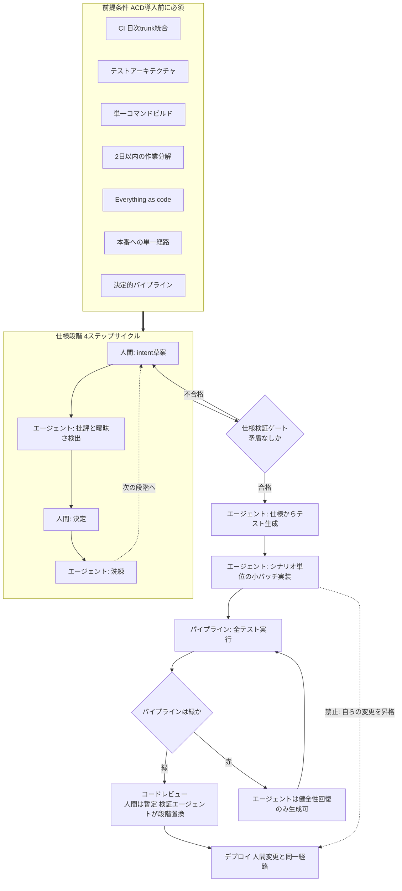
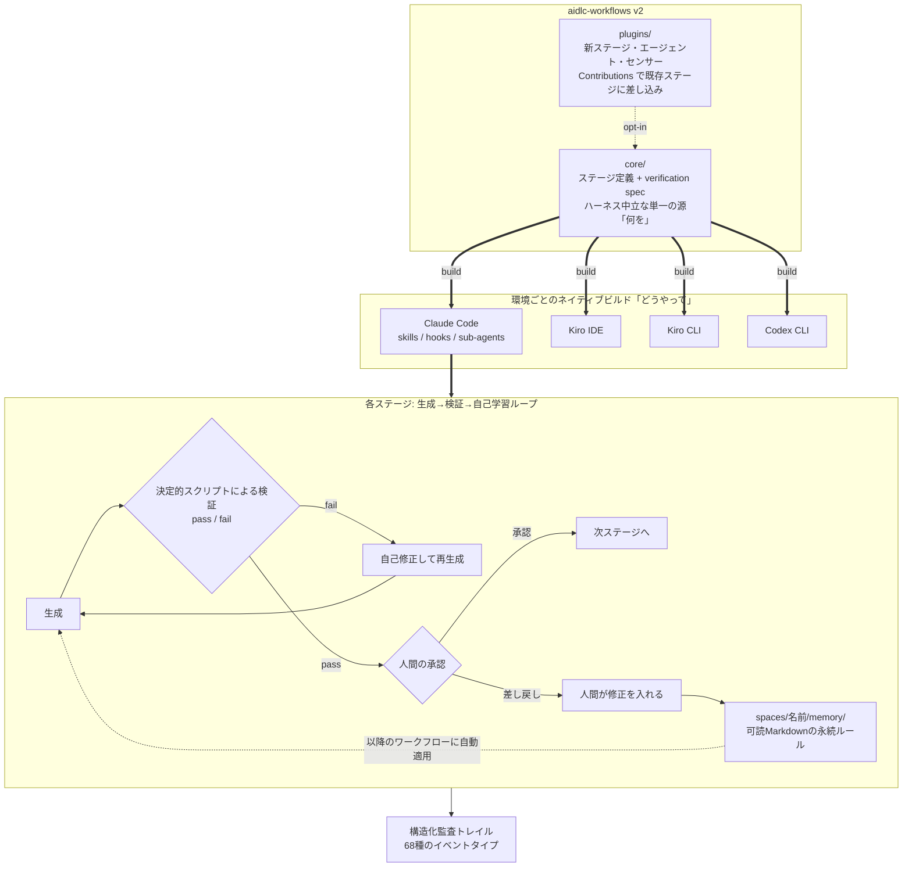
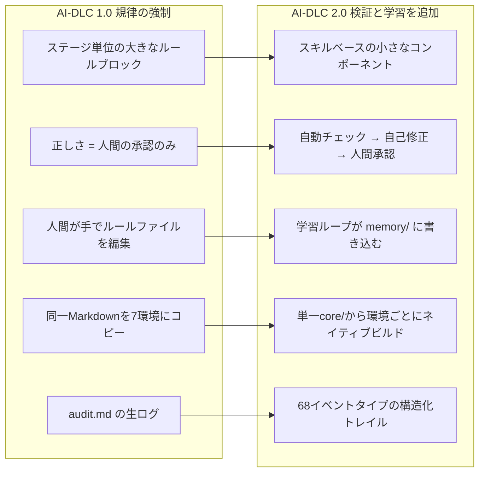
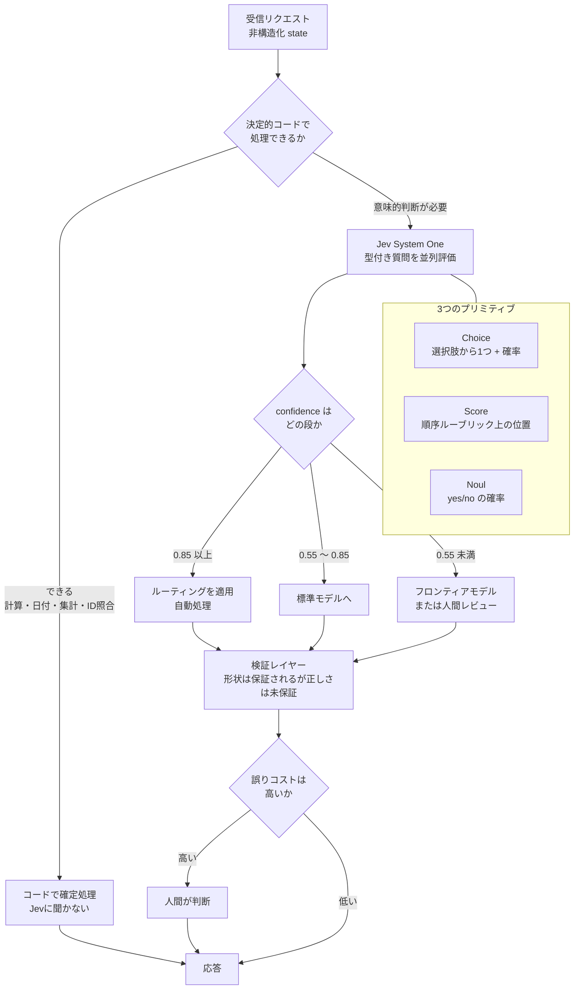
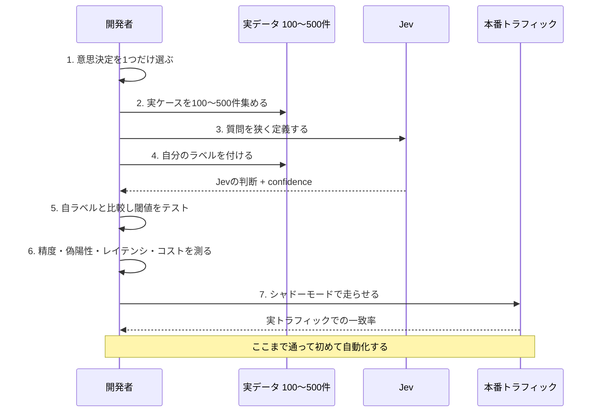

# Daily Briefing 2026-10-18

## 1. エージェンティック継続的デリバリー（ACD）（原題: Agentic Continuous Delivery (ACD)）

- **URL**: https://beyond.minimumcd.org/docs/agentic-cd/
- **公開日**: 2026-10-08（最終更新）
- **著者・媒体**: Michael Kusters / Bryan Finster（図版: Scott Prugh）、MinimumCD.org Practice Guide（CC BY 4.0）

### 本文翻訳

ACD（Agentic Continuous Delivery）は、AI エージェントがデリバリーパイプラインに変更を投入するようになったときに追加で必要となる **制約・成果物・プラクティス** を定義した実践ガイドである。副題は「継続的デリバリーを、AI エージェントが生成した変更のための制約・デリバリー成果物・プラクティスで拡張する」。重要な前提として、ACD は **チームがすでに継続的デリバリーを実践していること** を出発点に置く。

ガイドの中心にある唯一のルールはこうである。「エージェントが生成した変更は、人間が生成した変更と同じ品質基準を満たす、または超えなければならない」。パイプラインが判定するのは *誰が書いたか* ではなく、コードが正しいか・テストされているか・デプロイして安全かである。ケースによってはエージェントの作業にはより高い厳格さが必要になることもある。

**エージェント投入前に機能していなければならない前提条件**は8つ挙げられている。(1) 継続的インテグレーション — すべての作業が少なくとも日次で trunk に統合され、ビルドとテストが自動化されている。(2) テストの基礎 — あらゆる変更をストレステストし、オンデマンドでデリバリー可能かを判定できるテストアーキテクチャ。(3) ビルド自動化 — 単一コマンドでビルド・テスト・パッケージングが完了する。(4) 作業分解 — 2日以内にデリバリー可能なインクリメント。(5) コードレビュー — フローを止めない速いフィードバック。(6) Everything as code — インフラ・パイプライン・設定・スキーマがバージョン管理されている。(7) 本番への単一経路 — すべての変更が同じ自動パイプラインを通る。(8) 決定的なパイプライン — 同じ入力が常に同じ出力を生む。ガイドはこれらが欠けた状態でエージェントを入れると、**エージェントは既存の問題を増幅させる** と警告する。

**ACD の制約（MinimumCD への拡張）**は8項目。(1) すべての変更に、明示的で人間が所有する intent が存在する。(2) intent とアーキテクチャがデリバリー成果物として表現される。(3) すべての成果物がバージョン管理され、変更と一緒にデリバリーされる。(4) 意図した振る舞いが実装とは独立に仕様化される。(5) intent・テスト・実装・アーキテクチャ間の一貫性が強制される。(6) エージェント生成の変更は文書化されたすべての制約に準拠しなければならない。(7) **変更を実装したエージェントは、その変更を本番へ昇格させられてはならない**。(8) **パイプラインが赤の間、エージェントはパイプラインの健全性を回復する変更しか生成してはならない**。これらは「必須プラクティス」ではなく、エージェントが変更を行うようになった後もデリバリーのペースを維持するための **最低条件** だとされる。

**エージェント・デリバリー契約**: 各変更は、intent・振る舞い・制約・受入基準・システムレベルのルールをカバーする構造化ドキュメントによって固定される。エージェントは成果物を読み、生成してよいが、**自らの権限を再定義することはできない**。説明責任は人間に残る。

**根拠**として4点が示される。エージェントは人間がレビューできる速度より速く変更を生産できる。エージェントはビジネスルール・規範・アーキテクチャ上の意図といった、明文化されていない文脈を読めない。エージェントは自動テストを通過しながら intent に違反するコードを書くことがある。追加の成果物がなければ、ドリフトと技術的負債はチームが検出できる速度より速く蓄積する。

**ACD ワークフロー（段階別の役割分担）**は表で整理される。intent 記述では人間が問題記述と仮説を所有し、エージェントは曖昧さを発見しエッジケースを提案する。ユーザー向け振る舞いでは人間が BDD シナリオを定義・承認し、エージェントが草案とギャップを出す。機能記述では人間が制約と境界を設定、エージェントはアーキテクチャ上の考慮点を提案。受入基準では人間が閾値と評価設計を定義、エージェントが非機能基準を草案化し一貫性を検査。仕様検証は実装前のゲートで、エージェントが全成果物の矛盾をレビューする。テスト生成はエージェントが仕様から生成しパイプラインが検証（人間レビューは暫定）。実装はエージェントが **シナリオごとに1つの小バッチセッション** でコードを生成し、パイプラインが全テストを実行。コードレビューは暫定的に人間が行うが、**エキスパート検証エージェントが段階的に人間のレビューを置き換えていく**。デプロイは他のあらゆる変更と同じパイプラインを通る。

各仕様段階は **4ステップのサイクル** に従う: 人間が草案を書く → エージェントが批評する → 人間が決定する → エージェントが洗練する。テスト検証とコードレビューにおける人間のレビューは暫定状態であり、標準的な CD の置き換えサイクルを通じて置換されていく。

### 重要ポイント
- ACD の前提は「すでに CD ができていること」。CI・テストアーキテクチャ・単一の本番経路・決定的パイプラインが欠けた状態でエージェントを入れると既存の問題が増幅される
- 単一の品質基準: エージェント生成の変更は人間の変更と同等以上の基準を満たす。パイプラインは「誰が書いたか」を見ない
- 権限分離が明文化されている — 実装したエージェントは本番昇格できず、パイプラインが赤の間は健全性回復以外の変更を生成できない
- 仕様段階は「人間が草案 → エージェントが批評 → 人間が決定 → エージェントが洗練」の4ステップ。意思決定は常に人間側に残る
- 人間によるテスト検証とコードレビューは **暫定状態** と明記され、検証エージェントによる段階的置換が想定されている

### 図解



### 現場での適用方法

ACD の8制約のうち、ツールで強制できるのは「権限分離」と「パイプライン赤時の抑制」である。まず CLAUDE.md に行動規範として書き、次に hook で機械的に強制する。

**(1) CLAUDE.md への追記例**

````markdown
## ACD（Agentic Continuous Delivery）運用ルール

本リポジトリはエージェント生成の変更に ACD 制約を適用する。

### 単一の品質基準
エージェントが生成した変更は、人間が生成した変更と**同等以上**の品質基準を満たす。
「AI が書いたので簡易レビューでよい」は認めない。パイプラインは作者を見ない。

### 権限分離（絶対）
- 変更を実装したセッションは、その変更を本番へ昇格させてはならない
  （`deploy`, `promote`, `release` 系コマンドの実行、本番向けタグの push は禁止）
- 昇格は人間、または実装に関与していない別の検証エージェントが行う

### パイプラインが赤のとき
`main` の CI が失敗している間は、**パイプラインの健全性を回復する変更以外を生成しない**。
新機能・リファクタリング・依存更新は CI が緑に戻るまで着手しない。
着手前に必ず CI 状態を確認する。

### intent 成果物を変更と一緒にコミットする
すべての変更には人間が所有する intent が存在し、`specs/<change-id>/` 配下に置く。
- `intent.md`   … 問題記述と仮説（人間が所有。エージェントは編集せず批評する）
- `behavior.md` … BDD シナリオ（Given/When/Then）
- `criteria.md` … 受入基準と閾値（非機能含む）
実装コードだけの PR は不可。intent・振る舞い・テスト・実装の一貫性が取れていること。

### 仕様段階の4ステップサイクル
人間が草案 → エージェントが批評（曖昧さ・エッジケース・矛盾を列挙）→ 人間が決定 → エージェントが洗練。
エージェントは自らの権限・ルールを再定義してはならない。
`specs/` と本ファイルの制約節は、エージェントによる書き換え対象外。

### 実装の粒度
1シナリオ = 1小バッチセッション。複数シナリオを1セッションで実装しない。
作業は2日以内にデリバリー可能な単位に分解する。
````

**(2) スクリプト化の例 — パイプライン赤のときエージェントを止める hook**

`.claude/hooks/acd-guard.sh`:

```bash
#!/usr/bin/env bash
# ACD制約(7)(8)の機械的強制:
#   - パイプラインが赤の間は健全性回復以外の変更を禁止
#   - 実装セッションによる本番昇格を禁止
# 設置: .claude/hooks/acd-guard.sh（実行権限を付与）
set -euo pipefail

INPUT=$(cat)
TOOL=$(printf '%s' "$INPUT" | jq -r '.tool_name // ""')
CMD=$(printf '%s'  "$INPUT" | jq -r '.tool_input.command // ""')
FILE=$(printf '%s' "$INPUT" | jq -r '.tool_input.file_path // ""')

deny() { printf '{"decision":"block","reason":%s}\n' "$(jq -Rn --arg m "$1" '$m')"; exit 0; }

# --- 制約(7): 実装セッションは本番昇格できない ---
if [[ "$TOOL" == "Bash" ]]; then
  if printf '%s' "$CMD" | grep -qiE '(^|[[:space:];&|])(deploy|promote|release)([[:space:]]|$)|push[[:space:]].*(refs/tags|--tags)|gh[[:space:]]+release[[:space:]]+create'; then
    deny "ACD制約(7)違反: 変更を実装したセッションは本番へ昇格できません。昇格は人間、または実装に関与していない検証エージェントが行ってください。"
  fi
fi

# --- 制約(8): パイプラインが赤の間は健全性回復のみ ---
if [[ "$TOOL" == "Edit" || "$TOOL" == "Write" || "$TOOL" == "NotebookEdit" ]]; then
  STATE_FILE=".git/acd-pipeline-state"
  # 60秒キャッシュ（毎回APIを叩かない）
  if [[ ! -f "$STATE_FILE" ]] || [[ $(( $(date +%s) - $(stat -c %Y "$STATE_FILE" 2>/dev/null || echo 0) )) -gt 60 ]]; then
    # <DEFAULT_BRANCH> は環境に合わせて置換
    gh run list --branch "<DEFAULT_BRANCH>" --limit 1 \
      --json conclusion --jq '.[0].conclusion // "unknown"' > "$STATE_FILE" 2>/dev/null \
      || echo "unknown" > "$STATE_FILE"
  fi
  STATE=$(cat "$STATE_FILE")

  if [[ "$STATE" == "failure" ]]; then
    # 健全性回復作業の宣言ファイルがあれば許可
    if [[ ! -f ".acd-fixing-pipeline" ]]; then
      deny "ACD制約(8)違反: <DEFAULT_BRANCH> の CI が失敗しています。パイプラインの健全性を回復する変更のみ許可されます。復旧作業であれば '.acd-fixing-pipeline' を作成し、復旧後に削除してください。"
    fi
  fi

  # --- intent成果物の保護: 人間所有のファイルはエージェント編集不可 ---
  case "$FILE" in
    */specs/*/intent.md|specs/*/intent.md)
      deny "intent.md は人間が所有する成果物です。エージェントは編集せず、曖昧さ・エッジケース・矛盾の指摘のみ行ってください。" ;;
  esac
fi

exit 0
```

`.claude/settings.json` への登録:

```json
{
  "hooks": {
    "PreToolUse": [
      {
        "matcher": "Bash|Edit|Write|NotebookEdit",
        "hooks": [
          { "type": "command", "command": "$CLAUDE_PROJECT_DIR/.claude/hooks/acd-guard.sh" }
        ]
      }
    ]
  }
}
```

**(3) 運用手順 — 前提条件8項目の自己診断**

```bash
# ACD導入前の自己診断。1つでも落ちたらエージェント投入より前にそこを直す
set -u
echo "== (1) CI: trunk への統合頻度（直近7日のmainコミット日数）=="
git log --since="7 days ago" --date=short --pretty=%ad origin/<DEFAULT_BRANCH> | sort -u | wc -l
#   => 5以上なら日次統合が成立している目安

echo "== (3) ビルド自動化: 単一コマンドで build+test+package できるか =="
ls -1 Makefile Taskfile.yml justfile package.json 2>/dev/null
#   => make all / task ci / npm run ci 相当が1本で通ること

echo "== (4) 作業分解: PRのオープンからマージまでの中央値（日）=="
gh pr list --state merged --limit 50 --json createdAt,mergedAt \
  --jq '[.[] | (((.mergedAt|fromdate) - (.createdAt|fromdate)) / 86400)] | sort | .[length/2|floor]'
#   => 2以下が目標

echo "== (6) Everything as code: 設定・インフラ・スキーマがリポジトリ内にあるか =="
ls -d .github/workflows infra terraform k8s migrations db/migrate 2>/dev/null

echo "== (7) 本番への単一経路: デプロイを行う workflow が1本に収斂しているか =="
grep -rlE 'environment:\s*production|deploy.*prod' .github/workflows/ 2>/dev/null

echo "== (8) 決定的パイプライン: ロックファイルが存在し固定されているか =="
ls -1 package-lock.json yarn.lock pnpm-lock.yaml poetry.lock uv.lock Gemfile.lock go.sum Cargo.lock 2>/dev/null
```

### 期待効果

ACD は「エージェントを入れると速くなる」ではなく **「エージェントを入れてもデリバリーのペースが崩れない最低条件」** を定義する。期待できる効果は、(a) レビュー律速の可視化 — エージェントは人間がレビューできる速度より速く変更を生産するという前提が明文化されるため、レビュー能力の増強（検証エージェント、仕様からのテスト自動生成）に投資判断が向く。(b) ドリフトの早期検出 — intent・振る舞い・受入基準をバージョン管理された成果物として変更と同時にデリバリーするため、「テストは通るが intent に違反する」変更が仕様検証ゲートで止まる。(c) 事故の構造的予防 — 制約(7)(8) は権限と状態による機械的制約であり、プロンプトの言い回しに依存しない。本文中に定量データの提示はない（本ガイドは測定結果ではなく実践基準の文書である）。

### 注意点

- **最大の落とし穴は前提条件の無視**。ガイド自身が「これらが欠けた状態でエージェントを入れるとエージェントは既存の問題を増幅させる」と明記している。CI が日次で回っていない、テストが変更をストレステストできない、本番への経路が複数ある状態で ACD の制約だけを導入しても効果はない。順序は「CD を成立させる → ACD 制約を足す」
- 8つの制約は「必須プラクティス」ではなく「ペースを維持するための最低条件」と位置づけられている。チェックリストとして機械的に満たすのではなく、各制約が防いでいる失敗モード（レビュー律速、暗黙文脈の欠落、テスト通過かつ intent 違反、ドリフト蓄積）に自組織が該当するかで取捨する
- 「人間によるテスト検証とコードレビューは暫定状態」という記述を、レビュー省略の根拠に読み替えないこと。ガイドは **検証エージェントによる置換** を条件としており、置き換える先がないまま人間レビューを外すのは制約(5)(6) の放棄にあたる
- 制約(7) の権限分離は、CI/CD の認証情報設計まで踏み込まないと形骸化する。エージェントのセッションに本番デプロイ権限のあるトークンが渡っていれば、hook は回避可能な「お願い」にとどまる。トークンスコープの分離が本来の実装である
- 本ガイドは MinimumCD の拡張であり、原典の MinimumCD 要件（trunk ベース開発、継続的テスト、不変アーティファクト等）を前提とする。MinimumCD 自体を実践していない組織では、まずそちらを参照する必要がある

## 2. AI-DLC は進化を続ける — 自己修正型開発手法「2.0」と Spec-Driven Development スクラムの現在地（原題: AI-DLC Continues to Evolve — The Self-Correcting Development Methodology "2.0" and the Current State of Spec-Driven Development Scrums）

- **URL**: https://note.com/pompom_purin_ai/n/n06f4938a7063
- **公開日**: 2026-07-19
- **著者・媒体**: ポムポムぷりん（note）

### 本文翻訳

本稿は AWS の AI 駆動開発コンポーネントを扱った前稿の続編で、**AI-DLC 1.0 から 2.0 への作り直し** と、**AI-DLC 実装群および競合する SDD ツールのエコシステム** という2つの主題を扱う。

**なぜ 2.0 が作られたか。** AI-DLC Workflows 2.0 は 2026年5月19日（JST）にアルファ版として公開された。当初は Kiro のみをサポートし「本番利用は不可」の警告付きだったが、その後複数のエージェント環境にまたがる GA Preview に到達している。中心的な目標は **AI エージェントを検証可能で自己修正するエンジニアリングワークフローに変えること**。1.0 から得られた教訓は3つある。(1) **設定粒度をより細かくする** — ルールを大きなステージ単位の章から、小さなスキル単位のコンポーネントへ移し、必要な部分だけがロードされるようにする。(2) **正しさの明示的な基準** — verification spec（検証仕様）を定義し、自己評価ではなく **決定的なスクリプトが pass/fail を返す** 形で裏付ける。(3) **エージェントのネイティブ機能を使う** — すべてのツールに同一の Markdown をコピーするのではなく、各ハーネス固有の機能（Claude Code の skills・hooks・sub-agents、Kiro の相当機能）を使う。

**v1 と v2 の差分**は6領域で比較される。設定単位: 大きなステージレベルのルールブロック → 小さなスキルベースのコンポーネント。正しさ: 人間の承認のみ → 人間承認の前に自動チェックが入り、失敗時は自己修正。ガイダンス: 人間が手でルールファイルを編集 → 学習ループが修正を `memory/` に書き込む。配布: 同一 Markdown を7環境にコピー → 単一の `core/` から環境ごとにネイティブビルド。監査: `audit.md` の生ログ → **68種のイベントタイプによる構造化トレイル**。カスタマイズ: オプトイン拡張 → `spaces/memory/` を編集する経路と、プラグインを作る経路の2通り。著者のまとめは「v1 は規律を強制するものであり、v2 はその上に検証と学習を足して、承認の回数を減らすのではなく **後段で必要になる人間レビューの量そのものを減らす**」。

**生成 → 検証 → 自己学習ループ。** 各ステージは生成を行い、次に決定的な検証を行い、失敗時は再生成する。その後に人間の承認が続く。学習ループは人間による修正を `memory/` 内の永続ルールとして記録し、以降のワークフローが自動的に適用する。セッションの再開も柔軟になり、チェックポイントからの継続・リトライ・特定ステージへのジャンプ・やり直しが選べる。著者はこの学習を、不透明な重み更新ではなく **可読な Markdown を保存する** ため透明だと評価する。

**ハーネスエンジニアリング。** 「Agent = Model + Harness」という概念は、エージェントの性能がモデル単体ではなく、周囲の実行環境（ツール、ルール、hooks、コンテキスト管理）に依存することを示す枠組みである。v2 はハーネス中立な `core/` を単一の源（「何を」）として保ち、環境ごとに skills・agents・hooks・tools を生成する（「どうやって」）。対象は Claude Code、Kiro IDE、Kiro CLI、Codex CLI。著者はこれを「最小公倍数をコピーする」段階から「ハーネスの差異を積極的に設計する」段階への移行と表現する。前稿の「重複なし」原則が、いまはビルドを通して適用されている。

ディレクトリ構成（Preview 段階の概念）: aidlc-workflows (v2) 側では `core/` がステージ定義と検証仕様を保持し、生成された配布物がハーネスごとの skills・agents・hooks・tools を保持、`plugins/` がサンプルの test-pro を含むアドオンパッケージを保持する。プロジェクト側では `aidlc/spaces/<space-name>/memory/` が、学習ループが実行時にルールを蓄積する場所となる。カスタマイズ経路は2つ。経路1: `core/` に触らずプロジェクト固有の調整を `spaces/memory/` で行う。経路2: 新しいステージ・エージェント・センサーのためにプラグインを作る。「Contributions」は既存ステージを書き換えずに処理を差し込む仕組みで、コンプライアンスルールをオプトインパッケージとして配布できる。

**コミュニティの AI-DLC 実装。** ijin/aidlc-cc-plugin（チャットベースの Q&A、`audit.md` へのタイムスタンプ付き意思決定記録、セッション再開を使う Claude Code プラグイン）、ikeisuke/ai-dlc-starter-kit（日本発。設計/実装の2段階分割、KPT 形式のレビュー、外部 AI レビューを備えた Claude Code skills）、aws-samples/sample-aidlc-code-reviewer（ruff・mypy・bandit といった静的解析と AI 批評の組み合わせ）、specs.md（DDD を含む3段階のセレモニーレベルを持つ忠実な AI-DLC 実装を主張）、GitHub topic「aidlc」（プロンプトと IDE 横断フォークの草の根コレクション）、国内スタートアップ事例（AI-DLC をスキル化し、複数リポジトリ対応と自動メトリクス収集を備え、「continue」のような曖昧な指示から適切なスキルを選択する）。

**SDD のランドスケープ。** 2026年初頭までに **30を超える SDD ツール** が競合した。著者は「セレモニー」を、手法が要求する標準化された手続きの数と重さとして説明する。Kiro（AWS）は requirements・design・task ファイルを生成し受入基準に EARS 記法を使う spec-first IDE で、2025年11月 GA、AI-DLC 2.0 が最初に対象とした。GitHub Spec-Kit は **9万を超えるスター** を持つオープンソースツールキットで、プロジェクトの「constitution」から spec・計画・実装へ進む。VS Code + Copilot で最も始めやすい。BMAD-METHOD は最も重く、12〜21以上のロールベースエージェントと4万超のスターを持ち、すでに調整に苦しんでいるチームに向く。GSD（get-shit-done）は2025年12月の軽量・低セレモニーなフレームワークで、5か月で6万超のスター。OpenSpec は変更にフォーカスし、修正を ADDED/MODIFIED/REMOVED の差分として記述してトークンを節約する。その他 Tessl（仕様をソースとし、生成コードの手編集を推奨しない）、Spec Kitty（git worktrees による並行作業）。

**AI-DLC の位置づけ。** フェーズ・セレモニー・成果物・承認ゲート・監査トレイルをカバーする、最もガバナンス指向の選択肢である。著者は金融・医療・公共のような規制産業に向くとする一方、批判として **承認トレイルは概念的な明晰さやアーキテクチャの一貫性を保証しない** 点を挙げる。選定の指針（著者の見解）: 個人・小規模プロジェクトなら GSD か OpenSpec、仕様品質重視なら Spec-Kit か Kiro、ロールの混乱があるなら BMAD、監査・統制・組織展開なら AI-DLC。著者はまた収斂も観察している — AI-DLC 2.0 は自律性陣営から完了基準と品質ゲートを取り入れ、規律陣営のドリフト検出と設計意図は共通の関心事になりつつある。

結論は4点。(1) AI-DLC 2.0 はスキルベースの合成・明示的な検証・ツール固有の最適化に、生成 → 検証 → 自己学習ループを足した。(2) ハーネスエンジニアリングは単一の `core/` から環境ごとのネイティブ実装を生成する。(3) コミュニティ実装は Claude Code プラグイン・スターターキット・商用ツールへと増殖している。(4) SDD ランドスケープにおいて AI-DLC は統制・監査指向の選択肢であり、その重さは他の場面では欠点だが規制産業では利点になる。著者は本手法を「フィードバックを食べて育つ鋳型」と表現して結んでいる。

### 重要ポイント
- v2 の核心は **「決定的なスクリプトが pass/fail を返す verification spec」**。エージェントの自己評価を正しさの基準から外し、失敗時は人間承認の前に自己修正させる
- ルールの単位がステージ単位の大きな章から **スキル単位の小さなコンポーネント** へ移り、必要な分だけロードされる（コンテキスト効率）
- 「Agent = Model + Harness」。単一の `core/` を源に、Claude Code / Kiro IDE / Kiro CLI / Codex CLI それぞれのネイティブ機能へビルドする。同一 Markdown の7環境コピーを廃止
- 学習ループは人間の修正を `spaces/<name>/memory/` に **可読な Markdown の永続ルール** として書き込み、以降自動適用する。重み更新ではないため透明
- SDD ツールは30超が競合。セレモニーの重さで選ぶ — 個人は GSD/OpenSpec、仕様品質は Spec-Kit/Kiro、ロール混乱は BMAD、監査・組織展開は AI-DLC
- 批判の要点: **承認トレイルは概念的明晰さやアーキテクチャ一貫性を保証しない**

### 図解



v1 と v2 の比較:



### 現場での適用方法

AI-DLC 2.0 を丸ごと導入せずとも、**「決定的スクリプトが pass/fail を返す verification spec」** と **「人間の修正を memory/ に永続ルールとして書き戻す学習ループ」** の2つは、既存の Claude Code プロジェクトにそのまま移植できる。この2つが v1 → v2 の本質である。

**(1) スキル化の例 — verification spec を持つステージスキル**

`.claude/skills/verified-stage/SKILL.md`:

````markdown
---
name: verified-stage
description: AI-DLC 2.0 流の「生成→決定的検証→自己修正」でステージ成果物を作る。設計・仕様・実装などの成果物を人間レビューに回す前に、スクリプトによる pass/fail 検証を通す必要があるときに使う。エージェントの自己評価は正しさの根拠にしない。
---

# 検証付きステージ実行

## 原則
- **正しさの基準はエージェントの自己評価ではない。** 決定的なスクリプトが返す pass/fail だけが根拠。
- 検証に失敗した成果物を人間レビューに回さない。自己修正して再生成する。
- 人間が入れた修正は使い捨てにしない。`memory/` の永続ルールに昇格させる。

## 手順

1. **memory を先に読む**（最重要）
   `aidlc/spaces/<space>/memory/*.md` を全部読む。過去に人間から指摘された修正が
   永続ルールとして入っている。生成前に必ず適用する。

2. **生成**
   `core/stages/<stage>.md` のステージ定義に従って成果物を生成する。

3. **決定的検証**
   ```
   ./scripts/verify.sh <stage> <artifact-path>
   ```
   - 終了コード 0 = pass、非0 = fail
   - **自分で「問題なさそう」と判断してはならない。必ずスクリプトを実行する。**

4. **fail なら自己修正**
   スクリプトの出力（違反した検証項目）だけを根拠に修正し、手順3へ戻る。
   最大3周。3周で pass しなければ、違反項目と試した修正を列挙して人間に渡す。

5. **pass したら人間承認へ**
   成果物・検証ログ・適用した memory ルールの一覧を提示する。

6. **人間から修正が入ったら memory に書き戻す**（学習ループ）
   指摘が「このプロジェクトで今後も成り立つ規則」なら、
   `aidlc/spaces/<space>/memory/<topic>.md` に追記する。
   一回限りの事情なら書かない。判断に迷うときは人間に確認する。

## 書式: memory の永続ルール
```markdown
## <規則の要約>
- **規則**: <今後常に守ること>
- **理由**: <なぜ。背景の制約>
- **由来**: <YYYY-MM-DD の人間レビュー指摘>
```

## やらないこと
- 検証スクリプトを自分に都合よく書き換えること（`scripts/verify.sh` は編集対象外）
- 検証を飛ばして人間承認に進むこと
- memory/ の既存ルールを、理由の確認なしに削除・緩和すること
````

**(2) スクリプト化の例 — verification spec の決定的ランナー**

`scripts/verify.sh`:

```bash
#!/usr/bin/env bash
# AI-DLC 2.0 の verification spec を実行する。
# 正しさの基準はエージェントの自己評価ではなく、このスクリプトの終了コード。
#   使い方: ./scripts/verify.sh <stage> <artifact-path>
#   終了コード: 0 = pass, 1 = fail
set -uo pipefail

STAGE="${1:?usage: verify.sh <stage> <artifact-path>}"
ARTIFACT="${2:?usage: verify.sh <stage> <artifact-path>}"
SPEC="core/verification/${STAGE}.yaml"

[[ -f "$SPEC" ]]     || { echo "FAIL: 検証仕様がない: $SPEC"; exit 1; }
[[ -f "$ARTIFACT" ]] || { echo "FAIL: 成果物がない: $ARTIFACT"; exit 1; }

FAILED=0
pass() { echo "  PASS  $1"; }
fail() { echo "  FAIL  $1"; FAILED=1; }

echo "== verification spec: $STAGE =="

# 検証仕様から check を1件ずつ読んで実行する（決定的・自己評価なし）
#   core/verification/design.yaml の例:
#     checks:
#       - id: has-acceptance-criteria
#         desc: "受入基準セクションが存在する"
#         type: grep
#         pattern: "^## 受入基準"
#       - id: no-todo
#         desc: "TODO/TBD が残っていない"
#         type: grep_absent
#         pattern: "TODO|TBD|XXX"
#       - id: ears-notation
#         desc: "受入基準が EARS 記法である"
#         type: grep
#         pattern: "(WHEN|WHILE|IF|WHERE) .+ (THEN )?the .+ shall"
#       - id: tests-green
#         desc: "関連テストが通る"
#         type: command
#         run: "npm test -- --findRelatedTests"

COUNT=$(yq '.checks | length' "$SPEC")
for i in $(seq 0 $((COUNT - 1))); do
  ID=$(yq -r ".checks[$i].id"   "$SPEC")
  DESC=$(yq -r ".checks[$i].desc" "$SPEC")
  TYPE=$(yq -r ".checks[$i].type" "$SPEC")

  case "$TYPE" in
    grep)
      PAT=$(yq -r ".checks[$i].pattern" "$SPEC")
      grep -qE "$PAT" "$ARTIFACT" && pass "$ID: $DESC" || fail "$ID: $DESC"
      ;;
    grep_absent)
      PAT=$(yq -r ".checks[$i].pattern" "$SPEC")
      grep -qE "$PAT" "$ARTIFACT" && fail "$ID: $DESC" || pass "$ID: $DESC"
      ;;
    command)
      RUN=$(yq -r ".checks[$i].run" "$SPEC")
      if bash -c "$RUN" >/dev/null 2>&1; then pass "$ID: $DESC"; else fail "$ID: $DESC"; fi
      ;;
    *)
      fail "$ID: 未知の検証タイプ '$TYPE'"
      ;;
  esac
done

if [[ $FAILED -eq 0 ]]; then
  echo "== RESULT: pass =="; exit 0
else
  echo "== RESULT: fail（上記 FAIL 項目のみを根拠に修正し、再実行すること）=="; exit 1
fi
```

**(3) 運用手順 — 既存プロジェクトへの最小導入**

```bash
# 1. ディレクトリを作る（<SPACE_NAME> は機能・チーム単位の作業空間名）
mkdir -p core/{stages,verification} \
         aidlc/spaces/<SPACE_NAME>/memory \
         scripts .claude/skills/verified-stage

# 2. 最初の verification spec を1ステージ分だけ書く（全ステージを一度に作らない）
cat > core/verification/design.yaml <<'YAML'
checks:
  - id: has-acceptance-criteria
    desc: "受入基準セクションが存在する"
    type: grep
    pattern: "^## 受入基準"
  - id: no-todo
    desc: "TODO/TBD が残っていない"
    type: grep_absent
    pattern: "TODO|TBD|XXX"
YAML

# 3. ランナーを置いて実行権限を付ける
chmod +x scripts/verify.sh

# 4. 検証スクリプトをエージェントの編集対象から外す（自分に都合よく書き換えさせない）
cat >> .claude/settings.json.example <<'JSON'
{ "permissions": { "deny": ["Edit(scripts/verify.sh)", "Write(scripts/verify.sh)",
                            "Edit(core/verification/**)", "Write(core/verification/**)"] } }
JSON

# 5. 1ステージで2〜3週間回し、memory/ に蓄積されたルールを棚卸ししてから次のステージへ広げる
ls -la aidlc/spaces/<SPACE_NAME>/memory/
```

### 期待効果

著者が示す v2 の狙いは **「承認の回数を減らすのではなく、後段で必要になる人間レビューの量そのものを減らす」** ことである。機構別に見ると、(a) 決定的検証の前置きにより、フォーマット不備・TODO 残り・受入基準欠落といった機械判定可能な欠陥が人間レビューに到達しなくなる。(b) 学習ループにより、同じ指摘の再発が減る — 人間の修正が `memory/` の永続ルールになり以降自動適用されるため、レビューコストが一回払いになる。(c) スキル単位のルールロードにより、ステージ単位の巨大ルールブロックを常時読み込む必要がなくなりコンテキストが節約される。(d) 単一 `core/` からのネイティブビルドにより、7環境への Markdown コピーで生じていた同期ずれがなくなる。(e) 68イベントタイプの構造化監査トレイルにより、規制産業で要求される追跡可能性が得られる。記事中に削減率等の定量データの提示はない（ツールの設計と狙いの解説であり測定レポートではない）。

### 注意点

- **著者自身が引く批判が最重要**: 「承認トレイルは概念的な明晰さやアーキテクチャの一貫性を保証しない」。ゲートと監査ログを積んでも、仕様そのものが曖昧なら成果物は曖昧なままである。AI-DLC の重さを設計品質の代替物と見なさないこと
- AI-DLC 2.0 は記事執筆時点で **GA Preview**。アルファ公開時は Kiro のみ対応かつ「本番利用不可」の警告付きだった。ディレクトリ構成も「Preview 段階の概念」と注記されている。本番採用前に現行のバージョン・対応ハーネス・構成を一次情報で確認する必要がある
- **セレモニーの重さが選定基準**。著者の指針では個人・小規模プロジェクトは GSD か OpenSpec であり、AI-DLC は監査・統制・組織展開が必要な場合の選択肢。規制要件がない小規模チームが AI-DLC を選ぶとセレモニーだけが残る
- verification spec を決定的スクリプトで裏打ちする設計は、**スクリプトがエージェントの編集対象外である** ことに依存する。検証スクリプト自体を書き換えられる状態では自己評価に戻ってしまう。上記 (3) の deny 設定のような権限分離が必須
- 学習ループの `memory/` は放置すると矛盾したルールが蓄積する。可読な Markdown であることは棚卸しが可能という利点だが、棚卸しを行わない限り利点は実現しない。定期レビューを運用に組み込むこと
- 記事が挙げるスター数（Spec-Kit 9万超、GSD 6万超、BMAD 4万超）は人気の指標であり、自組織への適合度とは別物である。また記事は2026年7月時点の観測であり、30超のツールが競合する領域では勢力図が変わりやすい

## 3. Jev: 書くためではなく決めるために作られた AI（原題: Jev: AI Built to Decide, Not to Write）

- **URL**: https://arceapps.com/blog/jev-system-one-models/
- **公開日**: 2026-09-20
- **著者・媒体**: ArceApps Blog（著者名はページに記載なし／約26分の読み物）

### 本文翻訳

**問題設定。** エージェントシステムにおける多くの意思決定 — ルーティング、スキル選択、リスクスコアリング、ガードレール — は、生成された文章を必要としない。にもかかわらずチームは単純な意思決定を生成系 LLM に送り、その出力をパースし、検証し、リトライしている。著者の主張は、TypeSafe AI の **Jev** のような型付き値と確率を返すモデルがこうした境界のある意思決定を担い、コードがワークフローの制御を保ち、生成系 LLM が開放的な作業を扱えばよいというものである。要約すると **「AI が判断し、ソフトウェアが制御を保つ」**。

**System One Model とは何か。** Jev は非構造化の state と型付きの質問を受け取り、構造化された回答を返す。質問は **並列に評価される**。

**3つのプリミティブ。** **Choice** — 既知の選択肢集合から1つを選び、確率と confidence を返す。**Score** — 入力を順序付きのルーブリック上に配置する。**Noul** — yes/no の言明が真である確率を返す。

**アクセス手段。** Playground、直接の HTTP エンドポイント（`/v1/systemone`）、公式の Python（3.10+）および JS/TS（Node 20+）SDK。記事は各々の例を含む。

**エージェントツーリング。** Claude Code および Codex 互換エージェント向けの **公式 Agent Skill** が存在する。公式の CLI および MCP サーバーはドキュメントに記載がない。著者はコミュニティの CLI・MCP プロジェクトを挙げつつ、**公式のサーフェスとは別物として扱うよう推奨** している。

**8つのユースケース。** モデルルーティング、ツール／スキル選択、LLM ガードレール、RAG コンテキストのフィルタリング、セマンティックな CI チェック、issue トリアージ、リアルタイムアプリ、大規模データセットに対するセマンティック map-reduce。

**confidence とリスク。** confidence は **リスクポリシーに流し込むべき** であり、閾値は **アクションの誤りコストに応じて変える** こと。記事中の閾値例は、**0.85 以上ならルーティングを適用、0.55〜0.85 なら標準モデル、0.55 未満ならフロンティアモデルまたは人間レビュー**。

**ハルシネーションに関する留保。** Jev が保証するのは **出力の形状であって正しさではない**。著者はこの主張をこう言い換えるべきだとする — 「結果の形は保証できるが、すべての判断が正しいことは保証できない」。

**制約（Jev 1.13）。** 正確な計算、日付演算、多段推論、無関係な巨大コンテキスト、敵対的コンテンツ、テキスト生成には不向き。

**アーキテクチャ。** 決定的なコード、Jev、安価な／フロンティアの LLM、そして検証レイヤー。誤りコストが高い場合は人間が入る。

**ベンチマークへの留保。** ベンダーの主張としてレイテンシは約 70〜500ms、入力価格は100万トークンあたり $0.042、ピーク時の主張は **193.6倍高速・444.6倍安価**。著者はこれらに **独立した検証が必要** だと論じる。

**テスト計画（7ステップ）。** (1) 意思決定を1つ選ぶ。(2) 実データのケースを **100〜500件** 集める。(3) 質問を狭く定義する。(4) 自分のラベルと比較する。(5) 閾値をテストする。(6) 精度・偽陽性・レイテンシ・コストを測る。(7) **自動化の前にシャドーモードで走らせる**。

**結論。** Jev は LLM を置き換えない。LLM を **いつどう使うかをシステムに教える、高速な意思決定レイヤー** である。著者の問いはこうだ — 「意味的な意思決定を行うためだけに存在している LLM 呼び出しは、いくつあるか」。

Jev のローンチ日は2026年9月15日。

### 重要ポイント
- 「AI が判断し、ソフトウェアが制御を保つ」。境界のある意思決定（ルーティング・スキル選択・ガードレール・リスクスコア）に生成系 LLM を使い、出力をパースしてリトライするのをやめる
- プリミティブは3つだけ — Choice（選択肢から1つ＋確率）、Score（順序ルーブリック上の位置）、Noul（yes/no の確率）。質問は並列評価される
- **confidence は単一の閾値で使わず、アクションの誤りコストに応じて段位を切る**。記事例は 0.85以上→適用 / 0.55〜0.85→標準モデル / 0.55未満→フロンティアまたは人間
- 保証されるのは **出力の形状だけで、正しさではない**。スキーマが通ったことを正解の根拠にしてはいけない
- 1.13 の不得意領域が明確 — 正確な計算、日付演算、多段推論、無関係な巨大コンテキスト、敵対的コンテンツ、テキスト生成。これらはコード側に残す
- 導入は7ステップのテスト計画で。実ケース100〜500件に自分のラベルを付けて比較し、**自動化の前にシャドーモード**。ベンダー公称値（70〜500ms、$0.042/Mトークン、193.6倍高速・444.6倍安価）は独立検証が必要

### 図解



導入手順（7ステップのテスト計画）:



### 現場での適用方法

この記事の実務的な核は「7ステップのテスト計画」である。閾値を勘で決めず、**自分のラベルと比較して決める** 手順をスクリプトとして固定する。

**(1) スクリプト化の例 — 閾値をラベル付きデータから決める**

`scripts/jev-calibrate.py`:

```python
#!/usr/bin/env python3
"""Jev の confidence 閾値を、自分のラベル付きデータから決める。

記事の 7 ステップのうち (4) ラベル比較、(5) 閾値テスト、(6) 指標測定を担う。
入力 JSONL の各行: {"state": "...", "label": "<正解の選択肢>"}
  使い方: python3 scripts/jev-calibrate.py cases.jsonl
  前提:   TYPESAFE_API_KEY を環境変数に設定（コードに書かない）
"""
import json
import os
import statistics
import sys
import time

from typesafe import TypeSafe  # pip install typesafe-sdk  (Python 3.10+)

# --- 環境依存の値はここだけ ---
CASES_PATH = sys.argv[1] if len(sys.argv) > 1 else "<CASES_JSONL_PATH>"
MODEL = "<JEV_MODEL_VERSION>"          # 例: "jev-1.13.0" 閾値を調整するなら必ず固定する
CHOICES = ["<CHOICE_A>", "<CHOICE_B>", "<CHOICE_C>", "other"]  # "other" を必ず入れる
QUESTION = "<狭く定義した1つの質問>"
# 記事が挙げる段位の候補。自分のデータで検証する対象であって、そのまま使う値ではない
CANDIDATE_THRESHOLDS = [0.50, 0.55, 0.65, 0.75, 0.85, 0.90]

client = TypeSafe(api_key=os.environ["TYPESAFE_API_KEY"])


def ask(state: str) -> tuple[str, float, float]:
    """1 ケースを判定し (choice, confidence, 実測レイテンシms) を返す。"""
    t0 = time.perf_counter()
    res = client.system_one(
        model=MODEL,
        state=state,
        questions=[{"type": "choice", "prompt": QUESTION, "choices": CHOICES}],
    )
    latency_ms = (time.perf_counter() - t0) * 1000
    answer = res.answers[0]
    return answer.choice, answer.confidence, latency_ms


def main() -> None:
    cases = [json.loads(line) for line in open(CASES_PATH, encoding="utf-8") if line.strip()]
    if len(cases) < 100:
        print(f"警告: ケース数 {len(cases)} 件。記事の推奨は 100〜500 件。", file=sys.stderr)

    results, latencies = [], []
    for case in cases:
        choice, confidence, latency_ms = ask(case["state"])
        results.append({"label": case["label"], "choice": choice, "confidence": confidence})
        latencies.append(latency_ms)

    print(f"ケース数: {len(results)}  モデル: {MODEL}")
    print(f"レイテンシ p50={statistics.median(latencies):.0f}ms "
          f"p95={statistics.quantiles(latencies, n=20)[18]:.0f}ms")
    print()
    print("閾値    自動化率  自動分の精度  自動分の誤り  人手に回る件数")
    print("-" * 64)

    for threshold in CANDIDATE_THRESHOLDS:
        auto = [r for r in results if r["confidence"] >= threshold]
        escalated = len(results) - len(auto)
        if not auto:
            print(f"{threshold:.2f}      0.0%         -             -            {escalated}")
            continue
        correct = sum(1 for r in auto if r["choice"] == r["label"])
        wrong = len(auto) - correct
        print(f"{threshold:.2f}    {len(auto) / len(results):6.1%}      "
              f"{correct / len(auto):6.1%}       {wrong:4d} 件      {escalated:4d} 件")

    print()
    print("閾値の選び方: 『自動分の誤り』件数 × その誤りの実コストが許容範囲に収まる")
    print("最小の閾値を選ぶ。全アクションに同じ閾値を使わないこと。")
    print("低コストな誤り（タグ付けの間違い）と高コストな誤り（送金・削除）で段位を分ける。")


if __name__ == "__main__":
    main()
```

**(2) スクリプト化の例 — シャドーモードのラッパー**

記事の7ステップ目「自動化の前にシャドーモードで走らせる」を実装する。本番の判断は既存経路が行い、Jev の判断はログだけ取る。

```python
"""シャドーモード: Jev の判断を記録するが、本番の挙動には影響させない。"""
import logging
import os

from typesafe import TypeSafe

log = logging.getLogger("jev.shadow")
client = TypeSafe(api_key=os.environ["TYPESAFE_API_KEY"])

SHADOW_ONLY = os.environ.get("JEV_SHADOW", "1") == "1"  # 既定はシャドー。昇格は明示的に


def route(state: str, existing_decision: str) -> str:
    """既存ロジックの判断を返しつつ、Jev の判断を記録する。"""
    try:
        res = client.system_one(
            model="<JEV_MODEL_VERSION>",
            state=state,
            questions=[{"type": "choice", "prompt": "<質問>",
                        "choices": ["<A>", "<B>", "other"]}],
        )
        answer = res.answers[0]
        log.info(
            "jev_shadow",
            extra={
                "jev_choice": answer.choice,
                "jev_confidence": answer.confidence,
                "existing_decision": existing_decision,
                "agreed": answer.choice == existing_decision,
                "model": res.model,        # 返ってきた model を必ず記録する
            },
        )
    except Exception:
        # シャドーの失敗が本番経路を壊してはならない
        log.warning("jev_shadow_failed", exc_info=True)

    return existing_decision if SHADOW_ONLY else ...  # 昇格は一致率を確認してから
```

**(3) CLAUDE.md への追記例**

````markdown
## Jev（System One Model）利用ルール

### 使う場面 / 使わない場面
使う: ルーティング、ツール・スキル選択、ガードレール、RAG コンテキストのフィルタ、
      セマンティックな CI チェック、issue トリアージ、大規模データのセマンティック map-reduce。
使わない（Jev 1.13 の不得意領域。コード側に残す）:
- 正確な計算・集計 → コードで計算する
- 日付演算・順序付け → コードで行う（Jev に日付は文字列に見える）
- 多段推論 → フロンティアモデルへ
- 無関係な巨大コンテキスト → retrieval で絞ってから渡す
- テキスト・コードの生成 → Jev は生成できない

**判断基準: コードが正確に計算できることをモデルに聞かない。**

### 出力の扱い
Jev が保証するのは**出力の形状だけで、正しさではない**。
スキーマが通ったことを正解の根拠にしないこと。誤りコストが高い経路には検証レイヤーを置く。

### confidence の扱い
単一のグローバル閾値を使わない。**アクションの誤りコストごとに段位を切る。**
段位は `scripts/jev-calibrate.py` で自分のラベル付きデータ（100〜500件）から決める。
記事の例（0.85以上→適用 / 0.55〜0.85→標準モデル / 0.55未満→フロンティアか人間）は
出発点であって、検証せずに採用する値ではない。
確率分布が平坦な場合は、質問や選択肢の定義が悪い兆候として扱う。

### 実装規約
- Choice の選択肢には必ず `"other"` を入れる
- モデルバージョンを固定する（`jev-1.13.0` のように）。閾値を調整済みなら必須
- レスポンスの `model` フィールドを毎回ログに残す
- API キーはサーバー側のみ。クライアントに置かない
- **新しい意思決定を自動化する前に、必ずシャドーモードで一致率を測る**

### 公式 / 非公式の区別
公式サーフェスは Playground、HTTP エンドポイント `/v1/systemone`、Python(3.10+) / JS・TS(Node 20+) SDK、
および Claude Code・Codex 互換エージェント向けの Agent Skill。
コミュニティの CLI・MCP プロジェクトは公式とは別物として扱い、依存する場合はその旨を明記する。
````

### 期待効果

記事が示すベンダー公称値は、レイテンシ約 **70〜500ms**、入力価格 **100万トークンあたり $0.042**、ピーク時 **193.6倍高速・444.6倍安価**（著者はこれらに独立検証が必要と明記）。実務上期待できる構造的な効果は次の3点である。(a) **パース・検証・リトライのコード削減** — 型付き値が返るため、生成系 LLM の自由形式出力をパースして失敗時にリトライするラッパーが不要になる。(b) **意思決定レイヤーの分離によるコスト構造の変化** — 決定的コード／Jev／安価な LLM／フロンティア LLM／人間という段階構成により、大半のリクエストが安価な層で終わる。(c) **閾値による自動化率の制御** — confidence 段位を誤りコストに合わせて切ることで、「自動化率」と「誤りの件数」のトレードオフを数値で管理できる。(1) の校正スクリプトは、このトレードオフを閾値ごとの表として出すことを狙っている。

### 注意点

- **最大の誤解は「スキーマが通った = 正しい」**。著者が繰り返すとおり、保証されるのは結果の形だけである。型が合っていても判断内容は誤りうる。誤りコストが高い経路には必ず検証レイヤーか人間を置く
- **ベンダー公称値を前提に設計しないこと**。193.6倍高速・444.6倍安価・70〜500ms はいずれもベンダーの自己報告であり、著者が独立検証の必要を明記している。自分のデータ・自分の state サイズで測った値を使う
- **閾値をそのまま流用しない**。0.85 / 0.55 という記事中の数値は例であり、自分のラベル付きデータで校正すべき対象である。またアクションごとに段位を分けること（タグ付けの誤りと送金の誤りを同じ閾値で扱わない）
- **1.13 の不得意領域に投げない**。正確な計算、日付演算、多段推論、巨大な無関係コンテキスト、敵対的コンテンツ、テキスト生成。とくに日付はモデルから見れば文字列であり、順序付けはコード側の仕事である
- **state を信頼された入力として扱わない**。記事は敵対的コンテンツを不向きな領域に挙げている。ユーザー由来のテキストがそのまま state に入る設計では、判断を誘導されうる
- **公式と非公式のサーフェスを混同しない**。公式 CLI と MCP サーバーはドキュメントに記載がない。コミュニティ製に依存する場合は、公式のサポート対象外であることを前提に設計する
- 確率分布が平坦な場合は、モデルの限界ではなく **質問・選択肢の定義が悪い兆候** として扱う。閾値を下げて回避すべきではない
- ローンチが2026年9月15日の新しいモデルであり、記事自体も9月20日時点の観測である。価格・レート制限・モデルバージョン・制約事項は一次情報で再確認すること
