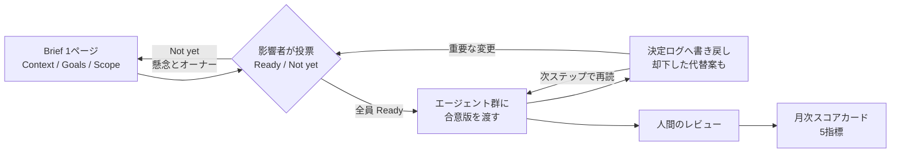
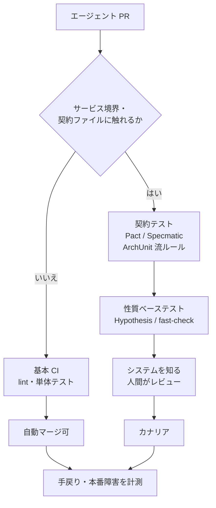
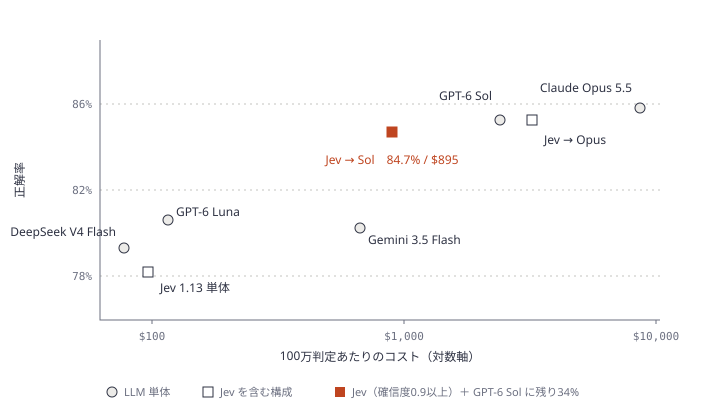
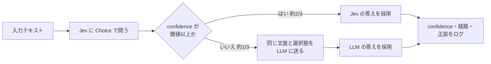

# Daily Briefing 2026-10-19

## 1. エージェントが動き出す前に — チームは何を作るかをどう合意し、より多くを同時に回すか（原題: Before the agents start: How engineering teams agree on what to build, then run more of it at once）

- **URL**: https://tryhamster.com/guides/before-the-agents
- **公開日**: 2026-10-05
- **著者・媒体**: Eyal Toledano（Hamster 創業者）/ Hamster Guides

### 本文翻訳

**作ることは安くなった。合意することは安くなっていない。** チームはすでに Claude Code・Cursor・Codex を使い、かつて1スプリントかかったものを午後のうちに書く。難所は移動した。エージェントが動き出す前の数分間（何を作らせるか決める時間）と、動いた後の数時間（全員が同じものを意図していたか判明する時間）だ。本ガイドはそこに向けて、**意図駆動開発（intent-driven development）**——方向付け・探索・デリバリーを、意図・決定・知識の単一の共有記録の上で連結したループとして回す実践——を説明する。

Bain によれば、アイデアからローンチまでの時間のうちコードを書いてテストする部分は約1/4〜1/3にすぎない。そこを10倍速くしても、決める・合意する・レビューする時間は残る。Faros が1万人超の開発者のテレメトリを見たところ、AI 採用率の高いチームでは**マージされた PR が98%増え、レビュー時間が91%増えた**。3人が同じチケットを別々に読めば、それぞれ微妙に違う「完了像」を持ち、各エージェントはその像を忠実に作る。以前はその食い違いが立ち会議や設計レビューでゆっくり表面化したが、今は3本の完成済み PR として一度に現れ、チームはレビューと手戻りで代価を払う。

**一段上で働く。** 同じ道具を持つ2人のエンジニアを考える。1人目はセッションを開いて機能を説明し、制約を貼り付け、2回修正して金曜までに1本出す。2人目は意図を一度書き、影響を受ける2人の合意を取り、合意版を3つのセッションに渡して自分はレビューと判断に回る。彼女は3本を回す。だからチームの産出は「同時に回せる、合意済みのワークストリーム数」で数えるべきだ。

**意図はチームのもの。** 開発者の2/3が最大の不満として「ほぼ正しいが、少し違う」出力を挙げる。その多くはエージェントが受け取っていない意図——誰かが知っていた制約、除外すると決めたケース、先月却下された設計の理由——だ。1人が書き1つのエージェントが読む仕様では埋まらない。チームの意図は (1) 複数人が形作り、(2) 影響を受ける人が名前で合意し、(3) 決定とその決定者が残り、(4) 全セッションが同じ版を読み、その変化を見る。Brooks の通信路数 n(n-1)/2 は、各人が複数のエージェントセッションを持つとさらに膨らむ。

**Brief を書く。** エージェントが動く前に1ページ書く。構成は常に同じで、Context（ユーザー側から見た問題）、Goals（書いた本人以外が検証できる成果）、Phases / Approach（成果の順序。ファイル名やコードは書かない）、Scope（特に Out of scope が最も効く。書かれた境界がないとエージェントは隣のモジュールまで親切にリファクタする）、Next Steps（未決事項とオーナー）の5節。技術的な方向は別の Spec に置く。

**一度、名前で合意する。** 影響を受ける人が Ready か Not yet を投票し、Not yet には懸念とオーナーを書く。重要な変更後は再投票する。Boehm と Basili は回避可能な手戻りをプロジェクト工数の40〜50%と見積もった。GitClear の分析では、コピペされた行は2021→2024年で8.3%→12.3%に増え、移動（再利用）された行は25%から10%未満に減った。

**決定を作業中に記録する。** エージェントはセッション中に何十もの小さな決定をし、終わると忘れる。同時に、史上最も安い書記でもある。「日付・決定・却下した代替案・決定者・可逆か・影響ワークストリーム」の表に書き戻させる。特に「却下した代替案」は、次のセッションが同じ却下案を再提案するのを止める。

**唯一の生きた情報源。** AGENTS.md や MCP は必要条件だが十分ではない。9時に Brief を読んだきり見直さないセッションは、チームが変えた後の古い版で作業している。全エージェントが読み、書き戻し、更新が次のステップで見えることが要件。

**同時並行とキュー。** Reinertsen は「キューこそ製品開発の性能低下の最大要因」と書いた。エージェント時代のキューは人の前にできる——オーナー待ちの決定、レビュー待ちの PR、合意待ちの意図。ワークストリームを小さく保ち、人の判断を流し続ける。ワークストリームを1行ずつ並べ「何を待っているか」「次の人間の判断」を書くマップを作る。追加するのは**エージェントに余力があるときではなく、チームに判断の余力があるとき**。

**AI が効いているかをどう示すか。** METR の RCT では経験ある開発者が AI 使用時に19%遅くなり、本人は20%速くなったと信じていた。毎月5指標を併せて読む: (1) 1人あたりの合意済み同時ワークストリーム数、(2) 合意済み意図に紐づくエージェント作業の割合、(3) 意図の誤り・欠落による PR の書き直し・放棄、(4) 意図合意から PR マージまでの時間、(5) マージ PR あたりの人間のレビュー時間。トークン消費・コード行数・提案採用率は無視する。

**30日の導入。** 1週目: 1ワークストリームを選び Brief と決定ログを開始。2週目: 合意チェックリストを回し、合意済み意図をリポジトリか MCP でエージェントへ渡す。3週目: 別段階の2本目を追加しマップを開始。4週目: スコアカードを読み3本目を判断する。最初の1本は規模でなく「複数人が関心を持つ2週間程度の仕事」を選ぶ——実際の意見対立で Brief と投票が試されるからだ。

### 重要ポイント

- ボトルネックは「書く」から「合意する」へ移った。AI 高採用チームは PR +98%、レビュー時間 +91%（Faros）
- エージェントに渡す前に5節の1ページ Brief（Context / Goals / Phases / Scope / Next Steps）を書き、影響者が名前で Ready / Not yet を投票する
- エージェントに決定ログ（特に「却下した代替案」）を書き戻させ、全セッションが同じ最新版を読む
- 産出は「合意済み同時ワークストリーム数」で数え、トークン・LOC・提案採用率は無視する
- 並行数を増やす基準はエージェントの余力ではなく、人間の判断の余力

### 図解



### 戦略分析

**フレームワーク**: 制約理論（TOC） × RACI

| TOC の5段階 | 記事の打ち手 |
|---|---|
| 1. 制約を見つける | 実装ではなく「合意」とレビュー。PR +98% に対しレビュー時間 +91% |
| 2. 制約を徹底活用 | 合意を会議ではなく Brief への投票（非同期・名前付き）に圧縮 |
| 3. 他を制約に従属 | エージェントの起動を「全員 Ready」まで待たせる。並行数は人の判断余力で決める |
| 4. 制約を引き上げる | 決定ログで同じ議論の再発を防ぎ、1件あたりの合意コストを下げる |
| 5. 繰り返す | 月次スコアカードで次の制約（レビュー時間か、意図合意〜マージ時間か）を特定 |

RACI で見ると、記事は **Accountable を「エージェント納品後の成果を持つ1人」として明示**し、エージェントは決定ログの「Decided by」に入れてよいが人間の確認が必須としている。つまりエージェントは R、合意投票者は C、成果オーナーは A という配置で、A を人間から動かさない。

**示唆**: エージェント利用枠を増やす前に、「着手前の Brief と投票」という関所を1つ足す方が先。具体的には (1) チケットからエージェントを直接起動する経路を、Out of scope 欄が埋まった Brief 経由に限定する、(2) 「Not yet には懸念とオーナー必須」をルール化する、(3) 月次で「意図の誤りによる PR 書き直し件数」を数え始める。(3) が下がらなければ Brief は形骸化している。

**反証条件**: 1人で完結する小さな変更が大半のチーム（バグ修正中心、影響者が書き手本人だけ）では合意コストがそもそも小さく、Brief と投票は純粋なオーバーヘッドになる。また記事の数値（Faros・Bain・METR）は既存調査の引用で、Brief 導入による改善効果そのものは記事中で計測されていない。効果は仮説として扱う。

### 現場での適用方法

**運用ファイル**: リポジトリに Brief と決定ログを置き、エージェントに読ませ・書き戻させる。

````markdown
<!-- docs/briefs/<BRIEF_SLUG>.md -->
# <タイトル>
> <1行説明>

## Context
<ユーザー側から見た問題。誰が困っていて、なぜ今か>

## Goals
- <書いた本人以外が検証できる成果。例: 管理者が1操作でユーザーを削除できる>

## Phases / Approach
- <成果の順序のみ。ファイル名・コンポーネント名は書かない（それは Spec へ）>

## Scope
**In scope**
- ...
**Out of scope**
- <エージェントが「親切に」手を出しそうな隣接領域を明記>

## Next Steps
- [ ] <未決事項> — owner: @<NAME>

## Votes
| Person | Vote | Concern（Not yet の場合必須） | Date |
|---|---|---|---|

## Decision log
| Date | Decision | Alternatives rejected | Decided by | Reversible? | Workstreams affected |
|------|----------|-----------------------|------------|-------------|----------------------|
````

**CLAUDE.md への追記例**:

```markdown
## Brief 駆動の作業ルール

- 機能追加・挙動変更のタスクは、対応する `docs/briefs/<slug>.md` が存在し、
  Votes 表の全員が Ready のときだけ着手する。Not yet が残っていれば着手せず、その旨を報告する
- 各ステップの前に Brief を読み直す（セッション開始時の1回だけで済ませない）
- Out of scope に書かれた領域のファイルは変更しない。必要だと判断したら Next Steps に
  質問として追記し、作業を止める
- 実装中に下した設計判断（命名・構造・エッジケースの扱い・2案からの選択）は、
  Decision log に1行追記する。「Alternatives rejected」列は必ず埋める
- Decision log の Decided by にはセッションを書いてよいが、末尾に `(要人間確認)` を付ける
- Decision log で却下済みの案を再提案しない
```

**月次スコアカード集計**（GitHub の PR ラベル運用を前提にしたコマンド例）:

```bash
#!/usr/bin/env bash
# 前提: 意図の誤りで書き直し/放棄した PR に label "rework:intent" を付ける運用
# 使い方: ./scorecard.sh <OWNER/REPO> 2026-10-01 2026-10-31
set -euo pipefail
REPO="$1"; FROM="$2"; TO="$3"
merged=$(gh pr list -R "$REPO" --state merged --search "merged:${FROM}..${TO}" --limit 1000 --json number --jq length)
rework=$(gh pr list -R "$REPO" --state all --label "rework:intent" --search "created:${FROM}..${TO}" --limit 1000 --json number --jq length)
briefed=$(gh pr list -R "$REPO" --state merged --search "merged:${FROM}..${TO} in:body docs/briefs/" --limit 1000 --json number --jq length)
echo "merged PRs              : $merged"
echo "rework (intent)         : $rework"
echo "PRs tracing to a Brief  : $briefed / $merged"
```

### 期待効果

- 3本の食い違った PR がレビューで初めて衝突する事態を、着手前の投票で潰せる（記事は手戻りを工数の40〜50%とする Boehm/Basili の推定を根拠に挙げる）
- 決定ログにより、次のセッションが却下済み案を再提案することによる無駄なレビューを減らせる
- 「同時ワークストリーム数」「意図起因の手戻り」で AI 投資の効果を説明でき、トークン消費のような上がるだけの指標に頼らずに済む

### 注意点

- 著者は Hamster の創業者で、記事末尾は製品紹介。ただしテンプレートはプレーンなファイルで再現できると明記されている
- Brief が PRD 化して長文になると読まれなくなる。1ページ・5節を超えない
- 再投票ルールが守られないと「古い合意」でエージェントが動く。Brief 更新時に投票表をリセットする仕組み（PR テンプレートやチェック）が要る
- 並行数を増やすと人の割り込みコストが上がる（Mark らの研究: 速くなるがストレスと負荷が増える）。マップの「Waiting on」列が詰まったら追加しない

## 2. コードレビューはエージェント PR に対する最後の防衛線（原題: Code review is your last line of defense against agent pull requests）

- **URL**: https://dev.to/dekita/code-review-is-your-last-line-of-defense-against-agent-pull-requests-54j5
- **公開日**: 2026-10-07
- **著者・媒体**: Dekita / DEV Community（初出: dekita-ai.pages.dev）

### 本文翻訳

PR の4分の1以上がエージェントによって書かれているなら、レビューはもはや品質ゲートの一つではない。**唯一のゲート**だ。

2026年10月初旬に dev.to で公開された Max Quimby の分析は、エージェント生成 PR が GitHub の PR の27.6%に達し、14か月前の1%未満から急増したとする。同記事が引く Anthropic の 2026 Agentic Coding Trends Report は、新規コードに占める AI の割合を41%としている。

居心地の悪い事実は、採用率が健全に見えることだ。同分析が参照する3.3万件のエージェント PR の調査では、エージェントの採用率は83.77%、人間は91.01%。見過ごせる程度の差に見える。だが**失敗は、見ている場所にない**。

**エージェント PR が実際に壊すもの。** エージェントはタイポや構文エラーをほとんど出さない。きれいにコンパイルされ、別の何かに違反するコードを出す——渡したファイルには見えていない API 契約、稼働中のシステムにしか存在しないサービス間依存、リポジトリではなくチームの頭の中にあるアーキテクチャ判断。分析はこれを4つの失敗モードに分類し、それぞれ別の防御が要るとする。人間の推論が背後にある前提で読むと、4つのうち3つを見逃す。

**失敗モード1: システム全体が見えない。** FeatBit の分析を引き、欠けている文脈を4種に分ける——ビジネスが本当に必要とするもの、コードベースの組み合わさり方、過去のレビュアーの指摘、チームの暗黙の規約。MSR 2026 の実証研究では、却下されたエージェント PR の23%が重複（別の担当者が同じ issue に取り組んでいる最中の提出）だった。Stack Overflow のエンジニアリングブログは、AI 生成コードのバグは人間の1.7倍、ロジック・正しさの誤りは1.75倍、セキュリティ指摘は1.57倍とする。一方で約28%のエージェント PR はほぼ即座にマージされる。小さく範囲の明確な変更は安全地帯で、サービスやアーキテクチャの境界をまたぐものでつまずく。
**ゲート**: CI で Pact や Specmatic による契約テスト、ArchUnit 流のアーキテクチャルール強制。

**失敗モード2: 磨かれた diff、脆いデプロイ。** New Relic の 2026 年調査では、エンジニアリングリーダーの94%がレビュー時点で AI 生成コードを人間のものより高品質と評価する。しかし同じ回答者の78%が出荷後のインシデント増を報告し、82%が6か月以内に AI 生成コード起因の本番障害を1回以上経験し、74%が1年以内にその1/4以上に大幅な手直しが必要だと答えた。62%のチームは AI 生成コードを行単位の手動検証なしで出荷している。構造的な説明は、エージェントが「紙の上での良いコードの見た目」を吸収しており、同時実行負荷・古いキャッシュ・部分的なネットワーク障害・成功ではなくエラーを返す外部 API の下で正しい振る舞いが保たれるかは吸収していないこと。Addy Osmani の言葉では「コード生成は安くなり、理解は高いままだった」。
**ゲート**: Hypothesis や fast-check による性質ベーステスト（エージェントが暗記できる固定の入出力ペアではなく不変条件を検査する）、本番トラフィックに振る舞いを判定させるカナリアデプロイ、テキストではなく振る舞いの変化を示すセマンティック diff。

**失敗モード3: レビュアーを上回るレビュー待ち行列。** Faros AI のテレメトリでは、AI 採用は PR 数98%増・PR サイズ154%増・レビュー時間91%増・レビューなしマージ31%増と相関する。人間の diff で鍛えたレビュアーの勘はエージェントのコードでは外れる。バグが実装ではなく前提に潜むからだ。
**ゲート**: 範囲を絞った人間の関与。自動マージは小さく範囲の明確な変更だけ。サービスやアーキテクチャの境界をまたぐ PR は、そのシステムを知るレビュアーへ回す。

**失敗モード4: 分析が見えなかったもの。** 本文で詳述されていない。記録されているのは、エージェントが契約を破り、サービス間依存を壊し、アーキテクチャ判断を巻き戻すこと——コードはきれいで前提が誤っているため、CI・リンタ・フォーマットのゲートでは捕まらない種類の失敗だ。

**今週変えること。** (1) ゲートに契約テスト。境界をテストで表現できないなら、エージェントにも見えない。(2) 例示テストではなく性質ベーステスト。(3) リスクのあるものはマージ前にカナリア。(4) 範囲付きの人間ゲート——レビュアーの時間が制約なので、小さな変更は自動マージし、境界をまたぐものはシステムを知る人へ。(5) 採用率ではなく手戻りを測る。インシデント、手戻り、AI 生成コードに紐づく本番障害を追う。

**確信がない点。** 27.6%や3.3万件の数字は Quimby の分析経由の二次情報で、ベンダー調査は自己申告なので方向性として読むべき。著者は大規模なエージェント PR 群でこれらのゲートを自ら運用してはいない。ただし構造的な主張は精密な数字を必要としない。生成が安く理解が高いままなら、理解を検証するゲートこそが重要になる。

### 重要ポイント

- エージェント PR の採用率（83.77%）は人間（91.01%）と大差ないが、失敗は採用後の下流（契約違反・サービス間依存・本番挙動）に出る
- 4つの失敗モードに別々のゲートを当てる: 契約テスト＋アーキテクチャルール / 性質ベーステスト＋カナリア / 境界をまたぐ PR だけ人間へ / 手戻り計測
- 小さく範囲の明確な変更は安全地帯（約28%がほぼ即マージ）。境界をまたぐ変更にレビュー資源を集中する
- 追うべき指標は採用率ではなく、手戻り・インシデント・AI 生成コード起因の本番障害
- 引用数値は二次情報・自己申告が中心で、著者自身もその限界を明記している

### 図解



### 戦略分析

**フレームワーク**: DORA Four Keys × Goodhart の法則

| 指標 | 記事が示す状態 | 読み方 |
|---|---|---|
| デプロイ頻度 / 変更量 | PR +98%、PR サイズ +154% | 速度指標は上がって見える |
| 変更のリードタイム | レビュー時間 +91% | レビュー待ちで相殺される |
| 変更失敗率 | 78%がインシデント増、82%が6か月内に本番障害 | 安定性指標が悪化 |
| 平均復旧時間 | 記事にデータなし | 該当なし |
| （代理指標）採用率 | 83.77% vs 91.01% | **目標化すると壊れる指標**の典型 |

採用率は「レビューを通ったか」というプロセス指標で、失敗が下流に出る以上、採用率を目標にするとレビューを素通りさせる圧力になる（Goodhart）。記事が「採用率ではなく手戻りを測れ」と言うのは、Four Keys の安定性側（変更失敗率）を主指標に戻せという主張と読める。

**示唆**: エージェント PR 向けの改善投資の順序が変わる。レビューを速くするツール（要約、AI レビュー）より先に、(1) 変更パスで「境界をまたぐか」を機械判定して自動マージ対象と人間レビュー対象を分ける、(2) 境界側に契約テストを置く、(3) 変更失敗率を「AI 生成 PR / 人間 PR」で分けて計測する。(3) のデータが出るまで自動マージ範囲は広げない。

**反証条件**: モノリスで外部契約が少なく、サービス間依存がほぼないシステムでは失敗モード1・3の多くが発生しにくく、追加ゲートのコストが見合わない。また記事の数値は自己申告調査の二次引用であり、自社の変更失敗率が AI 生成 PR と人間 PR で差がないなら、この分析の前提は崩れる。

### 現場での適用方法

**スクリプト化の例**: PR の変更パスから「境界をまたぐか」を判定し、ラベルを付ける GitHub Actions。

```yaml
# .github/workflows/agent-pr-routing.yml
name: agent-pr-routing
on:
  pull_request:
    types: [opened, synchronize]
permissions:
  contents: read
  pull-requests: write
jobs:
  route:
    runs-on: ubuntu-latest
    steps:
      - uses: actions/checkout@v4
        with:
          fetch-depth: 0
      - name: Classify by boundary
        env:
          GH_TOKEN: ${{ secrets.GITHUB_TOKEN }}
          BASE: ${{ github.event.pull_request.base.sha }}
          HEAD: ${{ github.event.pull_request.head.sha }}
          PR: ${{ github.event.pull_request.number }}
        run: |
          # 境界とみなすパス（<BOUNDARY_PATTERNS> を自リポジトリに合わせて編集）
          BOUNDARY='^(api/|proto/|openapi/|contracts/|migrations/|infra/|.*/clients/)'
          changed=$(git diff --name-only "$BASE" "$HEAD")
          files=$(echo "$changed" | wc -l)
          lines=$(git diff --shortstat "$BASE" "$HEAD" | awk '{print $4+$6}')
          if echo "$changed" | grep -Eq "$BOUNDARY" || [ "$files" -gt 10 ] || [ "${lines:-0}" -gt 300 ]; then
            gh pr edit "$PR" --add-label "needs-owner-review" --remove-label "auto-merge-eligible" || true
            echo "::notice::boundary-crossing change: route to system owner"
          else
            gh pr edit "$PR" --add-label "auto-merge-eligible" --remove-label "needs-owner-review" || true
          fi
```

`CODEOWNERS` と組み合わせて、境界パスにはそのシステムのオーナーを割り当てる:

```text
# .github/CODEOWNERS
/api/          @<ORG>/<API_OWNERS>
/contracts/    @<ORG>/<API_OWNERS>
/migrations/   @<ORG>/<DATA_OWNERS>
/infra/        @<ORG>/<PLATFORM_OWNERS>
```

**性質ベーステストの最小例**（Python / Hypothesis）。固定の入出力ではなく不変条件を書く:

```python
# tests/test_money_props.py
from hypothesis import given, strategies as st
from <PACKAGE>.billing import split_amount  # 例: 金額を n 人で分割する関数

@given(total=st.integers(min_value=0, max_value=10**9), n=st.integers(min_value=1, max_value=1000))
def test_split_preserves_total(total, n):
    parts = split_amount(total, n)
    assert sum(parts) == total          # 合計は保存される
    assert len(parts) == n
    assert max(parts) - min(parts) <= 1 # 偏りは最大1単位
```

**CLAUDE.md への追記例**:

```markdown
## エージェント PR の範囲
- 1 PR で `api/` `contracts/` `migrations/` `infra/` のいずれかに触れる場合、
  それ以外のディレクトリの変更を同じ PR に混ぜない（境界変更は単独 PR にする）
- 外部 API やサービス間の契約を変える場合は、先に契約テストを追加・更新してから実装する
- テストを追加するときは、具体例のテストに加えて不変条件（性質）を1つ以上書く
```

### 期待効果

- レビュー資源を境界をまたぐ PR に集中でき、小さな変更の待ち時間が減る（記事は約28%のエージェント PR がほぼ即マージされる安全地帯だとする）
- 契約テストと性質ベーステストにより、「コンパイルは通るが前提が誤っている」種類の失敗を CI 段階で捕まえられる
- 採用率ではなく変更失敗率・手戻りで見ることで、AI 生成コード起因の本番障害（記事引用では回答者の82%が6か月以内に経験）を早期に検知できる

### 注意点

- 引用数値はほぼ全て Quimby の分析経由の二次情報で、ベンダー調査は自己申告。記事自身が「方向性として読め」と書いている。投稿は AI 支援で執筆されたと明記されている
- 境界パスの正規表現は粗い近似。実際の依存関係（共有ライブラリ経由の契約など）は拾えないので、CODEOWNERS と人間の判断を併用する
- 自動マージを広げる前に、AI 生成 PR と人間 PR の変更失敗率を分けて計測できる状態（コミットトレーラーやラベル）を作っておく
- 失敗モード4は記事内でも詳述されておらず、未知の失敗に対する防御は示されていない

## 3. Jev とは何か — TypeSafe の判定モデルを LLM と比較検証（原題: What Is Jev? TypeSafe's Decision Model, Tested Against LLMs）

- **URL**: https://aimlapi.com/blog/what-is-jev
- **公開日**: 2026-09-25
- **著者・媒体**: Valerii Brizhatiuk / AI/ML API Blog

### 本文翻訳

9月に最も話題になった AI モデルの一つは、文章を書けない。TypeSafe AI の Jev はテキストを読み、文章の代わりに**判定**——Yes/No の確率、選択肢からの選択、スコア——を確信度付きで返す。筆者らは Claude Opus 5.5、GPT-6 Sol、廉価な LLM 3種（GPT-6 Luna、Gemini 3.5 Flash、DeepSeek V4 Flash）と、3タスク計900例で比較した。

結論の要約: **精度**——77意図のルーティングでは Opus 5.5 と GPT-6 Sol が Jev を約7ポイント上回り、廉価 LLM とは統計的に同等。攻撃的コンテンツのモデレーションでは Jev が6モデル中最高の F1。回答品質の採点では最下位。**価格**——Opus 5.5 の84〜150分の1、GPT-6 Sol の17〜30分の1。廉価 LLM とはほぼ同等で、ルーティングでは DeepSeek V4 Flash の方が安かった。**速度**——全タスクで最速（サーバー側6〜18倍、エンドツーエンド1.7〜3.9倍）。**確信度**——分類では較正が良く、0.9以上で94〜96%正解。**Jev＋LLM**——Opus 5.5 の前段フィルタにすると、分類2タスクで Opus と同等の精度を38〜45%のコストで達成。

**仕組み。** 1回の呼び出しで1つの state（テキスト）に複数の型付き質問を投げられる。Noul（Yes の確率）、Choice（最大255の選択肢から1つ）、Score（順序尺度上の小数スコアと分布）の3型。サポート文面に「緊急か」「担当チーム」「解約リスク」を同時に問う例では、billing を確信度1、緊急度0.91で返し、処理は131ms、全体0.95秒だった。ただし確信度1は保証ではない。ルーティング試験では確信度0.9以上の197回答のうち12件が誤りだった。

**課金は入力のみ。** 出力は課金されないが、入力には質問と全選択肢の説明が含まれるため、同じ問いでも GPT-6 Sol より入力トークンが多い（77選択肢で1,689 vs 857）。それでも単価が約45分の1なので安い。ただし廉価 LLM 相手では逆転しうる——ルーティングで DeepSeek V4 Flash は100万判定$77、Jev は$98。**選択肢の説明は短くし、明らかに当てはまらない選択肢は送らない**。

**検証方法。** Banking77（ルーティング）、TweetEval（モデレーション）、HelpSteer2（回答品質採点）から各300例、全モデル同一サンプル（seed 42）。LLM は許される最低の推論設定、温度0（Opus は思考有効時に1のみ可）。

**結果。** ルーティング正解率は Opus 85.7%、Sol 85.3%、Luna 80.7%、Gemini 80.3%、DeepSeek 79.3%、Jev 78.3%（p<0.001 で上位2モデルとの差は有意）。300問中32問は全モデルが同じ誤答をした。モデレーションは攻撃的ツイート28%の分布で、常に「非攻撃的」と答えるだけで正解率72.3%になるため F1 で比較すべきで、Jev は0.696で最高（再現率77%、適合率0.63）。LLM は慎重で35〜59%を見逃した。品質採点は人間評価とのスピアマン相関0.39で最下位（Gemini と Opus は0.48〜0.49）。

**確信度は信用できるか。** 分類では Yes。ECE はモデレーション0.032、ルーティング0.096、品質採点0.284（不良）。閾値0.9でルーティングは66%のトラフィックを93.9%の精度で、モデレーションは52%を95.5%で処理する。これは同データ上のどのモデルの全体精度よりも高い。代償はカバレッジで、残り1/3〜半分は別の行き先が要る。

**LLM の前段フィルタとして使う。** Jev に問い、閾値以上ならその答えを使い、未満なら同じ文面と選択肢を LLM に送る。コード上は if が1つ増えるだけ。ルーティングで Opus 単体は85.7%・$8,243/100万判定、Jev(0.9+)→Opus は85.3%・$3,154。Sol 単体85.3%・$2,321に対し Jev→Sol は84.7%・$895。モデレーションでは Jev(0.8+)→Opus が85.7%で Opus 単体84.0%を上回った。

**閾値の決め方。** 自社データ200〜300件にラベルを付けて Jev を走らせ、閾値ごとに精度を見る。精度が基準を満たす最も低い閾値を選ぶ。閾値未満の割合が LLM に払う分になる。品質採点のような曖昧な判断タスクでは較正が悪いのでこのパターンは使わない。

**使うべきでない場面。** 品質の判断、算術・日付比較・間接参照（計算はコードで先に済ませ、結果について Jev に問う）、テキスト以外の入力。コンテキスト32K、選択肢最大255、説明は出力しない、クローズドウェイト。

**結論。** Jev は「自分が不確かなときを知っている高速分類器」として、LLM の置き換えではなく**前段**で役立つ。ルーティング・モデレーション・タグ付けなどの大量分類に閾値0.8〜0.9で置き、残りを LLM に回す。品質判断と推論が要る仕事は LLM に残す。

### 重要ポイント

- Jev は LLM の置き換えではなく前段フィルタ。Jev(0.9+)→GPT-6 Sol でルーティング84.7%・$895（Sol 単体85.3%・$2,321）
- 分類タスクでは確信度の較正が良好（ECE 0.032〜0.096）。品質採点では不良（0.284）なので閾値運用しない
- 入力課金のみだが、選択肢説明も入力に含まれる。選択肢が多いと廉価 LLM より高くなる
- 確信度1でも誤る（0.9以上197件中12件誤り）。閾値は自社のラベル付きデータ200〜300件で決める
- サーバー側140ms でもネットワーク込みでは0.83秒。レイテンシ目的なら質問を1回にまとめ、自分の往復時間を測る

### 図解





### 戦略分析

**フレームワーク**: 単位経済性（ユニットエコノミクス）

ルーティング100万判定あたり（記事の実測値、AI/ML API 経由の課金）:

| 構成 | 正解率 | コスト | 単体最上位比のコスト |
|---|---|---|---|
| Claude Opus 5.5 単体 | 85.7% | $8,243 | 100% |
| Jev(0.9+) → Opus 5.5 | 85.3% | $3,154 | 38% |
| GPT-6 Sol 単体 | 85.3% | $2,321 | 28% |
| Jev(0.9+) → GPT-6 Sol | 84.7% | $895 | 11% |
| DeepSeek V4 Flash 単体 | 79.3% | $77 | 0.9% |

単位コストを決めるのは「Jev が処理するカバレッジ × フォールバック先の単価」で、Jev 自体のコストは小さい。カバレッジ66%なら、フォールバック先に流れる件数は約1/3になる（単純計算）。精度の損失は0.4〜0.6ポイント。

**示唆**: 分類系の LLM 呼び出しを見直すとき、「より安い LLM に乗り換える」と「Jev を前段に置く」は別の意思決定になる。精度要件が85%級なら前段ハイブリッド、80%で足りるなら DeepSeek V4 Flash 単体の方が安い（ただし確信度は返らない）。具体的な動作としては、(1) 本番の分類呼び出しのうち選択肢が固定のものを列挙、(2) 各200〜300件をラベル付け、(3) 閾値ごとのカバレッジと精度を出して、要件精度を満たす最低閾値と月額を比較する。

**反証条件**: 選択肢が多く説明が長いタスク（入力トークンが膨らむ）や、カバレッジが低いタスクでは前段の効果が消える。また記事は Banking77・TweetEval という公開データセットでの結果で、自社トラフィックの分布が異なれば較正は崩れうる。記事の著者は Jev を販売する API ゲートウェイ側でもあり、利害がある点も割り引く。

### 現場での適用方法

**スクリプト化の例**: 自社のラベル付きデータで閾値ごとのカバレッジ・精度を出し、要件精度を満たす最低閾値を選ぶ。

```python
#!/usr/bin/env python3
"""jev_threshold.py — 閾値選定
入力 CSV: text,label  （自社データ 200〜300 件）
使い方: AIMLAPI_API_KEY=... python3 jev_threshold.py labeled.csv --target 0.95
"""
import argparse, csv, json, os, requests

API = "https://api.aimlapi.com/v1"
HEADERS = {"Authorization": f"Bearer {os.environ['AIMLAPI_API_KEY']}"}
# 選択肢の説明は短く。明らかに当てはまらない選択肢は入れない（入力課金が増える）
CRITERIA = {
    "billing": "Charges, invoices, refunds",
    "technical": "API errors, outages, integrations",
    "sales": "Plans, upgrades, enterprise deals",
}
MODEL = "typesafe/jev"  # 本番ではバージョン固定の名前を使い、ログに残す

def ask(text):
    r = requests.post(f"{API}/decisions", headers=HEADERS, timeout=30, json={
        "model": MODEL, "state": text,
        "questions": {"team": {"type": "choice",
                               "instructions": "Which team should handle this?",
                               "criteria": CRITERIA}},
    })
    r.raise_for_status()
    a = r.json()["answers"]["team"]
    return a["choice"], float(a["confidence"])

def main():
    p = argparse.ArgumentParser()
    p.add_argument("csv"); p.add_argument("--target", type=float, default=0.95)
    args = p.parse_args()
    rows = list(csv.DictReader(open(args.csv, encoding="utf-8")))
    results = []
    for row in rows:
        choice, conf = ask(row["text"])
        results.append((conf, choice == row["label"]))
    json.dump(results, open("jev_results.json", "w"))
    best = None
    print("threshold  coverage  accuracy")
    for t in [0.5, 0.6, 0.7, 0.8, 0.85, 0.9, 0.95]:
        kept = [ok for c, ok in results if c >= t]
        if not kept:
            continue
        cov, acc = len(kept) / len(results), sum(kept) / len(kept)
        print(f"{t:>9.2f}  {cov:>8.1%}  {acc:>8.1%}")
        if best is None and acc >= args.target:
            best = (t, cov)
    if best:
        print(f"\n採用閾値: {best[0]}（カバレッジ {best[1]:.0%}、残りは LLM へ）")
    else:
        print("\n目標精度を満たす閾値なし: このタスクは Jev 前段に向かない")

if __name__ == "__main__":
    main()
```

**CLAUDE.md への追記例**（エージェントに分類処理を書かせるとき）:

```markdown
## 判定モデル（Jev）の使い方
- 選択肢が固定の分類（ルーティング・モデレーション・タグ付け）にのみ使う。
  品質採点・LLM-as-a-judge・算術や日付比較を含む判定には使わない
- 必ず「Jev → 閾値未満なら LLM」の2段構成にし、閾値は `config/jev_thresholds.yaml` から読む。
  コードに 0.9 などの値を直書きしない
- 呼び出しごとに model 名（バージョン付き）、confidence、採用経路（jev / llm）をログに出す
- 計算や日付比較が必要な場合は、先にコードで計算し、その結果について Jev に問う
```

### 期待効果

- 記事の実測では、Jev(0.9+)→Opus 5.5 でルーティングのコストが$8,243→$3,154（約38%）、精度は85.7%→85.3%
- モデレーションでは Jev(0.8+)→Opus 5.5 が85.7%と Opus 単体（84.0%）を上回り、コストは$1,621→$724
- 約2/3のリクエストが Jev の中央値0.83秒で返り、Opus の3.2秒を待たずに済む

### 注意点

- 著者は AI/ML API（Jev を含む各モデルを提供するゲートウェイ）の製品責任者で、記事末尾は自社 API への誘導。数値は同 API の課金に基づき、OpenRouter 等では単価が異なる（$0.042 vs $0.0578）
- 品質採点タスクの較正誤差0.284について、記事内の測定方法の説明が未記入（TODO のまま公開）であり、この数値は解釈を保留すべき
- 公開データセットでの結果。自社トラフィックでの較正は必ず別途検証する。確信度が高くても「意図したラベル」とは限らない（例: American Express の入金質問を0.97で別ラベルに分類）
- （本記事外の補足）他の解説記事では、`jev-latest` のような移動エイリアスは新版で答えが変わりうるため本番ではバージョン固定を推奨している
