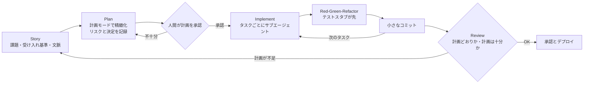
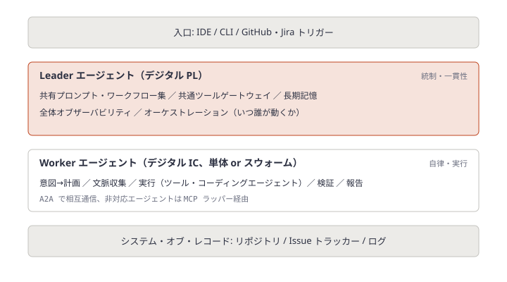
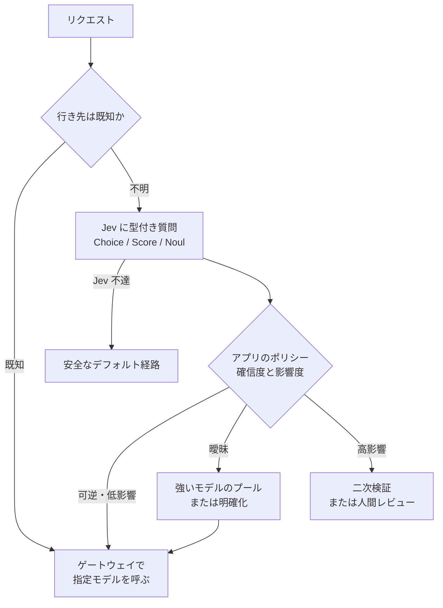

# Daily Briefing 2026-10-20

## 1. プロンプトからプロダクトへ — エージェントワークフローによる仕様駆動開発（原題: From Prompt to Product: Spec-Driven Development with Agent Workflows）

- **URL**: https://www.otto.de/jobs/en/blogs/techblog/spec-driven-development-agent-workflows/
- **公開日**: 2026-07-15
- **著者・媒体**: Nina Braunger（OTTO ソフトウェア開発者）/ OTTO Techblog

### 本文翻訳

本記事は、OTTO 社内で行った実験——**手書きのコードを1行も書かず、かつ「バイブコーディング」もせずに**フロントエンドを構築する試み——を紹介する。手法は、エージェントとサブエージェントのワークフローを用いた仕様駆動開発（Spec-Driven Development）である。

まず2つのアプローチを対比する。バイブコーディングは直感的で、とにかく早く結果を出すことを狙う。仕様駆動開発は構造化されており、精密な仕様とエージェントを通じて**再現可能でスケールする結果**を狙う。OpenCode のようなツールの登場で、エージェントとサブエージェントによる作業はますます重要になっている。

**ユースケース。** OTTO の AI Engineering Excellence（AIEE）チームは、プロダクト開発ライフサイクル（PDLC）全体にわたってチーム横断のイネーブルメントを担う。筆者のチームは AIEE と組み、2週間の実験を行った。目標は社内向けフロントエンドを MVP まで持っていくこと。制約は「手でコードを1行も書かない」こと、そして「一貫してバイブコーディングを避ける」ことである。

**役割分担。** AIEE チームはイネーブラーとして、エージェントスキルのノウハウ提供、アーキテクチャ助言、品質保証を担った。筆者のチームは実装を担い、エージェントを操縦し、仕様を書いて文書化した。毎日の同期、集中的なペアリング、速い反復サイクルがこれを支え、知識共有の度合いは高く、全員の学習曲線は急だった。

**仕様駆動開発とは。** 詳細かつ明確に書かれた仕様からソフトウェアを実装することである。要件は実装前に文書化され、エージェントの作業を含むすべての後続工程の拘束力ある基盤となる。利点として、要件のより正確な実装、再現可能な結果、高いコード品質、暗黙知の削減、コードの一貫性向上が挙げられる。

**エージェンティック・エンジニアリングのワークフロー。** 中核の考え方は、まず仕様を作り、そこから決定論的かつ追跡可能な形でコードを生成することだ。OTTO のワークフローは要件から監視までを貫くが、とくに実装フェーズでは、エージェントの「計画モード」と「実装モード」、人間による承認ステップ、TDD・サブエージェント・自己完結したコミットへの配慮を経て、承認とデプロイに至る。サイクルは4段階である。

1. **Story**: 課題・受け入れ基準・文脈を含む精密なユーザーストーリーから始める
2. **Plan**: 計画モードで、エージェントとともにストーリーを実行可能なロードマップへ精緻化し、リスクを洗い出し、決定事項を記録する
3. **Implement**: レビュー済みの計画に従い、小さく検証可能なコード片だけを書き、短いチェックポイントごとにコミットする
4. **Review**: コードが計画どおりか、そして計画自体が十分だったかを確認する

このサイクルは透明性・品質・速い反復を生む。ストーリーの丁寧な精緻化と計画の批判的レビューは、時間のかかる修正ループを避けるためのものだ。

**学び・落とし穴・解決策。**

**(1) 仕様がすべて。** 精密なストーリーが土台であり、着手前に入念にレビューした計画をその上に積む。これがないとエージェントは不明瞭な変更の中で迷子になる。実験では返品サービスの一覧をすべて定義していなかったため、ドロップダウンに一部のサービスしか表示されなかった。解決策は、ストーリー・計画・決定をすべて成果物として記録し、Story-Plan-Commit-Review のサイクルを守ること。要件が不明瞭なら結果も不明瞭になり、仕様が精密なら出力は驚くほど良くなる。

**(2) コンテキストは有限。** チームはエージェントを万能の問題解決者として扱い、一度に多くのタスクを与えがちだ。するとコンテキストウィンドウが埋まり、**使用率およそ70%を超えたあたりから品質が大きく落ちる**。解決策は、独立して並列に走らせられるタスクにサブエージェントを使い、それぞれに明確な責務を与えること。記事が示す実装プロンプトは次のとおり。

> 「実装せよ。タスクごとに進めよ。各タスクにサブエージェントを1つ起動せよ。TDD の Red-Green-Refactor を使え。コミットを作れ。」

加えて、不明点があればエージェントに質問させるべきだとしている。

**(3) TDD はゲームチェンジャー。** 最初からテストがあることは不可欠で、早期にエラーを捕まえ、変更ごとに自信を与える。自動テストがなかった段階では、動かないボタンやバリデーション漏れといったバグがすり抜けた。テストがなければエージェントには品質のフィードバック経路がなく、回帰が忍び込む。解決策は、**各サブエージェントに実装前にテストスタブ（ユニットテストかスナップショットテスト）を作らせ**、Red-Green-Refactor で全変更をメインブランチに入る前に検証させること。早期検証でバグを早く見つけ、自動テストで回帰を防ぎ、継続的テストで反復を安全に制御できる。

**結論。** 実験は価値があり、楽しかった。開発の高速化、スケーラビリティの向上、より一貫したコードベースが観察された。開発者の役割は変わりつつある——コードを書く時間が減り、アーキテクチャ思考・品質評価・複雑なシステムのオーケストレーションに時間を使うようになる。推奨は「小さく始め、仕様で考え、実装ではサブエージェントを意図的に使う」ことだ。

### 重要ポイント

- 2週間・手書きコード0行・バイブコーディング禁止という制約で、社内フロントエンドを MVP まで到達させた
- サイクルは Story → Plan（計画モード＋人間承認）→ Implement（小さく・短いチェックポイントでコミット）→ Review（計画自体の十分性も検証）
- 仕様の欠落はそのまま成果物の欠落になる（返品サービス一覧の未定義 → ドロップダウンの表示漏れ）
- コンテキスト使用率がおよそ70%を超えると品質が大きく劣化する。タスクごとにサブエージェントを分ける
- サブエージェントに実装前のテストスタブ作成を義務付け、Red-Green-Refactor をエージェントの品質フィードバック経路にする

### 図解



### 戦略分析

**フレームワーク**: JTBD（Jobs to be Done）× Cynefin

| 観点 | 内容 |
|---|---|
| 状況 | 社内向けの業務フロントエンドを短期間で MVP にしたい。要件はユーザーストーリーとして書き下せる |
| 片付けたい仕事 | エージェントの出力を「再現可能で、レビュー可能で、欠落に気づける」ものにする |
| 既存の代替手段 | バイブコーディング（速いが再現できない）、人間の手書き実装（遅い） |
| 雇われる理由 | 仕様・計画・決定がファイルとして残るため、出力の欠落を仕様の欠落として追跡できる |

Cynefin で見ると、記事の対象は「煩雑（Complicated）」領域——正解は存在し、分析すれば到達できる——に収まっている。返品サービス一覧の例は、答えが既知なのに仕様に書かれなかった典型であり、Plan フェーズの人間承認が「既知の事実の書き漏れ」を検出する装置として働く。

**示唆**: SDD の導入判断は「エージェントの性能」ではなく「その案件の要件が事前に列挙できるか」で決めるべきだ。具体的には (1) 社内ツール・管理画面のように受け入れ基準が列挙できる案件から SDD を適用する、(2) Plan 承認のチェック項目に「列挙型の値（選択肢・ステータス・対象サービス）が全件書かれているか」を入れる、(3) サブエージェント分割とテストスタブ先行をプロンプトのテンプレートに固定する。記事は効果を定性的にしか示していないため、導入時はストーリーあたりの手戻り回数を記録しておくと効果検証ができる（ここからは仮説）。

**反証条件**: ユーザー調査を経ないと要件が決まらない「複雑（Complex）」領域の新規プロダクトでは、精密なストーリーを先に書くこと自体が不可能で、Plan 承認がボトルネックになる。その場合は探索的プロトタイプ（捨てる前提のバイブコーディング）で要件を発見してから SDD に移る方が速い。

### 現場での適用方法

**CLAUDE.md への追記例**（Story-Plan-Implement-Review を強制するルール）:

````markdown
## 開発サイクル（Story → Plan → Implement → Review）

### Story
- 作業は必ず `specs/<ticket-id>/story.md` から始める。無ければ作業を開始せず、作成を依頼すること
- story.md には「課題」「受け入れ基準」「文脈」を必須とする
- 選択肢・ステータス・対象サービスなど**列挙型の値は全件を列挙**する。「など」で省略しない

### Plan
- 実装前に `specs/<ticket-id>/plan.md` を書き、人間の承認を得るまで実装しない
- plan.md には「タスク分割」「リスク」「決定事項と却下した代替案」を書く
- 不明点は推測で埋めず、質問として plan.md の末尾に列挙して停止する

### Implement
- タスクごとにサブエージェントを1つ起動する。1つのセッションで複数タスクを抱えない
- 各タスクは Red-Green-Refactor: まず失敗するテスト（unit または snapshot）を書き、次に実装、最後に整理
- タスク1つにつきコミット1つ。コミットメッセージに plan.md のタスク番号を含める
- コンテキスト使用率が 70% に近づいたら作業を区切り、残りを新しいサブエージェントに引き継ぐ

### Review
- 「コードが plan.md どおりか」に加えて「plan.md 自体が十分だったか」を `specs/<ticket-id>/review.md` に記録する
- 計画不足が原因の手戻りは story.md / plan.md 側を修正する（コードだけ直して終わらせない）
````

**実装フェーズの起動プロンプト**（記事のプロンプトを拡張したもの）:

```text
specs/<TICKET_ID>/plan.md を読み、承認済みのタスクを上から順に実装せよ。
- 各タスクにサブエージェントを1つ起動すること
- 各サブエージェントは TDD の Red-Green-Refactor を守り、実装前に失敗するテストを書くこと
- タスクごとに1コミットを作ること
- plan.md に書かれていない判断が必要になったら、実装を止めて質問すること
```

### 期待効果

- 記事は「開発の高速化」「スケーラビリティの向上」「より一貫したコードベース」を報告している（定量値は示されていない）
- テストスタブ先行により、記事で実際に発生した「動かないボタン」「バリデーション漏れ」型のバグを、メインブランチ到達前に検出できる
- 仕様・計画・決定がファイルとして残るため、出力の欠落を仕様の欠落として追跡でき、手戻りの原因分析が容易になる

### 注意点

- 2週間・1チーム・社内ツールの実験であり、本番の顧客向けプロダクトや大規模既存コードベースへの一般化は検証されていない
- AIEE チームという専任のイネーブラーが毎日伴走していた。同じ体制がない組織では学習曲線がより緩やかになる
- 「70%」は記事の観察値であり、モデルやツールによって閾値は変わる。自チームで計測して調整すること
- Plan 承認を人間が担うため、並行タスク数が増えると承認待ちが新たな待ち行列になる

## 2. エージェンティック・エンジニアリング — AI エージェントのスウォームがソフトウェアエンジニアリングをどう再定義するか（原題: Agentic Engineering: How Swarms of AI Agents Are Redefining Software Engineering）

- **URL**: https://www.langchain.com/blog/agentic-engineering-redefining-software-engineering
- **公開日**: 2026-04-17
- **著者・媒体**: Renuka Kumar（Cisco Principal Software Engineer / Director）、Prashanth Ramagopal（Cisco Senior Director of Engineering）/ LangChain Blog（ゲスト寄稿。見解は個人のもので Cisco を代表しない）

### 本文翻訳

ソフトウェア開発は、孤立した AI アシスタントから、現実のエンジニアリングチームを模した協調エージェントへと移りつつある。筆者らの中心的主張は、**最大の段差は道具の改善だけからは来ない。現実のチームを写し取ったシステムから来る**、というものだ。目標は「コードを速く書く」ことから「ソフトウェアをデリバリーパイプラインに速く安全に流す」ことへ移る。要件定義・設計・開発・セキュリティ・テスト・デプロイ・運用のほとんどの段階は部分的に自動化でき、一部はエンドツーエンドのオーケストレーションも可能だという。筆者らは自分たちのシステムを「より良いコーディングアシスタント」ではなく、**マルチエージェント協調のためのコントロールプレーン**と位置づける。

**アーキテクチャ。** システムは疎結合なエージェント群で、補完的な2つの役割から成る。

**Worker エージェント**はデジタルな個人貢献者（IC）として、定義された境界内で自律的に働く。1体でも、動的に協調するスウォームでもよい。Worker は、推論モデルを使ってユーザーの意図を実行可能な計画に変換し、ソースリポジトリ・Issue トラッカー・ログといったシステム・オブ・レコードから文脈を集め、ツール・コーディングエージェント・サブエージェントを通じて作業を実行し、正しさと完全性を検証し、計画・行動・結果を Leader 層へ報告する。

**Leader エージェント**はデジタルなプロジェクトリードとして、スウォームを協調・統制し、共有能力を提供する。具体的には、ベストプラクティスを標準化しオンボーディングを容易にする共有のプロンプト・ワークフロー集、承認済みの能力を安全かつ一貫して公開する共通ツールゲートウェイ、学習を支えるスウォームの長期記憶、エージェントの活動・判断・結果への全体オブザーバビリティ、そしていつどのようにエージェントが動くかを決めるオーケストレーションである。実行と協調を分離することで、**末端の自律性を保ちつつ、規模が大きくなっても一貫性を維持できる**。

Worker 同士は A2A（agent-to-agent）プロトコルで通信し、A2A 非対応のエージェントは MCP ラッパー経由で接続する。エンジニアは IDE・CLI、あるいは GitHub や Jira のアクションといった外部トリガーから作業を開始する。Leader は他チームの Leader とも協調でき、たとえばプロダクトマネジメントからの要求を、計画と要件抽出を担う適切な Worker スウォームへ回せる。

**技術実装と選定基準。** LangGraph（計画から作られる状態付きノードのグラフによる制御可能なオーケストレーション）、LangSmith（実行トレースによる観測と評価）、LangMem（長期記憶と学習）を採用した。評価で重視したのは、ステップ・エージェント・リトライをまたぐ状態管理とチェックポイント、「誰が・いつ・なぜ決めたか」の監査証跡、外部のシステム・オブ・レコードや MCP 型ツールゲートウェイとの互換性、不正な行動を抑え運用リスクを下げる決定論的実行、通信プロトコルや他フレームワーク製エージェントとの相互運用性である。

**例: IDE ベースの開発ワークフロー。** 多くのワークフローは4段階の型をとる。(1) **意図分析**: エンジニアが IDE で自然言語の意図を述べ、LangGraph で編成された Worker がそれを分析し MCP ツールで文脈を取得する。(2) **計画と通知**: Worker が構造化された多段階計画を生成し、Slack・Teams・Webex でエンジニアに送る。(3) **実行と追跡**: 計画は IDE の AI コーディングエージェントと並走しながら1ステップずつ実行され、LangGraph のチェックポイントが状態を追跡する。(4) **検証と完了**: Worker が実行済みステップがチェックポイントの状態と一致するか確認し、結果をエンジニアのチャンネルへ送り LangMem に保存する。コーディングエージェントが A2A に対応していなかったため、その要求を Worker へ回す MCP アダプタを作り、IDE 非依存を保った。

**パイロット結果。** 少なくとも2体のエージェント間の協調を要するワークフローで、品質を落とさずにスループットが上がるかを測った。ベースラインは、社内ブートキャンプでエンジニアが過去の実績をもとに「エージェントなしならどれだけかかるか」を見積もったもので、数値は保守的に報告している。

- **デバッグ**: 20超のワークフローで、根本原因特定までの時間が過去のベースライン比 **93%短縮**。チーム横断の調査でも、エージェントの協調実行5分未満で終わったものがある。独立した QE 評価で品質の低下は測定されなかった。1か月で70人が512回のデバッグセッションを行い、**200時間超**のエンジニア工数を節約した
- **開発**: 15超のワークフローで実行時間が **65%超短縮**。IDE のコーディングエージェントに Worker を組み合わせることでプロジェクト固有のバックエンド文脈にアクセスでき、コードとテスト計画の生成が改善した。計画を Worker に移し、LangMem が過去のワークフローを索引化して再利用することで、繰り返しタスクのオンボーディング時間が減った。**最大の効果はコード生成の高速化ではなく、PR マージ後の機能テストという下流工程の圧縮から来た**。そして人間の承認に依存する PR レビューが新たなボトルネックになった

**コーディングエージェントとの違い。** Codex 級のモデルは Worker の中で推論・コード生成エンジンとして動くことが多く、両者は補完関係にある。コーディングエージェントは、意図をコードにする・リファクタする・説明する・デバッグするといった、ユーザー主導の閉じたループでは優秀だが、チーム横断のワークフローを編成する能力は限られる。本システムは、開発者とチームの境界をまたいで働く疎結合なエンジニアリングチームとして振る舞い、エンドツーエンドのデリバリーの明示的なコントロールプレーンとして機能する。

**結論と教訓。** 価値は漸進的ではなく構造的である——協調オーバーヘッドの削減、チーム間の待ち時間の短縮、チームをまたぐ文脈の共有、人間の注意を最も重要な箇所へ振り向けること。実務上の教訓は3つ。フレームワークは協調・記憶・オブザーバビリティを第一級の関心事として扱うべきこと。一度設定すれば立ち上がりは容易で、複数チームが最小限の設定で Worker を使って内外のツールから文脈を引けること。そして**コード生成より下流のボトルネックの方が重要**で、テストとレビューの工程が多くの場合ゲインを制限すること。

### 重要ポイント

- 実行（Worker: 計画・文脈収集・実行・検証・報告）と協調（Leader: 共有プロンプト集・ツールゲートウェイ・長期記憶・観測・編成）を分離する2層構造
- 意図分析 → 計画をチャットへ通知 → チェックポイント付き逐次実行 → 状態照合による検証、の4段階が基本型
- デバッグで根本原因特定 93%短縮、1か月・70人・512セッションで200時間超節約。開発で実行時間 65%超短縮
- 最大の効果は下流（PR マージ後の機能テスト）の圧縮から来た。PR レビューが次のボトルネック
- ベースラインは過去実績に基づく見積もりであり、単一企業のパイロットである点に注意

### 図解



### 戦略分析

**フレームワーク**: バリューストリームマッピング × 制約理論（TOC）

| 工程 | 記事が示す変化 | 制約としての位置 |
|---|---|---|
| 意図→計画 | Worker が文脈を集め計画化、チャットで通知 | 縮小（繰り返しタスクのオンボーディングが短縮） |
| 実装 | コーディングエージェント＋Worker の文脈 | 主要な短縮要因ではない（記事が明言） |
| PR レビュー | 人間の承認に依存したまま | **新たな制約** |
| マージ後の機能テスト | エージェントで圧縮 | **最大の短縮要因** |
| デバッグ・根本原因特定 | 93%短縮 | 運用側の待ちを大幅に縮小 |

TOC の観点では、この記事は「制約を探して当てた」事例である。65%の短縮が実装ではなくマージ後テストから来たという事実は、多くの組織で実装支援ツールに投資が偏っていることへの反証になっている。そして下流を圧縮した結果、制約はレビューに移動した。

**示唆**: 次のエージェント投資先を「コーディング支援の追加」ではなく「マージ後の機能テスト」と「障害調査」に置く判断が導かれる。具体的には (1) 自組織のバリューストリームで、マージからリリースまでの待ち時間と、障害対応の調査時間を先に計測する、(2) そのどちらかが長ければ、文脈収集（ログ・Issue・リポジトリの横断検索）を担う Worker を1体だけ立て、チャット通知と状態照合付きで試す、(3) レビューが次の制約になる前提で、変更粒度の上限を同時に決めておく。

**反証条件**: マージ後テストが既に完全自動化され短時間で終わる組織、または障害調査が単一チーム内で完結する組織では、記事の効果の源泉（チーム横断の協調コスト削減）が存在しない。その場合、Leader 層の構築コストに見合う効果は出にくく、単体のコーディングエージェントで十分である。

### 現場での適用方法

**運用手順**（Worker 1体からの段階導入）:

1. 計測から始める。マージからリリースまでの時間と、障害チケットの起票から根本原因特定までの時間を直近1か月分取り出す

```bash
# マージからリリースタグまでの時間（GitHub CLI 例）
gh pr list --repo <OWNER/REPO> --state merged --limit 100 \
  --json number,mergedAt --jq '.[] | "\(.number)\t\(.mergedAt)"' > merged.tsv
git -C <REPO_PATH> for-each-ref --sort=creatordate \
  --format='%(refname:short)%09%(creatordate:iso8601)' refs/tags > tags.tsv
# 各 PR の mergedAt 直後のタグ作成日時との差分を集計し、中央値を記録する
```

2. 長い方の工程に Worker を1体だけ当てる。記事の4段階に合わせ、計画をチャットへ送ってから実行させる

```yaml
# worker-debug.yaml（<WORKFLOW_ENGINE> の設定例。キー名は利用する基盤に合わせて読み替える）
name: debug-worker
trigger:
  - type: issue_label
    label: incident
steps:
  - id: analyze_intent
    action: summarize_issue          # 意図分析
  - id: gather_context
    tools: [repo_search, log_query, issue_search]   # MCP 経由で取得
  - id: plan
    action: generate_plan
    notify: slack://<CHANNEL>       # 計画を人間へ通知
  - id: execute
    mode: step_by_step
    checkpoint: true                 # ステップごとに状態を保存
  - id: verify
    action: compare_with_checkpoint  # 実行結果と計画の照合
    report: slack://<CHANNEL>
memory:
  store: <MEMORY_STORE>              # 過去の調査を索引化し再利用
audit:
  record: [who, when, why]
```

3. 2〜4週間後に、手順1の指標を同じ方法で再計測する。改善した工程の次に長い待ちがどこにあるかを確認し、レビュー待ちが伸びていれば変更粒度の上限（例: 1 PR あたりの変更行数）を CLAUDE.md に追記する

### 期待効果

- 記事の数値: デバッグで根本原因特定 93%短縮、1か月で200時間超（70人・512セッション）の節約。開発ワークフローで実行時間 65%超短縮
- 共有プロンプト集と長期記憶により、繰り返しタスクのオンボーディング時間が減る
- 監査証跡（誰が・いつ・なぜ）とチェックポイントにより、エージェントの行動を後から追跡できる

### 注意点

- ベースラインは過去実績に基づく「見積もり」であり、対照実験ではない。単一企業のパイロットで、一般化は検証されていない
- 記事は LangChain ブログへのゲスト寄稿で、LangChain 製品の評価を含む。コスト、失敗モード、ガバナンス以外のセキュリティリスクは論じられていない
- 下流を圧縮すると PR レビューが制約になる。レビュー体制を同時に設計しないと、リードタイム全体は縮まない
- Leader 層（ツールゲートウェイ・長期記憶・観測）は構築・運用コストが大きい。Worker 1体で効果を確認してから広げる

## 3. Jev で LLM ルーティングを組む — ZenMux を使った開発者ガイド（原題: How to Use Jev for LLM Routing with ZenMux: A Developer Guide）

- **URL**: https://zenmux.ai/blog/how-to-use-jev-for-llm-routing-with-zenmux-a-developer-guide
- **公開日**: 2026-09-24
- **著者・媒体**: ZenMux 公式ブログ

### 本文翻訳

本ガイドは、TypeSafe AI の構造化判断モデル Jev 1.13 を、モデルゲートウェイの手前に置く**分類レイヤー**として使う方法を説明する。前提として、**Jev と ZenMux Auto は LLM ルーティングの別の層を担う**。Jev はリクエストを分類し、採点し、Yes/No 条件の確率を推定する。ZenMux Auto は生成モデルを選ぶ。なお ZenMux は、`zenmux/auto` の内部エンジンが Jev であるとは文書化していない。

**基本情報。** ZenMux 上のモデル ID は `typesafe/jev-1.13`。出力型は Choice・Score・Noul の3種。レイテンシは TypeSafe 公称で端から端まで70〜500ms だが、これはベンダー報告の範囲であり ZenMux の SLA ではない。価格は入力100万トークンあたり $0.042 で、出力トークンの別料金はない（TypeSafe と ZenMux の両方が掲載）。プロバイダは TypeSafe のみで、ZenMux 上でのマルチプロバイダ冗長性はない。

**推奨アーキテクチャ。** 責務を3つに分ける。(1) **Jev** が現在のプログラム状態に対して型付きの質問を評価する。(2) **アプリケーションコード**がその結果をモデル・候補プール・エスカレーション経路に対応づける。(3) **ZenMux** が選ばれたモデルを呼び、対応するプロバイダ経路を扱い、使用量を記録し、別途設定したフォールバックを適用する。**ルーティングポリシーは Jev に組み込まれておらず、開発者が書かなければならない**。

**出力型。** Choice は定義済みの集合（要約・コード生成・リサーチ・人間レビュー等）から1カテゴリを選び、選択結果・確率分布・確信度を返す。Score は複雑さやリスクといった順序尺度上にリクエストを置き、確率加重の位置（定義レベルの間に落ちることもある）・レベル分布・確信度を返す。閾値はアプリ側で当てる。Noul は「コード生成が必要か」のような Yes/No の問いに0〜1の確率を返し、別個の確信度フィールドは持たない。

**統合ワークフロー。** (1) タスク種別・複雑さ・安全リスク・コード生成要否などのルーティング次元を定義する。(2) 状態と Choice / Score / Noul の質問を送って Jev から型付き判断を得る。(3) アプリコードでルーティングポリシーを適用し、低確信度または影響の大きいケースはより強いモデルか人間のレビュアーへ回す。(4) 特定のモデルスラッグ、または候補を絞ったプールを `zenmux/auto` に渡して ZenMux 経由で呼ぶ。(5) フォールバックは ZenMux のプロバイダルーティングかフォールバックモデルで**別途**設定する。これは Jev の分類呼び出しとは別物である。統合前に、ルーティングカテゴリ・確信度閾値・候補モデル・フォールバック挙動を決めておくこと。ZenMux は Jev 専用の統合ガイドを公開していないため、TypeSafe ネイティブのエンドポイントがそのまま公開されていると仮定せず、モデルページの API Request に示される形式に従うべきだ。

**閾値。** 記事は数値の閾値を示さない。代表的なトラフィックで境界を較正し、誤ルートと不要なエスカレーションを測り、誤ルートのコストが大きいほど基準を引き上げよ、とする。例として、サポート要約のリクエストは小さなモデルへ直接送り、コード生成と判定された Choice の結果はコード対応モデルのプールを `zenmux/auto` に開く。

**確信度とエスカレーションの段階。** 影響が小さく容易に取り消せる判断は自動で受け入れる。曖昧な判断（分布が平坦、または確信度が低い）は、明確化を求めるか、より強いモデルのプールを使うか、安全なデフォルトへ倒す。影響の大きい判断は、より厳しい閾値、二次検証、または人間レビューを要求する。Noul では0.5付近の値は一般に不確実性が高いことを示すが、閾値はタスクの判断境界に相対的に置くべきだ。

**限界と失敗モード。** 基準が曖昧だと解釈しにくい確率が返るので、カテゴリ・スコア範囲・真偽の選択肢を事前に定義する。**構造化出力は決定論ではない**——Jev が保証するのは事前定義された回答の形であって、判断の決定性ではない。Jev が使えない場合に備え、アプリに明示的なフォールバック経路を用意する。レイテンシは層ごとに積み上がるので、行き先が既知なら分類を省き、不確実または影響の大きいケースだけを分類するとよい。ユーザー向けの文章を Jev に書かせるのは設計範囲外である。

**テストと監視。** 本番投入前に代表的なリクエストからラベル付き評価セットを作り、ポリシーの各版をそれと比較して、コストや速度の改善がルート品質を下げていないか確かめる。本番での推奨指標は、レビュー済みサンプルでのルーティング精度、Jev 判断のレイテンシ（中央値とテール）、ルーティング判断1回あたりと完了リクエスト1件あたりのコスト、低確信度エスカレーション率と人間レビュー率、タスクカテゴリ別のモデル選択分布、ZenMux のプロバイダ切り替えとフォールバックの頻度、ルーティング劣化の兆候となる入力ドリフトである。**Jev の不確実性と ZenMux の運用フォールバックは分けて追跡せよ**——前者はルーティング判断の不確実性、後者はモデル・プロバイダの可用性を表す。ZenMux は実際に使われたモデルを返し、コンソールログでリクエスト詳細を見られるので、選択とフォールバックの検証に使える。

### 重要ポイント

- 3層分離: Jev（型付き判断）／アプリコード（ルーティングポリシー）／ゲートウェイ（モデル呼び出し・フォールバック）。ポリシーは Jev に内蔵されていない
- 閾値は記事に無い。ラベル付き評価セットで較正し、誤ルートのコストが大きいほど厳しくする
- 「可逆で低影響 → 自動」「曖昧 → 明確化・強いモデル・安全なデフォルト」「高影響 → 厳しい閾値・二次検証・人間」の3段階
- 構造化出力は決定論ではない。Jev 不達時のフォールバック経路をアプリ側に必ず持つ
- Jev の不確実性（判断の質）とゲートウェイのフォールバック（可用性）は別の指標として監視する

### 図解



### 戦略分析

**フレームワーク**: リスク×可逆性マトリクス（Cynefin の併用候補）

| | 可逆（取り消し容易） | 不可逆（取り消し困難） |
|---|---|---|
| **低影響** | 自動受け入れ（記事: 自動で受け入れる） | 確信度閾値を上げて自動 |
| **高影響** | 強いモデルのプールへ回す | 二次検証または人間レビュー（記事: 厳しい閾値・二次検証・人間） |

記事の3段階エスカレーションは、この2軸で判断を振り分ける設計と読める。Jev が提供するのは「どのセルに入るか」を安く速く推定する材料であり、セルごとの処遇（ポリシー）は人間が決める。ここで RACI 的に重要なのは、**ポリシーの説明責任はアプリ開発者に残る**と記事が明言している点だ。

**示唆**: Jev 導入の最初の成果物はコードではなく「ルーティング表」——カテゴリ・影響度・可逆性・閾値・行き先を1行ずつ並べた表——である。具体的には (1) 既存の LLM 呼び出しログから代表リクエスト数百件を抜き出しラベルを付ける、(2) 可逆×低影響のセルだけを Jev に任せて開始し、誤ルート率と不要エスカレーション率を測る、(3) 高影響セルは当面人間レビュー固定のまま据え置く。コスト削減幅は記事に数値がなく、自社トラフィックでの計測が前提となる（仮説）。

**反証条件**: リクエストの大半が「行き先が既知」なアプリケーション（単一用途のチャットボット等）では、分類層を挟むこと自体がレイテンシとコストの純増になる。記事自身が「行き先が既知なら分類を省け」と書いており、分類対象が少数なら導入の意味は薄い。

### 現場での適用方法

**スクリプト化の例**（ルーティングポリシーをアプリ側に明示的に書く Python の骨子）:

```python
# router.py — Jev の型付き判断を受けて行き先を決めるポリシー層
# Jev / ゲートウェイの呼び出し部分は <JEV_CLIENT> <GATEWAY_CLIENT> の実装に合わせて差し替える
from dataclasses import dataclass

# ラベル付き評価セットで較正してから値を決める（記事は数値を示していない）
THRESHOLDS = {
    "choice_min_confidence": <CHOICE_MIN_CONF>,   # 例: 較正後に決める
    "risk_high": <RISK_HIGH_LEVEL>,               # Score の確率加重位置
    "codegen_yes": <NOUL_CODEGEN_THRESHOLD>,      # Noul の判断境界
}

ROUTES = {
    "summarization": {"model": "<SMALL_MODEL_SLUG>"},
    "code_generation": {"pool": ["<CODE_MODEL_A>", "<CODE_MODEL_B>"]},
    "research": {"pool": ["<STRONG_MODEL_A>", "<STRONG_MODEL_B>"]},
    "human_review": {"escalate": True},
}
SAFE_DEFAULT = {"pool": ["<STRONG_MODEL_A>"]}

@dataclass
class Decision:
    category: str
    confidence: float
    risk: float          # Score の確率加重位置
    needs_code: float    # Noul の確率

def ask_jev(state: str) -> Decision | None:
    try:
        r = <JEV_CLIENT>.decide(
            model="typesafe/jev-1.13",
            state=state,
            questions=[
                {"type": "choice", "name": "category",
                 "options": list(ROUTES.keys())},
                {"type": "score", "name": "risk",
                 "levels": ["low", "medium", "high"]},
                {"type": "noul", "name": "needs_code",
                 "statement": "このリクエストはコード生成を必要とする"},
            ],
        )
        return Decision(r.category.value, r.category.confidence,
                        r.risk.value, r.needs_code.p)
    except Exception:
        return None  # Jev 不達はアプリ側のフォールバックで扱う

def route(state: str, known_route: str | None = None) -> dict:
    if known_route:                       # 行き先が既知なら分類を省く
        return ROUTES[known_route]
    d = ask_jev(state)
    if d is None:
        return SAFE_DEFAULT
    if d.risk >= THRESHOLDS["risk_high"]:
        return ROUTES["human_review"]     # 高影響: 人間 or 二次検証
    if d.confidence < THRESHOLDS["choice_min_confidence"]:
        return SAFE_DEFAULT               # 曖昧: 強いモデルへ倒す
    if d.needs_code >= THRESHOLDS["codegen_yes"]:
        return ROUTES["code_generation"]
    return ROUTES[d.category]
```

**運用手順**（較正と監視）:

1. 既存ログから代表リクエストを抽出し、正しい行き先のラベルを付けて `eval/routing.jsonl` に保存する
2. 閾値の候補ごとに `route()` を評価セットに通し、「誤ルート率」「不要エスカレーション率」「1リクエストあたりコスト」を表にして閾値を選ぶ
3. 本番では次の2系統を**別々のダッシュボード**に出す: (a) Jev の低確信度エスカレーション率・カテゴリ別分布・入力ドリフト、(b) ゲートウェイのプロバイダ切り替え・フォールバック頻度・実際に使われたモデル
4. ポリシーを変えるたびに手順2を再実行し、評価セットでの品質低下がないことを確認してから反映する

### 期待効果

- 入力100万トークンあたり $0.042・出力無料という価格（両社掲載）で、ルーティング判断のコストを生成モデルより大幅に下げられる可能性がある
- 公称70〜500ms のレイテンシで、生成モデルに判断させるより速く経路を決められる（ベンダー報告値で SLA ではない）
- ポリシーがコードとして明示されるため、誤ルートの原因が「Jev の判断」か「閾値設定」か「ゲートウェイの可用性」かを切り分けられる

### 注意点

- 記事は ZenMux 自社ブログで、自社プラットフォームの宣伝を含む。コード例と数値閾値は記事に含まれない（上記コードは本ブリーフィングで補った骨子）
- ZenMux 上の Jev プロバイダは TypeSafe のみで冗長性がない。Jev 不達時の経路を必ず用意する
- ZenMux は Jev 専用の統合ガイドを公開しておらず、リクエスト形式はモデルページの API Request に従う必要がある
- Jev は判断の形を保証するだけで、判断の正しさは保証しない。高影響の判断を Jev 単独に委ねない
