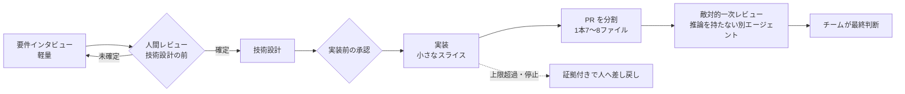
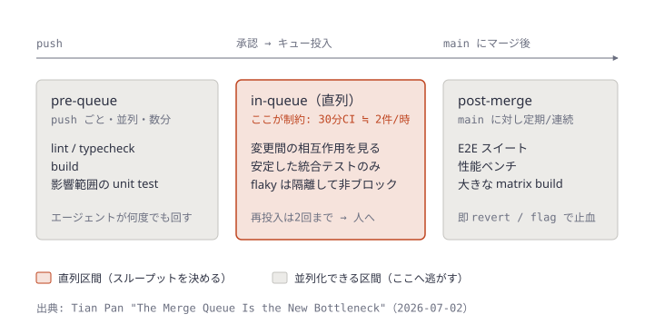
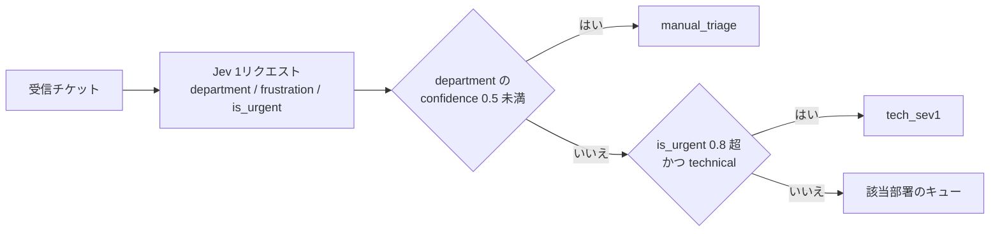

# Daily Briefing 2026-10-21

## 1. AI-DLC を実務で回すための10の統制とデリバリーパターン（原題: 10 controls and delivery patterns for AI-DLC in practice）

- **URL**: https://dius.com.au/controls-and-delivery-patterns-for-ai-dlc-practice/
- **公開日**: 2026-09-23
- **著者・媒体**: Kirsty Miller / DiUS（豪州のコンサルティング会社）Insights

### 本文翻訳

AI は個々のエンジニアを速くできる。しかしデリバリー全体が速くなるのは、**周囲のシステム**——プロダクトの意思決定、レビュー、コンテキスト、リポジトリのルール、品質統制、引き継ぎ——が同じペースで追いついたときだけだ。以下の10パターンは、DiUS が文脈に応じて適用している実践である。

**1. ハーネスを顧客の意思決定ループに合わせる**（Dallas Johnson）
詳細な仕様ワークフローが、顧客が意思決定を確定できる速さより速く成果物を生み出してしまい、一部の作業が価値を失った。チームはワークフローを簡素化し、軽量な要件インタビュー、技術設計前の人間レビュー、実装前の承認ポイントの3つに絞った。ワークフローを選ぶ前に「誰が要件を確定するか」「どの決定が先に要るか」「レビュアーはいつ動けるか」「要件が変わったら何が起きるか」を確認する。実装が意思決定を追い越すと、余分な速度は手戻りとして返ってくる。

**2. 未解決のプロダクト思考を実装ループに入れない**（Carl Thompson）
意図がまだ固まっていない探索的なプロダクト作業は分離しておく。AI は問題の形作りを手伝えるが、実装はアウトカム、ユーザーと状態、ドメイン用語、設計制約、成功基準が明確になってから始める。曖昧なブリーフは実装エージェントに推測を強いる。フィーチャースライスは、実装前に明確化・レビューできる程度に小さく保つ。

**3. 古いコンテキストを欠陥の発生源として扱う**（Sergei Matheson）
アーキテクチャ、ドメイン用語、リポジトリ指示、セットアップ手順などの文書は「信頼するもの」ではなく「検証するもの」として扱う。あるチームは、スケジュール実行される狭い権限のメンテナンスエージェントを置き、文書とコードを突き合わせて文書の修正を PR で提案させた。このエージェントは不一致を隠すためにアプリケーション側を変えることはできない。簡単な検査として、文書に書かれたセットアップコマンドを実行してみる。失敗したらその文書はもう信頼できない。

**4. デザインの振る舞いをエージェントが読める場所に置く**
静的なデザインは振る舞いを取りこぼす。各コンポーネントをいつ使うか、レスポンシブのバリアント、インタラクションと遷移、構造化されたデザイン注釈、プロダクト固有のコンポーネント判断を明文化し、バージョン管理されたデザインシステムパッケージに同梱するか、モノレポ内でコンポーネントコードの隣に置く。貢献が増えたらガバナンスを見直し、一人のデザイナーがボトルネックにならないようにする。

**5. 自動化が境界を越えるときはリポジトリのルールをローカルに保つ**
フロントエンド・バックエンド・インフラの複数リポジトリにまたがる作業で、エージェントがあるリポジトリのコマンドや PR 構成、ルールを別のリポジトリへ持ち込んだ。フィーチャーはリポジトリより上位のオーケストレーション層で調整して共有状態と関与リポジトリを追跡し、各リポジトリは自分のコマンド、ブランチ規約、PR 慣行を保つ。

**6. レビューが行列になる前に生成物を分割する**（Grace Wu）
金融システムで約50ファイルに及ぶ変更を、1本あたり7〜8ファイルの PR 8本に分割した。スライスと PR を小さく保ち、リスクの異なる変更を分け、高くつく手戻りの前に人間のレビューを置く。要件・設計・テスト素材にも同じことが言える。レビューが詰まっているなら、出力を増やしてもスループットは上がらない。「ボトルネックは人間だ」。

**7. コードがきれいかを問う前に、そのコードが存在すべきかを問う**（James Menzies）
AI コードレビューは、変更を生んだ推論を持たない新しいエージェントまたはモデルによる**敵対的な一次パス**から始める。問いは「正しい変更か」「正しい場所か」「もっと単純な方法はないか」「解決策が問題を必要以上に大きくしていないか」。追加の挑戦に見合う場合は別個のレビューパスを使う。最終判断はチームが持つ。

**8. エージェントで失敗を見つけ、防御は決定論的にする**
仕様と統合目標を与えたエージェントにテスト環境の API を探索させ、人が見落とす組み合わせを見つける。例: 空フィールドと別の空フィールドの組み合わせで 400 のはずが 500 が返った。重要な失敗はすべて、パイプラインが毎回実行する決定論的な回帰テストに変える。

**9. 自律度を上げる前に無人ループに上限を設ける**（Sergei Matheson）
人の引き継ぎを自動化するときは、停止・エスカレーション・人への差し戻し条件を定義する。最大実行コスト、時間制限、リトライ上限、ツールと実行環境の制限、人の介入を要する条件を置く。責任者は、到達した段階、使ったツール、停止理由、次に必要な判断を見られるようにする。ループが続行できないときは、実行を再構築せずに済むだけの証拠を添えて人がオーケストレーションする経路に引き渡す。

**10. ソフトウェアと一緒にデリバリーハーネスを引き渡す**（Grace Wu のチーム）
要件分析、技術設計、実装、レビュー、PR 作成のプロジェクトスキルを作り、リポジトリにチェックインしてバージョン管理・レビューした。これがないと顧客はソフトウェアを受け取っても、それを生んだ実践を受け取れない。引き継ぎでは「スキルの所有者は誰か」「誰が変更できるか」「変更はどうレビューするか」「必須の品質ゲートは何か」「基盤モデルが変わったらどうするか」「どこが顧客固有か」を確認する。

**共通テーマ**: 実装が速くなってもデリバリーが自動的に速くなるわけではない。

### 重要ポイント

- 仕様ワークフローが顧客の意思決定速度を追い越すと、成果物は手戻りに変わる。ワークフローの重さは「決める側の速度」で決める
- 古い文書は欠陥の発生源。文書とコードを突き合わせて **PR で提案だけする** 狭い権限のエージェントを定期実行する
- 50ファイルの変更を7〜8ファイル×8本に分割した例。レビューが制約なら生成量を増やしても無意味
- AI レビューの一次パスは「生成時の推論を持たない別エージェント」による「そもそも要るのか」の問い
- 無人ループにはコスト・時間・リトライ上限と、証拠付きで人に差し戻す経路を先に用意する

### 図解



### 戦略分析

**フレームワーク**: 制約理論（TOC）× バリューストリームマッピング

| 工程 | 記事が指摘する詰まり | 記事の打ち手 |
|---|---|---|
| 要件確定 | 顧客の意思決定が成果物生成より遅い | ワークフローを軽量化、承認点を2つに絞る |
| コンテキスト | 古い文書がエージェントの推測を誘う | 文書↔コードの差分を PR で提案するエージェント |
| 実装 | 速い（制約ではない） | スライスを小さく保つ |
| レビュー | 大きな生成物が行列を作る | PR 分割、敵対的一次パスで「不要な変更」を早期に落とす |
| 引き継ぎ | ハーネスが残らず再現できない | スキルをリポジトリに入れてバージョン管理 |

**制約**: 10パターンのうち6つ（1, 2, 3, 6, 7, 9）が実装の**外側**——意思決定・文脈・レビュー・例外処理——に手を入れている。TOC の第3ステップ「他を制約に従属させる」に相当し、実装エージェントの出力速度を、制約（顧客の意思決定とレビュー）の処理速度に合わせて絞っている。

**示唆**: SDD / AI-DLC のテンプレートを導入するとき、フルセットの仕様成果物から始めない。まず「誰が要件を確定し、平均何日で返事が来るか」を測り、その速度で回る段数に絞る。さらに PR に**ファイル数上限**（例: 記事の分割実績に倣い 8 ファイル前後）を設け、上限超過はエージェント側に分割させる。レビュー担当を増やす判断はその後に回す。

**反証条件**: 意思決定者がチーム内にいて即答できる（社内プロダクトでプロダクトオーナーが常駐する等）場合、パターン1の制約は存在せず、重い仕様ワークフローのほうが手戻りを減らす可能性がある。記事の事例は受託開発で顧客側に意思決定がある構造を前提としている。

### 現場での適用方法

**CLAUDE.md への追記例**（パターン 6・7・9 をルール化）:

```markdown
## AI 生成変更のデリバリー規約

### PR の粒度
- 1 PR あたり変更ファイルは 8 個まで。超える場合は、リスクの異なる変更（スキーマ / ロジック / UI / 設定）ごとに分割してから PR を作ること
- 分割した PR は依存順に番号を振り、本文に「N/M」と全体の計画へのリンクを書く

### レビューの一次パス
- PR を作る前に、実装時の会話を引き継がない新しいサブエージェントで次の4点だけを問う:
  1. この変更は必要か（要件に紐づいているか）
  2. 正しい場所に入っているか
  3. もっと単純な方法はないか
  4. 問題を必要以上に大きくしていないか
- 4点のいずれかに疑義があれば、実装を直す前に人間に確認する

### 無人ループの上限
- 同じタスクのリトライは 3 回まで。超えたら停止し、試したこと・失敗ログ・次に必要な判断を `handoff.md` に書いて人へ渡す
- 本番データ・権限・課金に触れるコマンドは実行しない（提案のみ）
```

**スクリプト化の例**（パターン 3: 文書のセットアップ手順が動くかを定期検証する GitHub Actions）:

```yaml
# .github/workflows/docs-freshness.yml
name: docs-freshness
on:
  schedule:
    - cron: "0 21 * * 0"   # 毎週月曜 06:00 JST
  workflow_dispatch:
jobs:
  setup-commands:
    runs-on: ubuntu-latest
    steps:
      - uses: actions/checkout@v4
      - name: README のセットアップ手順を実行
        run: |
          # README.md の <!-- setup:start --> と <!-- setup:end --> の間の bash ブロックを抽出
          awk '/<!-- setup:start -->/{f=1;next}/<!-- setup:end -->/{f=0}f' README.md \
            | sed -n '/^```bash$/,/^```$/p' | sed '1d;$d' > /tmp/setup.sh
          test -s /tmp/setup.sh || { echo "setup ブロックが見つからない"; exit 1; }
          bash -euo pipefail /tmp/setup.sh
      - name: 失敗したら Issue を起票
        if: failure()
        uses: actions/github-script@v7
        with:
          script: |
            await github.rest.issues.create({
              owner: context.repo.owner, repo: context.repo.repo,
              title: "docs-freshness: README のセットアップ手順が失敗",
              body: `実行ログ: ${context.serverUrl}/${context.repo.owner}/${context.repo.repo}/actions/runs/${context.runId}`,
              labels: ["docs", "agent-context"]
            });
```

### 期待効果

- 意思決定前に作られて捨てられる仕様成果物（記事のパターン1で起きた価値の喪失）を減らせる
- 約50ファイルの変更を8本の PR に分けた事例のように、1件あたりのレビュー負荷を下げてレビュー待ちの行列を短くできる
- 500 が返る組み合わせのような探索で見つけた失敗が回帰テストとして固定され、同じ欠陥の再発を防げる

### 注意点

- 記事は定性的な事例集で、リードタイム等の定量効果は示していない
- PR 分割はレビュー総量を減らさない。依存関係のある PR が増えるとマージ順序の管理コストが増える
- 敵対的一次パスを毎回走らせるとコストと待ち時間が増える。記事も「追加の挑戦に見合う場合」に限定している
- 文書検証エージェントにはアプリケーションコードの書き込み権限を与えないこと（記事の重要な設計点）

## 2. マージキューが新しいボトルネックになった（原題: The Merge Queue Is the New Bottleneck）

- **URL**: https://tianpan.co/blog/2026/07/02/the-merge-queue-is-the-new-bottleneck
- **公開日**: 2026-07-02
- **著者・媒体**: Tian Pan / tianpan.co

### 本文翻訳

AI コーディングエージェントはコードを書くことを安くしたが、コードを**着地させる**ことは安くなっていない。AI 導入度の高いチームはほぼ2倍の PR をマージしているが、デリバリー指標はほとんど動かない。すべての PR が、人間の出力量に合わせて設計された同じレビュー、CI、マージキューを通るからだ。制約は「承認から main まで」の直列経路に移った。

**静かに破綻するキャパシティ計算。** マージキューは、各 PR を main の未来の状態（現在の先端＋前に並ぶすべての変更）に対してテストすることで main を緑に保つ。正しさの代償は直列化である。マージグループの E2E CI が30分なら、厳密に順序付けされたキューは**最大で毎時2件、失敗ゼロでも1日48件**しか着地させられない。50人のチームが1人1日2件の PR を出せば（約100件/日）すでに上回る。サービス率が固定のままエージェントが到着を3倍にすると、稼働率が上限に近づくにつれ待ち時間は非線形に伸び、10分の遅延だったキューが4時間の遅延になりうる。バッチ化は効く。5件を1回の30分ランでテストすれば、直列の約2.5時間に対して5倍のスループットになる。GitHub のモノレポ（エンジニア500人超、月約2,500件の PR）では、動的マージグループへの移行で平均の出荷時間が約3分の1短縮され、安全に同時デプロイできる変更数が倍になった。

**エージェントは flaky の増幅器。** バッチが失敗するとキューは犯人を探さねばならない。全部を外して再テストすると高くつき、二分探索でも O(log n) 回のフル CI が要る。いずれにせよ、赤いテスト1つがその後ろにあるすべての PR の投機的状態を無効にする。連鎖の頻度はコード品質ではなく flaky 率で決まる。Uber では専用の flaky 管理以前、iOS の mainline が緑だったのは52%の時間だけで、モノレポ全体の約60万テストのうち約1,000が flaky だった。エージェントはこれを3通りで悪化させる。(1) **露出の増加**: 200回に1回発火する flaky は、1日40バッチなら週1回程度、120バッチなら毎日連鎖を起こす。flaky 率は同じで露出だけが増えた。(2) **リトライループ**: 「マージしておけ」と指示されたエージェントは同じ変更を何度も再投入し、CI を消費し、後ろの全員に連鎖を起こす。(3) **実際の破損の増加**: ツール横断の調査では AI 共著 PR は人間のみの PR より約1.7倍多くの問題を含み、その一部はマージグループで初めて表面化する。

**「ランナーを足す」は最初の一手として誤り。** ランナーはラン内を並列化するが、サービス時間は最も遅い必須チェックの実時間のままだ。連鎖による再起動は後ろの投機的作業をすべて捨てる。2%のバッチ連鎖率に対してランナーを倍にしても、主に連鎖ごとに捨てる計算量が倍になるだけである。README の修正とストレージエンジンのリファクタに同じフルスイートを回すことは、人間の量なら許容できたが、今や支配的なコストだ。

**何をどこで走らせるかを見直す。** pre-queue（push ごと）には lint、型検査、ビルド、影響範囲に絞ったユニットテストを置き、数分で終わるようにしてエージェントが1日に何度も回せるようにする。in-queue（マージグループ）には変更間の相互作用を確かめる統合テストだけを置き、安定させる。非決定的なテストはここに置かない。post-merge には E2E、性能ベンチ、大きなマトリクスビルドを置き、マージ済みの main に対して定期的に回し、即時 revert か feature flag で止血する。Bazel 型の影響範囲解析で変更が到達しえないサブシステムを飛ばし、並列キューで独立した変更を追い越させる（ドキュメント修正がスキーマ移行の後ろで待たないように）。flaky テストは**隔離**し、実行と報告は続けつつキューはブロックさせない。flaky が疑われる失敗では楽観的検証で先へ進み、後続の結果で確かめる。そしてエージェントのリトライ予算を設け、例えばキュー投入を2回までに制限し、超えたら失敗の証拠を添えて人間にエスカレーションする。

**ボトルネックは動く標的。** 1つの制約を解くと次に厳しい制約が効いてくる。次はレビューの注意力（AI 作成の PR はすでに人間レビューを何倍も長く待っている）か、デプロイとインシデント対応の能力かもしれない。パイプラインを独立した緑のチェックの集合ではなく、測定可能なクリティカルパスを持つシステムとして扱い、トラフィックの形が変わるたびにキャパシティ計算をやり直すこと。今四半期の始め方は、キューの到着率とサービス率を比べる、バッチ連鎖の頻度をグラフにする、すべての必須チェックを pre-queue / in-queue / post-merge に分類する、そして「毎時何件のマージを維持できるか」に答えられるようにすることだ。

### 重要ポイント

- 30分のマージグループ CI なら直列キューは最大毎時2件・1日48件。50人×1日2件の PR で既に溢れる
- flaky 率が同じでもバッチ数が増えれば連鎖は増える（200回に1回の flaky: 40バッチ/日で週1、120バッチ/日で毎日）
- ランナー追加は連鎖時に捨てる計算量を増やすだけ。直す対象は「キューに何をさせるか」
- チェックを pre-queue / in-queue / post-merge に3分類し、in-queue を安定した統合テストだけに細くする
- エージェントのキュー再投入は2回までにし、超えたら証拠付きで人へ

### 図解



### 戦略分析

**フレームワーク**: 制約理論（TOC）× 待ち行列（稼働率と待ち時間）

| TOC の5ステップ | 記事での対応 |
|---|---|
| 1. 制約を見つける | 承認から main までの直列区間。30分 CI で毎時2件が上限 |
| 2. 制約を徹底活用する | バッチ化（5件で5倍）、flaky の隔離で連鎖による無駄を消す |
| 3. 他を制約に従属させる | エージェントのリトライ予算（2回）、重いテストを post-merge へ |
| 4. 制約を引き上げる | 影響範囲解析・並列キュー（ランナー追加はここでは効かない） |
| 5. 繰り返す | 次の制約はレビュー注意力かデプロイ能力 |

**示唆**: 「CI が遅い」と感じたときの最初の投資判断を、ランナー増設から**チェックの再配置**に変える。具体的には、必須チェックを一覧にして3分類し、in-queue に残るチェックの合計時間を測る。この時間の逆数が1時間あたりのマージ上限なので、チームの1日の PR 到着数と比べて稼働率を出す。稼働率が高ければ、エージェントの並列数を増やす前に in-queue を削る。エージェントの起動設定には再投入回数の上限を書き込む。

**反証条件**: マージキューを使わず、PR 単位の CI だけで main に入れている組織（あるいは CI が数分で終わる小さなリポジトリ）では、直列区間がそもそも存在しないため、この分析は当てはまらない。その場合の制約はレビュー待ちである可能性が高い。また、GitHub の数値は記事が引く二次情報で、筆者自身の計測ではない。

### 現場での適用方法

**運用手順**（今四半期の4項目を実行する）:

1. 必須チェックを洗い出し、3分類の表を作る

```bash
# GitHub の main ブランチ保護で必須になっているチェック一覧
gh api repos/<OWNER>/<REPO>/branches/main/protection/required_status_checks \
  --jq '.contexts[]' > required-checks.txt
# 各チェックに pre-queue / in-queue / post-merge のどれかを付けて CHECKS.md に記録する
```

2. マージキューの到着率とサービス率を測る

```bash
#!/usr/bin/env bash
# queue-capacity.sh — 直近7日の merge_group ランから毎時のマージ上限と到着数を出す
set -euo pipefail
REPO="<OWNER>/<REPO>"
SINCE=$(date -u -d '7 days ago' +%Y-%m-%dT%H:%M:%SZ)

# サービス時間: merge_group イベントで走ったワークフローの所要時間の中央値（分）
gh run list -R "$REPO" --event merge_group --limit 500 \
  --json createdAt,updatedAt,conclusion \
  | jq --arg s "$SINCE" '[.[] | select(.createdAt >= $s)
      | ((.updatedAt|fromdate) - (.createdAt|fromdate)) / 60] | sort
      | .[length/2|floor]' > /tmp/median_min

# 到着数: 7日間にマージされた PR 数 / 7
ARRIVALS=$(gh pr list -R "$REPO" --state merged --search "merged:>=${SINCE%T*}" \
  --limit 1000 --json number | jq 'length / 7')

MEDIAN=$(cat /tmp/median_min)
echo "in-queue 中央値: ${MEDIAN} 分"
echo "直列時の上限: $(echo "scale=1; 60*24/$MEDIAN" | bc) 件/日"
echo "到着: ${ARRIVALS} 件/日"
echo "稼働率: $(echo "scale=2; $ARRIVALS / (60*24/$MEDIAN)" | bc)"
```

3. エージェントのリトライ予算を CLAUDE.md に書く

```markdown
## マージキュー
- マージキューへの投入は同じ PR につき 2 回まで。2 回目も失敗したら再投入せず、失敗したジョブ名・ログ URL・flaky と判断した根拠を PR コメントに残して人間に渡す
- テストを skip / disable して通すことは禁止。flaky と疑われる場合は `flaky` ラベルを付けて報告する
```

4. 稼働率が 0.7 を超えていたら、in-queue のうち最も遅いチェックから post-merge か pre-queue へ移す候補を検討する（0.7 は一般的な待ち行列の目安で、記事の数値ではない）

### 期待効果

- 記事が引く GitHub の事例では、動的マージグループへの移行で平均出荷時間が約3分の1短縮し、同時に安全にデプロイできる変更数が倍になった
- バッチ化で同じ30分の CI あたり最大5倍のスループット（5件バッチの場合）
- flaky 隔離とリトライ予算で、エージェント由来の連鎖と CI 分数の浪費を抑えられる

### 注意点

- post-merge へ移したテストの失敗は main に入った後に見つかる。即時 revert か feature flag による止血手段が前提
- 隔離した flaky テストは放置すると信号が死ぬ。隔離リストに期限と担当を付ける
- バッチ化は1件の失敗で犯人探しのコストが増える。flaky 率が高いうちはバッチを大きくしない
- 上の計測スクリプトは merge_group イベントを使う GitHub Merge Queue 前提。他のキュー製品ではメトリクスの取り方が異なる

## 3. TypeSafe Jev ガイド — 仕組みと6つの実践ユースケース（原題: TypeSafe Jev Guide: How it works and 6 best practical use cases）

- **URL**: https://composio.dev/content/typesafe-jev-guide-and-best-practical-usecases
- **公開日**: 2026-09-28
- **著者・媒体**: Harsh / Composio

### 本文翻訳

TypeSafe は2026年9月15日、最初の公開 System One モデルとして Jev をリリースした。Jev は応答を生成するのではなく、**状態**と定義済みの**判断**の組を受け取り、型付きの確率を返す。筆者は早期アクセスを得て、これがどこに収まるかを試した。

**Jev とは。** 問いの型は3つある。**Choice** は既知の選択肢から1つを選び、選択肢、選択肢ごとの確率、confidence を返す。**Score** は順序尺度上に位置づけ、位置、分布、confidence を返す。**Noul** は真偽の言明について 0〜1 の確率を返す。現行の安定モデルは `jev-1.13.0` で、`jev-latest` がそれを指す。料金は入力100万トークンあたり $0.042、出力は無料、リクエスト全体の上限は 64k、入力はテキストのみ。TypeSafe は出力がスキーマに拘束され、渡していない選択肢を返せないとしている。しかし**誤った有効な選択肢**を選ぶことはありうるので、確率と confidence によるゲートが重要になる。

**仕組み。** アプリケーションが状態を準備して問いを定義する。Jev は1リクエスト内のすべての問いを同じ状態に対して独立に評価する。閾値とルーティングを適用するのはあなたのコードだ。Jev が判断し、ソフトウェアがワークフローを制御する。文章作成、オープンエンドな推論、計算、画像、新しい値の生成は他のモデルやコードの仕事である。

**アクセス方法。** 直接利用では、TypeSafe コンソールで API キーを作り環境変数に設定する。Python パッケージ `typesafe-sdk` の `TypeSafeClient` の `system_one` メソッドに `state` と `questions` を渡し、回答は `response.answers` から問い名で読む。Noul の結果は `.noul` フィールドにある。Composio 経由では、Jev ツールキットが **Evaluate State**（Choice / Score / Noul を実行）と **List Models** の2ツールを公開し、エージェントが他の接続ツールと並べて Jev を使える。

**ユースケース1: サポートチケットのルーティング。** `department`（Choice: billing / technical / sales）、`frustration`（Score: 落ち着いている / 苛立っているが礼儀的 / 激怒）、`is_urgent`（Noul）を1リクエストで問う。コードは、department の confidence が 0.5 未満なら `manual_triage`、緊急度が 0.8 超かつ technical なら `tech_sev1`、それ以外は該当部署へ回す。出力例は department `technical`（confidence 0.78）、frustration 1.0、urgency 1.0 で、キューは `tech_sev1`。**最終的なキューは Jev ではなくコードのルールが決める。**

**ユースケース2: 捏造しないフィールド抽出。** 正規表現で本文中の実在する日付候補を拾い、フォールバックとして `none` を加え、Choice `arrival` で「注文日ではなく希望配達日」に一致する候補を選ばせる。confidence が 0.5 未満か `none` ならレビューに回し、それ以外はコードが ISO 日付に変換し、年（2026）はコードが補う。

**ユースケース3: MotherDuck で SQL 内分類。** MotherDuck の `prompt_jev()`（9月21日公開）で SQL から Jev を呼べる。選択肢は説明付きのラベルオブジェクトでも単純なリストでもよく、結果をそのまま filter・join・group できる。MotherDuck による AG News 10万行のベンチマークでは、Jev は 2,484行/秒・正解率89%・10万行あたり $0.50・40秒。GPT-4o mini は 84行/秒・80%・$1.93・19分45秒、GPT-5.6 Terra は 52行/秒・88%・$37.58・31分59秒だった。ただしこの数値はこのベンチマーク限りで、一般的な精度保証ではない。

**ユースケース4: エージェントハーネス内の判断。** `langchain-typesafe`（プレリリース `0.0.1a3`）が `TypeSafeClassifier` を LangChain の Runnable として公開する。`route`（Choice: normal / review）と `changes_system`（Noul: データ削除、本番変更、権限変更など重大な操作か）を問い、route の confidence が 0.5 未満なら `human_review`、リスク 0.8 以上なら `require_approval`、それ以外は `continue`。実験的な `ModelRouterMiddleware` は Choice でモデルを選び、`AutoModeMiddleware` はツール呼び出しを評価して閾値超えをブロックする。

**ユースケース5: ブラウザ操作。** BrowserUse の `jev-ultrafast` では、ランタイムが可視の操作と合法な操作の索引付きリストを作り、Jev が操作と対象インデックスを選ぶ。Jev はセレクタもスクリプトも座標も生成しない。Google Flights のタスクは 7.073 秒、Jev リクエスト17回、ブラウザ操作10回、テキスト生成2回、Jev のレイテンシ中央値 178ms で完了した（1つの制御されたタスクであり、広範なベンチマークではない）。

**ユースケース6: ライブチャットのモデレーション。** `harmful`（Noul）と `category`（Choice）を問い、確率 0.8 以上で削除、0.5 以上で人間レビュー、それ以外は維持。Jev にモデレーター権限はなく、閾値、レート制限、監査ログ、異議申し立て、最終操作はコードが持つ。

**Jev が向く場所。** チケットのルーティング、既知フィールドの選択、リスクのスコアリング、ツール選択、エージェントが止まるべきかの判断、大きな表の分類。向かないのは返信の下書き、コード生成、要約、スクリーンショットの検査、正確な合計の計算、選択肢外の値の生成。原則は「**有効な回答をモデル実行前に定義できるなら、Jev は評価する価値がある**」。Jev は新しく、本番での証拠の大半はまだ数日分しかない。

### 重要ポイント

- Choice / Score / Noul の3型。出力はスキーマに拘束されるが「誤った有効な選択肢」は選びうる
- すべてのユースケースで閾値（0.5 / 0.8）とルーティングは**コード側** が持ち、Jev は権限を持たない
- 抽出では候補をコードが列挙して Jev に選ばせることで、値の捏造を構造的に排除する
- エージェントハーネスでは「重大な操作か」を Noul で問い、0.8 以上で承認を要求するゲートにできる
- MotherDuck の AG News ベンチでは正解率89%・10万行 $0.50・40秒（このベンチ限りの数値）

### 図解



### 戦略分析

**フレームワーク**: RACI（判断と実行の責務分離）

| 責務 | Jev | アプリケーションコード | 人間 |
|---|---|---|---|
| 候補の列挙（抽出の日付候補、操作可能な要素） | — | **R** | — |
| 確率の算出 | **R** | — | — |
| 閾値の設定と適用 | — | **R** | **A**（閾値を決める） |
| 実際の操作（削除・ルーティング・承認要求） | — | **R** | **A** |
| 低 confidence 時の判断 | — | I | **R / A** |

記事の6ユースケースはすべて同じ形をしている。Jev は R を1つ（確率の算出）しか持たず、A は一度も持たない。「モデレーター権限を持たない」「キューを決めるのはコードのルール」という記述はこの分離を明示している。

**示唆**: Jev（あるいは同種の判断モデル）を導入するときに最初に決めるのはモデル選定ではなく、**閾値の所有者**である。0.5 / 0.8 は記事の例示値にすぎないので、ラベル付きのホールドアウトで「confidence 帯ごとの正解率」を測り、人へ回す帯をデータで決める担当を置く。LLM-as-judge で書いている既存のルーター・ガードレールのうち、回答の選択肢を事前に列挙できるものから置き換え候補にする。

**反証条件**: 選択肢が頻繁に増減する、あるいはドメイン固有の語彙が強く汎用モデルでは確率が較正されない領域では、閾値の運用コストが LLM 分類器との差額を上回りうる。記事自身も本番での証拠が数日分しかないと認めており、ベンチマークの数値は AG News に限られる。

### 現場での適用方法

**スクリプト化の例**（エージェントのツール呼び出しリスクゲート。記事のユースケース4をコード化した骨子。SDK のメソッド名・フィールド名は記事記載のもの、問いの定義の書式は公式ドキュメントで要確認）:

```python
# risk_gate.py — エージェントが実行しようとしているツール呼び出しを Jev で判定する
import json
import os
import sys

from typesafe_sdk import TypeSafeClient  # pip install typesafe-sdk

ROUTE_MIN_CONF = float(os.getenv("JEV_ROUTE_MIN_CONF", "0.5"))
RISK_APPROVAL = float(os.getenv("JEV_RISK_APPROVAL", "0.8"))

client = TypeSafeClient(api_key=os.environ["TYPESAFE_API_KEY"])

def decide(tool_call: dict) -> str:
    state = json.dumps(tool_call, ensure_ascii=False)
    response = client.system_one(
        model="jev-1.13.0",            # jev-latest は挙動が変わりうるので固定する
        state=state,
        questions={
            "route": {"type": "choice", "options": ["normal", "review"]},
            "changes_system": {
                "type": "noul",
                "statement": "This call deletes data, modifies production, "
                             "changes permissions, or takes another consequential action.",
            },
        },
    )
    route = response.answers["route"]
    risk = response.answers["changes_system"].noul

    # 閾値と最終判断はコード側が持つ（Jev は確率を返すだけ）
    if route.confidence < ROUTE_MIN_CONF:
        return "human_review"
    if risk >= RISK_APPROVAL:
        return "require_approval"
    return "continue"

if __name__ == "__main__":
    # Claude Code の PreToolUse フックから stdin で受け取る想定
    payload = json.load(sys.stdin)
    verdict = decide({"tool": payload.get("tool_name"), "input": payload.get("tool_input")})
    if verdict == "continue":
        sys.exit(0)
    print(f"Jev risk gate: {verdict}", file=sys.stderr)
    sys.exit(2)  # 2 = ブロックして理由をエージェントに返す
```

```json
{
  "hooks": {
    "PreToolUse": [
      {
        "matcher": "Bash",
        "hooks": [{ "type": "command", "command": "python3 <REPO_PATH>/scripts/risk_gate.py" }]
      }
    ]
  }
}
```

導入手順:
1. 既存のツール呼び出しログから 200 件程度を抜き出し、人手で「重大 / 非重大」をラベル付けする
2. `risk_gate.py` の判定を記録だけするモード（常に exit 0）で1週間回し、confidence 帯ごとの一致率を出す
3. 一致率が十分な帯だけを自動通過にし、`JEV_RISK_APPROVAL` を調整してからブロックを有効化する

### 期待効果

- 記事が引く MotherDuck のベンチマーク（AG News 10万行）では、Jev は 89% の正解率で 40秒・$0.50。GPT-4o mini（80%・19分45秒・$1.93）より速く安かった
- BrowserUse の事例では Jev のレイテンシ中央値 178ms。フックやルーターに挟んでもエージェントの体感速度を落としにくい
- 判断をスキーマに拘束するため、ルーティング先や抽出値が「存在しない値」になる事故を構造的に防げる

### 注意点

- Jev は2026年9月15日公開で、記事自身が「本番での証拠の大半は数日分」と認めている
- 早期アクセス（ウェイトリスト）経由で、API の形は変わりうる。`langchain-typesafe` はプレリリース版
- 入力はテキストのみ・64k 上限。スクリーンショットや大きな差分はそのまま渡せない
- 「出力がスキーマ内」は「正しい」ではない。上のフックを Jev 単独の安全装置にせず、既存の許可リストと併用する
- 上の Python コードの `questions` の書式は記事の記述から再構成したもの。実装前に TypeSafe の SDK ドキュメントで確認すること
