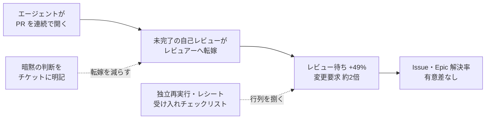
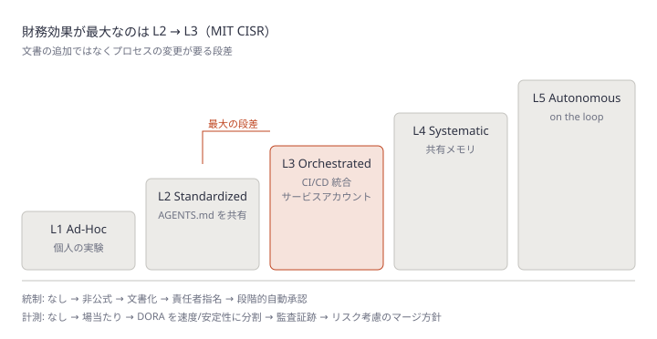
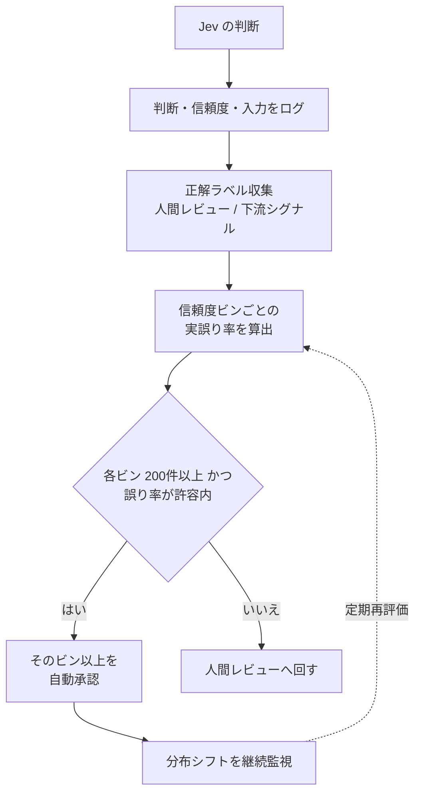

# Daily Briefing 2026-10-22

## 1. コーディングエージェントが増やすのは「コード」であって「ソフトウェア」ではない（原題: Coding Agents Produce More Code, Not More Software (2026)）

- **URL**: https://redreamality.com/blog/coding-agent-more-code-not-more-software-2026/
- **公開日**: 2026-10-17
- **著者・媒体**: Remy / Remy.Blog（redreamality.com）

### 本文翻訳

**研究の概要**: Harvard の Chen と Stratton は Jellyfish のデータ（2021年〜2026年3月、700社超・作業イベント約3億件）で、AI コーディングツール導入前後の企業を差分の差分法で比較した。コード産出は大きく増えたが、Issue・Epic で測ったデリバリーは増えず、効率はコードレビューで吸収された。

**エージェント導入後に変わったもの**: コード行数 約+30%、コミット 約+20%、PR 約+23%、レビュー時間（PR 提出からマージまで）約+49%、変更要求付き PR の割合はほぼ倍増、PR あたりコメント数 約+35%、レビューに関わる従業員の割合 約+14%。**Issue・Epic の解決率は統計的に有意な変化なし**。チケットの小型化では説明できない。2026年3月時点で約95%の企業がエージェントを導入していたが、エージェントが書いたのは PR の約11%、レビューコメントの約23%で、レビューの大半は人間が担った。

**データの限界**: 平均値であり、データは2026年3月で終わる。補完機能と PR を丸ごと出すエージェントは別物である。

**メカニズム**: 人間の作者は書きながら自己レビューし、考えが曖昧になると手が止まる。エージェントは止まらないので、PR を連続で開き、未完了の自己レビューをレビュアーに押し付ける。行列が伸び、手戻りが増える。Epic が動かないのは**信頼のボトルネック**である。

**レビュアーが実際に見ているもの（Campfire の書き直し）**: DHH はエージェントで Campfire を Rails から Rust 等へ書き直した。Piotr Sarnacki の批評によれば、曖昧なプロンプトは互換性、レイテンシ対スループット、メモリ上限、クラッシュ時に通知を失ってよいかを未回答のまま残し、エージェントが黙って決める。Rust 版は CSRF トークンを落とし、Redis をプロセス内キューに替えた。高負荷時の通知到達率は約1%（broadcast 容量256で遅い受信者が切られた）。容量を16,384にすると到達率は約14%→約90%に改善したが最悪レイテンシは約11秒→130秒超。これはプロダクト判断である。レビュアーが時間を使うのは構文確認ではなく、**誰も承認していない既定値の捜索**だ。

**ガバナンス**: QGIS は QEP428（2026-10-07）でレビュー帯域を守るため外部の AI 生成貢献を禁止した。Torvalds は Claude Code でカーネル変更を自ら指示・計測し役割を公表した。違いは誰が指示・レビュー・所有するかである。

**認知のオフロード**: UC Berkeley の実験（1,222人）では約10分 AI に頼ると、外した後に難問を諦める率が上がった。レビューには粘り強さが要る。

**意思決定フレームワーク**:
1. **主指標を変える**。行数・PR 数ではなく、閉じた Issue・Epic、インシデント率、レビュー待ち時間、マージ後ロールバックを追う
2. **責任構造でゲートする**。Torvalds 型は受け入れ基準を先に書いて下書きさせる。QGIS 型は制限。社内チームはレビュー側を広げる場合に限り書く側を広げる。プロトタイプは開放するが main 前に別環境で検証
3. **書く前にレビューを広げる**。マージ前の独立した再実行、レシート（コマンド・終了コード・コミットハッシュ）の要求、「完了」主張の受け入れチェックリスト。同系統の AI レビュアーをもう1つ足すより効く
4. **暗黙の判断をタスクに書く**。互換性要件、レイテンシ対スループットの優先、メモリ上限、失敗時に捨てるか溜めるか。書けないならそのチケットはエージェント向けではない
5. **レビューできる人を守る**。人間が読んで説明しなければならない仕事を残す。怠ると数か月で有資格のレビュアーがいなくなる
6. **4〜6週間の実験**。1プロダクトラインで同種の Epic を従来プロセスとエージェント群で比較する。量が増えデリバリーが横ばいならボトルネックはレビュー。伸びたら効いたタスク種別の実践だけを広げる

**結論**: ソフトウェアのスループットの上限は、変更を理解・保証・確認できる「信頼のスループット」で決まる。

### 重要ポイント

- 700社超の差分の差分分析で、エージェント導入後 PR は約+23%、レビュー時間は約+49%、**Issue・Epic の解決率は有意差なし**
- 人間は書きながら自己レビューして止まるが、エージェントは止まらず自己レビューをレビュアーに転嫁する。これが行列伸長の機構
- レビュアーの仕事は「誰も承認していない既定値の捜索」。broadcast 容量256の既定値で通知到達率が約1%になった実例
- 対策は書く前にレビューを広げること。独立再実行・レシート・受け入れチェックリストは、同系統 AI レビュアーの追加より効く
- 互換性・レイテンシ優先・メモリ上限・失敗時挙動をチケットに書けないなら、そのチケットはエージェントに渡さない

### 図解



### 戦略分析

**フレームワーク**: 制約理論（TOC）× DORA Four Keys

| TOC のステップ | 記事の主張・データ |
|---|---|
| 制約を見つける | 産出（PR +23%）は増えたが、レビュー時間 +49%・変更要求ほぼ倍増。制約はレビュー（信頼の付与） |
| 制約を徹底活用する | 暗黙の判断を事前にチケットへ書き、レビュアーが「既定値の捜索」に時間を使わないようにする |
| 他を制約に従属させる | 書く側の拡大はレビュー側の拡大とセットでのみ許可する（責任構造によるゲート） |
| 制約を引き上げる | 独立再実行・レシート・受け入れチェックリスト、またはレビュアー増員 |

DORA の観点では、記事の主指標（閉じた Issue・Epic、インシデント率、ロールバック、マージ後破損）は変更リードタイムと変更失敗率に対応し、**産出量は Four Keys のどれにも入らない**。

**示唆**: エージェント導入の成果報告から PR 数・行数を外し、「閉じた Epic 数」と「レビュー待ち時間の中央値」の2本に置き換える。そのうえで、レビュー待ちが伸びているチームでは並列エージェント数を増やす前に、チケットテンプレートへ「互換性 / レイテンシ優先 / メモリ上限 / 失敗時挙動」の4欄を追加し、PR にコマンドと終了コードのレシート添付を義務化する。記事の4〜6週間実験は、全社展開の可否判断をする前に1プロダクトラインで実施する。

**反証条件**: データは2026年3月までの平均値で、PR 単位で完結する小粒度・高テスト網羅のチーム（変更の大半が機械検証で判定できる）ではレビューが制約にならず、産出増がそのままデリバリー増に転じ得る。その場合は制約がデプロイや要件確定側にある。

### 現場での適用方法

**チケットテンプレート**（エージェントに渡す前に埋める。埋められなければ人間が担当）:

````markdown
<!-- .github/ISSUE_TEMPLATE/agent-task.md -->
---
name: Agent-ready task
about: コーディングエージェントに渡すタスク。下の4欄が埋まらない場合はエージェント不可
labels: agent-ready
---

## 目的と受け入れ基準
- [ ] ...

## 暗黙の判断（必須。空欄なら agent-ready を外す）
- 互換性: <既存 API / データ形式の後方互換を保つか>
- レイテンシ vs スループット: <どちらを優先するか、許容値>
- メモリ・リソース上限: <負荷時の上限>
- 失敗時の挙動: <捨てる / 溜める / 呼び出し側へ返す>

## 担当と受け入れ
- 指示・受け入れ責任者: @<OWNER>
- レビュアー: @<REVIEWER>
````

**CLAUDE.md への追記例**（PR にレシートを残させる）:

```markdown
## PR を出す前に
- 実行したテスト・ビルドのコマンド、終了コード、対象コミットハッシュを PR 本文の
  「Receipts」節にそのまま貼る。貼れないものは「完了」と書かない
- チケットの「暗黙の判断」欄にない既定値（バッファ容量、タイムアウト、リトライ回数、
  キャッシュ有無）を新たに決めた場合は、PR 本文の「Unapproved defaults」節に列挙する
- 1つの PR を開いたら、それがレビューされるまで同じチケットで次の PR を開かない
```

**計測スクリプト**（週次で「産出」と「レビュー待ち」を並べる。GitHub CLI 使用）:

```bash
#!/usr/bin/env bash
# usage: ./review-queue.sh <OWNER/REPO> <SINCE:YYYY-MM-DD>
set -euo pipefail
repo="$1"; since="$2"
gh pr list -R "$repo" --state merged --search "merged:>=$since" --limit 500 \
  --json number,createdAt,mergedAt \
| jq -r '
  map(((.mergedAt|fromdateiso8601) - (.createdAt|fromdateiso8601))/3600) as $h
  | ($h|sort) as $s
  | "merged_prs=\($s|length)  median_hours_to_merge=\($s[($s|length/2|floor)] // 0 | .*10|round/10)"'
gh issue list -R "$repo" --state closed --search "closed:>=$since" --limit 500 --json number \
| jq -r '"closed_issues=\(length)"'
```

### 期待効果

- 研究の平均値（PR +23% に対し Issue・Epic 解決率は横ばい）が自チームにも当てはまるかを、4〜6週間で判定できる
- 「暗黙の判断」の事前記述により、記事の Campfire 例（通知到達率約1%）のような未承認の既定値をレビュー前に表面化できる
- 主指標を閉じた Epic とレビュー待ちに置き換えることで、産出量の増加を成果と誤認する事態を避けられる

### 注意点

- 研究は平均値であり、データは2026年3月で終わっている。最新モデルや AI レビューの普及で数値は変わり得る
- 「同系統の AI レビュアーを足すより効く」は著者の主張で、記事は定量比較を示していない
- 対照群・介入群の比較は Epic の種類と規模を揃えないと結論が歪む
- QGIS 型の全面禁止は外部コントリビューション前提の判断で、社内チームにそのまま移植すべきではない

## 2. エージェンティック・エンジニアリング成熟度モデル: 5段階の自己診断（原題: Agentic Engineering Maturity Model: 5-Level Self-Assessment）

- **URL**: https://www.augmentcode.com/guides/agentic-engineering-maturity-model
- **公開日**: 2026-06-12（2026-06-18 更新）
- **著者・媒体**: Ani Galstian / Augment Code Guides（ベンダーブログ）

### 本文翻訳

**要旨**: 個人のツール利用は組織の成熟度ではなく、従来の導入指標は高速な出荷に伴う不安定さを見落とす。

**なぜベースラインが必要か**: リーダーに要るのは印象ではなく証拠（指示のバージョン管理、監査証跡、責任者、成果計測）である。DORA 2025 は AI 導入をスループット向上と不安定性増大の両方に結びつけている。

**Level 1: Ad-Hoc**。個人的・実験的な利用で、成功は個人のチャンピオン次第。AI 出力のレビューも形式化されていない。必要なのは実行を記録して再利用可能にすること。MIT CISR の2022年調査（721社）では最初の2段階の企業は業界平均を下回り、28%がこの段階にいた。

**Level 2: Standardized**。共有され、バージョン管理された指針を採用する。中心はエージェントが作業前に読むリポジトリ直下の AGENTS.md。スコープは階層化する——個人のグローバル既定、リポジトリ直下のチーム標準、モジュールごとのサブディレクトリ上書き、そのディレクトリで優先される任意の AGENTS.override.md。**Level 3 への移行には文書ではなくプロセスの変更が要る**。MIT CISR は第2→第3段階を最も価値の大きい移行とし、財務成績が平均以下から平均以上に転じる。

**Level 3: Orchestrated**。複数のエージェントをシステムとデリバリーワークフローをまたいで協調させる。要件は、追跡可能なエージェント ID、イベントトリガー、CI/CD 統合、人間以外の実行主体に対する明確な所有権。大きな問題は、パイプラインを個人のユーザーアカウントで認証すること。10エージェント×20ツールで200本の OAuth フローが生まれる例を挙げ、サービスアカウントを解決策とする。統制はスループットと安定性を分けて追跡すべきで、DORA のデプロイ手戻り率はインシデントが表面化する前にデリバリーリスクを示しうる。

**Level 4: Systematic**。繰り返されるエージェント作業がチームの能力として蓄積される。セッションや人をまたいで文脈が残る組織全体の共有メモリと、修正を蓄積する狭いドメインエージェントを推奨する。学習のフライホイールは Execute → Coach → Distill → Improve の4段で、修正された実行が次の実行の知識になる。

**Level 5: Autonomous**。統制された境界内でエージェントがより多くの作業を実行し、人間は in the loop から on the loop（監督）へ移る。Forrester の AEGIS フレームワーク（6領域39統制）を引用し、人間の判断が要る引き継ぎにはポリシーベースの承認ゲートを置く。最大のリスクは、自律実行が組織の理解を追い越し、悪い出力を診断・修正できなくなること。

**自己診断マトリクス**（L1→L5）:
- エージェント設定: 技術者ごと → リポジトリの AGENTS.md → サービスアカウントで CI/CD 統合 → 専門スコープ＋メモリ → 自己改善・全社
- 知識共有: 個人のプロンプト → 共有ルールファイル → 仕様駆動の協調 → エージェント間共有メモリ → 複利的に増える知識ベース
- 統制: なし → 非公式ポリシー → 文書化された AI ポリシー → エージェント責任者の指名 → 段階的自動承認と人の呼び込み
- 計測: AI 指標なし → 場当たり → DORA をスループットと安定性に分割 → エージェント監査証跡 → 戦略ダッシュボードとリスク考慮のマージ方針
- 組織設計: 個人チャンピオン → 少人数の専門グループ → 横断権限を持つ AI ディレクター → 職能横断スクワッド → ファクトリーチームと運用チームへの分割

**よくある過大評価**: (1) AI アシスタントをエージェントと呼ぶ「エージェントウォッシング」、(2) 客観的な DORA 指標、特にデプロイ手戻り率より感覚を信じる「認識ギャップ」、(3) 出荷速度だけを測り不安定さを無視する「スループットのみの追跡」。

**推奨**: Level 2 以上の組織は、まず現行ワークフローをマトリクスに当て、計測をスループットと安定性に分ける。それで AI が下流に問題を起こしている箇所、共有標準が要る領域、オーケストレーションやメモリ基盤が要る箇所が見える。エージェントの範囲拡大や自動化はそのベースラインの後に行う。

### 重要ポイント

- 個人のツール利用は組織の成熟度ではない。5段階（Ad-Hoc / Standardized / Orchestrated / Systematic / Autonomous）を5次元で自己診断する
- MIT CISR によれば財務効果が最大なのは第2→第3段階。そこで要るのは文書の追加ではなく**プロセスの変更**
- Level 3 の典型的な壁は個人アカウント認証。10エージェント×20ツールで OAuth フロー200本。サービスアカウントに寄せる
- 計測は DORA をスループットと安定性に分割し、特にデプロイ手戻り率を見る
- 範囲拡大はベースライン計測の後。自律実行が組織の理解を追い越すのが最大のリスク

### 図解



### 戦略分析

**フレームワーク**: ケイパビリティ成熟度モデル（記事のモデルに完了条件を付与）

| 段階 | 完了条件（記事の自己診断マトリクスから導出） | 次段階への最初の一手 |
|---|---|---|
| L1 → L2 | リポジトリ直下に AGENTS.md があり、PR レビューを経て更新されている | エージェント実行の記録を残す |
| L2 → L3 | エージェントが個人ではなくサービスアカウントで CI/CD から起動され、責任者が決まっている | 個人トークンで動いているジョブの棚卸し |
| L3 → L4 | DORA をスループットと安定性に分けて追跡し、エージェント操作に監査証跡がある | 修正内容をスキル・メモリへ蒸留する手順の定義 |
| L4 → L5 | 段階的な自動承認ポリシーと、人を呼び込む条件が文書化されている | 承認ゲートの対象とする引き継ぎの特定 |

**示唆**: 「AI-Ready の次」に悩む組織の大半は L2（AGENTS.md 整備済み）にいる。記事の主張どおり L2→L3 が最大価値なら、次の投資先は指示ファイルの磨き込みではなく、**エージェントを個人アカウントから切り離してサービスアカウント＋CI トリガーで動かすこと**と、責任者の指名である。四半期の目標を「AGENTS.md の網羅率」から「サービスアカウントで動くエージェントジョブの割合」と「デプロイ手戻り率の可視化」に置き換える。

**反証条件**: 財務効果の根拠は2022年の MIT CISR 調査（AI 一般のデジタル成熟度）であり、コーディングエージェント固有の段階移行を測ったものではない。また記事はベンダーブログで、L4 以降の推奨は自社製品と結びついている。小規模チーム（エージェントジョブが数本）では OAuth の爆発が起きず、L3 の要件は過剰投資になり得る。

### 現場での適用方法

**自己診断スクリプト**（リポジトリ単位で L2/L3 の完了条件を機械的に確認する）:

```bash
#!/usr/bin/env bash
# usage: ./agent-maturity-check.sh <REPO_PATH>
set -uo pipefail
cd "$1"
pass(){ printf '  [x] %s\n' "$1"; }; fail(){ printf '  [ ] %s\n' "$1"; }

echo "L2 Standardized"
[ -f AGENTS.md ] || [ -f CLAUDE.md ] && pass "ルートに指示ファイルがある" || fail "ルートに指示ファイルがない"
n=$(git log --since="90 days ago" --oneline -- AGENTS.md CLAUDE.md 2>/dev/null | wc -l)
[ "$n" -gt 0 ] && pass "指示ファイルが直近90日で更新 (${n} commits)" || fail "指示ファイルが90日間更新されていない"

echo "L3 Orchestrated"
if grep -rlqE 'anthropics/claude-code-action|codex|copilot' .github/workflows 2>/dev/null; then
  pass "CI からエージェントを起動するワークフローがある"
else
  fail "エージェントは個人の端末からのみ起動されている"
fi
if grep -rqE 'secrets\.(PERSONAL|USER)_[A-Z_]*TOKEN' .github/workflows 2>/dev/null; then
  fail "個人トークンでエージェントを認証しているジョブがある（サービスアカウントへ移行）"
else
  pass "個人トークンの直接参照は見つからない"
fi
[ -f .github/CODEOWNERS ] && grep -qE 'AGENTS\.md|CLAUDE\.md|\.claude/' .github/CODEOWNERS \
  && pass "エージェント設定に CODEOWNERS（責任者）がある" || fail "エージェント設定の責任者が未指定"
```

**CODEOWNERS への追記例**（L3 の「人間以外の実行主体に対する所有権」を明示）:

```text
# エージェント設定と CI 起動定義は責任者のレビューを必須にする
/AGENTS.md                         @<ORG>/<AGENT_OWNERS_TEAM>
/CLAUDE.md                         @<ORG>/<AGENT_OWNERS_TEAM>
/.claude/                          @<ORG>/<AGENT_OWNERS_TEAM>
/.github/workflows/agent-*.yml     @<ORG>/<AGENT_OWNERS_TEAM>
```

### 期待効果

- 「AI-Ready の次に何をするか」を段階の完了条件で議論でき、AGENTS.md の磨き込みに投資が偏るのを防げる
- MIT CISR が最大の財務効果を見出した第2→第3段階に投資を集中させる根拠になる
- 個人トークン依存の可視化により、記事の例（10エージェント×20ツールで OAuth 200本）のような認証の爆発を早期に止められる

### 注意点

- ベンダーブログであり、L4・L5 の推奨には自社製品（Cosmos）の宣伝が含まれる
- MIT CISR の数値は2022年の AI 全般の成熟度調査で、コーディングエージェントに直接当てはまる保証はない
- FAQ の回答はページに掲載されていない
- 自己診断スクリプトの判定は表層的（ファイルの有無と文字列一致）。数値化そのものを目的にしないこと

## 3. Jev の信頼度スコアは信用できるか: RLCD の較正を解説（原題: Is Jev's confidence score trustworthy? RLCD calibration explained）

- **URL**: https://prefactor.tech/blog/jev-calibrated-confidence-is-not-correctness
- **公開日**: 2026-09-25
- **著者・媒体**: Matt Doughty / Prefactor Blog

### 本文翻訳

**要約**: Jev の信頼度スコアは TypeSafe の学習データ上で較正されたものであり、あなたの本番トラフィック上で較正されたものではない。実行ごとに実際の結果と突き合わせるまでは、それに基づいて行動してはならない。

**1. 信頼度の数字は何を約束しているか**: Jev の信頼度スコアは、判断時の内部確率分布を反映する。TypeSafe は学習手法を RLCD（Reinforcement Learning for Calibrated Decisions）と呼ぶ。よく較正されたモデルでは、表明した確率と観測頻度が一致する。80% と言えば約80%の確率で正しい。較正は精度とは別物だ。モデルは頻繁に間違えても「間違えそうなとき」を知っていることがあるし、全体として正確でも誤りに対して過信していることもある。自動承認のルーティングでは、生の精度より較正が重要になる。なお TypeSafe は報酬関数、アーキテクチャ、較正手法を公開しておらず、主張は独立に検証できない。

**2. 学習データ上の較正はなぜ移転しないか**: 較正は特定の分布の性質である。語彙・ドメイン・形式・文脈が学習分布と異なれば、スコアと誤り率の関係は予告なくずれる。これはベンチマークと本番の一般的なギャップの一例だ。Klarna のアシスタント（初月約230万会話、フルタイム担当者約700人分）や JPMorgan の COIN（年約36万時間の法務作業を削減）は、いずれも自社データで成果を測ったから成功した。

**3. 自動承認ロジックの失敗モード**: 0.90 のような閾値は、「スコア90%なら自社トラフィックでの誤り率は10%」という前提を暗黙に置く。この前提は検証されていない。実際の誤り率は入力と学習分布の関係や、高信頼度のケースが系統的に異なるかどうか次第で、8%にも20%にも35%にもなり得る。過信は、ユーザーが最も多く送ってくる種類の入力に潜むことがある。

**4. 代わりに作るべきもの**:
- Jev のすべての判断を、信頼度スコアとそれを生んだ入力と一緒に記録する
- 人間のレビュー、下流の結果シグナル、または別の採点モデルで正解ラベルを集める
- 判断を報告信頼度でビンに分け、各ビンの実際の誤り率を計算する
- 観測された誤り率と表明された信頼度を比較する。例: Jev が 0.80 と言うビンの誤り率が 0.30 なら、自社データ上では較正が崩れている

これはベンダーへの質問ではなく本番評価の問題である。分布シフトで較正は時間とともに劣化しうるので、監視は継続的に行う。

**5. どこから始めるか**: 直近の Jev の判断を取り出し、各信頼度スコアと結果を並べて記録し、ビンに分けてスコアと誤り率が一致するか確かめる。結果ログがまだ無ければ、まずそれを整備する。

**6. FAQ**:
- ベンダーの較正の主張で十分か → 不十分。それは TypeSafe の学習分布の話であって、あなたの分布の話ではない
- ビンあたり何件必要か → 目安は**1ビンあたり約200件のラベル付き例**。それより少ないと誤り率の推定がノイジーになる
- 結果データが無いうちにスコアを使ってよいか → 弱く保守的なルーティング信号としてのみ。境界付近は人間レビューへ回し、その閾値での誤り率を測るまで自動承認の閾値を設定しない
- ラベル付けが高い → ルーティング閾値付近のケースを優先する。苦情・取り消し・追加問い合わせなどの下流シグナルで代替できる領域もあるが、遅延とノイズが加わる

**結び**: 他人のデータ上の較正は事前分布であり、自社の本番結果こそが証拠である。

### 重要ポイント

- Jev の信頼度は TypeSafe の学習分布上での較正。自社トラフィックでの誤り率を保証しない
- 閾値 0.90 は「誤り率10%」を暗黙に仮定する。実際は8%にも35%にもなり得る
- 判断・信頼度・入力をログし、正解ラベルを付け、信頼度ビンごとに誤り率を出して比較する
- 目安は1ビンあたり約200件。ラベル付けは閾値付近のケースを優先する
- 測るまでは境界付近を人間レビューへ回し、自動承認の閾値を置かない

### 図解



### 戦略分析

**フレームワーク**: リスク×可逆性マトリクス（Cynefin の併用候補）

| | 可逆（取り消し可能） | 不可逆 |
|---|---|---|
| **自社データで較正を検証済み** | 自動承認してよい（例: 問い合わせの一次振り分け） | 自動承認＋事後サンプリング監査 |
| **未検証（ベンダーの較正のみ）** | 保守的な信号として使い、境界付近は人へ | 自動承認しない。人間の判断に限定 |

記事の主張は、横軸ではなく縦軸——**較正を自社データで検証したか**——が自動承認の可否を決めるというもの。

**示唆**: Jev を導入するチームは、閾値を決める会議をする前に「判断ログ＋結果ラベル」の基盤を先に作る。リリース計画の順序を (1) 全判断を人間レビュー付きで記録、(2) 1ビン約200件たまったビンから誤り率を算出、(3) 許容誤り率を満たすビンだけ自動承認、とし、不可逆な操作（返金、アカウント停止など）は (3) に到達しても対象外にする。ラベル予算は閾値付近に集中させる。

**反証条件**: 判断の誤りコストが極めて小さく、下流で即座に自然訂正される用途（例: 表示順の並べ替え）では、較正検証のコストが誤りのコストを上回り、ベンダーの較正のまま使う方が合理的になる。また記事は較正ツールを販売する企業のブログであり、検証の必要性を強調する動機がある。

### 現場での適用方法

**較正チェックスクリプト**（判断ログ CSV から信頼度ビンごとの実誤り率を出す）:

```python
#!/usr/bin/env python3
"""usage: python3 jev_calibration.py <LOG_CSV> [--threshold 0.9] [--min-n 200]
LOG_CSV columns: decision_id,confidence,predicted,actual  (actual が空の行は未ラベルとして除外)
"""
import argparse, csv

ap = argparse.ArgumentParser()
ap.add_argument("log_csv")
ap.add_argument("--threshold", type=float, default=0.9)
ap.add_argument("--min-n", type=int, default=200)
args = ap.parse_args()

bins = {i: [0, 0] for i in range(10)}  # bin -> [n, errors]
with open(args.log_csv, newline="") as f:
    for row in csv.DictReader(f):
        if not row["actual"]:
            continue
        b = min(int(float(row["confidence"]) * 10), 9)
        bins[b][0] += 1
        bins[b][1] += row["predicted"] != row["actual"]

print(f"{'bin':>9} {'n':>6} {'stated_err':>10} {'observed_err':>12}  verdict")
for b, (n, err) in bins.items():
    lo, hi = b / 10, (b + 1) / 10
    stated = 1 - (lo + hi) / 2
    obs = err / n if n else float("nan")
    if n < args.min_n:
        verdict = "サンプル不足 → 人間レビュー"
    elif lo >= args.threshold and obs <= stated * 1.5:
        verdict = "自動承認候補"
    elif obs > stated * 1.5:
        verdict = "過信 → 閾値を上げる"
    else:
        verdict = "人間レビュー"
    print(f"{lo:.1f}-{hi:.1f} {n:>6} {stated:>10.3f} {obs:>12.3f}  {verdict}")
```

**CLAUDE.md への追記例**（Jev 連携コードを書くエージェント向け）:

```markdown
## Jev の判断を使うコード
- Jev の confidence を閾値比較に使う場合、閾値は `config/jev_thresholds.yaml` から読み、
  コードにハードコードしない。新しい閾値を追加する PR には `jev_calibration.py` の出力を添付する
- 判断ごとに decision_id, model_version, confidence, predicted, input_hash をログに出す
- モデル指定は `typesafe/jev-latest` ではなくバージョン固定（例: `typesafe/jev-1.13.0`）にする
- 返金・アカウント停止など不可逆な操作は confidence に関係なく人間の承認を経由させる
```

### 期待効果

- 「閾値 0.90 なら誤り10%」という暗黙の仮定を、自社データ上の実測誤り率に置き換えられる
- ラベル付けを閾値付近に集中させることで、レビュー工数を抑えつつ自動承認の範囲を段階的に広げられる
- 分布シフトによる較正劣化を、定期再評価で早期に検出できる

### 注意点

- 1ビン約200件はあくまで目安で、記事も「おおよその下限」としている。低頻度のビンは長期間判定できない
- 下流シグナル（苦情・取り消し）をラベル代わりにすると遅延とノイズが入る
- 記事にコード例は無い。上記スクリプトの判定基準（観測誤り率が表明値の1.5倍以内）は本ブリーフィングでの仮置きであり、許容誤り率は業務ごとに決めること
- 記事は較正・評価ツールを提供する企業のブログで、引用される他社事例（Klarna、Pandora 等）は Jev の事例ではない
