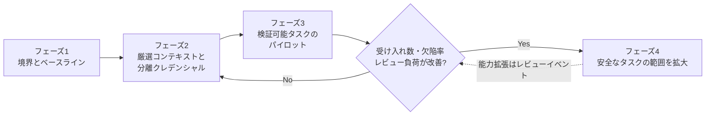
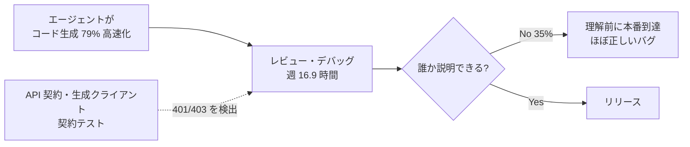
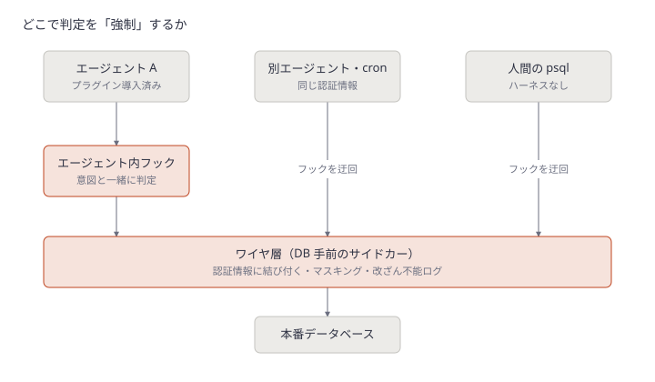

# Daily Briefing 2026-10-23

## 1. AI-Ready なエンジニアリング組織をつくる: 実践ガイド（原題: Building AI-Ready Engineering Organizations: A Practical Guide）

- **URL**: https://www.ai-infra-link.com/building-ai-ready-engineering-organizations-a-practical-guide/
- **公開日**: 2026-10-13
- **著者・媒体**: R. Santos Paulo / AI Infra Link

### 本文翻訳

全エンジニアにコーディングアシスタントを配っても AI-Ready にはならない。AI-Ready とは、**正しさ・セキュリティ・コスト・デリバリーの統制を失わずに**、AI を使って有用な変更を出せる状態のことだ。問うべきは、チームが適した仕事を選べるか、信頼できるコンテキストを渡せるか、出力を検証できるか、理解しているシステムを通して出荷できるか、である。

**AI-Ready の意味**: 補完・リポジトリを書き換えるエージェント・テストや運用の専用ツールでは自律度が違い、リスクの前提も変えるべきだ。診断の問いは「ツールはどのリポジトリとデータに触れるか」「生成された変更の所有者は誰か」「アーキテクチャ制約はどこから来るか」「出力はどうテストされるか」「危険なツールをどれだけ速く止められるか」。答えがばらつく、属人知に頼っているなら、それがギャップである。指示はリポジトリと一緒にバージョン管理し、全社ポリシーは中央で強制する。評価単位は個人や生成量ではなく、完了したエンジニアリング成果である。

**採用率は成果ではない**: Stack Overflow 2026 調査では回答者の 65.9% がアシスタントかエージェントを使い、26.2% がエージェント・自動化ワークフローを使う（自己申告）。DORA 2025 は AI を「既存の強み・弱みの増幅器」と位置づけ、AI 採用度はスループット上昇と不安定性上昇の両方に関連した。METR の 2025 年 RCT では熟練開発者が AI 使用時に 19% 遅くなった。一律の懐疑も一律の生産性主張も避けよ。

**運用モデルを先に作る**: 責務を4つに分ける。エンジニアリングチーム（課題設定・実装・テスト・受け入れ）、プラットフォーム（承認済み環境・ID・アクセス・テレメトリ）、セキュリティ（強制可能な境界と例外審査）、リーダーシップ（予算・横断制約・成果評価）。許可ツール、データ区分、モデルの送信先、保持期間、プラグイン権限、必須の人間承認点を短い利用基準として公開する。所有権の契約例: 依頼者が受け入れ基準と機微パスを示す → エージェントは隔離ブランチで限定的な変更を提案 → CI が標準チェック → レビュアーが振る舞い・設計・セキュリティを確認 → デプロイ系とオンコールが最終権限を持つ。**エージェントは貢献者であって所有者ではない**。

**内部コンテキストは基盤**: サービス所有者、ADR、Runbook、インターフェース契約、規約、テスト手順、デプロイ境界、インシデントの教訓から始め、各成果物に所有者・鮮度期限・アクセスポリシーを付ける。古いコンテキストは流暢に提示されるぶん危険だ。検索は呼び出し元の ID を尊重する。

**権限は結果の重さで設計する**: ツールは最小限、クレデンシャルは短命でリソース単位、作業環境は本番から隔離し、削除・権限変更・公開・インフラ変更・外部送信は明示確認を要求する。読み取りと書き込みを分け、保護ブランチへのマージと本番デプロイは既存の承認系に残す。**プロンプトの指示はセキュリティ境界ではない**。

**通常の統制を保つ**: レビューパッケージには、タスク参照、変更ファイル、テスト結果、前提、既知のギャップ、そして「実際に走らせたチェック」と「提案しただけのチェック」の区別を含める。レビュー容量は有限なので、生成が安かったから大きくなっただけのリファクタは却下する。

**生成量ではなく価値を測る**: 事前に定義するスコアカードは、受け入れからデプロイ可能までの時間、初回受け入れ率、レビュー・手戻り時間、流出欠陥、デプロイ安定性、総コスト（推論・ツール・人間の確認）。作業種別ごとに測り、コストは**受け入れ1件あたり**で、放棄・検証不能な作業も分母に入れる。

**判断力を育てる**: 生成が効く課題と、もっともらしく誤る課題をペアで演習し、受け入れ・修正・却下の理由を説明させる。失敗パターン（架空のインターフェース、依存のドリフト、不完全なテスト、誤解を招く要約）を記録する。遅くなったという報告を罰しない。

**段階的ロールアウト**: (1) 境界とベースライン（棚卸し・許可用途の公開・代表タスクの事前計測）(2) 小さく厳選したコンテキストと分離クレデンシャル (3) テスト生成・依存更新・ドキュメント同期など検証可能なタスクで、受け入れ基準・人間の所有者・完全な操作ログ・ロールバック・ベースライン比較を伴うパイロット (4) 受け入れ数・サイクルタイム・欠陥率・レビュー負荷が裏付けるところだけ自律度を拡大。

**自動化しない判断**: テストオラクルが弱い、要件が曖昧、副作用が重い仕事は助言のみや読み取り専用に留める。これを減点する成熟度スコアは能力ではなく無謀さを報いる。ツールが書き込み権限を得た、モデル更新で出力が変わった等は、黙って権限を広げず**レビューイベント**として扱う。

### 重要ポイント

- AI-Ready の評価単位は「個人の生成量」ではなく「受け入れられデプロイされた成果」。コストは受け入れ1件あたりで、放棄作業も分母に入れる
- 責務を チーム／プラットフォーム／セキュリティ／リーダーシップ の4者に分け、**エージェントは貢献者であって所有者ではない**と契約で明記する
- 権限は結果の重さで設計する。読み書き分離・短命クレデンシャル・不可逆操作の明示確認。プロンプトは境界ではない
- レビューパッケージに「実行したチェック」と「提案しただけのチェック」の区別を必須にする
- ツールの能力拡張（読み取り→書き込み、モデル更新）は黙認せずレビューイベントにする

### 図解



### 戦略分析

**フレームワーク**: ケイパビリティ成熟度モデル

| 段階 | 完了条件（記事の記述から） | 次段階へ進めない典型 |
|---|---|---|
| 1. 境界とベースライン | ツール・データ区分・リポジトリのリスクを棚卸し、利用基準を公開、代表タスクを事前計測 | 席を買って生産性目標だけ宣言 |
| 2. コンテキストと分離アクセス | 所有者・鮮度期限付きの小さな情報源、エージェント専用クレデンシャル | 巨大な社内 RAG を先に作る |
| 3. 限定パイロット | 受け入れ基準・人間の所有者・操作ログ・ロールバック・ベースライン比較が揃う | 前後比較を因果として発表 |
| 4. 自律度の拡大 | スコアカードが改善した作業種別だけ広げる | 本番権限を一括で付与 |

**示唆**: 多くの組織は段階1を飛ばしており、拡大の可否を判定する比較対象を持たない。今四半期に打つべき手は新ツールの導入ではなく、(1) 作業種別を3つ（例: テスト追加・依存更新・小さな移行）選び、AI 有無で「受け入れ1件あたりのレビュー時間と総コスト」を計測し始めること、(2) 本番・保護ブランチへの書き込みをエージェント用クレデンシャルから外すこと。成熟度を上げる判断は「使っている人数」ではなく、この計測値でのみ行う。記事は段階ごとの正式な完了基準を定義しておらず、上表の完了条件は記述からの再構成である。

**反証条件**: 小規模でレビュアーが潤沢、本番影響の小さい社内ツール中心の組織では、段階1〜2の統制コストが得られる安全性を上回り、早期に広く開放した方が学習速度で勝つ可能性がある。

### 現場での適用方法

**CLAUDE.md への追記例**（エージェントに「貢献者」としての振る舞いとレビューパッケージを課す）

```markdown
## エージェントの役割と提出物

あなたはこのリポジトリの「貢献者」であり「所有者」ではない。
マージ・デプロイ・権限変更は行わない。

### 作業開始前
- タスクの受け入れ基準が書かれていなければ、推測せず質問する
- `docs/sensitive-paths.txt` に載っているパスを変更する場合は、着手前に人間の確認を取る
- 業務ルールの例外に出会ったら、古いコメントから方針を推測せず質問する

### PR 本文に必ず含めるもの（レビューパッケージ）
1. タスク参照（Issue 番号）
2. 変更ファイルの一覧と各ファイルの変更理由（1行）
3. **実行したチェック**: コマンド・終了コードをそのまま貼る
4. **提案のみで未実行のチェック**: 実行しなかった理由
5. 置いた前提と既知のギャップ

### 禁止
- 生成が安いという理由で変更範囲を広げること（1 PR は 1 つの受け入れ基準に対応させる）
- 書き込み権限を持つ新しいツール・MCP サーバーを自分で追加すること
```

**スクリプト化の例**（PR 本文にレビューパッケージの必須見出しがあるか CI で検査）

```bash
#!/usr/bin/env bash
# .github/scripts/check-review-package.sh
# 使い方: PR_BODY="$(gh pr view <PR_NUMBER> --json body -q .body)" ./check-review-package.sh
set -euo pipefail
required=("タスク参照" "実行したチェック" "提案のみで未実行のチェック" "前提と既知のギャップ")
missing=0
for h in "${required[@]}"; do
  if ! grep -q "$h" <<<"${PR_BODY:?PR_BODY is empty}"; then
    echo "::error::レビューパッケージに「$h」がありません"
    missing=1
  fi
done
exit "$missing"
```

### 期待効果

- 「AI で速くなった」という主張を、作業種別ごとの受け入れ1件あたりコストで検証できるようになる（記事は特定の改善率を示していない）
- 記事が引く DORA の知見どおり、AI が弱い基盤を増幅して不安定化するリスクを、権限分離とレビューパッケージで抑える
- レビュアーが「走らせたか不明なテスト」を再確認する手間が減る

### 注意点

- 記事は段階ごとの期間・正式な出口基準を示しておらず、提示された順序も実証済みのタイムラインではないと明記している
- METR の 19% 遅延は特定条件（成熟した OSS・熟練開発者）の結果で、著者自身が一般化を戒めている
- AI 有無の比較をチームの自主選択で行うと観察研究になる。オプトアウトも分析対象に含めること
- ツール評価を個人の評価と混ぜると、手戻りが隠され計測が壊れる

## 2. コードは速くなったのにリリース日は同じ、なぜか（原題: Faster Code, Same Release Date: What Gives?）

- **URL**: https://liviutudor.com/2026/10/20/faster-code-same-release-date-what-gives/
- **公開日**: 2026-10-20
- **著者・媒体**: Liviu Tudor / Of Man and Internet

### 本文翻訳

きっかけは、デバッグツールを作る Undo の依頼で Coleman Parkes が行った調査だ（依頼元のバイアスには留意してほしい）。シニアエンジニアリングリーダー 300 人のうち **79% がエージェントでコード生成が大幅に速くなった**と答えたが、リリースサイクルは「以前と変わらない」と述べた。チームは週平均 **9.8 時間をコードを書くことに、16.9 時間をデバッグに**費やしている。そして**生成コードの 35% はチームが十分に理解する前に本番へ到達**している。Stack Overflow 2026 調査では AI コーディングツール利用者の 73% が毎日使い、BairesDev のバロメーターでは「AI がコードの半分以上を書く」開発者が 1 年前の 12% から 42% に増えた。コードは増えているのに、リリースは速くならない。

**タイピングがボトルネックだったことはない**: コードを書くのは昔からエンジニアリングの小さな部分で、要件の理解・統合・レビュー・テスト・デバッグが時間の大半を占める。Amdahl の法則で考えると、タイピングを 10 倍速くしても影響するのは仕事のおよそ 4 分の 1 だけだ。速い出力は遅いレビューとデバッグに流れ込み、行列を伸ばす。下流が吸収できない限り、すべてのコード行は資産である前に負債である。

**私の現場から**: 私は懐疑派ではない。Calendrz を Claude Code で作っており、変更の大半はエージェントが書く。戻るつもりはない。だが今、時間の大半はレビューに消えている。例1: AI スケジューリングアシスタントのミーティング投票レスポンスに新しいフィールドが追加され、宣言もドキュメントもあり、テストも通ったが、**誰もその値をセットしていなかった**。2 回目のレビューで気づいた。例2: 別のプロフィールに対してエンドポイントが 403 ではなく **401** を返していた。Web とモバイルアプリは 401 をセッション切れとして扱うので、ユーザーはサインアウトさせられるところだった。iOS アプリが生成済み API クライアントを使ったときに発覚した。こうしたバグはコンパイルもテストも通る。Undo の CEO Greg Law はこれを「ほぼ正しいが、完全ではない」コードと呼ぶ。実ユーザーに届くので最も高くつく種類のバグだ。

**では、どうするか**:
1. **パイプライン全体を測る**: アイデアから本番までのリードタイムと、リリースが何かを壊す頻度を追う。コード行数や PR 数は追わない
2. **レビューを制約として扱う**: 変更を小さく保ち、レビュー時間を正規の仕事として予定に入れる
3. **機械に機械を検査させる**: コミットされた API 契約、生成クライアント、契約テスト、型、プロパティテスト、さらにレビュー用の第二のエージェント。シニアの負担を減らす
4. **マージした人が所有する**: 誰も説明できない変更は出荷しない。35% という数字は CTO を不安にさせるべきだ
5. **エージェントを「書く」だけでなく「理解する」に向ける**: 調査では約 3 分の 1 のチームが、デバッグと理解のためにエージェントを使うのは単純なコードベースに限っていた。逆である。疲れを知らない読み手が最も役立つのはレガシーコードだ

**結び**: コードは安くなったが理解は安くないという現実に合わせてレビューと検証を作り直したチームが、1 年ほどで抜け出すだろう。エージェントはタイピングを無料にしたが、考えることには今も手間がかかる。

### 重要ポイント

- 79% が「コード生成は大幅に速い」と答えつつリリースサイクルは不変。週 9.8 時間を書くこと、16.9 時間をデバッグに費やす
- 生成コードの 35% はチームが理解する前に本番へ到達している
- Amdahl の法則: タイピングを 10 倍にしても効くのは仕事の約 1/4
- 実例は「宣言・文書・テストは揃うが値が未設定」「403 のはずが 401 でクライアントが強制ログアウト」。テストを通る「ほぼ正しい」バグ
- 対策の核は API 契約＋生成クライアント＋契約テストで機械に機械を検査させること

### 図解



### 戦略分析

**フレームワーク**: 制約理論（TOC）

| TOC のステップ | 記事の記述 |
|---|---|
| 制約を見つける | 書く 9.8h/週 に対しデバッグ 16.9h/週。制約は実装ではなく検証・理解 |
| 徹底活用する | 変更を小さくし、レビュー時間を予定に組み込む |
| 他を従属させる | 生成量を制約に合わせる。誰も説明できない変更はマージしない |
| 制約を引き上げる | 契約テスト・型・プロパティテスト・第二エージェントで機械的に検出できる誤りを人間の前で潰す |

**示唆**: 実装支援への追加投資は TOC 上リードタイムを縮めない。先に予算を振るべきは「人間のレビュー前に機械が落とせる誤りの範囲を広げる」こと。具体的には、著者の 401/403 の例のように**クライアントとサーバーの不整合**は OpenAPI 契約から生成したクライアントと契約テストで機械的に検出できるので、API を持つチームは契約テストの導入を、新たなコーディングエージェントのライセンス追加より優先する。

**反証条件**: 調査はデバッグツール企業の依頼であり、デバッグ時間を大きく見せる誘因がある。また著者の事例は個人開発の 1 プロダクトである。レビューが既に小さな変更単位で非同期待ちが少ないチームでは、制約は別工程（要件定義やリリース承認）にあり、契約テストへの投資はリードタイムを縮めない。

### 現場での適用方法

**スクリプト化の例**（OpenAPI 契約からクライアントを再生成し、差分とステータスコード契約を CI で検査）

```yaml
# .github/workflows/contract.yml
name: api-contract
on: [pull_request]
jobs:
  contract:
    runs-on: ubuntu-latest
    steps:
      - uses: actions/checkout@v4
      - uses: actions/setup-node@v4
        with:
          node-version: 20
      # 1. 契約からクライアントを再生成し、コミット済みのものと一致するか
      - run: npx --yes @openapitools/openapi-generator-cli@2.13.4 generate -i <OPENAPI_SPEC_PATH> -g typescript-fetch -o <CLIENT_OUT_DIR>
      - run: git diff --exit-code -- <CLIENT_OUT_DIR> || (echo "::error::生成クライアントが契約と不一致" && exit 1)
      # 2. 実装が契約どおりのステータスコードを返すか（schemathesis で契約テスト）
      - run: pip install schemathesis==3.* && <START_SERVER_COMMAND> &
      - run: st run <OPENAPI_SPEC_PATH> --base-url http://localhost:<PORT> --checks status_code_conformance,response_schema_conformance
```

**CLAUDE.md への追記例**

```markdown
## API 変更のルール

- レスポンスにフィールドを追加したら、そのフィールドに値をセットする箇所と、
  値がセットされていることを検証するテストを同じ PR に含める（宣言だけで終わらせない）
- 認可エラーは 403、認証切れのみ 401。クライアントは 401 を強制ログアウトとして扱うため取り違えない
- `<OPENAPI_SPEC_PATH>` を変えたら生成クライアントを再生成してコミットする
- PR 本文に「この変更を自分の言葉で説明すると」を3行で書く。説明できない変更は出さない
```

**運用手順**（レガシー理解にエージェントを向ける）

1. 週に1度、最も触られていないが障害の多いモジュールを `git log --since="6 months ago" --format= --name-only | sort | uniq -c | sort -n` で探す
2. エージェントに「このモジュールの不変条件と暗黙の前提を列挙し、根拠となる行を示せ。コードは変更しない」と依頼する
3. 出力を ADR か `docs/modules/<MODULE>.md` に人間がレビューしてコミットする

### 期待効果

- 記事の数値を借りれば、週 16.9 時間のデバッグのうち「契約不整合」「未設定フィールド」型の誤りを人間のレビュー前に機械で落とせる（削減率は記事に無い）
- 「理解前に本番到達」35% の割合を、説明責任ルールで下げられる
- 計測を PR 数からリードタイムと変更失敗率に切り替えることで、見かけの生産性に惑わされない

### 注意点

- 調査は Undo（デバッグツール企業）の依頼で、著者自身がバイアスを明記している
- 著者の実例は個人開発の 1 プロダクト。チーム規模の再現性は未検証
- 第二のエージェントによるレビューは、同系統モデルだと同じ見落としを共有しやすい。契約テスト・型など決定的な検査を先に置く
- 上記ワークフローのツールとバージョンは例示であり、記事が指定したものではない

## 3. Jev のガードレールはエージェント内に置くか、ワイヤ上に置くか（原題: Should your Jev guardrail live in the agent or on the wire?）

- **URL**: https://hoop.dev/blog/should-your-jev-guardrail-live-in-the-agent-or-on-the-wire/
- **公開日**: 2026-09-22
- **著者・媒体**: Luis Felipe Dias / hoop.dev

### 本文翻訳

TypeSafe が、行動にリスク確率を割り当てる分類器 Jev をリリースすると、エコシステムはすぐに数百のガードレールを作った。Claude Code プラグイン、LangChain ミドルウェア、自作フックスクリプト。どのガードレールも2つの仕事をする。行動を**判定**し、その判定を**強制**する。Jev は判定をほぼ無料にしたが、何も強制しない。強制は**配置**の問題である。判定がどこで適用され、何がそれを迂回できるか。

**エージェント内**: 第一の配置は、ツール呼び出しの前後に走るフックだ。プラグインが提案された行動を Jev に送り、スコアを allow / deny / 人間に確認 に変換する。例として **jev-guard** は、シェルコマンドごとに Jev へ質問のバッチを投げ、`rm -rf` や `DROP TABLE` のような形を決して自動許可しない Claude Code プラグインだ。LangChain の AutoModeMiddleware も同じ方式である。利点は、各行動をエージェントのタスクや計画と一緒に見られること。エージェントのサンドボックス内の危険コマンドも止められ、取得した Web ページを次のステップに影響する前にプロンプトインジェクション検査できる。限界は jev-guard の README 自身が書いている。「セキュリティ境界ではない」、フックを通るツールしか対象にしない、**既定でフェイルオープン**、導入した1つのエージェントしか守らない。同じ DB クレデンシャルを持つ2つ目のエージェント、cron ジョブ、開発者のノート PC はフックを完全に迂回する。

**ワイヤ上**: 第二の配置は、データベースに付けるサイドカープロキシ（hoop.dev）だ。エージェントの接続文字列をサイドカーに向けるだけで、SDK・プラグイン・プロンプトの変更は要らない。DB のネイティブプロトコルを話すので、各ステートメントを触るテーブルと返るデータの文脈で読める。モデルが各ステートメントの意図とリスクを採点し、各レベルで何をするか（許可・警告・ブロック・人間の承認待ち）はオペレーターが決める。ブロックされた文は DB に届く前に拒否され、オペレーターが書いたメッセージ付きの通常の DB エラーとして返る。機微な値はエージェントが見る前にマスクされ、全ステートメントはエージェントが編集できないログに残る。エージェント、別フレームワーク、シェルスクリプト、psql を使う人間をすべて同じに扱う。

**各層が止めるもの**:

| 状況 | エージェント内フック | ワイヤ |
|---|---|---|
| WHERE なしの DELETE を本番へ | フック経由のツールなら止める | どのツールからでも止める |
| 同じ認証情報を持つ別エージェント | そちらにもプラグインがあれば | 止める |
| ハーネスなしで接続するエージェント | 見逃す | 止める |
| クエリ結果の機微データ | エージェントが保持した後に検知 | 先にマスク |
| 実行記録 | エージェント自身のログ頼み | ステートメント単位の独立記録 |
| エージェントと同じ入力に誘導される判定器 | 同じ文脈を読むので影響されうる | その文脈を見ない |
| サンドボックス内の `rm -rf` | 実行前に止める | 見えない |
| 取得ページ内のプロンプトインジェクション | ツール後スキャンで検出 | 文になった場合のみ |

**両方を、この順で**: 2層はほとんど重ならず、互いに見えないものを止める。Jev で安価になったので、まずエージェント内の層を入れる。行動をその背後の意図と一緒に判定できる唯一の層だからだ。ただしフック層は「フック経由のツールを使う」「プラグインが入っている」「設定済みのエージェントである」という条件付きで働く。ワイヤ層はエージェントではなくクレデンシャルに結び付くので条件が無い。エージェントが本番クレデンシャルを持つなら、被害を起こすのはクレデンシャルであり、ワイヤでの強制は不可欠だ。

### 重要ポイント

- ガードレールは「判定」と「強制」の2つの仕事に分かれる。Jev は判定を安くしたが強制はしない
- エージェント内フック（jev-guard 等）は意図と一緒に判定できるが、**既定でフェイルオープン**、導入したエージェントにしか効かない
- ワイヤ層（DB 手前のプロキシ）はクレデンシャルに結び付き、別エージェント・cron・人間の psql まで一律に捕捉、マスキングと改ざん不能ログを担う
- 2層はほぼ重ならない。サンドボックス内 `rm -rf` とプロンプトインジェクションはフック、別経路の DELETE と機微データはワイヤ
- 判定器がエージェントと同じ文脈を読むと、同じインジェクションに誘導されうる点はフック層の構造的弱点

### 図解



### 戦略分析

**フレームワーク**: RACI × 権限分離の原則

| 活動 | エージェント | エージェント内フック（Jev） | ワイヤ層 | 人間のオペレーター |
|---|---|---|---|---|
| 行動の提案 | R | I | — | — |
| サンドボックス内コマンドの判定 | — | R | — | A（閾値を決める） |
| DB ステートメントの強制 | — | C | R | A（レベルごとの動作を決める） |
| 機微データのマスク | — | — | R | A |
| 実行記録の保持 | —（自己申告ログ） | — | R（改ざん不能） | A |

**示唆**: Accountable は常に人間に残り、Responsible の「強制」はエージェントの外側にある層が担う必要がある。記事の比較表から導ける具体的な判断は、**エージェントに本番 DB クレデンシャルを渡す前に、そのクレデンシャルを経由する経路にワイヤ層の強制点を置く**こと。フック型ガードレールは「導入済みエージェントの事故率を下げる」投資であって、「本番を守る」投資として予算化しない。フック側はフェイルオープンを既定のまま使わず、本番に触れるツールはフェイルクローズに設定する。

**反証条件**: エージェントが本番クレデンシャルを一切持たず、本番への変更が保護ブランチ→CI/CD→人間承認の経路でしか起きない組織では、ワイヤ層の追加価値は小さく、フック層と既存の承認系で足りる。また記事はワイヤ層を提供する企業のブログであり、ワイヤ層の重要性を強調する誘因がある。

### 現場での適用方法

**スクリプト化の例**（Claude Code の PreToolUse フックで、決定的な拒否リスト → Jev 判定 → **フェイルクローズ**の順に評価する）

`.claude/settings.json` の一部:

```json
{
  "hooks": {
    "PreToolUse": [
      {
        "matcher": "Bash",
        "hooks": [{ "type": "command", "command": "python3 .claude/hooks/jev_gate.py" }]
      }
    ]
  }
}
```

```python
#!/usr/bin/env python3
# .claude/hooks/jev_gate.py
# 終了コード 2 で Claude Code はツール呼び出しをブロックし、stderr をエージェントに返す
import json, os, re, sys, urllib.request

DENY = [r"\brm\s+-rf\b", r"\bDROP\s+TABLE\b", r"\bDELETE\s+FROM\s+\w+\s*;?\s*$", r"\bgit\s+push\s+--force\b"]
THRESHOLD = float(os.environ.get("JEV_DENY_THRESHOLD", "0.5"))  # 業務ごとに調整

cmd = json.load(sys.stdin).get("tool_input", {}).get("command", "")

# 1. 決定的なルールを先に（Jev のスコアに依存しない）
for pat in DENY:
    if re.search(pat, cmd, re.IGNORECASE):
        print(f"blocked by static rule: {pat}", file=sys.stderr)
        sys.exit(2)

# 2. Jev に noul（はい/いいえの確率）で質問する
req = urllib.request.Request(
    os.environ["JEV_ENDPOINT"],  # <JEV_API_ENDPOINT>
    data=json.dumps({
        "state": cmd,
        "questions": [{"id": "destructive", "type": "noul",
                       "text": "Does this shell command irreversibly delete or overwrite data or production resources?"}],
    }).encode(),
    headers={"Authorization": f"Bearer {os.environ['JEV_API_KEY']}", "Content-Type": "application/json"},
)
try:
    with urllib.request.urlopen(req, timeout=2) as r:
        p = json.load(r)["answers"]["destructive"]  # レスポンス形式は利用する API に合わせて修正
except Exception as e:
    # 3. フェイルクローズ: 判定できなければ止める
    print(f"jev unavailable, failing closed: {e}", file=sys.stderr)
    sys.exit(2)

if p >= THRESHOLD:
    print(f"blocked: destructive probability {p:.2f}", file=sys.stderr)
    sys.exit(2)
sys.exit(0)
```

**運用手順**（ワイヤ層の前提を確認する）

1. エージェントが使う DB ユーザーを人間・バッチと分け、`<AGENT_DB_USER>` として専用に発行する
2. `<AGENT_DB_USER>` には本番への直接接続を許可せず、プロキシのホスト経由のみ許可する（`pg_hba.conf` でプロキシの IP 以外を拒否）
3. プロキシ側で `DELETE`/`UPDATE` の WHERE なし、`DROP`/`TRUNCATE` を「人間の承認待ち」に設定する
4. 月に1度、プロキシのログと各エージェントの自己申告ログを突き合わせ、フックを通らなかった実行を数える

### 期待効果

- 記事の比較表にある8状況のうち、フック単独では「見逃す」「条件付き」となる別エージェント・ハーネスなし接続・機微データ・独立記録をワイヤ層で埋められる
- フックをフェイルクローズにすることで、Jev の障害時に「全部素通り」になる既定の弱点を消せる
- 記事は導入効果の数値を示していない

### 注意点

- 記事はワイヤ層製品（hoop.dev）を提供する企業のブログで、結論はその製品の必要性に向かう
- Jev は確率を返す分類器であり、確信を持って誤ることはありうる。決定的な拒否ルールを前段に置くこと
- フック内で判定器にエージェントと同じ文脈を渡すと、同じプロンプトインジェクションに誘導されうる。判定に渡すのはコマンド本体など最小限に絞る
- 上記フックの Jev API のリクエスト／レスポンス形式は概念例であり、実際の API 仕様に合わせて修正が必要。閾値 0.5 も仮置き
- フェイルクローズは Jev の障害がそのまま開発停止になる。タイムアウトと緊急時の無効化手順を決めておく
