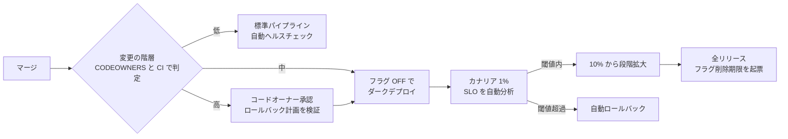
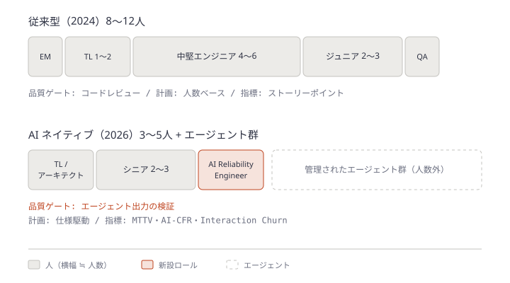
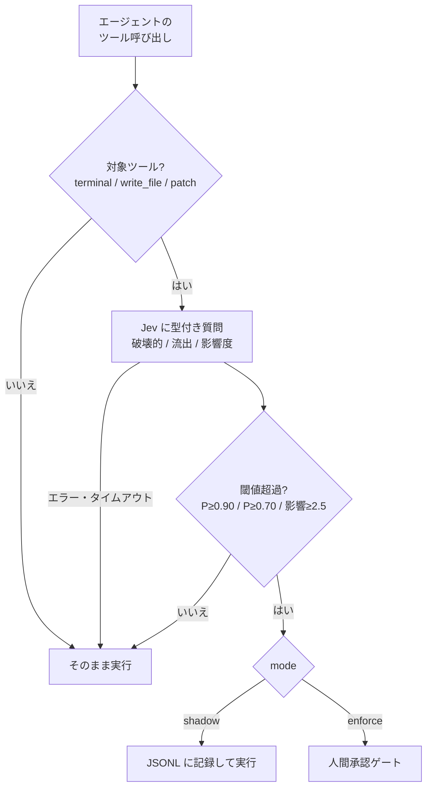

# Daily Briefing 2026-10-24

## 1. コードは増えたのにデプロイは減る: プログレッシブデリバリーは AI コーディング戦略の欠けた半分（原題: More Code, Fewer Deployments: Why Progressive Delivery Is the Missing Half of Your AI Coding Strategy）

- **URL**: https://stepto.net/blog/progressive-delivery-feature-flags-ai-generated-code-release-safety-2026
- **公開日**: 2026-10-20
- **著者・媒体**: Igor Gazivoda / StepTo

### 本文翻訳

**要旨**: Faros AI の調査では、AI 採用度の高いチームはタスク完了数が増える一方、デプロイ頻度は 11.7% 下がり（デプロイ頻度を計測している組織のサブセット）、PR あたりのインシデントは 242.7% 増えた。Harness によれば AI コーディングを最も使うチームは、修正が必要になったデプロイの比率が最も高い（22%）。人間による全行レビューはスケールしない。スケールするのはプログレッシブデリバリーである。デプロイとリリースを分離し、危険な変更をフラグの背後に置き、本番メトリクスに基づいてカナリアで昇格させ、自動でロールバックする。

**なぜ AI がコードを多く書くほど出荷頻度が落ちるのか**: Faros のテレメトリでは、高採用チームはタスク 33.7%・エピック 66.2% 多く完了するが、PR は 51% 大きく、レビュー時間の中央値は5倍になった。Harness の 2026 年調査（700チーム）では、最も積極的な AI 利用者の 35% が日次以上でリリースしている一方、修正率 22%・復旧時間 7.6 時間はいずれも最悪だった（Harness はリリースツールのベンダーである点に注意）。構造的に読めば、パイプラインのコード側だけがアップグレードされ、リリース側はそのままなのだ。

**なぜレビューだけでは支えきれないのか**: LeadDev と Harness の調査では、57% の組織がリスクに関係なく AI 生成コードの全行を人間がレビューすることを求めており、そのうち 38% は AI 導入前よりレビュー時間が増えた。32% はリリースサイズが大きくなり、AI 生成コード専用のガードレールを持つのは 49% だけだった。一律レビューは文言変更と決済ルーティング変更を同じに扱い、結果として「大きく稀で、レビューされていないリスクを多く含むリリース」を生む。DORA 2025（約5,000人、約9割が AI 利用）も、AI はスループットを上げたがデリバリーの不安定性は上がり続けたと報告している。レビューは説明責任のために依然必要だが、本番前の漏れのあるフィルタにすぎない。問うべきは「欠陥が何人のユーザーに、どれだけの時間届くか」である。

**プログレッシブデリバリーが変えるもの**: デプロイ（コードがサーバーに載る）とリリース（ユーザーがそれに触れる）を分ける。新コードは社内スタッフ → トラフィックの 1% → 10% と有効化でき、数秒で無効化できる。仕組みは4つ。フィーチャーフラグ（設定としてのリリース）、カナリア（小さなトラフィックでエラー率とレイテンシを比較）、リング／セル展開（ユーザー群・リージョン・テナント単位で拡大）、自動ロールバック。変更数が2倍で失敗率が一定なら失敗も2倍になる。スケールするレバーは「1件の失敗あたりの影響」を小さくすることだ。1% のトラフィックに4分間届く欠陥と、100% に 7.6 時間届く欠陥では桁が違う。レビューは設計・セキュリティ・実行時チェックが守れない経路へと重心を移す。

**大規模障害の教訓**（いずれも AI 生成コードではない）: Google Cloud（2025年6月）は、フラグ保護もエラー処理も無い変更が全リージョンに複製され Service Control が全域で停止した。以後、重要バイナリの変更はデフォルト無効のフラグ保護を必須にした。Cloudflare（2025年11月18日）は、権限変更でボット管理の特徴量ファイルが倍増し、200特徴量のハードリミットを超えてプロキシがパニックした。社内生成の設定もユーザー入力と同等に検証し、グローバルなキルスイッチを増やすと約束した。CrowdStrike（2024年7月）は、21フィールド定義に対し20値しか与えられないコンテンツ更新が検証をすり抜け 800 万台超を再起動ループに陥れ、そのコンテンツ種別に段階的展開を導入した。共通の教訓は「検証は漏れる。だからロールアウト自体を安全装置にせよ」である。

**フラグ自体のリスク**: フラグは通常のデプロイの外で制御される本番ブランチであり、放置すれば組合せ爆発し、古いフラグは事故のスイッチになる。Knight Capital（2012年）は8台中7台にだけ新コードが載り、再利用したフラグが残り1台の旧ロジックを起動、45分で 400 万回超の約定と 4.6 億ドル超の損失を出した。AI エージェントはフラグを気軽に足すが、消すことはまれだ。ルールは (1) すべてのフラグに所有者と有効期限 (2) リリースフラグは全展開後の決まったスプリント数で削除 (3) フラグ名を再利用しない、の3つで、これをエージェント指示と CI チェックに埋め込む。ベンダーロックインは OpenFeature（CNCF）で避ける。

**メトリクスに昇格させる**: 10分間ダッシュボードを眺める手動確認は、注意力が最も薄いときに破綻する。Argo Rollouts（Prometheus・Datadog 等に問い合わせ、成功条件を満たさなければ中止）や Flagger（サービスメッシュ／Ingress 背後の Kubernetes）で自動化する。難しいのはメトリクスの方だ。ユーザー体験を反映した SLO（エラー率・p95 レイテンシ・主要業務トランザクションの成功率）、信号とノイズを分けられるだけのカナリアトラフィック、バージョンやフラグ状態でタグ付けされたテレメトリ。これが無いとカナリア分析は「決して失敗しない」か「常に失敗して無効化される」かのどちらかになる。AI エージェントに曖昧な結果を解釈させてもよいが、助言層にとどめ、決定的な閾値ゲートを床として残す。

**AI 生成変更のリリースポリシー**: 人間が書いたかエージェントが書いたかではなく、**何を壊しうるか**で階層化する。低リスク（文言・スタイル・社内ツール・テストのみ）は軽量レビューと標準パイプライン。中リスク（アプリケーションロジック）はフラグの背後でダーク出荷し、自動カナリアを通して段階リリース。高リスク（認証・決済・データ移行・インフラ・個人データ）は指名コードオーナーのレビュー、明示的なホールドポイント付きの段階展開、マージ前にテスト済みのロールバック計画。規律は2つ。後方互換な expand-and-contract 移行（非互換スキーマ変更はロールバックで戻せない）と、自己申告ではなく CODEOWNERS・特定ディレクトリでフラグを要求する CI チェック・階層別パイプラインテンプレートによる強制だ。計測は、階層別の変更失敗率と DORA の手戻り率、カナリアで捕まえた障害と顧客が見つけた障害の比率、マージから全リリースまでの時間、古いフラグの数。カナリア中止が増え顧客障害が減っていれば仕組みは機能しており、どちらも動かないならゲートが鈍い。

**結論**: レビューの強化だけでは、スループットの問題を勤勉さの問題として扱うことになり、リリースはむしろ危険になる。コード側だけでなくリリース側をアップグレードせよ。

### 重要ポイント

- AI 高採用チームは「タスク +33.7%、PR +51%、レビュー時間5倍、デプロイ頻度 -11.7%、PR あたりインシデント +242.7%」（Faros）。詰まりはコードではなくリリース側にある
- 全行レビューの一律義務（57%の組織）はリリースを大きく稀にし、かえってリスクを増やす。レビューは説明責任の装置であって、本番前フィルタとしては漏れる
- 変更量が増える前提で効くレバーは「失敗1件あたりの影響範囲と時間」を下げること。デプロイとリリースを分離し、カナリアをメトリクスで自動昇格・自動ロールバックさせる
- リリースポリシーは作者（人間かエージェントか）ではなく変更の影響で3階層に分け、CODEOWNERS と CI で強制する
- エージェントはフラグを足すが消さない。所有者・期限・名前の非再利用をエージェント指示と CI に組み込む

### 図解



### 戦略分析

**フレームワーク**: 制約理論（TOC）× DORA Four Keys

| Four Keys | 記事が示す AI 高採用チームの変化 | 制約との関係 |
|---|---|---|
| デプロイ頻度 | -11.7%（Faros、計測組織のみ） | リリース工程が制約 |
| 変更のリードタイム | レビュー時間の中央値5倍、PR 51% 増 | レビュー待ちの行列が伸びる |
| 変更失敗率 | 修正が必要なデプロイ 22%（Harness） | 大きく稀なリリースが影響を増幅 |
| 平均復旧時間 | 7.6 時間（Harness） | 自動ロールバックが無い |

**制約**: 記事の論点は、制約が「レビュー」に見えて実は「リリースの安全装置の欠如」だということだ。安全装置が無いから全行レビューで守ろうとし、それがレビュー時間を5倍にし、リリースを大きくし、失敗率と復旧時間を悪化させる、という負のループがある。TOC の言葉では、レビューを「徹底活用」しようとして制約を固定化している状態である。

**示唆**: レビュアーの増員や AI レビューの追加より先に、(1) 変更をリスク3階層に分け、低リスク階層の人間レビュー義務を外す、(2) 中リスク以上をフラグ必須にし、カナリアの自動中止条件（エラー率・p95）を1サービスで定義する、の2点に投資する。成否は「カナリアで捕まえた障害 ÷ 全障害」が上がるかで判定する。速度2指標だけ追うと、記事が警告する不安定性の悪化を見逃す。

**反証条件**: トラフィックが小さく統計的に意味のあるカナリア比較ができないサービス、オンプレ配布やモバイルアプリのようにリリースを数秒で戻せない形態では、プログレッシブデリバリーの効果は限定的で、レビューと事前検証の比重を下げられない。また Faros・Harness の数値はベンダー調査であり、因果ではなく相関である。

### 現場での適用方法

**CLAUDE.md への追記例**（エージェントに階層判定とフラグ規律を課す）

```markdown
## リリース階層とフィーチャーフラグ

### 階層（作者ではなく影響で決まる。自己申告せず `.github/risk-tiers.yml` に従う）
- low: 文言・スタイル・テストのみ・`tools/` 配下
- medium: アプリケーションロジック → 必ずフラグの背後に置く（デフォルト OFF）
- high: `auth/` `payments/` `migrations/` `infra/` 個人データ → フラグ必須、PR 本文に
  ロールバック手順を書く。スキーマ変更は expand-and-contract の expand 段だけを出す

### フラグの規約
- 新しいフラグは `flags/registry.yml` に owner と expires（YYYY-MM-DD）付きで登録する
- 既存のフラグ名を再利用しない。名前が衝突したら新しい名前を作る
- 全展開済みのフラグを見つけたら、削除 PR を別に提案する
- フラグを追加した PR には、OFF のときに旧挙動になることを確かめるテストを含める
```

**スクリプト化の例**（CI: medium/high パスの変更にフラグ登録を要求し、期限切れフラグで失敗させる）

```bash
#!/usr/bin/env bash
# ci/check-flags.sh  — 使い方: ci/check-flags.sh origin/main
set -euo pipefail
BASE="${1:-origin/main}"
REGISTRY="flags/registry.yml"          # 形式: - name: x / owner: y / expires: YYYY-MM-DD
GUARDED='^(src/(auth|payments|billing)|migrations|infra)/'

changed=$(git diff --name-only "$BASE"...HEAD)

# 1. 保護パスを触っているのにフラグ登録の差分が無ければ失敗
if echo "$changed" | grep -Eq "$GUARDED"; then
  if ! echo "$changed" | grep -qx "$REGISTRY"; then
    echo "::error::medium/high 階層の変更です。$REGISTRY にフラグを登録してください"
    exit 1
  fi
fi

# 2. 期限切れフラグの検出（登録だけ残っているもの）
today=$(date +%F)
expired=$(awk -v t="$today" '
  /- name:/ {n=$3}
  /expires:/ { if ($2 < t) print n " (expired " $2 ")" }' "$REGISTRY")
if [ -n "$expired" ]; then
  echo "::error::期限切れのフラグがあります。削除してください:"
  echo "$expired"
  exit 1
fi
echo "flag checks OK"
```

**設定例**（Argo Rollouts のカナリア自動中止。閾値は <SLO_ERROR_RATE> を自社の SLO に置き換える）

```yaml
apiVersion: argoproj.io/v1alpha1
kind: AnalysisTemplate
metadata:
  name: error-rate
spec:
  metrics:
    - name: error-rate
      interval: 1m
      failureLimit: 2
      successCondition: result[0] < <SLO_ERROR_RATE>   # 例: 0.01
      provider:
        prometheus:
          address: http://prometheus.monitoring:9090
          query: |
            sum(rate(http_requests_total{app="<APP>",version="{{args.version}}",code=~"5.."}[2m]))
            / sum(rate(http_requests_total{app="<APP>",version="{{args.version}}"}[2m]))
  args:
    - name: version
---
# Rollout 側の steps 抜粋
# strategy:
#   canary:
#     steps:
#       - setWeight: 1
#       - analysis: { templates: [{ templateName: error-rate }], args: [{ name: version, valueFrom: { podTemplateHashValue: Latest } }] }
#       - setWeight: 10
#       - pause: { duration: 10m }
#       - setWeight: 50
```

### 期待効果

- 欠陥の影響を「全ユーザー × 7.6 時間」から「1% × 数分」へ縮める（記事の比較例）
- 低リスク階層の人間レビュー義務を外すことで、レビュー容量を高リスク変更に集中できる
- 「カナリアで捕まえた障害の比率」を追うことで、ゲートが機能しているかを数値で判断できる

### 注意点

- カナリア分析の価値はメトリクスの質で決まる。バージョンタグ付きテレメトリと十分なトラフィックが前提
- 非互換なスキーマ変更はロールバックで戻らない。expand-and-contract を徹底しないと自動ロールバックが逆に障害を起こす
- フラグは放置すると Knight Capital 型の事故源になる。期限と削除を CI で強制しないなら導入しない方が安全
- 記事の数値はベンダー（Faros・Harness）調査で、記事自体も DevOps 支援サービスの宣伝を含む

## 2. AI ネイティブチーム: 4人のチームが12人のチームより多く出荷する（原題: The AI-Native Team）

- **URL**: https://hoolahoop.io/articles/cto-coaching/ai-native-team-topology/
- **公開日**: 不明（直近数週間以内。本文に 2026 年後半への言及あり）
- **著者・媒体**: Leigh Newsome / Hoola Hoop（CTO・CPO コーチ）

### 本文翻訳

**副題: あなたの12人チームを上回って出荷している4人チーム**

エージェント時代以前、エンジニアリングの規模はほぼ人数に比例していた。その連動はもう切れている。より小さく、よりシニアな新しいチーム形態が、AI の「運用フェーズ」で勝ち始めている。私たちが支援するミドル〜レイトステージの顧客でも同じパターンが見える。エージェントを使う3〜5人のシニアエンジニアが、1年前の8〜12人チームに匹敵するか上回っている。参照点として Stripe の社内コーディングエージェント「Minions」は週 1,000 件超の PR をマージしている。コードはエージェントが端から端まで書き、人間がレビューする。にもかかわらず、多くの CTO はいまだにエージェント以前の人員計画に沿って採用し、ベロシティ指標で評価し、隣のチームがなぜ速いのか理解できずにいる。

**AI ネイティブなチームトポロジー**: 2024年型の従来チーム（8〜12人）は、EM 1、テックリード 1〜2、中堅 4〜6、ジュニア 2〜3、専任 QA 1。人数駆動の計画、ストーリーポイントでのベロシティ、主たる品質ゲートはコードレビュー、知識はチケット・ドキュメント・属人知に宿る。2026年型の AI ネイティブチーム（3〜5人）は、テックリード兼アーキテクト 1、シニア 2〜3、AI Reliability Engineer 1、そして管理されたエージェント群。検証がワークフローに組み込まれ、計画は仕様駆動、成果は出荷したアウトカムで測る。主たる品質ゲートはエージェント出力の検証で、知識は仕様と機械可読な受け入れ基準に符号化される。これは従来チームから人を抜いたものではなく**再設計**である。役割もレポートラインもスタンドアップの会話も変わり、エージェントは調整対象のチームメンバーとして数えられる。

**新しい3つの役割**:

1. **AI Reliability Engineer** — テストハーネス、実行時ガードレール、マージ前サンドボックスを作る。すべてのエージェント PR を「信頼を獲得しなければならないコード」として扱い、人間が書いた振る舞いテストに対して隔離実行し、期待されるシステム状態からのドリフトを監視し、静的に読むと通ってしまうもっともらしい誤りを捕まえる。エージェント型ワークフローにおける SRE に最も近い。
2. **Spec Author / Product Engineer** — 人間向けのユーザーストーリーではなく、エージェントが動ける受け入れ基準を書く。プロダクトの意図を、エージェントが行動できる精度のコンテキストに変換する。曖昧な仕様は曖昧な成果を高速に生み、曖昧さのコストは以前より重くのしかかる。
3. **Agent Orchestrator** — 人とエージェントのワークフローを設計し、作業を割り当て、引き継ぎと失敗モードを管理する。テックリードの下ではなく横に座る。エージェント数が増えるほどレバレッジが増し、この役割が無いとエージェント同士が衝突し、人間がボトルネックになる。

これらの役割がレベリングガイドに無いチームは、シニア候補者を失うリスクがある。一方で Shopify はインターンを年約100人から 1,000 人超に増やしており、AI ツールで約 20% の生産性向上を報告している。ジュニアは削られるのではなく、検証と仕様作成へと振り向けられている。

**AI ネイティブチームを示す指標**: ストーリーポイントやトークン数・PR 数は誤解を招く。ベロシティが上がりながら品質と予測可能性が下がることがある。Optimum Partners が提唱する3指標を使う。**MTTV（Mean Time to Verification）** はエージェント出力が正しく出荷可能だと確認するまでの時間で、「コード完成」に代わる品質マイルストーン。出力量が多くても MTTV が高ければ実際の AI レバレッジは小さい。**AI-CFR（AI Change Failure Rate）** はエージェント生成の変更のうち本番で失敗したかマージ後に手戻りが要った割合で、失敗モードが違うため人間の CFR とは分けて追う。**IC（Interaction Churn）** は有用な結果に至るまでの人とエージェントの往復回数で、高ければ仕様・コンテキストエンジニアリングが弱いか、エージェントの選択が誤っている。AI 投資が複利で効くかの先行指標である。来月のエンジニアリングレビューでこの3つのどれも使わないなら、そのチームは AI ネイティブではなく「AI に興味がある」段階だ。

**リーダーシップへの示唆**: (1) エージェント以前の人員計画で採用するのをやめる。次の10人の採用は、シニア3人とエージェント基盤への投資になるかもしれない。これは採用の失敗ではなく、CEO・CFO と公然と合意する**ユニットエコノミクスの改訂**として扱う。(2) 市場より先に職務体系を書き換える。AI Reliability Engineer・仕様作成・エージェントオーケストレーションを、レベルと期待値を伴う専門職として定義する。(3) ベロシティ報告を検証報告に置き換え、ストーリーポイントの代わりに MTTV・AI-CFR・IC を報告する。「検証の無い量は成果ではなく、動いているリスクである」。

**結び**: これはツールの変更ではなく構造の再設計である。優位性は良いモデルへのアクセスではなく、モデルからレバレッジを引き出す構造にある。2026 年後半になっても8〜12人モデルを最適化しているチームは、技術ではなく運用モデルで止まっている。

### 重要ポイント

- 3〜5人のシニア + AI Reliability Engineer + エージェント群が、1年前の8〜12人チームに匹敵する（著者の顧客観察。定量研究ではない）
- 主たる品質ゲートが「コードレビュー」から「エージェント出力の検証」に移り、それを担う専任ロール（AI Reliability Engineer）を置く
- 新設ロールは AI Reliability Engineer / Spec Author / Agent Orchestrator の3つ。職務体系とレベリングガイドに明文化する
- 指標は MTTV・AI-CFR・Interaction Churn。AI-CFR は人間の CFR と分けて追う
- 人員計画の見直しは「採用の失敗」ではなく「ユニットエコノミクスの改訂」として経営と合意する

### 図解



### 戦略分析

**フレームワーク**: マッキンゼー 7S

| 要素 | 従来型 | AI ネイティブ（記事） | 変更の難度 |
|---|---|---|---|
| Structure | 8〜12人、EM 配下 | 3〜5人、Orchestrator は TL の横 | 中 |
| Systems | 人数駆動の計画、コードレビュー | 仕様駆動、検証ハーネス、マージ前サンドボックス | 高 |
| Skills | 実装力 | 仕様作成・検証設計・エージェント運用 | 高 |
| Staff | ジュニア多数・専任 QA | シニア中心、ジュニアは検証と仕様へ | 中 |
| Style | ベロシティで評価 | 検証で評価 | 中 |
| Shared values | 「書いたコード量」 | 「検証された量だけが成果」 | 高 |
| Strategy | 人数で規模を買う | 構造でレバレッジを得る | — |

**示唆**: 7S の整合で見ると、多くの組織は Structure（人数削減）だけ先に動かし、Systems（検証ハーネス）と Skills（仕様作成）を置き去りにしがちである。記事の構成は、検証ハーネスを担う人が居ることが前提になっている。したがって最初の一手は人員削減ではなく、(1) 既存チームの1人を AI Reliability Engineer に任命し、エージェント PR の隔離実行環境を作らせる、(2) 次のエンジニアリングレビューで MTTV と AI-CFR を初めて報告する、の2つ。この2指標が改善してから人員計画を改訂する順序にする。

**反証条件**: 記事の「3〜5人で8〜12人に匹敵」はコンサルタントの顧客観察であり、対照群のある測定ではない（仮説として扱う）。規制業界やレガシー比率の高いシステムのように、ドメイン知識の分散保持やオンコール人数そのものが制約になる組織では、チーム縮小はバス係数と運用負荷の悪化を招き成立しない。

### 現場での適用方法

**運用手順**（MTTV・AI-CFR・Interaction Churn を GitHub のデータから月次で出す）

前提: エージェント生成 PR には `agent-authored` ラベル、マージ後の手戻り・障害修正 PR には `fixes-agent-pr` ラベルと元 PR 番号（`Fixes-PR: #123`）を本文に入れる運用を先に決める。

```bash
#!/usr/bin/env bash
# metrics/ai-native-metrics.sh — 使い方: ./ai-native-metrics.sh <OWNER/REPO> 2026-10-01
set -euo pipefail
REPO="$1"; SINCE="$2"

# MTTV: エージェント PR の「最初の Ready for review」から「承認」までの中央値（時間）
gh pr list -R "$REPO" --state merged --label agent-authored \
  --search "merged:>=$SINCE" --limit 500 --json number,createdAt,reviews \
| jq -r '.[] | select(.reviews | map(select(.state=="APPROVED")) | length > 0)
         | ((.reviews | map(select(.state=="APPROVED")) | .[0].submittedAt | fromdateiso8601)
            - (.createdAt | fromdateiso8601)) / 3600' \
| sort -n | awk '{a[NR]=$1} END {printf "MTTV(h, median): %.1f\n", (NR? a[int((NR+1)/2)] : 0)}'

# AI-CFR: エージェント PR のうち手戻り PR から参照された割合
total=$(gh pr list -R "$REPO" --state merged --label agent-authored \
  --search "merged:>=$SINCE" --limit 500 --json number | jq length)
failed=$(gh pr list -R "$REPO" --state merged --label fixes-agent-pr \
  --search "merged:>=$SINCE" --limit 500 --json body \
  | jq -r '.[].body' | grep -oE 'Fixes-PR: #[0-9]+' | sort -u | wc -l)
awk -v f="$failed" -v t="$total" 'BEGIN {printf "AI-CFR: %d/%d = %.1f%%\n", f, t, (t? 100*f/t : 0)}'

# Interaction Churn: エージェント PR あたりの「変更要求」レビュー数の平均（往復回数の代理指標）
gh pr list -R "$REPO" --state merged --label agent-authored \
  --search "merged:>=$SINCE" --limit 500 --json reviews \
| jq '[.[] | (.reviews | map(select(.state=="CHANGES_REQUESTED")) | length)] | (add / length)' \
| xargs printf "Interaction Churn (changes requested / PR): %.2f\n"
```

**AI Reliability Engineer の職務定義（レベリングガイドへの追記例）**

```markdown
### AI Reliability Engineer（シニア相当）

ミッション: エージェントが生成した変更が「信頼を獲得してから」出荷される仕組みを所有する。

責務
- エージェント PR を隔離環境で実行するマージ前サンドボックスを運用する
- 人間が書いた振る舞いテスト（受け入れテスト）の網羅を維持し、エージェントに書き換えさせない
- MTTV と AI-CFR を月次で報告し、上位の失敗パターンをエージェント指示（CLAUDE.md 等）に反映する

成果指標
- MTTV の中央値が四半期で下がっている
- AI-CFR が人間の CFR を上回らない
```

### 期待効果

- 品質ゲートを検証に移すことで、出力量が増えてもレビューが形骸化（ラバースタンプ化）しない
- MTTV・AI-CFR・IC により「AI で速くなったか」をストーリーポイント以外で説明できる
- 新設ロールを職務体系に入れることで、シニア人材の流出を防ぐ（記事の主張）

### 注意点

- 「3〜5人で8〜12人に匹敵」は著者の顧客観察で、定量的な裏付けは示されていない
- Interaction Churn は GitHub のデータだけでは正確に取れない。上記スクリプトの値は変更要求レビュー数による代理指標
- 人員計画の見直しを指標の改善より先に行うと、検証能力が無いまま出力だけが増える
- 記事はコーチングサービスの誘導で終わる

## 3. jev-judge: Jev をエージェントのツール呼び出し前ゲートにする Hermes プラグイン（原題: jev-judge）

- **URL**: https://hermes-agent.nousresearch.com/docs/plugins/jev-judge
- **公開日**: 不明（直近数週間以内。v0.1.0）
- **著者・媒体**: DoGMaTiiC / Hermes Agent プラグインドキュメント（Community 層）

### 本文翻訳

**概要**: jev-judge は TypeSafe Jev を判断レイヤーとして使う Hermes Agent のプラグインである。提供するものは2つ。`terminal`・`write_file`・`patch` の呼び出しを実行前に判定する**ツール前ゲート**と、モデルが型付きの判断（真偽・選択・スコア）を確率付きで要求できる **`jev_ask` ツール**だ。標準ライブラリのみで Node は不要、コミット `5dddbea` に固定されており、更新はレビュー済みの再固定でしか届かない。

**インストール**: `hermes plugins install DoGMaTiiC/hermes-jev/plugins/jev-judge`。検証は `python3 tests/test_offline.py` と `hermes plugins doctor . --ci`。

**バックエンド**: `backend` 設定で3経路から選ぶ。既定の `auto` は `TYPESAFE_API_KEY` → `OPENROUTER_API_KEY` → `AI_GATEWAY_API_KEY` の順に優先する。TypeSafe 直結は呼び出しごとのコスト報告なし、Vercel AI Gateway はメタデータで確信度とコストを返す、OpenRouter はアルファの Decisions API を使い OpenRouter のキーに課金される。

**モード**: `shadow`（既定）は判定をログに残すだけで何も止めない。`enforce` は閾値を超えた呼び出しを Hermes の人間承認ゲートにエスカレーションする。

**ゲートのバージョン**: `v1`（既定）は3問を尋ねる。破壊的か、情報流出か、望まれない場合の影響度（0〜3）。`v2`（オプトイン）は6つの分離した信号を尋ねる。秘密情報を読むか、外部へ送信するか、影響範囲（blast radius）、自己正当化しているか（self-advocating）、破壊的か、影響度。これに決定的な判定ラダーを適用する。

**主な設定**（`config.yaml` の `plugins.entries.jev-judge.settings`）: `mode`（shadow）、`tools`（terminal, write_file, patch）、`gate_version`（v1）、`backend`（auto）、`timeout_s`（3.0）、`cache_seconds`（300。同一呼び出しは窓内で1回だけ判定）、`retry_max_wait_s`（2.0。429/529 で待ち時間がこれ以下なら1回だけ再試行）、`breaker_threshold`（3。連続 429/529 でサーキットブレーカーが開く）、`breaker_cooldown_s`（120）、`min_interval_s`（0.25）。閾値は `destructive_threshold` 0.90（P(true)）、`exfiltration_threshold` 0.70（v1 のみ）、`impact_threshold` 2.5（0〜3 スケール）、v2 専用に `reads_secrets_threshold` 0.70、`sends_outbound_threshold` 0.70、`blast_radius_threshold` 2.5、`self_advocating_threshold` 0.70。判定ログは `<HERMES_HOME>/logs/jev-judge.log` に JSONL で書かれる。

**フェイルオープン**: すべてのエラー経路でフェイルオープンする。キー欠如、タイムアウト、HTTP エラー、不正な応答、過大なペイロードのいずれでもツール呼び出しはそのまま進む。答えが返らなかった質問は `answer_missing` として記録され、決して「問題なし」や 0.0 スコアとして扱われない。API キーが一切無ければ、プラグインは読み込まれたまま沈黙する。

**レート制限**: 429/529 では `Retry-After` を尊重し、上限内なら1回だけ再試行する。繰り返し制限されるとブレーカーがクールダウン期間エンドポイントを黙らせる。1呼び出しの最悪レイテンシは概ね `timeout_s` の2倍 + `retry_max_wait_s`、既定値で約8秒。

**送信されるデータ**: ゲート対象の呼び出しごとに、ツール名と引数（最大12キー、値はマスクされ600文字に切り詰め）だけを送る。会話履歴・ファイル・メモリ・ツール出力は送らない。65,536 バイト超のペイロードは送信せず拒否する。リダイレクトは追わず、プロキシ環境変数は無視する。**重要**: `backend: auto` で `OPENROUTER_API_KEY` だけが設定されていると、ツール名とマスク済み引数は OpenRouter に送られる。避けたいなら `backend` を `typesafe` か `gateway` に明示する。

**ログ**: すべての判定は1行の JSON として記録される。`tail -f "${HERMES_HOME:-$HOME/.hermes}/logs/jev-judge.log"` で追える。

**制約**: shadow モードでは何も止まらない。v2 はオプトイン。OpenRouter 経路はアルファ API。Gateway の無料枠にはモデル単位のレート制限がある。判定は Jev の確率的な答えに依存し、閾値はコード内で固定されている。プロジェクトは GitHub スター3、Community 層の掲載である。

### 重要ポイント

- 汎用 LLM ではなく型付き判断モデル（Jev）に「破壊的か」「流出か」「影響度」を確率とスコアで答えさせ、閾値でゲートする設計
- 既定は shadow（記録のみ）。閾値を自分のトラフィックで較正してから enforce（人間承認へエスカレーション）に切り替える段階導入が組み込まれている
- フェイルオープンが既定。安全装置ではなく「人間の注意を向ける先の選別器」として位置づけるべき
- v2 は信号を6つに分離（秘密読取・外部送信・影響範囲・自己正当化・破壊・影響）し、決定的なラダーで判定する。確率モデルの上に決定的ロジックを重ねる構成
- 送信データは最小化（引数12キー・600字・履歴なし）。ただし `backend: auto` のキー優先順位で意図しない送信先になりうる

### 図解



### 戦略分析

**フレームワーク**: Cynefin × リスク×可逆性マトリクス

| ツール呼び出しの例 | 可逆性 | Cynefin | jev-judge の扱い（v1 既定閾値） |
|---|---|---|---|
| `ls` / テスト実行 | 高 | 明白 | 閾値未満 → 実行 |
| `patch` によるソース変更 | 高（git で戻せる） | 煩雑 | 通常は閾値未満 |
| `rm -rf` / `git push --force` | 低 | 明白だが致命的 | 破壊的 P≥0.90 → 承認へ |
| `curl` で外部へ POST | 低（流出は戻せない） | 複雑 | 流出 P≥0.70 → 承認へ |

**示唆**: 決定的な許可リストで捌けるのは「明白」な領域だけで、`curl` の引数に秘密が混じるかのような「複雑」領域は文字列マッチでは判定できない。jev-judge の価値はこの中間帯を確率で選別し、人間の承認を本当に危ない呼び出しへ集中させる点にある。導入順序は (1) 許可リスト／拒否リストで明白な領域を先に片付ける、(2) 残りに jev-judge を shadow で2週間かけ、ログから偽陽性・偽陰性を集計する、(3) 閾値を較正してから enforce に切り替える。enforce 後も「承認要求の何割が実際に拒否されたか」を追い、低すぎれば閾値を上げる。

**反証条件**: フェイルオープンであるため、Jev の障害・レート制限中は無防備になる。不可逆操作の防止が**必須要件**（本番クレデンシャルを持つエージェント等）の環境では、確率ゲートは主たる統制にならず、クレデンシャル分離やサンドボックスなどフェイルクローズの統制が先に要る。またスター3のコミュニティプラグインであり、保守継続性は未知数（記事は効果の定量データを示していないため、上表の扱いは既定閾値からの推定）。

### 現場での適用方法

**設定例**（shadow で較正を始める。送信先を明示し、v2 の分離信号を使う）

```yaml
# <HERMES_HOME>/config.yaml
plugins:
  entries:
    jev-judge:
      settings:
        mode: shadow            # 2週間は記録のみ。較正後に enforce へ
        gate_version: v2
        backend: typesafe       # auto のままだと OPENROUTER_API_KEY 経由で送られうる
        tools: [terminal, write_file, patch]
        timeout_s: 3.0
        destructive_threshold: 0.90
        sends_outbound_threshold: 0.70
        reads_secrets_threshold: 0.70
```

**スクリプト化の例**（shadow ログから「enforce にしたら何件止まっていたか」を集計する）

```bash
#!/usr/bin/env bash
# tools/jev-shadow-report.sh — 使い方: ./jev-shadow-report.sh [LOG_PATH]
# 前提: ログは1行1判定の JSONL。キー名は実ログで確認し <TRIGGERED_KEY> <TOOL_KEY> を置き換える
set -euo pipefail
LOG="${1:-${HERMES_HOME:-$HOME/.hermes}/logs/jev-judge.log}"

echo "== 総判定数"
wc -l < "$LOG"

echo "== enforce なら承認要求になった件数（ツール別）"
jq -r 'select(.<TRIGGERED_KEY> == true) | .<TOOL_KEY>' "$LOG" | sort | uniq -c | sort -rn

echo "== answer_missing（判定できず素通りした件数）"
grep -c 'answer_missing' "$LOG" || true

echo "== 承認要求候補のサンプル 20 件（偽陽性レビュー用）"
jq -c 'select(.<TRIGGERED_KEY> == true)' "$LOG" | shuf -n 20 || true
```

**CLAUDE.md への追記例**（ゲートを前提にしたエージェント側の振る舞い）

```markdown
## ツール実行ゲート（jev-judge）について

- 破壊的操作・外部送信・秘密情報の読み取りは、実行前に判定ゲートを通る。
  承認待ちになったら、操作の目的と影響範囲を1〜2文で説明して人間の判断を待つ
- 判定を回避する目的でコマンドを分割・難読化しない（例: `rm` を変数経由で呼ぶ）
- 外部への送信が必要な場合は、送信先と送信内容の要約を先に提示する
```

### 期待効果

- 許可リストで判定できない中間帯の呼び出しを、人間承認に回すべきものだけ選別できる
- shadow モードの JSONL ログにより、本番適用前に閾値の偽陽性率を実データで確認できる
- 判定キャッシュ（300秒）とブレーカーにより、ゲートがエージェントの速度を大きく落とさない（最悪約8秒/呼び出し）

### 注意点

- **フェイルオープン**であり、障害・レート制限・キー欠如時は何も止めない。不可逆操作の唯一の防御にしない
- `backend: auto` はキーの有無で送信先が変わる。データ送信先の統制が必要なら必ず明示する
- 閾値はコード内固定（設定で上書きは可）で、Jev の確率は自分のトラフィックで較正するまで信用しない
- Community 層・スター3のプラグイン。コミット固定で使い、更新時は差分をレビューする
