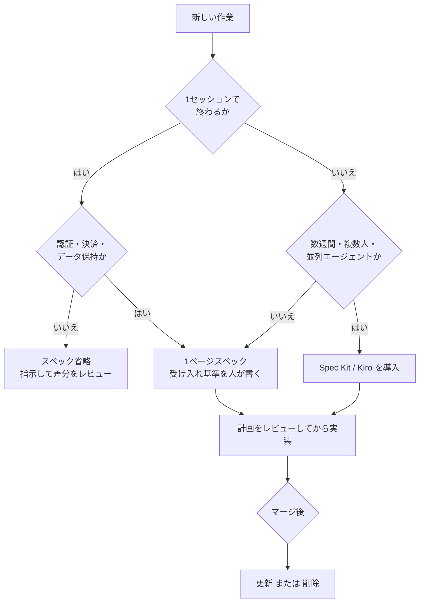
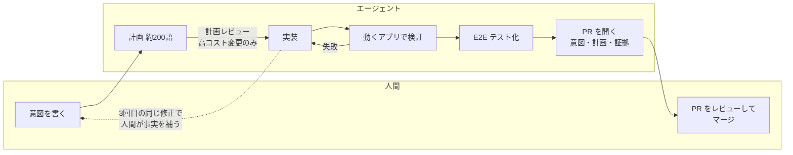
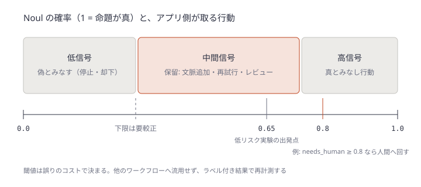

# Daily Briefing 2026-10-25

## 1. 誇張抜きのスペック駆動開発（原題: Spec-Driven Development, Without the Hype）

- **URL**: https://utsabpant.com/blog/spec-driven-development-without-the-hype
- **公開日**: 2026-07-13
- **著者・媒体**: Utsab Pant（Engineering Leader & Architect）/ 個人ブログ

### 本文翻訳

**よくある失敗**: 機能を数文で説明し、エージェントが10分ほど働く。返ってくるのは完成していてテストも通るが、問題の捉え方が違うものだ。説明の隙間をエージェントが自信ありげなデフォルトで埋め、その一部が間違っていた。前回の記事（AI が書いたコードのレビュー）で述べたとおり、厳密さはコードが存在する前、上流へ移す必要がある。スペック駆動開発（SDD）はその業界の現時点での答えである。GitHub の Spec Kit は 12 万スターを超え、AWS は Kiro IDE を出した。議論は「スペックこそ新しいソースコード」派と「CLI 付きのウォーターフォール」派に割れているが、どちらも言い過ぎで、筆者は「退屈な中間」を狙う。

**SDD とは何か**: コードの前にエージェントが仕様・技術計画・タスク分解を書き、開発者は各段階をレビューしてから次へ進む。コードは最後に、承認済み文書に沿って生成される。強い版は「スペックが唯一の真実で、コードはスペック変更時に再生成するビルド成果物」とするが、ここは疑ってかかるべき部分だ。Spec Kit は Claude Code や Copilot の中でスラッシュコマンドとして動き、`/speckit.constitution`（守るべきプロジェクト原則）、`/speckit.specify`（ユーザーストーリーと受け入れ基準。技術スタックは書かない）、`/speckit.plan`（アーキテクチャ・データモデル・契約）、`/speckit.tasks`（順序付きのタスク分解）、`/speckit.implement`（実行）と進み、各段階が `specs/` に Markdown を書く。Kiro も機能ごとに `requirements.md` / `design.md` / `tasks.md` を持ち、要件はシステム工学由来の EARS 記法で書く（例: 空のカートが送信されたとき、システムはバリデーションエラーを返す）。各要件がテスト可能である点が、機械が検査する時代に効く。

**なぜ存在するか**: 繰り返し現れる失敗は3つで、どれも純粋なコードの問題ではない。(1) **意図のドリフト**: 短いプロンプトは機能を決めきれず、エラー処理・エッジケース・データ形状・リトライをエージェントが既定値で埋める。(2) **文脈の減衰**: あるセッションの決定は次のセッションで消え、毎回コードからアーキテクチャを再導出して少しずつずれる。(3) **検証不能な出力**: 「正しい」の定義が書かれていなければレビューは雰囲気になる。コードを書いたエージェント自身が書いたテストは、開発者ではなくエージェントの理解を検査する。

**ウォーターフォール批判**: 外れている点は、ウォーターフォールの失敗原因はフェーズの存在ではなくフィードバックループのコストだったことだ。スペックが午後、実装が数時間で済むなら、18か月のループは1日になる。当たっている点は3つ。スペックのドリフトは不可避で、夜11時のホットフィックスはコードに直接入る。古いスペックはエージェントが真実として扱うため、無いより悪い。小さな作業には過剰で、Spec Kit の初期フィードバックの約3分の1が「バグ修正や小機能には重すぎる」で、Kiro は軽量なバグ修正フローを追加した。そして、スペックを書くのも同じモデルなので、もっともらしい成果物を斜め読みで承認する問題が1段上流に移るだけだ。

**元が取れる場面**: 経験則は「**スペックの価値は、作業がまたぐコンテキストウィンドウの数に比例する**」。1セッション・1人・頭に収まるタスクなら省く（大半の作業がこれ）。複数日・複数人・並列エージェント・既存規約のない新規モジュールでは、スペックがプロジェクト唯一の永続メモリになる。認証・決済・データ保持のように正しさが速度より重要な領域でも使う。

**軽量版**: (1) 1セッションを超える機能の前に1ページのスペックを手で書く。例「保存済み検索」: 何を（クエリとフィルタを保存し一覧から再実行、1ユーザー20件まで）、受け入れ基準（重複保存は既存を更新しエラーにしない／削除は確認なしで即時、ただし10秒間取り消し可／未知のフィルタキーは読み込み時に黙って捨てる／空状態はヒントを表示）、対象外（共有、結果変化の通知）、未決事項（端末間同期を今やるか）。5分で書け、各行が推測を1つ潰す。(2) コードの前に計画をレビューする。新しい同僚の設計文書のように読む。(3) マージ後にスペックを更新するか削除する。削除されたスペックは役目を果たした。古いスペックは次のエージェントを惑わす。数週間・複数人の作業なら本格ツールへ移り、既存プロジェクトで `specify init` を1機能だけ試すとよい。

**本当の変化**: スペックはかつてプログラマの頭の中にあり、タイピングがその外部化だった。エージェントはタイピングを肩代わりしたが、スペックの必要性は肩代わりしていない。

### 重要ポイント

- スペックが要るかは「作業が何個のコンテキストウィンドウをまたぐか」で決める。1セッションで終わる作業には不要
- SDD の価値はフィードバックループを1日に縮めた点にあり、ウォーターフォール批判の核心（ループの遅さ）は当たらない
- 一方で「スペックのドリフト」「小作業での過剰」「同じモデルが書いたスペックの斜め読み承認」は本物のリスク
- 1ページの手書きスペック（何を／受け入れ基準／対象外／未決事項）で SDD の利得の大半が得られる
- マージ後のスペックは「更新」か「削除」の二択。放置が最悪

### 図解



### 戦略分析

**フレームワーク**: JTBD（Jobs to be Done）

| 項目 | 内容 |
|---|---|
| 状況 | 作業が複数セッション・複数人・並列エージェントにまたがる、または正しさのコストが高い |
| 片付けたい仕事 | 「意図をセッションと担当者をまたいで失わずに持ち運び、正しさの定義を事前に固定する」 |
| 既存の代替手段 | プロンプト履歴、チャットスレッド、人間の頭の中、PR 説明 |
| 不採用になる状況 | 1セッションで終わる大半の作業（記事は「大半」と明言） |
| 解雇される理由 | スペックが古くなり、エージェントに誤った真実を与えたとき |

**示唆**: SDD を「全チーム標準」として導入すると、雇われない状況（小作業）にまで適用して反発を生む（記事の Spec Kit 初期フィードバックの約3分の1）。意思決定としては、(1) 適用条件を「複数セッション」または「認証・決済・データ保持」に限定してルール化し、(2) まずツールなしの1ページテンプレートから始め、(3) マージ時に「スペック更新か削除」を PR チェックリストに入れる。ツール導入の判断は、軽量版で「複数週の作業でスペックが参照され続けたか」を1機能分確認してからにする。

**反証条件**: レビュアーが生成スペックを斜め読みで承認する文化のチームでは、SDD は検証を上流に移すのではなく「承認済み」という偽の安心を生むだけになる。また、既存コードに明確な規約・例・自動チェックが揃っていて、エージェントがコードから要件を推論できるコードベースでは、スペックの追加価値は小さい。

### 現場での適用方法

**CLAUDE.md への追記例**:

````markdown
## スペックの運用（SDD 軽量版）

- 1セッションで終わる作業ではスペックを作らない。指示 → 計画 → 差分レビューで進める
- 次のいずれかに当たる場合は、実装前に `specs/<feature>.md` を作り、人間の承認を得るまでコードを書かない
  - 複数セッション・複数人・並列エージェントにまたがる
  - 認証・決済・データ保持・個人データに触れる
- スペックの「受け入れ基準」と「対象外」は人間が書く。エージェントは「未決事項」の洗い出しだけ手伝う
- 「未決事項」が残っている間は推測で実装せず、質問として返す
- マージする PR では、対応する `specs/*.md` を「現状に合わせて更新」か「削除」のどちらかにする。放置しない
````

**スペックのテンプレート**（`specs/_template.md`）:

```markdown
# Feature: <機能名>

## What
<1〜2文で、何をできるようにするか。上限・制約もここに>

## Acceptance criteria
- <テスト可能な形で。「〜のとき、システムは〜する」>
- <エッジケース: 重複・空状態・未知の入力・取り消し>

## Out of scope
- <今回作らないもの。エージェントの「親切な作り込み」を防ぐ>

## Open questions
- <未決事項。エージェントはここを推測せず質問する>
```

**マージ時の放置スペック検出**（CI 用スクリプト）:

```bash
#!/usr/bin/env bash
# PR で変更されたソースに対応する specs/*.md が更新も削除もされていなければ警告する
set -euo pipefail
BASE="${BASE_REF:-origin/main}"
changed_src=$(git diff --name-only "$BASE"...HEAD -- '<SRC_DIR>/' || true)
changed_specs=$(git diff --name-only --diff-filter=MD "$BASE"...HEAD -- 'specs/' || true)
open_specs=$(ls specs/*.md 2>/dev/null | grep -v '_template.md' || true)
if [[ -n "$changed_src" && -n "$open_specs" && -z "$changed_specs" ]]; then
  echo "::warning::ソースを変更していますが specs/ の更新・削除がありません。"
  echo "対象スペック:"; echo "$open_specs"
fi
```

### 期待効果

- 「完成しているが問題の捉え方が違う」差分の再作業を、5分のスペックで事前に潰せる（記事の例では10秒の取り消し猶予・未知キーの扱いなど、エージェントが別の推測をしたはずの行）
- 複数セッション作業でのアーキテクチャの再導出とドリフトを抑える
- 受け入れ基準がそのままレビューのチェックリスト兼テスト計画になる

### 注意点

- 記事は定性的な経験則で、効果の数値は示していない
- スペックを生成させて斜め読みで承認すると、レビューの問題を上流に移すだけになる。受け入れ基準は人間が考える
- 古いスペックは無いより悪い。更新か削除を強制する仕組み（PR チェックリストや CI 警告）とセットで導入する

## 2. エージェントネイティブな開発ワークフロー: 実践者のためのガイド（原題: The Agent-Native Developer Workflow: A Practitioner's Guide）

- **URL**: https://www.shiplight.ai/blog/agent-native-developer-workflow
- **公開日**: 2026-08-10
- **著者・媒体**: Will / Shiplight AI Blog

### 本文翻訳

AI コーディングエージェントがもたらす重要な変化は速度ではない。変わったのは周囲の1日の組み立て方、つまり開発者がまだ下す決定、意識せずに手放した決定、出力を役立てるために人間の注意を向けるべき場所だ。以下は導入済みチームで実際に回っているワークフローで、ぎこちない部分も含む。

**ループを一周する**: 名前より、チームが飛ばしがちな段階が重要だ。(1) **意図を入れる**: 作業単位は編集ファイルの列挙ではなく、望む最終状態の記述。例「無料プランの利用メーターに、支出ではなく残りクレジットを表示する」。無駄なエージェント実行の最大の原因は曖昧な意図で、2文足せば大半は直る。(2) **まず計画**: エージェントが関連コードを読み、ファイル・方針・不確実な点を書く。約200語の計画が人間による修正の最も安い地点で、計画を飛ばしたチームは浮いた時間をレビューで払う。(3) **実装**: 1分〜30分程度。差分が流れるのを眺めるのはやめる。完成した差分を読めば同じことが分かり、注意を後に残せる。(4) **動くアプリに対して検証**: エージェントがブラウザを開き、変更したフローを操作し、コンソールエラーも含めて結果を確かめる。自分の差分を読むだけのエージェントは「何が表示されるはずか」を推論しているにすぎない。多くのチームがここを飛ばし、それが「正しく見えて壊れている」出力の原因だ。(5) **カバーするテストを書く**: 検証を永続的な自動テストにする。セットアップ・状態・踏んだエッジケースという文脈は急速に失われる。(6) **PR を開く**: 意図・計画・実施した検証・証拠を含めて PR を開く。人間がレビューしてマージする。**エージェントはマージしない**。これは一時的な制限ではなく恒久的なゲートである。

**人間が介入する場所**（価値の高い順）: 意図（下流で回復不能。エージェントは間違ったものを有能に作る）、曖昧または高コストな作業の計画（文言変更は不要、データモデル・認証・決済・数ファイル超の変更は必要）、エージェントがループしたとき（同じ修正の3回目、防御的条件分岐の増殖、失敗に合わせてテストを曲げる。たいてい事実が1つ欠けており、補うのに約90秒）、PR（主たる品質ゲート）。やめるべき介入は、実装のリアルタイム監視だ。

**コードレビューの変化**: 1日数百行なら全行精読で回ったが、量がそれを壊す。代わりに意図・インターフェース・間違えると高くつく箇所に絞り、アプリに対して実際に走ったチェックで裏付ける。「検証したか」を必須の問いにし、PR テンプレートに証拠セクションを設ける。テストはコードと同じくらい丁寧に読む。エージェントは意図した挙動ではなく既存の挙動を表明するテストを書きうるので、差分ではなく元の意図と照らす。PR は意図して小さく保つ。丁寧に読む3ファイルは、斜め読みする30ファイルに勝る。

**スペックの変化**: 明確な記述から約20分でモジュールを再生成できるなら、資産は記述の方になる。意図はチャットではなく恒久的な場所に書く。暗黙の規約（例: Web 層から特定サービスを直接呼ばない）はエージェントが読む場所に書く。E2E テストは仕様を兼ね、PM が読める言葉で書かれたテストは変更のたびに自動検査される唯一の意図記述になる。

**CI の変化**: CI はゲートであると同時にエージェントのフィードバックループになる。失敗出力は機械可読に（失敗したチェック、ステップ、観測値と期待値、証拠へのリンク）。総実行時間より最初のシグナルまでの時間が重要で、変更範囲を4分でカバーする信号は40分のフル実行より役立つ。多くのチームは push ごとに高速セット、夜間とリリース前にフルスイートに落ち着く。フレーキーテストは高くつく。人間は6回に1回落ちるテストを無視できるが、エージェントは本物として扱い、動くコードを「修正」したりテストを書き換えたりする。積極的に隔離・修理する。修正の前に「アプリ・テスト・環境・データのどれが原因か」を切り分けるトリアージを定義済みの段階にする。

**現実的な1日**: 朝20分のトリアージで、夜間ブランチと夜間スイートの失敗2件（招待フローの本物の回帰と期限切れフィクスチャ）にそれぞれ1文の文脈を付けてエージェントを割り当てる。課金変更の意図を書き計画を求めると、クレジット計算を Web 層に置く誤った計画が出たので1行で修正。25分後、差分・無料／有料プラン両経路のブラウザ録画・新しい E2E テストが返る。テストを先に読むと、メーターの表示は確かめているが数値を確かめていなかったので、アサーションを追加させてからマージ。総労働時間はあまり変わらないが、4時間がタイピングから読むことに移った。

**まだうまくいかないこと**: 約40ファイルに及ぶリファクタリングは信頼できない。エージェントはプロダクトの意図を判断できない。UI 以外（DB 書き込み、Webhook 発火）の検証は未成熟。1日12件のエージェント PR を読むのは人間の PR 3件より疲れ、注意の質は気づかぬうちに落ちる（小さな PR、証拠必須、1人1日のレビュー上限で緩和）。エージェントはチェックに最適化する。作業を判定する成果物を、同じ監督なしのパスで作らせない。

### 重要ポイント

- ループは「意図 → 計画 → 実装 → 動くアプリでの検証 → テスト化 → PR」。最も飛ばされるのは動作検証
- 人間の介入は意図・計画・ループ検知・PR の4点に集中し、実装のリアルタイム監視はやめる
- PR に「何を操作し何を観測したか」の証拠セクションを必須化し、テストは差分ではなく元の意図と照らして読む
- CI はエージェントのフィードバックループ。機械可読な失敗出力、4分で返る変更範囲テスト、フレーキーテストの積極隔離
- レビュー疲れは実在する。小さな PR・証拠必須・1人1日のレビュー上限で守る

### 図解



### 戦略分析

**フレームワーク**: 制約理論（TOC）

| TOC の段階 | 記事の記述 |
|---|---|
| 制約を見つける | コード生成ではなく人間のレビュー（1日12件のエージェント PR は人間の PR 3件より疲れる） |
| 徹底活用する | 全行精読をやめ、意図・インターフェース・高コスト箇所に注意を絞る。証拠付き PR で判断材料を揃える |
| 他を制約に従属させる | PR を小さく保つ。エージェント側で動作検証とテスト化を済ませてからレビューに回す |
| 制約を引き上げる | 1人1日のレビュー上限、機械可読な CI 出力で人間に届く前に潰す |

**示唆**: 実装を速くする投資（並列エージェントの追加）は、レビューの行列を伸ばすだけで出荷を速めない。先に打つ手は (1) PR テンプレートへの「検証の証拠」必須化、(2) エージェントに動くアプリでの検証とテスト化までを完了条件として課す、(3) 1人あたりの1日レビュー件数に上限を置き、超えたら PR を分割させる、の3つ。並列度はこの上限から逆算して決める。

**反証条件**: 変更の大半が UI を持たないバックエンド（DB 書き込み・キュー・Webhook）であれば、記事自身が認めるとおり「動くアプリでの検証」が成立せず、レビュー前の自動検証による負荷軽減は効かない。その場合の制約は検証基盤（統合テスト環境）の不足に移る。

### 現場での適用方法

**PR テンプレート**（`.github/pull_request_template.md`）:

```markdown
## Intent
<望む最終状態を1〜3文で。ファイルの列挙ではなく>

## Plan
<エージェントの計画の要約、または計画へのリンク>

## Verification evidence（必須）
- 操作したフロー: <例: 無料プランでログイン → 利用メーターを開く>
- 観測した結果: <例: 残りクレジット 120 が表示された>
- コンソール／ログ: <エラーなし、または内容>
- 録画・スクリーンショット: <リンク>

## Tests
- 追加したテスト: <パス>
- このテストが確かめている意図: <「表示されること」ではなく「正しい値であること」まで書く>
```

**CLAUDE.md への追記例**:

````markdown
## 完了条件（エージェントの作業ループ）

1. データモデル・認証・決済・5ファイル以上の変更では、実装前に約200語の計画を出して承認を待つ
2. 実装後、`<DEV_SERVER_CMD>` でアプリを起動し、変更したフローを実際に操作して結果とコンソールエラーを確認する
3. 確認した内容を E2E テストにする。テストは「表示される」ではなく「意図した値・状態になる」を表明する
4. PR テンプレートの Verification evidence を埋めて PR を開く。マージはしない
5. 同じ失敗に対する修正が3回目に入ったら作業を止め、何の事実が欠けているかを質問する
6. 失敗したテストを通すためにテスト側を書き換えない。テストが誤っていると判断したら理由を PR に書いて人間に委ねる
````

**証拠セクションの欠落を落とす CI チェック**（GitHub Actions）:

```yaml
name: pr-evidence
on:
  pull_request:
    types: [opened, edited, synchronize]
jobs:
  check:
    runs-on: ubuntu-latest
    steps:
      - name: Require verification evidence
        env:
          BODY: ${{ github.event.pull_request.body }}
        run: |
          section=$(printf '%s' "$BODY" | awk '/^## Verification evidence/{f=1;next} /^## /{f=0} f')
          if ! printf '%s' "$section" | grep -Eq '観測した結果: *[^<[:space:]]'; then
            echo "::error::Verification evidence の「観測した結果」が空です"
            exit 1
          fi
```

### 期待効果

- 「正しく見えて壊れている」PR がレビュー前に減る（記事の主張。定量値は示されていない）
- 計画段階の1行修正で、誤った設計の上に積まれた差分の再レビューを避けられる（記事の例: クレジット計算の配置）
- フレーキーテスト隔離と機械可読な失敗出力で、エージェントが動くコードを誤って「修正」する事故を減らす

### 注意点

- 著者は動作検証用ツール（ブラウザ MCP）を提供するベンダーである。ワークフロー自体はツール非依存だが、動作検証の重要性の強調にはその立場を割り引く
- 約40ファイル規模のリファクタリング、DB 書き込みや Webhook の検証は記事自身が「まだうまくいかない」としている
- 証拠セクションの必須化は形骸化しやすい。テンプレートの空欄チェックだけでなく、レビュアーが証拠と意図を照合する運用とセットにする

## 3. Jev System One モデル: 型付き AI 判断の実践ガイド（原題: Jev System One Model: A Practical Guide to Typed AI Decisions）

- **URL**: https://huggingface.co/blog/paidaxccc/jev-system-one-model-a-practical-guide-to-typed-ai
- **公開日**: 2026-09-25
- **著者・媒体**: MY（paidaxccc）/ Hugging Face Community Article

### 本文翻訳

ソフトウェアには小さく繰り返される判断（ルーティング、リスク確認、エスカレーション、証拠の有無）が多く、自由形式の LLM 応答はそれを得る手段として向いていない。Jev System One は、状態（state）と有限個の型付き質問を受け取り、コードが検証・閾値判定できる構造化された答えを返す。

**ソフトウェアにおける「System One」**: 定義された状態を受け取り、範囲の決まった質問を評価し、型付きシグナルを返す判断層である。アプリケーション、権限、ワークフローエンジン、生成モデルを置き換えるものではない。流れは「状態 + 型付き質問 → Jev → 構造化された答え → アプリの行動」で、行動の主体は常にアプリ側だ。

**なぜ判断モデルが要るか**: 隠れた判断はプロンプトチェーン、正規表現、ハードコードされた分岐、レビューキューに潜んでいる。チケットのルーティング、エージェント操作の承認、リードスコアリング、コンテンツ判定、コンテキスト圧縮、モデルルーティングはいずれも、答えの空間が有限で、状態を共有し、コードへ流し込む必要がある。

**仕組み**: 状態は文字列・JSON オブジェクト・テキスト配列で、焦点を絞る。質問は1つにつき1つの問いで、アプリが付けたキーが応答でも使われる。複数の質問は1つの状態を共有して並列に評価される。答えは質問 ID をキーとする型付きシグナルである。

**3つの質問型**: **Choice** は事前定義した選択肢から1つを選び、`criteria` で各選択肢の説明を与える（ルーティング・ラベル付け向け）。**Score** は順序付き尺度上の水準で、`criteria` は低→高の配列。確率加重なので水準の中間値を取りうる。**Noul** は yes/no を 0〜1 で返す（1 が yes）。安全ゲート・証拠確認・エスカレーション向けだが、許可を与えるものではない。

**状態の設計原則**: 状態は隠れた指示ではなく証拠を持つ／質問は原子的に／基準は運用可能な言葉で／使わない文脈は削る／契約はバージョン管理する。入力はテキスト・JSON・テキスト配列のみで、画像・音声・動画は別途抽出が要る。

**最小のリクエスト**: `POST https://jevmodel.net/v1/systemone` に Bearer キーと JSON を送る。旗艦モデル名は `jev-latest`。キーはサーバー側に置く。`is_urgent`（Noul）を聞く例では、応答モデル `jev-1.13.0`、値 `0.95`、入力 307 トークン・出力 20 トークンだった。

**サポートトリアージの完全な例**: 1つの状態に3問。`team`（Choice: billing / technical / account / sales）、`severity`（Score: low / medium / high / critical）、`needs_human`（Noul）。`needs_human` が 0.8 以上、または `severity` が 2.5 以上なら人間のレビューキューへ、それ以外はチームへ優先度付きでルーティングする。この分岐の周りに許可リスト、スキーマ検証、冪等性、認可、監査ログを置くこと。

**確率・信頼度・閾値**: 3段階のポリシーを使う。高信号（低リスクかつ検証済み閾値以上なら続行）、中間（文脈追加・再試行・レビュー）、低信号（停止・却下）。例の閾値 0.8 と 2.5、低リスクの社内実験の出発点 0.65 を示すが、閾値は誤りのコストで決まり、ワークフロー間でコピーしてはならない。信頼度は正確さではない。ラベル付き結果に対して測り、偽陽性・偽陰性・レビュー率・レイテンシ・誤りのコストを追う。

**LLM・エージェントとの併用**: LLM は広い理解・下書き・計画、Jev は範囲の決まった質問を担う。エージェントループは「ステップを提案 → 焦点を絞った状態を作る → 型付きの答えを得る → 決定的チェック（認可・範囲・冪等性・閾値）→ 実行／確認／レビュー待ち」。Jev は権限システムではない。モデルルーティングも許可リストと組み合わせて同じ形で使う。

**本番チェックリスト**: 契約（状態のバージョン、安定した質問 ID、相互に区別できる Choice の基準、順序付き Score、Noul は1命題）、セキュリティ（サーバー側キー、アプリ側認可、データ最小化、破壊的操作の確認）、信頼性（スキーマ検証、タイムアウト、上限付きリトライ。401 は認証情報、422 はペイロード修正、429 と 529 は指数バックオフ）、可観測性（契約バージョン・質問 ID・答え・確率・閾値・最終行動をログに残し、レイテンシ・トークン・エラー・自動化率・レビュー率を監視）、評価（曖昧・敵対的ケースで質問型ごとに測り、コストや方針が変われば閾値を見直す）。

**よくある誤り**: 範囲を決められるのに自由回答の質問を使う、高確率を許可とみなす、余計な文脈を送る、Playground での手動テストを省く、全モダリティ対応だと思い込む。まず低リスクな判断1つから始め、実ケースで試し、行動はアプリコードに残し、境界が明確になってから広げる。

### 重要ポイント

- Jev は「状態 + 型付き質問（Choice / Score / Noul）→ 型付きシグナル」を返す判断 API で、行動の主体は常にアプリ側
- 状態は証拠だけを入れ、質問は1問1命題、基準は運用可能な言葉で書き、契約をバージョン管理する
- 閾値は3段階（続行／保留／却下）で設計し、値は誤りのコストから決める。0.8・2.5・0.65 は例であって流用しない
- 高確率は許可ではない。認可・範囲・冪等性の決定的チェックを Jev の後段に必ず置く
- 契約バージョン・答え・確率・閾値・最終行動をログに残し、ラベル付き結果で較正する

### 図解



### 戦略分析

**フレームワーク**: Cynefin（どの判断を型付きモデルに委ねるか）

| 領域 | 記事の判断例 | Jev の扱い |
|---|---|---|
| 明白 | 既知の許可リスト照合、認可 | Jev を使わず決定的コードで書く（記事: Jev は権限システムではない） |
| 煩雑 | チケットのチーム振り分け、重大度評価、緊急度 | Jev の主戦場。答えの空間が有限で、ラベル付きデータで較正できる |
| 複雑 | 曖昧・敵対的なケース、中間信号 | 自動化せず保留帯に落として人間へ。閾値の見直し対象 |
| カオス | 破壊的操作、未定義の状態 | 確認必須。Jev の確率で通さない |

**示唆**: Jev の導入判断は「どのモデルを使うか」ではなく「既存コードのどこに煩雑領域の隠れた判断が埋まっているか」の棚卸しから始める。記事の挙げる場所（プロンプトチェーン、正規表現、ハードコード分岐、レビューキュー）を検索し、答えの空間が有限でラベル付き履歴があるもの1件だけを置き換える。続行閾値は、その判断の誤りコスト（誤ルーティング1件あたりの手戻り時間など）と、保留帯に落ちる件数＝人間のレビュー負荷の両方から決める。記事は自社データでの数値を示していないため、この順序は仮説である。

**反証条件**: ラベル付きの過去結果が存在しない判断（新規業務、正解が事後にも確定しない判断）では、閾値を較正できず3段階ポリシーが恣意的になる。その場合は Jev を入れても自動化率は上がらず、保留帯が肥大化して人間のレビューが増えるだけになる。

### 現場での適用方法

**判断契約と3段階ポリシーの実装例**（Python、`requests` のみ）:

```python
"""support_triage.py — Jev による型付き判断 + アプリ側の決定的ポリシー"""
import os, json, time, logging, requests

JEV_URL = os.environ.get("JEV_URL", "<JEV_ENDPOINT>")  # 例: https://jevmodel.net/v1/systemone（公式ドキュメントで要確認）
JEV_KEY = os.environ["JEV_API_KEY"]                   # キーはサーバー側のみ
CONTRACT_VERSION = "triage-v1"
ALLOWED_TEAMS = {"billing", "technical", "account", "sales"}

# 閾値は誤りのコストから決め、ラベル付き結果で較正する（記事の値は出発点にすぎない）
HUMAN_THRESHOLD = float(os.environ.get("HUMAN_THRESHOLD", "0.8"))
SEVERITY_THRESHOLD = float(os.environ.get("SEVERITY_THRESHOLD", "2.5"))

QUESTIONS = {
    "team": {"type": "choice", "instructions": "Which team should own this ticket?",
             "criteria": {"billing": "payments, invoices, payouts",
                          "technical": "errors, bugs, integrations",
                          "account": "login, access, profile",
                          "sales": "pricing, plans, purchasing"}},
    "severity": {"type": "score", "instructions": "How severe is the customer impact?",
                 "criteria": ["low", "medium", "high", "critical"]},
    "needs_human": {"type": "noul",
                    "instructions": "Does this ticket require a human decision (refund, legal, safety)?"},
}

def ask_jev(state: str, retries: int = 3) -> dict:
    body = {"model": "jev-latest", "state": state, "questions": QUESTIONS}
    for attempt in range(retries):
        r = requests.post(JEV_URL, json=body, timeout=5,
                          headers={"Authorization": f"Bearer {JEV_KEY}"})
        if r.status_code in (429, 529):
            time.sleep(2 ** attempt); continue          # 指数バックオフ
        r.raise_for_status()                            # 401/422 はリトライしない
        return r.json()
    raise RuntimeError("jev unavailable")

def decide(ticket_id: str, text: str) -> dict:
    try:
        ans = ask_jev(text)["answers"]
        team = ans["team"]["choice"]
        severity = float(ans["severity"]["score"])
        p_human = float(ans["needs_human"]["noul"])
    except Exception as e:                              # 失敗時は人間へ（フェイルクローズ）
        action = {"action": "human_review", "reason": f"jev_error: {e}"}
    else:
        if team not in ALLOWED_TEAMS:                   # 許可リストで検証
            action = {"action": "human_review", "reason": "unknown_team"}
        elif p_human >= HUMAN_THRESHOLD or severity >= SEVERITY_THRESHOLD:
            action = {"action": "human_review", "team": team, "reason": "threshold"}
        else:
            action = {"action": "route", "team": team, "priority": severity}
        action.update(p_human=p_human, severity=severity)
    # 可観測性: 契約バージョン・答え・閾値・最終行動を必ず残す
    logging.info(json.dumps({"ticket": ticket_id, "contract": CONTRACT_VERSION,
                             "thresholds": [HUMAN_THRESHOLD, SEVERITY_THRESHOLD], **action}))
    return action
```

**運用手順**:

1. 過去チケットからラベル付き評価セットを作る（`<N>` 件、曖昧・敵対的ケースを含める）
2. 上記をシャドーモードで動かし、実際のルーティングは変えずにログだけ取る
3. ログとラベルを突き合わせ、質問ごとに偽陽性・偽陰性・人間レビュー率を集計する
4. 誤ルーティング1件のコストとレビュー率のバランスで `HUMAN_THRESHOLD` / `SEVERITY_THRESHOLD` を決め、環境変数で反映する
5. 状態や質問文を変えたら `CONTRACT_VERSION` を上げ、2〜4 をやり直す

### 期待効果

- 正規表現やプロンプトチェーンに散らばった判断を、型付きでテスト・計測可能な契約に置き換えられる
- 記事の例では1判断あたり入力 307・出力 20 トークンで、生成 LLM に自由回答させるより出力トークンが小さい
- 保留帯を明示することで、自動化率と人間レビュー率をトレードオフとして調整できる

### 注意点

- エンドポイントの記載が情報源によって異なる（本記事は `jevmodel.net`、他の資料は `api.typesafe.ai` や OpenRouter 経由）。導入時は公式ドキュメントで確認する
- 信頼度は正確さではない。自分のトラフィックでラベル付き較正をするまで閾値を本番の自動化に使わない
- Jev は認可も実行もしない。破壊的操作は確率に関係なく確認を挟む
- 入力はテキスト・JSON・テキスト配列のみ。画像などは事前に抽出が必要
