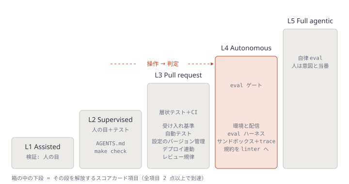
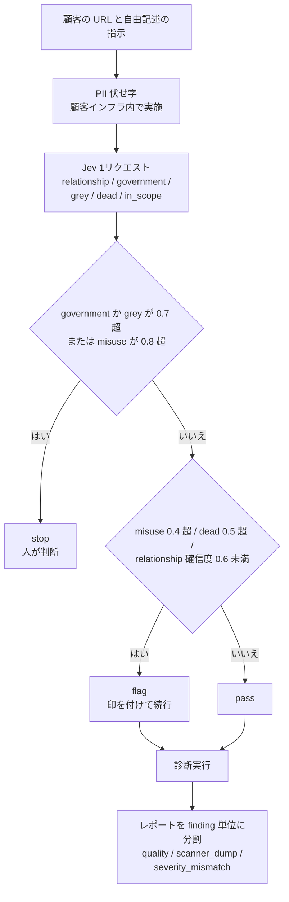
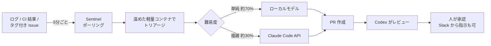

# Daily Briefing 2026-10-26

## 1. エージェント型 SDLC プレイブック: ビルドは縮んだ、両側を直せ（原題: Agentic SDLC Playbook: The Build Shrank. Fix Both Sides.）

- **URL**: https://felipefontoura.com/articles/agentic-sdlc/
- **公開日**: 2026-10-01
- **著者・媒体**: Felipe Fontoura / 個人サイト（Agentic SDLC シリーズ）

### 本文翻訳

**中心の主張**: AI エージェントはビルド（実装）工程を安くした。しかしその周りのライフサイクルは「ビルドが遅い」前提で調整されたままだ。ボトルネックは両側へ移った。上流は**文脈**（何を、どのルールのもとで作るかを知ること）、下流は**検証**（出力が正しいと確かめること）である。筆者が実測した例では、人間の工数は約60分の1、暦日は約4分の1になった。ただし1件の機能を事後に測っただけの数字である。

**実測例の中身**: 1つの機能で、タスク10件、マージリクエスト13件、リポジトリ6つ、言語5種類（テストとドキュメント込み）。エージェントなしのチーム見積もりは「開発者5人がフルタイムで10〜15営業日」。エージェントを使った実測は「3営業日、全員の人間作業を合計して約6.5時間、トークン代67ドル」。ただし事後測定であり、エージェント向きの機能を選んでいる。桁の目安として扱うこと。

**導入順の7ステップ**

1. **リポジトリをエージェント作業に備える**: ルートに文脈ファイル（AGENTS.md）を置き、「完了を証明するコマンド」を1つ用意する。例では AGENTS.md に「`make check` を実行して出力を貼れ」と書く。これは lint・型・単体・結合テストを走らせ、どれか1つでも失敗すれば非ゼロで終了する。指示は「**テストではなくコードを直せ**」。AGENTS.md には他に「linter が拾わない規約（金額は整数のセント、新しいエンドポイントには必ず結合テスト）」「なぜ（why）の在処（スペック、ADR、作業ログ。ログは未検証と明記）」「2回見た間違い」の節を置く。AGENTS.md を唯一の正本とし、CLAUDE.md のようなツール固有ファイルは `@AGENTS.md` の1行だけにする。
2. **検査可能なルールを失敗するチェックに変える**: 規約を lint ルール・型・テストへ移し、モデルが覚えているかどうかに依存させない。
3. **文脈を失わない**: 作業単位の終わり、セッションを消す前に「必要だったのに見つからなかったもの」をエージェントに抽出させて Markdown に書く。節は「手で足した文脈」「下した判断」「昇格させるか？チェックリスト」。各知識を信頼度で緑・黄・赤に分類し、信頼できるものだけをスペック・文脈ファイル・チェックへ昇格させる。作業ログは素材であってドキュメントではない。**赤のメモがエージェントの土台になってはならない。**
4. **実行前にスペックを書く**: チケットに問題・範囲・受け入れ基準を持たせてからエージェントを走らせる。
5. **レビューを作り直す**: 単位の大きさは、コードが存在する前の計画承認時に上限を決め、レビュアーが一度に読み切れる大きさにする（エンドポイントごとに分割、DB マイグレーションは独立したマージリクエストに）。機械的な問題はステップ2が止めているので、レビューは意図とリスクに集中する。コメントには `blocking` / `major` / `minor` の重大度プレフィックスを付け、どれがマージを止めるか作者に分かるようにする。ある導入事例では、レビュアーの集中力の実用上限は1セッション約1時間だった。10件目の簡単な承認がゴム印になる危険にも注意する。
6. **人間のゲートを作業のある場所に置く**: ゲートを作業そのものに紐づけ、エージェントと人の作業を並行させる。
7. **ループを勝ち取る**: まず配信を退屈にする。誰でも1コマンドで同じ環境を立ち上げられ、すべての変更が中断可能なカナリアの背後で出荷され、ロールバックを最近誰かが実際に実行している状態。次に eval: 自分たちの履歴から実タスクを20件以上集め、それぞれの受理済み結果と組にし、プロンプト・スキル・モデルが変わるたびに CI で回す。インシデントは新しいケースになる。エージェントはスコープを絞った認証情報でサンドボックス実行し、実行したコマンドの trace を残し、チームごとにトークン予算を見える化する。最後に、決定的なスクリプトが本番を監視し、メトリクスが通常範囲を外れたらエージェントを呼んで診断させ、次のチケットを書かせ、人がトリアージする。

**自律度ラダー**: L1 Assisted（エージェントは下書き・補完、検証は人の目）、L2 Supervised（依頼に応じてファイルを変更、人が全差分をレビュー）、L3 Pull request（タスク全体を引き受け PR を開く、層状テストと CI で検証）、L4 Autonomous（計画・実装・自己採点し承認ゲートの背後で納品、eval ゲートで検証）、L5 Full agentic（スペックから本番まで自走し自らループに再突入、人は意図を定義し当番をする）。重要なのは L2 から L4 への跳躍で、仕事が「操作」から「判定」に変わる。段は飛ばせない。

**スコアカード**: 11項目をそれぞれ 0（なし）/1（場当たり）/2（確立）/3（自動化され必須）で採点する。プロジェクトの上限は「全項目が2以上の最も高い段」で決まり、平均や最良のツールでは決まらない。迷ったら低い方をつける。目標段は誤りのコストで決め、コアプラットフォームは L5、基盤プロダクトは L3、実験は L2。効果測定は、エージェント以前のクローズ済みエピックを基準に機能あたりの配信コストを比べ、人間の工数は実際に作業した人から聞き、トークンは利用量エクスポートを使う。すべてのプロセスに撤去日を付けることも勧める。

### 重要ポイント

- AI で縮んだのは実装だけ。ボトルネックは上流（文脈・スペック）と下流（検証・レビュー）の**両側**へ移った
- 実測例: 見積もり「5人×10〜15営業日」が「3営業日・人間6.5時間・67ドル」。ただし1件・事後測定・選ばれた機能
- 自律度の上限は**最も弱い項目**で決まる。11項目スコアカードで「全項目2点以上」の段がそのチームの天井
- AGENTS.md を正本にして CLAUDE.md は `@AGENTS.md` だけ、完了条件は `make check` の出力を貼ること
- 作業ログは緑/黄/赤で仕分けてから昇格させる。未検証メモを文脈ファイルに直接入れない

### 図解



### 戦略分析

**フレームワーク**: ケイパビリティ成熟度モデル × 制約理論（TOC）

| 段 | 完了条件（記事のスコアカード項目がすべて2点以上） | 次段への制約 |
|---|---|---|
| L2 Supervised | AGENTS.md、1コマンドで全チェック | 人が全差分を読む＝レビュー工数が実装速度に比例 |
| L3 Pull request | 受け入れ基準、自動テスト、設定のバージョン管理、デプロイ連動、レビュー規律 | レビュアーの集中力（約1時間/セッション） |
| L4 Autonomous | 環境と配信、eval ハーネス、サンドボックスと trace、規約の linter 化 | eval が「受理済み結果」を持つ実タスクで構成されているか |

**構造**: 記事のモデルの特徴は、上限を「最弱項目」で決める点にある。これは TOC の「制約以外の改善はスループットを上げない」と同じ構造で、強いツールを入れても AGENTS.md や受け入れ基準が0点なら天井は動かない。

**示唆**: 次の四半期のツール予算を決める前に、11項目を1時間で採点する。0〜1点の項目が L3 列にあるなら、エージェントの追加導入より「チケットに受け入れ基準を必須化」「規約を lint へ移す」を先に着手する。目標段をリポジトリごとに分け（実験は L2 で止める）、L4 を全社一律の目標にしない。

**反証条件**: 記事の「60分の1」は1機能・事後測定であり、ラダーの段と効果の相関は記事内でデータ化されていない（以下は仮説）。変更の大半が単一リポジトリ内の小修正で、レビューがもともと待ち時間を生んでいない組織では、L3 以降へ投資してもリードタイムは縮まず、制約は企画や承認プロセス側にある。

### 現場での適用方法

**AGENTS.md の雛形**（記事の節構成をそのまま使う）:

````markdown
# AGENTS.md

## Done means
`make check` を実行し、その出力をそのまま PR 説明に貼ること。
非ゼロ終了なら未完了。**テストではなくコードを直す。** テストの削除・skip は禁止。

## Conventions the linter does not cover
- 金額は整数のセント（`int`）で扱う。浮動小数点を使わない
- 新しい HTTP エンドポイントには必ず結合テストを1本追加する
- <PROJECT_SPECIFIC_RULE>

## Where the why lives
- スペック: `specs/`
- 設計判断: `docs/adr/`
- 作業ログ: `worklogs/`（**未検証**。ここを根拠に実装しない。必要なら人に確認）

## Mistakes we have seen twice
- <例: マイグレーションとアプリ変更を同じ PR に入れた>
````

```markdown
<!-- CLAUDE.md（正本は AGENTS.md。ここには何も書き足さない） -->
@AGENTS.md
```

**`make check` と作業ログ抽出**:

```makefile
.PHONY: check
check:
	<LINT_CMD>          # 例: ruff check . / eslint .
	<TYPECHECK_CMD>     # 例: mypy src / tsc --noEmit
	<UNIT_TEST_CMD>     # 例: pytest -q tests/unit
	<INTEGRATION_CMD>   # 例: pytest -q tests/integration
```

```bash
#!/usr/bin/env bash
# worklog.sh — セッションを閉じる前に実行。抽出結果は未検証として worklogs/ に置く
set -euo pipefail
mkdir -p worklogs
out="worklogs/$(date +%F)-$(git rev-parse --abbrev-ref HEAD | tr '/' '-').md"
claude -p "この作業単位で、必要だったのにリポジトリ内で見つからなかった情報を列挙し、
次の3節で Markdown にせよ: '## 手で足した文脈' '## 下した判断' '## 昇格させるか？'
（各項目に [緑/黄/赤] の信頼度候補を付ける。最終判定は人が行う）" > "$out"
echo "wrote $out — 緑の項目だけを AGENTS.md / specs / lint ルールへ昇格させること"
```

**スコアカード採点表**（チームで1時間）:

```markdown
| 項目 | 解放する段 | 点数(0-3) |
|---|---|---|
| ルートの AGENTS.md | L2 | |
| 1コマンドで全チェック | L2 | |
| チケットの受け入れ基準 | L3 | |
| 自動テスト | L3 | |
| エージェント設定のバージョン管理 | L3 | |
| デプロイ連動 | L3 | |
| レビュー規律（重大度プレフィックス・単位上限） | L3 | |
| 環境と配信（1コマンド環境・カナリア・ロールバック実績） | L4 | |
| eval ハーネス（実タスク20件以上） | L4 | |
| サンドボックスと trace | L4 | |
| 規約の linter 化 | L4 | |
<!-- 上限 = 全項目が2以上の最も高い段。迷ったら低い方 -->
```

### 期待効果

- 記事の実測例では人間工数が約60分の1、暦日が約4分の1（1件の事後測定）
- 「どの項目が天井を決めているか」が採点で特定でき、投資先がツールではなく最弱項目に向く
- 重大度プレフィックスと単位上限で、レビューの「どれがマージを止めるか」の往復が減る

### 注意点

- 記事自身が「桁の目安」と断っている。自社の基準値（クローズ済みエピックの実績）を取ってから比較すること
- 作業ログをそのまま文脈ファイルに入れると、誤った前提がエージェントに固定される。緑/黄/赤の仕分けは人がやる
- L5 を全リポジトリの目標にしない。誤りのコストが低い実験は L2 で十分
- 段は飛ばせない。eval ハーネス無しで L4 の自動マージを始めると、検証が雰囲気に戻る

## 2. 本番での Jev ガードレール: セキュリティ基盤の玄関口を1日5セントで（原題: Jev guardrails in production: a security platform's front door for five cents a day）

- **URL**: https://www.metaheuristic.co/blog/jev-quality-gates-cybersecurity/
- **公開日**: 2026-09-28
- **著者・媒体**: Alexander Myasoedov（Founder）/ Metaheuristic

### 本文翻訳

**顧客: 自由記述で動くセキュリティ診断**: あるサイバーセキュリティ企業は、顧客から URL と自由記述の指示を受け取って診断を実行する。結果（findings）も研究者や外部のテスターから自由記述で返ってくる。入口でも出口でも、判定対象は構造化されていないテキストである。

**ドメインのブロックリストが「意図」に効かない理由**: URL それ自体は良くも悪くもない。同じ競合のオンラインストアでも、所有者が診断を頼むなら正当で、ライバルが頼めば悪用になる。そこで筆者はリストを保守するのではなく、**依頼者と対象の関係とスコープ**を判定することにした。

**ゲート1: オンボーディング時の意図ガードレール**: 顧客のインフラから何かを出す前に、プロフィールと指示から氏名・メール・電話番号・健康情報らしきものを除去する。そのうえで Jev に1回のリクエストで複数の質問を投げる。呼び出しは OpenRouter の `POST /api/v1/systemone`、モデルは `typesafe/jev-1.13`、タイムアウト10秒。`state` には `client`（伏せ字済みの企業プロフィール）、`target_page`（対象サイトの公開テキスト）、`instructions`（伏せ字済みの診断指示）の3キーを入れる。質問は5つ。

- `relationship`（choice）: `client` と `target_page` のサイトの最も妥当な関係。選択肢は `owner`（顧客がこのサイトを運営）/ `engaged`（所有者のために診断を請け負っている可能性が高い）/ `competitor`（顧客はサイト運営者の競合）/ `unrelated`（妥当なつながりがない）
- `government`（noul）: 政府・公共部門のサイトである
- `grey`（noul）: 違法・グレーマーケットの商品やサービスを提供している
- `dead`（noul）: パーキング・放置・プレースホルダーのサイトである
- `in_scope`（noul）: `instructions` がこのサイトのセキュリティ診断を記述している

「この顧客は悪意があるか？」という質問は**意図的に置いていない**。動機はモデルが推測するしかないからだ。

**ゲート2: LLM-as-a-judge を使わないレポート品質判定**: Jev の Score で、平易な英語で書いた段階に照らしてレポートを採点する。`quality`（score）は「受け取る顧客にとってどれだけ行動可能か」で、段階は `unusable`（読者が再現できる finding が1つもない）/ `thin`（再現手順・対象資産・証拠のない finding がある）/ `actionable`（すべての finding に資産・再現手順・証拠がある）。加えて yes/no を2つ: `scanner_dump`（大半がツールの生出力で分析がない）、`severity_mismatch`（記載された深刻度が記述された影響と合わない）。長いレポートは分割し、finding ごとに採点してからコードで集約する。OpenRouter の掲載コンテキストは 32k トークンであり、TypeSafe のドキュメントは「質問に不要な内容が state に多いと精度が落ちる」と述べているためだ。

**3段階のエスカレーション**: stop（人間のために停止）、flag（印を付けて続行）、pass。閾値は本番値ではなくプレースホルダとして示されている。misuse = `competitor` と `unrelated` の確率の和。`government` か `grey` が 0.7 超、または misuse が 0.8 超なら stop。misuse が 0.4 超、`dead` が 0.5 超、または `relationship` の確信度が 0.6 未満なら flag。それ以外は pass。**低い確信度はコイン投げではなく flag として扱う。**

**コスト**: 入力 100万トークンあたり 0.042 ドル、出力は無料。この顧客では両ゲート合計で1日約120万入力トークン、約5セント。OpenRouter はレスポンスごとに `usage.cost` を返すので、それを合計している。

**Jev が向かない所**: 推論の痕跡や自由記述の説明を返さないので、人に見せる理由文は別の手段で作る必要がある。対象ページは信頼できない入力なので、Jev は複数のシグナルの1つにとどめる。stop の案件は必ず人へ回し、法的な一線は決定的なコードで書く。精度が最も高いのは英語である。

**教訓**: 判断を、人が検証できる小さく字義どおりの質問に分ける。決定ロジックはレビュー可能なコードに置く。低い確信度は人に回すべき有用な結果である。チェックのコストはモデル呼び出しではなく、それが引き起こす人間のレビューでほぼ決まるので、狙いを絞った質問を足すのは安い。

### 重要ポイント

- 「悪意があるか」ではなく「関係は何か」「政府サイトか」「スコープ内か」と、**人が検証できる字義どおりの質問**に分解する
- 判定（Jev の確率）と決定（stop/flag/pass の閾値）を分離し、決定はレビュー可能なコードに置く
- 低い確信度は flag。境界ケースを無理に二値化しない
- 長文は finding 単位に分割して採点し、集約はコードで行う（不要な state は精度を下げる）
- 2つのゲートで1日約5セント。コストの本体はモデルではなく、それが呼び出す人間のレビュー

### 図解



### 戦略分析

**フレームワーク**: RACI（人と決定モデルの責務分担）

| 判断 | Responsible | Accountable | 根拠（記事） |
|---|---|---|---|
| 関係・サイト種別・スコープの確率推定 | Jev | エンジニア（質問設計の責任） | 字義どおりの小さな質問に分解 |
| stop / flag / pass の決定 | 閾値コード | エンジニア（閾値の責任） | 決定ロジックはレビュー可能なコードに置く |
| stop 案件の最終判断 | 人 | 人 | stop は必ず人へ |
| 法的な一線 | 決定的コード | 法務・エンジニア | モデルに任せない |
| 顧客向けの理由説明 | 人または別手段 | 人 | Jev は理由文を返さない |

**示唆**: LLM-as-a-judge を「1つの大きなプロンプト」で入れている箇所は、(1) 質問を検証可能な単位に割り、(2) 閾値をコードとして PR レビューの対象にし、(3) 低確信度を人間のキューへ回す、の3点で置き換えを検討する。予算判断は API 単価ではなく「flag 1件あたりの人間レビュー時間 × 件数」で行う。記事が言うとおりコストの本体はそこにある。

**反証条件**: 判定に理由文が必須の業務（顧客への説明義務がある審査、監査証跡で根拠の自然文が要る場面）では、Jev 単体は要件を満たさず、記事のコスト優位は別途の説明生成で薄れる。また閾値はプレースホルダであり、自社データで較正しないまま流用すると flag の量が人間の処理能力を超え、制約が人間側に移る。

### 現場での適用方法

**ゲート1のリクエストと決定ロジック**（Python、閾値は記事のプレースホルダ値。必ず自社データで較正する）:

```python
# jev_gate.py
import os
import requests

URL = "https://openrouter.ai/api/v1/systemone"
HEADERS = {"Authorization": f"Bearer {os.environ['OPENROUTER_API_KEY']}"}

def ask_intent(client: str, target_page: str, instructions: str) -> dict:
    body = {
        "model": "typesafe/jev-1.13",
        "state": {
            "client": client,              # 伏せ字済み
            "target_page": target_page,    # 信頼できない入力
            "instructions": instructions,  # 伏せ字済み
        },
        "questions": {
            "relationship": {
                "type": "choice",
                "question": "Most plausible relationship between `client` and the site in `target_page`.",
                "options": {
                    "owner": "The client operates this site.",
                    "engaged": "The client is plausibly engaged to assess it for the owner.",
                    "competitor": "The client competes with the site's operator.",
                    "unrelated": "No plausible connection between the client and the site.",
                },
            },
            "government": {"type": "noul", "question": "`target_page` is a government or public-sector site."},
            "grey": {"type": "noul", "question": "`target_page` offers illicit or grey-market goods or services."},
            "dead": {"type": "noul", "question": "`target_page` is parked, abandoned or a placeholder."},
            "in_scope": {"type": "noul", "question": "`instructions` describe a security assessment of this site."},
        },
    }
    r = requests.post(URL, json=body, headers=HEADERS, timeout=10)
    r.raise_for_status()
    return r.json()

def decide(a: dict) -> str:
    """a は {質問名: 確率 or 選択肢→確率の dict} に正規化済みとする（<NORMALIZE_RESPONSE> 参照）"""
    rel = a["relationship"]
    misuse = rel["competitor"] + rel["unrelated"]
    if a["government"] > 0.7 or a["grey"] > 0.7 or misuse > 0.8:
        return "stop"
    if misuse > 0.4 or a["dead"] > 0.5 or max(rel.values()) < 0.6:
        return "flag"
    return "pass"
```

レスポンスのフィールド構造は記事に全文が載っていないため、`<NORMALIZE_RESPONSE>` の部分は OpenRouter の Jev API リファレンスに合わせて実装すること。

**CLAUDE.md への追記例**（チームで同種のゲートを書くときのルール）:

```markdown
## 決定モデル（Jev 等）を使うゲートの規約
- 質問は「人が検証できる字義どおりの事実」に限る。動機・悪意・意図そのものは聞かない
- 決定（閾値と分岐）は必ずコードに置き、閾値変更は PR でレビューする
- 低確信度は pass にも stop にも寄せず、必ず人間キュー（flag）へ
- 長い入力は判定単位（finding、段落）に分割し、集約はコードで行う
- 法的・契約上の一線はモデルに判定させず決定的コードで書く
- `usage.cost` をレスポンスごとに記録し、日次で合計する
```

### 期待効果

- 記事の顧客では2つのゲート合計で1日約5セント（約120万入力トークン）
- ブロックリスト保守が不要になり、「同じ URL でも依頼者次第で正当/悪用」の判定ができる
- 閾値がコード化されるため、判定基準の変更が PR 履歴として追跡できる

### 注意点

- 閾値は記事自身がプレースホルダと明言している。過去の案件でラベル付けして較正すること
- Jev は理由文を返さない。顧客への説明が要るならテンプレート文や別モデルで補う
- 対象ページは攻撃者が書ける入力。Jev を唯一の防御にしない
- 精度は英語が最も高い。日本語の state を入れる場合は自社で精度を測ってから本番に出す

## 3. エージェンティック・エンジニアリング: コーディングエージェントで本番システムを作る（原題: Agentic Engineering: Building Production Systems with Coding Agents）

- **URL**: https://www.zenml.io/llmops-database/agentic-engineering-building-production-systems-with-coding-agents
- **公開日**: 不明（直近数週間以内）
- **著者・媒体**: Oschlo（4人のコンサルティング会社）の登壇内容を ZenML LLMOps Database が要約

### 本文翻訳

**概要**: Oschlo の開発者が、2024年末から2026年初頭までの18か月間、コーディングエージェントで本番システムを作ってきた経験を語る。「バイブコーディング」と「エージェンティック・エンジニアリング」を区別し、検証・セキュリティ・自動化を重視する。

**ツールの変遷**: Cursor（2024年末）は「補完の強化版」と感じた。Aider は architect モードとターミナル中心のワークフローをもたらした。Claude Code（2025年2月）が主力になった。話者は、ハーネスとモデルは組で評価すべきだと主張する。

**6つの運用上の転換**

1. **共同で計画する**: 完璧なプロンプトを練るのをやめ、エージェントと反復しながら計画を作る。Plan モードと Superpowers プラグインが中心。
2. **推論より決定的ツール**: ユーザーレコード全体の支出合計のような作業は、LLM より `jq` などの CLI の方が速く・安く・一貫している。
3. **スキルを部品にする**: 独自のサブエージェントの代わりに再利用可能なスキルを使う。例: 価格ポリシースキル（銀行家の丸め、最低料金）、体系的デバッグスキル、`yt-dlp` で個人ナレッジベースを作る調査スキル。
4. **Markdown より HTML**: ライブプレビューと注釈ベースのフィードバックが使える HTML 出力の方がレビューしやすい。
5. **マルチエージェント編成**: tmux セッションと Git worktree で並列エージェントを走らせ、衝突を避けるため引き継ぎ成果物を残す。
6. **検証を自動化する**: 検証にトークンを使うより、テスト・型チェック・バリデーションを優先する。計画段階ではモデル間レビュー（Claude が起草し Codex がレビュー）を使う。

人間のレビュー時間を最も割くのはセキュリティで、OWASP ベースのスキルを使う。「モデルが言ったことではなく、**モデルがしたことを見よ**」。

**Sentinel（自律システム）**: 開発サーバー上でローカルモデルとともに動く。5分ごとにログ・CI/CD の結果・タグ付き Issue をポーリングし、事前に温めた軽量コンテナを起動して問題をトリアージする。単純なものはローカルモデルへ、複雑なものは API 経由で Claude Code へ回す。プルリクエストを開き、Codex がレビューする。チームメンバーは Slack から作業を指示できる。約70%の Issue がローカルモデル、30%がクラウドモデルへ行く。成功率は示されていない。

**フル機能の構築例**（DB・API・フロントエンド、Superpowers 使用）: 設計はサブエージェント11体・約100万トークン・21分。計画は約70万トークン。構築は約200万トークン・1時間45分。人間の承認は2回、手動テストで見つかったのはフロントエンドの軽微なバグ1件。以前なら2〜3週間かかった作業だと話者は見積もる。Claude Code と Codex の「goal」機能でゴール駆動の実行ができ、単純な例では約1.7K トークンだった。

**コストとローカルモデル**: ノルウェーの福祉機関で Copilot の価格改定後に費用が3〜4倍になった例、Uber の1人月1,500ドルの上限、同僚が週次サブスクリプションを数日で使い切った例が紹介される。128GB の Strix Halo マシン上の Gemma 4 27B は、単純なタスクで Claude Sonnet とほぼ同等の速さで解いた。より小さい Gemma 4 は 32〜64GB のノートPCで動く。

**MCP と CLI**: 開発作業では MCP の利用が減った。CLI の方がトークン効率が良い（GitHub MCP より GitHub CLI）。MCP は Google Workspace のようなオフィスアプリ向けに有用と見ている。

**メモリと文脈**: 個人のメモリ（好み・作業スタイル）とチームの文脈を区別する。小さなチームは計画を Git と GitHub Issue に置く。計画ファイルは実装後、恒久的なドキュメントを抽出してから削除する。

**チームと役割**: チームは小さくなり、プロダクトと開発の境界はぼやける。開発者は指揮者・オーケストレーターになる。エージェントの行為への説明責任はエンジニアに残る。

**記事自身の批判的評価**: 大規模でのコスト持続性は疑わしい。重点レビュー領域以外の品質主張には懐疑が要る。ワークフローはシニア級のスキルを要し、普及を制限する。特定ツールへの依存はベンダーロックインを生む。セキュリティを人がレビューしていること自体が、検証の穴が残っていることを示す。

### 重要ポイント

- 集計・変換など決定的に書ける作業は LLM ではなく `jq` 等の CLI へ。速く、安く、毎回同じ結果
- サブエージェントを増やすより、業務ルール（丸め規則・最低料金など）を**スキル**として部品化する
- Sentinel: 5分ごとのポーリング → トリアージ → ローカル70% / クラウド30% の振り分け → PR → 別モデルがレビュー
- フル機能を設計21分・構築1時間45分・人間承認2回で作った例（以前の見積もり2〜3週間）
- 人間のレビュー時間はセキュリティに集中させる。「言ったことではなく、したことを見る」

### 図解



### 戦略分析

**フレームワーク**: 単位経済性（ユニットエコノミクス）

| 項目 | 記事の記述 | 意思決定への含意 |
|---|---|---|
| 1機能あたりのトークン | 設計約100万 + 計画約70万 + 構築約200万 | 機能単位でトークン予算を置ける規模感 |
| 1機能あたりの人間関与 | 承認2回、手動テストで軽微なバグ1件 | 人間コストは承認とテストに集約 |
| 定常運用（Sentinel） | 約70%をローカル、30%をクラウド | 変動費の大半をローカルの固定費へ移せる |
| コスト外部リスク | 価格改定で3〜4倍、1人月1,500ドル上限の例 | 単価は自社で制御できない変数 |
| 決定的処理 | `jq` 等が LLM より速く安く一貫 | トークンを使わない経路を先に設計する |

**示唆**: エージェントの導入計画に「機能1件あたりのトークン量」と「人間の承認回数」を KPI として置き、価格改定で単価が3倍になっても成立するかを試算する。定常的なトリアージや CI 監視のような高頻度・低難度の仕事は、ローカルモデルへのルーティングを前提に設計すると変動費の上振れに耐えられる。集計や整形のプロンプトは `jq` / スクリプトへ置き換える棚卸しを先にやる。

**反証条件**: 記事は4人のシニア中心のチームで、Sentinel の成功率も示されていない。ジュニア比率が高い組織や、ローカル推論用の 128GB 級マシンを用意できない環境では、ローカル振り分けの経済性と「承認2回で済む」品質が再現しない可能性が高い（仮説）。

### 現場での適用方法

**Sentinel 型の最小構成**（cron で5分ごと。ルーティング判定は単純なルールから始める）:

```bash
#!/usr/bin/env bash
# sentinel.sh — */5 * * * * <REPO_PATH>/ops/sentinel.sh
set -euo pipefail
cd <REPO_PATH>

# 1. 直近の失敗 CI とタグ付き Issue を決定的ツールで集める（LLM を使わない）
failed=$(gh run list --status failure --limit 5 --json databaseId,name,headBranch \
  | jq -r '.[] | "\(.databaseId)\t\(.name)\t\(.headBranch)"')
issues=$(gh issue list --label "sentinel" --state open --json number,title \
  | jq -r '.[] | "\(.number)\t\(.title)"')

route() {  # 単純: 失敗ログが短い・lint 系 → ローカル、それ以外 → クラウド
  local log_lines=$1 name=$2
  if [[ $log_lines -lt 200 && $name =~ (lint|format) ]]; then echo local; else echo cloud; fi
}

while IFS=$'\t' read -r id name branch; do
  [[ -z ${id:-} ]] && continue
  log=$(gh run view "$id" --log-failed | tail -n 400)
  target=$(route "$(wc -l <<<"$log")" "$name")
  wt="../wt-sentinel-$id"
  git worktree add -f "$wt" "$branch" >/dev/null 2>&1 || continue
  if [[ $target == local ]]; then
    (cd "$wt" && <LOCAL_AGENT_CMD> "CI '$name' の失敗を直して PR を作れ。ログ: $log")
  else
    (cd "$wt" && claude -p "CI '$name' の失敗を根本原因から直し、テストを skip せずに PR を作れ。ログ:
$log")
  fi
done <<<"$failed"

echo "$issues" | while IFS=$'\t' read -r num title; do
  [[ -n ${num:-} ]] && echo "TODO triage issue #$num: $title"   # Issue 側も同様に拡張
done
```

**スキル化の例**（業務ルールを部品にする。記事の価格ポリシースキルを想定）:

````markdown
---
name: pricing-policy
description: 料金・請求額・割引を計算または変更するコードを書くときに使う。丸め規則と最低料金の社内規定を適用する。
---

# 価格ポリシー

## 規則
- 端数は銀行家の丸め（round half to even）。言語の既定丸めを使わない
- 1請求あたりの最低料金は <MIN_CHARGE>。割引適用後に下回る場合は最低料金を請求
- 金額は整数の最小通貨単位で保持する

## 実装時に必ずやること
1. 既存の `<PRICING_MODULE_PATH>` の関数を使う。新しい丸め関数を作らない
2. 境界値テストを追加する: x.5 の偶数/奇数、最低料金ちょうど、最低料金未満
3. 合計の検算は `jq` などの決定的ツールで行い、LLM に足し算させない

```bash
jq '[.items[].amount_cents] | add' <FIXTURE_JSON>
```
````

### 期待効果

- 記事の例ではフル機能が設計21分・構築1時間45分・人間承認2回（以前の見積もり2〜3週間）
- Sentinel の振り分けで約70%の Issue をローカルモデルで処理し、クラウドの変動費を抑える
- 集計を CLI に寄せることで、トークン消費と結果のブレが同時に減る

### 注意点

- 記事は登壇内容の要約で、Sentinel の成功率は示されていない。導入時は自社で「PR がマージに至った率」を測ること
- 1機能で約370万トークン規模を使う。価格改定やレート上限で同じ運用が続けられるか事前に試算する
- 4人のシニア中心チームの事例。ジュニアが多い組織では承認回数と手動テストを増やす前提で設計する
- 自動で PR を開く仕組みは、スコープを絞ったトークンとサンドボックスで動かす。セキュリティ領域は人がレビューする
