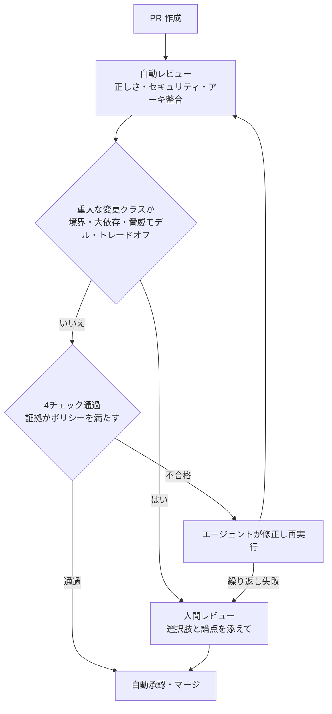
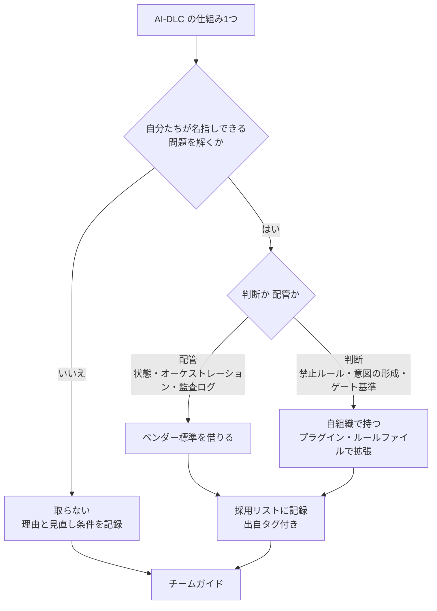
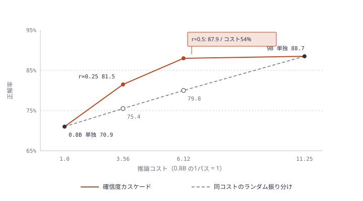

# Daily Briefing 2026-10-27

## 1. コードレビューの終わりが近い（原題: The End Is Nigh for Code Review）

- **URL**: https://semgrep.dev/blog/2026/end-is-nigh-for-code-review/
- **公開日**: 2026-10-09
- **著者・媒体**: Daghan Altas / Semgrep Blog

### 本文翻訳

**すべての変更を人間が手でレビューする時代は終わりつつある。多くのチームではすでに終わっている。** コードの大半をエージェントが書くようになり、ボトルネックは検証へ移った。筆者の提案は、変更を「低リスク」と「高リスク」に仕分け、低リスク側はエージェントが大規模に自動レビューすることだ。空港の TSA PreCheck（事前審査済みの旅客は簡易検査で通す）のようなものだと考えればよい。

**コード生産は加速している。** ヘミングウェイの「徐々に、そして突然に」の通りだ。以下はいずれもベンダーの自己申告である。Anthropic では、典型的なエンジニアが1日にマージするコード量が 2024 年比で 2026 年 Q2 に8倍になった。OpenAI では、オーケストレータ Symphony を使い始めた最初の3週間で、マージされた PR が 500% 増えたチームがある。同社の研究組織では、人間の1営業日あたりエージェントが約3営業日分の作業をこなす。GitHub の月間コミット数は 2026 年4月から8月で 14 億から 29 億に増えた。Gergely Orosz（The Pragmatic Engineer）によれば、2026 年8月に GitHub 上でエージェントが作った PR の数が人間の PR を上回り、8か月で約9倍に伸びた。

**ボトルネックは検証へ移った。** Anthropic 自身、組織に流すコードが増えたことで人間のコードレビューが新たなボトルネックになったと述べている。2026 年7月の Carnegie Mellon と Stanford の研究（"AI Writes Faster Than Humans Can Review"）は、AI 活用の進んだ中規模企業1社で 802 人の開発者と約 20 万件の PR を追った。PR 数は 3.1 倍になったが、レビュアーの数は 1.5 倍にしか増えなかった。つまりレビュアー1人あたりの負荷はおよそ2倍だ。AI が書いた PR は、PR の規模と作者を統制してもなお、最初の人間レビューからマージまで人間の PR より約 20% 長くかかった。

**モデルにはまだ監督が要る。** 2026 年7月の8モデルのベンチマーク（arXiv 2607.23088）では、曖昧な要件や、セキュリティと機能の衝突といった現実的なリスク場面で、どのモデルも平均脆弱性率が 56% を超えた（評価に使われたのは旧版のモデル）。モデルが良くなるほどセキュリティには「ジェヴォンズのパラドックス」が起きる。変更1件あたりのミスは減るが、変更の数がはるかに増える。説明用の計算（実測ではない）をしてみる。100 件の変更で見逃し率が 2% なら欠陥は2件。400 件で 1% なら4件。率は半分になったのに、量が4倍なので欠陥は倍になる。

**私たちはうまく監督できていない。** 先の CMU/Stanford 研究では、人間が文章でフィードバックを書いた PR の割合が 39% から 21% に下がった。レビュアー1人あたりの無言の承認はほぼ倍になり、コメント付きレビューは中央値で月3件ほどのまま横ばいだった。承認は増え、指摘は減った。Orosz の取材に、あるエンジニアは「みんなレビューの動作をなぞっているだけだ」と語っている。

**人間のレビューを上回るのは難しくない。** AI レビューは完璧である必要はなく、今の人間のレビューより良ければよい。2022 年の ICSE の対照実験（arXiv 2202.04586）では、人間のレビュアーが仕込まれたセキュリティ欠陥を見つけた率は 3%〜61% だった。通常のレビューでは、ある欠陥は 3%、別の欠陥は 21% しか見つからなかった。セキュリティに注目させたり専用チェックリストを渡したりしても最高で 61% だった。ただしこの研究が扱ったのは脆弱性2種だけで、方向付け、判断、想定外の例外では人間の方が依然として優れている。

**ひとつの極端: 必須レビューなし。** コーディングエージェント Amp を作る 20 人のチームには PR がない。エンジニアは main に直接 push し、製品は継続的に出荷される。Will Dollman によれば統制は4つある。main に push できるのは権限のある者だけ。全コミットに署名がある。自動テストとセキュリティチェックが走り、悪い変更は止められる。全コミットがそれを生んだ会話に紐づく。SOC 2 が求めるのは PR ではなくリスク管理であり、監査人もこの統制を認めた。とはいえ Amp 自身、2000 人の会社がこのやり方をすべきではないと認めている。Cursor もコードレビューの大半を自動化しており、ボットがときどき人間をタグ付けする程度だと伝えられている。

**企業規模で YOLO はできない。** Uptime Institute の調査では、直近の大規模障害の損失が 100 万ドルを超えたという回答が5人に1人あった。IBM と Ponemon によれば、データ侵害の世界平均コストは過去最高の 499 万ドルだ。リスクとリターンの閾値は組織ごとに決めるしかない。ただし安全側に寄せすぎることも、長期的にはリスクになる。

**提案する運用モデル。** すべての変更を、正しさ・セキュリティ・意図したアーキテクチャとの整合の観点で自動レビューする。定型の変更は、文脈と検証の証拠がポリシーを満たせば自動で進む。重大な変更、すなわち新しいサービス境界、大きな依存の追加、脅威モデルの変化、本当のトレードオフは人間に回す。人間のレビューには的を絞った問いを添え、PR 全体ではなく欠けている部分に集中させる。Anthropic の AI ネイティブ SDLC プレイブックも、人間のレビューを規制対象と重要コードに限るという同様の結論に達している。

**3段階の導入。** (1) **意図を記録する**: サービス境界、依存のルール、重要資産、エスカレーションの条件を書き出す。(2) **判断を比較する**: システムをレビュアーと並走させ、見逃したリスクと不要なエスカレーションを1件ずつ調べる。(3) **クラス単位で任せる**: 範囲の決まった変更クラスごとに自動承認を有効にし、専門家の判断をアーキテクチャ記録・テスト・ルールに変換していく。OpenAI の "Defense Factory" も同じ道筋を描いている。全期間を通じ、スループットと並べて品質と人間の工数を測る。

**Semgrep 社内のパイロット。** 自社の PR で試しており、来年早々に続報を出す予定だ。対象は定型 PR から始め、今はオプトイン。エージェントは PR を承認するか、人間に渡すかのどちらかをする。自律承認の前に、専門家が「安全な PR とは何か」を定義し、実際の PR にラベルを付けてテストケースにする。各変更は**知識移転・プロダクト・設計・正しさ**の4チェックをすべて通らなければならない。エージェントはまずシャドーモードで人間と並走する。有効化はリポジトリ単位で、各リポジトリが自分のリスク水準を設定し、結果が保たれる場所でだけ有効にする。パイロット中は誤承認・カバレッジ・コスト・速度を測る。

**定常状態の目標は、人間が必要な PR を 1% 未満にすること。** 定型の変更は、更新された文脈、確認済みの振る舞いとアーキテクチャ、記録された証拠をもって承認される。チェックに落ちればエージェントが直して再実行し、繰り返し失敗したら人間が引き取る。重大な変更は、選択肢とトレードオフが整理された状態で人間に届く。定常状態では逃した欠陥・アーキテクチャのドリフト・人間の工数を測る。結論は「すべての変更を自動でレビューし、通ったものは承認し、落ちたものは再試行し、例外は人間が決める。自律の範囲は証拠が貯まるにつれて広げる」。

### 重要ポイント

- CMU/Stanford の実測で、PR は 3.1 倍、レビュアーは 1.5 倍。1人あたりの負荷は約2倍になり、文章でのフィードバックがある PR は 39% から 21% に落ちた。「全件人間レビュー」はすでに名目化している
- 欠陥率が半分になっても変更量が4倍なら欠陥は倍になる。モデル品質の向上だけでは安全にならない
- 比較対象は「完璧な AI」ではなく「今の人間レビュー」。人間の欠陥検出率は 3〜61%
- 運用モデルは「全件を自動レビュー → 定型は証拠で自動承認 → 重大な変更クラスだけ人間へ」。重大な変更の定義は、サービス境界・大きな依存・脅威モデル・トレードオフの4つ
- 導入は「意図を記録 → シャドーで判断比較 → 変更クラス単位でリポジトリごとに有効化」の順。誤承認・カバレッジ・コスト・速度を測ってから広げる

### 図解



### 戦略分析

**フレームワーク**: 制約理論（TOC）× リスク×可逆性マトリクス

| TOC の段階 | 記事の対応 |
|---|---|
| 制約を見つける | レビュー。PR 3.1 倍に対しレビュアー 1.5 倍、AI PR は初回レビュー→マージが約 20% 長い |
| 徹底活用する | 人間には重大な変更だけを、論点を絞った問い付きで渡す |
| 他を従属させる | 定型変更は自動レビュー＋証拠で流し、人間の待ち行列に入れない |
| 引き上げる | 専門家の判断をルール・テスト・ADR に変換し、自動化できるクラスを増やす |

| | 可逆（ロールバック容易） | 不可逆（境界・依存・脅威モデル） |
|---|---|---|
| 影響小 | 自動承認の第一候補 | 人間（数は少ない） |
| 影響大 | 自動承認＋段階リリース | 人間が必ず判断 |

**示唆**: 「レビュアーを増やす」より先に、**変更クラスの台帳を作る**意思決定が来る。具体的には (1) 過去3か月の PR を「境界・依存・脅威モデル・それ以外」の4クラスに手で振り分け、「それ以外」の割合を出す。(2) その割合が大きいリポジトリから、自動レビューをシャドーで並走させる。(3) 誤承認が許容範囲に収まったクラスだけを自動承認に切り替える。記事の数字のうち、自社の判断に使ってよいのは CMU/Stanford の実測（負荷2倍・フィードバック率半減）までだ。ベンダー自己申告の倍率は使わない。

**反証条件**: 変更の大半が「重大な変更クラス」に当たる組織、たとえば新規サービス立ち上げ期や、規制で全件の人間承認が義務付けられている領域では、自動承認に回せる量が小さい。そこではこの分析は成立せず、制約を動かす手段はレビュアーの増員か変更粒度の縮小になる。また、自動レビューの誤承認率を測る仕組み（シャドー期間の比較データ）を持たないまま有効化すると、「人間の無言承認」を「AI の無言承認」に置き換えただけになる。

### 現場での適用方法

**運用手順 + 設定ファイル**: リポジトリごとに「変更クラスの方針」をファイルで宣言し、CI で人間レビュー要否のラベルを付ける。まずはシャドーモード（ラベルを付けるだけで、必須レビューは外さない）で始める。

```yaml
# .github/review-policy.yml
# 変更クラスごとのレビュー方針。mode: shadow の間は人間レビュー必須のまま、判定ラベルだけ付ける
mode: shadow            # shadow | enforce
human_required:
  # 新しいサービス境界
  - paths: ["services/*/api/**", "proto/**", "openapi/**"]
    reason: service-boundary
  # 大きな依存の追加
  - paths: ["package.json", "go.mod", "requirements*.txt", "pom.xml"]
    reason: dependency
  # 脅威モデルに関わる箇所
  - paths: ["**/auth/**", "**/crypto/**", "infra/iam/**", ".github/workflows/**"]
    reason: threat-model
auto_eligible:
  max_changed_lines: 300
  required_checks: ["test", "lint", "semgrep"]
```

```bash
#!/usr/bin/env bash
# scripts/classify-pr.sh — PR の変更ファイルからレビュー区分を判定してラベルを返す
# 使い方: scripts/classify-pr.sh <BASE_SHA> <HEAD_SHA>
set -euo pipefail
BASE="$1"; HEAD="$2"
files=$(git diff --name-only "$BASE" "$HEAD")
lines=$(git diff --shortstat "$BASE" "$HEAD" | grep -oE '[0-9]+ insertion' | grep -oE '[0-9]+' || echo 0)

match() { echo "$files" | grep -Eq "$1"; }

if match '^(services/[^/]+/api/|proto/|openapi/)'; then echo "review:human service-boundary"; exit 0; fi
if match '(^|/)(package\.json|go\.mod|requirements[^/]*\.txt|pom\.xml)$'; then echo "review:human dependency"; exit 0; fi
if match '(/auth/|/crypto/|^infra/iam/|^\.github/workflows/)'; then echo "review:human threat-model"; exit 0; fi
if [ "${lines:-0}" -gt 300 ]; then echo "review:human too-large"; exit 0; fi
echo "review:auto-eligible"
```

```yaml
# .github/workflows/review-class.yml
name: review-class
on: pull_request
permissions: { contents: read, pull-requests: write }
jobs:
  classify:
    runs-on: ubuntu-latest
    steps:
      - uses: actions/checkout@v4
        with: { fetch-depth: 0 }
      - id: c
        run: echo "label=$(scripts/classify-pr.sh ${{ github.event.pull_request.base.sha }} ${{ github.event.pull_request.head.sha }})" >> "$GITHUB_OUTPUT"
      - run: gh pr edit ${{ github.event.pull_request.number }} --add-label "$(echo '${{ steps.c.outputs.label }}' | cut -d' ' -f1)"
        env: { GH_TOKEN: "${{ github.token }}" }
```

導入ステップ:

1. 上の3ファイルを置き、2〜4週間 `mode: shadow` のまま運用する
2. 毎週、`review:auto-eligible` が付いた PR のうち人間が差し戻した件数（＝自動承認していたら誤承認だった件数）を数える
3. 誤承認がゼロか許容範囲のリポジトリだけ、`review:auto-eligible` の PR について必須レビュアー数を 0 にする（ブランチ保護のルールセットをリポジトリ単位で変更）
4. 人間に回った PR には「どのクラスに当たったか」をラベルで示し、レビュアーがその観点だけを見るようにする

### 期待効果

- 人間のレビューが「重大な変更クラス」に集中し、無言の承認（記事の研究では倍増）を減らせる
- 記事の目標値は、定常状態で人間が必要な PR を 1% 未満にすること（Semgrep の目標であり、達成実績ではない）
- シャドー期間のデータで、自動承認の可否をリポジトリごとに根拠付きで判断できる

### 注意点

- 記事のコード量の倍率（8倍・500% 等）はベンダーの自己申告。社内説得の根拠には CMU/Stanford の実測値を使う
- パスベースの分類は粗い。境界変更がパス規約の外で起きる（例: 既存ファイル内の新エンドポイント）ことがあるので、自動レビュー側でも境界変更を検出させる
- Amp の「PR なし」は 20 人規模・署名コミット・会話トレーサビリティが前提で、本人たちも大組織には勧めていない
- SOC 2 等の監査で「全件人間承認」を統制として申告している場合は、統制記述の変更を先に監査人と合意する

## 2. AI-DLC を導入するな、盗め（原題: Don't Adopt AI-DLC. Steal From It.）

- **URL**: https://felipefontoura.com/articles/dont-adopt-ai-dlc/
- **公開日**: 2026-09-14（2026-10-01 更新）
- **著者・媒体**: Felipe Fontoura / 個人サイト

### 本文翻訳

**中心の主張**: AWS が公開する AI-DLC は、AI エージェントでソフトウェアを作るための公開フレームワークとして最も完成度が高い。それでも一括で導入すべきではない。自分たちが名指しできる問題を解く仕組みだけを取り、残りは棚に置き、**取ったものと取らなかったものの両方を記録する**。筆者が大規模なエンジニアリング組織の中で数か月見てきた限り、AI-DLC を「作るための材料」として扱ったチームはうまくいき、「従うべき教義」として扱ったチームは苦戦した。スーパーの棚のように扱え。「問題に合うものを取れ。教義は棚に置いていけ」。

**名前を採用すると、他人の問題まで採用することになる。** 手法を丸ごと入れたチームは、自分たちにない問題に合わせたサイズの儀式を回し、自分たちにある問題を見落としがちだ。AWS の手法は AWS のエンタープライズ顧客の文脈を反映している。出発点であって、目的地ではない。

**最初に取るべき仕組み（必須。開発者1人とエージェント1つでも効く）**

- **リポジトリ内の永続的な成果物**: 要件・決定・計画を、エージェントが毎セッション読むバージョン管理されたファイルとして置く。筆者はこれを手法の中で最も価値のある考え方と呼ぶ。どのツールでも使える
- **工程間の人間のゲート**: エージェントが作り、人間が承認か修正依頼をし、それから次の工程を始める。誤った決定を、まだ安く戻せるうちに捕まえられる
- **AI に質問させる**: 完璧なプロンプトを書くのではなく、意図を渡してエージェントの質問に答える。その質問は、開発者が実装の途中でぶつかる疑問とよく一致する
- **作業に比例した深さ**: バグ修正にドメインモデルは要らない。AI-DLC 2 はこれを 11 のワークフロープロファイルで表現している（8工程の PoC から、全 33 工程まで）。エンジンを入れなくても原則だけ採用できる

**任意（最初の4つが習慣になってから）**

- **時間単位のスライス**（"bolt"）: 2週間スプリントの代わりに、時間単位で切る。チームが、会議なしでエージェントがスライスを届けられるほど仕様を書けるようになってから
- **学習ループ**: 修正のたびにそれをルールにし、エージェントが次回読む。最初はチームのルールファイル1枚で十分だ

**今は置いていくもの**

- **初日から全 33 工程**: Classic プロファイル（v1 の Inception と Construction、工程ごとに1回の承認）から始め、実際の問題が求めたときにフェーズを足す
- **何でも改名すること**: スプリントを bolt と呼んでも仕事は変わらない。先に仕事を変える
- **すべてのタスクでモブ**: Mob Elaboration は複数人で一緒に決める必要があるときに元が取れる。1人で済むタスクは1人で仕様を書けばいい
- **使わないエージェント**: AWS プラットフォームエージェントや AWS MCP サーバーは AWS 以外では雑音だ。コンプライアンス体制がないのにコンプライアンスエージェントを置けば、ただの儀式になる
- **即座の納期短縮への期待**: この手法はサイクルタイムを良くする前に一度悪くする。約束だけを採用したリーダーは、その谷の底で展開を打ち切りがちだ

**選択を記録する。** チームガイドに2つのリストを持つ。「AI-DLC から取ったもの」と「取らなかったもの、およびその理由」。各項目に出自のタグを付ける。AWS の手法（どの原則かを明記）、他のフレームワーク、自分たちのパイロット（証拠付き）のいずれかだ。取らなかった項目には「いつ見直すか」の条件も付ける。出自のない項目は載せない。これで「決定」と「噂」が区別でき、将来の読者が何を変えてよいかがわかる。

**AI-DLC 2 はこのやり方を裏付けた。** v1 は実質ルールファイルの集まりだったので、チームは自前の層を作らざるを得なかった。オプトインの拡張、タスク終了時の振り返り、git worktree での並列構築、コアルールへのパッチ注入、コンテキストを消去する規律などだ。AI-DLC 2 はその配管の多くを標準機能にした。

| v1 で自作していたもの | AI-DLC 2 で標準化されたもの |
|---|---|
| 独自の状態管理と再開 | 意図ごとの状態ファイル、追記専用の監査ログ（108 種のイベント）、セッション途中のコンテキスト圧縮からの復旧 |
| タスク終了時の振り返り | 工程ごとの日誌。学習候補はゲートで確認され、次回実行で適用 |
| worktree での並列構築 | 依存が解けた Unit のスウォーム実行とバッチチェックポイント |
| コアルールへのパッチ注入 | コアを編集せずに追加できるプラグイン機構 |
| タスクごとに手で削ったワークフロー | 11 のプロファイルと、独自ルートを提案するコンポーザーエージェント |

v1 を教義として扱ったチームは、ベンダーがちょうど不要にした回避策を保守し続ける羽目になった。棚として扱ったチームはほとんど何も失わなかった。残ったのは自分たちの判断だった。バイブコーディングを禁じるルール、意図を形にする儀式、どのタスクは手法を通さなくてよいかという感覚。どれもリリースに含めて出荷できるものではない。

**判断は所有し、配管は借りる。** ベンダーに任せるもの: 状態管理と再開、エージェントと工程のオーケストレーション、並列実行と worktree、監査ログとトレーサビリティ検査。自分たちが持ち続けるもの: エージェントに絶対させないことのルール、最初の要件の前に意図をどう形にするか、どの仕事を手法に通すか、各ゲートでレビュアーが何を確認するか。

**拡張は継ぎ目で行う。** AI-DLC 2 のプラグイン機構は、コアに触れずに工程・エージェント・ルール・チェックを追加できるので、追加分はリリースを越えて生き残る。ルールファイルも組織・チーム・プロジェクトの3階層で置ける。コアファイルに散らばったパッチはアップグレードで失われる。

**丸ごと導入が正しい場合**: 組織がベンダーの想定顧客に似ているとき（多数のチーム、規制業務、完全なトレーサビリティ要件、AWS スタック。Enterprise プロファイルが合う）。あるいは、チームにプロセスがまったくないとき（即興より文書化された完全な手法の方が良い。ワークショップモードで学べる）。その場合でも、すべての適応を記録する。失敗とは、決めずに採用することだ。

**FAQ（抄）**: 部分採用はチェリーピックではないか → 違う。チェリーピックは難しい部分を黙って飛ばす。ここでは問題を名指しし、置いていったものと理由を記録し、リストを見直す。カスタマイズしたら更新を失うか → 継ぎ目で行えば失わない。誰が何を取るか決めるか → 最初のパイロットを回した人たちと、ガイドのオーナー。パイロットに裏付けられた実践は証拠を持ち、スライドに裏付けられた実践は希望しか持たない。結びの規則は「全部取る場合でも、一つひとつ決めよ」。

### 重要ポイント

- AI-DLC から最初に取るべきは4つ（リポジトリ内の永続成果物、工程間の人間ゲート、AI に質問させる、作業に比例した深さ）。いずれも1人＋エージェント1つで効く
- 初日の全 33 工程、改名、全タスクのモブ、使わない AWS 系エージェントは置いていく。導入直後はサイクルタイムが一度悪化する前提で臨む
- 「取ったもの／取らなかったもの」を出自タグ付きで記録し、取らなかったものには見直し条件を付ける。出自のない項目は載せない
- v1 で自作した配管（状態・振り返り・並列・パッチ）の多くは v2 で標準化された。残る価値は自組織の判断であり、配管ではない
- 拡張はプラグインと組織・チーム・プロジェクトのルールファイルで行い、コアに手を入れない

### 図解



### 戦略分析

**フレームワーク**: Make/Buy（判断は Make、配管は Buy）

| 構成要素 | 区分 | 記事の根拠 |
|---|---|---|
| 状態管理・再開、オーケストレーション、並列実行、監査ログ | Buy（ベンダーに借りる） | v1 で自作した層の多くが v2 で標準化され、自作分は陳腐化した |
| エージェントの禁止ルール、意図の形成、手法を通すタスクの線引き、ゲートのレビュー基準 | Make（自組織で持つ） | 「リリースに含めて出荷できない」もの。v2 になっても残った価値 |
| 拡張方法 | Buy の継ぎ目で Make | プラグインと3階層のルールファイル。コアパッチはアップグレードで失われる |

**示唆**: 社内のフレームワーク整備の工数を、配管から判断へ移す意思決定になる。具体的には (1) 社内で自作している状態管理・並列実行・振り返りの仕組みを洗い出し、v2 の標準機能で置き換えられるものは保守をやめる。(2) 浮いた工数で、チームガイドに「取ったもの／取らなかったもの」の2リストと、ゲートごとのレビュー基準を書く。(3) 展開計画には、導入直後のサイクルタイム悪化を想定した評価期間を最初から入れる。記事は定量データを示していないため、悪化の幅と期間は仮説であり、自組織のパイロットで測る必要がある。

**反証条件**: 記事自身が挙げる2つの条件に当てはまる組織、つまり AWS スタックで規制業務・多数チーム・完全なトレーサビリティ要件を持つ組織や、そもそもプロセスがない組織では、部分採用の判断コストの方が高くつき、丸ごと導入が合理的になる。また、ベンダーが v2 のプラグイン機構を将来大きく変えた場合、「継ぎ目で拡張すれば生き残る」という前提が崩れる。

### 現場での適用方法

**CLAUDE.md（またはチームガイド）への追記例**: 採用／不採用の記録と、ゲートの基準をエージェントが毎回読める形で置く。

````markdown
## 開発プロセス（AI-DLC からの採用記録）

### 採用したもの
| 仕組み | 出自 | 証拠 |
|---|---|---|
| 要件・決定・計画を `docs/intent/<ID>/` に置き、毎セッション読む | AWS AI-DLC（永続成果物） | パイロット <TEAM_A>、手戻り件数の比較 |
| 要件 → 設計 → 実装の各工程の間で人間が承認する | AWS AI-DLC（人間ゲート） | パイロット <TEAM_A> |
| 実装前にエージェントが質問を出し、人間が答える | AWS AI-DLC（質問させる） | 社内パイロット |
| バグ修正は「要件1段落＋テスト」だけで実装に入ってよい | AWS AI-DLC（深さの比例） | — |

### 採用しなかったもの
| 仕組み | 理由 | 見直し条件 |
|---|---|---|
| 全 33 工程 | 問題の規模に対して過大 | 複数チームにまたがる案件が四半期に3件を超えたら |
| 用語の改名（bolt 等） | 仕事が変わらない | — |
| 全タスクのモブ | 単独タスクには過剰 | — |
| AWS プラットフォームエージェント | AWS 不使用 | AWS 移行が決まったら |

### エージェントへのルール
- 各工程の成果物を書いたら、次の工程に進まず人間の承認を待つこと
- 不明点は推測で埋めず、`docs/intent/<ID>/questions.md` に質問として列挙して止まること
- 修正指摘を受けたら、再発防止のルールを `docs/rules/team.md` に1行追記する案を出すこと
- このファイルの「採用しなかったもの」に載っている工程を勝手に追加しないこと
````

**運用手順**:

1. `docs/intent/` と `docs/rules/team.md` を作り、上の表をチームガイドに置く
2. 最初の1か月は Classic 相当（要件と実装の2工程、工程ごとに1回承認）だけで回す
3. 月次の振り返りで「採用しなかったもの」の見直し条件を満たしたものがあるか確認し、あれば出自と証拠を付けて採用リストへ移す
4. 社内で自作した配管（状態ファイル・並列実行スクリプト等）は、v2 の標準機能で置き換えられるかを一覧化し、置き換えられるものの保守を止める

### 期待効果

- 手法の名前ではなく問題から導入するため、不要な儀式によるオーバーヘッドを避けられる
- 採用理由が記録されるので、チームごとの「私的な方言」化を防ぎ、後任が何を変えてよいか判断できる
- v2 のような上流の更新時に、自作配管の保守を捨てて判断の部分だけを持ち越せる
- 記事は定量的な効果を示していない。効果はパイロットで測る前提

### 注意点

- 記事は筆者1人の観察に基づく。成功・失敗の比較データは示されていない
- 導入直後にサイクルタイムが悪化すると記事は明言している。評価期間を設けずに始めると谷の底で打ち切ることになる
- 部分採用が「難しい部分を黙って飛ばす」チェリーピックに変わらないよう、取らなかったものと理由の記録を必ずセットにする
- 同著者の AI-DLC 2 解説（2026-10-02 選定）、Agentic SDLC プレイブック（2026-10-26 選定）と併読すると、v2 の機能面の詳細が補える

## 3. Jev 型の決定モデルを確信度カスケードで使う: 迷った 25% だけ大モデルに回す（原題: Inference-time compute strategy for (Jev-like) Prefill-Only Decision Models with Confidence Cascades）

- **URL**: https://github.com/rlisml/jev-cascade
- **公開日**: 不明（直近数週間以内）
- **著者・媒体**: rlisml / GitHub リポジトリ（MIT License）

### 本文翻訳

**中心の主張**: 0.8B パラメータの prefill のみで動く決定モデル（Jev のように、テキストを生成せずラベル候補の確率分布を返すモデル）を、4B モデル並みに答えさせることができる。やることは、**モデルが最も自信のない 25% の質問だけを大きいモデルで解き直す**ことだ。これで大モデルの精度の 96% を、追加コストの 40% で得られる。9B モデルを相手にすると、9B のコストの半分でカスケードは 9B に 1pp 以内まで迫り、同コストのランダム振り分けを 8pp 上回る。

**考え方**: このモデルはテキストを生成する代わりに、1回の forward pass でラベルの選択肢（メニュー）全体にわたる確率分布を読み出す。確信度カスケードは、確信度が最も低い一定割合のレコードを大きなモデルへ回す。2回目のパスは大モデルの通常の1パスそのものなので、カスケードに必要なのは「平坦な2パス」だけで、展開時に閾値を探索する作業も追加のエンジニアリングも要らない。確信度は弱点を示す良いシグナルになっている。

**結果: kev-0.8b → kev-4b（HWU-64 テスト。コストは 0.8B の1パスを1とする単位）**

| 大モデルへ回す割合 | コスト | カスケード精度 | 同コストのランダム振り分け |
|---|---|---|---|
| r = 0（小モデルのみ） | 1.0 | 61.9 | 61.9 |
| r = 0.25 | 2.0 | 71.6 | 64.4 |
| r = 0.50 | 3.0 | 72.6 | 66.9 |
| r = 1.0（大モデルのみ） | 5.0 | 71.9 | 71.9 |

25% を回すと、同じ予算のランダム振り分けより +7.2pp。この傾向は5つの評価ソースすべてで成り立つとしている。

**結果: kev-0.8b → kev-9b（7ソース計 3,500 件をプール。9B のコストは 11.25）**

| 大モデルへ回す割合 | コスト | カスケード精度 | 同コストのランダム振り分け |
|---|---|---|---|
| r = 0 | 1.00 | 70.9 | 70.9 |
| r = 0.25 | 3.56 | 81.5 | 75.4 |
| r = 0.50 | 6.12 | 87.9 | 79.8 |
| r = 1.0 | 11.25 | 88.7 | 88.7 |

r = 0.5 でカスケードは 9B に約 1pp 差まで迫り、コストは 9B の 54%、ランダム振り分けより +8.1pp。難しいソースの ARC では、精度は 61.6 → 67.8（r = 0.1）→ 75.6（r = 0.25）と伸びるが、9B 単独の 94.4 にはまだ届かない。

**メニュー変更の予測（ラベル付け不要のシミュレータ）**: 1回目のパスで得た分布を新しいメニューに制限して正規化し直せば、メニューを変えたときの答えを予測できる。実測がこの予測からずれた分（残差）は、提示順などの見せ方の効果や紛らわしいラベルを表す。検証セルとして、正解＋一様にランダムな 14 候補、正解を強制しない 15 候補、1回目の確率が低いものを避けて選んだ候補、1回目の上位候補＋正解（"Which of these C options matches best?" と聞く変種を含む）、上位1候補と正解の二択などを用意した。事前登録した3つの合格基準は、G-A1「10 セル中9セル以上で残差の絶対値が 2pp 以内」、G-A2「避けて選んだ候補 ≥ ランダム候補 − 1pp」、G-A3「二択と通常の比較をソースごとに符号表で報告」。メニューは source・cell・レコード ID の crc32 をシードに作るので、結果は再現可能だ。

**構成と使い方**: `build_sources.py` が公開データから5つのデータセット（goemotions27: 2,984件・27ラベル、massive60: 2,974件・59意図、hwu64: 1,076件・64意図、amzntoys60: 1,200件・60カテゴリ、snips7: 1,400件・7意図）を再構築する。`battery_kev.py`（ローカル GPU）/ `battery_jev.py`（HTTP）がメニュー操作の検証を、`cascade_kev_pass1.py` が大モデルの通常パスを、`cascade_analysis.py` がカスケード曲線とランダム振り分けの比較を、`cascade_tasks.py` が HTTP 経由の小→大カスケードを実行する。モデルは Hugging Face の `jaredpalmer/kev-0.8b`、`kev-4b`、`kev-9b` と `ZefanCai/Open-Jev-2B`（重みは同梱しない）。HTTP の契約は `POST /v1/systemone` 1本で、質問ごとに `probabilities` を返すことだけ。これに合わせれば他のサービングスタックでも動く。

**注意事項（README 記載）**: コスト単位はパラメータ比（0.8B = 1、4B = 5、9B = 11.25）で、実測レイテンシではない。正解を強制しないセルでメニューに正解が含まれないレコードは、構造上0点とし、モデル呼び出しを省く。ラベル空間が狭い snips7（7ラベル）はメニューの大きさに上限があるため、同じ C で比較している。実行は再開可能で、既存の結果ファイルはスキップする。

### 重要ポイント

- 決定モデルは1パスで選択肢全体の確率を返すため、「確信度の低い順に上位 r を大モデルへ回す」だけでカスケードが組める。閾値探索は要らない
- 0.8B→9B では、25% を回すとコスト 3.56 で 81.5%、50% でコスト 6.12（9B の 54%）で 87.9%。9B 単独は 88.7%
- 同コストのランダム振り分けより +7〜8pp。つまり「確信度」は難しいレコードを選ぶ信号として機能している
- ARC のような難問ソースでは、25% を回しても 75.6% で 9B の 94.4% に遠い。カスケードの効きはタスクに依存する
- コストはパラメータ比での見積もりであり、レイテンシや API 料金の実測ではない。確信度の定義（top-1 確率か、マージンか）も README には明記されていない

### 図解



### 戦略分析

**フレームワーク**: 単位経済性（ユニットエコノミクス）

| 構成 | 1判断あたりコスト（0.8B=1） | 精度 | 記事の位置付け |
|---|---|---|---|
| 小モデルのみ | 1.00 | 70.9 | 基準 |
| カスケード r=0.25 | 3.56 | 81.5 | 9B の約 32% のコストで +10.6pp |
| カスケード r=0.50 | 6.12 | 87.9 | 9B の 54% のコストで 9B に約 1pp 差 |
| 大モデルのみ | 11.25 | 88.7 | 上限 |

**示唆**: 決定モデルの選定は「小さいモデルか大きいモデルか」の二択ではなく、**r（大モデルへ回す割合）を事業上の誤判定コストから決める**意思決定に変わる。手順は (1) 現行の判定タスク（チケット分類、ルーティング等）の評価セットで、小モデルの確信度順に r = 0 / 0.1 / 0.25 / 0.5 の精度を測る。(2) 誤判定1件あたりの損失と、1判定あたりの推論費から、「正解した判定1件あたりのコスト」が最小になる r を選ぶ。(3) r を超えて回したいほど難しいタスク（記事の ARC のように 25% で頭打ちするもの）は、カスケードではなく大モデルか人間に直接回す。記事の数値は分類ベンチマークのものなので、自社タスクでの値は仮説として扱い、必ず測り直す。

**反証条件**: 確信度と正誤の相関が弱いタスクでは、カスケードはランダム振り分けとの差を失う（README は「確信度は弱点の良い信号」と述べるが、これは5〜7ソースでの観察）。また、実運用のコストがパラメータ比ではなくネットワーク往復や API の最低課金で決まる環境、たとえば大モデルが外部 API で1呼び出しの固定費が支配的な場合は、表の単位経済性が崩れる。

### 現場での適用方法

**スクリプト化の例**: 決定モデルの HTTP API（`POST /v1/systemone` 互換）に対し、バッチを小モデルで1パス流し、確信度の低い順に r だけ大モデルへ回すスクリプト。確信度は top-1 確率として実装している（README では定義が明示されていないため、マージンやエントロピーに差し替えて比較するとよい）。

```python
#!/usr/bin/env python3
"""cascade.py — 確信度カスケードで決定モデルを2パス実行する。

使い方:
  python3 cascade.py --input records.jsonl --r 0.25 \
      --small-url <SMALL_ENDPOINT> --large-url <LARGE_ENDPOINT> > out.jsonl
records.jsonl の各行: {"id": "...", "state": "...", "labels": ["a", "b", ...]}
"""
import argparse, json, sys, urllib.request

def ask(url: str, state: str, labels: list[str]) -> dict[str, float]:
    # 契約は README の POST /v1/systemone。ペイロード形式は自環境の API に合わせて調整する
    body = json.dumps({
        "state": state,
        "questions": [{"id": "q", "type": "choice", "options": labels}],
    }).encode()
    req = urllib.request.Request(url, data=body, headers={"Content-Type": "application/json"})
    with urllib.request.urlopen(req, timeout=30) as res:
        return json.load(res)["answers"]["q"]["probabilities"]

def confidence(probs: dict[str, float]) -> float:
    return max(probs.values())  # top-1 確率。margin = p1 - p2 も試す価値がある

def main() -> None:
    ap = argparse.ArgumentParser()
    ap.add_argument("--input", required=True)
    ap.add_argument("--r", type=float, default=0.25)
    ap.add_argument("--small-url", required=True)
    ap.add_argument("--large-url", required=True)
    a = ap.parse_args()

    recs = [json.loads(l) for l in open(a.input, encoding="utf-8")]
    # パス1: 全件を小モデルで
    for rec in recs:
        rec["probs"] = ask(a.small_url, rec["state"], rec["labels"])
        rec["stage"] = "small"
    # パス2: 確信度の低い順に上位 r を大モデルで解き直す（閾値探索なし）
    k = int(len(recs) * a.r)
    for rec in sorted(recs, key=lambda x: confidence(x["probs"]))[:k]:
        rec["probs"] = ask(a.large_url, rec["state"], rec["labels"])
        rec["stage"] = "large"
    for rec in recs:
        answer = max(rec["probs"], key=rec["probs"].get)
        print(json.dumps({"id": rec["id"], "answer": answer, "stage": rec["stage"],
                          "confidence": round(confidence(rec["probs"]), 4)}, ensure_ascii=False))

if __name__ == "__main__":
    main()
```

**r を決める運用手順**:

```bash
# 1. 正解付きの評価セット（200〜500件）を用意し、r を振って実行
for r in 0 0.1 0.25 0.5; do
  python3 cascade.py --input <EVAL_SET>.jsonl --r "$r" \
    --small-url <SMALL_ENDPOINT> --large-url <LARGE_ENDPOINT> > "out_r${r}.jsonl"
done

# 2. 正解率を集計（gold.jsonl の各行: {"id": "...", "gold": "..."}）
for f in out_r*.jsonl; do
  python3 - "$f" <<'PY'
import json, sys
gold = {j["id"]: j["gold"] for j in map(json.loads, open("<GOLD_FILE>.jsonl"))}
rows = [json.loads(l) for l in open(sys.argv[1])]
acc = sum(r["answer"] == gold[r["id"]] for r in rows) / len(rows)
print(sys.argv[1], f"acc={acc:.3f}")
PY
done

# 3. 「(推論費 + 誤判定件数 × 誤判定1件の損失) ÷ 件数」が最小の r を本番値にし、
#    モデルのバージョンと r をセットで設定ファイルに固定する
```

### 期待効果

- README の数値では、0.8B→9B で r=0.5 にすると 9B の 54% のコストで精度差約 1pp、r=0.25 で 9B の約 32% のコストで小モデル単独から +10.6pp
- 同コストのランダム振り分けより +7〜8pp。「一部だけ大モデルに回す」構成を、確信度という根拠付きで組める
- 閾値探索が不要なので、運用パラメータは r ひとつに集約できる

### 注意点

- 対象は Jev そのものではなく、Jev 型の公開モデル（kev 系・Open-Jev）での実験。商用の Jev API で同じ曲線になるかは未検証
- コストはパラメータ比で、実測レイテンシや API 料金ではない。外部 API では呼び出し固定費やレート制限で単位経済性が変わる
- r はバッチ内の相対順位で決まるため、オンラインで1件ずつ流す用途では、評価セットで r に相当する確信度の閾値を求めて使う必要がある
- ARC のような難問では 25% を回しても大モデルに遠い。カスケードが効くかはタスクごとに測る
- 4B で r=0.5 が大モデル単独を上回る（72.6 対 71.9）点に説明や分散の記載はない。誤差の範囲と見るのが妥当
