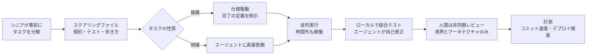
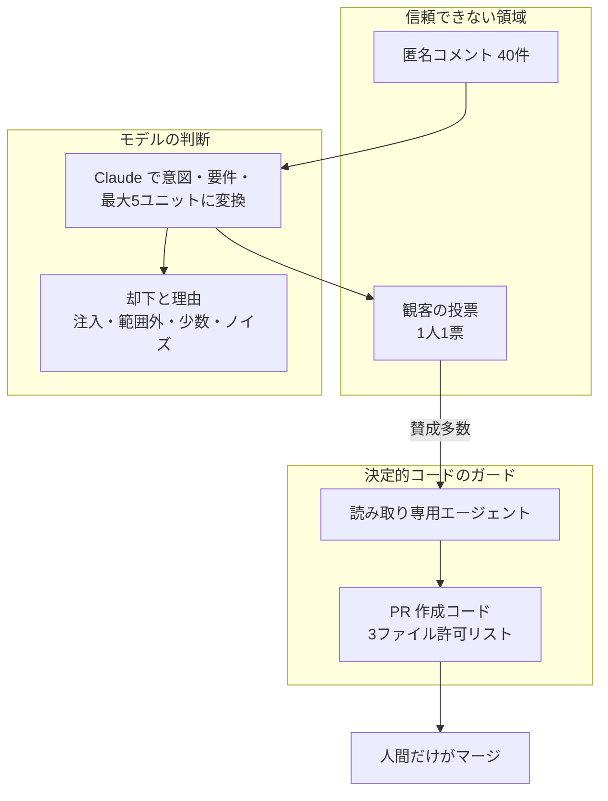
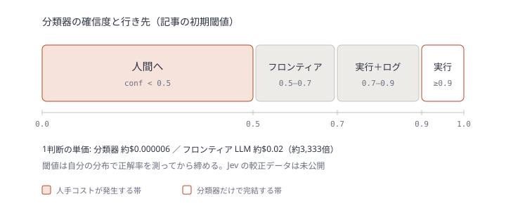

# Daily Briefing 2026-10-28

## 1. フロンティアチームは AI ネイティブ開発をどう作り直しているか（原題: How frontier teams are reinventing AI-native development）

- **URL**: https://aws.amazon.com/blogs/machine-learning/how-frontier-teams-are-reinventing-ai-native-development/
- **公開日**: 2026-06-10
- **著者・媒体**: Swami Sivasubramanian（AWS Agentic AI 担当 VP）/ AWS Machine Learning Blog

### 本文翻訳

AI コーディングエージェントはコードの生成を速くした。しかし顧客に機能が届く速さは、それほど変わっていない。ボトルネックは、エージェントが必要な知識にアクセスできるか、そしてチームが仕事のやり方を組み替える覚悟があるかにある。これをやり切った「フロンティアチーム」は 4.5 倍、ときに 10 倍を超える生産性向上を報告している。Amazon は3つの経路でこれを試した。

**1. Pathfinder イニシアティブ。** シニアエンジニア6人が Amazon Bedrock の推論エンジンを作り直した。当初の見積もりは「開発者 30 人で 12〜18 か月」。チームはワークフローをゴール起点で設計し直し、複数のエージェントを並列に走らせ、業務時間外にもエージェントが働くように組んだ。結果は 76 日で出荷。正規化したコミット速度で見ると、個人の生産性は約 20 倍（週2コミット → 週40コミット）になった。

**2. 構造化スプリント。** Prime Video の Financial Systems チームは、6人のエンジニアを1部屋に集め、オンコール・他案件・重い会議を外した 10 日間のスプリントを行った。事前にシニアエンジニア1人が3週間かけて作業を範囲の明確なタスクに分解した。複雑な機能には仕様駆動開発（spec-driven development）を、明確なタスクにはエージェントの直接支援を使い分けた。コミット数はベースライン 96 に対して 556。90 週の見積もりが 24 週に縮み、スループットは約6倍になった。チームはこれを、それぞれ約 1.5 倍の3つの要因の掛け算だと説明する。判断の少ない作業の高速化、判断の要る作業への中断なき集中、そして記録済みのドメイン知識への即時アクセスである。

**3. 現場での実験。** 調査した 50 以上のチームのうち、新しいツールと新しいやり方の**両方**を採用した 25 チームは、既存ワークフローに AI を足しただけのチームを上回った。Amazon Stores のパイロットは特別な条件なしに通常のバックログで Kiro と社内 AI ツールを使い、正規化したデプロイ速度の中央値で 4.5 倍を記録した。Perfect Order Experience は2週間かかっていた機能を午後のうちに出荷するようになり、WW Grocery は設計ドキュメントの作成を5日から数時間に縮めた。

**高成果チームの5つの実践。**

1. **エージェントのコンテキストに投資する。** ステアリングファイルを維持し、チームの規約・コーディング標準・テスト方法・コードベースの歩き方を書き出す。あるインフラチームはコードとドキュメントをすべてモノレポに集め、AI が生成したインラインコメントを永続的な記憶として残した。
2. **速くなるために、いったん遅くなる。** 最初の2週間は、専門知識をドキュメントに落とし込みリポジトリを組み替えるため、遅く感じると覚悟する。早々にやめたチームは複利的な効果を取り逃がした。
3. **エージェントを子守りせず、餌を与え続ける。** 範囲の明確なタスクのバックログを絶やさず、エージェントを並列に走らせ、出力は非同期でレビューする。あるプリンシパルエンジニアは、連続した数時間で変更一式を出荷した。
4. **コーディングの前に意図を明示する。** 仕様と明確な「完了の定義」を使う。手書きのコードを全体の 1〜2% に抑えつつ、1人あたりのコミットを増やしているチームもある。
5. **テストを左に寄せる。** エージェントにローカルで結合テストを走らせ、自己修正させる。自動ガードレール、コンポーネントテスト、性能テスト、フォーマッタで問題を早期に潰すことで、コードレビューはスタイルではなくインターフェースとアーキテクチャに集中できる。

**リーダーへの提言。** 道具だけでは足りず、チームの働き方を変えること。成果は「AI が判断の少ない作業を担う」「人が判断の要る作業に中断なく集中する」「ドメイン知識にすぐアクセスできる」の組み合わせで決まる。まず小さなチームで試行し、本番のコーディングの前にエージェントのコンテキストを作らせ、そのチームが作ったプレイブックで横展開する。計測はコミット速度、デプロイ頻度、解決までの時間、開発者満足度で行う。なお、コミット速度は全体像の一部にすぎず、リリース管理・運用・セキュリティ・EOL 対応については続編で扱うとしている。

### 重要ポイント

- 「ツール＋やり方の変更」を両方行った 25 チームが「ツールだけ」のチームを上回った。Amazon Stores の中央値は**デプロイ速度 4.5 倍**
- Prime Video の約6倍は「判断の少ない作業の高速化」「中断なき集中」「ドメイン知識への即時アクセス」の3要因（各 約1.5 倍）の掛け算。AI の寄与はその3分の1にすぎない
- 成功例の共通の前提は、シニアが**事前に**タスクを分解しておくこと（Prime Video では3週間）
- 導入初期の約2週間は遅くなる。そこでやめると複利を取り逃がす
- テストを左に寄せることで、人間のレビューをインターフェースとアーキテクチャに絞る

### 図解



### 戦略分析

**フレームワーク**: マッキンゼー 7S

| 要素 | ツールだけ足したチーム | フロンティアチーム（記事の記述） |
|---|---|---|
| Strategy | AI で個人を速くする | ゴール起点でワークフローを再設計 |
| Structure | 既存の体制のまま | 6人程度の小チーム、オンコール・他案件を外す |
| Systems | 既存の開発プロセス | 仕様駆動・並列エージェント・非同期レビュー・テスト左寄せ |
| Shared values | 「書くのが仕事」 | 「餌を与え続けるのが仕事」 |
| Style | リーダーはツール導入を指示 | 最初の2週間の遅れを許容する |
| Staff | 全員に同じ期待 | シニアが事前分解を担う |
| Skills | プロンプト技術 | 専門知識をステアリングファイルへ書き出す力 |

**示唆**: 記事の数値で効いているのは Systems と Structure の変更であり、ツールのライセンス配布では Prime Video の3要因のうち1つ（約1.5 倍）しか取れない。したがって投資判断は「全社にツールを配る」より先に、**1チームを2〜3週間、他業務から外して事前分解とステアリングファイル作成に充てる**ことを優先する。Staff の観点では、シニアの時間を実装ではなくタスク分解とコンテキスト整備に振り替える意思決定が要る。成果は「コミット速度」ではなく「デプロイ頻度」と「解決までの時間」で判定する（コミット数は分割の仕方で容易に増える）。

**反証条件**: 記事の事例は、範囲の明確なバックログと、事前分解できるシニアが揃ったチームに偏っている。要件が流動的でシニアが事前分解に時間を割けない組織、または下流（リリース承認・運用）が制約になっている組織では、Systems を変えてもデプロイ頻度は伸びず、記事自身が続編に回したリリース管理の問題に突き当たる。

### 現場での適用方法

**パイロット運用手順（2週間の「遅くなる期間」を前提にする）**

1. パイロットチームを1つ選び、オンコールと他案件を期間中外す
2. 着手前にシニア1名が次のバックログをタスクに分解する（1タスクは数時間で終わる粒度）
3. 下のステアリングファイルをリポジトリに置く
4. 計測のベースラインを取る（下のスクリプト）

**CLAUDE.md への追記例**

```markdown
## チームの作業規約（エージェント向け）

### 着手前
- タスクに「完了の定義」が無ければ実装を始めず、定義案を返して確認を取る
- 複雑なタスク（複数モジュールにまたがる、外部 API 仕様の変更を含む）は
  `specs/<TASK_ID>.md` に仕様を書いてから実装する

### 実装中
- 変更後は必ず `<TEST_COMMAND>` で結合テストをローカル実行し、失敗したら自分で直す
- フォーマッタ `<FORMAT_COMMAND>` を通してからコミットする
- 新しく分かったコードベースの歩き方・落とし穴は `docs/agent-notes.md` に追記する

### レビュー依頼
- PR 説明には「変更したインターフェース」と「アーキテクチャ上の判断」だけを書く
  （スタイルは自動チェックに任せ、人間には聞かない）
```

**ベースライン計測スクリプト（週次のマージ数と main へのデプロイ相当コミット数）**

```bash
#!/usr/bin/env bash
# usage: ./weekly-velocity.sh <REPO_PATH> <WEEKS>
set -euo pipefail
REPO="${1:?repo path}"; WEEKS="${2:-8}"
cd "$REPO"
for i in $(seq "$WEEKS" -1 1); do
  since=$(date -d "$i weeks ago" +%F)
  until=$(date -d "$((i-1)) weeks ago" +%F)
  merges=$(git log origin/main --merges --since="$since" --until="$until" --oneline | wc -l)
  commits=$(git log origin/main --no-merges --since="$since" --until="$until" --oneline | wc -l)
  authors=$(git log origin/main --since="$since" --until="$until" --format='%ae' | sort -u | wc -l)
  echo "$since merges=$merges commits=$commits authors=$authors"
done
```

### 期待効果

- 記事の数値: Amazon Stores でデプロイ速度の中央値 4.5 倍、Prime Video で約6倍のスループット、Pathfinder で個人コミット速度 約20 倍（76 日で出荷）
- 設計ドキュメント作成が5日から数時間に（WW Grocery）
- レビューの論点がインターフェースとアーキテクチャに絞られ、レビュー時間の使い方が変わる

### 注意点

- 事例はすべて Amazon 社内で、AWS の VP による自社ツール（Kiro）を含む報告。外部検証はない
- 「コミット速度」は粒度で増減する指標。比較にはデプロイ頻度・変更のリードタイムを併用する
- 最初の2週間は遅くなる。その期間の評価で打ち切らないよう、事前に関係者と合意しておく
- 記事は開発までを扱い、リリース管理・運用・セキュリティは対象外（続編予定）

## 2. AWS の AI-DLC を見知らぬ群衆に開放した: 40 コメントから 5 ワークユニットへ（原題: I Opened AWS's AI-DLC to Random Strangers on the Internet: 40 Comments In, 5 Work Units Out）

- **URL**: https://dev.to/_76130e67067eab4c8510/i-opened-awss-ai-dlc-to-random-strangers-on-the-internet-40-comments-in-5-work-units-out-2f71
- **公開日**: 2026-08-04
- **著者・媒体**: Yuuki Yamashita / DEV Community

### 本文翻訳

**背景: AI-DLC。** AWS の AI-Driven Development Life Cycle は、AI が成果物の下書きを作り、人間のチームが決定を下す開発手法だ。Inception・Construction・Operations の3フェーズからなる。Mob Elaboration という儀式では、チーム全員が AI の出した要件とワークユニットをリアルタイムで検証する。作業単位は「Bolt」で、週ではなく時間で見積もる。この枠組みは、部屋にいる全員が信頼でき、目的を共有していることを前提にしている。

**実験: Boltcast。** 筆者は「モブが匿名のネット群衆だったらどうなるか」を試すため、Boltcast を作った。パイプラインは次の通り。

1. 観客のコメントがライブ配信のように画面を流れ、DynamoDB に保存される
2. 誰かが「convert」を押すと、直近 40 件のコメントが Amazon Bedrock 上の Claude Sonnet 4.6 に渡る。モデルは意図、いくつかの要件、最大5つのワークユニットを出し、却下したコメントは理由付きでカテゴリ分けする
3. 観客は各ユニットに賛否を投票する（1人1票）。賛成多数のユニットが先へ進む
4. Bedrock AgentCore Runtime 上の Strands エージェントが対象リポジトリを読み、実装を書き、GitHub の PR を開く
5. マージできるのは人間だけ

対象は、別のプライベートリポジトリに置いた、小さく独立した依存ゼロの ToDo アプリだ。エージェントが暴走しても被害範囲を限定するためである。

**1回のテスト結果。** 筆者は 40 件のコメントを仕込んだ。本物の機能要望（日本語検索、ダークモード、CSV エクスポート）と、敵対的なもの（プロンプトインジェクション、破壊的コマンド、認証情報の要求、話題外の意見）だ。出力は5ワークユニットと 13 件の却下。却下の内訳は、プロンプトインジェクション2件、範囲外（インフラのセキュリティや認証の要望）2件、投票対立での少数意見1件、ノイズ（機能ではなくプロセスへの意見）1件などだった。分類はキーワードの拒否リストではなく、モデルによる意図の推論に頼っている。筆者はこれを十分な防御とは見なさず、その下にコードレベルのガードレールを置く理由だとしている。

**バグ1: モデル出力からの JSON 抽出。** プロンプトでは JSON のみの返答を求めた。最初の `{` から最後の `}` までを切り出す素朴な方法は、モデルが JSON の後に波括弧を含む文章（CSS の例など）を書いたときに壊れた。修正は、括弧の深さと「文字列の中にいるか」を追跡し、最も外側のオブジェクトが閉じた時点で止まる小さなパーサである。

**バグ2: 中国語出力のエスケープされていない引用符。** 中国語の出力は約半分の確率でパースに失敗した。モデルが文字列値の中で、強調のために ASCII の二重引用符をそのまま使ったためだ。「強調には鉤括弧「」を使え」という明示的な指示を1行足すと、テストバッチでの失敗率はゼロになった。英語だけのテストでは実際の失敗モードを見逃す、というのが教訓だ。

**バグ3: 60 秒のタイムアウト。** 筆者のプランでは Vercel のサーバーレス関数は 60 秒で打ち切られるが、Bolt の実行は 30〜90 秒かかり、65 秒かかった回もあった。修正はエージェントを速くすることではない。ルートは AgentCore の呼び出しと 45 秒のタイマーを競わせ、エージェントが応答しなければ 202 Accepted を返す。エージェントは AWS 上で走り続け、終わったら結果を DynamoDB に書き、すでにポーリングしているフロントエンドがそれを拾う。

**プロンプトの外にあるガードレール。**

- エージェントには読み取りツールしかなく、書き込みツールはない。PR の作成はモデルの終了後に走る決定的なコードで、提案されたファイルを3ファイルの許可リストで絞る
- GitHub トークンは Secrets Manager に置き、実行時に取得する。コンテナイメージには焼き込まない
- IAM 権限は単一リソースに絞る（テーブル1つ、モデル1つ、ランタイム ARN 1つ）。長期の IAM アクセスキーはない。Vercel は OIDC フェデレーションでリクエストごとに AWS ロールを引き受ける
- コメント投稿・convert 実行・Bolt 実行には、DynamoDB の固定ウィンドウカウンタによる別々のレート制限があり、コストの上限になる
- エージェントにできるのは PR を開くことだけで、システムのどこにも main へマージする手段はない

**結論。** 40 対5という比率はこの群衆に固有で、一部は自作自演なので一般的な率ではない。しかし却下のカテゴリ（インジェクション、範囲外、少数意見、ノイズ）は、信頼されたチーム向けのプロセスを公開するたびに再来するだろう。入力のフィルタ、最小権限、人間のマージゲートといった「信頼できない群衆向けの設計」は、事故の後で気づくのではなく、意図して組み込むべきだ。

### 重要ポイント

- AI-DLC の Mob Elaboration は「全員が信頼できる」前提。入力源を広げる（顧客要望・問い合わせ・社外コメント）と、インジェクション／範囲外／少数意見／ノイズの4種の却下が必ず発生する
- 却下の分類はモデルに任せても、**安全性はプロンプトの外**で担保する。読み取り専用エージェント＋PR 作成は決定的コード＋ファイル許可リスト＋人間だけがマージ
- LLM から JSON を取り出すときは、括弧の深さと文字列内かを追うパーサを使う。最初の `{` から最後の `}` は壊れる
- 多言語出力では引用符の衝突でパースが壊れる。1行の指示で失敗率がゼロになった
- 長いエージェント実行は 202 Accepted＋非同期書き込み＋ポーリングで、サーバーレスのタイムアウトから切り離す

### 図解



### 戦略分析

**フレームワーク**: リスク×可逆性マトリクス（権限分離の原則を併用）

| 工程 | 誰が判断するか | 失敗時の可逆性 | 記事の統制 |
|---|---|---|---|
| コメントの取捨選択 | モデル | 高い（却下は理由付きで残る） | 意図推論のみ |
| ユニットの採否 | 群衆の投票 | 高い（まだコードはない） | 1人1票・レート制限 |
| 実装と PR 作成 | エージェント＋決定的コード | 高い（PR は閉じられる） | 読み取り専用・許可リスト・最小 IAM |
| main へのマージ | 人間のみ | 低い | 機械にはマージ手段がない |

**示唆**: 統制の強さを「判断主体の信頼度」ではなく「その工程の不可逆性」に合わせている点が設計の要である。モデル判断に任せる工程は、すべて取り消し可能な段階に置かれている。社内で AI-DLC の入力源を顧客要望やサポートチケットに広げる場合も、同じ配置にすればよい。具体的には、(1) エージェントから書き込みツールを外し、PR 作成を決定的コードに移す、(2) 変更してよいパスを許可リストで固定する、(3) マージ権限を機械アカウントに与えない。プロンプトでの防御強化に時間を使う前に、この3点を先に入れる。

**反証条件**: 対象が依存ゼロの小さな ToDo アプリで、許可リストが3ファイルで済んだから成立している。変更が多数のファイル・共有ライブラリ・DB マイグレーションに及ぶ実システムでは、許可リストが広がって実質的な統制にならず、マージ前の人間レビューに負荷が集中する。その場合は可逆性の低い変更（マイグレーション等）を別経路に分ける設計が別途要る。

### 現場での適用方法

**スクリプト化の例: LLM 出力から最初の JSON オブジェクトを安全に取り出す（記事のバグ1の修正方針を実装）**

```python
import json

def extract_first_json_object(text: str) -> dict:
    """括弧の深さと文字列内かどうかを追い、最も外側の {...} が閉じた時点で切り出す。"""
    start = text.find("{")
    if start < 0:
        raise ValueError("no JSON object found")
    depth, in_str, escaped = 0, False, False
    for i in range(start, len(text)):
        ch = text[i]
        if in_str:
            if escaped:
                escaped = False
            elif ch == "\\":
                escaped = True
            elif ch == '"':
                in_str = False
            continue
        if ch == '"':
            in_str = True
        elif ch == "{":
            depth += 1
        elif ch == "}":
            depth -= 1
            if depth == 0:
                return json.loads(text[start:i + 1])
    raise ValueError("unterminated JSON object")

if __name__ == "__main__":
    out = '{"units": [{"title": "dark mode"}]}\n例: body { color: #fff; }'
    print(extract_first_json_object(out))  # => {'units': [{'title': 'dark mode'}]}
```

**スクリプト化の例: エージェントの提案ファイルを許可リストで絞ってから PR を作る（決定的コード側）**

```bash
#!/usr/bin/env bash
# usage: ./open-pr.sh <PROPOSAL_DIR> <BRANCH>
# PROPOSAL_DIR にはエージェントが提案したファイルがリポジトリ相対パスで置かれている前提
set -euo pipefail
PROPOSAL_DIR="${1:?}"; BRANCH="${2:?}"
ALLOW=("src/app.js" "src/style.css" "index.html")   # <ALLOWED_PATHS>
git checkout -b "$BRANCH"
while IFS= read -r f; do
  rel="${f#"$PROPOSAL_DIR"/}"
  if printf '%s\n' "${ALLOW[@]}" | grep -qxF "$rel"; then
    cp "$f" "$rel"; git add "$rel"
  else
    echo "REJECTED (not in allowlist): $rel" >&2
  fi
done < <(find "$PROPOSAL_DIR" -type f)
git diff --cached --quiet && { echo "nothing to commit"; exit 0; }
git commit -m "bolt: ${BRANCH}"
git push -u origin "$BRANCH"
gh pr create --fill --head "$BRANCH"   # マージは人間のみ。この経路に merge は書かない
```

**多言語出力向けのプロンプト追記例（バグ2の対策）**

```text
JSON の文字列値の中で強調や引用をするときは、ASCII の二重引用符 " を使わず、
鉤括弧「」を使うこと。
```

### 期待効果

- 記事の結果: 敵対的入力を含む 40 件から5ユニットを抽出し、13 件を理由付きで却下（インジェクション2件を含む）
- 中国語出力の JSON パース失敗率が約半分からゼロに（プロンプト1行の追加、テストバッチでの値）
- マージ経路を機械から切り離すことで、プロンプト防御が破られても被害は「閉じれば済む PR」にとどまる

### 注意点

- 40 対5の比率は自作の入力を含む1回のテストの値で、一般化できない
- 却下の分類はモデルの推論で、拒否リストではない。単独の防御として使わない
- 実験対象は依存ゼロの小さなアプリ。実システムでは許可リストの設計が難しくなる
- AI-DLC 本来の Mob Elaboration は信頼されたチームでの合意形成の儀式であり、群衆投票はその代替ではなく、記事は「前提を外すと何が起きるか」を試したもの

## 3. ルーターこそがハーネスである（原題: The Router Is the Harness）

- **URL**: https://agentconn.com/blog/router-is-the-harness-classifier-models-agent-control-loop/
- **公開日**: 2026-09-22
- **著者・媒体**: AgentConn Team / AgentConn Blog（Field Report）

### 本文翻訳

エージェントシステムの判断層は**分類問題であって、生成問題ではない**。にもかかわらず業界はそこに生成の料金を払ってきた。本番のハーネスはすでに制御ループの中で分類器を動かしているが、それを「ルーターモデル」と呼んで製品にしている者は少ない。

**背景。** TypeSafe は 2026 年9月 15 日に Jev を公開し、この分類器パターンに名前と価格と型付き API を与えた。数日後、LangChain は Jev を判断層にしたエージェントハーネスの構築手順を公開した。

**パターンはすでにあった。** Claude Code・Codex・Cursor・Gemini CLI・Aider を含む本番コーディングエージェント 13 種のソース分析によれば、エージェントは1回のモデル呼び出しではなく「判断の合間にモデル呼び出しが挟まるループ」を回している。判断とは、経路の選択、リスクの評価、タスク完了の判定などだ。Claude Code の auto mode では、背景の安全分類器（Sonnet 4.6）がユーザーの依頼と提案されたツール呼び出しだけを見て allow / deny / ask を返す。メインモデルの推論から隔離されているので、メインモデルが理屈で承認を引き出すことはできない。Gemini CLI は静的ルールからクライアント側のローカル Gemma までの7層ルーティングを持ち、単純な問い合わせは第1層で解決し、曖昧なものだけが高度な分類器に落ちていく。原則は「安く解決できるときは安く、必要なときだけ上げる」である。

**コストの計算。** Interesting Engineering の分析は、典型的なエージェントループに 12 の判断点があるとする。それぞれは、コード（無料だが決定的ロジックに限る）、型付き分類器（1判断 約0.000006 ドル）、フロンティア LLM（1判断 約0.02 ドル）のいずれかで実装できる。比は約 3,333 倍。1反復 12 判断 × 1タスク 30 反復なら、制御フローだけで 360 回の LLM 呼び出しになり、フロンティア価格で1タスク約 7.20 ドル、型付き分類器なら約 0.002 ドルだ。反論もある。LLM がすでにコンテキストを温めているなら、判断をそこに相乗りさせればコスト差は縮む。それでも型付き分類器は、レイテンシ（1回の順伝播）と隔離（会話経由のプロンプトインジェクションに強い）で勝る。12 の判断のうち、予算ゲート・進捗監視・ファンアウト抽出・検索フィルタの4つは純粋なコードが向く。モデルルーティング・ツールゲート・完了判定の3つは分類器の有力候補だ。

**確信度ゲート付きルーティング。** 分類器は判断と確信度を返す。確信度が高ければそのまま実行し、中程度ならフロンティアモデルへ、低ければ人間へ上げる。

**LangChain の実装。** LangGraph のエージェントループに判断ノードを2つ足す。**リクエストルーター**は LLM 呼び出しの前に依頼の複雑さを分類し、単純な照会は安いモデル（例では gpt-4o-mini）に、複雑な設計の質問は強いモデル（gpt-4o）に送る。ルーティング方針は平易な英語で書き、分類器は確率付きの選択を返す。**ツールゲート**は提案されたツール呼び出しを低・中・高リスクに分類する。低（ファイル読み取り・検索）は自動で進み、中（ファイル編集）はログを残して進み、高（ファイル削除・シェル実行）はブロックしてユーザーの承認に回す。ゲートは AutoModeMiddleware というミドルウェアとして実装され、LLM はゲートのロジックを一切見ない。

**分類器が勝つ3つの判断点。** (1) **モデルルーティング**は ROI が最大だ。問い合わせの 60% が単純な照会で、それを 10 分の1の価格のモデルに回せば、LLM 支出は約 54% 下がり、その分の品質低下はない。(2) **ツールゲート**は Claude Code の三値・隔離コンテキスト設計が手本で、主要なコーディングエージェントはすべて何らかの形で持っている。(3) **完了判定**は「終わったか」の二値判断。LLM は RLHF の有用性バイアスで早すぎる完了宣言をしがちなので、較正された分類器で確信度 0.8 未満ならループを続けさせる。

**分類は特徴量エンジニアリング。** Hacker News の議論は、LLM 単体の分類器は確信度が信頼できず閾値の調整ができないと指摘し、LLM の出力を特徴量にしてロジスティック回帰や決定木にかければ較正された確率が得られると提案する。ComplianceGate 論文（2026 年6月）は、分類器でゲートする多段ルーターで精度 99.2%、オーバーヘッド 7ms、レイテンシ 39% 削減、フロンティア一択比で 33〜52% のコスト削減を報告している。

**今日から実装するには。** 3つの要件がある。(1) 確信度を返す分類層。高い順に、構造化出力付きのフロンティアモデル（1判断 0.01〜0.03 ドル）、フロンティアの判断を蒸留した小型モデル（0.001〜0.005 ドル）、Jev 等の型付きモデル（約 0.00004 ドル、較正は未証明）、LLM で抽出した特徴量に載せた従来型 ML 分類器（約 0.00001 ドル、ラベル付きデータが必要）。(2) 閾値とエスカレーション。**0.9 以上は実行、0.7〜0.9 は実行してレビュー用にログ、0.7 未満はフロンティアへ、0.5 未満は人間へ。** (3) 分類器と生成器の隔離。着手は**ツールゲートから**が勧められる。実装が最も容易で、誤検知しても確認が求められるだけで済み、安全面の効果がすぐ出る。モデルルーティングには自分の問い合わせ分布の計測が、完了判定にはラベル付きの完了・未完了の例が要る。

**作り手への提言。** 今すぐやること: エージェントループの中の「生成の形をした分類」（選択肢を選ばせる、尺度で評価させる、安全性を判定させるプロンプト）を棚卸しし、分類器とのコストを比べる。慎重にやること: 確信度ゲートは使うが、閾値は自分の分布で精度を測ってから保守的に置き、データが溜まるにつれて締める。まだやらないこと: LLM の判断層を Jev や単一の分類器で置き換えること。TypeSafe は較正データを公開しておらず、独立ベンチマークもない。荷重を支える置き換えではなく、エスカレーションの選択肢の1つとして使う。

### 重要ポイント

- エージェントループの判断点（12 個の例）は「コード向き4」「分類器向き3」に分けられる。分類器向きはモデルルーティング・ツールゲート・完了判定
- 1判断のコストはフロンティア LLM 約0.02 ドル対 型付き分類器 約0.000006 ドルで約 3,333 倍。1タスク 360 判断なら 7.20 ドル対 0.002 ドル
- 閾値の初期値: 0.9 以上で実行、0.7〜0.9 は実行＋ログ、0.7 未満はフロンティアへ、0.5 未満は人間へ。自分の分布で測ってから締める
- 分類器を生成器から**隔離**することが安全性の本体（Claude Code の安全分類器はメインモデルの推論を見ない）
- 着手はツールゲートから。Jev の較正は未公開なので、単独で荷重を支えさせない

### 図解



### 戦略分析

**フレームワーク**: 単位経済性（ユニットエコノミクス）× Cynefin

| 判断点 | Cynefin 上の位置 | 実装 | 1判断の単価（記事の数値） |
|---|---|---|---|
| 予算ゲート・進捗監視・抽出・検索フィルタ | 明白 | コード | 0 |
| ツールゲート・モデルルーティング・完了判定（確信度高） | 煩雑 | 型付き分類器 | 約0.000006〜0.00004 ドル |
| 同（確信度中） | 煩雑〜複雑 | フロンティア LLM | 約0.02 ドル |
| 同（確信度低） | 複雑 | 人間 | 人件費 |

**示唆**: タスク単価を決めるのは生成ではなく、制御フローの判断の回数と、そのうち何割が上位層に落ちるかである。したがってコスト削減の第一手は「より安い生成モデルへの乗り換え」ではなく、**ループ内の判断点を棚卸しし、明白なものをコードに、煩雑なものを分類器に降ろす**ことだ。安全面では、ツールゲートを分類器化すれば「メインモデルから隔離された判定」が得られる。誤検知のコストが「確認が1回増える」だけなので、着手順もここが最も低リスクになる。モデルルーティングは問い合わせ分布の実測（記事の例では単純な照会が 60%）が前提で、測る前に支出削減額を約束しない。

**反証条件**: 判断を、すでにコンテキストを温めているメイン LLM に相乗りさせられる構成（判断ごとに別呼び出しをしない）では、記事自身が認める通りコスト差は大きく縮み、分類器導入の経済的根拠は隔離とレイテンシだけになる。また、分類器の確信度が較正されていなければ閾値は意味を持たない。Jev は較正データが未公開なので、自分の評価セットで信頼性図を描くまでは、この分析のコスト側の数字を当てにできない。

### 現場での適用方法

**スクリプト化の例: Claude Code の PreToolUse フックで三段のツールゲートを置く**

確信度付き分類器の代わりに、まず決定的な規則で「低・中・高」に分ける最小構成。分類器（Jev 等）を入れる場合は `classify()` を差し替える。

`.claude/settings.json`

```json
{
  "hooks": {
    "PreToolUse": [
      {
        "matcher": "Bash|Write|Edit",
        "hooks": [{ "type": "command", "command": "python3 .claude/hooks/tool_gate.py" }]
      }
    ]
  }
}
```

`.claude/hooks/tool_gate.py`

```python
#!/usr/bin/env python3
"""三段ツールゲート: low=許可 / medium=ログして許可 / high=ユーザー確認。"""
import json, re, sys, datetime, pathlib

HIGH = [r"\brm\s+-rf?\b", r"\bgit\s+push\b.*--force", r"\bdrop\s+table\b",
        r"\bkubectl\s+delete\b", r"curl[^|]*\|\s*(ba)?sh"]
MEDIUM_TOOLS = {"Write", "Edit"}
LOG = pathlib.Path(".claude/tool-gate.log")

def classify(tool: str, inp: dict) -> tuple[str, float]:
    # 分類器に置き換える場合はここで (label, confidence) を返す
    if tool == "Bash":
        cmd = inp.get("command", "")
        if any(re.search(p, cmd, re.I) for p in HIGH):
            return "high", 1.0
        return "low", 1.0
    if tool in MEDIUM_TOOLS:
        return "medium", 1.0
    return "low", 1.0

def main() -> None:
    ev = json.load(sys.stdin)
    tool, inp = ev.get("tool_name", ""), ev.get("tool_input", {})
    label, conf = classify(tool, inp)
    # 記事の閾値: 0.7 未満は上位へ、0.5 未満は人間へ（ここでは ask に寄せる）
    if label == "high" or conf < 0.7:
        decision, reason = "ask", f"tool-gate: {label} risk (conf={conf:.2f})"
    else:
        decision, reason = "allow", f"tool-gate: {label}"
    if label == "medium":
        with LOG.open("a") as f:
            f.write(f"{datetime.datetime.now().isoformat()} {tool} {json.dumps(inp)[:200]}\n")
    print(json.dumps({"hookSpecificOutput": {
        "hookEventName": "PreToolUse",
        "permissionDecision": decision,
        "permissionDecisionReason": reason}}))

if __name__ == "__main__":
    main()
```

**運用手順: 閾値を自分の分布で決める**

1. 2週間、`tool-gate.log` と「ask になった件のうちユーザーが拒否した件」を記録する
2. 分類器を入れる場合は、同じ期間の呼び出しに確信度を付けてシャドー記録し、確信度の帯（0.5 刻み〜0.1 刻み）ごとに正解率を集計する
3. 正解率が目標（例: <TARGET_ACCURACY>）を満たす最小の確信度を「実行」の閾値にする。記事の初期値 0.9 / 0.7 / 0.5 から始め、データが溜まるにつれて締める

### 期待効果

- 記事の試算: 制御フロー判断のコストが1タスク約 7.20 ドルから約 0.002 ドルへ（判断を全て分類器に置けた場合）
- 単純な照会 60% を 10 分の1価格のモデルへ回せば LLM 支出が約 54% 減
- ComplianceGate 論文の報告: 精度 99.2%、オーバーヘッド 7ms、レイテンシ 39% 減、コスト 33〜52% 減
- ツールゲートの隔離により、会話経由のプロンプトインジェクションで危険操作が承認される経路を断てる

### 注意点

- コストの数字は第三者の分析と試算で、実測ではない。メイン LLM に判断を相乗りさせる構成では差が縮む
- Jev の確信度は較正データが未公開。閾値を置く前に自分の評価セットで較正を確認する
- 上の PreToolUse フックは決定的規則による最小構成で、正規表現の抜け道（エイリアス、変数展開）は防げない。サンドボックスや権限設定と併用する
- 完了判定の分類器化には、ラベル付きの完了・未完了の例が必要
