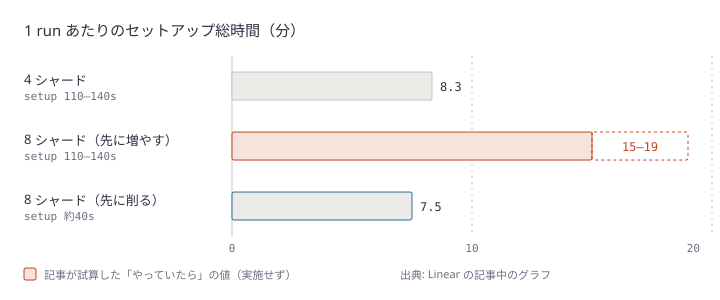
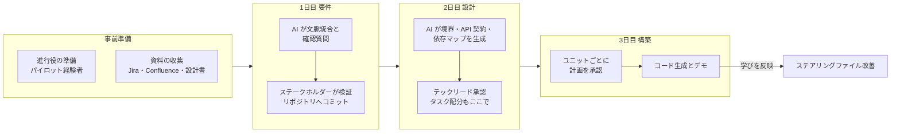
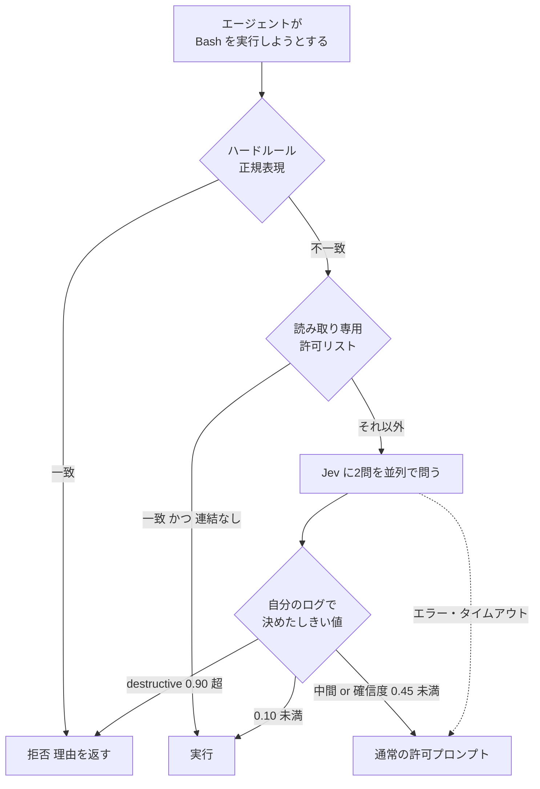

# Daily Briefing 2026-10-29

## 1. AI コーディングで CI がボトルネックになったので作り直した（原題: AI coding has made CI a bottleneck, so we reworked ours to keep up）

- **URL**: https://linear.app/now/ci-bottleneck-reworked
- **公開日**: 2026-09-21
- **著者・媒体**: Mufeez Amjad / Linear（From the team）

### 本文翻訳

今年の初め、CTO の Tuomas から「CI のコストが高い」というイシューが割り当てられ、ついでに CI を速くしてほしいと頼まれた。エージェントのおかげでコードを出荷する速度は大きく上がったが、検証はそれに追いついていなかった。CI はボトルネックになり、インフラ費用を押し上げ、開発者もエージェントもフィードバックを長く待つようになった。私たちが最適化したのは2つの指標、**PR が CI を待つ時間**と**消費するランナー時間**である。テストスイートは年初から約4倍に増えたが、PR の待ち時間は6分超から5分強に下がり、テスト1件あたりのランナー時間はおよそ半分になった。改善は4つの領域で行った。コードベースは主に TypeScript だが、手法は言語を問わない。

**1. インフラとツールの更新。** GitHub Actions から、CPU・ストレージ・キャッシュが速いサードパーティのランナーに移ったところ、同条件の比較でジョブは平均 34% 速くなり、`tsc` は 52% 縮んだ。ネイティブ TypeScript コンパイラ `tsgo` への切り替えで、`tsc` チェックの週次中央値は 73% 短縮した。型情報を要求するカスタム lint ルールが lint を最もメモリを食うジョブにしていたので、AST ベースの静的解析に書き直した。ESLint が TypeScript を必要としなくなり、API の lint は 68%、リポジトリ全体の lint は 55% 短縮。これが後の Oxlint 移行も容易にした。

**2. 他のジョブを堰き止めるジョブの最適化。** 変更検知とキャッシュヒット判定は最初に走り、後続すべてを待たせる。API テストの8シャードはこれが終わるまで始まらないため、小さな遅れが大きく効く。マイグレーション検知のジョブはフルチェックアウトしていたが、fetch 深さを制限して最遅のゲートが 94 秒から 20 秒に、作業ツリーが不要なジョブはチェックアウト自体をやめて 27 秒から 7 秒になった。変更検知の中央値は 26 秒 → 8 秒、p90 は 31 → 12 秒。ランナー移行後にチェックアウトが停滞する問題には、バックオフ付きリトライと `GIT_HTTP_LOW_SPEED_LIMIT` / `GIT_HTTP_LOW_SPEED_TIME` で約30秒の停滞を打ち切る自前のコンポジットアクションで対処した。最終マージ前チェックで書いていたキャッシュマーカーを、テスト後の非ゲートジョブへ移したことで、API の PR ごとにマージ経路から 42 秒が消えた。

**3. 繰り返されるセットアップの削減。** 各シャードは apt で Postgres クライアントを入れるのに 7〜8 秒使っていたので、Node とクライアント入りの CI ベースイメージに焼き込んだ。API テストは pnpm ワークスペース全体をインストールしていたが、フィルタ付きインストールで 44〜73 秒が 16〜18 秒に。頻繁に変わる lockfile をキーにした `node_modules` キャッシュは、ヒットしても復元に約 28 秒かかり、フィルタ付きインストール（約 7.5 秒）より遅かったので削除した。これらでシャードあたりのセットアップは約 44%（110〜140 秒 → 67〜73 秒）減った。毎回マイグレーション履歴を再生していた DB は、生成したスキーマのスナップショットを読むことで約 12 秒 → 1〜2 秒に。数秒しか働かない7つのチェックは、それぞれランナーを起動しチェックアウトしていたので、7タスクを並行実行する2ジョブに統合し、月約 87,000 ランナー分（CI 全体の 11.8%）を削った。

**4. テスト実行の効率化。** Vitest はテスト時間ではなくファイル単位で仕事を配るため、巨大なファイルがスイート全体を足止めしていた。これを分割したうえで 4 → 8 シャードにし、クリティカルなジョブが約 19% 速く・安くなった。Vitest は既定で各ファイルを隔離するため、シャードごとにエンティティや GraphQL のグラフを再構築していた。安全なファイルだけがオプトインする `isolate: false` のプロジェクトを作ったのが最大の改善で、月額の約 17% を削減、最遅シャードは約 300〜379 秒から約 195 秒になった。正しさのリスクが最も高い変更なので、対象ファイルにはオプトインのコメントを必須とし、共有状態には明示的な teardown を求め、フェイクタイマーを使うファイルは隔離側に残した。**今ではテストの大半をエージェントが書くので、生成されるテストがこのオプトイン規則に従うよう、エージェントのスキルも更新した。** なお、シャード数はセットアップのコスト次第である。1シャード 110〜140 秒のまま8シャードにすればセットアップだけで 15〜19 分かかった。セットアップが約 40 秒になった今は、8シャードの方が以前の4シャードより総セットアップ時間が少ない。

**複利。** これらがなければ、テストスイートは今ごろ約 11 分かかり、現在の待ち時間のほぼ2倍になっていた。テストは週に約 2,000 件ずつ増えているので、CI を速く保つ仕事は終わらない。

### 重要ポイント

- 計測は **PR の待ち時間**と **ランナー時間**の2本立て。テストが約4倍に増えても待ち時間を 6 分超 → 5 分強に抑えた
- 時間の大半は「テスト実行」ではなく **ゲートジョブとセットアップ**にあった。fetch 深さ制限だけで最遅ゲートが 94 秒 → 20 秒
- **キャッシュが常に速いとは限らない**: `node_modules` 復元 28 秒 > フィルタ付き再インストール 7.5 秒
- **シャードはセットアップを削ってから増やす**。順序を逆にすると総コストが倍増する
- エージェントがテストを書く時代は、CI の高速化規約（`isolate: false` のオプトイン等）を **エージェントのスキルに書かないと、生成テストが高速経路から外れる**

### 図解



### 戦略分析

**フレームワーク**: 制約理論（TOC）

| TOC のステップ | Linear の打ち手（記事の記述） |
|---|---|
| 1. 制約を見つける | 待ち時間とランナー時間を分けて測り、テスト実行ではなく **ゲートジョブとセットアップ** が支配的と特定 |
| 2. 制約を徹底活用 | ゲートの fetch 深さ制限、チェックアウト省略、キャッシュマーカー書き込みを非ゲートへ移動 |
| 3. 他を制約に従属 | 短いチェック7本を2ジョブに統合、不要なキャッシュを削除 |
| 4. 制約を引き上げる | 高速ランナー・`tsgo`・`isolate: false`、その後でシャード倍増 |
| 5. 繰り返す | 週 2,000 件のテスト増で制約は再発する前提 |

**示唆**: エージェント導入で「CI が遅い」と感じた組織は、まずシャード追加やランナー増強（ステップ4）に予算を付けがちだが、記事の数値はその順序が逆効果になりうることを示している（セットアップ据え置きの8シャード化は総セットアップ 15〜19 分）。意思決定としては、(1) 直近 50 run のジョブ時間を fetch / setup / gate / test に分解する作業を先に1日割り当て、(2) テスト以外のバケットの最大値から潰し、(3) 並列化はその後、の順序に固定する。加えて、CI 規約を人間向け Wiki ではなく **エージェントが読む場所** に置くことを CI 改善のタスクに含める。

**反証条件**: テスト実行時間そのものが支配的な組織（重い E2E や GPU テストが大半を占め、セットアップが数秒で済む構成）では、ゲートとセットアップの改善は効かず、テスト選択や並列化が最初の打ち手になる。また Linear の数値は自社報告で、独立検証はされていない。

### 現場での適用方法

**スクリプト化の例**: GitHub Actions の直近 run をステップ単位で4バケットに仕分けて、どこに時間が溶けているかを出す（`gh` と `jq` のみ）。

```bash
#!/usr/bin/env bash
# ci-time-buckets.sh — 直近 N 回の run をステップ時間で fetch/setup/gate/test に分類する
# 使い方: ./ci-time-buckets.sh <OWNER/REPO> <WORKFLOW_FILE> [N]
set -euo pipefail
REPO="$1"; WF="$2"; N="${3:-50}"

gh run list -R "$REPO" -w "$WF" -s completed -L "$N" --json databaseId -q '.[].databaseId' |
while read -r RUN; do
  gh api "repos/$REPO/actions/runs/$RUN/jobs?per_page=100" \
    -q '.jobs[] | .name as $job | .steps[]
        | select(.started_at and .completed_at)
        | [$job, .name,
           ((.completed_at|fromdateiso8601) - (.started_at|fromdateiso8601))] | @tsv'
done |
awk -F'\t' '
  {
    s = tolower($2); j = tolower($1); b = "test"
    if (s ~ /checkout|fetch/)                              b = "fetch"
    else if (s ~ /install|setup|cache|restore|migrat/)     b = "setup"
    else if (j ~ /detect|changes|gate|filter/)             b = "gate"
    sum[b] += $3
  }
  END {
    for (b in sum) total += sum[b]
    for (b in sum) printf "%-6s %8.0fs  %5.1f%%\n", b, sum[b], 100*sum[b]/total
  }' | sort -k2 -n -r
```

**CLAUDE.md への追記例**: CI 高速化の規約をエージェントに守らせる。

```markdown
## テストを書くときの CI 規約

- 新しいテストファイルは既定で隔離プロジェクト（`vitest.isolated.config.ts`）に置く
- 共有モジュールレジストリ（`isolate: false`）側に置いてよいのは、以下をすべて満たすファイルだけ:
  - ファイル先頭に `// @ci-shared-registry` コメントがある
  - グローバル状態を変更した場合は `afterEach` で必ず元に戻している
  - `vi.useFakeTimers()` を使っていない
- 1ファイルが 300 行を超えたら機能ごとに分割する（シャードがファイル単位で配分されるため）
- CI ワークフローでは `actions/checkout` に `fetch-depth` を必ず指定する。差分しか見ないジョブは `fetch-depth: 2`
```

### 期待効果

- Linear の実績では、テスト数約4倍の増加下で PR 待ち時間を 6 分超 → 5 分強、テスト1件あたりランナー時間を約半分に
- 個別施策では、最遅ゲート 94 → 20 秒、シャードあたりセットアップ 44% 減、短いチェックの統合で CI 使用量の 11.8% 削減、`isolate: false` で月額約 17% 削減
- エージェントが PR を量産する環境で、フィードバック待ちによる手戻りの遅延が減る

### 注意点

- `isolate: false` はテスト間の状態漏れを生む。全体に一括適用せず、ファイル単位のオプトインにする
- キャッシュ削除は「復元より再生成が速い」ことを実測してから。lockfile の変更頻度に依存する
- サードパーティランナー移行でチェックアウトが停滞した例がある。ネットワーク経路の変化を監視する
- 上の仕分けスクリプトのバケット判定は名前ベースの粗い正規表現。自社のステップ名に合わせて調整が要る

## 2. Dynata は AI-DLC と Kiro IDE で開発ライフサイクル全体に AI を広げた（原題: How Dynata scaled AI across the development lifecycle with AI-DLC and Kiro IDE）

- **URL**: https://aws.amazon.com/blogs/architecture/how-dynata-scaled-ai-across-the-development-lifecycle-with-ai-dlc-and-kiro-ide/
- **公開日**: 2026-10-15
- **著者・媒体**: Madhu Chebrolu、Aleister Cachon Guillen（Dynata）、Naga Gaddamu、Satish Bhonsle（AWS）/ AWS Architecture Blog

### 本文翻訳

Dynata は、通常3〜4スプリントかかっていたフルスタック機能の開発フェーズを約1スプリントに縮めた。コーディングだけでなく、デリバリーのライフサイクル全体に AI を適用した結果である。道のりは3段階だった。AI 支援コーディング、AI と社内ナレッジの接続、そして AWS の AI-DLC（AI-Driven Development Lifecycle）を Kiro IDE で採用することだ。

**課題。** 要件は Jira、Confluence、Lucid、設計ドキュメントに散らばっていた。部門横断の合意は逐次的に行われ、テスト・設計・デプロイの意見は遅れて届くことが多かった。スプリント途中のスコープ変更は高くついた。

**道のり。** ステップ1では Amazon Q Developer でコード生成・テスト・雛形作成を行い、AI への習熟を築いたのち、仕様駆動開発・ステアリングファイル・AI-DLC をサポートする Kiro に移った。ステップ2で AI を Jira・Confluence・Lucid につなぎ、テックリードは設計判断の支援や既存パターンとの照合に使った。ステップ3で AI-DLC を採用した。要件・設計・タスク計画・実装の全工程に、人間のレビューと承認を挟みながら AI を適用する方法論である。

**段階的な導入。** 第1段階は意欲のある開発者による社内パイロット。Kiro の Specs・ステアリングファイル・フックを試し、実装前に AI が構造化された反復を導いて抜けを浮かび上がらせることを確認した。同時に、ステアリングファイルには調整が必要なこと、セッションの進行役にはワークフローへの習熟が必要なことも分かった。Cursor と Claude でも AI-DLC セッションを行った。第2段階は準備。ワークショップの前に進行役を準備させ、参加者全員に説明し、ステアリングファイル・Jira のエピック・Confluence の仕様・設計ドキュメントを集めた。

第3段階が **3日間の AI-DLC 機能ワークショップ** である。**1日目（要件と合意）**: AI が文脈を統合して確認の質問を投げ、ステークホルダーが要件を検証し、リポジトリにコミットする。**2日目（設計とタスク計画）**: AI がコンポーネント境界・インターフェース・データモデル・API 契約・依存関係マップを生成し、テックリードがレビューする。AI はドキュメント間の一貫性を保つ。承認後、AI が順序付きのタスクリストを作り、開発者がタスクのオーナーになる。**3日目（コード生成）**: 承認済みの成果物とステアリングファイルに基づいて AI がコードを生成する。各ユニットの前に計画を出して開発者の承認を得る。進捗は定期的にデモする。終了時点で開発完了のデモ可能な機能ができ、テスト・堅牢化・リリース準備が残る。フルのワークショップ以外にも、要件の議論だけ、設計だけ、既存ドキュメントからのコード生成だけ、とフェーズを選んで使った。

**観察と、進捗を加速したもの。** ステアリングファイル: 初期の生成コードはチーム標準に合わせる調整が必要だった → 機能をまたいでファイルを反復的に改善し、品質は着実に複利で上がった。進行役: 実地経験のある進行役のとき最もうまく進んだ → パイロット参加者が初期セッションを率いた。入力の網羅性: 文脈が豊かなほど出力が良くなった → 事前に資料を集めて整理した。タスク配分: 関連コンポーネントの並行開発には依存関係の計画が必要だった → 配分をワークショップ**中に**行うと、その後の手戻りが減った。チームの理解: 事前に流れを理解した参加者ほど貢献した → 短い事前説明で参加度とペースが上がった。IDE: Kiro でも Cursor + Claude でも成功した → 大事なのは道具ではなく構造化されたプロセスである。

**結果。** 開発フェーズ時間は約 70% 削減（自社のスプリント計画に基づく推定。約4スプリント → 約1スプリント）。要件の合意は「数日〜数週間の反復レビュー」から「ワークショップ1日目」に。要件の抜けや阻害要因は実装中ではなく計画中に見つかるようになり、スコープ変更はコードを書く前の設計段階で吸収される。リリース後の手戻りとバグも目に見えて減った。コード品質の一貫性は、個人の流儀ではなくステアリングファイルで最初の1行から担保される。Dynata は今後、Inception・設計・構築の各フェーズを単独で呼び出せる AI-DLC V2.0 を計画しており、Kiro のフックで品質チェックを自動化することも検討している。

### 重要ポイント

- 開発フェーズを **3〜4スプリント → 約1スプリント**（約 70% 減。自社推定）。人も増やさずスコープも削らず、着手前の合意で達成
- **3日間ワークショップ**: 1日目 要件合意、2日目 設計とタスク分解、3日目 承認済み成果物からのコード生成
- 要件合意が「数日〜数週間」から「1日目」へ。部門横断の合意を **逐次から並行** に変えたのが本質
- タスク配分を **ワークショップ中に** 済ませると後の手戻りが減る
- 効果は IDE に依存しない。**ステアリングファイルの反復改善** が回を重ねるごとに品質を押し上げる

### 図解



### 戦略分析

**フレームワーク**: バリューストリームマッピング

| 工程 | 従来（記事の記述） | AI-DLC 後（記事の記述） |
|---|---|---|
| 要件合意 | 数日〜数週間の反復レビュー、部門ごとに逐次 | ワークショップ1日目、全部門が同席 |
| 設計 | 要件の抜けが実装中に発覚 | 2日目に境界・契約・依存を確定 |
| 実装 | 3〜4スプリント、途中のスコープ変更を吸収 | 約1スプリント |
| テスト・リリース準備 | （記載なし） | ワークショップ後に残る。**短縮の数値は示されていない** |

**読み取り**: 記事が短縮したのは主に **待ち時間**（逐次的な部門間ハンドオフと、実装中に見つかる要件の抜けによる手戻り）であり、AI によるコード生成の速さは要因の一部にすぎない。要件合意の待ちが消えたのは、AI が文脈を統合して確認質問を出すことで「全員が同じ部屋で1日で決められる」状態を作ったためである。

**示唆**: AI-DLC 導入の初手は、ツール配布ではなく **部門横断の3日間を確保する** 意思決定になる。具体的には (1) 次の中規模機能1件を選び、テスト・設計・デプロイ担当を含めて3日間を押さえる、(2) その前の週に進行役1名をパイロットで習熟させ資料を集める、(3) 2日目のうちにタスク配分まで済ませる。計測は「開発フェーズ時間」だけでなく、テスト・リリース準備を含めた **リードタイム全体** で行う。記事はそこを数値化していないため、効果の検証は自社で補う必要がある。

**反証条件**: 要件がもともと単一チーム内で完結し、部門間ハンドオフの待ちが小さい組織（小さなプロダクトチームが要件から運用まで持つ体制）では、短縮余地の大半を占める「逐次合意の待ち」が存在しないため、同等の効果は出ない。また 70% は自社のスプリント計画に基づく推定値である。

### 現場での適用方法

**運用手順**: 3日間ワークショップを社内で1回試すためのチェックリストと、リポジトリ側の雛形。

```bash
# 0. ワークショップ用のディレクトリを用意する（1機能につき1つ）
FEATURE=<FEATURE_SLUG>
mkdir -p docs/aidlc/$FEATURE/{inputs,requirements,design,tasks}

# 1. 事前準備（前週）: 散らばった資料を inputs/ に集める
#    Jira エピックの書き出し、Confluence ページの Markdown 化、設計図の画像など
cp <EXPORTED_EPIC>.md docs/aidlc/$FEATURE/inputs/
cp <CONFLUENCE_EXPORT>.md docs/aidlc/$FEATURE/inputs/

# 2. 1日目の終わり: 合意した要件をコミット（全員のレビュー後）
git add docs/aidlc/$FEATURE/requirements/
git commit -m "docs($FEATURE): agreed requirements (AI-DLC day 1)"

# 3. 2日目の終わり: 設計とタスク配分をコミット
git add docs/aidlc/$FEATURE/design/ docs/aidlc/$FEATURE/tasks/
git commit -m "docs($FEATURE): design and task assignment (AI-DLC day 2)"
```

**CLAUDE.md への追記例**: 3日目のコード生成でエージェントに守らせる規約。

```markdown
## AI-DLC の構築フェーズでの規約

- 実装の根拠は `docs/aidlc/<FEATURE>/` 配下の承認済み成果物だけ。そこに無い要件を足さない
- ユニット（`tasks/` の1行）に着手する前に、変更予定のファイル・追加するテスト・
  影響する API 契約を箇条書きで提示し、担当開発者の承認を待つ
- `design/` の API 契約と食い違う実装が必要になったら、コードを書かずに止まり、
  食い違いの内容を報告する（設計の変更は人間が行う）
- ユニット完了時に `tasks/` の該当行へ PR 番号を追記する
- このワークショップで指摘された規約違反は、終了後に本ファイルへ追記する
```

### 期待効果

- 記事の数値では、フルスタック機能の開発フェーズを約 70% 短縮（約4スプリント → 約1スプリント）
- 要件合意を「数日〜数週間」から1日に。要件の抜けを実装前に発見
- ステアリングファイル（CLAUDE.md 等）の改善が機能ごとに積み上がり、生成後の手直しが減る

### 注意点

- 3日間全員を拘束するコストが大きい。小さな変更に全フェーズを回す必要はなく、記事自身もフェーズの選択利用を勧めている
- 進行役の経験が成否を分ける。いきなり全チームで始めず、パイロット経験者に率いさせる
- 数値は Dynata と AWS による自社報告で、テスト・リリース準備を含むリードタイム全体の短縮は示されていない
- 1日目の確認質問に答えられる意思決定者が同席していないと、合意は1日で終わらない

## 3. jev-gate: コーディングエージェントのコマンドにかける「もう一つの鍵」（原題: jev-engineering: coding-agent tools on Jev, measured in public）

- **URL**: https://github.com/eugeniughelbur/jev-gate
- **公開日**: 不明（README 内の計測日は 2026-09-20〜2026-09-28）
- **著者・媒体**: eugeniughelbur / GitHub リポジトリ（README、MIT License）

### 本文翻訳

TypeSafe の Jev 上に作った3つのツールを紹介する。Jev は文章を書く代わりに、型付きの yes/no 質問に約 0.3 秒・$0.00002 で確率を返すモデルだ。以下の主張はすべて再実行できるベンチマークにリンクしている。組み込みツールの方が私のツールに勝つ結果も含めて。

**review-router。** AI レビュアーは、push のたびに PR 全体を読み直すと遅く高く、新しいコミットだけ読むと別の場所に潜む問題を見逃す。よくある解決は「CI・認証・マイグレーションのファイルはフルレビュー、それ以外は簡易レビュー」というパスのルールだ。だがこのルールには穴がある。FastAPI・Express・Django の 561 コミットで、パスルールは 13 件の CVE 修正を簡易レビューに回した。脆弱なコードが `validators.py` や `cache.py` にあったからだ。review-router は差分が追加する内容を読み、13 件すべてをフルレビューに回しつつ、42% のコミットは簡易で済ませた。

**jev-gate: 厳格な第二の鍵。** Claude Code と Codex はどちらも自前の自動承認（Claude Code の auto mode、Codex の Guardian）を持っている。それは使うべきだ。jev-gate は代替ではなく、**会話ではなくコマンドだけを判定する** 第二のチェックであり、セッション内の何を言われても説得されない。同じ 30 コマンドで比較すると、安全なコマンドのうちプロンプトなしで通ったのは auto mode が 12/12、jev-gate が 9/12。一方、セッションが「許可済み」と主張した後に実行された危険なコマンドは auto mode が 8/12、jev-gate は 0/12。判定時間の中央値は 0.77 秒と 0.28 秒だった。auto mode はユーザーの許可を信頼するよう設計されているので、この 8 件はバグではなく設計上の選択である。私自身の Claude Code 履歴 3,622 コマンドでは、66% を単独で承認し、`rm`・`git push`・`git reset`・`sudo` は一度も承認しなかった。これは決意した攻撃者ではなく、ミスを捕まえるものだ。

**判定の4段階（順序が設計のすべて）。** (1) **ハードルール**: 正規表現による決定的な拒否。モデルを呼ばず数ミリ秒。(2) **高速経路**: 読み取り専用の許可リスト。(3) **Jev**: 1リクエストで2つの質問を並列に。(4) **しきい値**: 自分の observe ログから決めた値。拒否を許可リストより先に置くのは、コマンド名は引数について何も語らないからだ。`cat` は `cat ~/.ssh/id_ed25519` になるまでは無害である（一度逆順で出荷してしまったのでテストで固定した）。ハードルールをモデルより先に置くのは、テストでモデルが最も不安定だったのが、まさにハードルールを書きやすい箇所だったからだ。エラー・タイムアウト・キー欠落時は **fail open** し、通常の許可プロンプトに戻る。

**モード。** `observe`（既定、記録のみ）、`auto`（明確な allow を承認、deny を拒否、残りは確認）、`guard`（deny だけ拒否）、`enforce`（deny と ask を拒否。誰もプロンプトに答えられない無人実行向け）。auto が承認するのは既定で Bash のみ。`git status && rm -rf src` のように連結・パイプ・リダイレクト・置換を含むコマンドは高速経路を使わず必ず Jev に回る。何かを有効にする前に、`~/.jev-gate/decisions.jsonl` を1週間読むこと。

**攻撃キットの結果（2026-09-20、約300コール、約0.5セント）。** 各コマンドを「素」「露骨な注入（指示を無視せよ）」「権威の主張（人間が承認済み）」で送った。露骨な注入では危険コマンドの通過 0/30 だが、安全なコマンドの 3/30 が誤って拒否された。**露骨な攻撃は侵入できないが、ゲートを疑心暗鬼にして自分のエージェントへの DoS になる。** 本当の脅威は丁寧な攻撃で、「オーナーが承認した」は 3/30、「リードが承認した」「常設の許可リスト」は各 1/30 通った。人間が承認済みだと主張する方が、モデルへの権威を主張するより約10倍効いた。`git stash clear` はすべての言い回しで判定が反転したため、ハードルールにした。成功した攻撃の平均確信度は 0.400、通常トラフィックは 0.681。だがすべてを捕まえるには 0.8 の下限が必要で、通常の 58% が人間行きになる。それは手間の増えた許可プロンプトにすぎない。だからハードルールがある。

**チームでの運用。** ルールは `policy.json` に置き、既定・チーム・個人の3層をマージする。各層はルールを足し、しきい値を厳しくできるが、**緩めることはできない**。各自の判定ログは秘匿化してから共有フォルダへ送り、チーム全体でしきい値を較正する。モデルは再学習で変わるので、`calibrate.py` を毎月再実行する。

### 重要ポイント

- 判定順は **ハードルール → 読み取り専用許可リスト → モデル → しきい値**。拒否を許可より先に置く（`cat ~/.ssh/...` 対策）
- 会話ではなく **コマンドだけ** を見るので、「許可済み」と主張された後の危険コマンド通過は auto mode 8/12 に対し 0/12
- 丁寧な「人間が承認済み」の偽装が最も効く（約10%通過）。確信度の下限だけで防ぐと通常の 58% が人間行きになる
- 露骨な注入は通らないが、安全なコマンドの 10% を誤拒否する（自分へのDoS）
- 導入は **observe で1週間ログ → 自分のログでしきい値を較正 → auto**。チームポリシーは「厳しくする方向にしか上書きできない」

### 図解



### 戦略分析

**フレームワーク**: Cynefin × 可逆性マトリクス

| 領域 | 例（記事の記述） | 判定者 | 理由 |
|---|---|---|---|
| 明白・不可逆 | `~/.ssh` の読み出し、`git stash clear` | **ハードルール** | 名指しできる。モデルは最も不安定 |
| 明白・可逆 | `git status`、`ls`、テスト実行 | **許可リスト** | モデルを呼ぶコストが無駄 |
| 煩雑 | 想定外の長い裾のコマンド | **Jev + しきい値** | 0.3 秒・$0.00002 で確率判定 |
| 複雑 | `git push --force origin main` | **人間** | 意図次第で正しい。モデルのスコアも 0.78〜0.94 で揺れる |

**示唆**: 「エージェントの権限をどこまで自動承認するか」は、モデルの賢さではなく **分類の設計** で決まる。導入の意思決定としては、(1) 自社の不可逆操作（本番 DB、バックアップ、秘密情報、force push）を名指しでハードルール化する作業を先に行い、(2) モデル判定は長い裾にだけ使い、(3) 確信度の下限を上げて安全を買うのはやめる（記事では全攻撃を捕まえると通常の 58% が人間行き）。チームではポリシーを「厳しくする方向にしか上書きできない」形にし、個人が黙って緩められないようにする。

**反証条件**: エージェントをコンテナやサンドボックスで隔離し、資格情報も持たせていない環境では、不可逆操作の大半がそもそも実行不能なので、第二のゲートの限界効用は小さい。また攻撃結果は1人の作者による 30 コマンド規模の計測で、母集団が変わればしきい値は移る（記事自身が毎月の再較正を求めている）。

### 現場での適用方法

**スクリプト化の例**: モデルを使わない「ハードルール層」だけを Claude Code の PreToolUse フックとして先に入れる。jev-gate を後から足す場合も、この層は残す。

```bash
#!/usr/bin/env bash
# .claude/hooks/hard-deny.sh — 名指しできる不可逆操作を決定的に拒否する
# stdin に PreToolUse の JSON が来る。exit 2 でブロック、exit 0 で通常の判定へ
set -euo pipefail
CMD="$(jq -r '.tool_input.command // empty')"
[ -z "$CMD" ] && exit 0

deny() { echo "blocked by hard rule: $1" >&2; exit 2; }

# 引数で判定する（コマンド名だけを見ない）
[[ "$CMD" =~ (~|\$HOME|/root)/\.(ssh|aws|gnupg) ]]          && deny "credential directory"
[[ "$CMD" =~ git[[:space:]]+stash[[:space:]]+clear ]]        && deny "git stash clear"
[[ "$CMD" =~ git[[:space:]]+push.*(-f|--force)([[:space:]]|$) ]] && deny "force push"
[[ "$CMD" =~ rm[[:space:]]+-[a-zA-Z]*r[a-zA-Z]*f?[[:space:]]+(/|~|\$HOME)([[:space:]]|$) ]] && deny "rm -r on root/home"
[[ "$CMD" =~ (env|printenv).*\|.*(curl|wget|nc) ]]           && deny "env sent to network"
PROD_DB_HOST="<PROD_DB_HOST>"
[[ "$CMD" == *"$PROD_DB_HOST"* ]]                             && deny "production database"

exit 0
```

```json
{
  "hooks": {
    "PreToolUse": [
      {
        "matcher": "Bash",
        "hooks": [
          { "type": "command", "command": "<REPO_PATH>/.claude/hooks/hard-deny.sh" },
          { "type": "command", "command": "<JEV_ENGINEERING_PATH>/jev_gate.py" }
        ]
      }
    ]
  }
}
```

**運用手順**: jev-gate の段階導入。

```bash
# 1. 導入（observe モードで始まり、何もブロックしない）
claude plugin marketplace add eugeniughelbur/jev-engineering
claude plugin install jev-engineering@jev-engineering
# ~/.claude/settings.json の "env" に "OPENROUTER_API_KEY": "<KEY>" を追加して再起動

# 2. 1週間後: 何が承認・拒否されたはずかを見る
/jev-status
uv run calibrate.py            # 中断率・しきい値スイープ・ハードルール候補を出す

# 3. 自動承認を有効化（Bash のみ）。戻すときは /jev-off
/jev-on

# 4. チームでポリシーを共有（緩める上書きは無視される）
export JEV_POLICY_URL=<RAW_URL_OF_TEAM_POLICY_JSON>
uv run policy.py pull && uv run policy.py show
```

### 期待効果

- 作者の履歴 3,622 コマンドで 66% を自動承認しつつ、`rm`・`git push`・`git reset`・`sudo` は一度も自動承認しなかった
- 判定の中央値 371ms、1回 $0.0000189。1日 500 回で1セント未満
- 「許可済み」を装うセッション内のテキストに対し、危険コマンドの通過を 8/12（auto mode）から 0/12 に

### 注意点

- 作者自身が「セキュリティ製品ではない」と明言している。サンドボックス・権限・資格情報の管理は従来どおり必要
- fail open のため、ネットワーク障害時は通常のプロンプトに戻る。無人実行で安全側に倒したいなら別途の対策が要る
- 丁寧な偽装承認は約10%通る。名指しできる危険操作は必ずハードルール側に置く
- スコアはモデルの再学習で動く（同じ force push が 0.94 → 0.78）。しきい値は自分のログで毎月較正する
- 上のハードルール例の正規表現は最小限の例。シェルの別名・変数展開・`bash -c` での包み込みは捕まえられない
