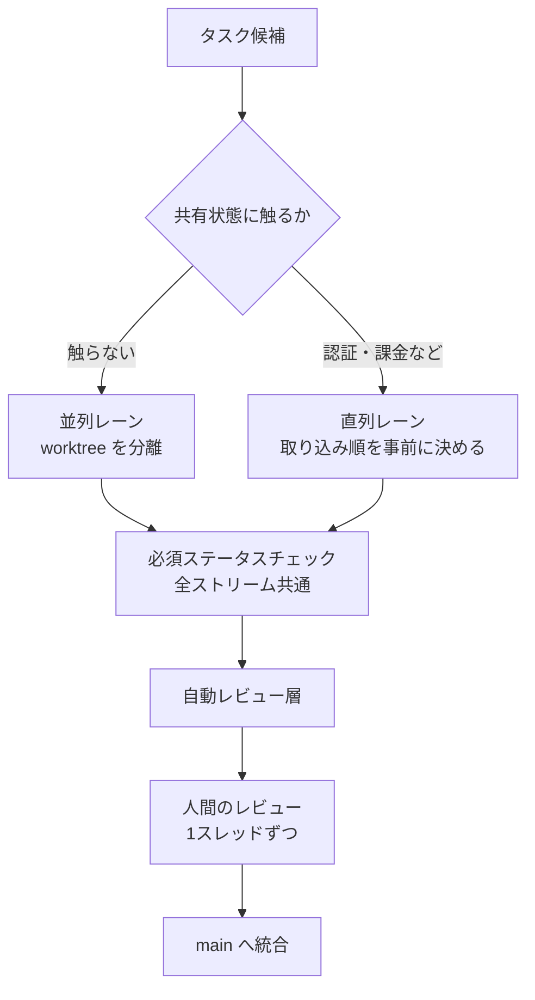
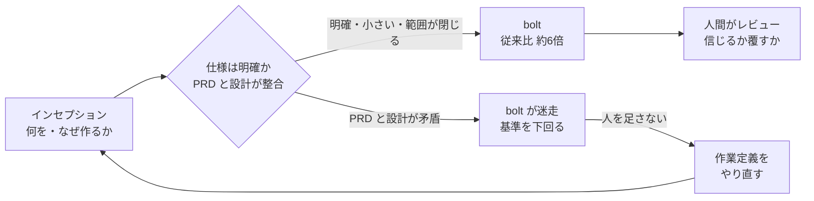
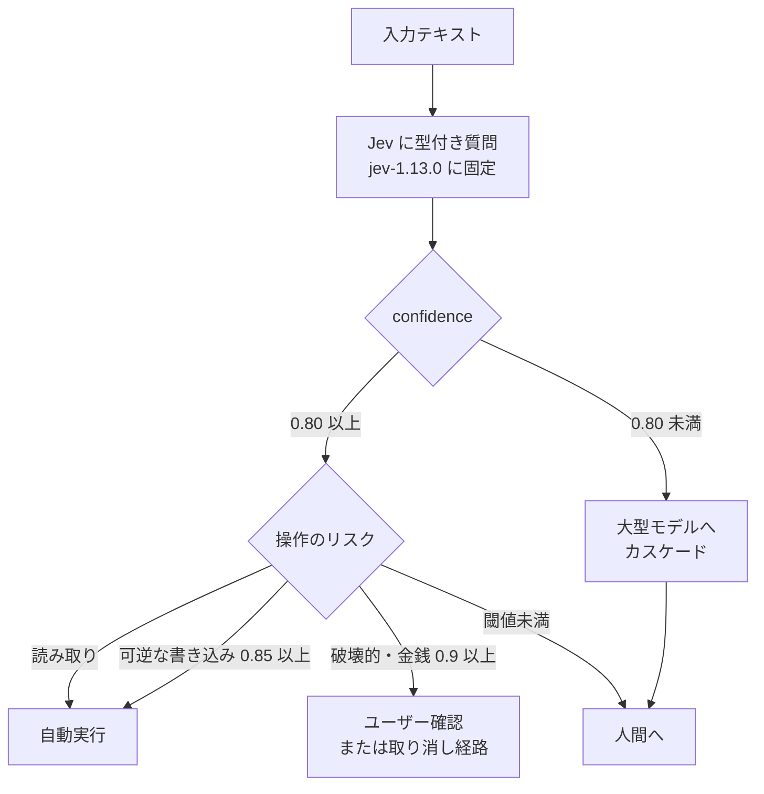

# Daily Briefing 2026-10-30

## 1. あなたのエンジニアリングチームには AI コーディングエージェントの並列化戦略があるか（原題: Does Your Engineering Team Have a Parallelization Strategy for AI Coding Agents 2026?）

- **URL**: https://blog.codacy.com/does-your-engineering-team-have-a-parallelization-strategy-for-ai-coding-agents-2026
- **公開日**: 2026-10-26
- **著者・媒体**: Jaime Jorge / Codacy Blog

### 本文翻訳

エンジニアが Claude Code や Codex のセッションを3〜4本同時に、別々の git worktree で走らせるのは珍しくなくなった。だが**作業の並列化は、注意力の並列化より簡単**だ。Simon Willison も「大きな変更をレビューして取り込めるのは一度に1つだけ」と述べている。問題はエージェントが終わった後——文脈の保持、レビュー、衝突解消、統合——にある。5本同時に回す前に、その周辺の戦略が要る。

**要旨**: ボトルネックはタイピング速度から人間の注意力と検証能力へ移った。セッションごとに worktree を分ければファイル衝突は防げる。共有状態のない作業は安く並列化できるが、認証や課金のような共有モジュールに触れる作業は調整コストが速度向上を打ち消す。実際の時間コストはコーディングではなくマージと統合に出る。1人の頭で4〜5セッションを追うことより、全ストリームに等しく掛かる自動チェックの方が重要だ。

**1人が4〜5セッションを回すと何が変わるか**。エージェントが数分自走する間、人間は待つしかない。そこで2枚目の端末を開くところから並列化は自然発生的に始まる。すると2つの問題が複合する。1つは**文脈管理**（各エージェントに何を頼み、何が出てきて、何の判断待ちか）。もう1つは**検証**で、出力が増えても目は1組のままだ。DORA は AI 導入が25%増えるとデリバリー安定性が7.2%下がる相関を報告しており、一因は生成が速くなってバッチが大きくなり、レビューしにくくなることだ。

**文脈管理が中核スキルになる**。推奨されるのは「構造化されたコンテキストスイッチ」だ。各並列作業を、(1) 一目で目的が分かるラベル、(2) エージェントが触ってよい範囲の明示、(3) 専用のブランチか worktree、(4) 具体的な成果との紐付け（完了・停滞・逸脱が判定できる）を持つ「スレッド」として扱い、新しい出力が出た端末に飛びつくのではなく、短いスレッド一覧を順に確認する。シニアはもともと複数の作業を並行しているので有利だが、その優位は若手に自動では波及しない。ラベルも範囲もない4スレッドを抱えた若手は、疲弊し、スレッドを取りこぼし、作業が静かに止まる。

**並列化に向く作業・向かない作業**。向くのは、独立したモジュールやマイクロサービス、別リポジトリ、ボイラープレート、既存コードへのテスト生成、1ファイル内の孤立したリファクタ、マージを前提としない調査。向かないのは、共有の認証・課金ロジックに触る複数機能、進行中のリファクタと競合する作業、厳密な順序が要る作業。リリース順序やマイグレーションの先行など、クリティカルパス上の直列部分はエージェントを6本にしても短くならない。変わるのは、そのボトルネックの手前に溜まる量だけだ。

**PR・レビュー・統合への影響**。午後に4本のエージェントが PR を4本作れば、レビュアー1人に PR が4本届く。同じファイルを2つのエージェントが互いを知らずに編集する、テストが落ちているのに完了報告する、欠陥が3コミット積まれてから見つかる、といった失敗が起きる。最大の変化は、**オーケストレーションとレビューを同じ1人が担う**ことだ。注意を5分割すれば各 PR のレビューは薄くなる。Cursor が並列エージェント向け UI でファイル横断の差分集約を作ったのも、レビューとテストが新たなボトルネックになったからだ。

**チームが整えるべき5つ**。(1) 並列作業ごとにチェックアウトか worktree を分離する。(2) タスクを独立単位に切り、共有面に触るストリームの**取り込み順を事前に決める**。(3) すべての PR に自動チェックを必須ステータスチェックとして課す。(4) 人間のレビューを補う自動レビュー層を置く。(5) 全リポジトリで同じポリシーを適用する。習慣は疲労・異動・繁忙期に崩れるが、仕組みは崩れない。さらに、指示ファイルの出来の悪さは全セッションに掛け算で効く。単一エージェントなら悪い PR 1本で済む誤りが、4〜5本同時に生まれる。CLAUDE.md や AGENTS.md は「荷重を受けるインフラ」であり、本番コードと同じ厳しさでレビューすべきだ。

結論として、並列化はスループットの問題ではなく、**文脈と検証の問題**である。（※記事後半には Codacy 製品の紹介があるが、ここでは省いた）

### 重要ポイント

- 並列エージェントの制約は生成速度ではなく、**人間の注意力と検証能力**。オーケストレーターとレビュアーが同一人物であることが構造的リスク
- 各並列作業を「ラベル・範囲・専用 worktree・成果との紐付け」を持つスレッドとして管理し、出力が出た順ではなく一覧を巡回する
- 並列化の適否は**独立性**で決まる。共有の認証・課金ロジック、進行中リファクタとの競合、厳密な順序がある作業は直列に置く
- 共有面に触るストリームは**取り込み順を事前に決める**。統合順を偶然に任せない
- 指示ファイルの欠陥は並列数だけ増幅される。CLAUDE.md / AGENTS.md は本番コード並みにレビューする

### 図解



### 戦略分析

**フレームワーク**: 制約理論（TOC）

| TOC のステップ | 記事の記述 | 具体的な打ち手 |
|---|---|---|
| 制約を見つける | 注意力と検証能力。目は1組 | オーケストレーターとレビュアーが同一人物かを確認 |
| 制約を徹底活用する | 構造化されたコンテキストスイッチ | スレッドに4属性を持たせ、巡回順を固定 |
| 他を制約に従属させる | 共有面の作業を直列化、取り込み順を事前決定 | 並列数をレビュー能力に合わせて上限設定 |
| 制約を引き上げる | 全 PR に必須チェック、自動レビュー層 | 機械判定できる指摘を人間の前に潰す |

**示唆**: 「1人あたり何本のエージェントを回せるか」を生産性目標にしてはいけない。並列数は**レビュー能力に従属させる変数**として扱う。具体的には、(1) 共有モジュール（認証・課金・スキーマ）に触るタスクは並列レーンに入れないルールを先に決める、(2) 必須ステータスチェックが無いリポジトリでは並列化を解禁しない、(3) 若手には並列数の上限を置く、の順で導入する。記事の DORA の数値（AI 導入25%増で安定性7.2%低下）は、安定性指標を見ずに並列数を増やすと何が起きるかの警告として読むべきだ。

**反証条件**: 作業の大半が独立したマイクロサービスや別リポジトリに分かれ、共有面がほぼない組織では、統合コストが小さく、記事の想定ほど制約は強くない。また、レビュアーとオーケストレーターを別人に分けられる体制なら、注意力の制約は1人に集中しない。

### 現場での適用方法

**CLAUDE.md への追記例**（並列セッション運用のルール）:

````markdown
## 並列セッションの運用ルール

- 1セッション = 1 worktree = 1ブランチ。他セッションの worktree のファイルは読み書きしない
- セッション開始時に、次の4点をブランチの最初のコミットメッセージか PR 説明に書く
  - ラベル: 何のための作業か（1行）
  - 範囲: 変更してよいディレクトリ（例: `services/notification/**`）
  - 完了条件: どのテストが通れば完了か
  - 禁止範囲: `auth/` `billing/` `db/migrations/` には触らない
- 範囲外のファイルを変更する必要が出たら、変更せずに停止して報告する
- 完了報告の前に `<TEST_COMMAND>` を実行し、失敗している場合は完了と報告しない
````

**スクリプト化の例**（スレッド単位で worktree を作り、範囲外の変更を検出する）:

```bash
#!/usr/bin/env bash
# usage: agent-thread.sh new <label> <allowed-glob>   スレッド作成
#        agent-thread.sh check <label>                範囲外変更の検出
#        agent-thread.sh list                         巡回用の一覧
set -euo pipefail
REPO=<REPO_PATH>
BASE=${BASE:-main}
THREADS="$REPO/.git/agent-threads"
mkdir -p "$THREADS"
SHARED='^(auth|billing|db/migrations)/'   # 並列レーン禁止の共有面

case "$1" in
  new)
    label=$2; glob=$3
    git -C "$REPO" worktree add -b "agent/$label" "$REPO/../wt-$label" "$BASE"
    echo "$glob" > "$THREADS/$label"
    echo "created: ../wt-$label (scope: $glob)"
    ;;
  check)
    label=$2; glob=$(cat "$THREADS/$label")
    changed=$(git -C "$REPO/../wt-$label" diff --name-only "$BASE"...HEAD)
    bad=0
    for f in $changed; do
      if [[ $f =~ $SHARED ]]; then echo "SHARED: $f (直列レーンへ)"; bad=1; fi
      # shellcheck disable=SC2053
      if [[ $f != $glob ]]; then echo "OUT OF SCOPE: $f"; bad=1; fi
    done
    exit $bad
    ;;
  list)
    for t in "$THREADS"/*; do
      l=$(basename "$t")
      n=$(git -C "$REPO/../wt-$l" rev-list --count "$BASE"..HEAD 2>/dev/null || echo "?")
      echo "$l  scope=$(cat "$t")  commits=$n"
    done
    ;;
esac
```

**運用手順**（必須ステータスチェックの確認）:

1. GitHub の Settings → Branches → `main` の Branch protection で「Require status checks to pass before merging」を有効化し、lint・test・セキュリティスキャンを必須に指定する
2. 必須チェックが無いリポジトリでは、並列セッションを2本以下に制限する
3. 週1回、`agent-thread.sh list` の出力で「commits が増えていないスレッド」を停滞として棚卸しする

### 期待効果

- 範囲外変更・共有面への同時変更が PR 作成前に検出され、統合時の衝突解消コスト（記事が「本当の時間コスト」と呼ぶ部分）が減る
- 必須チェックにより、オーケストレーターの注意が他スレッドに向いていた PR も同じ品質基準を通る
- 記事は効果の数値を示していない。DORA の「AI 導入25%増で安定性7.2%低下」を避ける方向の施策として位置づける

### 注意点

- 記事は Codacy の自社ブログで、後半は製品紹介。必須チェックや自動レビューは他ツールでも実現できる
- worktree を増やすとディスクと依存インストール時間が増える。セットアップが重いリポジトリでは並列数の上限が別の理由で決まる
- glob による範囲判定は粗い。範囲内のファイルでも共有インターフェースを変える変更は検出できないので、型チェックと契約テストを併用する

## 2. アジャイルは最後の革命だった：これからは AI-DLC（原題: Agile Was the Last Revolution: Now It's AI-DLC）

- **URL**: https://benevity.com/blog/ai-dlc-software-development-agile-unleashed
- **公開日**: 2026-05-22
- **著者・媒体**: Daleth Hildebrand（Benevity テクニカルプログラムマネジメント ディレクター）/ Benevity Blog

### 本文翻訳

**要点**: AI-DLC の導入は取締役会レベルの合意と組織構造を変える覚悟を要する、全面的な変革であって脇の実験ではない。AI は構築の速度を担い、方向性・問題定義・仕様の質は人間の判断が担う。

**開発の時代は約25年ごとに変わる**。ウォーターフォール（1960〜80年代）は要件書に署名してから12〜36か月後に動くソフトウェアが届いた。1990年代の RAD は60〜90日に短縮した。2001年以降のアジャイルは Lean とトヨタ生産方式を源流に2週間スプリントを持ち込み、2010年代半ばの DevOps は書く人と運用する人の壁を取り払った。アジャイル宣言から約25年が経ち、次の転換点が来ている。

**AI-DLC とは**。AI エージェントがエンジニアと共にインセプションからコンストラクション、運用までを担う、ソフトウェア開発の全面的な再設計だ。アジャイルは消えるのではなく「解き放たれる」。Benevity は導入前の2026年1月に責任ある AI ポリシーを公開した。筆者は、AI をエンジニアリング思考の代替として扱うのが早期導入者の典型的な誤りだと警告する。最大の成果を出すチームは、何を・なぜ作り、問題をどう定義するかという判断を人間が保持している。「常に human in the loop」はガバナンスの標語ではなく日々の設計制約だ。

**展開のタイムライン**。2025年12月に AI-DLC を知り探索開始。2026年2月に偵察チームが集中ワークショップに参加。4月にエンジニアリング組織の半分が完全移行。6月に開発組織全体が AI-DLC のみで動く予定。この速度には順序立てと、構造的な事業変更と同等の変革管理が要った。取締役会の後援がなければ脇の実験で終わっていた。難しいのは技術ではなく、組織が変わり投資する意思だ。

**初期データと驚き**。最初の bolt（AI-DLC の作業サイクル）の正規化ベロシティは大きくばらついた。最良のチームは従来スプリントの**約6倍**、最悪のチームは基準を下回った。最良の bolt は小さく、作業が明確で範囲が閉じており、全員が何をなぜ作るか理解していた。苦戦した bolt は PRD とアーキテクチャ文書が矛盾しており、チームが迷走した。コード生成は今や最速の工程で、すべての判断が一方通行の扉ではなく、最初で正しくなければ bolt のコードは捨ててよい。結論は「**何を作るかがかつてなく重要**」。AI-DLC は期間を圧縮するので、定義の甘い取り組みはより速く崩れ、良い取り組みは予想以上に速く進む。定義とインセプション、明確な仕様が最重要の投資になった。60%のベロシティ向上は「始まりにすぎない」。

**SaaS リーダーへの5つの教訓**。
1. **すべてが変わると受け入れる**。日々のセレモニーが変わり、従来のベロシティ指標は意味を失い、チーム再編がほぼ必須になる。ストーリーポイントは機能しない。3日と見積もった変更がその日の午前中に終わった。
2. **経営の合意を取る**。見積もりは未知の領域で、新しい指標の開発には時間と実験と経営の合意が要る。
3. **少数精鋭のチームに投資する**。全員が乗客ではなく運転手であるチームが報われる。苦戦する bolt に人を足しても助からない。作業をより明確に定義することが助けになる。
4. **初期の失敗を許容する**。最初のチームは数日で済むはずのインセプションとコンストラクションに3週間かかった。方法論を自分たちの文脈に合わせて修正し、先へ進んだ。また失敗するだろうが、アジャイルより速く失敗する。
5. **人間の判断を中心に置く**。伸びるエンジニアは AI の出力を信じる時と覆す時を知っている。作業を声に出して共有し、知識を横断させ、自信過剰なモデルが仮定しすぎるときに声を上げる。

**FAQ から**: 最大のリスクは技術ではなく**仕様の質**。導入に必要なのは、取締役会からの後援、変わる本当の理由、権限を持つエンジニアリングチーム、初期失敗への寛容、重要な判断を人間が統べる文化。全員がこのペースを歓迎するわけではない。「アップグレードではなく変革」であり、パイロット扱いでは十分な効果は得られない。

### 重要ポイント

- 6か月で開発組織全体を AI-DLC に移行（2025年12月探索 → 2026年2月ワークショップ → 4月に半数 → 6月に全体）。後援は取締役会レベル
- bolt のベロシティは最良で従来比**約6倍**、最悪は基準割れ。差を生んだのは**仕様の明確さと範囲の小ささ**で、PRD とアーキテクチャ文書の矛盾が失敗の原因
- ストーリーポイントは機能しなくなる（3日見積もりがその日の午前に完了）。新しい指標は経営合意のもとで実験的に作る
- 苦戦する bolt には人を足すのではなく、作業定義を明確にする
- 最初のチームは数日で済む工程に3週間かかった。初期失敗を前提に計画する

### 図解



### 戦略分析

**フレームワーク**: マッキンゼー 7S

| 要素 | 記事の記述 | 変化の方向 |
|---|---|---|
| Strategy | 期間圧縮で、良い取り組みは速く進み悪い取り組みは速く崩れる | 「何を作るか」の選択に投資を寄せる |
| Structure | チーム再編がほぼ必須。少数精鋭 | 小さく閉じた bolt 単位 |
| Systems | ストーリーポイントが機能しない | 新指標を実験的に開発 |
| Shared values | 常に human in the loop | 判断は人間、構築は AI |
| Style | 取締役会レベルの後援 | トップダウンの順序立て |
| Staff | 全員が運転手 | 人を足しても助からない |
| Skills | 出力を信じる/覆す判断、声を上げる | 仕様化と検証の能力 |

**示唆**: 7S のうち記事が最も強く主張するのは Systems（指標）と Skills（仕様化）の同時変更だ。したがって導入計画は「ツールの配布」ではなく、(1) 最初の bolt を**小さく範囲の閉じた**案件に限定する、(2) 着手前に PRD と設計文書の整合をレビューするゲートを置く、(3) ストーリーポイントでの評価を止め、代替指標の実験期間を経営と合意しておく、の3点から始める。苦戦チームへの増員要請は却下し、定義の見直しに切り替える運用ルールも先に決めておく。

**反証条件**: 6倍という数値は最良の1チームの値で、最悪のチームは基準割れ。記事は分布全体や母数を示していない。規制要件や外部依存で仕様が頻繁に変わる案件、範囲を閉じられない大規模な既存システム改修では、最良ケースの条件（小さく明確で閉じた範囲）が成立せず、この組織変革の費用に見合う効果は保証されない。

### 現場での適用方法

**スキル化の例**（bolt 着手前の仕様整合ゲート）:

````markdown
---
name: bolt-readiness-gate
description: AI-DLC の bolt（作業サイクル）に着手する前に、PRD・設計文書・受け入れ条件の整合と範囲の閉じ具合を確認する。bolt を始める、インセプションを終える、と言われたときに使う。
---

# bolt 着手前ゲート

## 入力
- PRD: `<PRD_PATH>`
- 設計文書: `<DESIGN_DOC_PATH>`

## 手順
1. PRD の要求を1行ずつ列挙し、設計文書の対応箇所を探す。対応が無い要求、PRD に無い設計判断を「不整合」として列挙する
2. 受け入れ条件がテストで判定できる形か確認する。「使いやすい」等の判定不能な条件を指摘する
3. 変更範囲（ディレクトリ・サービス）を列挙し、3つを超えたら bolt の分割を提案する
4. 「何を・なぜ作るか」を2文で書けるか試み、書けなければ停止する

## 出力
```
判定: GO / NO-GO
不整合: n 件（一覧）
判定不能な受け入れ条件: n 件
範囲: サービス a, b
分割提案: あり / なし
```

## 禁止
- NO-GO のまま実装を始めない
- 不整合を自分の判断で解消しない。人間に返す
````

**運用手順**（最初の3か月の進め方）:

1. 最初の bolt は「1サービス内で閉じ、受け入れ条件がテストで書ける」案件だけを選ぶ
2. 各 bolt の開始前に上記ゲートを実行し、NO-GO の件数を記録する
3. bolt ごとに「着手〜完了の日数」「やり直し回数」「NO-GO だった項目」を記録し、ストーリーポイントの代わりに3か月分を経営に報告する
4. 苦戦した bolt の振り返りでは「人が足りたか」ではなく「定義が明確だったか」を最初に問う

### 期待効果

- 記事の最良ケースでは正規化ベロシティが従来スプリントの約6倍、全体としては60%の向上（「始まりにすぎない」）
- 着手前の不整合検出により、記事の失敗例（PRD と設計の矛盾による迷走）を回避できる
- 見積もりの破綻（3日見積もりが午前中に完了）を前提に、指標の作り直しを計画に組み込める

### 注意点

- 記事は自社の導入記で、ベロシティの「正規化」の方法や母数は示されていない
- 公開は2026年5月で、全面移行予定の6月以降の結果は書かれていない
- 6か月での全面移行は取締役会の後援が前提。現場主導のボトムアップでは同じ速度は出ない、と記事自身が述べている
- 筆者は「全員がこのペースを歓迎するわけではない」と認めている。離職や反発のリスクを計画に含める

## 3. Jev の使い方：動くコード付きの検証済みガイド（原題: How to Use Jev: Tested Guide With Working Code (2026)）

- **URL**: https://www.ayautomate.com/blog/how-to-use-jev-guide
- **公開日**: 2026-09-20（本文に 2026-10-23 時点の追記あり）
- **著者・媒体**: Adel Dahani（CTO）/ AY Automate

### 本文翻訳

Jev は TypeSafe の System One モデルだ。テキストと型付きの質問を送ると、文章ではなく確率と confidence が返るので、コードがその結果で分岐できる。著者らは TypeSafe のドキュメントで主張を確認し、ガイド内のすべてのリクエストを実 API に投げ、791件のラベル付き判定でベンチマークした。

**セットアップ**。TypeSafe コンソールで API キーを作り `TYPESAFE_API_KEY` に入れる。モデル ID は `jev-latest`。2026-10-23 時点でこのエイリアスは `jev-1.13.0` を指し、`jev-preview` は10月14日リリースの `jev-1.14.0` を指していた。**閾値を調整するならバージョン付き ID に固定する**（エイリアスは動く）。リクエストは `POST https://api.typesafe.ai/v1/systemone` に Bearer 認証で送る。公式 SDK は `typesafe-sdk`（Python）と `@typesafe-ai/sdk`（JavaScript）で、一時的なエラーを自動リトライする。

**最初の呼び出し**。リクエストは `state`（判定対象）、`model`、`questions`（名前→型の対応）の3フィールド。サポートチケット1件に対し、部署（choice）、苛立ち（score）、緊急性（noul）を尋ねた結果は、department が `technical`（confidence 0.75、確率 technical 0.84 / billing 0.16）、is_urgent が 0.98、入力423トークン・出力73トークン（出力は無料）。レスポンスの `model` フィールドで実際に答えたバージョンが分かるので記録する。

**質問の型**。choice は最大255個の選択肢から必ず1つを返す。score は2〜10段階のルーブリックで、確率加重なので段階の間の値になりうる。数値としての較正は弱いので順序として扱う。noul は真偽の主張に0〜1の確率を返し、confidence フィールドが無い。0.5からの距離か、ラベル付きデータで決めたカットオフで判定する。

**state と質問の設計**。state はテキストのみ（画像・音声・動画は不可）。1問に1つの平易な主張。モデルは否定や範囲語を字義どおりに読むので、二重否定の質問は 0.54、真偽の基準を明示した平易な質問は 0.41 だった（入力は30トークン増）。判定に必要なものだけ送る。無関係な内容が増えると精度が落ちる。事実は state に、判断は質問に置く。

**バッチ化**。同じ state への質問は1つの `questions` にまとめる。TypeSafe のクックブックでは13問のバッチ化で逐次呼び出しと同じ答えが得られ、コストは12.2分の1、時間は 2.71 秒から 0.27 秒になった。

**レシピ（抜粋）**。
- **confidence による行動ゲート**: 操作のリスク別に閾値を分ける。読み取りのみは0.6で自動実行。可逆な書き込みは0.85以上で自動、中間はユーザー確認。破壊的・金銭的操作は0.9以上で自動、中間は確認、それ未満は人間へ。紛らわしい8種のカード意図160件で、confidence 0.90 以上の回答は全体の70.0%、その正解率は95.5%。誤りの5件はすべて同じ混同（口座振替をカード決済と読む）だった。
- **大型モデルへのカスケード**: Jev が先に答え、confidence が0.80未満なら大型モデルへ回す。8種分類では19.4%が回され、正解率は Jev 単独83.8%、大型モデル単独89.4%、カスケード90.0%、コストは大型モデル単独の25.7%、平均レイテンシは 1.58 秒→0.70 秒。77種分類でも84.8%（単独84.3%）をコスト27.9%で達成。
- **入力ガードレール**: プロンプトインジェクション判定の noul を400件（うち170件が攻撃）で試すと、カットオフ0.50で再現率0.69・誤検知0、0.10で再現率0.96・誤検知15。「壁ではなくフィルタ」なので背後の権限を絞る。

**コストと限界**。入力100万トークンあたり $0.042、出力無料。8種分類で1000判定 $0.0151。中央値 0.33 秒、p95 0.44 秒。コンテキストは64k、レート制限は毎秒25万トークン・毎分1200リクエスト。

**エラー処理**。401・400・422 はリトライしない（直す）。429・529 は指数バックオフでリトライ。1段階だけの score を送ってもエラーにならず score 0.0・confidence 1.0 が返ったので、スケールは自前で検証する。

**本番チェックリスト**。モデルバージョンを固定し、更新前にラベル付きセットを再実行する。数百件のラベル付き例を持ち、操作ごとに閾値を決める。モデル・リクエスト ID・state ハッシュ・確率・判定・結果を記録する。中間帯の判定が増えたらアラート。過去の失敗の回帰セットを持つ。敵対的入力には Jev 単独で頼らない。

**使うべきでない場面**。テキスト出力が必要なとき、数え上げや日付計算、多段推論や二重否定、敵対的ユーザーへの唯一の防御、画像等。77種分類では GPT-5.6 Terra が約5ポイント上回った（p = 0.029）。

### 重要ポイント

- 閾値を調整するなら `jev-latest` ではなく**バージョン付き ID に固定**し、レスポンスの `model` を記録する。エイリアスは2026-10-23時点で `jev-1.13.0`
- 操作のリスク別に閾値を分ける（読み取り0.6 / 可逆な書き込み0.85 / 破壊的・金銭0.9）。0.90以上の回答は正解率95.5%だが、誤りは同じ混同に集中する
- confidence 0.80 未満を大型モデルへ回すカスケードで、大型モデル単独と同等以上の正解率（90.0% vs 89.4%）を約26%のコストで達成
- 同一 state への質問は1リクエストにまとめる（クックブックで12.2倍安く、10倍速い）
- confidence は分布の集中度であって真実性ではない。破壊的操作には確認か取り消し経路を必ず置く

### 図解



### 戦略分析

**フレームワーク**: 単位経済性（ユニットエコノミクス）

| 構成 | 1000判定あたりコスト | 正解率（8種分類） | 根拠 |
|---|---|---|---|
| 大型モデル単独（GPT-5.6 Terra） | $0.609 | 89.4% | 記事の実測 |
| Jev 単独 | $0.0151 | 83.8% | 記事の実測 |
| カスケード（0.80） | 大型モデル単独の25.7% | 90.0% | 記事の実測 |

月5万チケットなら Terra 単独 $30.45 に対しカスケード約 $7.80（記事の試算）。

**示唆**: 判定の単価そのものはどの構成でも小さく、意思決定を左右するのは**誤判定1件あたりのコスト**だ。したがって「Jev に置き換えるか」ではなく、(1) 操作をリスク別に3段階に分け、(2) 破壊的・金銭的操作は高閾値＋確認経路、(3) 中間帯は大型モデルへ回す、という構成で導入する。最初にやるべきは、自社の数百件のラベル付きデータで閾値を決めること。記事の閾値（0.6/0.85/0.9）のうち0.9は著者の独自値で、自社データでの検証なしに流用しない。

**反証条件**: 分類の選択肢が多く紛らわしい領域（記事の77種分類）では Jev 単独が大型モデルに有意に劣り（p = 0.029）、カスケードへ回る比率が上がるほど単位経済性の優位は縮む。また、ラベル付きデータを数百件用意できない組織では閾値を決める根拠がなく、この構成の前提が崩れる。

### 現場での適用方法

**スクリプト化の例**（リスク別閾値＋カスケード＋監査ログ。Python）:

```python
# jev_gate.py  — 環境変数 TYPESAFE_API_KEY が必要
import hashlib, json, os, time, urllib.request, urllib.error

URL = "https://api.typesafe.ai/v1/systemone"
MODEL = "jev-1.13.0"            # エイリアスではなく固定
THRESHOLDS = {"read": 0.6, "reversible": 0.85, "destructive": 0.9}
CASCADE_CUTOFF = 0.80
RETRY = {408, 429, 529} | set(range(500, 600))

def ask(state, questions, retries=4):
    body = json.dumps({"state": state, "model": MODEL, "questions": questions}).encode()
    for i in range(retries):
        req = urllib.request.Request(URL, data=body, headers={
            "Authorization": f"Bearer {os.environ['TYPESAFE_API_KEY']}",
            "Content-Type": "application/json"})
        try:
            with urllib.request.urlopen(req, timeout=10) as r:
                return json.load(r)
        except urllib.error.HTTPError as e:
            if e.code not in RETRY or i == retries - 1:
                raise                       # 400/401/422 は直す。リトライしない
            time.sleep(min(0.5 * 2 ** i, 5))

def decide(text, intents, risk_of, fallback):
    """intents: 選択肢のリスト / risk_of: intent→'read'|'reversible'|'destructive'
    fallback: confidence 不足時に呼ぶ大型モデル関数 (text, intents) -> intent"""
    res = ask(text, {"intent": {"type": "choice", "options": intents}})
    a = res["answers"]["intent"]
    intent, conf = a["choice"], a["confidence"]
    route = "jev"
    if conf < CASCADE_CUTOFF:
        intent, route = fallback(text, intents), "fallback"
    risk = risk_of[intent]
    if route == "jev" and conf >= THRESHOLDS[risk]:
        action = "confirm" if risk == "destructive" else "auto"
    else:
        action = "human"
    print(json.dumps({                       # 監査ログ: 閾値の見直しに使う
        "model": res.get("model"), "state_sha": hashlib.sha256(text.encode()).hexdigest()[:12],
        "probabilities": a["probabilities"], "confidence": conf,
        "route": route, "intent": intent, "action": action}, ensure_ascii=False))
    return intent, action
```

**運用手順**（閾値の決め方）:

1. 過去の問い合わせから数百件を抽出し、正解ラベルを付けて `labeled.jsonl` にする
2. 上記 `decide` を全件に流し、confidence を0.05刻みで区切って各帯の正解率を集計する
3. 破壊的操作の閾値は「その帯以上の正解率が許容誤り率を満たす最小値」に置く
4. モデルを `jev-1.14.0` 等へ上げる前に同じセットを再実行し、帯ごとの正解率が下がっていないか確認する
5. 中間帯（例: 0.5〜0.8）に落ちる判定の割合を日次で監視し、急増したらアラートを出す

### 期待効果

- 記事の実測で、カスケードは大型モデル単独と同等以上の正解率（90.0%）を25.7%のコストで、平均レイテンシ 1.58 秒→0.70 秒
- confidence 0.90 以上の自動実行対象は全体の70.0%、その正解率95.5%
- 月5万チケットで Terra 単独 $30.45 → カスケード約 $7.80（記事の試算）

### 注意点

- confidence は「分布の集中度」であって正しさではない。記事でも誤りは特定の混同（口座振替↔カード決済）に集中していた。破壊的操作は confidence が高くても確認経路を残す
- noul には confidence が無い。0.5からの距離か自前のカットオフで判定する
- 1段階 score のような不正なスケールもエラーにならない。スキーマは送信前に自前で検証する
- 著者らは Jev をクライアント案件で使った経験は無いと明記している。ベンチマークは1台のラップトップからの計測で、レイテンシは相対比較にとどまる
- ベンチマークのインジェクション評価は in-sample。ガードレールは唯一の防御にしない
