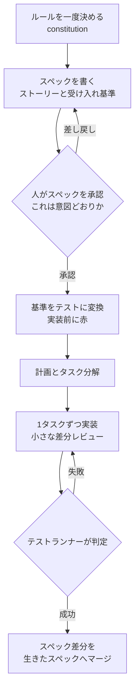
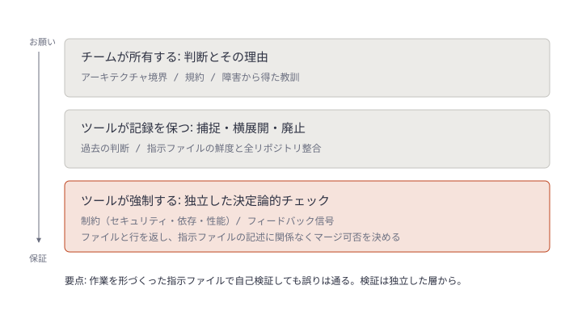
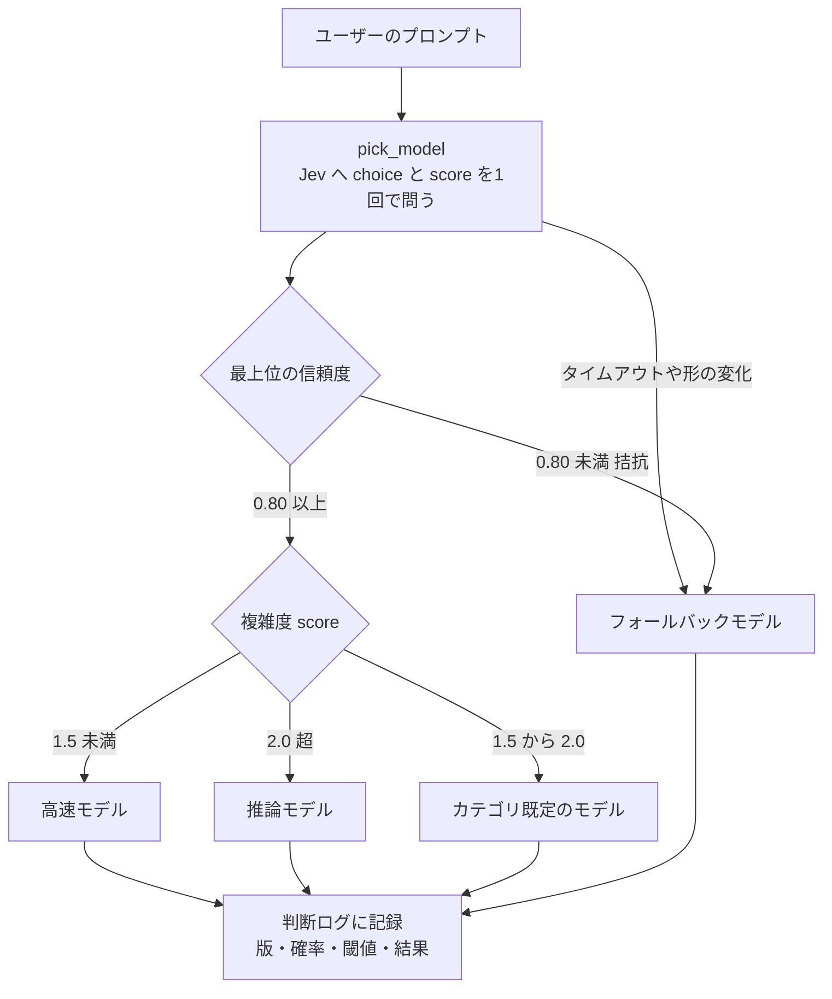

# Daily Briefing 2026-11-01

## 1. エージェントハーネス: スペック駆動開発とは実際のところ何か（原題: Agentic Harness: What Spec Driven Development Actually Is）

- **URL**: https://juliantellez.com/blog/what-spec-driven-development-is
- **公開日**: 2026-10-22
- **著者・媒体**: Julian Tellez / 個人ブログ（連載「エージェントハーネスを作る」の1本）

### 本文翻訳

ハーネスはエージェントの出力を検査できる。範囲内に留まったか、完了したか、何をしたか。しかし**依頼を理解したかどうか**は確認できない。その現在の答えがスペック駆動開発（SDD）である。OpenAI の Sean Grove は、生成コードを残してプロンプトを捨てる習慣を「ソースコードをシュレッダーにかけ、バイナリをバージョン管理するようなもの」と評した。小さな作業は結果を読めば検証できるが、広い作業は自動チェックがすべて通ったまま意図からずれていく。

**定義**。エージェントがコードを書く前に、望むことを文書にする。その文書が共有の正本となり、エージェントはそこから計画し、タスクを導き、それに照らして検査される。定義はまだ流動的で、Thoughtworks は 2025年11月に Technology Radar の Assess に置いた。Birgitta Böckeler は3段階で整理した: (1) spec first（書いて作り、タスク完了で終わり）、(2) spec anchored（タスク後も残し機能とともに進化させる）、(3) spec as source（人はスペックだけを編集し、コードは生成）。大半のツールは1段階目に留まる。

**なぜ必要か**。エージェントはコードを書くのは上手いが意図の推測は下手だ。曖昧な文を与えると解釈を1つ選び、上手に作り、もっともらしく正当化する。プロンプトが消えれば、コードは意図の非可逆な記録にすぎない。システムが何をするかは示すが、なぜか、何を決してしてはいけないかはほとんど示さない。

**系譜**。契約による設計（Meyer）、モデル駆動アーキテクチャ（OMG, 2001）、BDD（Dan North, 2006）、EARS（Rolls-Royce, 2009）。EARS の例:「登録済みのメールでサインアップフォームが送信されたとき、システムは要求を拒否し、既にアカウントがある旨を表示する」「メールサービスが5秒以内に応答しない場合、システムはウェルカムメールをキューに入れてサインアップを完了する」。各行は1つのトリガーと1つの振る舞いを持つ検証可能な主張である。違いは読み手がモデルになったこと。硬直性は消えたが、同じスペックから実行ごとに違うコードが出る不確実性が戻ってきた。

**使い方の共通ループ**。(1) ルールを一度決める（Spec Kit の constitution）、(2) スペックを書く（ユーザーストーリーと受け入れ基準。多くはエージェントが下書きし人が直す）、(3) 計画（データモデル・インタフェース・既存コードとの適合）、(4) 小さく順序付き独立検証可能なタスクに分解、(5) 1タスクずつ作り小さな差分をレビュー。レビューは「この生成コードは正しいか」から「これは私の意図か」に変わる。

**5つのアプローチ**（スター数は 10/22 時点）。Spec Kit（約14.2万、最も重厚。手順は「必須フェーズではなく独立した入口」に軟化）、Kiro（`.kiro/specs/` に requirements/design/tasks の3ファイル、EARS、依存グラフで並列実行）、OpenSpec（約7.3万、変更単位のフォルダにスペック差分を置き、出荷時に `openspec/specs/` の生きたスペックへマージ。既存コードベース向け）、BMAD Method（約5.4万、役割別エージェントでチームを模す）、Tessl（唯一の spec as source の本格挑戦だったが、現在は「エージェント実行基盤」に方針転換）。

**批判**。Böckeler は Kiro が小さなバグを4ストーリー・16受け入れ基準に膨らませたのを「大槌でクルミを割る」と評し、Spec Kit の大量の Markdown より「コードをレビューしたい」と述べた。調査ステップで既存と記録したクラスをエージェントが再生成した例もある。批判の大半は**長すぎてレビューできないスペック**と、**何も強制しないスペック**に向いている。

**今やるべきこと**。(1) バグ修正ではなく機能に使う。スペックが何を捕まえるか言えないなら省く。(2) 一度の着席でレビューできる長さに保つ。(3) すべての受け入れ基準を「失敗しうる」形にする。(4) 実装前に各基準をテストにし、エージェントではなくテストランナーに判定させる。(5) spec as source ではなく spec anchored を目指す。(6) 合う中で最も軽いツールから始める。未解決の課題はドリフトで、2026年6月の論文もスペックとコードの静かな乖離を既存手法が解けていないと指摘する。

### 重要ポイント

- SDD の本質は「意図の保存」。ハーネスは出力を検査できるが理解は検査できない
- 成熟度は spec first → spec anchored → spec as source。現実的な目標は **spec anchored**
- 受け入れ基準は EARS のように「1トリガー・1振る舞い」で書き、失敗しうる形にする
- 批判の核心は「レビューできない長さ」と「強制されないスペック」。基準をテストに変換して強制する
- 既存コードベースには変更単位のスペック差分（OpenSpec 型）が合う。小さなバグには使わない

### 図解



### 戦略分析

**フレームワーク**: JTBD × Cynefin

| 観点 | 内容 |
|---|---|
| 雇われる状況 | 既存コードベースの複数箇所に触れる機能を、エージェントに実装させるとき |
| 片付けたい仕事 | 「意図とずれた実装」を、コードを読む前に安く検出すること |
| 現在の代替手段 | 詳細なプロンプト、生成コードの事後レビュー（意図は消え、コードだけ残る） |
| 雇われない状況 | 再現手順が明確なバグ修正（Cynefin の「明白」。スペックの追加コストが便益を上回る） |
| 解雇される理由 | スペックが長すぎて誰も読まない／基準がテストに落ちず強制されない |

**示唆**: SDD の導入判断は「ツールを選ぶ」ではなく「どの変更に適用するか」の線引きが先になる。具体的には (1) 変更を Cynefin で分類し、「煩雑」（複数モジュールにまたがる機能）にだけスペックを義務付ける、(2) スペックの承認条件に「全受け入れ基準が失敗しうる形で書かれ、テストに変換済み」を入れる、(3) 長さに上限（例: 一度で読める量）を設け、超えたら変更を割る。重量級の Spec Kit を全変更に適用するのは、記事が示す批判をそのまま再現する。

**反証条件**: 変更の大半が小さなバグ修正や定型作業で、かつテストスイートが既に意図を十分に表現している組織では、SDD が片付ける仕事が残っておらず、スペックは「長いプロンプト」にしかならない。またドリフトを検出する仕組みがない場合、spec anchored のスペックは時間とともに嘘をつき始め、正本としての価値を失う（記事自身が未解決と認める点）。

### 現場での適用方法

**CLAUDE.md への追記例**（spec anchored を軽量に運用する）:

````markdown
## スペック駆動のルール

### いつスペックを書くか
- 2つ以上のモジュールに触れる機能追加 → `specs/changes/<YYYYMMDD>-<slug>/` を作ってから実装する
- 再現手順が明確なバグ修正・依存更新・文言修正 → スペック不要。直接実装してよい
- 判断に迷ったら「このスペックが何を捕まえるか」を1文で書く。書けなければ不要

### スペックの書式（spec.md）
- 受け入れ基準は EARS で書く。1行に1トリガー・1振る舞い
  - `When <トリガー>, the system shall <振る舞い>.`
  - `If <異常条件>, then the system shall <振る舞い>.`
- 「正しく動く」「適切に処理する」のように失敗しえない基準は書かない
- 合計 80 行を超えたら変更を分割する（一度でレビューできる長さを保つ）

### 実装の順序
1. spec.md を書き、人間の承認を待つ（承認前にコードを書かない）
2. 各受け入れ基準をテストに変換し、全テストが失敗することを確認する
3. tasks.md に独立して検証できるタスクを並べ、1タスクずつ実装する
4. 完了判定はテストランナーの結果で行う。自分の判断で「完了」と書かない
5. 出荷後、spec.md の要点を `specs/living/<領域>.md` に差分としてマージし、変更フォルダを archive へ移す
````

**スクリプト化の例**（受け入れ基準の書式チェック。CI か pre-commit で実行）:

```bash
#!/usr/bin/env bash
# check-spec.sh <SPEC_FILE>
set -euo pipefail
spec="${1:?usage: check-spec.sh specs/changes/<id>/spec.md}"

lines=$(wc -l < "$spec")
if [ "$lines" -gt 80 ]; then
  echo "NG: $spec は ${lines} 行。80行以内に分割してください" >&2; exit 1
fi

# 受け入れ基準セクションの箇条書きを抽出
criteria=$(awk '/^## 受け入れ基準/{f=1;next} /^## /{f=0} f && /^- /' "$spec")
[ -n "$criteria" ] || { echo "NG: 受け入れ基準がありません" >&2; exit 1; }

# EARS 形式でない行、失敗しえない曖昧語を含む行を検出
bad=$(echo "$criteria" | grep -Ev '^- (When|If|While|Where) .+ shall ' || true)
vague=$(echo "$criteria" | grep -Ei '適切に|正しく|問題なく|works|properly' || true)

if [ -n "$bad$vague" ]; then
  echo "NG: 以下の基準を EARS 形式・失敗しうる形に直してください" >&2
  printf '%s\n%s\n' "$bad" "$vague" | sed '/^$/d' >&2
  exit 1
fi
echo "OK: $(echo "$criteria" | wc -l) 件の受け入れ基準"
```

### 期待効果

- レビューの問いが「生成コードは正しいか」から「これは意図か」に変わり、コードを読む前に意図のずれを検出できる（記事の主張）
- 受け入れ基準を先にテスト化することで、完了判定がエージェントの自己申告からテストランナーに移る
- 変更単位のスペック差分を残すことで、次のエージェントが「なぜ」「何をしてはいけないか」を読める
- 数値的な効果は記事に示されていない

### 注意点

- 小さなバグに適用すると Kiro の例（1バグ→4ストーリー・16基準）のように過剰になる。適用範囲の線引きが先
- 同じスペックからでも実行ごとに異なるコードが出る。スペックは検証の代替ではなく、テストとセットで初めて効く
- スペックとコードのドリフトは既存ツールでも未解決。生きたスペックの更新を出荷手順に組み込み、四半期ごとに棚卸しする
- Tessl の方針転換が示すように、spec as source を目標にしない

## 2. AI コンテキストエンジニアリングとは何か: コーディングエージェントに正しいコンテキストを与える（原題: What Is AI Context Engineering? Giving Coding Agents the Right Context）

- **URL**: https://blog.codacy.com/ai-context-engineering
- **公開日**: 2026-10-30
- **著者・媒体**: Luís Ventura / Codacy Blog

### 本文翻訳

コーディングエージェントがチームで合意したルールを破ると、よくある対応は指示を足すことだ。しかし素材を増やすとエージェントはかえって悪くなりうる。Chroma が18モデルを試したところ、タスクが同じでも入力が長くなるほど性能が落ちた。代わりの考え方が **AI コンテキストエンジニアリング**、つまりエージェントが各ステップで何を知るかを決めることだ。複数のエンジニアとエージェントが同じファイルを共有する今、そのコンテキストには所有者が要る。

**定義**。エージェントが次の行動の前に見る情報を決め、それをコードと同じ規律で保守すること。Andrej Karpathy が 2025年半ばに「次のステップにちょうど必要な情報でコンテキストウィンドウを満たす繊細な技芸」として広めた。コンテキストには、タスクごとに自動で組み立てられるもの（開いている差分やチケット）と、タスクやエンジニアをまたいで残り、誰も自動では組み立てないものがある。記事は4層で位置づける: グラフは順序とルーティング、ハーネスは触れる範囲と出力検査、ループは再試行と停止、そしてコンテキストエンジニアリングはハーネスの中で「各ステップで何を知るか」を決める。

**多ければよいわけではない**。Chroma の結果では、約300トークンの絞った入力が、同じ事実を約11.3万トークンのチャット履歴に埋めた入力をすべてのモデルで大きく上回った。最も害が大きいのは「関連はあるが誤った内容」（ディストラクタ）で、入力が長いほど効く。古い規約が現行の規約の隣にあると、エージェントにはどちらが勝つか判別する確かな手段がない。

**必要な5種類のコンテキスト**。(1) アーキテクチャ: 構造と境界の理由。ファイル名から推測させず、リポジトリ内の設計記録から与える。(2) 規約: 命名・パターン・社内スタイル。(3) 制約: セキュリティ・依存・性能のルール。文章の方針として始まるが、強制されるチェックに裏付けられて初めて実効性を持つ。(4) 過去の判断: 試したこと、壊れたこと、変えたこと。誰かがその時に記録しない限り指示ファイルには残らず、多くは原因となった障害の日付を付けたルールになる。(5) フィードバック信号: チェック結果。次の試行に戻されて初めて役に立つ。制約とフィードバックは散文よりチェック結果として持つ方が堅牢だ。決定論的チェックは毎回同じ答えを返す。

**古い・矛盾する・リポジトリ間で乖離するとき**。ハーネスは正しいかどうかに関係なくコンテキストを忠実に届ける。古いルールも現行と同じ権威を持つ。さらに、エージェントが作業を形づくったのと同じ指示ファイルで自分の出力を検査すると、自分のレビューに合格してしまう。誤読を生んだチケットを読み返しても誤読は見つからないのと同じだ。あるチームが障害後に指示ファイルを更新し、別のチームがしなければ、同じ変更が片方では通り片方では止まる。検証は作業を形づくったコンテキストから独立していなければならない。Codacy が 34,266 リポジトリを調べたところ、4組織に1つでエージェント設定ファイルに欠落があった。

**保守される成果物としてのコンテキスト**。チームレベルのコンテキストには、コードと同じく所有者・バージョン管理・定期更新が要る。指示ファイルは文書のように感じられ、文書はスプリントが押すと最初に削られる。Codacy 自身の運用では、各ルールに問題が起きた日付を記録して同じ失敗の再発を防いでいるが、これは1人なら回るがチームが大きくなると破綻する。GitHub のコードレビューの5件に1件以上にエージェントが関わる今、判断が下された時点で捕捉し、不要になったら廃止する仕組みが要る。

**内製か購入か**。チームが所有するのは「システムについて何が真か」という知識、ツールが担うのはそれを最新に保つことと何がマージできるかの強制。指示ファイルのルールはエージェントが従うかもしれない「お願い」で、全変更で走るチェックは「保証」だ。分担は3つ: 自分で所有する（判断と理由）、ツールに記録させる（捕捉・リポジトリ間整合・廃止）、ツールに強制させる（独立した決定論的チェック）。

**効果**。正確なコンテキストは初回の出来を上げ、修正ラウンドを減らす。DORA の研究も、これが欠けると AI による時間短縮がレビューへ移ると示す。Stack Overflow 2026年調査では、検証が容易な場合に AI 出力を信頼する開発者は48%、重要な業務判断に関わるタスクでは16%にとどまる。独立した検証は、検証を全変更で回せるほど安くする。（後半は自社製品 Verity と、CLAUDE.md・AGENTS.md の秘密情報・曖昧な指示・ファイル間矛盾・インジェクション経路を検査する OSS の AgentLinter の紹介）

### 重要ポイント

- 指示を足すほど良くなるわけではない。約300トークンの絞った入力が約11.3万トークンの履歴埋もれ入力をすべてのモデルで上回った（Chroma）
- 最も害が大きいのは「関連はあるが誤った」古い規約。指示ファイルには所有者・版管理・廃止の手順が要る
- 制約とフィードバックは散文ではなく決定論的チェックで持つ。指示は「お願い」、チェックは「保証」
- 作業を形づくった指示ファイルで自己検証しても誤りは通る。検証は独立した層から
- 34,266 リポジトリ中、4組織に1つでエージェント設定ファイルに欠落（Codacy 調査）

### 図解



### 戦略分析

**フレームワーク**: Make/Buy（記事の「内製か購入か」）× RACI

| コンテキスト種別 | R（実行） | A（説明責任） | 持ち方 |
|---|---|---|---|
| アーキテクチャ | 設計記録を書くエンジニア | テックリード | リポジトリ内の設計記録（内製） |
| 規約 | 指示ファイル所有者 | テックリード | 指示ファイル＋可能なものは lint 化 |
| 制約 | プラットフォーム／セキュリティ | 同チームの責任者 | 決定論的チェック（購入または内製ツール） |
| 過去の判断 | 障害対応者 | インシデント責任者 | 日付付きルール→横展開はツール |
| フィードバック | CI・解析ツール | プラットフォーム | チェック結果をエージェントに戻す |

**示唆**: 「指示ファイルに1行足す」をデフォルトの対応にしない。ルール違反が起きたら、まず (1) その制約を決定論的チェックにできるか判定し、できるならチェックとして実装して指示ファイルには書かない、(2) できない判断・理由だけを日付付きで指示ファイルに残す、(3) 指示ファイルに所有者（A）を1人置き、四半期ごとに古いルールを削る。購入判断の対象は「記録の横展開と強制」であって、判断そのものは外部化できない。

**反証条件**: リポジトリが1〜2個でエージェント利用者も少ない組織では、日付付きルールを1人が手で保守する運用（記事が「1人なら回る」と認めた形）で十分で、記録・強制ツールの購入は固定費が便益を上回る。また記事は Codacy 自社ブログであり、「独立チェックの購入」を推す動機がある点は割り引いて読む。

### 現場での適用方法

**CLAUDE.md への追記例**（指示ファイル自体の保守ルール）:

````markdown
## この指示ファイルの保守規約

- 所有者: <OWNER_HANDLE>（四半期ごとに棚卸しする。次回: <YYYY-MM>）
- ルールを追加する前に確認する: 「lint・型・テスト・CI チェックで機械的に強制できるか」
  - できる → チェックとして実装し、ここには書かない
  - できない（判断・理由・背景）→ 下の書式で追記する
- 書式: `- <ルール>（<YYYY-MM-DD> <発端の障害・PR へのリンク>）`
- 現行ルールと矛盾する古いルールは追記ではなく置換する。並べて残さない

## 過去の判断
- 決済モジュールでは ORM の遅延ロードを使わない（2026-09-14 N+1 による障害 <INCIDENT_URL>）
- 外部 API クライアントは必ず `lib/http/` のラッパー経由で作る（2026-10-02 タイムアウト未設定 <PR_URL>）

## 自己検証の禁止
- 自分の変更をこのファイルの記述だけで「適合」と判定しない
- 完了報告の前に `<CHECK_COMMAND>` を実行し、出力されたファイルと行を全件修正する
````

**スクリプト化の例**（日付のないルール・古いルールを検出する棚卸しスクリプト）:

```bash
#!/usr/bin/env bash
# audit-agent-instructions.sh [<REPO_PATH>] — 指示ファイルの鮮度を棚卸しする
set -euo pipefail
repo="${1:-.}"
max_age_days="${MAX_AGE_DAYS:-180}"
now=$(date +%s)

find "$repo" -type f \( -name 'CLAUDE.md' -o -name 'AGENTS.md' \) -not -path '*/node_modules/*' |
while read -r f; do
  echo "== $f"
  # 箇条書きルールのうち日付注記がないもの
  grep -nE '^\s*- ' "$f" | grep -vE '[0-9]{4}-[0-9]{2}-[0-9]{2}' | sed 's/^/  [日付なし] /' || true
  # 日付が古すぎるもの
  grep -noE '[0-9]{4}-[0-9]{2}-[0-9]{2}' "$f" | while IFS=: read -r ln d; do
    ts=$(date -d "$d" +%s 2>/dev/null || echo "$now")
    age=$(( (now - ts) / 86400 ))
    [ "$age" -gt "$max_age_days" ] && echo "  [${age}日経過] L${ln}: $(sed -n "${ln}p" "$f" | cut -c1-80)"
  done
done
```

### 期待効果

- 指示を足す代わりに絞ることで、エージェントの初回の出来が上がり修正ラウンドが減る（記事の主張。Chroma の 300 vs 11.3万トークンの比較が根拠）
- 制約をチェックへ移すことで、リポジトリ間で同じ変更の判定が揃う
- 独立チェックにより、人間のレビュー前に機械判定可能な指摘が消え、レビュー負荷が下がる

### 注意点

- 記事後半は Codacy 製品（Verity）の宣伝。原則（独立検証・所有者・決定論的チェック）は製品なしで実装できる
- すべての規約がチェック化できるわけではない。理由や背景はチェックにできないので、指示ファイルに残す部分と線引きする
- 日付付きルールの運用は人数が増えると破綻する（記事自身の指摘）。所有者と棚卸し周期を先に決める
- 指示ファイルには秘密情報やインジェクション経路が紛れ込みうる。AgentLinter のような検査を CI に入れる

## 3. Jev: 会話ではなく判断のために作られたモデル（原題: Jev: Built for Decisions, Not Conversation）

- **URL**: https://www.edenai.co/post/jev-a-new-kind-of-ai-model-built-for-decisions-not-conversation
- **公開日**: 2026-10-22（最終更新日。初出日の記載なし）
- **著者・媒体**: Clément Moreau / Eden AI

### 本文翻訳

AI アプリの多くの処理は、リクエストの分類、ツールの選択、結果のゲートなど、生成された文章ではなく**判断**を必要とする。それでもアプリは、ラベル1つ（例:「coding」）が欲しいだけの小さな判断に LLM の生成をまるごと使い、時間とトークンを払い、さらにパースする。TypeSafe AI の「System One」モデル Jev はこの層のために作られた。Jev は DCVC 主導の4,000万ドルの資金調達とともに公開された。状態を型付きの質問に照らして評価し、確率と信頼度を1回の API 呼び出しで返し、テキストは生成しない。プロプライエタリで早期アクセス制、重みも公開されずオンプレ版もない。自信満々に間違えることもある。

**文字列から判断へ**。開発者は推論前に判断空間を宣言するので、JSON をパースする工程が要らない。プリミティブは3つ。**Choice** は criteria オブジェクトで定義した1〜255のカテゴリから1つを選ぶ。**Score** は2〜10段階の順序付きルーブリックで採点し、1.78 のような小数位置を返す。**Noul** は確率を返す Yes/No 質問。複数の質問を1リクエストにまとめられ、答えは同じキーで返る。

**確率が重要な理由**。Jev は較正された判断のための強化学習（RLCD）で訓練され、正直な確率を最適化している。明確な勝者（technical 0.86）と拮抗（0.37/0.34/0.29）は扱いを変えるべきだ。高信頼は自動化、中は安価な二次チェック、低はエスカレーションか強いモデルへ。ただし確率は精度の保証ではないので、閾値はラベル付きトラフィックで較正する。

**速度とコスト**。非自己回帰で全質問を1パスで評価し、レイテンシは70〜500ms。ベンダーのベンチマークでは 0.114秒 vs 8.566秒、$0.000081 vs $0.013880（193.6倍速、444.6倍安）。価格は入力100万トークンあたり $0.042、出力は無料。**なぜ分類器ではないのか**: ファインチューニングした分類器はラベル付きデータと再訓練が要るが、Jev はスキーマをリクエストで受け取る。ただし、安定・大量・狭いタスクでラベル付きデータがあるなら、小さなファインチューニングモデルの方が良いことが多いと記事は率直に認める。

**ルーターを作る**。Step 1: カテゴリ（simple / coding / reasoning / creative）を Eden AI の provider/model 形式でモデルに対応付ける。`GET /v3/alpha/decisions/models` で `typesafe/jev-latest` と `typesafe/jev-preview` が返る。調整後は具体的なバージョンを固定する。Step 2: プロンプトを state にし、各カテゴリを説明する criterion を持つ choice 質問を `/v3/alpha/decisions` に5秒タイムアウトで POST する。応答には実際のモデルバージョン、`answers`、トークン使用量、コスト（例 $0.00000496）が入る。Step 3: 選んだモデルへ OpenAI SDK（ベース URL `https://api.edenai.run/v3`）で元のプロンプトを送る。判断エンドポイントはベース URL の差し替えでは届かないので `requests` のまま。Step 4: 信頼度が 0.80 未満ならフォールバックモデルへ。信頼度フィールドのない Noul には `abs(p - 0.5) * 2` を使う。coding 0.49 vs reasoning 0.44 のような拮抗は自動ルーティングが危険な例。Step 5: 多質問ポリシー。Score の criteria は低→高の順で並べる（2.4 は「hard」と「research-level」の間）。vision と code の Noul が 0.8 超か、複雑度 Score が 1.5 未満なら高速なコーディングモデル、2.0 超なら推論モデル。質問は肯定形で書く。完成版では判断エンドポイントのコードを `pick_model` 関数に閉じ込め、失敗や応答形の変化時はエラーにせずフォールバックモデルを返し、未知カテゴリには `.get()` で既定値を使う。

**トレードオフ**。Jev は TypeSafe の4ワークフローのベンチマークで約68%の精度で、中位の LLM 程度。判断エンドポイントはアルファで予告なく変わりうるので薄いアダプタを挟む。セルフホストはない。結論は「LLM か判断モデルか」ではなく「LLM と判断モデル」。生成モデルが答えを書き、判断モデルが誰が書くかを選ぶ。

### 重要ポイント

- 小さな判断（分類・ルーティング・ゲート）に生成 LLM を使うのをやめ、型付き判断に分離する
- 3プリミティブ: Choice（1〜255択）、Score（2〜10段階・小数位置）、Noul（Yes/No 確率）
- 信頼度で3段階に分ける（0.80 以上で自動、拮抗はフォールバック）。閾値はラベル付きトラフィックで較正
- 判断エンドポイントは薄いアダプタに閉じ込め、失敗時はエラーではなくフォールバックモデルを返す
- 精度は約68%（中位 LLM 並み）。安定・大量・狭いタスクでラベルがあるならファインチューニング分類器の方が良い

### 図解



### 戦略分析

**フレームワーク**: 単位経済性（ユニットエコノミクス）

| 項目 | 生成 LLM でルーティング | Jev でルーティング（記事の値） |
|---|---|---|
| 1判断あたりコスト | $0.013880（ベンダー比較） | $0.000081（同） |
| 1判断あたりレイテンシ | 8.566秒 | 0.114秒 |
| パース失敗の処理 | 必要（JSON 抽出） | 不要（型付き） |
| 精度 | 比較対象次第 | 約68%（中位 LLM 並み） |
| 誤判断の扱い | 再生成・パース修正 | 信頼度でフォールバックへ |

**構造**: 判断1回あたりのコストは十分小さいため、単位経済性を決めるのは判断コストではなく**誤ルーティングのコスト**になる。0.80 未満を強いモデルに回す設計は、フォールバック率×強いモデルの単価で総コストが決まる。

**示唆**: 導入判断は「Jev は安いか」ではなく「誤判断1件のコストと、閾値を下回る割合」で決める。具体的には (1) 既存のルーティングログから200〜500件をラベル付けし、Jev の信頼度分布とフォールバック率を測る、(2) 誤ルーティングが顧客影響を生む判断（返金・権限）には使わず、誤っても後段で吸収される判断（モデル選択・RAG の関連度）から始める、(3) 判断量が多く安定していてラベルが溜まったら、記事の言う通りファインチューニング分類器への置き換えを再評価する。

**反証条件**: 判断の誤りが不可逆で高コストな用途、または判断量が少なく生成 LLM のコストが問題にならない用途では、速度・コストの優位は意思決定を変えない。記事の速度・コスト比較はベンダー提示値であり、自社トラフィックで再測定するまでは仮説として扱う。

### 現場での適用方法

**スクリプト化の例**（薄いアダプタ＋信頼度ルーティング。記事の構成を Python で再現）:

```python
# router.py — 判断エンドポイントをこのファイルに閉じ込める
import os
import requests

DECISIONS_URL = "https://api.edenai.run/v3/alpha/decisions"
JEV_MODEL = os.environ.get("JEV_MODEL", "<PINNED_JEV_VERSION>")  # 調整後は具体的な版に固定
API_KEY = os.environ["EDENAI_API_KEY"]                            # キーはサーバ側にのみ置く
FALLBACK = os.environ.get("FALLBACK_MODEL", "<STRONG_MODEL_ID>")
THRESHOLD = float(os.environ.get("ROUTE_THRESHOLD", "0.80"))

MODEL_MAP = {
    "simple": "<FAST_MODEL_ID>",
    "coding": "<CODING_MODEL_ID>",
    "reasoning": "<REASONING_MODEL_ID>",
    "creative": "<CREATIVE_MODEL_ID>",
}

def _decide(prompt: str) -> dict:
    body = {
        "model": JEV_MODEL,
        "state": prompt,
        "questions": {
            "category": {"type": "choice", "criteria": {
                "simple": "A short factual or conversational request",
                "coding": "Writing, fixing or explaining code",
                "reasoning": "Multi-step analysis, math or planning",
                "creative": "Open-ended writing or ideation",
            }},
            # Score の criteria は低い順に並べる
            "complexity": {"type": "score", "criteria": [
                "trivial", "moderate", "hard", "research-level"]},
        },
    }
    r = requests.post(DECISIONS_URL, json=body, timeout=5,
                      headers={"Authorization": f"Bearer {API_KEY}"})
    r.raise_for_status()
    return r.json()

def noul_confidence(p: float) -> float:
    return abs(p - 0.5) * 2

def pick_model(prompt: str) -> tuple[str, dict]:
    """失敗時はエラーにせずフォールバックを返す。戻り値は (model_id, ログ用情報)"""
    try:
        res = _decide(prompt)
        cat = res["answers"]["category"]
        label, conf = cat["answer"], cat["confidence"]
        complexity = res["answers"]["complexity"]["score"]
    except (requests.RequestException, KeyError, TypeError) as e:
        return FALLBACK, {"reason": f"decision_error:{type(e).__name__}"}

    log = {"jev_version": res.get("model"), "label": label, "confidence": conf,
           "complexity": complexity, "threshold": THRESHOLD}
    if conf < THRESHOLD:
        return FALLBACK, {**log, "reason": "low_confidence"}
    if complexity > 2.0:
        return MODEL_MAP["reasoning"], {**log, "reason": "complex"}
    return MODEL_MAP.get(label, FALLBACK), {**log, "reason": "routed"}
```

※ 応答のフィールド名（`answer` / `confidence` / `score`）はアルファ API のため変わりうる。記事中でも例とコードでキー名が揺れているので、実際の応答を一度出力して合わせること。

**運用手順**（閾値の較正）:

1. 既存のルーティングログから 200〜500 件を抽出し、人手で正解カテゴリを付ける
2. `pick_model` を本番と並走（shadow）させ、`label` / `confidence` / 正解を記録する
3. 信頼度を 0.05 刻みで区切り、区間ごとの正答率とフォールバック率を集計する
4. 「正答率が許容値を超える最低の信頼度」を `ROUTE_THRESHOLD` に設定する
5. Jev の版を変えたら 2〜4 を再実行する（版は環境変数で固定し、ログに残す）

### 期待効果

- ルーティング判断のコストとレイテンシの大幅削減（記事のベンダー比較で 193.6倍速、444.6倍安）
- JSON パースが不要になり、判断層の失敗モードが「タイムアウト」と「低信頼」の2つに限定される
- 判断ログ（版・確率・閾値・結果）が残り、閾値を根拠付きで調整できる

### 注意点

- 精度は約68%で中位 LLM 並み。確率は精度の保証ではなく、閾値は自社トラフィックで較正が必須
- 判断エンドポイントはアルファで予告なく変わりうる。アダプタを1ファイルに閉じ込め、フォールバックを必ず用意する
- プロプライエタリ・早期アクセス制でセルフホスト不可。データの持ち出し制約がある環境では使えない
- 安定・大量・狭いタスクでラベルが揃っているなら、ファインチューニングした小型分類器の方が適する（記事自身の指摘）
- 本記事は Eden AI（API 提供事業者）のブログで、自社エンドポイント経由の構成を前提にしている
