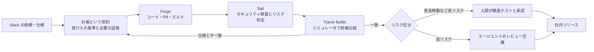
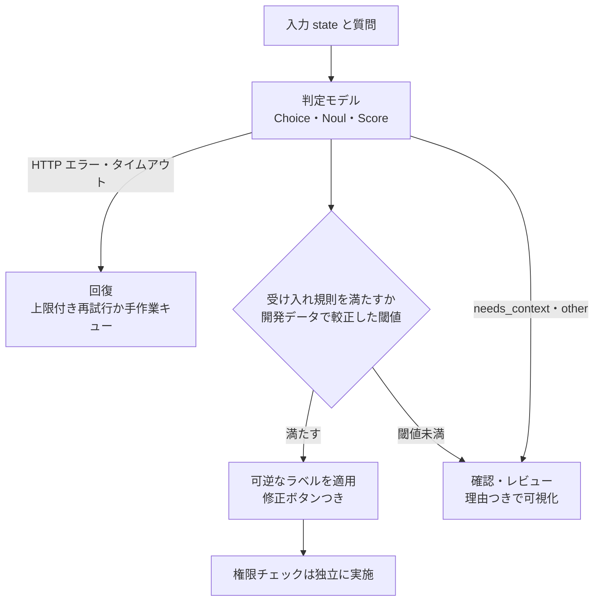
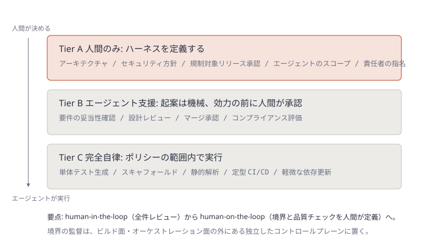

# Daily Briefing 2026-11-03

## 1. Coinbase Wallet はいかにしてエージェントファーストの製品開発ライフサイクルを築いたか（原題: How Coinbase Wallet built an agent-first product development lifecycle）

- **URL**: https://arize.com/blog/how-coinbase-wallet-built-an-agent-first-product-development-lifecycle/
- **公開日**: 2026-09（日付の詳細は不明）
- **著者・媒体**: Sara Verdi / Arize AI Blog（Arize Observe 2026 での Chintan Turakhia の講演に基づく）

### 本文翻訳

Coinbase Wallet は約3週間出荷を止め、エンジニアに IDE を削除するよう求めて、AI エージェント前提の働き方へ強制的にリセットをかけた。製品エンジニアリングを率いる Chintan Turakhia は、難しかったのは文化だと語る。コーディングエージェントはすでに有用なソフトウェアを書けたが、チームのプロセスと習慣は「コードを書くのは高くつく」ことを前提にしたままだった。結果として、モバイルの単純なバグ・機能は 20〜25日から約1.8日に、Slack の依頼から PR とテスト可能なビルドまでが12分に、セキュリティレビューは3日から5分になった。コード生成が速くなると、PR レビュー・CI・ビルド基盤・検証・プロダクトの意思決定がボトルネックになった。

**意図から本番までの時間を測る。** 北極星指標は「intent to production」、すなわちバグの特定・機能の提案・仮説の形成から、ユーザーがその結果を体験できるまでの時間である。コード量や PR 数やエージェント実行回数が増えても、ビルド・レビュー・環境・承認で何日も待つなら意味がない。測るべきは、(1) アイデアから実行可能なプロトタイプまでの時間、(2) プロトタイプから検証済みビルドまでの時間、(3) CI・インフラ・セキュリティ・人間レビューでの待ち時間、(4) 人間が実装に介入しなければならない頻度。Coinbase はキャッシュ済みクラウド環境で 30〜40分のビルドを1分未満にした。

**社内エージェントハーネス。** 3つの仕組みで計画・実装・レビュー・テスト・リリースを運ぶ。**Forge** は Slack の依頼をコード・PR・テスト可能なモバイルビルドに変え、人間は動くプロダクトを見る。**Sail** は変更をセキュリティ観点で検査してリスクレベルを付け、人間はリスクの高い箇所に集中する。**Tracer Bullet** は仕様を実装・シミュレータテスト・検証・社内リリースまで運び、人間は結果が当初の意図に合っているかを確かめる。規制業種のため、資金移動に関わる変更は今も人間が徹底的にテスト・承認し、低リスクの変更はエージェントのレビュー合議に回せる。

**プロンプトではなく計画を。** プロンプトは行動を求めるが、計画は成果・制約・実装文脈・完了を証明する証拠を定める。計画は契約であり、実装が失敗したら IDE でコードを直すのではなく契約を更新して再実行する。そうすると学びが次の実行に残る。計画に含めるのは、意図するユーザー成果、変えるべき現在の挙動、関係するリポジトリ・サービス・インターフェース、明示的な受け入れ基準、既知のエッジケースとリスク領域、エージェントが返すべきテスト・ログ・スクリーンショット・録画。約20分の明確化が何時間もの軌道修正を省き、複数エージェントが並列に走れる成果物になる。

**エージェントには観測手段が要る。** 「エージェントに任せろ」が成り立つのは、エージェントが自分の出力を観測できるときだけだ。ログ・ビルド出力・テスト結果・実行時の挙動・デザインシステム部品・本番制約がなければ、生成コードは検証されていない推測にすぎない。Coinbase はデバイス構成ごとのモバイルシミュレータ群で実装を動かし、変更前後の動画を録り、仕様と比較して合否を報告する。失敗すれば仕様を直してループを回す。ビルドと検証環境の改善により、人間が実装しないままマージされた PR は 73% 増えた。

**儀式を見直す。** スプリント、デイリースタンドアップ、キックオフ、従来型 PRD、Figma ハンドオフを必須工程から外した。数百のプロトタイプを社内で使い、価値を示したものだけに本番向けの投資をする。ただし丸ごと真似るのではなく、各会議・文書・承認・ハンドオフを「意図を明確にするか」「エージェントに必要な文脈を与えるか」「検証を改善しリスクを下げるか」「動くソフトウェアをユーザーが早く評価できるようにするか」で監査せよ。どれにも当たらない工程は、もう存在しない制約を守っている可能性がある。

**1日ロードマップ圧縮テスト。** 最も野心的なロードマップ項目を1日で作ってみる。(1) 野心的だが範囲の決まった成果を選ぶ (2) 受け入れ基準と検証要件付きの詳細な計画を書く (3) 生成コードを手で直さずエージェントで実行する (4) 動くビルドと意図どおりに動く証拠を要求する (5) 遅れた・失敗した箇所をすべて記録する。その後ボトルネックを「エージェントの文脈不足」「遅い CI」「曖昧な評価基準」「アクセスできないテスト環境」「詰め切れていないプロダクト案」に分類する。極端な例として2人で1週間でアプリを作り直したところ約85%まで到達したが、残り15%（信頼性・セキュリティ・検証・プロダクト判断）が本番化を阻んだ。

### 重要ポイント
- 北極星指標は「意図から本番まで」。コード量や PR 数ではなく、待ち時間と人間の介入頻度を測る
- 計画は契約。失敗したらコードではなく計画を直して再実行し、学びを次回に残す
- エージェントにはログ・テスト・実行時挙動・前後比較動画などの観測手段を与える。これで人手実装なしマージが 73% 増
- 既存の儀式は「意図・文脈・検証・早期評価」の4問で監査し、どれにも当たらないものは削る
- 1日ロードマップ圧縮テストで、自組織のボトルネックを5分類で炙り出す

### 図解



### 戦略分析

**フレームワーク**: バリューストリームマッピング × 制約理論

| 工程 | 以前 | 以後（記事の数値） | 制約の移動 |
|---|---|---|---|
| 依頼→PR とテスト可能ビルド | 不明 | 12分 | 解消 |
| ビルド | 30〜40分 | 1分未満 | 解消 |
| セキュリティレビュー | 3日 | 約5分 | 解消（Sail によるリスク判定） |
| 単純なバグ・機能の通し | 20〜25日 | 約1.8日 | — |
| 最後の15% | — | 2人×1週間でも未達 | **信頼性・検証・プロダクト判断** |

**制約**: 生成・ビルド・定型レビューの待ちを潰した後に残る制約は「何を作るか」の判断と、最後の15%の検証である。記事が北極星を「意図から本番まで」に置き、計画を主たる仕事と呼ぶのはこの状態を指す。

**示唆**: 実装支援ツールへの追加投資より先に、(1) 計測の起点を「最初のコミット」から「意図の発生」に前倒しし、待ち時間を工程別に分けて記録する、(2) 計画テンプレート（成果・現状・関係システム・受け入れ基準・エッジケース・必要な証拠）を必須化して、失敗時はコードではなく計画を直す運用に切り替える、(3) 既存の会議・承認を4問で棚卸しし、1つも当たらないものを止める。手始めは1日圧縮テストを1回だけ回し、ボトルネック分類の分布を見てから投資先を決める。

**反証条件**: ビルド・CI・環境が遅く、それを短縮する基盤投資（キャッシュ済みクラウド環境、シミュレータ群）ができない組織では、儀式を削っても待ち時間は減らず、制約は依然として基盤側にある。また Coinbase の数値は自社講演ベースで、比較対象の定義（「単純な」バグ・機能）が記事では示されていないため、そのまま目標値にしない。

### 現場での適用方法

**計画テンプレート（`.claude/skills/plan-contract/SKILL.md`）**

````markdown
---
name: plan-contract
description: 実装依頼を受けたら、コードを書く前にこの計画テンプレートを埋めて人間に確認させる。実装が失敗したときはコードを直す前に計画を更新して再実行する。
---

# 計画は契約

実装に入る前に `plans/<TICKET_ID>.md` を以下の見出しで作成し、確認を求めること。

## 1. 意図するユーザー成果
## 2. 変えるべき現在の挙動（再現手順つき）
## 3. 関係するリポジトリ・サービス・インターフェース
## 4. 受け入れ基準（検証可能な文で、箇条書き）
## 5. 既知のエッジケースとリスク領域
## 6. 返すべき証拠
- 実行したテストコマンドと結果
- 変更前後のスクリーンショットまたは録画
- 関連ログの抜粋

## ルール
- 受け入れ基準を満たせなかった場合、コードを手で継ぎはぎしない。
  計画のどこが不足していたかを `## 7. 改訂履歴` に追記してから再実行する。
- 資金移動・認証・データ移行に触れる場合は `risk: high` と明記し、人間の承認を待つ。
````

**1日ロードマップ圧縮テストのボトルネック記録（`ops/compression-test.md` の雛形）**

```markdown
# 1日圧縮テスト: <ITEM_NAME>（実施日: YYYY-MM-DD）

| 時刻 | 何が止まったか | 分類 | 待ち時間 |
|---|---|---|---|
| 10:12 | ステージング環境にエージェントが入れない | テスト環境 | 45分 |
| 11:40 | 受け入れ基準「使いやすい」が判定不能 | 評価基準の曖昧さ | 20分 |

分類: 文脈不足 / 遅い CI / 評価基準の曖昧さ / テスト環境 / プロダクト案の未成熟
```

### 期待効果
- 記事の数値: 単純なバグ・機能 20〜25日→約1.8日、セキュリティレビュー 3日→約5分、ビルド 30〜40分→1分未満、人手実装なしの PR マージ 73% 増
- 計画を契約として残すことで、失敗の学びがコードではなく再利用可能な成果物に蓄積される
- 1日圧縮テストで「投資すべき制約」がデータとして見える

### 注意点
- 数値は Coinbase 自身の講演由来で、ベースラインの定義は詳述されていない
- 「IDE を削除して3週間出荷停止」は経営の後ろ盾があって成立する施策。記事自身も丸ごと真似るなと書いている
- 規制対象（資金移動）は人間の徹底テストを残している。高リスク領域の線引きを先に決めないと、レビュー短縮が事故に直結する
- 2人1週間で85%止まりという結果は、最後の信頼性・セキュリティ・判断がエージェント化しにくいことを示す

## 2. Jev と AI 判定モデル: 実践的な入門ガイド（原題: Jev and AI Decision Models: A Practical Getting Started Guide）

- **URL**: https://blog.starmorph.com/blog/jev-decision-models-guide
- **公開日**: 2026-10-11
- **著者・媒体**: Dylan Boudro / Starmorph Blog

### 本文翻訳

判定モデル（decision model）は、与えられた文脈を、アプリケーションが使える小さな答え（ラベル、確率、評価）に変える。本稿の例は、保存したリンクを3つのバケットに振り分け、不確かなものに印を付け、改善を追跡できる読書アプリだ。

**判定モデルとは何か。** 範囲の決まった判断の道具である。質問と許される答えをこちらが定め、モデルはそこから選ぶ。TypeSafe は自社の方式を「System One」と呼ぶが、これは製品用語であって人間の直感を模したものではない。モデルは答えを提案し、次に何をするかはアプリケーションが決める。答えの形は3つ。**Choice** は名前付きの選択肢から1つを選び確率と確信度を返す。**Noul** は 0〜1 の yes 確率を返す。**Score** は順序付きルーブリック上の確率加重の位置を返し、段階の間に落ちることもある。1リクエスト内の質問は互いに独立に採点される。

**どこで役立つか。** 各用途に「小さな判断」と「妥当な最初の一歩」がある。個人ナレッジベースではノートを種類別に分けてフォルダを提案する（元を消さないので可逆）。サポート受信箱ではチケットを動かす前に担当チームを推薦する（人間が確認できる）。読書キューでは研究テーマに合う記事を候補に挙げる（利用者が候補を見る）。検索パイプラインでは候補文の再順位付け、コンテンツ作業では必須セクションの欠落を編集者に知らせる（影響が小さい）、エージェントではツールを提案するが通常の権限チェックはそのまま適用する（モデルは権限を得ない）。日付比較や拡張子判定のような厳密なルールは決定論的なコードの方がよく、自由記述は生成モデル、証拠不足は検索が向く。

**代替との比較。** Jev は TypeSafe のホスト型独自サービスで、`jev-1.13.0` のように版を固定でき、`jev-latest` という可動エイリアスもある。公平な比較のために版を固定せよ。ローカルの Nimble、Qwen ベースの Tev1、Clef 系、Vela 2.0、CPU 向けの GLiNER2.5-Decide、適応推論の GLiDE などを、品質順位ではなくプロジェクト適合で並べている。

**まず1つの有用な質問から。** プロバイダを選ぶ前に小さなタスクを決める。例はノートを `tutorial` / `reference` / `opinion` / `other` / `needs_context` に分類し、ノートは変更せずフォルダだけ提案するもの。成功の定義は「提案が自分のラベルと十分に一致して時間が浮くこと」。易しい例と厄介な例で試し、モデル評価の前に定義の曖昧さを直す。

**ホスト型 Jev。** API キーはサーバ側の環境変数に置く。`/v1/systemone` に POST し、Bearer 認証と JSON の Content-Type を付ける。本文は `model`（固定した版）、`state`（評価対象のテキスト）、`questions`（質問名をキーとするオブジェクト。各質問に `type`、`instructions`、各ラベルと説明の `criteria` マップ）。選ばれたラベルは `answers.document_kind.choice` にあり、確率分布も後の分析用に保存しておく。

**ローカル（Ollama）。** Ollama 0.35.0 以降で `ollama pull nimble` し、同じリクエストの `model` だけ `nimble` に変えてポート 11434 の `/v1/systemone` に送る。`/api/chat` は誤りで、任意のチャットモデルは判定モデルとしては動かない。HTTP エラーは運用上の問題として扱い、モデルが `needs_context` を選んだこととは区別する。

**自動化の前に評価する。** (1) 多様なノート 50〜100件を自分でラベル付けする (2) 開発用とテスト用に分け、関連するノートは同じ側に置く (3) 手作業・ルール・既存の汎用モデルをベースラインにする (4) モデルとランタイムの版、ルーブリック、日付、入力長、時間を記録し、コールドとウォームは別に測る (5) `other` と `needs_context` を明示的に数え、カテゴリ別に誤りを見る (6) 修正とレビューの時間を含めてワークフロー全体を測る。例: 100件中70件を受け入れて67件が正しければ、カバレッジ70%、受け入れ分の正解率は約95.7%。

**フォールバック設計。** 受け入れ（開発データで決めた規則を満たせば可逆なラベルを適用）、確認・レビュー（曖昧なもの、特に `needs_context` と `other` を見える場所に残す）、回復（タイムアウトや不正な応答は再試行か手作業キューへ）。レビュー項目には「文脈不足」「閾値未満」「サービス停止」など短い理由を付ける。ホスト型のエラーは上限付きバックオフで再試行する。確信度 0.9 は正解率 90% を意味しない。自分のラベル付きデータで検証し、権限チェックと人間の承認は確信度から独立させよ。

### 重要ポイント
- 判定モデルは「答えを提案するだけ」。行動の可否はアプリケーション側の規則と権限で決める
- 最初は可逆な行為（フォルダ提案、推薦、候補提示）から始める
- 評価は 50〜100件の自前ラベル、開発/テスト分割、ベースライン比較、カバレッジと正解率の併記
- フォールバックは「受け入れ / 確認 / 回復」の3経路。HTTP エラーと `needs_context` を混同しない
- 確信度は正解率ではない。閾値は自分のデータで較正する

### 図解



### 戦略分析

**フレームワーク**: Cynefin × リスク×可逆性マトリクス

| 領域 | 記事の用途例 | 推奨される実装 |
|---|---|---|
| 明白（Clear） | 日付比較、拡張子判定 | 決定論的コード。判定モデルは不要 |
| 煩雑（Complicated）かつ可逆 | ノートのフォルダ提案、チケットの担当推薦、記事の候補抽出 | 判定モデル＋受け入れ閾値。誤りは修正ボタンで戻す |
| 煩雑かつ不可逆 | エージェントのツール実行 | 判定モデルは提案のみ。権限チェックと人間承認は独立 |
| 複雑（Complex）・自由記述 | 説明文、文章生成 | 生成モデル。判定モデルの対象外 |

**示唆**: 判定モデルの導入判断を「精度が十分か」ではなく「誤ったときに戻せるか」で先に切る。具体的には、候補業務を可逆/不可逆に分け、可逆な業務だけを 50〜100件のラベル付きデータで評価し、カバレッジと受け入れ分の正解率の両方が手作業ベースラインの所要時間を下回ったものから自動適用する。不可逆な業務では判定モデルの出力を権限判定の入力にしない、とルール化する。

**反証条件**: ラベル付けできるほど判断基準が安定していない業務（担当者ごとに分類が割れる、カテゴリが頻繁に変わる）では、評価セットが作れずこの導入順序は成立しない。その場合は先にカテゴリ定義を合意する作業が制約になる。

### 現場での適用方法

**評価スクリプト（`scripts/eval_decisions.py`）**: 自前ラベルと判定結果からカバレッジと受け入れ分の正解率を算出する。

```python
#!/usr/bin/env python3
"""使い方: python3 eval_decisions.py labeled.jsonl predictions.jsonl 0.80
labeled.jsonl:     {"id": "n1", "label": "tutorial"}
predictions.jsonl: {"id": "n1", "choice": "tutorial", "confidence": 0.91}
"""
import json
import sys
from collections import Counter

labels = {r["id"]: r["label"] for r in map(json.loads, open(sys.argv[1]))}
preds = {r["id"]: r for r in map(json.loads, open(sys.argv[2]))}
threshold = float(sys.argv[3])
ESCAPE = {"needs_context", "other"}

accepted = correct = 0
escapes = Counter()
errors_by_label = Counter()
for nid, gold in labels.items():
    p = preds.get(nid)
    if p is None:
        escapes["missing_prediction"] += 1
        continue
    if p["choice"] in ESCAPE:
        escapes[p["choice"]] += 1
        continue
    if p["confidence"] >= threshold:
        accepted += 1
        if p["choice"] == gold:
            correct += 1
        else:
            errors_by_label[gold] += 1

n = len(labels)
print(f"coverage = {accepted}/{n} = {accepted / n:.1%}")
if accepted:
    print(f"accuracy(accepted) = {correct}/{accepted} = {correct / accepted:.1%}")
print("escapes:", dict(escapes))
print("errors by gold label:", dict(errors_by_label))
```

**CLAUDE.md への追記例**

```markdown
## 判定モデル（Jev 等）を組み込むときのルール
- モデルの確信度を権限判定・承認の代わりにしない。権限チェックは常に別処理で行う
- 自動適用してよいのは可逆な操作のみ（ラベル付与・提案・並べ替え）。削除・送信・課金は対象外
- モデル ID は `jev-latest` ではなく固定版（例: `jev-1.13.0`）を使い、評価結果と一緒に記録する
- HTTP エラーと `needs_context` を同じ分岐にしない。前者は再試行、後者はレビューキュー
- 閾値を変更する PR には `scripts/eval_decisions.py` の出力を添付する
```

### 期待効果
- 記事の例では 100件中70件を自動で受け入れ（カバレッジ70%）、その正解率は約95.7%
- 可逆な操作から始めるため、誤判定のコストが修正ボタン1回に収まる
- 版固定と評価記録で、モデル更新時の回帰を検出できる

### 注意点
- 記事は実行済みの応答例を示していない。レスポンススキーマ全体は公式ドキュメントで確認すること
- Jev はホスト型でローカル実行不可。データを外部に出せない場合は Nimble 等の代替を評価する必要がある
- 閾値の数値は記事に無い。自分の開発データで決め、テストデータで検証する
- コールドスタートとウォームの応答時間は別に測ること（ローカル実行時に差が大きい）

## 3. エージェント時代のエンジニアリング運営モデル: チーム＋エージェント（原題: Agentic Engineering Operating Model: Teams + Agents）

- **URL**: https://www.augmentcode.com/guides/agentic-engineering-operating-model
- **公開日**: 2026-05-16（2026-06-18 更新）
- **著者・媒体**: Paula Hingel / Augment Code Guides

### 本文翻訳

AI エージェントはツールの問題である以上に運営モデルの問題だ。組織は、多数の専門エージェントを指揮する小さな人間チームを中心に再編される。個々の開発者は速くなったと感じても、サイクルタイムや変更失敗率といった組織の指標は改善しないことがある。2025年の DORA レポートは AI 導入とスループット向上の関連を示す一方で安定性の懸念も残しており、持続的な効果はプラットフォーム基盤、統制されたワークフロー、共有コンテキストに依存する。典型的な失敗は、草の根の導入が運営設計を追い越すことだ。

**なぜ運営モデルの転換が要るか。** 基盤がないと、AI は大きな PR、不揃いなコードパターン、アーキテクチャ標準を破る提案を生む。DORA の AI 能力モデルは「明確に伝えられた AI スタンス」（何のための AI か、どこで実験してよいか、どのツールが許されるか）から始まる。転換前後で、実行モデルは「人が実行」から「人が舵を取りエージェントが実行」へ、チームは「大人数・狭い範囲」から「少人数・広い範囲」へ、ボトルネックは「実行能力」から「判断とレビューの能力」へ、知識は「Wiki」から「共有メモリ基盤」へ、統制は「事後のコンプライアンス」から「実行時に強制する policy-as-code」へ、プラットフォームの任務は「開発者ツール」から「エージェントのライフサイクル・オーケストレーション・統制」へ移る。

**チーム構造。** ストリームアラインドチームは、直接実装する人数を減らしてより広い領域を担い、人間はアーキテクチャ・レビュー・境界管理に集中する。チーム境界が曖昧ならエージェントのスコープも曖昧になり、そのコストは調整オーバーヘッドとして現れる。逆コンウェイ戦略として、チーム境界とエージェントのスコープは最初から一緒に設計する。LinkedIn はインフラチームに倣った専任のエージェントプラットフォームチームを作り、Red Hat は 500人超の組織で要件・設計・セキュリティ・品質・文書・リリース自動化の横断「タイガーチーム」を置いた。

**プラットフォームの任務拡大。** 開発者体験はエージェントが使える API・MCP サーバ・承認済みツール連携へ、CI/CD は人間ゲート付きのエージェント対応パイプラインへ、可観測性は推論トレース・ツール呼び出しログ・評価パイプラインへ、セキュリティは最小権限のツールアクセスと監査証跡へ広がる。監督の独立性を保つため、「エージェントコントロールプレーン」はビルド面・オーケストレーション面の外に置く。統制をエージェントフレームワークに内蔵すると利益相反になる。

**意思決定の権限。** 統制は human-in-the-loop（全変更のレビュー）から human-on-the-loop（エージェントの作業を縛る仕様と品質チェックを人間が定義する）へ移る。人間はハーネスを定義し、名前の付いた責任を保持し、エージェントは方針・レビュー・所有が明示された範囲で動く。**Tier A（人間のみ）**: アーキテクチャ、セキュリティ方針、規制対象のリリース承認、エージェントのスコープ定義、責任者の割り当て。**Tier B（エージェント支援）**: エージェントが起案し、効力を持つ前に人間が承認する。要件の妥当性確認、設計レビュー、マージ承認、コンプライアンス評価。**Tier C（完全自律）**: 方針の範囲内でエージェントが実行。単体テスト生成、スキャフォールド、静的解析、定型 CI/CD、軽微な依存更新、監査証跡の生成。人間レビューの前にエージェント同士の検証層を置ける。HBR は、監督能力に合わせた管理範囲の設計、職務記述書への監督責任と現実的な量の明記、速さではなく監督の質を評価することを勧めている。

**新しい役割。** エージェントオーケストレーションエンジニア（マルチエージェントの引き継ぎと文脈委譲）、エージェント信頼性エンジニア（稼働中エージェントの挙動・信頼性・コスト監視）、AI ワークフローデザイナー（タスクを機械実行可能な手順とエスカレーションに分解）、コンテキストエンジニア（メモリ・ツール選択・コンテキストウィンドウ管理）、AI ガバナンスオーナー（自律の境界・エスカレーション経路・監査証跡）、エージェント評価エンジニア（機能テストとは別の挙動一貫性評価）。

**組織記憶はインフラ。** 共有メモリがないと毎回ゼロから始まり、障害が再発見され、退職者が AI 経由の文脈を持ち去る。失敗の型は、文脈の断片化、エージェントのドリフト（プロンプトがコードほど厳密に版管理されない）、知識のサイロ化、コンテキスト腐敗の4つ。

**計測。** DORA 指標に再作業デプロイ率を加え、頻度は再作業と並べて読む。エージェントのタスク成功率・一貫性・タスクあたりコスト・エスカレーション頻度、統制の網羅率、真の自律率・介入の分類・レビュー待ち行列の深さを併せて見る。推奨手順は、意思決定の階層を定義し、エージェントのスコープをチーム境界に合わせ、1つの統制されたワークフローで試行してから自律を広げること。

### 重要ポイント
- 典型的失敗は「草の根の導入が運営設計を追い越す」こと。個人の速さが組織指標に出ない
- 意思決定を Tier A（人間のみ）/ B（起案は機械・承認は人間）/ C（方針内で自律）に分ける
- チーム境界とエージェントのスコープは逆コンウェイ戦略で一緒に設計する
- 監督のコントロールプレーンはビルド・オーケストレーション面の外に置き、利益相反を避ける
- 計測は DORA＋再作業率に、自律率・介入分類・レビュー待ち行列の深さを加える

### 図解



### 戦略分析

**フレームワーク**: RACI × マッキンゼー 7S（構造・システム・スキルに絞る）

| 意思決定 | R（実行） | A（説明責任） | C（相談） | I（報告） |
|---|---|---|---|---|
| アーキテクチャ・スコープ定義（Tier A） | 人間 | 指名された人間 | エージェント（材料提供） | — |
| マージ承認・設計レビュー（Tier B） | エージェント（起案） | 人間 | エージェント検証層 | ガバナンスオーナー |
| テスト生成・依存更新（Tier C） | エージェント | ポリシーのオーナー（人間） | — | 監査証跡 |

7S のうち記事が変化を明示するのは、**構造**（少人数・広範囲のストリームアラインド＋エージェントプラットフォームチーム）、**システム**（policy-as-code、独立したコントロールプレーン、共有メモリ）、**スキル**（6つの新役割）の3つ。共有価値観・スタイルについては記事は「AI スタンスの明示」以外に具体策を示しておらず、該当なしとする。

**示唆**: エージェントへの権限拡大を「どのツールを入れるか」ではなく「どの決定を Tier C に下ろすか」の一覧として管理する。具体的には、(1) 現在の決定を A/B/C に分類した表をリポジトリに置き、Tier C への昇格は PR で行う、(2) Tier C の各項目に A（ポリシーのオーナー）を1名ずつ指名する、(3) レビュー待ち行列の深さを週次で見て、Tier B に偏っていれば Tier C 昇格候補を検討する。新役割の新設は、この表が回り始めてから必要性を判断すればよい。

**反証条件**: チーム規模が小さく（数人）、全員がすべての変更を見られる組織では、Tier 分類と独立コントロールプレーンの維持コストが効果を上回る。また記事は事例（LinkedIn、Red Hat）を挙げるが効果の数値は示しておらず、本分析は仮説である。

### 現場での適用方法

**意思決定の階層表（`ops/decision-tiers.yml`）とその検査フック**

```yaml
# ops/decision-tiers.yml
# Tier を変更する PR は Tier A の承認者のレビューを必須にする（CODEOWNERS で強制）
tiers:
  A:  # 人間のみ
    - id: architecture-change
      owner: "@<ARCH_OWNER>"
    - id: security-policy
      owner: "@<SECURITY_OWNER>"
  B:  # エージェント起案・人間承認
    - id: merge-approval
      owner: "@<TEAM_LEAD>"
      paths: ["src/payments/**", "src/auth/**"]
  C:  # 方針内で自律
    - id: unit-test-generation
      owner: "@<QA_OWNER>"
      paths: ["tests/**"]
    - id: minor-dependency-update
      owner: "@<PLATFORM_OWNER>"
      constraint: "semver patch only"
```

```bash
#!/usr/bin/env bash
# scripts/check-tier-b-paths.sh — Tier B のパスに触れた PR に人間承認ラベルが無ければ失敗させる
# 使い方（CI）: BASE_REF=origin/main PR_LABELS="human-approved,..." ./scripts/check-tier-b-paths.sh
set -euo pipefail
changed=$(git diff --name-only "${BASE_REF:-origin/main}"...HEAD)
tier_b_patterns=("src/payments/" "src/auth/")
for pat in "${tier_b_patterns[@]}"; do
  if echo "$changed" | grep -q "^${pat}"; then
    if [[ ",${PR_LABELS:-}," != *",human-approved,"* ]]; then
      echo "Tier B path touched (${pat}) without human-approved label" >&2
      exit 1
    fi
  fi
done
echo "tier check passed"
```

```
# .github/CODEOWNERS
/ops/decision-tiers.yml  @<ARCH_OWNER> @<SECURITY_OWNER>
```

### 期待効果
- 権限拡大の議論が「ツール導入」から「どの決定を下ろすか」に移り、責任の所在が明確になる
- Tier B のパスを CI で強制することで、高リスク領域の人間承認が運用の善意に依存しなくなる
- レビュー待ち行列と自律率を並べて見ることで、スループット指標だけでは見えない詰まりを検出できる（記事は効果の数値を示していない）

### 注意点
- 記事はベンダーのガイドであり、事例の効果測定は示されていない
- 6つの新役割をいきなり置くと少人数組織では兼務だらけになる。まず役割を「責務」として既存メンバーに割り当てる
- 独立したコントロールプレーンの構築は大規模組織向け。小規模なら CODEOWNERS と CI のチェックで代替できる
- プロンプトや指示ファイルはコードと同じ厳密さで版管理しないとドリフトする（記事の失敗の型の1つ）
