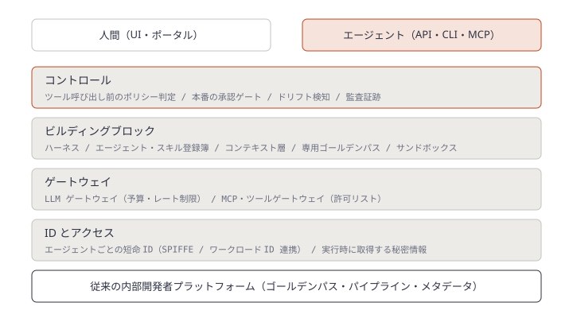
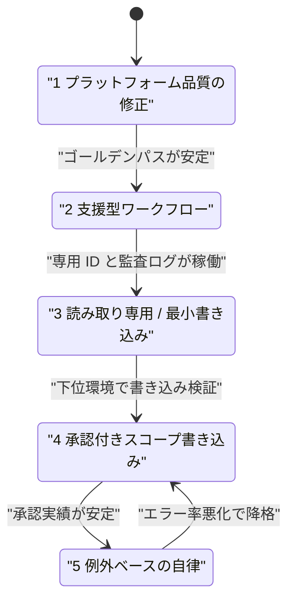
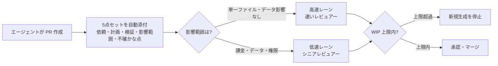
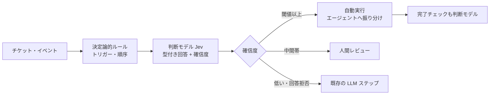

# Daily Briefing 2026-11-04

## 1. プラットフォームエンジニアリングにおける AI: エージェントがプラットフォームに加わるとき（原題: AI in Platform Engineering: When Agents Join Your Platform）

- **URL**: https://spacelift.io/blog/ai-in-platform-engineering
- **公開日**: 2026-10-15
- **著者・媒体**: Ioannis Moustakis（レビュー: Tim Davis） / Spacelift Blog

### 本文翻訳

**AI とプラットフォームエンジニアリングの接点。** 多くの組織はすでに内部プラットフォームを持っている（DORA 2025 レポートでは約90%、専任のプラットフォームチームを置く組織が76%）。つまり AI を載せる土台はある。AI が入り込む経路は3つ。(1) **アシスタント**: コードや設定の生成、社内ドキュメントへの Q&A、サービスの雛形作成、インシデント要約。Claude Code・Cursor・Kiro・OpenAI Codex などがコーディングを担う。(2) **オペレーター**: インフラに対して行動するエージェント。SRE エージェントがログを集め、シグナルを相関させ、修正を提案し、PR を開き、インシデント中にプラットフォーム操作を行う。(3) **AI ワークロード**: GPU スケジューリングや推論エンドポイントのホスティング（本稿では扱わない）。

**エージェントは新しい種類のプラットフォーム利用者である。** エージェントの挙動は完全には決定論的でないため、失敗モードをあらかじめ設計に組み込む必要がある。推奨されるメンタルモデルは「**ミスをする利用者として扱う**」こと。人間と同じセルフサービス経路を使わせるが、制限はより厳しくする。要件は4つ。①エージェント固有の ID（短命・最小権限で、個別に失効できる資格情報）、②所有者とライフサイクル（責任を負う名前のある所有者と、想定外の挙動を止めるキルスイッチ）、③ガードレール・クォータ・予算（エージェント ID ごとのレート制限、支出上限、トークン上限。エージェントは24時間高速に動くため）、④可観測性（監査ログ、トレース、推論、ツール呼び出しを帰属可能かつ検索可能にする）。とくに PR レビュー、ビルド失敗の切り分け、依存関係のパッチ、デプロイ検証など**デリバリーに触れる場面**で重要になる。エージェントには UI ではなく API・CLI・MCP サーバーを使わせる。ドキュメントは検索取得向けに書き直す。Markdown 版を用意し、1ページ1トピック、タスクごとの正規の例、制約と「やってはいけないこと」を冒頭に置く。リポジトリには AGENTS.md / CLAUDE.md、スキル、利用可能な MCP ツールを含める。

**プラットフォームはどう進化すべきか。** 従来の内部開発者プラットフォームの上に4群の部品を足す。**ID とアクセス**: SPIFFE やクラウド IAM のワークロード ID 連携で検証可能な短命 ID を発行し、秘密情報は Vault に置いてエージェントとタスクの両方にスコープを絞って実行時に取得する。**ゲートウェイ**: LLM ゲートウェイ（LiteLLM、Portkey、Envoy AI Gateway）がプロバイダ資格情報を一元管理し、アプリ・チーム・エージェント単位で予算とレート制限を強制する。MCP／ツールゲートウェイがサーバーとツールの許可リスト、集中ログ、資格情報の受け渡しを担い、エージェントが長期の秘密を持たないようにする。**ビルディングブロック**: エージェントハーネスは新しいプラットフォーム業務の層となる。エージェント・スキル・プロンプトの中央登録簿、サービス境界や依存関係を供給するコンテキスト層、ポリシーチェックを内蔵したエージェント専用ゴールデンパス、境界のある使い捨てサンドボックスを用意する。**コントロール**: 実行前にすべてのツール呼び出しをポリシーで判定し、本番の高リスク操作には承認ゲートを置く。業務上重要なシステムでは読み取りは自由に、状態変更は人間の承認を必須にする。定期的なドリフト検知と、人間・エージェントを問わない監査証跡を持つ。

**段階的な導入パス。** 第1段階は**プラットフォーム品質の修正**。テンプレートの不統一、ドキュメント欠落、エラーの多いデプロイはそのままエージェントの失敗になる。第2段階は**支援型ワークフロー**（コード生成、Q&A、要約）。低リスクで、コンテキストとドキュメントの穴をあぶり出す。第3段階は**読み取り専用または最小限の書き込み**。専用 ID を持たせ、ドリフト分析や失敗した実行の要約、修復計画の起案をさせ、ID と可観測性を検証する。第4段階は**承認付きのスコープを絞った書き込み**。PR を開き、サンドボックスや下位環境で変更を適用し、重要な変更は人間が承認する。第5段階は**例外ベースの自律**。安定して成果を出しているワークフローに限り変更ごとの承認を外し、人間はエスカレーション先とサンプリングレビューに回る（記事はこれを大規模にはまだ将来目標と位置づける）。自律は**ワークフロー単位・エージェント単位**で、第1〜4段階を通過したものにだけ与える。計測は、変更リードタイム・インシデント率・変更失敗率・復旧時間に加え、エージェントあたりのコスト、パイプライン中の AI 生成コード量、AI 生成変更のエラー率、AI 起因のドリフトを追う。

**未解決の論点。** 可観測性・統制・専用 ID のない弱いプラットフォームにエージェントを足しても成果は弱い。決定論的なパイプラインに非決定的なエージェントが入るため、リトライや冪等性の前提を見直し、合否はテスト・スキャナ・ポリシーに決めさせる。MCP は2026年7月の仕様でステートレス設計に移るなど変化が速い。トークン消費はタスクで大きく揺れるため、当面は ID 単位・実行単位の予算上限が現実的な統制手段となる。

### 重要ポイント
- エージェントは「ミスをする利用者」として、人間と同じゴールデンパスを**より厳しい制限で**使わせる
- 必須の4要件: エージェント固有の短命 ID、名前のある所有者とキルスイッチ、ID 単位の予算・レート制限、帰属可能な監査ログ
- 自律は5段階（品質修正 → 支援 → 読み取り専用 → 承認付き書き込み → 例外ベース自律）で、**ワークフロー × エージェント単位**に獲得させる
- 第1段階は AI 導入ではなく**既存プラットフォームの品質修正**。壊れたテンプレートはそのままエージェントの失敗になる
- 計測は既存の DORA 系指標に AI 固有の4指標（エージェント別コスト、AI 生成コード量、AI 変更のエラー率、AI 起因ドリフト）を重ねる

### 図解

レイヤーの積み重ねそのものが記事の主張（従来基盤の上に4層を足す）なので SVG で描く。



段階的な自律の獲得は状態遷移として表せる。



### 戦略分析

**フレームワーク**: ケイパビリティ成熟度モデル

| 段階 | 完了条件（次段階へ進む根拠） | 記事が挙げる失敗パターン |
|---|---|---|
| 1 品質修正 | テンプレート統一、ドキュメント整備、デプロイが安定 | 壊れたテンプレートがそのままエージェントの失敗に |
| 2 支援 | 人間向けの生成・Q&A が日常化し、文脈の穴が洗い出された | — |
| 3 読み取り専用 | エージェント専用 ID と監査ログで全操作が帰属可能 | 共有の人間アカウントで動かす |
| 4 承認付き書き込み | 下位環境での書き込みが安定、承認の記録が溜まる | 非決定的出力を冪等前提のパイプラインに流す |
| 5 例外ベース自律 | ワークフロー単位で実績があり、サンプリングレビューが機能 | 全ワークフローに一律で自律を与える |

**示唆**: 「AI-Ready の次」は新しいツール導入ではなく、**段階3の前提（エージェント専用 ID・ID 単位の予算・監査ログ）を先に整える**意思決定になる。多くの組織はエージェントを人間の個人トークンで動かしたまま段階4の書き込みを試しており、この表では段階2から3を飛ばしている。具体的には (1) エージェントの実行に使っている資格情報を棚卸しし、個人トークンをワークロード ID に置き換える、(2) 自律の付与を「チーム」ではなく「ワークフロー」単位で台帳管理する、の2点から着手するのが妥当。段階を降りる条件（エラー率悪化での降格）も最初から決めておく。

**反証条件**: エージェントがリポジトリ内のコード変更だけを行い、インフラや本番に一切触れない組織（PR を出して人間がマージするだけ）では、ID・ゲートウェイ層への投資は過剰になりうる。その場合の制約はプラットフォームではなくレビュー工程（本日の記事2）側にある。なお記事は段階ごとの効果を数値で示していないため、上表の完了条件は記事の記述からの整理である。

### 現場での適用方法

**CLAUDE.md / AGENTS.md への追記例**（記事の「ドキュメントは検索取得向けに、制約と禁止事項を冒頭に」を適用）:

```markdown
## エージェント運用の制約（必ず最初に読むこと）

- 本番環境（<PROD_ACCOUNT>）への状態変更は禁止。plan / diff の生成までに留め、適用は人間が行う
- 秘密情報をファイル・ログ・PR 本文に書かない。必要な値は `vault kv get <PATH>` で実行時に取得する
- 1タスクの LLM 予算は <BUDGET_USD> ドルまで。超えそうなら作業を止めて報告する
- インフラ変更は必ずゴールデンパス `templates/<SERVICE_TEMPLATE>` から作る。手書きの Terraform を新規に作らない

## 自律レベル（ワークフロー単位）

| ワークフロー | 段階 | 許可される操作 |
|---|---|---|
| 依存関係パッチ | 4 | PR 作成まで。マージは人間 |
| ドリフト分析 | 3 | 読み取りと修復計画の起案のみ |
| ドキュメント更新 | 5 | 自動マージ可（週次サンプリングレビュー） |
```

**スクリプト化の例**（エージェント用の資格情報が個人トークンでないことを CI で検査する）:

```bash
#!/usr/bin/env bash
# check-agent-identity.sh: エージェント実行ジョブが専用 ID で動いているか確認する
set -euo pipefail
EXPECTED_PREFIX="${AGENT_ID_PREFIX:-spiffe://<TRUST_DOMAIN>/agent/}"
ACTUAL="$(cat "${AGENT_IDENTITY_FILE:-/var/run/secrets/agent-id}" 2>/dev/null || true)"
if [[ -z "$ACTUAL" || "$ACTUAL" != "$EXPECTED_PREFIX"* ]]; then
  echo "ERROR: エージェントが専用ワークロード ID で実行されていません (got: '${ACTUAL:-none}')" >&2
  exit 1
fi
echo "OK: $ACTUAL"
```

### 期待効果
- エージェントの全操作が個別の ID に帰属し、問題発生時にそのエージェントだけを止められる（キルスイッチ）
- ID 単位の予算上限で、ループ暴走によるトークン費用の急増を抑えられる
- 自律の付与がワークフロー単位の台帳になり、「どこまで任せているか」を監査・説明できる
- 記事は効果の数値を示していない（DORA 2025 の普及率のみ）。効果は既存の変更失敗率・復旧時間と AI 固有4指標で自社計測する前提

### 注意点
- 記事はベンダー（Spacelift）のもので、後半は自社製品の紹介。段階モデルとレイヤー構成は製品に依存しないが、具体的な実装は自社スタックに読み替える
- MCP や A2A などの標準はまだ変化が速い。ゲートウェイ製品の選定は差し替え可能な構成にしておく
- 段階5（例外ベース自律）は記事自身が「大規模には将来目標」としている。目標を段階5に置くより、段階3〜4を確実に運用する方が先

## 2. エンジニアが遅いのではない、レビュー待ち行列が遅いのだ（原題: Your engineers are not slow. Your review queue is.）

- **URL**: https://dev.to/levelbrook/your-engineers-are-not-slow-your-review-queue-is-948
- **公開日**: 2026-09-21
- **著者・媒体**: Levelbrook Consulting / DEV Community（初出は Levelbrook playbook）

### 本文翻訳

コーディングエージェントはコード生成を速くしたが、出荷の速度はほとんど変わっていない。ボトルネックが人間のレビューに移ったからだ。今年コーディングエージェントを導入した多くのチームが行き着いた結論をまとめる。

**生成側は勝った。レビュー側には誰も知らせなかった。** コーディングエージェントがよく働くことは認める。detail.dev は、かつて四半期かかった移行や言語の書き換えをエージェントがこなせると報告している。同じ記事は、多くの組織が上半期に重い作業をエージェントへ回し、怪しいコードは大量にできたが良いソフトウェアはほとんどできなかったとも書いている。工場の1つの工程だけを強化し、残りはそのままにした状態である。

**作業はどこへ行ったのか。** 本番変更1件を分解すると、記述に約4時間、レビューに約20分、自動テストに約6分、デプロイに約5分。エージェントで記述は約12分になり、エンジニアは5〜15倍の変更を作れるようになったが、1件ごとに約20分のレビューが要ることは変わらない。1日のレビュー処理能力が40件の6人チームを考えると、作るのが40件でも400件でも出荷は40件で、残りは行列に並ぶ。苛立ったエンジニアは生産をやめるか、互いの変更を形だけ承認するか、気づかれないまま自分でマージする。これは1か月以内にインシデントログに現れる。

**誰も設計し直さなかった席。** ツール業界の対応は、テストを書き、PR をレビューし、指摘を直すエージェントをさらに作ることだった。Macroscope は顧客の PR の40%を自動承認しているとするが、これはスポンサー枠での主張である。著者は、レビュアーを取り除くことは目的として誤りだと論じる。人間のレビュアーは**説明責任の拠点**だからだ。名前のある人がその変更を承認し、責任を問える。自動承認ではログの1行しか残らない。差分を読むことは自動化できても、差分の責任を引き受けることはできない。だからエンジニアの主な仕事はレビューになり、課題は形骸化させずにレビューを速くすることになる。

**速いレビュー席とはどんなものか。** 「8秒の判断」とは、有能なレビュアーが関係するものをすべて持ち、無関係なものを何も持たないときに要する時間のこと。ところが多くのレビューツールは、差分から意図を再構築する20分のレビュー向けに作られている。エージェントが書いたコードは、意図がプロンプト・計画・トランスクリプトに記録されているのに、レビューツールはそれを捨ててしまう。レビュアーに必要なのは5つ。**依頼内容、計画、実施した検証、影響範囲（blast radius）、エージェントが確信を持てなかった点**。最後の項目はどこに集中すべきかを示すのでとくに有用だ。SWE-Bench Verified と Terminal-Bench で4モデル・176構成を比べた研究では、強いモデルでは明示的な計画は精度を上げず主にコストを下げた。計画は安く生成できるのだから、すべての PR に添付すべきだ。

**月曜日にやること。**
- **行列を測る**: 平均サイクルタイムではなく、人間待ちの変更の件数と、最も古いものの待ち時間を数える。週ごとに伸びていれば問題が起きている
- **レビュー席を取り除かず設計し直す**: プロンプトと計画を各 PR に自動添付する。エージェントには何をどう検証したかと不確かな点を固定書式で報告させる
- **影響範囲で振り分ける**: データに影響しない単一ファイルの変更は速いレビュアーの高速レーンへ、課金の変更はシニアの低速レーンへ
- **レビュアーに1日の判断予算を与える**: 終わりのない行列ではなく
- **仕掛かりに上限を設ける**: ラインのペースをボトルネックに合わせる製造業の原則。開いたままの PR はコードベースの変化とともに劣化する在庫である
- **自動承認は人間のレビューレーンが機能してから**: 易しい40%を自動承認すると、最も難しい60%が文脈の乏しい疲れたレビュアーに残る

### 重要ポイント
- 記述が4時間→12分になってもレビュー20分は変わらず、出荷量は**レビュー処理能力（例: 1日40件）で頭打ち**になる
- レビュアーは説明責任の拠点。目標は「レビュアーを消す」ではなく「8秒で判断できるレビュー席を作る」
- PR に添付すべき5点: 依頼、計画、実施した検証、影響範囲、エージェントの不確かな点
- 計測は平均サイクルタイムではなく、**人間待ちの件数と最古の待ち時間**
- 自動承認の導入は最後。先にやると難しい60%だけが疲れたレビュアーに残る

### 図解



### 戦略分析

**フレームワーク**: バリューストリームマッピング × 制約理論（TOC）

| 工程 | 導入前 | 導入後 | 記事の主張 |
|---|---|---|---|
| 記述 | 約4時間 | 約12分 | 5〜15倍の変更量 |
| レビュー | 約20分 | 約20分 | **変化なし（制約）** |
| 自動テスト | 約6分 | 約6分 | — |
| デプロイ | 約5分 | 約5分 | — |
| レビュー待ち | 小 | 増大し続ける | 処理能力40件/日を超えた分が行列化 |

**制約**: TOC の5段階に当てはめると、記事の「月曜日にやること」はそのまま対応する。(1) 制約の特定＝人間待ち件数と最古の待ち時間を測る、(2) 制約の徹底活用＝5点セット添付で1件20分を短縮する（記事の言う8秒の判断）、(3) 他工程を制約に従属させる＝WIP 上限で生成を止める、(4) 制約の引き上げ＝影響範囲で振り分けて高速レーンの処理能力を上げる。自動承認は (4) の手段だが、(2)(3) の前に行うと難しい変更だけが残る。

**示唆**: 生成側（エージェントのライセンス追加、並列実行数の増加）への追加投資は、**レビュー待ちの最古時間が下がり始めるまで凍結する**のが合理的。代わりに PR テンプレートへの5点セット必須化と WIP 上限の設定という、ほぼ無償の施策を先に打つ。レビュアー増員は制約を動かすが固定費が増え、20分というレビュー1件の時間は変わらないので最後の選択肢になる。

**反証条件**: 変更の大半がエージェントの自己検証（テスト・型・ポリシー）だけで安全と判断できる領域、たとえばドキュメントや設定値の更新が中心の組織では、レビューは制約にならず、自動承認を先に入れてよい。また記事の4時間・20分は1件の例示であり実測分布ではない。自社のレビュー時間の分布を測ってから判断すること。

### 現場での適用方法

**PR テンプレート**（`.github/pull_request_template.md`。エージェントにもこの書式で埋めさせる）:

```markdown
## 依頼内容
<!-- 元の Issue / プロンプトへのリンクと1行要約 -->

## 計画
<!-- エージェントが実装前に立てた計画（箇条書き） -->

## 実施した検証
<!-- 実行したコマンドと結果。例: `npm test` 142 passed / `terraform plan` 差分3件 -->

## 影響範囲（blast radius）
- [ ] 単一ファイル・データ影響なし（高速レーン）
- [ ] 課金・個人データ・権限・マイグレーションに触れる（低速レーン）

## エージェントが確信を持てなかった点
<!-- レビュアーが最初に見るべき箇所。なければ「なし」と明記 -->
```

**CLAUDE.md への追記例**:

```markdown
## PR 作成のルール
- PR 本文は `.github/pull_request_template.md` の5項目をすべて埋める。空欄で出さない
- 「実施した検証」には実際に実行したコマンドと出力の要約を書く。「テスト済み」だけは不可
- 「確信を持てなかった点」は必ず1つ以上検討し、無い場合はその理由を書く
- 自分の開いている PR が <WIP_LIMIT> 件以上あるときは新しい PR を作らず、既存 PR の指摘対応を優先する
```

**スクリプト化の例**（人間待ちの行列を測る。GitHub CLI を使用）:

```bash
#!/usr/bin/env bash
# review-queue.sh: レビュー待ち PR の件数と最古の待ち時間を出す
set -euo pipefail
REPO="${1:?usage: review-queue.sh <OWNER/REPO>}"
gh pr list --repo "$REPO" --state open --search "review:required -is:draft" \
  --json number,createdAt --limit 500 |
python3 -c '
import json, sys, datetime as dt
prs = json.load(sys.stdin)
now = dt.datetime.now(dt.timezone.utc)
ages = [(now - dt.datetime.fromisoformat(p["createdAt"].replace("Z", "+00:00"))).total_seconds() / 3600 for p in prs]
print(f"waiting={len(prs)} oldest_hours={max(ages, default=0):.1f}")
'
```

週次で記録し、`waiting` と `oldest_hours` が週ごとに増えていれば生成側を絞る合図とする。

### 期待効果
- レビュアーが差分から意図を再構築する時間が減り、1件あたりのレビュー時間が下がる（記事の目標は「8秒の判断」）
- 影響範囲での振り分けにより、シニアの時間を課金・データ系の変更に集中できる
- WIP 上限により、劣化する在庫（開いたままの PR）とリベースの手戻りが減る
- 形だけの承認や自己マージが減り、それに起因するインシデント（記事は1か月以内に出るとする）を防げる

### 注意点
- Macroscope の「40%自動承認」はスポンサー枠での主張。数値を根拠にしない
- 「確信を持てなかった点」をエージェントが常に「なし」と書くと形骸化する。空欄理由の記載を必須にする
- WIP 上限は人間の開発者にも効く。上限値はレビュー処理能力の実測から決め、根拠なく小さくしない
- 影響範囲のラベルをエージェント自身に付けさせると過小申告のおそれがある。パス（`billing/`、`migrations/` など）から CODEOWNERS で機械的に決める方が安全

## 3. Jev のような判断モデルをソフトウェアファクトリーで使う方法（原題: How to use decision models like Jev in software factories）

- **URL**: https://www.port.io/blog/jev-in-software-factories
- **公開日**: 2026-10-29
- **著者・媒体**: Aaron Taylor、Sagi Keren / Port Blog

### 本文翻訳

**要点。** 判断モデル（decision model）は閉じた問いに答え、ラベル・スコア・Yes/No など固定された選択肢から型付きの値を確率つきで返す。Jev が最も成熟しているが、OpenAI の Decisions API、Microsoft の decision-1、オープンウェイトの Laya もある。判断モデルが価値を出すのは推論や文章作成ではなく**判断**の場面だ。筆者らの検証では、Jev は LLM ジャッジと同等以上の精度を、はるかに低いレイテンシとコストで出した。判断モデルはエージェントとルールのあいだに位置し、どちらも置き換えない。各回答に付く確信度が次に何をするかを決める。

**ファクトリーにある既存モデルとの違い。** LLM は PR の説明文・解説・コードのような開かれた出力を作る。判断モデルはあらかじめ定めた一覧から1つを選び、確信度を付ける。TypeSafe は Kahneman の「速い思考」になぞらえて Jev を「System One」モデルと呼ぶ。Jev は、トリガーと順序を扱う決定論的なワークフローと、生成的な作業をするエージェントのあいだに入る。比較すると、開かれた問いか閉じた問いか、自由文か型付き出力か、数秒か 70〜500ms か、トークン課金か入力のみの課金か、という違いになる。長い生成応答がないので出力は無料になる。弱点は説明と多段の論理である。実用上の目安は、**すべての答えにすでに名前が付いているなら、LLM より判断モデルが向いている可能性が高い**ということだ。

**ファクトリーが繰り返し下す判断。** エージェント型 SDLC で繰り返し現れる判断は6種類ある。
- **チケットの優先度**: チケット本文だけに頼らず、サービスの重要度、SLA フラグ、再発回数で緊急度を順位づける
- **リソースの所有者**: 孤立したサービスの所有者を、コミットメッセージの記述ではなくデプロイ履歴とカタログのタグから特定する
- **適切なエージェントへの振り分け**: 固定のチーム一覧から担当エージェントを選ぶ。LLM の推測は他の出力と同じ自信で語られてしまう
- **インシデント時の Runbook 選択**: 類似の過去インシデントを解決した頻度で Runbook を順位づける。スコアリング問題として扱う
- **スキル選択**: サービス再起動、ログ照会、PR 作成のどれを呼ぶかを、環境や凍結状態などの構造化された状態から決める
- **評価とスキルの健全性**: 修正がチケットを解決したか、スキルの解決率が多数の呼び出しで維持されているかを確認する

どれも結果が有限なので、安く速い判断モデルが生成モデルより向いている。

**経済性。** チケットの作成からマージ済みの修正までを、分類2回（優先度・振り分け）と完了チェック2回（ステップ確認・評価）の計4判断としてモデル化する。Jev で4判断を回すとチケット1件あたり約 $0.00042、生成モデルでは約 $0.0082〜$0.0503 で、モデル階層により約20〜120倍になる。月1万チケットなら LLM で $82〜$503、判断モデルで $4.20。1,000回あたりでは、分類が Jev $0.14 に対し高速 LLM $3.70、高性能推論モデル $24.73。完了チェックは Jev $0.07 に対し LLM $0.40。

**ファクトリーを作り直さずに導入する方法。** 段階的に3ステップで進める。
1. **閉じた判断を1つ選ぶ**。完了チェックか意図分類が最も良い出発点
2. **まずオフラインで試す**。ラベル付きの実データを流し、自社のトラフィックで確信度が正しさに追随するかを確かめる
3. **確信度の閾値を置き、LLM をフォールバックに残す**。閾値以上は自動で実行し、中間帯は人間のレビューへ、低確信度は既存の LLM へ回す

閾値の具体値は示さず、自社のラベル付きデータから決めるべきだとする。今後はファクトリーの判断が人間から LLM へ、さらに判断モデルへと移り、生成モデルが作業をし、判断モデルが工程間の閉じた問いに答える形になる、と結ぶ。

**FAQ。** Jev はコーディングエージェントを置き換えない（TypeSafe のドキュメントもそう明言している）。現時点ではホスト型 API のみで、セルフホストや VPC の選択肢は公開されていない。エンタープライズ契約ではデータ保持ゼロにでき、利用者データで学習しない。ローカル配備には ModernBERT ベースの Laya が近いが、初期状態の較正は弱い。料金は入力100万トークンあたり $0.042 で出力は無料。大規模ではコストよりレイテンシが制約になりやすく、入力が大きいと応答は1秒に近づく。誤判断への備えは生の出力を信じることではなく閾値で、Harness の検証ではすべての誤りがモデル自身が不確かと示した帯に収まっていた。顧客ごとのファインチューニングは不要で、挙動は各呼び出しで送る状態・指示・基準で調整する。そのため精度は、判断とその根拠をどれだけ明確に記述するかに依存する。

### 重要ポイント
- 判断の目安: **すべての答えにすでに名前があるなら判断モデル**、開かれた出力が要るなら LLM
- ファクトリーの頻出判断は6種（優先度、所有者、振り分け、Runbook、スキル選択、評価・健全性）
- チケット1件4判断で Jev 約 $0.00042 に対し LLM 約 $0.0082〜$0.0503（約20〜120倍）
- 導入は「1判断 → オフライン検証 → 閾値 + LLM フォールバック」の3ステップ。閾値は自社のラベル付きデータで決める
- 誤判断はモデル自身の低確信度帯に集中した（Harness の検証）。だから**3レーン振り分け**（自動・人間・LLM）が効く

### 図解



### 戦略分析

**フレームワーク**: 単位経済性（ユニットエコノミクス）

| 単位 | Jev | 生成モデル | 出典 |
|---|---|---|---|
| 分類 1,000回 | $0.14 | $3.70（高速）〜$24.73（推論） | 記事の表 |
| 完了チェック 1,000回 | $0.07 | $0.40 | 記事の表 |
| チケット1件（4判断） | $0.00042 | $0.0082〜$0.0503 | 記事の試算 |
| 月1万チケット | $4.20 | $82〜$503 | 記事の試算 |

**構造の読み方**: 月1万チケットでも LLM 側は最大 $503 であり、**金額の差だけでは移行の意思決定は動かない**規模である（記事自身も、大規模ではレイテンシの方が制約になるとしている）。本当に変わるのは単位あたりの判断コストが約20〜120分の1、レイテンシが数秒から 70〜500ms になることで、「**これまで高くて置けなかった判断を全工程に置ける**」点にある。たとえば全ステップ後の完了チェックや、スキル呼び出しごとのゲートがそれにあたる。

**示唆**: 既存の LLM 判定を判断モデルに置き換えてコストを削るより、**今は判定を置いていない工程に完了チェックを足す**方へ投資を向ける。手順は (1) パイプライン中で「答えに名前がある」判断を棚卸しする、(2) 最も頻度が高いもの1つ（完了チェックか振り分け）を選ぶ、(3) 過去のラベル付きデータ数百件で確信度と正解率の関係を測ってから閾値を決める、の順。

**反証条件**: 判断の選択肢が頻繁に増減する、あるいは判断に多段の推論や説明が必須な領域（監査で理由の記録を求められる承認など）では、判断モデルの「出力無料・説明なし」が欠点になり、LLM のままの方が総コストが低い。また記事のコスト表は筆者らの試算で、精度比較の詳細データは示されていない。自社データでの検証が前提になる。

### 現場での適用方法

**運用手順: 完了チェック1つを判断モデルに載せる**

1. 対象の判断と選択肢を固定する（例: 「この修正はチケットを解決したか」= `resolved` / `not_resolved` / `needs_human`）
2. 過去のチケットから正解ラベル付きのサンプルを集める（`labeled.jsonl`、1行に `{"state": {...}, "label": "resolved"}`）
3. オフラインで確信度別の正解率を測り、閾値を決める
4. 本番では閾値以上のみ自動、中間帯は人間、低確信度は既存 LLM へ回す
5. 週次で中間帯のサンプルにラベルを付け、閾値を見直す。モデルはエイリアス（`latest` など）ではなくバージョンを固定する

**スクリプト化の例**（手順3: 確信度の帯ごとの正解率を出す。`decide()` は利用中の判断モデル API に合わせて実装する）:

```python
#!/usr/bin/env python3
"""calibrate.py: labeled.jsonl を判断モデルに流し、確信度の帯ごとの正解率を出す"""
import json
import sys
from collections import defaultdict

def decide(state: dict) -> tuple[str, float]:
    """判断モデルを呼び、(選んだラベル, 確信度) を返す。<MODEL_ID> はバージョン固定で指定する。"""
    raise NotImplementedError("利用中の SDK で実装する（例: OpenRouter 経由で <MODEL_ID> を呼ぶ）")

def main(path: str) -> None:
    buckets = defaultdict(lambda: [0, 0])  # 帯 -> [正解数, 件数]
    with open(path, encoding="utf-8") as f:
        for line in f:
            row = json.loads(line)
            label, conf = decide(row["state"])
            band = min(int(conf * 10), 9) / 10  # 0.0, 0.1, ..., 0.9
            buckets[band][0] += int(label == row["label"])
            buckets[band][1] += 1
    print("band   n     accuracy")
    for band in sorted(buckets):
        ok, n = buckets[band]
        print(f"{band:.1f}+  {n:<5} {ok / n:.3f}")

if __name__ == "__main__":
    main(sys.argv[1] if len(sys.argv) > 1 else "labeled.jsonl")
```

出力で正解率が目標（例: 誤りのコストが高い判断なら 0.98 以上）を超える最低の帯を自動実行の閾値にし、その下の帯を人間レビューの中間帯にする。

**CLAUDE.md への追記例**（エージェントに判断モデルの使いどころを守らせる）:

```markdown
## 判断モデルの使い分け
- 答えの選択肢が固定されている判断（優先度、担当振り分け、完了チェック）は判断モデル `<MODEL_ID>` を使う。LLM に自由文で判断させない
- 判断モデルの確信度が `<AUTO_THRESHOLD>` 未満の結果で自動実行しない。中間帯は `needs-human` ラベルを付けて止める
- 理由の説明が必要な場合は、判断は判断モデル、説明文は LLM と役割を分ける
```

### 期待効果
- 判断1回あたりのコストが記事の試算で約20〜120分の1になり、これまで置けなかった工程にもチェックを追加できる
- レイテンシが 70〜500ms になり、パイプラインの各ステップにゲートを置いても待ち時間が増えにくい
- 誤りがモデル自身の低確信度帯に集まる性質（Harness の検証）を使い、人間レビューを中間帯に集中できる

### 注意点
- Jev は現時点でホスト型のみ。データの持ち出しに制約がある環境では、契約条件（データ保持ゼロ）か Laya などのローカルモデルを検討する
- 確信度は正しさの保証ではない。閾値は必ず自社のラベル付きデータで決め、モデルの更新時に測り直す
- 判断の記述（送る状態・基準）の質が精度を決める。チケット本文だけを送ると、記事が推す「構造化された状態で判断する」利点が失われる
- コスト差は絶対額では小さい（月1万件で数百ドル）。コスト削減を主目的にした置き換えは移行工数に見合わないことがある
