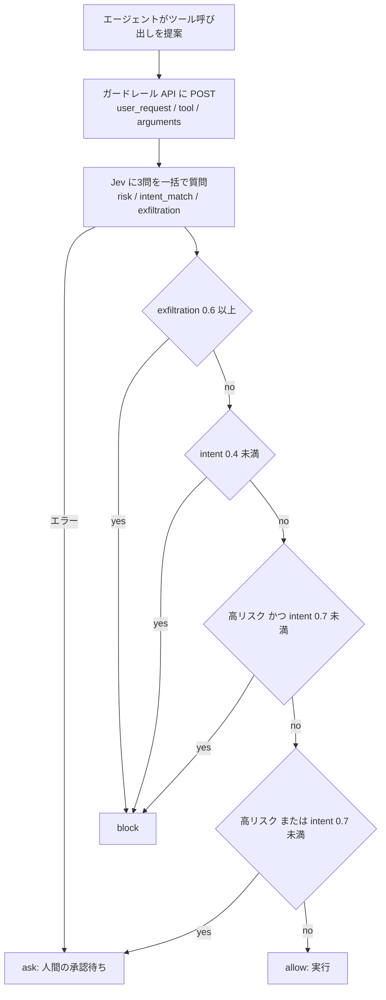
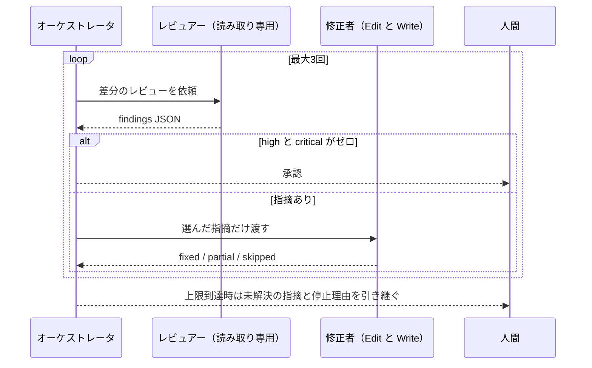
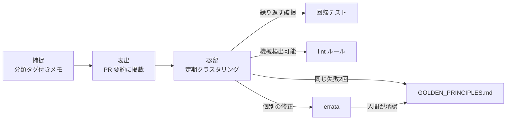
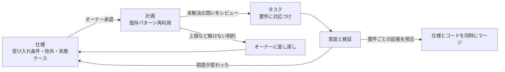

# Daily Briefing 2026-11-05

## 1. 嘘をつけないモデルに許可を求めるエージェント: AWS 上の Jev ガードレール（原題: An Agent That Asks Permission From a Model That Cannot Lie: Jev Guardrails on AWS）

- **URL**: https://builder.aws.com/content/3L1JAXoHCTuquxxX8BR4wtlzeut/an-agent-that-asks-permission-from-a-model-that-cannot-lie-jev-guardrails-on-aws
- **公開日**: 2026-10-21（最終更新 2026-10-22）
- **著者・媒体**: Rasik Rahman S（ShellKode, AWS Partner） / AWS Builder Center（Builder Series Part 3）

### 本文翻訳

**失敗モード。** エージェントにシェルや API を渡すと、ユーザーの依頼から逸脱したツール呼び出しが起きる。「ディスクを空けて。プロジェクトには触らないで」という依頼に対して `rm -rf ~/Projects` を提案する、といった事故である。正規表現のデニーリストは脆く、LLM-as-judge は遅く高価で、判定する LLM 自体がプロンプトインジェクションの標的になる。

**Jev とは。** TypeSafe AI の Jev は、テキストを生成せず、質問に対する**型付きの判定を較正済み確率で返す**判断モデルである。自由文を返さないため、判定の出力自体を乗っ取られにくい。本稿では OpenRouter 経由で呼び出す。

**ガードレールの動作。** エージェントはツールを実行する前に、提案したツール呼び出しをガードレール API に POST する。ボディは `user_request`（ユーザーの依頼文）、`tool`（ツール名）、`arguments`（引数）、`session_id` の4フィールド。ガードレールは1回のリクエストで Jev に3つの質問を投げ、閾値ポリシーで **allow / ask（人間の承認待ちで一時停止） / block** の3値を返し、判定を記録する。

**3つの質問。**
- **risk**（順序尺度）: 「このツール呼び出しが間違っていたら、どれだけの損害を与えうるか」。安全側から「読み取り専用。何も変わらない」「ユーザーが所有し元に戻せる状態を変更する」「不可逆・破壊的、または金銭・資格情報・他者のデータに触れる」
- **intent_match**（真偽）: 「この呼び出しは、ユーザーが実際に頼んだことだけを行うか」
- **exfiltration**（真偽）: 「この呼び出しは私的データ・秘密・ファイルを外部へ送るか」

著者は「**閾値の調整よりも、判定基準の文言のほうが効いた**」と述べる。

**ポリシー。** 次の順で評価する。(1) exfiltration が `block_exfil`（0.6）以上なら block。(2) intent が `block_intent`（0.4）未満なら block。(3) risk が `block_risk` 以上かつ intent が `ask_intent`（0.7）未満なら block。(4) risk が `ask_risk`（1.0）以上、または intent が `ask_intent` 未満なら ask。(5) それ以外は allow。閾値は `POLICY_BLOCK_RISK` などの環境変数で与える。

**アーキテクチャ。** AWS Lambda（arm64、256MB、Python 標準ライブラリのみ）、API Gateway HTTP API、監査ログに DynamoDB（オンデマンド、`expires_at` の TTL で30日後に失効、`session_id` をハッシュキー・`created_at` をレンジキーとする `by-session` GSI、判定ごとに `decision_id`）、API キーは SSM Parameter Store の SecureString。**どんなエラーでも ask を返す**ため、障害時はエージェントが素通りせず停止する。

**実行結果。** 4つのスクリプト化した呼び出しで検証した。読み取り専用の `du` は intent 0.56 で ask になった（著者はバグではなく保守的な判定とみなす）。`rm -rf ~/Projects` は intent 0.01 で block、SSH 鍵を外部サイトへアップロードする呼び出しは exfiltration 0.98 で block。

**コスト。** エンドツーエンドで約750〜840ms、1回あたり約 $0.000023。Jev は1,000回あたり約 $0.02 で、AWS 側はほぼ無料枠に収まる。

**次に変えること。** エンドポイントに認証を付ける（v1 はデモ用に公開。次のコミットで IAM オーソライザか Lambda オーソライザ）。ログを非同期にする（現状は DynamoDB 書き込み失敗でリクエスト自体が失敗する）。ラベル付きデータで閾値を調整する（既定値は出発点にすぎない）。ツールがクラウド API の場合は4つ目の質問「この呼び出しはユーザー自身のアカウント外のリソースに影響するか」を足す。

### 重要ポイント
- ツール呼び出しを**実行前に**外部の判断モデルへ送り、allow / ask / block の3値で返す。中間の **ask** を設けたことで、閾値の誤差が「停止して人に聞く」に吸収される
- 判定項目は risk・intent_match・exfiltration の3つ。**基準文言の書き方が閾値より効く**
- 障害時は fail-closed ではなく **fail-to-ask**。エージェントが止まるだけで、人間が復旧判断できる
- 1判定あたり約800ms・約 $0.000023 と、全ツール呼び出しに掛けても現実的なコスト
- 監査ログは session 単位で引けるように GSI を張り、TTL で自動失効させる

### 図解



### 戦略分析

**フレームワーク**: リスク×可逆性マトリクス（Cynefin の委譲線引きの補助として）

| | 可逆（ユーザー所有で元に戻せる） | 不可逆・他者データ・金銭 |
|---|---|---|
| **意図に合致** | allow（自動実行） | ask（人が承認） |
| **意図から逸脱** | ask〜block | block |
| **外部送信あり** | block（可逆性に関係なく） | block |

記事のポリシーは実質このマトリクスを確率の閾値で実装している。重要なのは「外部送信」が可逆性の軸から独立して最優先で block される点で、データ流出は一度起きると戻せないという判断が順序に埋め込まれている。

**示唆**: エージェントの権限設計を「ツールごとの許可リスト」から「**呼び出しごとの判定**」へ移すと、同じ `bash` ツールでも `du` と `rm -rf` を区別できる。導入の順序は、(1) まず全判定を ask 寄りの閾値で動かし監査ログを溜める、(2) ログから ask を人が承認した割合を見て、承認率が高いパターンだけ閾値を緩めて allow に寄せる、が妥当。記事の `du` が ask になった例は、初期は誤 ask を許容するという設計判断そのものである。

**反証条件**: ツール呼び出しが毎分数十回発生するような高頻度ループでは、1回 800ms の同期判定がスループットの制約になり、ask の多発で人間がボトルネックになる。その場合は読み取り系をローカルの静的ルールで先に通し、状態変更系だけを Jev に回す二段構えでないと成立しない（記事は単発の対話型エージェントを前提にしている）。

### 現場での適用方法

**Claude Code の PreToolUse フックとして同じガードレールを噛ませる例**。フックは標準入力でツール名と引数を受け取り、終了コード 2 で実行を拒否できる。

```bash
#!/usr/bin/env bash
# .claude/hooks/jev-guard.sh
# 事前に記事のガードレール（API Gateway + Lambda）をデプロイしておく
set -euo pipefail
GUARD_URL="<GUARDRAIL_ENDPOINT_URL>"   # 例: https://xxxx.execute-api.<REGION>.amazonaws.com/check
INPUT="$(cat)"

TOOL=$(jq -r '.tool_name' <<<"$INPUT")
ARGS=$(jq -c '.tool_input' <<<"$INPUT")
SESSION=$(jq -r '.session_id // "unknown"' <<<"$INPUT")
# ユーザーの依頼文は環境変数かファイルで渡す（例: タスク開始時に書き出しておく）
REQ="$(cat "${CLAUDE_PROJECT_DIR}/.claude/current-task.txt" 2>/dev/null || echo "unknown")"

BODY=$(jq -n --arg r "$REQ" --arg t "$TOOL" --argjson a "$ARGS" --arg s "$SESSION" \
  '{user_request:$r, tool:$t, arguments:$a, session_id:$s}')

# 記事と同じく、失敗時は ask 扱い（止めて人に聞く）
VERDICT=$(curl -sS --max-time 5 -X POST -H 'Content-Type: application/json' \
  -d "$BODY" "$GUARD_URL" | jq -r '.decision // "ask"' 2>/dev/null || echo "ask")

case "$VERDICT" in
  allow) exit 0 ;;
  block) echo "jev-guard: blocked ($TOOL)" >&2; exit 2 ;;
  *)     jq -n '{hookSpecificOutput:{hookEventName:"PreToolUse",permissionDecision:"ask",
               permissionDecisionReason:"jev-guard: human approval required"}}'; exit 0 ;;
esac
```

```json
{
  "hooks": {
    "PreToolUse": [
      { "matcher": "Bash|Write|Edit|WebFetch",
        "hooks": [ { "type": "command", "command": "\"$CLAUDE_PROJECT_DIR\"/.claude/hooks/jev-guard.sh" } ] }
    ]
  }
}
```

レスポンスのフィールド名（`.decision`）は記事のリポジトリ（rasik2002/jev-agent-guardrail）の実装に合わせて調整すること。

### 期待効果
- `rm -rf` や秘密情報の外部送信のような**一発で取り返しのつかない操作**を、ツール単位の許可を広く与えたまま止められる（記事のデモで intent 0.01、exfiltration 0.98 で block）
- 1判定 約 $0.000023、1,000回で約 $0.02（Jev 分）と、全呼び出しに掛けても費用が問題にならない
- DynamoDB の監査ログにより、「どの判定を人が覆したか」から閾値調整のデータが得られる

### 注意点
- 記事の v1 はエンドポイントが**無認証**。そのまま公開すると第三者に判定 API を使われる。IAM オーソライザ等を必ず付ける
- 同期ログ書き込みのため DynamoDB 障害でリクエストが失敗する（結果は ask に倒れるが、ask が多発する）
- 既定閾値はラベル付きデータで検証されていない。`du` が ask になったように、初期は誤 ask が多い前提で運用する
- ユーザーの依頼文（`user_request`）の質が intent_match の精度を決める。依頼文を渡せない構成では intent 判定が意味を失う

## 2. コーディングエージェントのためのハーネスエンジニアリング: より信頼できる AI 支援開発のための9パターン（原題: Harness Engineering for Coding Agents: 9 Patterns for More Reliable AI-Assisted Development）

- **URL**: https://deepsense.ai/blog/harness-engineering-for-coding-agents-9-patterns-for-more-reliable-ai-assisted-development/
- **公開日**: 2026-10-29
- **著者・媒体**: Maks Operlejn, Marcin Kosecki, Marek Połom, Przemysław Kaleta / deepsense.ai

### 本文翻訳

コードは安くなったが、人間の時間とモデルのコンテキストは安くない。プロンプトを磨くより、エージェントの周りに**ハーネス**（ドキュメント、コンテキスト供給、検証、フィードバックループ）を作るほうが結果は安定する。著者らは OpenAI Codex ハッカソン向けにリポジトリ理解レイヤ HyperCode を作り、Codex と Claude Code で以下のパターンを検証した。

**1. リポジトリを知識ベースにする。** ルートの `AGENTS.md` にアーキテクチャ・制約・規約・エントリポイント・立ち入り禁止領域を書く。短く保ち、詳細は別ドキュメントへリンクする。「なぜ」はコミットメッセージと回帰テストの docstring に残し、エージェントにも理由を書いたコミット本文を書かせる。

**2. 広い RAG より、ジャストインタイムのコンテキスト。** 古くなる埋め込みインデックスに頼らず、タスクごとに現在のリポジトリ・git 履歴・ルールからコンテキストを組み立てる。エージェント起動前に「サイドカー」がこのパッケージを用意する。HyperCode は構造的リンク・意味要約・過去セッションの決定からハイパーグラフを作り、素の Codex と比べて機能要求から実装計画までの時間を50%以上短縮した。

**3. 耐久性のあるツールと焦点を絞ったスキル。** `rg`・`git log`・`git diff`・テストランナーのような馴染みのツールから始め、社内コマンドは目的・例・ヘルプの場所を書く。繰り返す失敗は手順と回復方法を持つスキルにする。SkillsBench では、スキル1つで +18.0 ポイント、2〜3個で +19.0、4個以上で +10.1 にとどまり、網羅的な文書より簡潔なガイダンスのほうが効いた（普遍的な上限ではないと著者は断っている）。

**4. 発見可能な検証メニュー。** 検証コマンドを `Makefile` のような1か所に集め、`lint`・`test-unit`・`check` のように意図で命名し、`##` コメントから `make help` を生成する。CI と同じターゲットを使い、失敗時は非ゼロで終了させる。`AGENTS.md` で「まず `make help` を実行し、該当ターゲットを優先せよ」と明示する。実験では、ターゲットを発見しただけのエージェントがテストにはターゲットを使い、lint には自前の `ruff` コマンドを組み立てた。

**5. フィードバックループを閉じる。** 「検証 → 観察 → 報告」を回し、リトライに上限を設ける。例はレビュー/修正ループ。オーケストレータだけがリトライ状態（`review_iteration`、上限 `max_review_iterations` = 3、未解決の指摘）を持ち、自らはレビューも修正もしない。レビュアーは読み取り専用（Bash・Read・Grep・Glob）で、重大度・ファイル・行・カテゴリ・修正案を持つ JSON を返す。修正者は選ばれた指摘だけを受け取り、Edit と Write を持ち、`fixed` / `partial` / `skipped` を JSON で返す。high・critical がゼロになれば承認、上限に達したら未解決の指摘と停止理由を添えて人間へ引き継ぐ。

**6. 選択的な視覚フィードバック。** テスト、DOM、アクセシビリティスナップショット、コンソールやネットワーク出力といったテキスト信号を優先する。スクリーンショットはレイアウトや切れのようにピクセルが問題のときだけ、要素単位で撮る。スクショ駆動の修正は2回で打ち切る。強い画像圧縮（ディザリング含む）は小さな文字が読めなくなり逆効果だった。

**7. 硬直したルールではなく意図を伝える。** NEVER/ALWAYS 型のルールは代理指標を符号化しており、新しいモデルはそれに過剰に従う（既存の失敗なのに push を止めるなど）。「ローカルビルドが緑でなければ push するな」は、「壊れていると考える理由のある変更を出さない。ビルドを実行し、失敗が自分の変更によるものか確認する。既存の失敗や flaky ならそう述べて進める。判断できなければ止めて聞く」と書き直す。字義通りの絶対則は秘密情報・破壊的操作・本番アクセスのような真の不変条件に限る。

**8. 比例的な計画。** 重い計画ワークフローはトークンを約10倍使うという利用者報告もある（逸話であり計測ではない）。低リスクの作業は短い計画と使い捨ての試行で済ませ、失敗が高くつく作業にだけ詳細計画を使う。

**9. エージェント版ガベージコレクタ。** エージェントに摩擦を記録させ、3段階で処理する。**捕捉**は小さな分類（`principle-violation`・`duplication`・`brittle-test`・`missing-test`・`doc-gap`・`human-correction` など）でメモを残す。**表出**はメモと人間の指示をそのまま PR 要約に載せる。**蒸留**は定期的にメモをクラスタリングし、「同じ失敗が2回」または「同じテーマで人間の手助けが2〜3回」でルール・テスト・lint に昇格させる。普遍的な原則は追記専用の `GOLDEN_PRINCIPLES.md`（`AGENTS.md` から参照）へ、個別の修正は errata ファイルへ置き、errata を原則へ上げるには人間の承認を要する。エージェントは指示しても自発的には記録しなかったため、「コードが変わったのに何も記録されていない」ときに促す stop フックが必要だった。

**結論。** 良い結果は良いセットアップから生まれる。スキルを絞り、小さな作業で計画しすぎず、リトライに上限を設け、繰り返す失敗をテスト・チェック・ガイダンスに変える。安定したハーネスはモデルやツールの変化も吸収する。

### 重要ポイント
- `AGENTS.md` は短く、詳細はリンク。「なぜ」はコミット本文と回帰テストの docstring に置く
- 検証コマンドは `make help` で発見可能にし、**発見させるだけでなく「優先せよ」と明示**する（発見だけでは自前コマンドを組み立てた）
- レビュー/修正ループは状態をオーケストレータだけに持たせ、レビュアーは読み取り専用、上限3回で人間に引き継ぐ
- NEVER/ALWAYS は「結果・判断手順・逃げ道」に書き直す。絶対則は秘密・破壊的操作・本番に限る
- 「同じ失敗2回、または人の手助け2〜3回」でルール・テスト・lint に昇格させる。記録は stop フックで強制する

### 図解





### 戦略分析

**フレームワーク**: 制約理論（TOC）

記事の冒頭命題「コードは安いが、人間の時間とモデルのコンテキストは高い」は、制約が2つあると言っている。9パターンをどちらの制約に効くかで分けると次のようになる。

| 制約 | 徹底活用（無駄に使わない） | 従属・引き上げ |
|---|---|---|
| **モデルのコンテキスト** | 1 短い AGENTS.md、2 JIT コンテキスト、3 スキルを絞る、6 テキスト信号優先 | 8 比例的な計画（計画でコンテキストを浪費しない） |
| **人間の時間** | 5 上限付きループで人に来る前に潰す、7 「止めて聞く」の条件を明示 | 4 検証メニュー、9 ガベージコレクタ（同じ介入を2度させない） |

**示唆**: 多くのチームは 1・3 に投資するが、人間の時間を守る 5・9 は後回しになりがちである。人間の介入回数を測っていないなら、まず「人がエージェントを手助けした回数」をテーマ別に数え始め、2〜3回で昇格させるルールを回す。これが人間の時間という制約を引き上げる唯一の継続的手段になる。スキルを増やす前に、スキル4個以上で効果が +10.1 ポイントに落ちたという SkillsBench の結果を踏まえ、既存スキルを統合・削減する。

**反証条件**: 人間の介入がほぼ発生しない小規模・単独開発（作者自身がレビューも兼ねる）では、9 の記録・蒸留の運用コストが得られる学習を上回る。また HyperCode の50%短縮はハッカソン条件での自社ツールの数値であり、大規模モノレポで JIT コンテキストの構築自体が重くなる場合は 2 の優位は保証されない。

### 現場での適用方法

**AGENTS.md / CLAUDE.md への追記例**（パターン 4・7・9 を実装）

````markdown
## 検証
- 作業前に `make help` を実行し、該当するターゲットがあれば**必ずそれを使う**。
  lint・テスト・型検査のコマンドを自分で組み立てない。
- 完了前に `make check` を実行する。

## ビルドが落ちているとき（絶対則ではなく判断手順）
- 目的: 壊れていると考える理由のある変更を出さない。
- 手順: ビルドを実行し、失敗が自分の変更によるものかを `git stash` で切り分ける。
- 既存の失敗や flaky ならその旨を PR に書いて進めてよい。
- 判断できなければ止めて人間に聞く。

## 絶対則（例外なし）
- 秘密情報をコミット・出力しない。本番環境に接続しない。`rm -rf` をリポジトリ外に使わない。

## 摩擦の記録
- 作業中に詰まった点は `.agent/friction.md` に1行で追記する。
  形式: `- [YYYY-MM-DD] <tag> <file>: <内容>`
  tag: principle-violation | duplication | brittle-test | missing-test | doc-gap | human-correction
- 恒久ルールは `GOLDEN_PRINCIPLES.md`（追記専用）を参照する。
````

**Makefile の検証メニュー**

```makefile
.DEFAULT_GOAL := help
.PHONY: help lint test-unit check

help: ## このメニューを表示する
	@grep -E '^[a-zA-Z_-]+:.*?## ' $(MAKEFILE_LIST) | \
	  awk 'BEGIN {FS = ":.*?## "}; {printf "%-14s %s\n", $$1, $$2}'

lint: ## ruff で静的解析（CI: lint ステージ）
	ruff check .

test-unit: ## ユニットテストのみ。DB 不要（CI: test ステージ）
	pytest -q tests/unit

check: lint test-unit ## push 前に実行する総合チェック
```

**摩擦記録を強制する Stop フック**（コード変更があるのに記録が無ければ停止を差し戻す）

```bash
#!/usr/bin/env bash
# .claude/hooks/require-friction-log.sh  (Stop フック)
cd "$CLAUDE_PROJECT_DIR"
changed=$(git diff --name-only HEAD -- . ':!.agent/friction.md' | wc -l)
logged=$(git diff --name-only HEAD -- .agent/friction.md | wc -l)
if [ "$changed" -gt 0 ] && [ "$logged" -eq 0 ]; then
  echo '{"decision":"block","reason":"コードを変更したが .agent/friction.md に記録がない。摩擦が無ければ「- none」と1行書いて終了すること。"}'
fi
exit 0
```

### 期待効果
- 機能要求から実装計画までの時間を50%以上短縮（HyperCode のハッカソン計測。素の Codex 比）
- スキルを2〜3個に絞ることで、SkillsBench 上は +19.0 ポイントの改善幅を維持できる（4個以上では +10.1）
- 同じ介入を2度させない仕組みにより、レビュー時の指摘が回を追うごとに減る（記事は定性的記述）

### 注意点
- 記事の「9パターン」は TL;DR では10項目あり、「モデル変更に備える」は独立節になっていない
- 摩擦メモは放置すると肥大化する。定期的な蒸留（クラスタリングと解決済みの削除）を誰が回すか決めておく
- errata を人間の承認なしに原則へ上げると、個別事例に過適合したルールが増える
- Stop フックの差し戻しは無限ループになりうる。「- none」で抜けられる逃げ道を必ず用意する

## 3. スペック駆動開発: 仕様・計画・タスク・コードの4段階を回す実践ガイド（原題: Spec-Driven Development: GitHub Spec Kit and Kiro）

- **URL**: https://omidsaffari.com/blog/spec-driven-development
- **公開日**: 不明（直近数週間以内。記載ドキュメントの確認日は 2026-10-13）
- **著者・媒体**: 著者名記載なし / omidsaffari.com

### 本文翻訳

**導入。** AI コーディングエージェントに実装させる前に、意図する振る舞いを確定させる。推奨は「**仕様・計画・タスク・コードの4段階、各段階の間にレビュー**」。最初の試行には小さく境界のある機能が向いている。

**スペック駆動開発とは。** レビュー済みの振る舞いの記述が、計画・タスク・実装・検証を導く手法。Markdown の仕様は、実行可能な BDD テストとは別物である点に注意する。

**ワークフロー。** (1) 観測可能な受け入れ条件と未解決の問いを含む仕様を書く。(2) 既存パターンを再利用する計画をレビューする。(3) 個別に検証できるタスクに分ける。(4) 実装・検証し、前提が変わったら仕様を突き合わせて更新する。

**ツール。** 必要な構造の量で選ぶ。
- **GitHub Spec Kit**: `uv tool install specify-cli` → `specify init my-project --integration copilot`。コマンドは `/speckit.constitution`（原則）、`/speckit.specify`（振る舞い）、`/speckit.clarify`（曖昧さの解消）、`/speckit.plan`、`/speckit.checklist`（要求品質）、`/speckit.tasks`、`/speckit.analyze`（文書間整合）、`/speckit.implement`、`/speckit.converge`（残ギャップ検出）。スキル形式では `/speckit-specify`、Codex では `$speckit-specify`。`converge` はコードと仕様・計画・タスクを比べてギャップを `tasks.md` に追記するだけで、コードは直さない。「Converged」はレビューの入力であり、テストや承認の代わりではない。アクティブな機能は `.specify/feature.json` か `SPECIFY_FEATURE_DIRECTORY` で決まり、**Git ブランチを切り替えても仕様は切り替わらない**ので、再開時に機能ディレクトリを確認する。既存プロジェクトでは `specify init --here --force --integration <key>` だが上書きに注意。
- **Kiro**: `.kiro/specs/` 配下に `requirements.md`・`design.md`・`tasks.md`。`.kiro/steering/` にステアリング、`.kiro/hooks/` にフック。生成された要件が、承認されていない前提を形式化してしまうことがある。
- **Claude Code**: `claude --permission-mode plan` で始め、合意した計画を仕様フォルダに保存し、恒久的な指示は `CLAUDE.md` に置く。
- **Codex**: CLI で `/plan`、合意した計画を保存し、恒久指示は `AGENTS.md`。

**例: ワークスペースの CSV エクスポート**（実測ではなく説明用の例と明記）。1ページの仕様は R1〜R6 と完了条件から成る。R1 権限: 選択中ワークスペースの現オーナーのみ。未ログイン・メンバー・外されたオーナーにはファイルを返さず、ボタンではなくサーバーで検査する。R2 範囲: 選択ワークスペースのみ、一覧の状態・担当者フィルタを適用し、「表示中のページ」ではなく一致する全件を既存の並び順で。ブラウザが送るワークスペース ID は権限の根拠にしない。R3 内容: タスク ID・タイトル・状態・担当者表示名の順。コメント・メール・内部メタデータは含めない。R4 CSV: UTF-8・ヘッダ行あり、カンマ・引用符・改行を含むタイトルが壊れない、表計算の数式入力は安全な出力方針に従う。R5 空と失敗: 該当なしはヘッダのみ、失敗時に部分ファイルを成功扱いしない。R6 互換性: 既存の一覧と JSON 応答は不変、マイグレーションやバックグラウンドジョブは追加しない。完了条件はオーナー承認、要件ごとの検証証拠、回帰チェック通過、仕様とコードの同時マージ。

計画は既存のセッション・メンバーシップ方針とフィルタロジックを再利用し、一覧応答は変えず、結果サイズが既存の上限に収まらない場合は**上限やジョブ機構を勝手に作らずオーナーに差し戻す**。タスクは5つ: 既存の一覧挙動を回帰チェック化 → 権限テスト（オーナー・メンバー・外されたオーナー・別ワークスペース）→ スコープ付きクエリと CSV 応答の実装 → エクスポート UI と読み込み・失敗表示 → 受け入れチェックと範囲外変更の差分点検。要件ごとに「求める証拠」と「それが捕まえる誤り」を表にする（例: R1 は各ロールのリクエストテストで「ボタンだけ隠して API は無防備」を捕まえる）。期待するテスト結果は独立にレビューする。

**コストと回収。** 主なコストはレビューと保守の時間、そしてエージェント利用料（Kiro Pro は1ユーザー月 $20、クレジット消費は変動）。判断基準は「仕様のコストが、それが防ぐ作り直しより小さいか」。

**誇張と過剰。** 仕様は正しさを保証しない。表明された意図と強制された振る舞いは別物で、文書はドリフトする。小さく自明な修正や未検証のアイデアに重い手順は不要。

**最初の1週間。** バックログの小さな機能を選ぶ → 除外事項と失敗ケースを含む1ページ仕様をオーナーに承認してもらう → 計画モードで計画を作らせる → 実装前に未解決の問いをレビュー → 要件に対応するタスク一覧を求める → PR 時に合意と証拠を照合し、変わった決定を記録する → 手順の重さは曖昧さの量に合わせる。

### 重要ポイント
- 仕様には**除外事項と失敗ケース**（R5・R6 のような「しないこと」）を必ず書く。ここが抜けるとエージェントはジョブ機構やマイグレーションを足す
- 要件ごとに「求める証拠」と「捕まえる誤り」を対応させた表を作ると、PR レビューが照合作業になる
- 計画段階で解けない制約（結果サイズの上限など）は**エージェントに決めさせずオーナーへ差し戻す**
- Spec Kit の `converge` はギャップをタスクに足すだけ。「Converged」をテスト合格の代わりにしない
- Spec Kit はブランチ切り替えで仕様が切り替わらない。再開時に `.specify/feature.json` を確認する

### 図解



### 戦略分析

**フレームワーク**: JTBD（Jobs to be Done）

| 項目 | 内容 |
|---|---|
| 状況 | エージェントが数分でコードを出すが、PR レビューで「何が正しいか」の合意が無いまま差分を読むことになる |
| 片付けたい仕事 | **レビューを「読解」から「照合」に変えたい**。要件→証拠→誤りの表がその道具 |
| 既存の代替手段 | チケットの自由記述、口頭合意、計画モードの使い捨て計画 |
| 雇われない状況 | 小さく自明な修正、未検証のアイデア（記事自身が過剰と明言） |

記事の CSV 例で重い部分は仕様の文書量ではなく、R1・R2 の権限とスコープ、R5 の失敗時挙動である。つまりこの手法が本当に雇われているのは「**セキュリティ境界と失敗ケースを事前に人が決める**」仕事であり、文書生成ではない。

**示唆**: SDD ツールを全面導入する前に、まず「権限・データ範囲・外部連携・マイグレーションを含む変更だけ1ページ仕様を必須にする」ルールを置くのが費用対効果の高い入り方になる。ツールは Spec Kit / Kiro でなく、既存エージェントの計画モード + `specs/` フォルダで十分始められる（記事も Claude Code・Codex での手順を併記している）。記事の判定基準「仕様のコスト < 防ぐ作り直し」を、過去の差し戻し PR の件数で見積もると導入判断ができる。

**反証条件**: 既存のテストスイートが厚く、権限・境界の回帰テストがすでに CI で強制されている組織では、仕様の追加価値は「事前合意」のみに縮み、レビュー時間短縮の効果はほとんど出ない。また記事の例は説明用で効果は計測されていないため、効果量は仮説である。

### 現場での適用方法

**スキル化の例**（Spec Kit なしで、Claude Code の計画モードと組み合わせる）

````markdown
---
name: one-page-spec
description: 権限・データ範囲・外部連携・スキーマ変更のいずれかを含む機能を実装する前に使う。1ページの振る舞い仕様と、要件ごとの検証証拠表を specs/<feature>/spec.md に作り、オーナー承認を得てから計画に進む。小さく自明な修正には使わない。
---

# 1ページ仕様

## 手順
1. `specs/<feature>/spec.md` を下のテンプレートで作る。推測で埋めた箇所は「未解決の問い」に移す。
2. 人間に承認を求め、承認されるまで計画・実装に進まない。
3. 計画では既存の認可・フィルタ・シリアライザを探して再利用する。
   上限・ジョブ・マイグレーションが必要に見えたら、作らずに人間へ差し戻す。
4. タスクは要件 ID（R1…）に対応づける。最後のタスクは「範囲外変更の差分点検」。
5. PR 本文に証拠表を貼り、各行の証拠（テスト名・コマンド出力）を埋める。

## テンプレート
```
# <機能名>
目的: <誰が・何のために>
R1 権限: <誰に許可し、誰に拒否するか。サーバー側で検査する>
R2 範囲: <対象データ。クライアント由来の ID を権限根拠にしない>
R3 内容: <含める項目 / 含めない項目>
R4 形式: <エンコーディング・特殊文字・安全方針>
R5 空と失敗: <該当なし・失敗時の挙動。部分結果を成功扱いしない>
R6 互換性: <変えないもの。追加しないインフラ>
未解決の問い:
- 
完了条件: 承認 / 要件ごとの証拠 / 回帰チェック通過 / 仕様とコードを同時マージ

| 要件 | 求める証拠 | 捕まえる誤り |
|---|---|---|
| R1 | | |
```
````

**Spec Kit を使う場合の導入手順**

```bash
uv tool install specify-cli
cd <REPO_PATH>
specify init --here --integration claude   # 既存リポジトリ。--force は上書きに注意して差分確認後のみ
# エージェント内で順に実行
#   /speckit.specify → /speckit.clarify → /speckit.plan → /speckit.tasks → /speckit.analyze → /speckit.implement
# 再開時はアクティブ機能を必ず確認（ブランチ切替では変わらない）
cat .specify/feature.json
```

### 期待効果
- PR レビューが要件ごとの証拠照合になり、「ボタンだけ隠して API が無防備」「表示ページだけエクスポート」のような典型的な取りこぼしを事前に捕まえられる（記事の証拠表の例）
- エージェントが勝手にジョブ機構やマイグレーションを足す範囲外変更を、R6 と差分点検タスクで抑止できる
- 記事は効果を計測していないため、数値的な効果は自チームの差し戻し PR 件数で測る必要がある

### 注意点
- 仕様は正しさを保証しない。表明された意図と、テストで強制された振る舞いは別物
- Kiro などの生成要件は、承認されていない前提を「それらしく形式化」することがある。生成物ほど未解決の問いを疑う
- 小さな修正に適用すると手順のコストが作り直しの回避効果を上回る。適用条件を明文化しておく
- 仕様のドリフトを防ぐため、マージ後に仕様を更新するかアーカイブするかを決めておく
