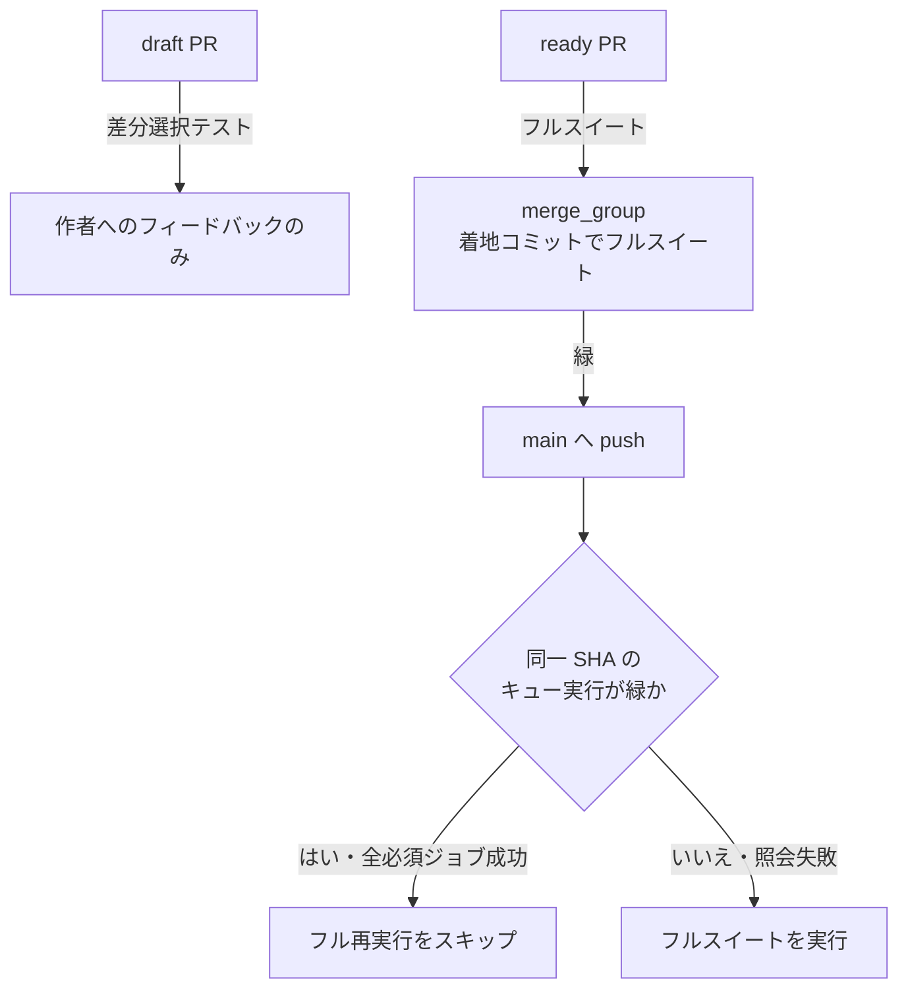
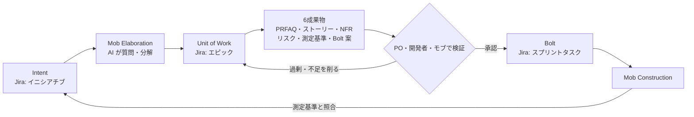
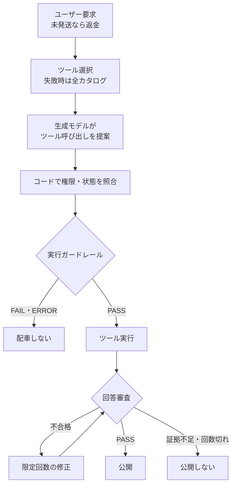

# Daily Briefing 2026-11-07

## 1. コーディングは速くなった。検証がボトルネックになった（原題: Coding Got Faster. Verification Became the Bottleneck）

- **URL**: https://dev.to/thomson_nguy/coding-got-faster-verification-became-the-bottleneck-1p10
- **公開日**: 2026-11-06（DEV Community 掲載日。初出は inflect-ai.com）
- **著者・媒体**: Thomson D Nguy（InflectAI 創業者） / DEV Community

### 本文翻訳

**問題。** 私たちのメインリポジトリでは、約25のエンジニアリングエージェントと3つの Claude Ultra アカウント（月 $600）が PR の大半を書いている。draft PR を開くと GitHub Actions で約30,000件のテストが走り、push のたび・マージのたびにもう一度フル実行が走った。1回のフル実行は GitHub ホストランナーで 60〜75 ランナー分として課金される。10月のトラッカーでは GitHub Actions が約 $1,600 で、サブスクリプション費用の2.5倍を超えた。10月のある時点の計測では、マージキューの待ち時間の中央値は12〜14分だった。拘束条件はコードを書くことではなく検証であり、コストもそれに付いてきていた。

**1. YAML をいじる前にジョブ試行を監査する。** GitHub CLI と Actions REST API で1日分のワークフロー実行を列挙し、高価な実行についてはリトライを含む全ジョブ試行を列挙する。runs エンドポイントからトリガーと SHA が、jobs エンドポイントに `filter=all` を付けると過去の試行が取れる。フィルタ付き検索の1,000件上限を避けるため、時間窓を細かく分けて問い合わせる。ジョブ時間をトリガー別・ランナー種別で集計する（例: 8シャード×10分で約80ランナー分）。1シャードの失敗でスイート全体を再実行すると計算量はほぼ倍になる。実コストは課金データで確認し、無料枠と使用量は分けて追う。

**2. draft には高速チェック、マージにはフルゲート。** GitHub Enterprise に移って無料枠を増やしたうえで、テストを2段に分けた。draft PR では追加・変更されたテストだけを実行し、マージ準備のできた PR はフルスイートを通過しなければならない。1回あたりの課金分は 76.4 から 31.4 へ59%減った。ただし CI がより頻繁に走るようになったため、当初は総課金分はほとんど変わらなかった。

マージキューは**実際に着地するコミットそのもの**をテストする。main への push 後、CI はその正確なコミットに対する成功済みキュー実行を探し、無ければフルスイートを走らせる。別コミットでの緑は数えない。推奨するイベント設計は次のとおり。

| イベント | 走らせるもの | 結果が証明すること |
|---|---|---|
| `pull_request`（draft） | 高速チェックと差分選択テスト | 作者へのフィードバックのみ。マージゲートではない |
| `pull_request`（ready） | フルスイート | キュー投入前に通過。ベースは変わりうる |
| `merge_group` | キューコミットに対する必須フルスイート | 提案された結合後の変更が通過した |
| 保護ブランチへの `push` | 着地コミットの証明。無ければフルスイート | そのコミットが既に通過済み、または今テストされる |

必須ワークフローは `merge_group` で起動し、チェックアウト後に `git rev-parse HEAD` を記録して何をテストしたかを残す。push 後のスキップは、(1) 信頼できるキューワークフローの緑の実行がある、(2) SHA が push されたコミットと一致する、(3) 必須のフルスイートジョブがすべて成功している、の全条件を満たすときだけ許す。照会がタイムアウトしたらスイートをスキップしてはならない。有効化前に「既知の緑で完全一致 → スキップする」「別 SHA の緑 → スキップしない」「照会失敗 → スキップしない」の3ケースを試す。

**3. EC2 Spot へ移す。** 対象テストジョブを GitHub ホストランナーから EC2 Spot へ移した。最初はマージキュー、その後同一リポジトリのブランチからの PR も含めた。ランナーは隔離・短命・1ジョブで使い捨て。ランチャーは特定インスタンス型ではなくジョブ要件で EC2 Fleet に容量を要求し、capacity-optimized 配分を使い、起動時に Spot が無ければ On-Demand にフォールバックする。失敗経路は2つある。起動時ならジョブは未開始なので別の場所で走らせる。テスト中に中断されたら、失われたシャードだけを GitHub ホストランナーで1回再試行し、通過済みシャードは保持する。**失敗したテストは再試行しない。** 8シャード中8番目を失ったら同じコミットで8番目だけ再試行し、元の7つと合わせて必須とする。ランナー喪失を確認できない、または再試行が失敗したらチェックは赤のまま。信頼できない PR コードは自前ランナープールに乗せない。

**4. 請求とキューを一緒に見る。** 同じリポジトリ範囲の直近ベースラインと比較し、可能なら一度に1変数だけ変える。コストだけでなく、キュー初回成功率・キュー滞在時間・マージ数を追う。リトライ分も含めた GitHub と AWS の費用をマージ PR 数で割った「マージ PR あたりコスト」を計算する。GitHub の請求が下がっても、待ちの増加や AWS の新しい費用が隠れうるからだ。結果として、1日あたりの Actions 総課金は約 $83 から約 $27 へ約68%減り、マージ数は1日約50件を維持した。マージ PR あたりの Actions 総課金は $1.19〜2.52 から $0.49〜0.56 になった。ただし AWS 側の費用はまだ測っておらず、正味の削減額は未確定である。

**結論。** エージェントは私たちが検証できるより速くコードを書く。エージェントには自由に反復させたい。見るべき指標は、テスト済みの変更がどれだけ速く main に届き、それがいくらかかるかだ。これらの変更後、速度と生産性の主な制約は人の判断――健全なアーキテクチャパターンを見抜き、良い決定を下すこと――だと考えている。

### 重要ポイント
- エージェント約25体の環境で、CI 費用（約 $1,600/月）がモデル費用（$600/月）の2.5倍を超えた。検証が制約でありコストの発生源
- draft は差分選択テストのみ、ready・`merge_group` でフルスイート。1回あたり課金分は59%減
- push 後のフル再実行は「同一 SHA のキュー実行が緑」のときだけスキップ。照会失敗時はスキップしない（フェイルクローズ）
- Spot 中断はシャード単位で1回だけ再試行。テスト失敗は再試行しない（フレーキー隠しをしない）
- 評価指標は「マージ PR あたりコスト」とキュー滞在時間をセットで見る。片方だけだと改善が錯覚になる

### 図解



### 戦略分析

**フレームワーク**: 制約理論（TOC） × 単位経済性

| TOC の5段階 | 記事での対応 |
|---|---|
| 制約の特定 | マージキュー待ち中央値12〜14分、CI 費用がモデル費用の2.5倍。書く工程ではなく検証工程 |
| 制約の徹底活用 | 同一 SHA の緑を再利用し、push 後の重複フル実行を省く |
| 他を制約に従属 | draft はフィードバック専用の軽量テストに落とし、フルスイートの枠をマージ候補に集中 |
| 制約の能力向上 | Spot ランナーで容量を安く増やし、シャード単位再試行で喪失コストを局所化 |
| 次の制約へ | 著者は「人の判断（アーキテクチャ判断）」を次の制約と見ている |

**単位経済性**: 分母を「マージ PR」に置いた点が要。1回あたり課金分が59%減っても、実行回数が増えれば総額は変わらなかった（記事の観察）。施策の良否は「1回あたり」ではなく「着地した変更1件あたり」で判定しないと誤る。

**示唆**: エージェント導入後に CI 費用が膨らんでいるチームは、ランナー増強の稟議より先に (1) トリガー別・試行別のランナー分の監査、(2) draft と merge のテスト層分離、(3) 同一 SHA の結果再利用、の順で手を入れる。KPI ダッシュボードに「マージ PR あたり CI コスト」と「キュー滞在時間中央値」を並べて置き、片方だけを最適化しない。

**反証条件**: テストスイートが短く（数分以内）マージキューを使っていない、あるいはエージェントが PR の主要な書き手でない組織では、検証は制約になっておらず、この施策の効果は小さい。また記事は AWS 費用を未計上のため、Spot 移行の正味効果はまだ仮説である。

### 現場での適用方法

**スクリプト化の例**: `merge_group` を必須ゲートにし、main への push では同一 SHA のキュー成功を確認できたときだけフル実行を省くワークフロー。

```yaml
# .github/workflows/ci.yml
name: ci
on:
  pull_request:
    types: [opened, synchronize, ready_for_review]
  merge_group:
  push:
    branches: [main]

jobs:
  fast:
    if: github.event_name == 'pull_request' && github.event.pull_request.draft
    runs-on: ubuntu-latest
    steps:
      - uses: actions/checkout@v4
        with: { fetch-depth: 0 }
      - name: 差分選択テスト（フィードバック専用）
        run: |
          files=$(git diff --name-only "origin/${{ github.base_ref }}...HEAD" -- '<TEST_DIR>/**' | tr '\n' ' ')
          if [ -n "$files" ]; then <TEST_CMD> $files; else echo "変更テストなし"; fi

  proof:
    if: github.event_name == 'push'
    runs-on: ubuntu-latest
    outputs:
      skip: ${{ steps.lookup.outputs.skip }}
    steps:
      - id: lookup
        env:
          GH_TOKEN: ${{ github.token }}
        run: |
          # 照会失敗・タイムアウト時は skip=false（フェイルクローズ）
          n=$(timeout 30 gh api \
            "repos/${{ github.repository }}/actions/workflows/ci.yml/runs?event=merge_group&head_sha=${{ github.sha }}&status=success" \
            --jq '.total_count' 2>/dev/null) || n=0
          if [ "${n:-0}" -ge 1 ]; then echo "skip=true" >> "$GITHUB_OUTPUT"; else echo "skip=false" >> "$GITHUB_OUTPUT"; fi

  full:
    needs: [proof]
    if: |
      always() && (
        (github.event_name == 'pull_request' && !github.event.pull_request.draft) ||
        github.event_name == 'merge_group' ||
        (github.event_name == 'push' && needs.proof.outputs.skip != 'true'))
    runs-on: ubuntu-latest
    strategy:
      matrix: { shard: [1, 2, 3, 4, 5, 6, 7, 8] }
    steps:
      - uses: actions/checkout@v4
      - run: echo "tested_sha=$(git rev-parse HEAD)"   # 何をテストしたかを記録
      - run: <TEST_CMD> --shard ${{ matrix.shard }}/8
```

**運用手順**（監査）: 変更前に1日分のランナー分をトリガー別に集計する。

```bash
REPO=<OWNER>/<REPO>; DAY=<YYYY-MM-DD>
gh api --paginate "repos/$REPO/actions/runs?created=$DAY&per_page=100" \
  --jq '.workflow_runs[] | [.id, .event, .head_sha] | @tsv' > runs.tsv
while IFS=$'\t' read -r id ev sha; do
  gh api --paginate "repos/$REPO/actions/runs/$id/jobs?filter=all&per_page=100" \
    --jq ".jobs[] | select(.completed_at) | [\"$ev\", .run_attempt, ((.completed_at|fromdate) - (.started_at|fromdate))/60] | @tsv"
done < runs.tsv | awk -F'\t' '{m[$1]+=$3; if($2>1) r[$1]+=$3} END {for(k in m) printf "%s\t%.0f min\t(retry %.0f min)\n", k, m[k], r[k]}'
```

有効化前に「同一 SHA の緑 → スキップ」「別 SHA の緑 → 実行」「`gh api` を失敗させる → 実行」の3ケースを必ず確認する。

### 期待効果
- 1回あたりの課金分 59%減（76.4 → 31.4）、1日あたり Actions 総課金 約68%減（約 $83 → 約 $27）、マージ数は1日約50件を維持（記事の数値）
- マージ PR あたりの Actions 課金 $1.19〜2.52 → $0.49〜0.56
- 重複実行の削減でキュー滞在時間の短縮が見込める（記事は時間面の改善幅を明示していない）

### 注意点
- 差分選択テストは draft のフィードバック専用。これを合格判定に使うと、変更していないテストの破壊を見逃す
- push 後スキップの照会はフェイルクローズにする。タイムアウトでスキップする実装は事故の元
- 自前・Spot ランナーにフォーク PR などの信頼できないコードを載せない
- 記事は AWS 費用・エンジニア人件費を含まない比較であり、正味の削減は未確定

## 2. AI-DLC の「Unit of Work」でソフトウェアデリバリーを加速する（原題: Accelerating software delivery with units of work in the AI-DLC）

- **URL**: https://builder.aws.com/content/3HAB4twQ38WEKqLK7gfEIfOzHbc/accelerating-software-delivery-with-units-of-work-in-the-ai-dlc
- **公開日**: 2026-08-05
- **著者・媒体**: gpmattoo（AWS） / AWS Builder Center

### 本文翻訳

AI コーディングツールで得られる結果がチームごとにばらつくのは、ツールのせいではなく**作業の定義の仕方**のせいである。Inception フェーズでの **Unit of Work（作業単位）の定義品質**こそが、デリバリー速度とビジネス価値を最もよく予測する。私たちの関与先では 44% から 90% 超のサイクルタイム短縮が見られた。

**構造化されていない AI 支援開発の問題。** リスクは3つある。検証なしに AI 出力へ過度に依存すること、ガバナンスの欠如で見通しが立たなくなること、既存のエンジニアリングワークフローとの統合が弱くトレーサビリティが切れること。

**Inception で Unit を定義しスコープを決める。** **Mob Elaboration** という共同セッションで AI に分解案を出させる。順序は、AI が明確化の質問をし、意図をユーザーストーリーと非機能要件に展開し、ストーリーを Unit にまとめる（例: 「ユーザーデータ収集」「推薦アルゴリズム選定」「API 連携」）。設計原則は、Unit は独立にビルド・デプロイできるよう**疎結合**に、その中のストーリーは1チームで Unit 全体を作れるよう**高凝集**にすること。DDD のサブドメインや Scrum のエピックに相当する。各 Unit には次の6成果物を必須とする。

1. PRFAQ（プレスリリース／FAQ）
2. 受け入れ基準付きユーザーストーリー
3. 非機能要件
4. 組織のリスク登録簿に対応づけたリスク
5. ビジネス上の意図に結びついた測定基準
6. Construction 向けの Bolt 案

各 Unit は単一チームでビルド可能でなければならない。ストーリーはフォルダ階層の中の個別 Markdown ファイルとして保存する。検証として、プロダクトオーナーが Unit を確認して要件を足し（例: GDPR 上の考慮）、開発者が PRFAQ とリスクを確認し、モブ全体で AI 出力を見直して過剰設計・設計不足の部分を削る。

**Construction で Unit を JIRA に写像する。** キックオフで正規の写像を合意する。Intent → イニシアチブ／プログラム目標、Unit of Work → エピック／サービス、User Story → Jira ストーリー、Bolt → スプリントタスク（数時間〜数日の高速なビルド・検証の反復）。MCP サーバのアダプタで記録システムに直結し、手作業の同期をなくす。GitHub リポジトリ・GitHub Projects・Jira から組織固有の再利用可能なプロンプトテンプレートを作る（モデルをまたいで使える）。リポジトリをまたぐ「AI のコンテキスト腐敗」を防ぐためにサブ Unit に分解し、Unit とリポジトリの対応表で複数リポジトリの実行を決定的にする。

**Bolt の実行と段階的な価値。** Bolt は最小の反復で、1つの Unit またはそのタスク群を数時間〜数日のビルド・検証サイクルで回す。1 Unit を1つまたは複数の Bolt で、並列または逐次に実行できる。Bolt の計画は AI が立て、人が検証する。製造業の顧客では、1つの Bolt が従来は数日かかったダッシュボードの派生版を40分で作った。測定基準は Inception で定め、ビジネス上の意図に紐づける。

**ROI と成功パターン。** パターン1: 要件が曖昧でない小さくスコープされたタスク。ある大企業顧客はこれで 44% のサイクルタイム短縮を得た。パターン2: 構造化された Inception で書かれた良いストーリー。ある州政府機関は要件がよく文書化されているとき、スプリントあたりのストーリーポイントが 64% 増えたと報告した。

**標準化とガバナンス。** 成熟度モデルは3段階。レベル1（個人の AI 利用）: 構造テンプレート、Mob Elaboration の必須化、ガバナンスのチェックポイント。レベル2（チームでの実験）: 標準の JIRA 写像、MCP 統合、再利用可能なプロンプトテンプレート。レベル3以上（組織全体での採用）: Mob Construction の儀式、自動計測、ROI ループの閉鎖。Mob Elaboration と Mob Construction が人を制御の中に留め、ワークフローは人のすべての操作と承認を記録する（規制業種で重要）。導入障壁には検証ゲート、社内チャンピオン、段階的拡大で対処する。プロンプトテンプレートは Discovery & Analysis、Inception、Construction、Operations の4フェーズ分を定義する。

**結論。** まず構造テンプレートから始め、次にチーム単位の再利用プロンプトと MCP 統合、その後に組織全体の Mob 儀式とガバナンスを足す。最初の一歩は、1つの Unit で Mob Elaboration を実施し、ベースラインとサイクルタイムを比べることだ。

### 重要ポイント
- 成果のばらつきの主因はツールではなく作業定義。Inception での Unit 定義品質が速度の最良の予測因子（著者の主張）
- Unit は「疎結合（独立にビルド・デプロイ可）× 高凝集（1チームで完結）」。各 Unit に PRFAQ・ストーリー・NFR・リスク・測定基準・Bolt 案の6成果物
- Intent / Unit / Story / Bolt を Jira の階層にキックオフ時点で写像し、MCP で手作業同期をなくす
- リポジトリをまたぐ Unit はサブ Unit に割り、Unit とリポジトリの対応を固定してコンテキスト腐敗を防ぐ
- 数値（44〜90%、64%、40分）は個別案件の逸話で、計測方法は示されていない

### 図解



### 戦略分析

**フレームワーク**: ケイパビリティ成熟度モデル

| レベル | 記事が定める要件 | 到達判定の目安（仮説） |
|---|---|---|
| 1. 個人の AI 利用 | 構造テンプレート、Mob Elaboration 必須化、ガバナンスチェックポイント | 新規着手の Unit がすべて6成果物を持つ |
| 2. チームでの実験 | 標準 Jira 写像、MCP 統合、再利用プロンプト | Unit・Story・Bolt が手作業なしで Jira に反映される |
| 3. 組織全体 | Mob Construction、自動計測、ROI ループ閉鎖 | Unit の測定基準がリリース後に自動で読み戻される |

右列は記事に無いため、この表の判定基準は仮説である。

**示唆**: AI-DLC を「ツールを入れる話」ではなく「Inception の定義品質を上げる話」と捉え直すと、最初の投資先が変わる。具体的には、コーディングエージェントのライセンス追加より先に、次の新規案件1件で Mob Elaboration を1回実施し、6成果物のテンプレートを `docs/units/` に置く。レベル2の MCP 連携は、Unit の6成果物が3件以上そろってから着手する（定義が揺れている段階で同期を自動化すると、揺れを Jira に複製するだけになる）。

**反証条件**: 要件が既に明確で小さな改修が中心のチーム（保守運用・バグ修正主体）では、Inception の儀式は待ち時間を増やすだけになりうる。また記事の数値は手法や前提が非開示の逸話であり、自社のベースライン計測なしに効果を見積もってはならない。

### 現場での適用方法

**スキル化の例**: Mob Elaboration を Claude Code のスキルにして、Unit の6成果物を必ず揃えさせる。

````markdown
---
name: unit-of-work
description: 新しい Intent（ビジネス上の目的）を AI-DLC の Unit of Work に分解し、各 Unit の6成果物を docs/units/ 配下に生成する。Inception フェーズ、Mob Elaboration、要件の分解を頼まれたときに使う。
---

# Unit of Work の定義

## 手順
1. Intent を読み、曖昧な点について **質問を最大5つ** 返してから先へ進む
2. ユーザーストーリーと非機能要件に展開する。ストーリーが15件を超えたら優先度を付けて残りを保留にする
3. ストーリーを Unit にまとめる。各 Unit は次を満たすこと
   - 疎結合: 他 Unit と独立にビルド・デプロイできる
   - 高凝集: 1チームで Unit 全体を作れる
   - 1 Unit が2リポジトリ以上にまたがるならサブ Unit に分割する
4. Unit ごとに次のディレクトリを作る

```
docs/units/<unit-slug>/
  prfaq.md
  stories/<story-id>.md      # 1ストーリー1ファイル、受け入れ基準必須
  nfr.md
  risks.md                   # <RISK_REGISTER_ID> に対応づける
  metrics.md                 # Intent に紐づく測定基準
  bolts.md                   # Bolt 案（数時間〜数日単位）
  repos.md                   # Unit とリポジトリの対応
```

5. 最後に「人が確認すべき点」を列挙して止まる。Bolt の実行には進まない

## 禁止
- 6成果物のいずれかが欠けた Unit を「完了」と報告しない
- metrics.md に Intent と無関係な技術指標だけを書かない
````

### 期待効果
- 記事の事例: 小さく明確なタスク化で 44% のサイクルタイム短縮、良いストーリーでスプリントあたりストーリーポイント 64% 増、1 Bolt で数日の作業が40分
- 定義の揺れが Construction 前に顕在化し、手戻りが Inception 側で吸収される

### 注意点
- 数値は AWS 側の関与案件の逸話で、ベースラインや方法論が無い。自社ではまず1 Unit でベースライン比較を取る
- Mob Elaboration は参加者の時間を食う。PO と開発者が同席できない組織では形骸化しやすい
- Jira 写像をキックオフで決めずに走り出すと、後から Unit と Epic の対応がずれてトレーサビリティが切れる

## 3. エージェントに判断を教える: JEV 統合から Harness の判断フロー全体まで（原題: Teaching Agents to Decide: From JEV Integration to the Full Harness Decision Flow）

- **URL**: https://www.alibabacloud.com/blog/teaching-agents-to-decide-from-jev-integration-to-the-full-harness-decision-flow_603722
- **公開日**: 2026-11-03
- **著者・媒体**: Alibaba Cloud Native Community / Alibaba Cloud Blog

### 本文翻訳

**導入。** エージェントのワークフローでは、実行ノードごとに具体的な判断が必要になる。どのツールを見せるか、取得した資料が記述を支持しているか、操作の条件が満たされているか。TypeSafe が公開した JEV は、型付きの構造化判断のための「System One」モデルで、ソフトウェアが分岐・ランキング・ルーティングに使える選択肢・スコア・確率を返す。テキストやコードを生成するモデルと違い、型付き判断と確率の較正を中心に訓練されている。ただし較正とは多数の予測について予測確率と実際の頻度が一致することであり、個々の判断を保証しない。閾値は業務サンプルで検証しなければならない。AgentScope Java は `agentscope-extensions-jev` モジュールで JEV に対応した。

**構造化判断がエージェントに入る位置。** JEV はチャットの `Model` プロバイダとしてではなく、`JevClient` と上位コンポーネント経由で使う。責務は3つに分ける。JEV は定義済みの問いへの構造化判断、生成モデルは分析・回答・ツール呼び出しの提案、Harness は判断・ツール・コンテキスト・予算・状態の配置。権限や返金状態のような**決定的な事実はコードで**識別・業務システムに照合し、意味的な問いだけを JEV に渡す。

**材料と問いの定義。** `SystemOneRequest` は共有の `state`（ユーザー要求、ツール結果、ポリシー、下書き）と ID 付きの問いを持つ。「この回答は良いか」のような曖昧な問いは再利用しにくい。問いの型は3つ: `NoulQuestion`（記述が真である確率。ツール適用性や根拠の支持に）、`ChoiceQuestion`（選択肢・分布・確信度。ルート選択に）、`ScoreQuestion`（等級分布・加重スコア・確信度。リスク深刻度や要件充足度に）。`JevJudge` は再利用可能な基準を加え、`PASS` / `FAIL` / `INCONCLUSIVE` / `ERROR` を返す。これで証拠不足や呼び出し失敗を、明確な不合格と分けて扱える。

**条件付き返金1件を通した全フロー。** 例は「注文を調べ、未発送なら返金し、結果を教えて」。
- **ツール選択**（`JevToolSelectionMiddleware`）: 各推論ラウンドの前に候補ツールを個別に評価し、件数上限をかける。必須ツールは上限外で保持。既定の `RECENT_WINDOW` は直近8件の非空メッセージ・8,000字。不確実・タイムアウト・不正応答時は全カタログにフォールバック。**絞り込みは可視性を変えるだけで権限は変えない。**
- **フェーズルーティング**（`JevPhaseRouting`, `JevTeamPlanner`）: フェーズごとの候補プールを能力・コンテキスト容量・出力予約・クォータで絞り、配車前に再確認し、元のモデルにフォールバック。チーム推薦はするが割り当てはスケジューラが行う。
- **実行ガードレール**（`JevAutoModeMiddleware`）: ツール呼び出しを実行前に検査。`ENFORCE` では却下された呼び出しは送られない。合格は「実行してよい」だけで、認可や成功を意味しない。
- **コンテキスト圧縮**（`JevContextCompactor`）: 過去のツール呼び出しと結果を対で保持・切り詰め・削除に判定。直近・システム・固定制約・未完了結果は保護。`ENFORCE` ではアーカイブ成功が圧縮の前提で、切り詰めは要約生成ではなく先頭保持。
- **記憶の取り込み**（`JevMemoryGate`）: 候補事実の長期価値と矛盾を審査し、推奨のみ行う。書き込みはアプリ側。
- **検索根拠**（`JevEvidenceProcessor`）: 認可済み資料を、プロンプトインジェクション・回答根拠・前提の矛盾に分類・再ランク。アクセス制御はホストが先に行う。
- **回答修正**（`JevResponseMiddleware`）: 最終テキストを審査。`ENFORCE` では明確に不合格の下書きに限られた回数のテキスト修正を許し、合格した修正版だけを公開。証拠不足・審査エラー・修正回数切れなら元の下書きも公開しない。`SHADOW` は審査のみで止めない。
- **継続監督**（`JevSupervisionMiddleware`）: 進捗・停滞・逸脱・検証要否を観察。`OFF` / `SHADOW` のみで、タスクを止めたり完了させたりはできない。
- **軌跡評価**（`JevTraceEvaluator`）: ツール選択・結果利用・根拠性・スコープ遵守・関連性・完全性・間接インジェクションを評価。スキップやエラーを低スコアに混ぜない。事後評価は実行を取り消せない。
- **拡張**: `JevCodeReviewer` は差分を段階的に審査して指摘を出す（`OFF` / `SHADOW` のみ、自動承認なし）。

**実装。** Java 17 以上。認証情報は `TYPESAFE_API_KEY`（予備に `JEV_API_KEY`）。`JevClient` はベース URL `https://api.typesafe.ai`、モデル `jev-latest`、タイムアウト5秒、リトライ2回・初期バックオフ 500ms。API エラーは `JevException` として投げられ、**確率ゼロと読んではならない**。Judge 例 `refund-answer-v1` は期待値 true、0.2 以下で `FAIL`、0.8 以上で `PASS`、その間は `INCONCLUSIVE`。Harness では `SHADOW`・タイムアウト2秒・バージョンラベル `order-tools-v1` で `JevToolSelectionMiddleware` を `maxTools(2)`、確信閾値 0.8、却下閾値 0.2 で組み込む。`SHADOW` 中はモデルは全カタログを見る。Spring Boot スターターはクライアントだけを自動構成し、ミドルウェア登録や `ENFORCE` 有効化はしない。鍵不要のオフライン例はフローの確認用で、品質の検証にはならない。

**採用する価値があるかの判断。** 判断を足すとレイテンシとリクエストが増え、ツール記述を減らしても全体が速くなるとは限らない。同一入力で元のフローと拡張フローを比べ、判断品質・配車挙動・業務成果を別々に測る。返金ガードレールなら誤って通した返金と、正当なのに止めた返金を追う。エラー・棄権・スキップは区別して記録し、判断のレイテンシを全体から分離し、使用量の欠損をコストゼロと記録しない。まず `SHADOW` でサンプルを集め、フォールバックを検証してからユースケース単位で `ENFORCE` に切り替える。フォールバックは、ツール選択・ルーティング失敗時は元のフローを維持、保護ツールの検査失敗時は配車を拒否、公開前審査の失敗時は公開をブロック。

### 重要ポイント
- 責務分離: 決定的な事実（権限・返金状態）はコード、意味的な問いだけを JEV、生成と提案は LLM、配置は Harness
- 判定は `PASS` / `FAIL` / `INCONCLUSIVE` / `ERROR` の4値。API エラーを確率ゼロと扱わない
- 各段に `OFF` / `SHADOW` / `ENFORCE` のモードと、失敗時の向き（フェイルオープンかクローズか）が明示されている
- ツール絞り込みは可視性であって権限ではない。ガードレール合格は認可ではない
- `SHADOW` で業務サンプルを集め、誤許可と誤拒否を別々に測ってからユースケース単位で `ENFORCE`

### 図解



### 戦略分析

**フレームワーク**: リスク×可逆性マトリクス

| 判断ポイント | 誤判断時の可逆性 | 記事のモード・失敗時の向き |
|---|---|---|
| ツール選択 | 可逆（次ラウンドで再選択） | 失敗時は全カタログ（フェイルオープン） |
| ルーティング | 可逆 | 元のモデルにフォールバック（オープン） |
| 実行ガードレール（返金等） | **不可逆** | `ENFORCE` で拒否（フェイルクローズ） |
| 回答公開 | 半不可逆（ユーザーに届く） | 審査失敗で非公開（クローズ） |
| 監督・コードレビュー | — | `SHADOW` のみ（止める権限なし） |

記事は明言していないが、モードと失敗時の向きは「誤ったときに取り返せるか」で一貫して決められている。可逆な判断は効率のために JEV に任せてフェイルオープン、不可逆な判断はフェイルクローズにし、さらに認可はコードに残す二重構造である。

**示唆**: 自社エージェントに判断モデルを入れるときは、モデル選定より先に、判断ポイントを上表の形で棚卸しし、各行に「失敗時はオープンかクローズか」を1語で書く。`ENFORCE` に昇格させるのは不可逆な行から、ただし `SHADOW` で誤許可・誤拒否の両方を一定件数集めてから。可逆な行（ツール選択など）は、レイテンシ増に見合う精度向上が同一入力比較で確認できなければ入れない。

**反証条件**: 判断の大半が決定的なルールで書ける業務（ステータスや金額の閾値だけで決まる）では、確率モデルを挟む利点が無く、コードの分岐だけで足りる。また記事は効果の実測値を示しておらず、上記の効用は仮説である。

### 現場での適用方法

**CLAUDE.md への追記例**: エージェントに判断モデル（JEV 等）のガードレールを組み込むコードを書かせるときのルール。

```markdown
## 判断モデル（Jev 等）を組み込むときのルール

- 権限・残高・ステータスなど決定的に判定できる事実は必ずコードで検証する。判断モデルに問わない
- 判断モデルの結果は PASS / FAIL / INCONCLUSIVE / ERROR の4値で扱う。API エラーや
  タイムアウトを確率 0 や FAIL に丸めない（ERROR として別に記録する）
- 判断ポイントごとに失敗時の向きをコメントで明記する
  - 可逆（ツール選択・ルーティング）: フェイルオープン（元のフローを維持）
  - 不可逆（返金・削除・外部送信・公開）: フェイルクローズ（実行しない）
- 新しい判断ポイントは必ず SHADOW モードで追加する。ENFORCE への切り替えは別 PR にし、
  PR 本文に「誤許可件数・誤拒否件数・追加レイテンシ p95」を記載する
- 閾値（例: FAIL ≤ <LOW_THRESHOLD>, PASS ≥ <HIGH_THRESHOLD>）は定数化し、判定定義に
  バージョン名（例: <DEFINITION_NAME>-v1）を付ける。閾値を変えたらバージョンを上げる
- ツールの絞り込み結果を権限チェックの代わりに使わない
```

### 期待効果
- 不可逆操作の前に意味的な検査が入り、誤操作の配車をコード側の権限チェックと二重に防げる
- 4値判定とモード分離により、「審査が落ちた」と「審査できなかった」を区別した運用ログが取れる
- 記事は定量的な効果を示していない。効果は `SHADOW` 比較で自社サンプルから測る前提

### 注意点
- 判断の追加はレイテンシとリクエスト数を増やす。ツール記述を減らしても全体が速くなるとは限らない（記事の警告）
- 閾値 0.2 / 0.8 は例示。較正は多数の予測について成り立つ性質で、個々の判断を保証しない
- オフラインのサンプルはフロー確認用で、品質評価には使えない
- AgentScope Java（Java 17 以上）前提の API。他フレームワークでは同じ責務分離を自前で実装する必要がある
