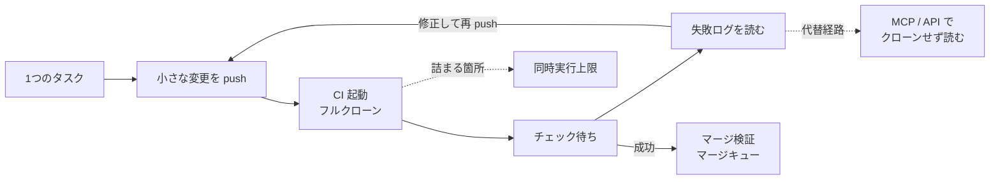
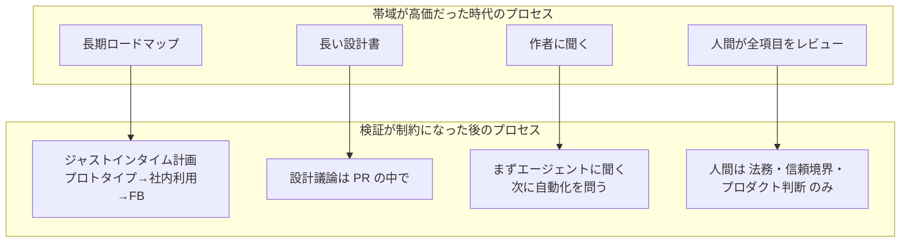
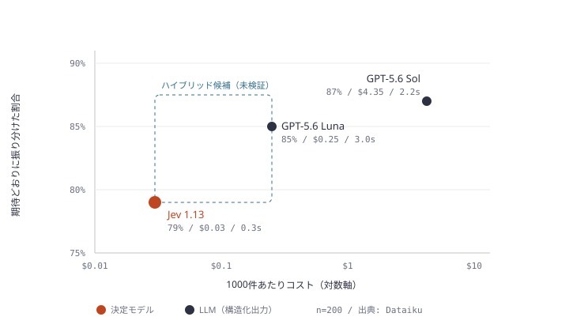

# Daily Briefing 2026-11-10

## 1. コードがボトルネックでなくなったとき: AI エージェントに合わせてソース管理と CI をスケールさせる（原題: When Code Stops Being the Bottleneck: Scaling Source Control and CI for AI Agents）

- **URL**: https://www.harness.io/blog/when-code-stops-being-the-bottleneck
- **公開日**: 2026-10-22（2026-10-26 更新）
- **著者・媒体**: Abhinav Singh（Senior Staff Software Engineer）、Juveria Kanodia（Senior Director of Software Engineering）/ Harness Blog

### 本文翻訳

**ボトルネックは移動した。** コードを書くことはもはや遅い工程ではない。遅いのはソース管理、レビュー、ビルド、テストだ。Anthropic は、数か月で1日あたりのマージ数が10倍以上に増えたと報告している。

**自社のドッグフーディングデータが示すもの。** Harness 社内では、コードをコミットする人数は約 1.3 倍にしか増えていないのに、エンジニアリング活動量は 4〜7 倍に増えた。プルリクエストは 2025年8月比で約7倍。2026年7月の push 数は前年同月比で約 6.6 倍と過去最高を記録した。リポジトリから取得されたデータ量は約6倍に増え、アップロード量の伸びを大きく上回った。CI のクローン、自動テスト、そしてコードを読むエージェントがその原因だ。2026年3月から5月にかけて追加されたコード行数も約5倍になった。

**CI も同じ圧力を受ける。** 2025年11月から2026年9月にかけて、CI の実行回数は約7倍に増えたが、アクティブなプロジェクト数は 1.7 倍だった。ピーク時には、計算資源に余裕があるにもかかわらずパイプラインが待ち行列に詰まった。制約はインフラでも失敗ジョブでもなく、**同時実行数の上限**だった。エラー率は安定していた。チームは同時実行上限を引き上げ、量が多く重要度の低いトリガーを一時的に無効化して滞留を解消した。週末に行った環境移行が、あるピークを増幅させた。

**なぜエージェントは負荷の形を変えるのか。** エージェントは小さな変更を頻繁に push し、PR を開き、チェックを待ち、失敗を読み、また push する。1つのタスクが複数回の push、CI 実行、新規クローンを引き起こす。読み取りが書き込みより速く増える（約6倍 対 3〜5倍）のは、CI とエージェントがコードを変更するよりはるかに頻繁に取得するからだ。

**Harness Code にとっての3つの転換。**
- **クローンせずに質問に答える**: エージェントは MCP サーバー、CLI、API 経由で diff、マージベース、PR の状態を読む。
- **バーストに備えて CI をスケールする**: 並列のエージェント生成変更による突発的なスパイクを吸収できる同時実行数と容量が必要。
- **コードレビューをスケールする**: 人間のレビューはコード量に追いつけない。AI コードレビューで PR を自動レビューし、社内ではマージ速度が約5倍になり、一部リポジトリは自律的に回っている。

**Anthropic が見つけたこと。** Anthropic のモノレポは 2026年5月から9月の間に1日あたり約 2,500 件から3万件超のマージへ増えた。同社は独自の REST API 方式を作ったが、大きなエンジニアリング投資と保守が必要だった。Harness は Git を置き換えるのではなく、Git 基盤をスケールさせる道を選んだ。

**Agent Ready SCM のスケーリング施策。**
- **クローンキャッシュ**: コミットとクライアントフラグをキーにした短命キャッシュで、同一の packfile を作り直さない。クローンのレイテンシが 40% 改善した。1コミットが最大100本の CI パイプラインを起動し得る。
- **マージ最適化**: 読み取り専用の MergeVerify ドライランで分散書き込みロックとクォーラムを取らないようにし、n レプリカ全体でマージ検証の作業量を約3分の2削減。
- **マージキュー**: 同時マージが集中する最も忙しいリポジトリに導入。
- **CI のスケーリング**: リージョン・AZ・インスタンス種別・ウォームプールに負荷を分散し、フォールバックを用意。過去のパターンから**ピークの前に**スケールする予測アルゴリズムで、ビルドを遅くせずに7倍の負荷を処理できる。
- **負荷試験**: 現行の10倍の量で、主要 REST エンドポイントの P90 は約 200〜270ms、コード検索は約 810ms、クローン約 890ms、push 約 360ms、ls-remote 約 390ms。

**次の一手。** Snowflake や Aurora と同様に計算とストレージを分離する。リポジトリデータの本拠地を耐久性のあるオブジェクトストレージに置き、Git サーバーはいつでも作り直せる高速キャッシュにする。開発者・エージェント・IDE・CLI からの見え方は変わらない。

**結論。** 人間規模の作業向けに作られたツールはエージェントの量に耐えられない。エージェントの働き方に合わせて設計された、統制されたソフトウェアファクトリーが必要だ。

### 重要ポイント

- コミットする人は 1.3 倍、PR は約7倍、CI 実行は約7倍。**人数ではなくエージェントの反復回数**が負荷を決める
- CI の詰まりの正体は計算資源ではなく**同時実行数の上限**。上限引き上げと非重要トリガーの一時停止で解消した
- 読み取り（クローン・fetch）が書き込みより速く増える。エージェントには「クローンせずに読める」経路（MCP / API）を用意する
- クローンキャッシュでレイテンシ 40% 改善、マージ検証のロック除去で作業量 2/3 削減、マージキューを高頻度リポジトリに限定導入
- 予測スケーリングで「ピークの後追い」をやめ、7倍負荷でもビルド時間を維持

### 図解



1タスクがループを何周もするため、push・CI・クローンの回数が人数の伸びと無関係に増える。記事の対策は、ループ内の読み取りをクローンから API に逃がすことと、CI の同時実行上限を先回りで広げることの2点に集約される。

### 戦略分析

**フレームワーク**: 制約理論（TOC）× 待ち行列

| TOC の段階 | 記事での対応 |
|---|---|
| 1. 制約を見つける | CI のピーク時待ち。計算資源ではなく同時実行上限が制約だった |
| 2. 制約を徹底活用する | 非重要・高頻度トリガーを一時停止し、制約の枠を重要なパイプラインに回す |
| 3. 他を制約に従属させる | エージェントの読み取りを MCP / API に逃がしクローン負荷を減らす。クローンキャッシュで同一 packfile を再生成しない |
| 4. 制約を引き上げる | 同時実行上限の引き上げ、予測スケーリング、マージキュー |
| 5. 繰り返す | 次の制約としてレビュー（AI レビューで5倍）、さらに Git ストレージ（計算/ストレージ分離）へ |

待ち行列の観点では、エージェントは到着率を上げるだけでなく「到着のばらつき」を大きくする（1コミットで最大100パイプライン）。稼働率が高い状態でばらつきが増えると待ち時間は非線形に伸びるため、平均負荷に合わせた容量計画では足りない。

**示唆**:
1. エージェント導入を広げる前に、CI の**同時実行上限・キュー滞留時間・クローン回数**を週次で取る。計算資源の使用率だけを見ていると「余っているのに詰まる」状態を見逃す。
2. トリガーに重要度ラベルを付け、ピーク時に止めてよいもの（定期 lint、ドキュメントのプレビュー等）をあらかじめ決めておく。止める判断を障害時に議論しない。
3. エージェントが PR 状態や diff を読むだけのためにリポジトリをクローンしていないかを確認し、API / MCP 経由に置き換える。読み取りの伸びは書き込みより大きい。

**反証条件**: エージェントの利用が IDE 内の補完中心で、自律的に push → CI → 再 push のループを回していない組織では、CI 実行回数は人数に比例してしか増えず、この分析の前提（負荷が人数と切り離されて増える）は成立しない。また記事の数値は SCM/CI ベンダー自身のドッグフーディングであり、エージェント利用の密度が一般企業より高い可能性がある。

### 現場での適用方法

**スクリプト化の例: GitHub Actions のキュー滞留とクローン回数を週次で計測する**

```bash
#!/usr/bin/env bash
# ci-pressure.sh — 直近7日の workflow run から「待ち時間」と「同時実行の詰まり」を見る
# 前提: gh CLI 認証済み、jq インストール済み
set -euo pipefail
REPO="<OWNER>/<REPO>"
SINCE=$(date -u -d '7 days ago' +%Y-%m-%dT%H:%M:%SZ)

gh api -X GET "repos/${REPO}/actions/runs" -f created=">=${SINCE}" -f per_page=100 --paginate \
  --jq '.workflow_runs[] | [.id, .name, .event, .created_at, .run_started_at] | @tsv' > runs.tsv

echo "== イベント別の実行回数（push / pull_request / schedule ...）"
cut -f3 runs.tsv | sort | uniq -c | sort -rn

echo "== 作成から開始までの待ち秒数（p50 / p90）— 同時実行上限で詰まっていればここが伸びる"
awk -F'\t' '{ c=$4; s=$5; cmd="date -d " c " +%s"; cmd | getline cs; close(cmd);
              cmd="date -d " s " +%s"; cmd | getline ss; close(cmd); print ss-cs }' runs.tsv \
  | sort -n | awk '{a[NR]=$1} END {print "p50:", a[int(NR*0.5)], "s  p90:", a[int(NR*0.9)], "s  n=", NR}'

echo "== 実行回数の多いワークフロー上位（ピーク時に止める候補）"
cut -f2 runs.tsv | sort | uniq -c | sort -rn | head -10
```

**設定例: ピーク時に止めてよいトリガーを分離し、同一ブランチの重複実行を打ち切る**

```yaml
# .github/workflows/docs-preview.yml（重要度: low）
on:
  pull_request:
    paths: ["docs/**"]
concurrency:
  group: docs-preview-${{ github.ref }}
  cancel-in-progress: true   # エージェントの連続 push で古い実行を捨てる
jobs:
  preview:
    if: ${{ vars.CI_PEAK_MODE != 'on' }}   # ピーク時は gh variable set CI_PEAK_MODE --body on で停止
    runs-on: ubuntu-latest
    steps:
      - uses: actions/checkout@v4
        with:
          fetch-depth: 1      # フルクローンしない
          sparse-checkout: docs
```

**CLAUDE.md への追記例**

```markdown
## リポジトリの読み方
- PR の状態・diff・CI 結果を知りたいだけなら clone/fetch しない。`gh pr view` / `gh pr diff` / `gh run view --log-failed` を使う
- 1つの修正で push は原則1回。ローカルで lint とテストを通してから push する（CI を試行錯誤の場にしない）
```

### 期待効果

記事ではクローンキャッシュでクローンのレイテンシ 40% 改善、マージ検証の作業量約 2/3 削減、予測スケーリングで7倍負荷でもビルド時間を維持、AI レビューでマージ速度約5倍。同時実行上限の引き上げと非重要トリガーの停止で、ピーク時の滞留を解消している。

### 注意点

- Harness は SCM/CI ベンダーであり、記事後半は自社製品（Agent Ready SCM）の紹介を含む。施策の考え方（同時実行・読み取り経路・キャッシュ）だけを持ち帰る
- 同時実行上限を上げると課金が増える SaaS CI がある。先にトリガーの整理と `cancel-in-progress` で無駄打ちを減らす
- `fetch-depth: 1` はマージベースを必要とする差分系ツールを壊すことがある。対象ジョブを限定する
- 上記スクリプトの p50/p90 は workflow 単位の概算。ジョブ単位のキュー待ちを見るには jobs API が必要

---

## 2. AI ネイティブなエンジニアリング組織を運営する（原題: Running an AI-native engineering org）

- **URL**: https://claude.com/blog/running-an-ai-native-engineering-org
- **公開日**: 2026-06-03
- **著者・媒体**: Fiona Fung（Director of Engineering, Claude Code / Claude Cowork）/ Claude Blog（Code w/ Claude SF 2026 の講演に基づく）

### 本文翻訳

かつてソフトウェア開発で高くつくのはエンジニアリングの帯域だった。計画プロセスはそのコストを前提に作られてきた。いまはエージェント型コーディングが記述・テスト・リファクタリングの多くを担い、ボトルネックは検証、コードレビュー、セキュリティへ移った。問うべきは「新しい制約に合わせてプロセスをどう作り直すか」だ。

**機能しなくなったプロセスと、その置き換え。**

- **計画**: 長期のロードマップはすぐに古くなった。チームは「ジャストインタイム計画」に移行した。プロトタイプを作り、社内ユーザーに使ってもらい、そのフィードバックで動く。設計の議論は長い設計書ではなく PR の中で行う。
- **文脈の収集**: コードの作者に聞く前に、まず Claude に聞く。Claude はすべての PR に関わっているからだ。さらに「その質問自体を自動化できないか」を問う。例として、顧客フィードバックの日次サマリーを Claude がバックグラウンドで作るようになった。
- **コードレビュー**: スタイル、lint、バグ修正、テストは Claude が担う。人間は専門性が要る領域、すなわち法的リスク、信頼境界やセキュリティに敏感なコード、プロダクトセンスとデザインに集中する。この分担はモデルの進化に合わせて見直すべきものだ。
- **チーム構成**: 役割の境界は曖昧になった。PM がコードを書き、エンジニアがデザインやコンテンツの仕事を担う。採用では2つの人物像を求める。プロダクトセンスを持つ創造的なビルダーと、深いシステムの専門性を持つエンジニアだ。

**展開のしかた。** いくつかの規範はチームの必須原則にしている。

- プロダクトを徹底的にドッグフーディングする。職能横断のパートナーも含めて。
- チームをできるだけフラットに保つ。マネージャーも最初は個人貢献者として始め、作業ポッドを支える。
- 機能しなくなったプロセスは廃止する。メンバーにはそれを疑問視する明示的な許可を与える。

この原則の範囲内で、各ポッドはトリアージ、計画、スタンドアップでの Claude の使い方や、どのワークフローから自動化するかを自律的に決める。

**追うべき指標。**

1. **オンボーディングの立ち上がり時間**: 新しいエンジニア、デザイナー、PM がどれだけ早く生産的になるか。エンジニアは初週に実際のコードを出荷しているという。
2. **PR サイクルタイム**: パイプラインのボトルネックを見つけるために使う。コード量が増えると CI やビルドシステムが苦しくなる。
3. **Claude 支援コミット**: すべてのコミットが既定で Claude 支援になっている。ただしスループットは成功ではない。本当の指標は「解こうとしている問題」そのものだ。

**始め方。** 最も「うるさい」ワークフロー、つまり最も高くつき、最も嫌われ、最も愛されていないものを1つ選び、それがまだ目的を果たしているか、自動化または廃止できないかを問う。筆者の例では、参加者が皆ノート PC を開いて別の作業をしていた週次の定例会議が、誰かがその価値を問うたことで廃止された。

### 重要ポイント

- 制約が「実装の帯域」から「検証・レビュー・セキュリティ」に移ったので、帯域を節約するためのプロセス（長期ロードマップ、長い設計書）から先に見直す
- 文脈収集は「作者に聞く」前に「エージェントに聞く」、さらに「その質問を自動化できるか」を問う
- レビューの人間担当領域を **法的リスク・信頼境界とセキュリティ・プロダクト判断** の3つに明示的に絞る。分担はモデル更新ごとに見直す
- 全体原則（ドッグフーディング、フラット化、プロセス廃止の許可）は必須、各ポッドの Claude の使い方は自律
- 指標はオンボーディング立ち上がり時間・PR サイクルタイム・支援コミット率。ただしスループットを成功と取り違えない

### 図解



### 戦略分析

**フレームワーク**: マッキンゼー 7S

| 要素 | 記事での変化 |
|---|---|
| Strategy（戦略） | 制約を「実装の帯域」から「検証・レビュー・セキュリティ」へ置き直す |
| Structure（構造） | フラット化。マネージャーも個人貢献者から始め、ポッドを支える |
| Systems（仕組み） | ジャストインタイム計画、PR 内設計議論、レビュー分担の明文化、顧客 FB の日次自動サマリー |
| Shared values（価値観） | 徹底したドッグフーディング、機能しないプロセスを疑問視する許可 |
| Style（スタイル） | 全体原則は必須・ポッド内の運用は自律、という「枠と裁量」の分離 |
| Staff（人材） | 創造的ビルダーと深いシステム専門家の2類型で採用。PM もコードを書く |
| Skills（スキル） | 人間の技能をプロダクトセンス・信頼境界の判断に集中させる |

7S の要点は要素間の整合だが、記事で最も効いているのは **Systems と Shared values の組み合わせ**だ。「プロセスを廃止してよい」という価値観がなければ、ジャストインタイム計画に移っても旧来の承認会議が残り、二重運用になる。

**示唆**:
1. AI 導入の次の一手として、ツール追加ではなく「廃止候補プロセスの棚卸し」を四半期に1回行う。記事の基準どおり、最も高コスト・最も嫌われている定例から順に「まだ目的を果たしているか」を問う。
2. コードレビューの人間担当範囲を CODEOWNERS とレビュー規約に明文化する（法務・認証認可・課金・データ境界・UX 判断）。それ以外は AI レビューで閉じ、人間のレビュー待ちを専門領域だけに集中させる。
3. 立ち上がり時間（初回マージまでの日数）を組織指標に加える。支援コミット率だけを追うとスループット偏重になる。

**反証条件**: 規制業界などで設計書や承認記録そのものが監査要件になっている組織では、「長い設計書をやめて PR で議論する」はそのまま適用できない。また記事のチームは自社のコーディングエージェントを作る組織であり、ドッグフーディングが製品改善と直結する。社内ツールとして使うだけの組織では、同じ熱量の自発的改善が起きる前提は弱い（記事に他社データはなく、この点は仮説）。

### 現場での適用方法

**CLAUDE.md への追記例: レビューの分担と文脈収集のルール**

```markdown
## レビューの分担
- エージェントが閉じてよい: スタイル、lint、テスト追加、明らかなバグ修正、リファクタリング
- 人間の承認が必須（CODEOWNERS で強制）:
  - 認証・認可・課金・個人データを扱うパス（<AUTH_DIR>, <BILLING_DIR>, <PII_DIR>）
  - ライセンス・利用規約・外部公開文言など法的リスクのある変更
  - UX の挙動を変える変更（プロダクト判断）
- この分担はモデル更新のたびに見直す（最終見直し: <YYYY-MM-DD>）

## 文脈の集め方
- コードの意図を知りたいときは、作者に聞く前に PR 履歴と git blame をエージェントに要約させる
- 同じ種類の質問を3回以上したら、自動化（定期サマリー・スキル化）を提案する
- 設計の議論は PR の説明欄とレビューコメントで行い、別の設計書は作らない（規制要件がある領域を除く）
```

**運用手順: 「うるさいワークフロー」の廃止判定（四半期に1回、60分）**

```bash
# 1. 定例会議・定期レポート・承認フローを1行1件で列挙する
cat > <REPO_PATH>/ops/process-inventory.md <<'EOF'
| プロセス | 頻度 | 参加人数×時間/回 | 本来の目的 | まだ果たしているか | 自動化/廃止/存続 |
|---|---|---|---|---|---|
| 週次ステータス定例 | 週1 | 8人×60分 | 進捗共有 | <yes/no> | <判定> |
| 設計レビュー会議 | 週1 | 5人×60分 | 設計合意 | <yes/no> | <判定> |
EOF
# 2. 「参加人数×時間」の大きい順に、目的を果たしているかを全員で判定
# 3. 自動化候補はエージェントで代替案を1週間試し、廃止候補は1か月止めて困った人がいるかを見る
```

**CODEOWNERS の例**

```text
# 人間の判断が必須な領域だけを列挙する
/<AUTH_DIR>/      @<ORG>/security-reviewers
/<BILLING_DIR>/   @<ORG>/billing-owners
/legal/           @<ORG>/legal-reviewers
```

### 期待効果

記事では新しいエンジニアが初週に実際のコードを出荷できていること、すべてのコミットが既定で Claude 支援であることが述べられている。週次定例の廃止のように、時間を取っていたプロセスの削減が直接の効果になる。定量的な効果測定値は記事に示されていない。

### 注意点

- 公開は 2026年6月で、直近数週間の記事ではない。ただし組織運営の原則は陳腐化しにくいため選定した
- 自社エージェントを開発する組織の事例であり、ドッグフーディングの前提が他社にそのまま当てはまるとは限らない
- 設計書の廃止は監査・規制要件と衝突し得る。適用範囲を限定する
- 「フラット化」は管理範囲が広がるため、ポッドの自律と全体原則の線引きを先に文書化しないと混乱する

---

## 3. Dataiku のエージェントに決定モデルを組み込む: Jev と LLM エージェントの比較（原題: Decision Models in Dataiku: Testing Jev vs. LLM Agents）

- **URL**: https://www.dataiku.com/tech-blog/jev-inside-a-dataiku-agent
- **公開日**: 2026-09-30
- **著者・媒体**: Christiaan Burrett、Youssef Jouini / Dataiku Tech Blog

### 本文翻訳

TypeSafe の Jev は「決定モデル」という新しい種類のモデルだ。OpenAI が新たに発表した Decisions API と同様に、自由記述ではなく、確率付きの型付き判断を返す。yes/no の質問に答える、カテゴリから選ぶ、順序付き基準に照らしてリクエストを採点する、といったことができる。今回のテストでは1000リクエストあたり数セントと安価だった。

**組み込み方。** 筆者らは Jev を Dataiku の Structured Visual Agents 内で使えるプラグインブロック「Jev Question Set」としてパッケージ化した。ビルダーは各判断を定義し、型（yes/no、選択、スコア）を選び、平易な言葉で判断基準を書く。ブロックはすべての質問を Dataiku の LLM Mesh 経由で Jev へ**1回の呼び出し**で送り、回答をエージェントの状態に保存して振り分けに使う。

**テスト設計。**
- **タスク**: 供給者（サプライヤー）のオンボーディング。各リクエストは3つの結果のいずれかになる。標準のオンボーディングキュー、人間のレビュー（ポリシー例外や機微なアクセスの場合）、不足情報の問い合わせ。
- **各エージェントの判断**: 例外が要求されているか、どの種類のリクエストか、先に進むのに十分な情報があるか。
- **振り分け**: Dataiku 標準の Routing ブロックが業務ポリシーを適用する。
- **比較対象**: Jev を使うエージェント1つと、LLM Mesh 経由で構造化出力スキーマを使う GPT-5.6 Luna と GPT-5.6 Sol のエージェント2つ。
- **データ**: 事前にラベル付けした供給者リクエスト200件。多くは意図的に難しく、決め手となる記述が定型的な調達文言の中に埋もれている。

**結果。**

| 指標 | Jev 1.13 | GPT-5.6 Luna | GPT-5.6 Sol |
|---|---|---|---|
| 期待どおりに振り分け | 157/200（79%） | 169/200（85%） | 174/200（87%） |
| 平均応答時間 | 0.3 秒 | 3.0 秒 | 2.2 秒 |
| 応答時間 p95 | 0.4 秒 | 4.7 秒 | 4.0 秒 |
| 1000件あたりコスト | $0.03 | $0.25 | $4.35 |

**速度とコスト。** Jev は LLM エージェントより約10倍速く、回答の95%が0.5秒未満で返った。コストは Luna の約9分の1、Sol の1%未満。

**精度。** LLM の方が正確だった。難しいリクエストはどのモデルにとっても難しく、Sol が誤るときは Jev もたいてい誤った。差の主因は人間のレビューが必要なリクエストで、Jev はその 26% を通してしまったのに対し、LLM は 6% だった。

**曖昧なリクエスト。** 一部では Jev の方がうまくいった。行動するには情報が薄すぎる5件のリクエストに対し、Jev は詳細を問い合わせたが、Sol はキューに送ってしまった。

**閾値の調整。** Jev が見逃したレビュー対象の多くは僅差で、閾値 0.70 を下回るスコアだった。閾値を 0.30 に下げれば、不要なレビュー4件と引き換えにさらに10件を捕捉できた。筆者らは境界ケースだけを LLM や人に回すハイブリッドを提案しているが、検証はしていない。

**決定モデル導入の3つの教訓。**
1. **モデル選択を自分で握る**。LLM Mesh なら決定モデルと LLM を同じタスクで並べて走らせ、品質・速度・コスト・データの所在でユースケースごとに選べる。Jev はホスト型 API として動く。
2. **業務ルールをモデルから分離する**。モデルは判断の質問に答え、Routing ブロックがポリシーを持つ。モデルの差し替えや閾値の変更は、リリース前にテストできる設定変更になる。
3. **自分たちの正解データで Flow の中で評価する**。ラベル付きデータセット、エージェントごとの Prompt レシピ、Agent Evaluation 機能、すべてを再実行するシナリオで評価を組んだ。

**結論。** 決定モデルは、速くて安い型付き判断という選択肢を AI ツールキットに加える。重要なのは、それを明示的なルールと組み合わせ、自社のデータで判断を測ることだ。プラグインは github.com/dataiku/dss-plugin-typesafe-ai でオープンソース公開されている。

### 重要ポイント

- 判断（例外要求か / 種類 / 情報十分か）をモデルに、振り分けポリシーを Routing ブロックに分離。モデル差し替えや閾値変更が「テスト可能な設定変更」になる
- Jev は 79%・0.3 秒・$0.03/1000件、Sol は 87%・2.2 秒・$4.35/1000件。速度約10倍、コストは Sol の1%未満
- 精度差の主因は **要レビュー案件の取りこぼし**（Jev 26% vs LLM 6%）。誤りの多くは閾値 0.70 未満の僅差
- 閾値 0.70→0.30 で +10件捕捉・不要レビュー +4件。閾値は精度と人手コストのトレードオフを直接動かすつまみ
- 情報が薄いリクエストでは Jev が「問い合わせ」を選び、Sol はキューに流した。型付き判断が保守的に働く場面もある

### 図解



横軸が対数なので、Jev と Sol の間には約145倍のコスト差がある。正答率の差 8 ポイントの大半は「人間レビューが必要な案件」の取りこぼしに集中しており、点線の領域（境界ケースだけ LLM に回す）は記事が提案しつつも未検証の選択肢である。

### 戦略分析

**フレームワーク**: 単位経済性（ユニットエコノミクス）× リスク×可逆性マトリクス

| 判断の種類 | 誤りの方向 | 可逆性 | 記事の結果から見た担当 |
|---|---|---|---|
| 標準キューへ流す | 要レビュー案件を通す（偽陰性） | 低い（例外承認や機微なアクセスが通る） | Jev 単独では 26% 取りこぼし → 閾値を下げるか LLM/人間を後段に |
| 人間レビューへ送る | 不要なレビュー（偽陽性） | 高い（人の時間が減るだけ） | 閾値を下げて多めに送る側に倒してよい |
| 不足情報の問い合わせ | 余計な往復 | 高い | Jev が LLM より良かった領域 |

単位経済性で見ると、1件あたりの判断コストは Jev が $0.00003、Sol が $0.00435 で、どちらも人間レビュー1件のコストに比べれば桁違いに小さい（人件費は記事外の一般論）。つまりこのタスクでは**モデル費用ではなく、誤振り分けの後処理と人間レビューの件数**が単位コストを支配する。閾値を 0.30 に下げたときの「+10件捕捉・+4件の不要レビュー」は、まさにこの支配項を動かす選択である。

**示唆**:
1. 決定モデル導入の評価軸を「正答率」から「偽陰性（通してはいけないものを通した件数）」に変える。記事でも差の主因はそこだった。
2. 閾値はモデルではなくポリシー側（Routing）に持たせ、偽陰性が許容できない分岐だけ閾値を下げる。可逆な分岐（問い合わせ・レビュー送り）は Jev 単独で十分な可能性がある。
3. コストが 100 倍以上違うので、全件 LLM ではなく「全件 Jev → スコアが閾値付近のものだけ LLM」の段階構成を自社データで検証する価値がある。ただしこれは記事で未検証の仮説である。

**反証条件**: 判断を誤ったときのコストが小さく、全件を後段で人間が見直す業務では、偽陰性の議論が成立せず、速度とコストだけで Jev を選べばよい。逆に、Sol が誤るケースで Jev も誤るという記事の観察が自社データでも成り立つなら、ハイブリッドで LLM に回しても救えるのは「僅差の取りこぼし」だけで、難問そのものは人間に回すしかない。

### 現場での適用方法

**スクリプト化の例: 正解ラベル付きデータで閾値ごとの偽陰性・偽陽性を出す**

```python
#!/usr/bin/env python3
"""threshold_sweep.py — 決定モデルのスコアと正解ラベルから閾値を決める。
入力 CSV: request_id, needs_review_score (0..1), label (queue|review|ask)
スコアは決定モデル（Jev 等）の「人間レビューが必要か」の確率をそのまま保存したもの。"""
import csv, sys

rows = list(csv.DictReader(open(sys.argv[1] if len(sys.argv) > 1 else "<SCORES_CSV>")))
print(f"{'閾値':>6} {'捕捉':>6} {'取りこぼし(偽陰性)':>18} {'不要レビュー(偽陽性)':>20}")
for th in [0.9, 0.8, 0.7, 0.6, 0.5, 0.4, 0.3, 0.2]:
    tp = fn = fp = 0
    for r in rows:
        flagged = float(r["needs_review_score"]) >= th
        truth = r["label"] == "review"
        tp += flagged and truth
        fn += (not flagged) and truth
        fp += flagged and not truth
    print(f"{th:>6.2f} {tp:>6} {fn:>18} {fp:>20}")
```

**設定ファイルの例: 判断（モデル）とポリシー（ルール）を分離する**

```yaml
# routing-policy.yaml — モデルを差し替えてもこのファイルは変えない
questions:                 # 決定モデルに一括で投げる判断
  exception_requested: { type: yes_no, criteria: "ポリシー例外や機微なアクセスを求めているか" }
  request_kind:        { type: choice, options: [new_supplier, update_bank, access_request] }
  enough_info:         { type: yes_no, criteria: "オンボーディングを進めるのに必要な情報が揃っているか" }

thresholds:                # 偽陰性が高くつく分岐ほど低くする
  exception_requested: 0.30   # 記事: 0.70→0.30 で +10件捕捉 / +4件不要レビュー
  enough_info: 0.50

routes:                    # 上から評価
  - when: "exception_requested >= thresholds.exception_requested"
    to: human_review
  - when: "enough_info < thresholds.enough_info"
    to: ask_for_details
  - to: standard_queue

escalation:                # 未検証のハイブリッド。自社データで検証してから有効化
  enabled: false
  band: [0.25, 0.45]       # この範囲のスコアだけ LLM に再判定させる
  model: <LLM_MODEL_ID>
```

### 期待効果

記事の 200 件テストでは、Jev は LLM エージェントの約10倍速く（p95 0.4 秒）、コストは Sol の1%未満（$0.03 / 1000件）。閾値を 0.30 に下げると要レビュー案件をさらに10件捕捉できる（不要レビュー +4件）。業務ルールを Routing に分離したことで、モデルや閾値の変更をリリース前にテスト可能な設定変更として扱える。

### 注意点

- テストは 200 件・1タスクのみ。Dataiku は統合ベンダーであり、自社データで同じ比較をやり直す必要がある
- 閾値 0.30 の効果は記事内の事後分析で、別データでの検証はされていない
- Jev は推論の説明を返さない。監査で判断理由の記録が必要な業務では、ルール側のログと組み合わせる
- ハイブリッド構成（境界ケースだけ LLM）は記事で未検証。`escalation.enabled` は検証まで false にしておく
