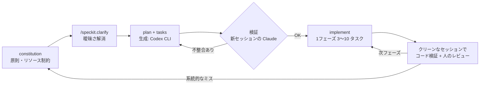
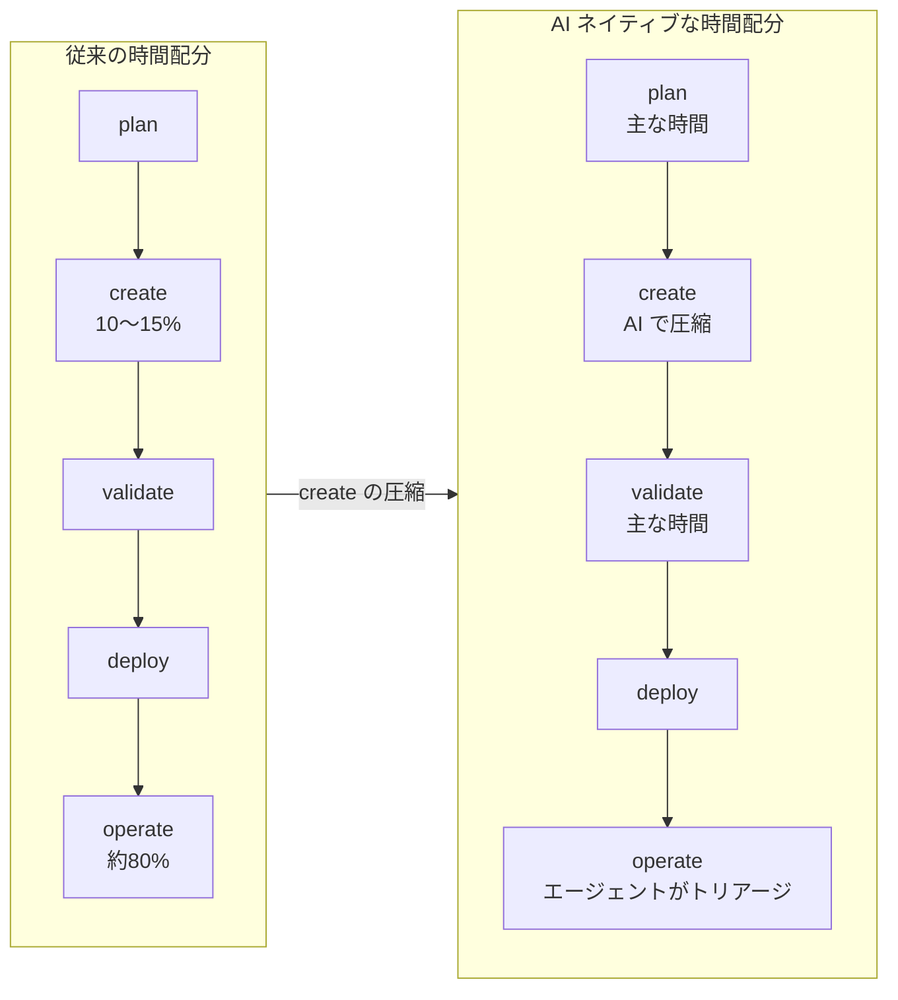
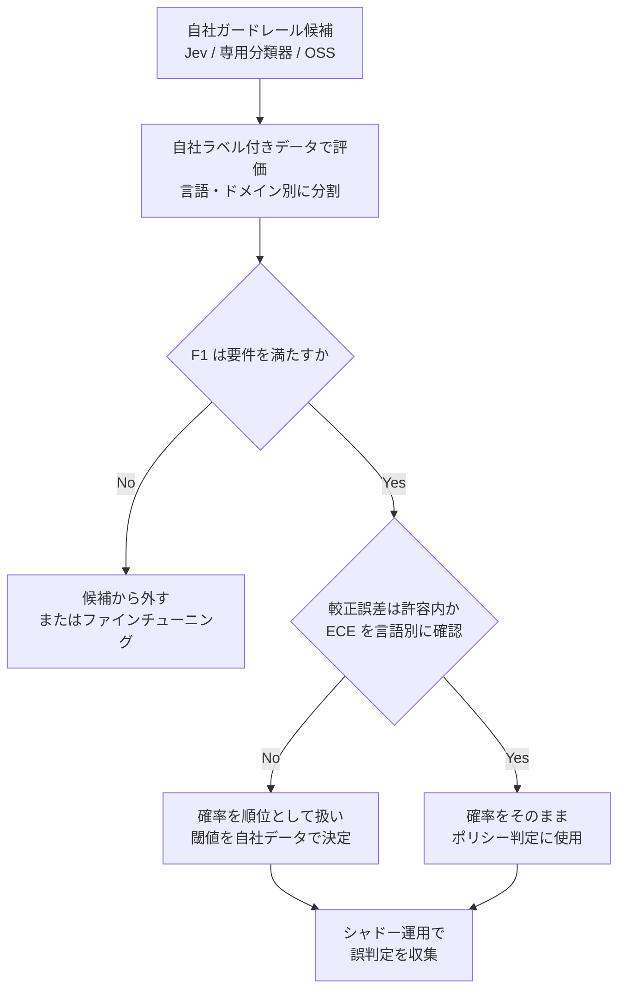

# Daily Briefing 2026-11-11

## 1. iOS でのスペック駆動開発: Spec-kit の実践経験（原題: Spec-Driven Development in iOS: Practical Experience With Spec-kit）

- **URL**: https://maddevs.io/writeups/spec-driven-development-in-ios/
- **公開日**: 2025-11-26（最終更新日。直近数週間の新着ではないが、数値付きの一次実践報告として選定）
- **著者・媒体**: Pavel Pushkarev（Software Engineer）/ Mad Devs

### 本文翻訳

**はじめに**: SDD を採用する前、筆者の AI エージェントとの作業は混沌としていた。制約が弱く、ユーザーストーリーは曖昧で、プロジェクト固有の情報も欠けていたため、コンテキストが散らかり、ハルシネーションが起きた。SDD はここに「constitution（憲法）→ specification（仕様）→ plan（計画）→ tasks（タスク）→ implementation（実装）」という構造化された流れを持ち込む。SDD において仕様は実装の「ガイド」ではなく、実装を直接「生成」するためのものだ。本稿では Spec-kit を使う。

**コマンド**: 基本フローは `/speckit.constitution`（原則と制約）、`/speckit.specify`（何を作るか）、`/speckit.plan`（技術計画とスタック）、`/speckit.tasks`（分解）、`/speckit.implement`（実行）。品質系として `/speckit.clarify`（曖昧さの解消。計画前の実行を推奨）、`/speckit.analyze`（成果物間の整合性チェック）、`/speckit.checklist`（品質チェックリスト）がある。

**2つのプロジェクト**: (1) 新規の都市オーディオガイド。地図上の観光スポットに近づく／タップすると音声やテキストを出す。SwiftUI・Combine・MapKit・AVFoundation。(2) 既存の博物館アプリ SJMC。位置情報と Bluetooth ビーコンを使うイベント駆動アプリで、RxSwift によるリアクティブ構成。constitution・仕様・計画を書き、新画面のタスクをいくつか完了させた。UIKit・RxSwift・CoreLocation・CoreBluetooth。

**ワークフロー: 2モデル検証**: ① Spec-kit コマンドで成果物を生成（Codex CLI を使用）② 新しいセッションで別モデル（Claude）に検証させる ③ 必要なら修正 ④ 最後に自分でレビュー。確証バイアスを避けるため、検証はクリーンなコンテキストで行う。検証側モデルはコードレビューとエッジケース発見に強かった。

**うまくいったこと**: 毎ステップの検証（1つ目のプロジェクトで検証を省いたのが最大の失敗だった）。フェーズ分割実装（各フェーズ終了時にビルド・テスト可能な状態を保つ）。フェーズごとに新しいコンテキストウィンドウを使う（長いセッションは出力品質が落ちる）。並列化（エージェントが1タスクを実装している間に次のユーザーストーリーを計画する。別ブランチでの並列実装は未検証）。系統的なエラーは constitution のルールにする（エージェントが色や文字列をハードコードし続けたが、型付きリソースを必須とするルールで解消した）。

**うまくいかなかったこと**: アプリ全体を1イテレーションで作ること（検証が重くなりトークンも嵩む。MVP から始めるべき）。粒度が細かすぎるタスク（5分で終わる修正では、仕様を書く方が高くつく）。Figma MCP なしの作業（UI を手で記述する羽目になった）。

**実践的な推奨**: 実装フェーズごとに新コンテキストを使い、1リクエストあたりのアクション数を絞る。ピンポイント修正では成果物を作らない（重大・系統的なものを除く）。コストは、新規プロジェクトで実装前ステップ（constitution・仕様・計画・タスク）が約 7〜8 ドル、実装フェーズが約 10〜15 ドル。制約なしで試した以前の試行は 35 ドルを超えた。仕様には View とロジックの連携パターン、スタックとドメイン構造、リソース扱い（型付きの色・テキスト・ローカライズ・画像）を定義する。タスク計画では各フェーズ後にビルド可能な状態を保ち、tasks.md を別エージェントで検証し、細かすぎる受け入れ基準を見直し、タスクは英語で書く。各タスクはフォルダにまとめ `description.md`（ユーザーストーリー・技術的文脈・スクリーンショット）と `/speckit.tasks`・`/speckit.implement` の成果物を置く。実装中は、エージェントの繰り返す誤りを constitution に記録し、不整合を説明して仕様更新を依頼し、変更を受け入れてから手で直し、完成コードはクリーンなセッションで検証する。

**開始チェックリスト**: MVP から始める。リソースとパターンの制約を含む constitution を書く。計画前に `/speckit.clarify`。各ステップを新コンテキストで検証。1フェーズ 3〜10 タスク。各フェーズを新コンテキストで実行。計画と実装を並列化。`/speckit.analyze` で整合性確認。

**結果**: 生成コードの約 **90%** がレビュー時に修正不要だった。典型的な問題は軽微な重複、リソース型付けの問題（constitution ルール導入前）、小さなエッジケース、既存プロジェクトの `/speckit.plan` での存在しないエンティティやロジッククラスのハルシネーション（検証で解消）。両プロジェクトともリリースされ期待通り動作している。既存プロジェクトはドメインの複雑さゆえ検証が多く必要だった。

**結論**: SDD は銀の弾丸ではないが、エージェント作業を構造化する有用な枠組みだ。教訓は4つ。①結果は常にクリーンなコンテキストで検証する（通常1〜2回）②計画前に `/speckit.clarify`、タスク後に `/speckit.analyze` ③ MVP から始め、ごく小さいタスクは手でやる ④最大の利得は並列性——モデルが今のタスクを実装している間に次のタスクを記述する。

### 重要ポイント
- 生成モデル（Codex CLI）と検証モデル（Claude）を分け、**検証は必ず新しいセッション**で行う「2モデル検証」が品質の要
- 繰り返し出るミス（色・文字列のハードコード）は都度直さず **constitution のルールに昇格**させると止まる
- コストは制約なしの 35 ドル超に対し、仕様＋実装で約 17〜23 ドル。1フェーズ 3〜10 タスク、フェーズごとに新コンテキスト
- 5分で終わる修正・ピンポイントのバグ修正に SDD は過剰。適用範囲を決めてから使う
- 修正不要率は約 90%。既存プロジェクトでは plan 段階で存在しないクラスのハルシネーションが出るため検証が多く要る

### 図解



### 戦略分析

**フレームワーク**: JTBD（Jobs to be Done）

| 観点 | 内容 |
|---|---|
| 状況 | 既存・新規の iOS アプリで、複数画面にまたがる機能をエージェントに実装させたい |
| 片付けたい仕事 | 「エージェントに任せた結果を、レビューで手戻りなく受け入れられる状態にする」 |
| 既存の代替手段 | プロンプトでその都度指示する（記事の言う「混沌」。35 ドル超・ハルシネーション多発） |
| SDD が雇われない状況 | 5分の修正、ピンポイントのバグ修正、細かな UI 調整 |

**示唆**: SDD の導入判断は「チーム全体で採用するか」ではなく、**どのチケットに適用するか**の線引きとして行うべきである。具体的には (1) チケットに「SDD 対象（複数画面・新規モジュール）」「直接修正」のラベルを付け、前者だけ Spec-kit を通す、(2) 生成と検証のモデル・セッションを分けることを、ツール選定より先にルール化する、(3) レビューで2回以上同じ指摘が出たら constitution へ昇格させる運用を回す。記事のコスト差（約 20 ドル 対 35 ドル超）は、仕様コストを払っても制約による手戻り削減が上回ることを示唆する。

**反証条件**: これは単一エンジニアによる2プロジェクトの報告であり、統制された比較ではない。ドメイン知識が仕様に書き下しにくい（暗黙の業務ルールが多い）既存システムでは、plan 段階のハルシネーション検証コストが仕様化の利得を上回る可能性がある。

### 現場での適用方法

**CLAUDE.md への追記例**（Spec-kit を使うリポジトリ向け）:

````markdown
## Spec-kit 運用ルール

- 対象: 複数画面・新規モジュール・ドメイン横断の変更のみ。5分で済む修正やピンポイントのバグ修正では
  /speckit.* を使わず直接直す
- 順序: constitution → specify → clarify（必須）→ plan → tasks → analyze（必須）→ implement
- 1フェーズは 3〜10 タスク。各フェーズの終了時点でビルドとテストが通ること
- 各フェーズは新しいセッションで開始する。前フェーズの会話を持ち込まない
- 生成した plan.md / tasks.md は、生成時とは別のセッション（可能なら別モデル）で検証してから実装に入る
- リソース（色・文字列・画像・ローカライズ）は型付きアクセサ経由のみ。リテラルのハードコード禁止
- 同じ指摘がレビューで2回出たら、constitution.md に1行ルールとして追記する

## タスクフォルダ規約
```
specs/<feature>/tasks/<NN>-<slug>/
  description.md   # ユーザーストーリー / 技術的文脈 / スクリーンショット
  tasks.md         # /speckit.tasks の出力
  impl-notes.md    # /speckit.implement の出力・判断ログ
```
````

**検証セッションを分けるスクリプト例**（生成後に別 CLI で検証する）:

```bash
#!/usr/bin/env bash
# usage: ./verify-spec.sh specs/<feature>
set -euo pipefail
FEATURE_DIR="${1:?feature dir required}"
for f in plan.md tasks.md; do
  test -f "$FEATURE_DIR/$f" || { echo "missing $f"; exit 1; }
done
# 新しいセッションで検証（生成に使ったセッションとは別プロセス）
claude -p "あなたはレビュアーです。$FEATURE_DIR/plan.md と tasks.md を読み、
1) 既存コードに存在しないクラス・エンティティへの言及
2) フェーズ終了時にビルド不能になるタスク順序
3) 粒度が細かすぎる受け入れ基準
を列挙してください。問題がなければ 'OK' とだけ出力。" \
  --allowedTools "Read,Grep,Glob" > "$FEATURE_DIR/verify-report.md"
grep -qx "OK" "$FEATURE_DIR/verify-report.md" && echo "verified" || { echo "issues found:"; cat "$FEATURE_DIR/verify-report.md"; exit 2; }
```

### 期待効果
- レビュー時の修正不要率 約 90%（記事の実測）
- 新規プロジェクトのコストが制約なし試行の 35 ドル超から、仕様 7〜8 ドル＋実装 10〜15 ドルへ
- 計画と実装の並列化で、エンジニアの待ち時間が次タスクの仕様化に転換される

### 注意点
- 検証を省くと品質が崩れる（記事の最大の失敗）。検証は「おまけ」ではなく工程の一部として時間を確保する
- 既存コードベースでは plan がハルシネーションしやすい。モジュール単位で仕様を切る
- Figma 等のデザイン連携が無いと UI 記述の手間が大きい。不完全なデザインをそのまま写す点にも注意
- 2025年11月時点の Spec-kit コマンド体系に基づく。現行バージョンのコマンド名を確認すること

## 2. AI ネイティブなエンジニアリング組織を設計する（原題: Designing the AI-native engineering organization）

- **URL**: https://newsletter.getdx.com/p/designing-the-ai-native-engineering
- **公開日**: 2026-05-05
- **著者・媒体**: Justin Reock / DX Engineering Enablement（DX Annual のパネル。司会 Abi Noda、登壇 Tim Bozarth〈Microsoft CVP CoreAI〉、Nancy Wang〈1Password CTO〉、Taroon Mandhana〈Atlassian CTO of AI & Teamwork〉）

### 本文翻訳

**1. AI ネイティブな SDLC とは**: Tim Bozarth は plan（計画）・create（作成）・validate（検証）・deploy（デプロイ）・operate（運用）の5段階モデルを使う。create は AI によって圧縮されつつある。歴史的にはエンジニアリング時間の約 80% が operate、10〜15% が create に使われてきたが、最も効果的なチームでは今や plan と validate が時間の大半を占める。重要なシステムの検証には人間をループに残すべきで、セキュリティを AI 単独に任せてはならない（ペンテストやレッドチーミングには使える）。

Nancy Wang によれば、1Password は完全な PRD を書くのをやめ、顧客とプロトタイプで会話するようにした。これによりプロダクトとエンジニアリング間の往復がほぼ半減した。一方で、コードが増えればレビューと信頼性の仕事も増えると警告する。1Password は自社のインシデントデータで学習させた DevOps エージェントを試験運用しており、operate のかなりの部分を担わせようとしている。

Taroon Mandhana は operate こそ未開拓の余地が最も大きいと言う。Atlassian はエージェントでアラートをトリアージし、本当の問題のときだけ人を起こす。ポストインシデントレビューも自動化している。単純な脆弱性（ライブラリのバージョン上げなど）の約 50% は今や AI で解消されている。

**2. 組織構造**: Atlassian は組織図を変えていないが、ゼロイチのチームは 3〜4 人のスクワッドになった。ボトルネックはアラインメントと意思決定に移った。Microsoft は8週間サイクルで、ミッション特化の小さな「v-team」を回し、学習速度を重視する。各サイクルの終わりにチームは継続・吸収・停止のいずれかになる。1Password は計画の地平を 12〜18 か月から1四半期に短縮した。これには異なるリーダーシップのリズムが要る。

**3. AI 利用の義務化**: Microsoft も Atlassian も利用を義務化していない。Microsoft は日次アクティブ利用を「診断シグナル」として追うが、利用目標ではなく速度・容易さ・品質に焦点を当てる。Atlassian は自然発生するチャンピオンに頼っており、典型的にはエンジニア 100〜200 人に1人が現れる。1Password は AI チャンピオンのギルドを作り、具体的な成功事例を公に共有することが義務化よりも採用を進めると分かった。

**4. AI コストの管理**: Taroon は1月以来3回目の予算予測をしていると述べ、トークンコストの変動の大きさを指摘する。Atlassian はこの支出をクラウドの売上原価（COGS）並みの厳密さで扱う。1Password はリポジトリ・プロジェクト別にトークン支出を可視化する内部ツールを作り、CI のビルド量に連動したガードレールを検討している。Nancy は、モデル提供者と将来の利用量見込みでコミット契約を交渉してトークン単価を下げることを勧める。Tim は、実験のような一部の支出は直接の価値ではなく学習を生むものと見なすべきで、取締役会への報告でもその余地が要ると主張する。

**5. 3〜5年後の優れたエンジニアのスキル**: Tim は「作り手のマインドセット」——成果志向で特定ツールに執着しないこと——を挙げる。Nancy はライフサイクル全体にまたがるプロダクト感覚のあるジェネラリストを求め、早期の専門特化を避ける。Taroon はエージェンシー（主体性）と意思決定が技術的深さと同じくらい重要になっていると言い、Atlassian は今それを明示的に評価している。

**6. 非エンジニアのコード貢献**: Atlassian ではデザイナーが PR を出す。静的な仕様ではなく動くプロトタイプに反応できるため初期の議論は良くなったが、エンジニアは毎日品質問題をエスカレーションしており、重複や技術的負債も増えている。教訓は「非エンジニアによるプロトタイピングは明確な解放だが、本番出荷には強いテストスイートとデプロイチェックが要る」。1Password ではカスタマーエクスペリエンス担当がフロントエンドのテストカバレッジ PR を生成し、エンジニアはそれを評価するハーネスとレビュー工程を作る側に回った。

**結論**: AI はエンジニアリングの時間を作成と運用から計画と検証へ移している。チームは小さくミッション志向になり、計画の地平は短くなる。採用は義務化より、支援と目に見える成功事例で進む。トークンコストには財務的な厳密さが要り、一部は学習投資として扱う。誰からの AI 支援貢献であれ、受け入れ前に強い品質ゲートが不可欠である。

### 重要ポイント
- 時間配分が「create・operate 中心」から「plan・validate 中心」へ移る。operate は次の自動化余地として最大
- 1Password は PRD をやめプロトタイプで顧客と会話し、プロダクト⇔エンジニアの往復を約半減
- 組織: 3〜4人スクワッド、8週間サイクルの v-team（継続・吸収・停止）、計画地平を1四半期へ
- 利用の義務化はせず、DAU は診断シグナル扱い。チャンピオンは 100〜200 人に1人自然発生、成功事例の公開共有が効く
- トークン費はクラウド COGS 並みに管理し、リポジトリ別に可視化。非エンジニアの PR は品質ゲート前提

### 図解



### 戦略分析

**フレームワーク**: マッキンゼー 7S

| 要素 | 記事で語られた変化 |
|---|---|
| Structure | ゼロイチは 3〜4 人スクワッド、8週間の v-team（継続・吸収・停止） |
| Systems | PRD → プロトタイプ、アラートのエージェントトリアージ、トークン費のリポジトリ別可視化 |
| Strategy | 計画地平 12〜18 か月 → 1四半期 |
| Skills | 作り手のマインドセット、ジェネラリスト、エージェンシーと意思決定 |
| Style | 義務化しない、DAU は診断シグナル |
| Staff | チャンピオンが 100〜200 人に1人。非エンジニアが PR を出す |
| Shared values | 「誰の貢献でも品質ゲートを通す」 |

**示唆**: 7S の整合で見ると、Structure（小チーム化）と Strategy（四半期計画）だけを変えても、Systems（検証とコスト管理の仕組み）が追いつかなければ品質が崩れる——Atlassian でデザイナー PR による重複・負債が日々エスカレーションされているのがその兆候である。したがって意思決定の順序は (1) 検証ゲート（テストスイート・デプロイチェック）とトークン費の可視化を先に整え、(2) その後で非エンジニアの貢献や小チーム化を広げる、が妥当。また「AI 利用率の目標値」を KPI に置くのはやめ、DAU を診断にとどめ、成功事例を週次で公開共有する場を作る方が採用に効く。

**反証条件**: パネル登壇者3社はいずれも大規模で、テスト基盤とプラットフォームチームが既に厚い。テスト自動化が薄い組織では、時間配分を validate に寄せる前に検証基盤の構築そのものが制約となり、記事の構造変更は時期尚早になる。数値の多くは登壇者の発言であり、統制された測定ではない点にも留意。

### 現場での適用方法

**運用手順: 四半期ごとの「7S 整合レビュー」**

1. トークン費をリポジトリ別に集計する（例: プロバイダの利用ログを CSV で出力し、以下で集計）

```bash
# usage.csv: date,repo,project,input_tokens,output_tokens,cost_usd
python3 - <<'PY' < <USAGE_CSV_PATH>
import csv, sys, collections
agg = collections.defaultdict(float)
for r in csv.DictReader(sys.stdin):
    agg[r["repo"]] += float(r["cost_usd"])
for repo, c in sorted(agg.items(), key=lambda x: -x[1]):
    print(f"{repo:40s} ${c:,.2f}")
PY
```

2. 非エンジニア・エージェント由来 PR に品質ゲートを強制する（GitHub の CODEOWNERS とブランチ保護）

```text
# .github/CODEOWNERS
# 本番コードは非エンジニアの PR でもエンジニアのレビューを必須にする
/src/            @<ORG>/<ENGINEERING_TEAM>
/tests/e2e/      @<ORG>/<ENGINEERING_TEAM>
```

3. v-team を8週間で切り、終了時に判定する。テンプレート:

```markdown
## v-team 終了判定（8週目）
- ミッション: <MISSION>
- 学習したこと（3行）:
- 判定: [ ] 継続 / [ ] 既存チームへ吸収 / [ ] 停止
- 次サイクルへの持ち越し: <ITEMS>
```

4. AI チャンピオンの週次共有会を設け、「Before/After の具体例＋使ったプロンプト／スキル」を1件ずつ発表する。利用率の目標値は設定しない。

### 期待効果
- PRD をプロトタイプに置き換えることでプロダクト⇔エンジニアの往復がほぼ半減（1Password の発言）
- 単純な脆弱性の約 50% を AI で解消（Atlassian の発言）
- アラートトリアージの自動化で、人が起こされるのは本当の問題のときだけになる

### 注意点
- 非エンジニアの PR は重複と技術的負債を増やす（Atlassian の実例）。テスト基盤なしに解放しない
- トークン費は変動が大きく、年初予算が持たない前提で予測を回す
- 公開日は 2026-05 で、直近の新着ではない。パネル発言ベースのため数値は各社の自己申告

## 3. ガードレール用の意思決定モデル: Jev と Kev によるモデレーションの検証（原題: Decision Models for Guardrails: Exploring Jev and Kev for Moderation）

- **URL**: https://blog.ai.gov.sg/decision-models-for-guardrails-exploring-jev-and-kev-for-moderation/
- **公開日**: 2026-09-28
- **著者・媒体**: Leanne Tan, Jia Yi Goh / GovTech Singapore（ai@govtech）

### 本文翻訳

**背景**: TypeSafe AI は Jev を公開した。同社はこれを、ソフトウェアが直接消費できる高速で構造化された意思決定のための「System One」モデルと呼ぶ。意思決定モデルは、文脈と構造化された問い（yes/no、事前定義の選択肢、スケール）を受け取り、選択肢上の確率分布を返す。例えばジェイルブレイク検出なら選択肢は "jailbreak" と "not_jailbreak" になる。ラベル空間が固定された従来の ML 分類器と違い、問いと選択肢を推論時に変えられるため、1つのモデルでゼロショットに多くのタスクを扱える。

**LLM との違い**: 筆者らは、Jev が LLM にできないことをしているわけではないと述べる。意思決定ワークロード向けに設計されており、低レイテンシ・一貫した構造化出力・意味のある不確実性推定の3点が強調される。構造化出力 LLM は自己回帰的なトークン生成の中でスキーマを強制するが、Jev は事前定義の型付き出力と「並列サンプラー」を使う。Jev は Reinforcement Learning for Calibrated Decisions（RLCD）で訓練され、予測確信度と実際の正答率を揃えることを狙う。

**動機**: GovTech は以前、シンガポール向けの多言語モデレーションガードレール LionGuard 2 を作った。汎用の意思決定モデルが、シンガポールの地域文脈に汎化する高速で信頼できるモデレーション判断を下せるかを問うた。

**実験設定**: 比較対象は Jev（API）、Kev、LionGuard 2.1。Kev は Qwen3.5 上に作られた Jev に着想を得たオープンソースプロジェクトで、Jev の再現ではない。TypeSafe が非自己回帰とする Jev と違い、Kev は自己回帰バックボーンを使う。Kev-0.8B は元のチェックポイントと、LionGuard 2 の訓練セットで軽くファインチューニングした版（2エポック、ハイパーパラメータ調整は最小限）の2形態で試した。データセットは LionGuard 2 の非公開テスト分割、RabakBench（英語／シングリッシュ・マレー語・タミル語・中国語）、SimpleSafetyTests、OpenAI moderation データセット。指標は safe/unsafe の二値 F1 で、unsafe 確率を 0.5 で閾値処理した。

**結果（F1）**: Jev / Kev(Base) / Kev(FT) / LionGuard 2.1 の順に、非公開テスト 0.8385 / 0.2163 / 0.7184 / 0.7318、RabakBench 英語・シングリッシュ 0.8745 / 0.2855 / 0.7541 / 0.8618、マレー語 0.8766 / 0.2502 / 0.6451 / 0.8420、タミル語 0.7805 / 0.1183 / 0.6270 / 0.7267、中国語 0.8809 / 0.5120 / 0.8142 / 0.8688、SimpleSafetyTests 1.0000 / 0.4252 / 0.9848 / 1.0000、OpenAI Moderation 0.7639 / 0.5573 / 0.7301 / 0.7397。

**所見**: Jev は追加学習なしで強い性能を示した。LionGuard 2.1 に対する優位は RabakBench の多くと OpenAI moderation では小さく、非公開テストでは大きかった。TypeSafe は英語が最も強いとしているにもかかわらず、マレー語・タミル語・中国語の結果は筆者らにとって驚きだった。元の Kev は全データセットでかなり劣った。ファインチューニングした Kev は全ベンチマークで改善し、特に SimpleSafetyTests と OpenAI moderation での伸びはシンガポール文脈のデータを超えた汎化を示唆するが、全体では Jev と LionGuard 2.1 に及ばなかった。推論速度は提供環境が異なるため定量比較に含めなかったが、Jev と LionGuard は同程度に速く感じ、Kev は小型の生成 LM に近い遅さだった（LionGuard 2 は単一 CPU で約 300 tokens/s と報告）。**キャリブレーション**では、Jev は LionGuard 2.1 より一貫して良いわけではなかった。非公開テスト、RabakBench の英語・シングリッシュと中国語では LionGuard 2.1 の平均キャリブレーション誤差が小さく、Jev はタミル語で優れていた。

**結論**: Jev はシンガポール文脈のベンチマーク全般で強いモデレーション性能を示しつつ、意思決定モデルがガードレールとして魅力的である速度も保った。ただし分類性能の高さと良いキャリブレーションは必ずしも両立しないため、**キャリブレーションはタスクとデータ分布ごとに検証すべき**である。汎用の意思決定モデルは、設定ごとに別モデルを訓練せずに言語と地域文脈をまたいで汎化できる点で、モデレーションに有望だ。

### 重要ポイント
- Jev は追加学習なしで専用ガードレール LionGuard 2.1 と同等以上の F1（非公開テストで 0.8385 対 0.7318）
- ただし**キャリブレーションは専用モデルの方が良い**データセットが複数。「確率が出る＝確率として信用できる」ではない
- オープンな代替 Kev-0.8B は素のままでは使い物にならず（F1 0.12〜0.56）、ファインチューニングで大きく改善するが届かない
- 閾値 0.5 固定の評価。本番で使うなら自社データで閾値と較正を決め直す必要がある
- 速度は同条件で計測しておらず、印象ベース。レイテンシ要件は自分で測る

### 図解



### 戦略分析

**フレームワーク**: Make/Buy と TCO

| 選択肢 | 性能（記事） | 較正 | 運用負担 |
|---|---|---|---|
| Buy: Jev（API） | 全データセットで最高 F1 | 専用モデルに劣る場面あり | 外部 API 依存・データ送信 |
| Make: 専用分類器（LionGuard 型） | Jev に近い F1 | 3データセットで最良 | 学習・保守のコスト |
| Make: OSS 意思決定モデル（Kev FT） | 両者に届かない | 記事に記載なし | ファインチューニング必須 |

**示唆**: 新規にモデレーション・ガードレールを用意する組織にとって、記事は「まず Buy（Jev）で立ち上げる」判断を支持する。専用分類器を一から訓練する前に、汎用意思決定モデルが F1 で同等以上を出しうるからだ。ただし確率値をそのまま「0.8 以上ならブロック」のようなポリシーに使う設計は避け、**自社のラベル付きデータで言語別に較正を測ってから閾値を決める**工程を契約前に組み込むべきである。既に専用分類器を持つ組織は、置き換えではなく、専用分類器が弱い言語・カテゴリの補完として並走させる方が TCO が低い可能性がある（これは記事のデータからの仮説）。

**反証条件**: データの外部送信が規制上許されない環境（政府・医療など）では API 型の Buy は選択肢から外れ、性能で劣る OSS の Make が唯一の解となる。また評価は公開ベンチマーク中心で、敵対的入力（判断のポイズニング等）への頑健性は測っていない。

### 現場での適用方法

**スクリプト化の例: ガードレール候補の F1 と較正誤差（ECE）を言語別に測る**

```python
#!/usr/bin/env python3
"""usage: python3 eval_guardrail.py <PREDICTIONS_CSV>
CSV columns: lang,label,p_unsafe   (label: 1=unsafe, 0=safe)
"""
import csv, sys, collections

def f1(rows, th=0.5):
    tp = sum(1 for y, p in rows if p >= th and y == 1)
    fp = sum(1 for y, p in rows if p >= th and y == 0)
    fn = sum(1 for y, p in rows if p < th and y == 1)
    return 0.0 if tp == 0 else 2 * tp / (2 * tp + fp + fn)

def ece(rows, bins=10):
    buckets = collections.defaultdict(list)
    for y, p in rows:
        buckets[min(int(p * bins), bins - 1)].append((y, p))
    n = len(rows)
    return sum(len(b) / n * abs(sum(y for y, _ in b) / len(b) - sum(p for _, p in b) / len(b))
               for b in buckets.values())

def best_threshold(rows):
    return max((t / 100 for t in range(5, 96)), key=lambda t: f1(rows, t))

by_lang = collections.defaultdict(list)
with open(sys.argv[1]) as fh:
    for r in csv.DictReader(fh):
        by_lang[r["lang"]].append((int(r["label"]), float(r["p_unsafe"])))

print(f"{'lang':8s} {'n':>6s} {'F1@0.5':>7s} {'ECE':>6s} {'best_th':>8s} {'F1@best':>8s}")
for lang, rows in sorted(by_lang.items()):
    bt = best_threshold(rows)
    print(f"{lang:8s} {len(rows):6d} {f1(rows):7.4f} {ece(rows):6.4f} {bt:8.2f} {f1(rows, bt):8.4f}")
```

運用手順:
1. 自社の過去ログから言語・カテゴリ別に最低数百件のラベル付きデータを用意する
2. 候補モデル（Jev・既存分類器）それぞれで `p_unsafe` を出し、上のスクリプトで比較する
3. ECE が大きい言語では確率を「順位」として扱い、言語別の `best_th` を設定ファイルに持つ
4. 本番投入前にシャドー運用し、ブロック／許可の不一致を週次でレビューする

### 期待効果
- 専用モデルを訓練せずに、多言語で専用ガードレール同等以上の F1 を得られる可能性（記事: 非公開テストで 0.8385 対 0.7318）
- 言語別の閾値設定により、較正の弱い言語での過剰ブロック／見逃しを抑えられる

### 注意点
- 高い F1 と良い較正は別物。確率を閾値ポリシーに直結させない
- 評価は閾値 0.5 固定、速度は同条件で未計測。自社環境で再測定が必要
- 意思決定モデルはあくまで「信号」であり、認可・サンドボックス・最小権限の代わりにはならない
- 敵対的入力（文脈への偽の承認の挿入など）で判定が動く報告が他所にある。ガードレールの評価セットに攻撃ケースを含めること
