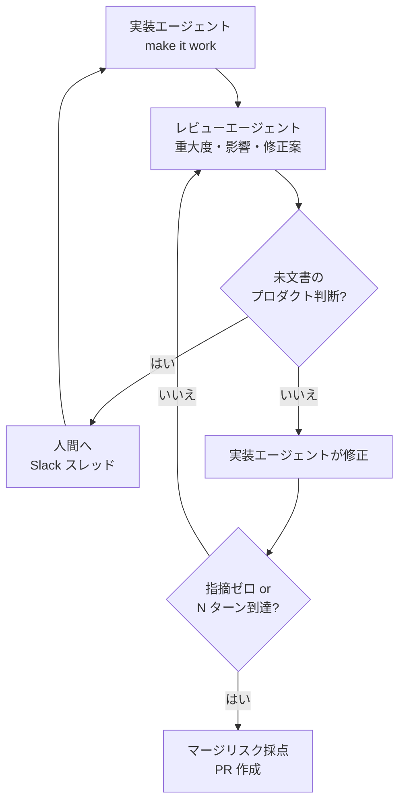
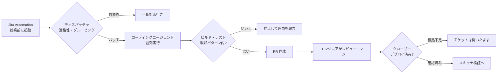
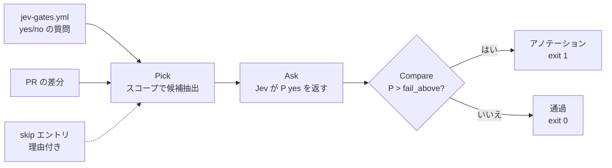

# Daily Briefing 2026-11-12

## 1. コードレビューのボトルネックに対処する（原題: Addressing the Code Review Bottleneck）

- **URL**: https://www.warp.dev/blog/agent-code-review-bottleneck
- **公開日**: 2026-11-05
- **著者・媒体**: Ben Holmes / Warp Engineering blog

### 本文翻訳

エージェントが書いた PR は増え続けるが、人間のレビュー時間は増えない。本稿は、人間のレビューを無くさずに **1件あたりのレビューにかかる人の時間** を減らす3つのレバーを示す。人が見る前の敵対的なエージェントレビュー、エージェント自身によるエンドツーエンド検証、そしてすべての PR へのマージリスク採点である。

**1. 自前のコードレビューエージェントを作る**

狙いは、チームメイトが PR を見る前にエージェントが内部レビューを済ませておくこと。「動くようにする」パスのあとに「良くする」パスを回す。自作する理由は、採点基準を自チームの優先順位に合わせられ、自社データで精度を調整できるからだ。本番インシデントやリバートは信号の強いデータで、そのまま評価ケースになる（この発想は Addy Osmani による Anthropic のコードレビュー手法の解説に負う）。ノイズを減らすため、エージェント同士のレビューは GitHub のスレッドの外で行い、人の判断が必要なコメントだけを PR に載せる。

Warp Factories の既定ループは次のとおり。(1) 実装エージェントがレビューエージェントへ作業を渡す。(2) レビュアーは重大度・影響・（該当すれば）修正案付きの指摘リストを返す。(3) 文書化されていないプロダクト判断に依存する変更は人間に戻す。Warp ではタスクボードのチケットに紐づく Slack スレッドで行う。(4) 実装エージェントが直せるものを直す。(5) レビュアーが追加の指摘を出す。すべて決着するか最大 N ターンに達するまで繰り返す。

複数ラウンドのレビューは高価だ。Warp のフルスタック環境での初期ベンチマークでは、複数ラウンドを大きな機能に限定するのが現実的な選択肢と示唆された。レビュアーの評価には、PR あたりコスト・サイクルタイム・インシデントによるロールバックといった下流の指標を追う。コード品質・効率・テスト品質・失敗モードなどの定性面は、指標ごとのルーブリックを持つ LLM-as-a-judge で採点する。判定者は会話全体でもレビューサブエージェント単体でも評価できる。さらに自己改善エージェントが判定スコアを読んで改善案を出す（`/skill-doctor` がこのパターンを試す手段として紹介されている）。

**2. エージェントに検証用のコンピュータを与える**

人間がローカルビルドで確かめていない PR を信用しないのと同じく、エージェントもユーザーと同じようにアプリを試すべきだ。バックエンドなら現実的なステージング DB を立て、テスト用認証情報を注入し、アクセスログを取る。Web なら Chrome DevTools MCP や WebMCP、任意のクライアントアプリには computer use を使う。Warp では computer use はサブエージェントへ委譲するツール呼び出しで、サブエージェントが仮想デスクトップを操作し、スクリーンショットと画面録画を成果物として返す。検証は変更の前後両方を示す。テスト成果物は PR 記述の必須項目にする（Matt Pocock の `/pr` スキルを雛形として挙げる）。過剰な検証を避けるため、スクリーンショットは重複しない別々のユーザーフローだけを撮り、録画は切り詰める。Warp は FFmpeg の後処理でエージェント操作間の空白を削り、数分の録画を約10〜15秒にした。

**3. マージリスクを採点し、緩和する**

レビュアーは変更の範囲とどこに注目すべきかを知る必要がある。基準は5つ。**検証**（テストカバレッジと E2E の成果物）、**整合**（Issue や PR 記述と一致しているか、ついでの修正や副作用が混ざっていないか）、**影響**（影響範囲、auth・権限・課金など機微なパスに触れるか。触れるならコードオーナーにルーティング）、**ロールバックコスト**（破壊的なスキーマ移行のような一方通行のドアか、戻せる二方向のドアか）、**エラー検知**（失敗が握りつぶされるのか、ログに出るのか、エラー監視に通知されるのか。Warp は Sentry のアラートを工場のエージェントへ転送する Webhook を追加した）。`/merge-risk` スキルが PR をこの基準で採点し、最も注意が必要な箇所を示す。

人間のレビュー前の最後の一押しとして、エージェントは整合しない変更を取り除き、新しいコードパスにエラー監視を足し、高影響の変更をスタック PR に分割し、同じ結果が得られるなら機微なパスを避け、スクリーンショットと録画で E2E 検証する。

リスクが下がってもゼロにはならない。着手順は、(1) PR 記述に「影響」と「ロールバックコスト」の欄を追加、(2) コードレビュー工程を追加、(3) E2E テストより深い検証のため computer use を追加。結論は、すべての PR を1行ずつ読むのではなく、エージェントを動かす仕組みの側にエンジニアリングの労力を注げ、というものだ。

### 重要ポイント

- 人間のレビューを無くすのではなく、**人が PR に触れる前にエージェントが済ませる作業** を増やして1件あたりの人の時間を減らす
- エージェント間レビューは PR スレッドの外で回し、人の判断が要る指摘（未文書のプロダクト判断）だけを人に上げる。最大 N ターンで打ち切る
- 複数ラウンドのレビューは高価なので、大きな機能に限定するのが現実的（Warp の初期ベンチマーク）
- E2E 検証の成果物（前後のスクリーンショット・切り詰めた録画）を PR 記述の必須項目にする
- マージリスクは「検証・整合・影響・ロールバックコスト・エラー検知」の5基準。最初の一歩は PR テンプレートに「影響」「ロールバックコスト」欄を足すこと

### 図解

エージェント間レビューのループ（手順と打ち切り条件）:



マージリスクの2軸（記事の「影響」「ロールバックコスト」を軸に取り、人の注意の配分を示したもの）:


### 戦略分析

**フレームワーク**: 制約理論（TOC）

| TOC のステップ | 記事での対応 |
|---|---|
| 1. 制約を見つける | エージェント PR の増加に対し、人間のレビュー時間が固定 |
| 2. 制約を徹底活用する | 人に上げる指摘を「未文書のプロダクト判断」に限定。マージリスク採点で注目箇所を示す |
| 3. 他を制約に従属させる | 実装エージェントは人の前に make it good パス・E2E 検証・不要変更の除去・PR 分割を済ませる |
| 4. 制約を引き上げる | 記事は扱わない（レビュアー増員ではなく仕組みへの投資を勧める） |

**制約**: 記事の主張は、レビュアーの人数を増やす（ステップ4）前に、ステップ2・3で人の1件あたりの注意を節約せよ、というものだ。人が読む量は「PR の行数」ではなく「マージリスクが高い箇所」で決まる構造に変える。

**示唆**: 来週やるべきことは新しいレビューツールの購入ではなく、**PR テンプレートに「影響」「ロールバックコスト」「検証成果物」欄を足すこと**（記事の推奨着手順の1番目）。これは無料で、人の注意配分を即座に変える。次にエージェント間レビューを導入するが、記事のベンチマークに従い **大きな機能だけ複数ラウンド** にしてコストを抑える。評価は「レビューコメント数」ではなく PR あたりコスト・サイクルタイム・ロールバック件数で行う。

**反証条件**: 制約がレビューではない組織、たとえばレビューは即日終わるがデプロイが週1回のリリーストレインに縛られている場合、この投資はリードタイムを縮めない。また、機微なパス（auth・課金）に触れる変更が大半を占めるコードベースでは、ほぼすべてが右上の象限に入り、人の注意を節約する余地が小さい。

### 現場での適用方法

**PR テンプレート**（`.github/pull_request_template.md`）。記事の推奨着手順1番目をそのまま形にしたもの:

```markdown
## 変更の目的
<!-- 対応する Issue: #<ISSUE_NUMBER> -->

## 影響（Impact）
- 影響範囲: <!-- 例: 請求 API の /invoices のみ -->
- 機微なパスへの接触: [ ] auth  [ ] 権限  [ ] 課金  [ ] なし
  <!-- いずれかにチェックがあればコードオーナーのレビュー必須 -->

## ロールバックコスト
- [ ] 二方向ドア（revert で戻せる）
- [ ] 一方通行ドア（スキーマの破壊的変更・データ移行・外部への通知など）
  - 戻し方: <!-- 一方通行なら必須 -->

## 検証（Verification）
- テスト: <!-- 追加・変更したテスト -->
- E2E 成果物: <!-- 変更前後のスクリーンショット / 切り詰めた録画 -->

## エラー検知
- 新しいコードパスの失敗は: [ ] ログ出力  [ ] エラー監視へ通知  [ ] 該当なし

## 整合
- [ ] Issue の範囲外の「ついでの修正」は含まない
```

**スキル化の例**（`.claude/skills/merge-risk/SKILL.md`）。エージェントが PR を出す前に自己採点させる:

```markdown
---
name: merge-risk
description: PR を作成する直前に使う。差分を5基準（検証・整合・影響・ロールバックコスト・エラー検知）で採点し、人間のレビュアーが注目すべき箇所を PR 記述の冒頭に書く。高リスクならスタック PR への分割を提案する。
---

# マージリスク採点

## 手順
1. `git diff origin/<BASE_BRANCH>...HEAD --stat` で変更範囲を把握する
2. 各基準を Low / Medium / High で採点し、根拠のファイルと行を添える
   - 検証: 変更した振る舞いにテストと E2E 成果物があるか
   - 整合: Issue に無い変更が混ざっていないか（あれば取り除く）
   - 影響: `<SENSITIVE_PATHS>`（例: src/auth/, src/billing/）に触れるか
   - ロールバックコスト: マイグレーション・データ削除・外部 API への送信を含むか
   - エラー検知: 新しい catch / except が例外を握りつぶしていないか
3. 影響が High かつロールバックコストが High なら、PR を分割する案を示して停止する
4. それ以外は採点結果を PR 記述の「レビュアーへ」節に書いて PR を作成する

## してはいけないこと
- 採点を理由にテストを省略しない
- 未文書のプロダクト判断を自分で決めない。人間に質問として返す
```

### 期待効果

- 人がレビューで読む範囲が「全行」から「高リスク箇所」に絞られ、1件あたりの人の時間が減る
- E2E 録画の後処理で、数分の録画が約10〜15秒になる（Warp の実例）
- インシデント・リバートを評価ケースに回すことで、レビューエージェントの精度が自社コードに合わせて上がる

### 注意点

- 複数ラウンドのエージェントレビューはコストが高い。記事も大きな機能に限定することを勧めている
- 記事はサイクルタイム短縮の具体的な数値を示していない。効果は自組織で計測して確かめる必要がある
- 自己採点はエージェントの自己申告である。影響・ロールバックコストの判定は、パス一致やマイグレーション有無などの決定的なチェックで裏付ける
- 「リスクが下がってもゼロではない」。機微なパスはコードオーナーのレビューを外さない

## 2. Agentic Pipelines で脆弱性修正をレビュー可能な状態にする（原題: How we made vulnerability fixes review-ready with Agentic Pipelines）

- **URL**: https://www.atlassian.com/blog/bitbucket/vulnerability-fixes-with-agentic-pipelines
- **公開日**: 2026-08-30
- **著者・媒体**: Arthy Vijayaraghavan（Senior Engineering Manager）/ Atlassian Blog（Bitbucket）

### 本文翻訳

**定型作業の問題**: 定型的な脆弱性修正は1件ずつは単純だが、計画した作業を中断させる。依存関係をたどり、パッケージやイメージを更新し、生成ファイルを作り直し、チェックを回し、PR を開き、デプロイ後にチケットを閉じる。この繰り返しの受け渡しは自動化の好適な対象で、目標は「毎朝、テスト済みの PR がある状態で一日を始める」ことだ。

ワークフローは Jira Automation、自作のディスパッチャとクローザー、Bitbucket Agentic Pipelines、Rovo Dev、Atlassian の MCP ツールを組み合わせる。差分のレビューとマージ判断はエンジニアが行う。

**3か月の結果**: 120件以上の脆弱性を解消。エージェントが作成した PR のうち55件以上をマージ。そのうち **95% が初回実行のまま**（手戻りやテスト失敗なし）でマージされた。

**脆弱性パッチが出発点に向いていた理由**: エージェント自動化に向くタスクの条件は4つ。(1) 影響を受けるパッケージ・イメージと必要な安全バージョンをチケットが特定している。(2) 作業の多くを少数の修正パターンでカバーできる。(3) 変更を検証できるビルドとテストスイートがある。(4) 本番前にエンジニアが慣れた管理点として PR がある。エージェントは変更とその根拠を準備し、出荷するかはエンジニアが決める。

**構成要素**: Jira Automation がスケジュールで起動する。ディスパッチャ（Agentic Pipeline）が適格性とグルーピングのルールを適用し、バッチごとにコーディングエージェントを並列起動する。コーディングエージェントはリポジトリを更新し、チェックを回し、ブランチを作って PR を開く。既存の CI/CD とエンジニアがレビュー・マージ・デプロイを統制する。クローザー（Agentic Pipeline）がデプロイ済みコミットを検証して Jira チケットを更新する。

**流れ**: ディスパッチャは始業前にスケジュール実行され、設定したパッチ期間内の脆弱性チケットを検索する。チケットごとに、自動修正の対象か、他のチケットと同じ依存関係変更を共有するか、どうまとめて実行するか、どれに人間の判断が必要かを決める。**すべてのチケットに明示的な結果**（ディスパッチ済み・グループ化・手動対応行き）が付く。

コーディングエージェントはチケットの文脈を受け取り、リポジトリをチェックアウトし、リポジトリに置かれたコードベース固有の指示に従う。指示は判断経路を扱う。直接依存ならバージョンを上げる。推移的依存なら親を上げる必要があるかもしれない。プラットフォーム管理のパッケージなら変更せず報告する。ベースイメージは別の経路をたどる。変更を適用し、必要なら生成ファイルを作り直し、フルビルドとテストスイートを回す。チェックが失敗するか、修正が既知のパターンから外れたら、実行を止めて理由を報告する。通れば PR を開く。パイプライン定義・プロンプト・再利用可能なスキルはすべてリポジトリでバージョン管理される。エージェントはビルドと同じ配信システム内で、チェックアウトとビルドツール、そのステップに必要な Bitbucket 権限だけを持って動く。

クローザーはデプロイ後、対応する PR がマージされ、デプロイされたビルドが期待するコミットを含むことを確認してから、チケットをスキャナ検証へ進める。根拠が不完全なら開いたままにする。繰り返し実行しても重複動作や二重クローズは起きない。

**学び**: 不完全なプロンプトで始めて反復する。信頼性は実運用のあとにワークフローを締めることで得られた。プロンプトとスキルは本番資産として扱う。指示はコードベース固有にする（依存パターン・ファイル位置・ビルドコマンド・既知の例外）。汎用的な指示からは汎用的な修正しか出てこない。検証は決定的かつ人間の管理下に置く。マージの安全性はビルド・テスト・ブランチ保護・必須レビューが決め、モデルの出力を単独でリリースゲートにしない。安全に失敗し、再実行を無害にする。チケット・ラベル・ブランチ・PR・デプロイ状態を使って重複作業を防ぐ。権限は狭く、帰属可能にする。

**適用方法**: 信頼できるチェックがある1リポジトリの1つの繰り返し作業から始める。適格性ルールと手動例外を定義し、コードベースの知識をリポジトリ所有のプロンプトかスキルに書き、初回の失敗から指示を改善する。依存関係のメンテナンス、古いフィーチャーフラグ、ドキュメント更新、flaky テストの修正にも合うパターンだ。エージェントは Rovo Dev のほか、自前のプロバイダアカウントで Claude Code や Codex も使える。

### 重要ポイント

- 3か月で120件以上の脆弱性を解消、エージェント PR 55件以上をマージ、その **95% が初回実行のまま** マージ
- 自動化に向くタスクの4条件: チケットが安全バージョンを特定 / 少数の修正パターン / 検証できるテスト / PR という管理点
- ディスパッチャが全チケットに「ディスパッチ・グループ化・手動行き」の明示的な結果を付ける。取りこぼしが起きない
- クローザーは「マージ済み」ではなく「デプロイ済みビルドに期待コミットが含まれる」を確認してからチケットを進める
- 指示はコードベース固有（直接依存・推移的依存・プラットフォーム管理・ベースイメージで経路が違う）。モデル出力を単独のリリースゲートにしない

### 図解



### 戦略分析

**フレームワーク**: RACI × バリューストリームマッピング

| 工程 | R（実行） | A（説明責任） | 記事での待ち・作業の変化 |
|---|---|---|---|
| 対象判定・グルーピング | ディスパッチャ | エンジニア（ルール所有者） | 人が毎回たどっていた作業がスケジュール実行に |
| 修正・ビルド・テスト | コーディングエージェント | エンジニア | スプリント容量を割り込みで消費しなくなる |
| レビュー・マージ | エンジニア | エンジニア | 変わらない（意図的に人間に残す） |
| デプロイ確認・クローズ | クローザー | エンジニア | 「閉じ忘れ」「早すぎるクローズ」の待ちが消える |

**構造**: 記事の設計は、Accountable を全工程で人間に残したまま Responsible だけをエージェントへ移している。人が実行する工程はレビュー・マージの1つに減った。脆弱性対応のリードタイムの多くは、作業そのものより **割り込みとして後回しにされる待ち時間** にある（これは一般論で、記事は待ち時間を計測していない）。始業前に PR が揃っていれば、その待ちが「レビュー待ち」1つに圧縮される。

**示唆**: 脆弱性対応の自動化を始めるとき、最初に作るべきは修正エージェントではなく **ディスパッチャの適格性ルール** とクローザーの完了条件である。「直接依存のパッチバージョン更新でテストが通るもの」だけを対象にした狭いルールから始め、手動行きの理由を記録して、多い順にパターンを足していく。95% の初回マージ率は、対象を絞り込んだ結果であって、エージェントの汎用能力の証拠ではないと読むべきだ。

**反証条件**: テストスイートが変更を検証できない（カバレッジが低い、flaky が多い）リポジトリでは、条件(3)が崩れ、初回マージ率は記事の数値に届かない。また脆弱性の大半がフレームワークのメジャー更新を要する場合、条件(2)の「少数の修正パターン」が成り立たず、ほとんどが手動行きになる。

### 現場での適用方法

**スクリプト化の例**: GitHub + Dependabot 環境で、記事のディスパッチャに当たる「適格性判定」を決定的なコードで書いたもの。対象外は理由付きで記録し、対象だけをエージェントに渡す。

```bash
#!/usr/bin/env bash
# dispatch-vulns.sh — 始業前に cron / scheduled workflow で実行
# 前提: gh CLI 認証済み、jq あり。<OWNER>/<REPO> を置き換える
set -euo pipefail
REPO="<OWNER>/<REPO>"
OUT_DIR="${OUT_DIR:-./dispatch}"
mkdir -p "$OUT_DIR"
: > "$OUT_DIR/eligible.jsonl"
: > "$OUT_DIR/manual.jsonl"

gh api "repos/$REPO/dependabot/alerts?state=open&per_page=100" --paginate \
  | jq -c '.[] | {
      number,
      pkg: .dependency.package.name,
      ecosystem: .dependency.package.ecosystem,
      scope: .dependency.relationship,          # direct / transitive
      severity: .security_advisory.severity,
      patched: .security_vulnerability.first_patched_version.identifier,
      manifest: .dependency.manifest_path
    }' \
  | while read -r a; do
      reason=""
      [ "$(jq -r .patched <<<"$a")" = "null" ] && reason="安全バージョン未公開"
      [ "$(jq -r .scope <<<"$a")" != "direct" ] && reason="${reason:-推移的依存（親の更新が必要）}"
      # プラットフォーム管理のパッケージは変更せず報告する（記事の判断経路）
      grep -qxF "$(jq -r .pkg <<<"$a")" ops/platform-managed.txt 2>/dev/null \
        && reason="${reason:-プラットフォーム管理}"
      if [ -n "$reason" ]; then
        jq -c --arg r "$reason" '. + {outcome:"manual", reason:$r}' <<<"$a" >> "$OUT_DIR/manual.jsonl"
      else
        jq -c '. + {outcome:"dispatched"}' <<<"$a" >> "$OUT_DIR/eligible.jsonl"
      fi
    done

# 同じパッケージは1バッチにまとめる（記事の「グループ化」）
jq -s 'group_by(.pkg) | map({pkg: .[0].pkg, patched: .[0].patched, alerts: map(.number)})' \
  "$OUT_DIR/eligible.jsonl" > "$OUT_DIR/batches.json"

echo "dispatched: $(wc -l < "$OUT_DIR/eligible.jsonl") / manual: $(wc -l < "$OUT_DIR/manual.jsonl")"
```

**CLAUDE.md への追記例**: 記事の「コードベース固有の指示」と「安全に失敗する」をエージェント向けルールにしたもの。

```markdown
## 脆弱性修正エージェントのルール

- 入力は batches.json の1バッチ（pkg, patched, alerts）。範囲外の変更はしない
- 直接依存: マニフェストのバージョンを `patched` 以上の最小版へ上げ、ロックファイルを再生成する
  - npm: `npm install <PKG>@<VERSION> --save-exact` / Python: `uv lock --upgrade-package <PKG>`
- ベースイメージ: Dockerfile の FROM タグを上げる。digest 固定なら digest も更新する
- 検証: `<BUILD_CMD>` と `<TEST_CMD>` を両方実行する。どちらかが失敗したら PR を作らず、
  失敗ログの要約を `dispatch/failed/<PKG>.md` に書いて停止する
- 既知パターンに当てはまらない（メジャー更新が必要、API 変更あり）なら修正を試みず停止して報告する
- PR タイトル: `fix(deps): bump <PKG> to <VERSION> (alerts #<N>, #<M>)`
- ブランチ名: `vuln/<PKG>-<VERSION>`。同名ブランチが既にあれば何もしない（再実行を無害にする）
- テストを弱める・スキップする変更は禁止
```

### 期待効果

- 記事の実績: 3か月で120件以上の脆弱性を解消、エージェント PR 55件以上をマージ、うち95%が手戻りなし
- エンジニアの作業が「追跡・修正・テスト・チケット操作」から「差分レビューと承認」に縮み、スプリント容量への割り込みが減る
- クローザーの完了条件により、デプロイされていない修正でチケットが閉じる事故がなくなる

### 注意点

- 95% の初回マージ率は適格性ルールで対象を絞った上での数値。対象外（手動行き）の比率は記事に示されていない
- 書き込み権限は必要なステップにだけ与え、専用の認証情報を使う。Claude Code / Codex を使う場合はデータ取り扱い・コスト・出力責任を確認する
- 記事執筆時点で Agentic Pipelines はベータ表記（関連記事では有料 Cloud プランで GA とされている）。Bitbucket 以外では、同じ構成を自前で組む必要がある
- プロンプトとスキルは本番資産。初回の失敗から改善し続ける運用体制が前提になる

## 3. Jev Gate: リンタでは書けないコード規約を CI で判定する（原題: Jev Gate）

- **URL**: https://github.com/lymagics/jev-gate
- **公開日**: 不明（直近数週間以内。Jev は 2026-09-15 公開）
- **著者・媒体**: lymagics / GitHub（MIT License）

### 本文翻訳

リンタはパーサが見えるものを捕まえる。セミコロン抜け、未使用 import、長すぎる行。しかし `InvoiceBuilder` が「何であるか」ではなく「何をするか」で命名されていること、`test_rejects_empty_cart` というテストが実は合計を検査していること、`except` ブロックがエラーを黙って握りつぶしていることは指摘できない。こうした規約には読み手が要る。

Jev Gate は CI の中のその読み手だ。各ルールを YAML ファイルの yes/no の質問として書く。Jev Gate は質問の対象となるコードを見つけ、[Jev](https://docs.typesafe.ai) に答えが「yes」である確率を尋ね、確率がしきい値を超えたらパイプラインを失敗させる。GitHub Action、GitLab CI、単体コマンドとして動く。

**仕組み**: 「クラスは何をするかではなく何であるかで命名する」という規約を例にとる。PR が `class InvoiceBuilder` と `class Invoice` を追加したとき、(1) **Pick**: `type` スコープが PR の触れたクラスを全部見つける。(2) **Ask**: それぞれについて `name` を埋めた質問を Jev に送り、確率を得る。`InvoiceBuilder` は 0.93、`Invoice` は 0.04。(3) **Compare**: 0.93 はしきい値 0.85 を超えるのでゲートが発火し、パイプラインが失敗する。`Invoice` は通る。GitHub ではクラスの行にアノテーションが付く。

**何を判定するか、パイプラインを落とすかはコードが決め、Jev は質問に答えるだけ**。同じファイルからは常に同じ候補が選ばれ、厳しさは1つの数値で調整する。対応言語は Python、Java、JavaScript、TypeScript、C#、C++、Ruby、Rust。

**クイックスタート**: (1) `.github/jev-gates.yml` にゲートを1〜2個書く。(2) Typesafe の API キーを `TYPESAFE_API_KEY` としてリポジトリシークレットに登録する。(3) ワークフローを追加する。ワークフローで重要なのは2行だ。`fetch-depth: 0` で全履歴を取得し、比較対象のベースコミットを用意する。`ref: ...head.sha` で PR の本当の head をチェックアウトし、GitHub が作るマージコミットを自分のコミットとして判定させない。

**ゲートの書き方のコツ**: 「yes」が「壊れている」を意味するように質問を書く（高い確率で発火するため）。`state` のフィールドはすべてバッククォートで質問中に名指しする。質問に必要なフィールドだけを送る（テキストが少ないほど安く、鋭い答えになる）。厳しく始めて緩める。`fail_above: 0.9` から始め、ゲートを信頼できたら下げる。

**スコープ**: `file`（パスと内容の不一致）、`hunk`（コードを削除せずコメントアウト。diff 専用）、`commit`（振る舞いを変えたのにテストがない。diff 専用）、`test`（テスト名とアサーションの不一致）、`changed_test`（通すためにテストを弱めた。diff 専用）、`type`、`function`、`variable`、`throw`（何が失敗したか言わないエラーメッセージ）、`catch`（握りつぶされた例外）、`log`（ログへの秘密情報の出力）。

**モード**: `diff` は変更が触れたものだけを判定し、`full` はリポジトリ全体を判定する。後者は週次実行に向く。モデルは `jev-1.13.0` のように固定し、エイリアスは拒否される。巨大な候補は `oversize`（既定 `fail`）で扱いを決め、誤検知は理由付きの `skip` エントリで除外する。終了コードは 0（発火なし）、1（1つ以上発火）、2（ゲートファイルの破損などで完走できない）。GitLab のマージ結果パイプラインでは `HEAD` が合成マージコミットになるので、先にソースブランチの SHA をチェックアウトする。

### 重要ポイント

- 「リンタでは書けない、読み手が要る規約」を yes/no の質問として YAML に書き、確率のしきい値で CI を落とす
- **候補の選択と合否判定はコード、意味判断だけ Jev** という分担。同じ入力からは同じ候補が選ばれ、厳しさは `fail_above` 1つで調整する
- `changed_test`（テストを弱めた）や `catch`（例外の握りつぶし）など、AI エージェントの PR で起きやすい問題に直接効くスコープがある
- `fail_above: 0.9` で厳しく始めて緩める。質問は「yes = 壊れている」の向きで書く
- PR では `fetch-depth: 0` と head SHA のチェックアウトが必須。モデルはバージョン固定

### 図解



### 戦略分析

**フレームワーク**: 制約理論（TOC）

AI エージェントの PR が増えると、人間のレビューが制約になる（記事1と同じ構造）。人間のレビュー時間の一部は、「テスト名とアサーションの一致」「例外を握りつぶしていないか」のような、規約として書けるが文法では検査できない指摘に使われている。Jev Gate はこの種の指摘を、人に届く前の CI に移す。TOC のステップ3「他を制約に従属させる」に当たる。

| 指摘の種類 | 従来の担い手 | Jev Gate 導入後 |
|---|---|---|
| 構文・スタイル | リンタ | リンタ（変化なし） |
| 文法では検査できない規約（命名の意味・テストの主張・例外処理） | 人間のレビュー | CI のゲート（確率で判定） |
| 設計判断・プロダクト判断 | 人間のレビュー | 人間のレビュー（変化なし） |

**示唆**: 自チームのレビューコメントを1か月分見返し、**同じ指摘が3回以上出ている規約** を抜き出す。それを yes/no の質問に書き直し、`fail_above: 0.9` で1つだけ入れる。最初の候補は `changed_test`（テストを弱めた変更）がよい。AI エージェントがテストを通すために検査を緩める失敗は、人間のレビューで見落とされやすいからだ。誤検知は `skip` に理由付きで残し、発火率と誤検知率を2週間見てから2つ目のゲートを足す。

**反証条件**: README は精度データを示していない（例の 0.93 / 0.04 は動作説明）。自チームのコードでゲートの誤検知率が高ければ、開発者は `skip` を乱発するかゲートを無視するようになり、人のレビュー時間はかえって増える。また、レビューコメントの大半が設計判断である組織では、移せる指摘が少なく効果は小さい。

### 現場での適用方法

**設定ファイル**: AI エージェントの PR で起きやすい3つの問題に絞ったゲートファイル（`.github/jev-gates.yml`）。README のレシピを組み合わせたもの。

```yaml
model: jev-1.13.0          # エイリアス不可。バージョン固定
oversize: fail

paths:
  include: ["src/**", "tests/**"]
  exclude: ["**/generated/**"]

gates:
  # エージェントがテストを通すために検査を緩める失敗
  - id: test-weakened
    scope: changed_test
    state: [before, after]
    ask: Does `after` check less than `before` did?
    fail_above: 0.8

  # 例外の握りつぶし
  - id: swallowed-exception
    scope: catch
    state: [handler]
    ask: Does `handler` drop the error without logging, rethrowing or returning it?
    fail_above: 0.9

  # ログへの秘密情報出力
  - id: secret-in-log
    scope: log
    state: [statement]
    ask: Does `statement` write a password, token or key to the log?
    fail_above: 0.8

skip:
  - gates: [swallowed-exception]
    path: src/legacy/<LEGACY_MODULE>.py
    reason: <TICKET_ID> で書き直し予定。それまで既知の握りつぶしを許容
```

**ワークフロー**（`.github/workflows/jev-gate.yml`）。README のクイックスタートどおり:

```yaml
name: Jev Gate

on:
  pull_request:

permissions:
  contents: read

jobs:
  gate:
    runs-on: ubuntu-latest
    timeout-minutes: 15
    steps:
      - uses: actions/checkout@v7
        with:
          fetch-depth: 0
          ref: ${{ github.event.pull_request.head.sha }}
      - uses: lymagics/jev-gate@<RELEASE_TAG>
        with:
          config: .github/jev-gates.yml
          mode: diff
          base: ${{ github.event.pull_request.base.sha }}
        env:
          TYPESAFE_API_KEY: ${{ secrets.TYPESAFE_API_KEY }}
```

**GitLab CI の場合**:

```yaml
jev-gate:
  image: python:3.12
  rules:
    - if: $CI_PIPELINE_SOURCE == "merge_request_event"
  variables:
    GIT_DEPTH: 0
  script:
    # マージ結果パイプラインでは HEAD が合成マージコミットなのでソースブランチの SHA に切り替える
    - git checkout "$CI_MERGE_REQUEST_SOURCE_BRANCH_SHA"
    - pip install jev-gate==<VERSION>
    - jev-gate --log plain --config .github/jev-gates.yml --mode diff --base "$CI_MERGE_REQUEST_DIFF_BASE_SHA"
```

### 期待効果

- 「テストを弱めた」「例外を握りつぶした」といった、文法では検査できない規約違反が人間のレビュー前に機械的に止まる
- 違反が該当行へのアノテーションとして出るため、実装エージェントがそのまま自己修正に使える
- 厳しさを `fail_above` 1つで調整でき、`full` モードの週次実行で既存コードの違反も棚卸しできる（README に効果の数値はない）

### 注意点

- 外部サービス（Typesafe の Jev）への API 呼び出しが必要。コード片が外部に送られるため、送信してよいコードかを事前に確認する
- `oversize` の既定は `fail`。巨大な候補でパイプラインが止まりうるので、`commit` スコープなどは `oversize: skip` を検討する
- 精度は README で示されていない。導入初期は発火率と誤検知率を記録し、しきい値を調整する
- コミュニティ製のツールで、スター数は少ない。バージョンを固定し、更新時は変更内容を確認する
