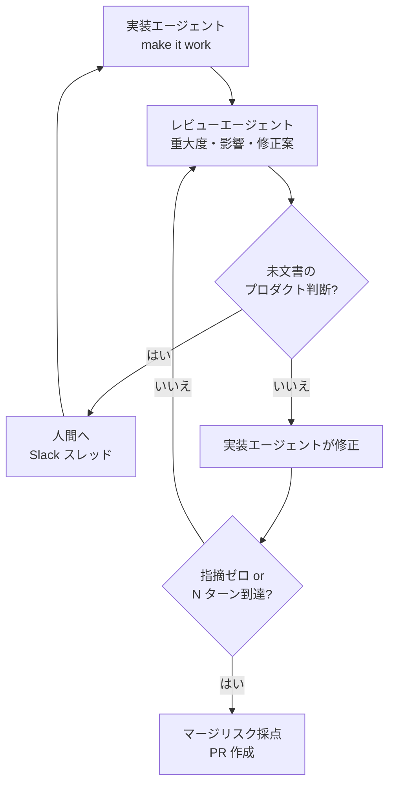
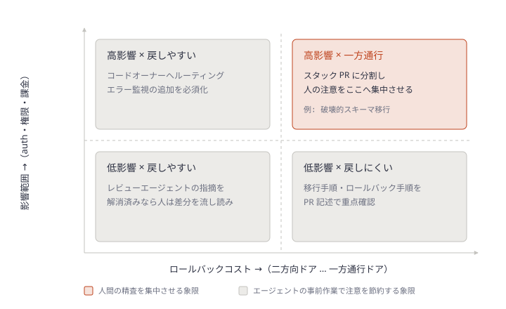
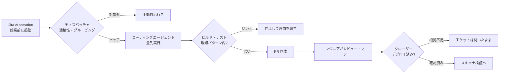
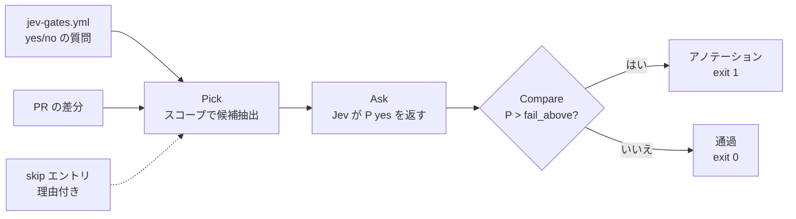
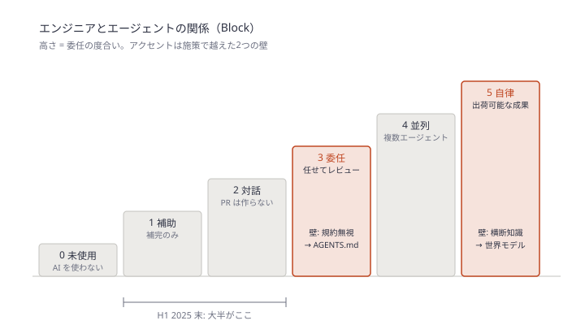
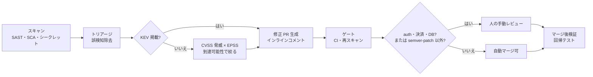
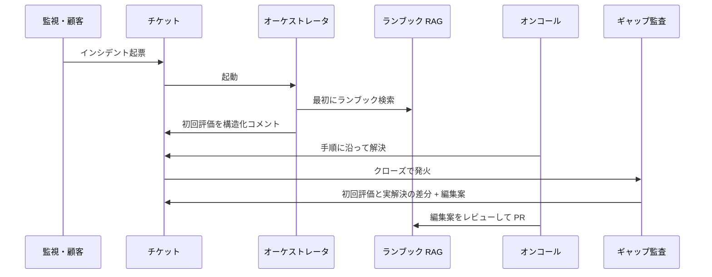
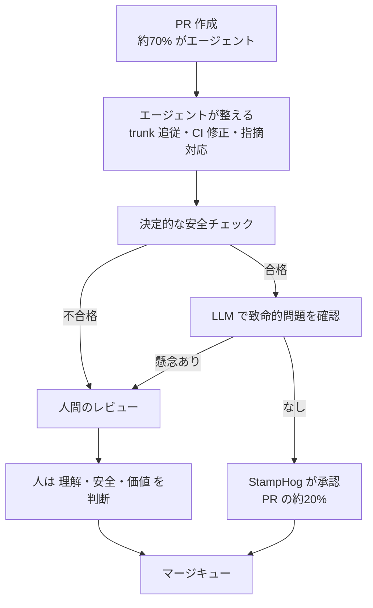
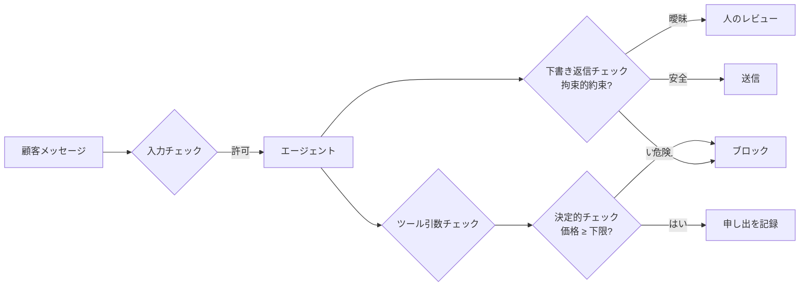

# Daily Briefing 2026-11-12

## 1. コードレビューのボトルネックに対処する（原題: Addressing the Code Review Bottleneck）

- **URL**: https://www.warp.dev/blog/agent-code-review-bottleneck
- **公開日**: 2026-11-05
- **著者・媒体**: Ben Holmes / Warp Engineering blog

### 本文翻訳

エージェントが書いた PR は増え続けるが、人間のレビュー時間は増えない。本稿は、人間のレビューを無くさずに **1件あたりのレビューにかかる人の時間** を減らす3つのレバーを示す。人が見る前の敵対的なエージェントレビュー、エージェント自身によるエンドツーエンド検証、そしてすべての PR へのマージリスク採点である。

**1. 自前のコードレビューエージェントを作る**

狙いは、チームメイトが PR を見る前にエージェントが内部レビューを済ませておくこと。「動くようにする」パスのあとに「良くする」パスを回す。自作する理由は、採点基準を自チームの優先順位に合わせられ、自社データで精度を調整できるからだ。本番インシデントやリバートは信号の強いデータで、そのまま評価ケースになる（この発想は Addy Osmani による Anthropic のコードレビュー手法の解説に負う）。ノイズを減らすため、エージェント同士のレビューは GitHub のスレッドの外で行い、人の判断が必要なコメントだけを PR に載せる。

Warp Factories の既定ループは次のとおり。(1) 実装エージェントがレビューエージェントへ作業を渡す。(2) レビュアーは重大度・影響・（該当すれば）修正案付きの指摘リストを返す。(3) 文書化されていないプロダクト判断に依存する変更は人間に戻す。Warp ではタスクボードのチケットに紐づく Slack スレッドで行う。(4) 実装エージェントが直せるものを直す。(5) レビュアーが追加の指摘を出す。すべて決着するか最大 N ターンに達するまで繰り返す。

複数ラウンドのレビューは高価だ。Warp のフルスタック環境での初期ベンチマークでは、複数ラウンドを大きな機能に限定するのが現実的な選択肢と示唆された。レビュアーの評価には、PR あたりコスト・サイクルタイム・インシデントによるロールバックといった下流の指標を追う。コード品質・効率・テスト品質・失敗モードなどの定性面は、指標ごとのルーブリックを持つ LLM-as-a-judge で採点する。判定者は会話全体でもレビューサブエージェント単体でも評価できる。さらに自己改善エージェントが判定スコアを読んで改善案を出す（`/skill-doctor` がこのパターンを試す手段として紹介されている）。

**2. エージェントに検証用のコンピュータを与える**

人間がローカルビルドで確かめていない PR を信用しないのと同じく、エージェントもユーザーと同じようにアプリを試すべきだ。バックエンドなら現実的なステージング DB を立て、テスト用認証情報を注入し、アクセスログを取る。Web なら Chrome DevTools MCP や WebMCP、任意のクライアントアプリには computer use を使う。Warp では computer use はサブエージェントへ委譲するツール呼び出しで、サブエージェントが仮想デスクトップを操作し、スクリーンショットと画面録画を成果物として返す。検証は変更の前後両方を示す。テスト成果物は PR 記述の必須項目にする（Matt Pocock の `/pr` スキルを雛形として挙げる）。過剰な検証を避けるため、スクリーンショットは重複しない別々のユーザーフローだけを撮り、録画は切り詰める。Warp は FFmpeg の後処理でエージェント操作間の空白を削り、数分の録画を約10〜15秒にした。

**3. マージリスクを採点し、緩和する**

レビュアーは変更の範囲とどこに注目すべきかを知る必要がある。基準は5つ。**検証**（テストカバレッジと E2E の成果物）、**整合**（Issue や PR 記述と一致しているか、ついでの修正や副作用が混ざっていないか）、**影響**（影響範囲、auth・権限・課金など機微なパスに触れるか。触れるならコードオーナーにルーティング）、**ロールバックコスト**（破壊的なスキーマ移行のような一方通行のドアか、戻せる二方向のドアか）、**エラー検知**（失敗が握りつぶされるのか、ログに出るのか、エラー監視に通知されるのか。Warp は Sentry のアラートを工場のエージェントへ転送する Webhook を追加した）。`/merge-risk` スキルが PR をこの基準で採点し、最も注意が必要な箇所を示す。

人間のレビュー前の最後の一押しとして、エージェントは整合しない変更を取り除き、新しいコードパスにエラー監視を足し、高影響の変更をスタック PR に分割し、同じ結果が得られるなら機微なパスを避け、スクリーンショットと録画で E2E 検証する。

リスクが下がってもゼロにはならない。着手順は、(1) PR 記述に「影響」と「ロールバックコスト」の欄を追加、(2) コードレビュー工程を追加、(3) E2E テストより深い検証のため computer use を追加。結論は、すべての PR を1行ずつ読むのではなく、エージェントを動かす仕組みの側にエンジニアリングの労力を注げ、というものだ。

### 重要ポイント

- 人間のレビューを無くすのではなく、**人が PR に触れる前にエージェントが済ませる作業** を増やして1件あたりの人の時間を減らす
- エージェント間レビューは PR スレッドの外で回し、人の判断が要る指摘（未文書のプロダクト判断）だけを人に上げる。最大 N ターンで打ち切る
- 複数ラウンドのレビューは高価なので、大きな機能に限定するのが現実的（Warp の初期ベンチマーク）
- E2E 検証の成果物（前後のスクリーンショット・切り詰めた録画）を PR 記述の必須項目にする
- マージリスクは「検証・整合・影響・ロールバックコスト・エラー検知」の5基準。最初の一歩は PR テンプレートに「影響」「ロールバックコスト」欄を足すこと

### 図解

エージェント間レビューのループ（手順と打ち切り条件）:



マージリスクの2軸（記事の「影響」「ロールバックコスト」を軸に取り、人の注意の配分を示したもの）:



### 戦略分析

**フレームワーク**: 制約理論（TOC）

| TOC のステップ | 記事での対応 |
|---|---|
| 1. 制約を見つける | エージェント PR の増加に対し、人間のレビュー時間が固定 |
| 2. 制約を徹底活用する | 人に上げる指摘を「未文書のプロダクト判断」に限定。マージリスク採点で注目箇所を示す |
| 3. 他を制約に従属させる | 実装エージェントは人の前に make it good パス・E2E 検証・不要変更の除去・PR 分割を済ませる |
| 4. 制約を引き上げる | 記事は扱わない（レビュアー増員ではなく仕組みへの投資を勧める） |

**制約**: 記事の主張は、レビュアーの人数を増やす（ステップ4）前に、ステップ2・3で人の1件あたりの注意を節約せよ、というものだ。人が読む量は「PR の行数」ではなく「マージリスクが高い箇所」で決まる構造に変える。

**示唆**: 来週やるべきことは新しいレビューツールの購入ではなく、**PR テンプレートに「影響」「ロールバックコスト」「検証成果物」欄を足すこと**（記事の推奨着手順の1番目）。これは無料で、人の注意配分を即座に変える。次にエージェント間レビューを導入するが、記事のベンチマークに従い **大きな機能だけ複数ラウンド** にしてコストを抑える。評価は「レビューコメント数」ではなく PR あたりコスト・サイクルタイム・ロールバック件数で行う。

**反証条件**: 制約がレビューではない組織、たとえばレビューは即日終わるがデプロイが週1回のリリーストレインに縛られている場合、この投資はリードタイムを縮めない。また、機微なパス（auth・課金）に触れる変更が大半を占めるコードベースでは、ほぼすべてが右上の象限に入り、人の注意を節約する余地が小さい。

### 現場での適用方法

**PR テンプレート**（`.github/pull_request_template.md`）。記事の推奨着手順1番目をそのまま形にしたもの:

```markdown
## 変更の目的
<!-- 対応する Issue: #<ISSUE_NUMBER> -->

## 影響（Impact）
- 影響範囲: <!-- 例: 請求 API の /invoices のみ -->
- 機微なパスへの接触: [ ] auth  [ ] 権限  [ ] 課金  [ ] なし
  <!-- いずれかにチェックがあればコードオーナーのレビュー必須 -->

## ロールバックコスト
- [ ] 二方向ドア（revert で戻せる）
- [ ] 一方通行ドア（スキーマの破壊的変更・データ移行・外部への通知など）
  - 戻し方: <!-- 一方通行なら必須 -->

## 検証（Verification）
- テスト: <!-- 追加・変更したテスト -->
- E2E 成果物: <!-- 変更前後のスクリーンショット / 切り詰めた録画 -->

## エラー検知
- 新しいコードパスの失敗は: [ ] ログ出力  [ ] エラー監視へ通知  [ ] 該当なし

## 整合
- [ ] Issue の範囲外の「ついでの修正」は含まない
```

**スキル化の例**（`.claude/skills/merge-risk/SKILL.md`）。エージェントが PR を出す前に自己採点させる:

```markdown
---
name: merge-risk
description: PR を作成する直前に使う。差分を5基準（検証・整合・影響・ロールバックコスト・エラー検知）で採点し、人間のレビュアーが注目すべき箇所を PR 記述の冒頭に書く。高リスクならスタック PR への分割を提案する。
---

# マージリスク採点

## 手順
1. `git diff origin/<BASE_BRANCH>...HEAD --stat` で変更範囲を把握する
2. 各基準を Low / Medium / High で採点し、根拠のファイルと行を添える
   - 検証: 変更した振る舞いにテストと E2E 成果物があるか
   - 整合: Issue に無い変更が混ざっていないか（あれば取り除く）
   - 影響: `<SENSITIVE_PATHS>`（例: src/auth/, src/billing/）に触れるか
   - ロールバックコスト: マイグレーション・データ削除・外部 API への送信を含むか
   - エラー検知: 新しい catch / except が例外を握りつぶしていないか
3. 影響が High かつロールバックコストが High なら、PR を分割する案を示して停止する
4. それ以外は採点結果を PR 記述の「レビュアーへ」節に書いて PR を作成する

## してはいけないこと
- 採点を理由にテストを省略しない
- 未文書のプロダクト判断を自分で決めない。人間に質問として返す
```

### 期待効果

- 人がレビューで読む範囲が「全行」から「高リスク箇所」に絞られ、1件あたりの人の時間が減る
- E2E 録画の後処理で、数分の録画が約10〜15秒になる（Warp の実例）
- インシデント・リバートを評価ケースに回すことで、レビューエージェントの精度が自社コードに合わせて上がる

### 注意点

- 複数ラウンドのエージェントレビューはコストが高い。記事も大きな機能に限定することを勧めている
- 記事はサイクルタイム短縮の具体的な数値を示していない。効果は自組織で計測して確かめる必要がある
- 自己採点はエージェントの自己申告である。影響・ロールバックコストの判定は、パス一致やマイグレーション有無などの決定的なチェックで裏付ける
- 「リスクが下がってもゼロではない」。機微なパスはコードオーナーのレビューを外さない

## 2. Agentic Pipelines で脆弱性修正をレビュー可能な状態にする（原題: How we made vulnerability fixes review-ready with Agentic Pipelines）

- **URL**: https://www.atlassian.com/blog/bitbucket/vulnerability-fixes-with-agentic-pipelines
- **公開日**: 2026-08-30
- **著者・媒体**: Arthy Vijayaraghavan（Senior Engineering Manager）/ Atlassian Blog（Bitbucket）

### 本文翻訳

**定型作業の問題**: 定型的な脆弱性修正は1件ずつは単純だが、計画した作業を中断させる。依存関係をたどり、パッケージやイメージを更新し、生成ファイルを作り直し、チェックを回し、PR を開き、デプロイ後にチケットを閉じる。この繰り返しの受け渡しは自動化の好適な対象で、目標は「毎朝、テスト済みの PR がある状態で一日を始める」ことだ。

ワークフローは Jira Automation、自作のディスパッチャとクローザー、Bitbucket Agentic Pipelines、Rovo Dev、Atlassian の MCP ツールを組み合わせる。差分のレビューとマージ判断はエンジニアが行う。

**3か月の結果**: 120件以上の脆弱性を解消。エージェントが作成した PR のうち55件以上をマージ。そのうち **95% が初回実行のまま**（手戻りやテスト失敗なし）でマージされた。

**脆弱性パッチが出発点に向いていた理由**: エージェント自動化に向くタスクの条件は4つ。(1) 影響を受けるパッケージ・イメージと必要な安全バージョンをチケットが特定している。(2) 作業の多くを少数の修正パターンでカバーできる。(3) 変更を検証できるビルドとテストスイートがある。(4) 本番前にエンジニアが慣れた管理点として PR がある。エージェントは変更とその根拠を準備し、出荷するかはエンジニアが決める。

**構成要素**: Jira Automation がスケジュールで起動する。ディスパッチャ（Agentic Pipeline）が適格性とグルーピングのルールを適用し、バッチごとにコーディングエージェントを並列起動する。コーディングエージェントはリポジトリを更新し、チェックを回し、ブランチを作って PR を開く。既存の CI/CD とエンジニアがレビュー・マージ・デプロイを統制する。クローザー（Agentic Pipeline）がデプロイ済みコミットを検証して Jira チケットを更新する。

**流れ**: ディスパッチャは始業前にスケジュール実行され、設定したパッチ期間内の脆弱性チケットを検索する。チケットごとに、自動修正の対象か、他のチケットと同じ依存関係変更を共有するか、どうまとめて実行するか、どれに人間の判断が必要かを決める。**すべてのチケットに明示的な結果**（ディスパッチ済み・グループ化・手動対応行き）が付く。

コーディングエージェントはチケットの文脈を受け取り、リポジトリをチェックアウトし、リポジトリに置かれたコードベース固有の指示に従う。指示は判断経路を扱う。直接依存ならバージョンを上げる。推移的依存なら親を上げる必要があるかもしれない。プラットフォーム管理のパッケージなら変更せず報告する。ベースイメージは別の経路をたどる。変更を適用し、必要なら生成ファイルを作り直し、フルビルドとテストスイートを回す。チェックが失敗するか、修正が既知のパターンから外れたら、実行を止めて理由を報告する。通れば PR を開く。パイプライン定義・プロンプト・再利用可能なスキルはすべてリポジトリでバージョン管理される。エージェントはビルドと同じ配信システム内で、チェックアウトとビルドツール、そのステップに必要な Bitbucket 権限だけを持って動く。

クローザーはデプロイ後、対応する PR がマージされ、デプロイされたビルドが期待するコミットを含むことを確認してから、チケットをスキャナ検証へ進める。根拠が不完全なら開いたままにする。繰り返し実行しても重複動作や二重クローズは起きない。

**学び**: 不完全なプロンプトで始めて反復する。信頼性は実運用のあとにワークフローを締めることで得られた。プロンプトとスキルは本番資産として扱う。指示はコードベース固有にする（依存パターン・ファイル位置・ビルドコマンド・既知の例外）。汎用的な指示からは汎用的な修正しか出てこない。検証は決定的かつ人間の管理下に置く。マージの安全性はビルド・テスト・ブランチ保護・必須レビューが決め、モデルの出力を単独でリリースゲートにしない。安全に失敗し、再実行を無害にする。チケット・ラベル・ブランチ・PR・デプロイ状態を使って重複作業を防ぐ。権限は狭く、帰属可能にする。

**適用方法**: 信頼できるチェックがある1リポジトリの1つの繰り返し作業から始める。適格性ルールと手動例外を定義し、コードベースの知識をリポジトリ所有のプロンプトかスキルに書き、初回の失敗から指示を改善する。依存関係のメンテナンス、古いフィーチャーフラグ、ドキュメント更新、flaky テストの修正にも合うパターンだ。エージェントは Rovo Dev のほか、自前のプロバイダアカウントで Claude Code や Codex も使える。

### 重要ポイント

- 3か月で120件以上の脆弱性を解消、エージェント PR 55件以上をマージ、その **95% が初回実行のまま** マージ
- 自動化に向くタスクの4条件: チケットが安全バージョンを特定 / 少数の修正パターン / 検証できるテスト / PR という管理点
- ディスパッチャが全チケットに「ディスパッチ・グループ化・手動行き」の明示的な結果を付ける。取りこぼしが起きない
- クローザーは「マージ済み」ではなく「デプロイ済みビルドに期待コミットが含まれる」を確認してからチケットを進める
- 指示はコードベース固有（直接依存・推移的依存・プラットフォーム管理・ベースイメージで経路が違う）。モデル出力を単独のリリースゲートにしない

### 図解



### 戦略分析

**フレームワーク**: RACI × バリューストリームマッピング

| 工程 | R（実行） | A（説明責任） | 記事での待ち・作業の変化 |
|---|---|---|---|
| 対象判定・グルーピング | ディスパッチャ | エンジニア（ルール所有者） | 人が毎回たどっていた作業がスケジュール実行に |
| 修正・ビルド・テスト | コーディングエージェント | エンジニア | スプリント容量を割り込みで消費しなくなる |
| レビュー・マージ | エンジニア | エンジニア | 変わらない（意図的に人間に残す） |
| デプロイ確認・クローズ | クローザー | エンジニア | 「閉じ忘れ」「早すぎるクローズ」の待ちが消える |

**構造**: 記事の設計は、Accountable を全工程で人間に残したまま Responsible だけをエージェントへ移している。人が実行する工程はレビュー・マージの1つに減った。脆弱性対応のリードタイムの多くは、作業そのものより **割り込みとして後回しにされる待ち時間** にある（これは一般論で、記事は待ち時間を計測していない）。始業前に PR が揃っていれば、その待ちが「レビュー待ち」1つに圧縮される。

**示唆**: 脆弱性対応の自動化を始めるとき、最初に作るべきは修正エージェントではなく **ディスパッチャの適格性ルール** とクローザーの完了条件である。「直接依存のパッチバージョン更新でテストが通るもの」だけを対象にした狭いルールから始め、手動行きの理由を記録して、多い順にパターンを足していく。95% の初回マージ率は、対象を絞り込んだ結果であって、エージェントの汎用能力の証拠ではないと読むべきだ。

**反証条件**: テストスイートが変更を検証できない（カバレッジが低い、flaky が多い）リポジトリでは、条件(3)が崩れ、初回マージ率は記事の数値に届かない。また脆弱性の大半がフレームワークのメジャー更新を要する場合、条件(2)の「少数の修正パターン」が成り立たず、ほとんどが手動行きになる。

### 現場での適用方法

**スクリプト化の例**: GitHub + Dependabot 環境で、記事のディスパッチャに当たる「適格性判定」を決定的なコードで書いたもの。対象外は理由付きで記録し、対象だけをエージェントに渡す。

```bash
#!/usr/bin/env bash
# dispatch-vulns.sh — 始業前に cron / scheduled workflow で実行
# 前提: gh CLI 認証済み、jq あり。<OWNER>/<REPO> を置き換える
set -euo pipefail
REPO="<OWNER>/<REPO>"
OUT_DIR="${OUT_DIR:-./dispatch}"
mkdir -p "$OUT_DIR"
: > "$OUT_DIR/eligible.jsonl"
: > "$OUT_DIR/manual.jsonl"

gh api "repos/$REPO/dependabot/alerts?state=open&per_page=100" --paginate \
  | jq -c '.[] | {
      number,
      pkg: .dependency.package.name,
      ecosystem: .dependency.package.ecosystem,
      scope: .dependency.relationship,          # direct / transitive
      severity: .security_advisory.severity,
      patched: .security_vulnerability.first_patched_version.identifier,
      manifest: .dependency.manifest_path
    }' \
  | while read -r a; do
      reason=""
      [ "$(jq -r .patched <<<"$a")" = "null" ] && reason="安全バージョン未公開"
      [ "$(jq -r .scope <<<"$a")" != "direct" ] && reason="${reason:-推移的依存（親の更新が必要）}"
      # プラットフォーム管理のパッケージは変更せず報告する（記事の判断経路）
      grep -qxF "$(jq -r .pkg <<<"$a")" ops/platform-managed.txt 2>/dev/null \
        && reason="${reason:-プラットフォーム管理}"
      if [ -n "$reason" ]; then
        jq -c --arg r "$reason" '. + {outcome:"manual", reason:$r}' <<<"$a" >> "$OUT_DIR/manual.jsonl"
      else
        jq -c '. + {outcome:"dispatched"}' <<<"$a" >> "$OUT_DIR/eligible.jsonl"
      fi
    done

# 同じパッケージは1バッチにまとめる（記事の「グループ化」）
jq -s 'group_by(.pkg) | map({pkg: .[0].pkg, patched: .[0].patched, alerts: map(.number)})' \
  "$OUT_DIR/eligible.jsonl" > "$OUT_DIR/batches.json"

echo "dispatched: $(wc -l < "$OUT_DIR/eligible.jsonl") / manual: $(wc -l < "$OUT_DIR/manual.jsonl")"
```

**CLAUDE.md への追記例**: 記事の「コードベース固有の指示」と「安全に失敗する」をエージェント向けルールにしたもの。

```markdown
## 脆弱性修正エージェントのルール

- 入力は batches.json の1バッチ（pkg, patched, alerts）。範囲外の変更はしない
- 直接依存: マニフェストのバージョンを `patched` 以上の最小版へ上げ、ロックファイルを再生成する
  - npm: `npm install <PKG>@<VERSION> --save-exact` / Python: `uv lock --upgrade-package <PKG>`
- ベースイメージ: Dockerfile の FROM タグを上げる。digest 固定なら digest も更新する
- 検証: `<BUILD_CMD>` と `<TEST_CMD>` を両方実行する。どちらかが失敗したら PR を作らず、
  失敗ログの要約を `dispatch/failed/<PKG>.md` に書いて停止する
- 既知パターンに当てはまらない（メジャー更新が必要、API 変更あり）なら修正を試みず停止して報告する
- PR タイトル: `fix(deps): bump <PKG> to <VERSION> (alerts #<N>, #<M>)`
- ブランチ名: `vuln/<PKG>-<VERSION>`。同名ブランチが既にあれば何もしない（再実行を無害にする）
- テストを弱める・スキップする変更は禁止
```

### 期待効果

- 記事の実績: 3か月で120件以上の脆弱性を解消、エージェント PR 55件以上をマージ、うち95%が手戻りなし
- エンジニアの作業が「追跡・修正・テスト・チケット操作」から「差分レビューと承認」に縮み、スプリント容量への割り込みが減る
- クローザーの完了条件により、デプロイされていない修正でチケットが閉じる事故がなくなる

### 注意点

- 95% の初回マージ率は適格性ルールで対象を絞った上での数値。対象外（手動行き）の比率は記事に示されていない
- 書き込み権限は必要なステップにだけ与え、専用の認証情報を使う。Claude Code / Codex を使う場合はデータ取り扱い・コスト・出力責任を確認する
- 記事執筆時点で Agentic Pipelines はベータ表記（関連記事では有料 Cloud プランで GA とされている）。Bitbucket 以外では、同じ構成を自前で組む必要がある
- プロンプトとスキルは本番資産。初回の失敗から改善し続ける運用体制が前提になる

## 3. Jev Gate: リンタでは書けないコード規約を CI で判定する（原題: Jev Gate）

- **URL**: https://github.com/lymagics/jev-gate
- **公開日**: 不明（直近数週間以内。Jev は 2026-09-15 公開）
- **著者・媒体**: lymagics / GitHub（MIT License）

### 本文翻訳

リンタはパーサが見えるものを捕まえる。セミコロン抜け、未使用 import、長すぎる行。しかし `InvoiceBuilder` が「何であるか」ではなく「何をするか」で命名されていること、`test_rejects_empty_cart` というテストが実は合計を検査していること、`except` ブロックがエラーを黙って握りつぶしていることは指摘できない。こうした規約には読み手が要る。

Jev Gate は CI の中のその読み手だ。各ルールを YAML ファイルの yes/no の質問として書く。Jev Gate は質問の対象となるコードを見つけ、[Jev](https://docs.typesafe.ai) に答えが「yes」である確率を尋ね、確率がしきい値を超えたらパイプラインを失敗させる。GitHub Action、GitLab CI、単体コマンドとして動く。

**仕組み**: 「クラスは何をするかではなく何であるかで命名する」という規約を例にとる。PR が `class InvoiceBuilder` と `class Invoice` を追加したとき、(1) **Pick**: `type` スコープが PR の触れたクラスを全部見つける。(2) **Ask**: それぞれについて `name` を埋めた質問を Jev に送り、確率を得る。`InvoiceBuilder` は 0.93、`Invoice` は 0.04。(3) **Compare**: 0.93 はしきい値 0.85 を超えるのでゲートが発火し、パイプラインが失敗する。`Invoice` は通る。GitHub ではクラスの行にアノテーションが付く。

**何を判定するか、パイプラインを落とすかはコードが決め、Jev は質問に答えるだけ**。同じファイルからは常に同じ候補が選ばれ、厳しさは1つの数値で調整する。対応言語は Python、Java、JavaScript、TypeScript、C#、C++、Ruby、Rust。

**クイックスタート**: (1) `.github/jev-gates.yml` にゲートを1〜2個書く。(2) Typesafe の API キーを `TYPESAFE_API_KEY` としてリポジトリシークレットに登録する。(3) ワークフローを追加する。ワークフローで重要なのは2行だ。`fetch-depth: 0` で全履歴を取得し、比較対象のベースコミットを用意する。`ref: ...head.sha` で PR の本当の head をチェックアウトし、GitHub が作るマージコミットを自分のコミットとして判定させない。

**ゲートの書き方のコツ**: 「yes」が「壊れている」を意味するように質問を書く（高い確率で発火するため）。`state` のフィールドはすべてバッククォートで質問中に名指しする。質問に必要なフィールドだけを送る（テキストが少ないほど安く、鋭い答えになる）。厳しく始めて緩める。`fail_above: 0.9` から始め、ゲートを信頼できたら下げる。

**スコープ**: `file`（パスと内容の不一致）、`hunk`（コードを削除せずコメントアウト。diff 専用）、`commit`（振る舞いを変えたのにテストがない。diff 専用）、`test`（テスト名とアサーションの不一致）、`changed_test`（通すためにテストを弱めた。diff 専用）、`type`、`function`、`variable`、`throw`（何が失敗したか言わないエラーメッセージ）、`catch`（握りつぶされた例外）、`log`（ログへの秘密情報の出力）。

**モード**: `diff` は変更が触れたものだけを判定し、`full` はリポジトリ全体を判定する。後者は週次実行に向く。モデルは `jev-1.13.0` のように固定し、エイリアスは拒否される。巨大な候補は `oversize`（既定 `fail`）で扱いを決め、誤検知は理由付きの `skip` エントリで除外する。終了コードは 0（発火なし）、1（1つ以上発火）、2（ゲートファイルの破損などで完走できない）。GitLab のマージ結果パイプラインでは `HEAD` が合成マージコミットになるので、先にソースブランチの SHA をチェックアウトする。

### 重要ポイント

- 「リンタでは書けない、読み手が要る規約」を yes/no の質問として YAML に書き、確率のしきい値で CI を落とす
- **候補の選択と合否判定はコード、意味判断だけ Jev** という分担。同じ入力からは同じ候補が選ばれ、厳しさは `fail_above` 1つで調整する
- `changed_test`（テストを弱めた）や `catch`（例外の握りつぶし）など、AI エージェントの PR で起きやすい問題に直接効くスコープがある
- `fail_above: 0.9` で厳しく始めて緩める。質問は「yes = 壊れている」の向きで書く
- PR では `fetch-depth: 0` と head SHA のチェックアウトが必須。モデルはバージョン固定

### 図解



### 戦略分析

**フレームワーク**: 制約理論（TOC）

AI エージェントの PR が増えると、人間のレビューが制約になる（記事1と同じ構造）。人間のレビュー時間の一部は、「テスト名とアサーションの一致」「例外を握りつぶしていないか」のような、規約として書けるが文法では検査できない指摘に使われている。Jev Gate はこの種の指摘を、人に届く前の CI に移す。TOC のステップ3「他を制約に従属させる」に当たる。

| 指摘の種類 | 従来の担い手 | Jev Gate 導入後 |
|---|---|---|
| 構文・スタイル | リンタ | リンタ（変化なし） |
| 文法では検査できない規約（命名の意味・テストの主張・例外処理） | 人間のレビュー | CI のゲート（確率で判定） |
| 設計判断・プロダクト判断 | 人間のレビュー | 人間のレビュー（変化なし） |

**示唆**: 自チームのレビューコメントを1か月分見返し、**同じ指摘が3回以上出ている規約** を抜き出す。それを yes/no の質問に書き直し、`fail_above: 0.9` で1つだけ入れる。最初の候補は `changed_test`（テストを弱めた変更）がよい。AI エージェントがテストを通すために検査を緩める失敗は、人間のレビューで見落とされやすいからだ。誤検知は `skip` に理由付きで残し、発火率と誤検知率を2週間見てから2つ目のゲートを足す。

**反証条件**: README は精度データを示していない（例の 0.93 / 0.04 は動作説明）。自チームのコードでゲートの誤検知率が高ければ、開発者は `skip` を乱発するかゲートを無視するようになり、人のレビュー時間はかえって増える。また、レビューコメントの大半が設計判断である組織では、移せる指摘が少なく効果は小さい。

### 現場での適用方法

**設定ファイル**: AI エージェントの PR で起きやすい3つの問題に絞ったゲートファイル（`.github/jev-gates.yml`）。README のレシピを組み合わせたもの。

```yaml
model: jev-1.13.0          # エイリアス不可。バージョン固定
oversize: fail

paths:
  include: ["src/**", "tests/**"]
  exclude: ["**/generated/**"]

gates:
  # エージェントがテストを通すために検査を緩める失敗
  - id: test-weakened
    scope: changed_test
    state: [before, after]
    ask: Does `after` check less than `before` did?
    fail_above: 0.8

  # 例外の握りつぶし
  - id: swallowed-exception
    scope: catch
    state: [handler]
    ask: Does `handler` drop the error without logging, rethrowing or returning it?
    fail_above: 0.9

  # ログへの秘密情報出力
  - id: secret-in-log
    scope: log
    state: [statement]
    ask: Does `statement` write a password, token or key to the log?
    fail_above: 0.8

skip:
  - gates: [swallowed-exception]
    path: src/legacy/<LEGACY_MODULE>.py
    reason: <TICKET_ID> で書き直し予定。それまで既知の握りつぶしを許容
```

**ワークフロー**（`.github/workflows/jev-gate.yml`）。README のクイックスタートどおり:

```yaml
name: Jev Gate

on:
  pull_request:

permissions:
  contents: read

jobs:
  gate:
    runs-on: ubuntu-latest
    timeout-minutes: 15
    steps:
      - uses: actions/checkout@v7
        with:
          fetch-depth: 0
          ref: ${{ github.event.pull_request.head.sha }}
      - uses: lymagics/jev-gate@<RELEASE_TAG>
        with:
          config: .github/jev-gates.yml
          mode: diff
          base: ${{ github.event.pull_request.base.sha }}
        env:
          TYPESAFE_API_KEY: ${{ secrets.TYPESAFE_API_KEY }}
```

**GitLab CI の場合**:

```yaml
jev-gate:
  image: python:3.12
  rules:
    - if: $CI_PIPELINE_SOURCE == "merge_request_event"
  variables:
    GIT_DEPTH: 0
  script:
    # マージ結果パイプラインでは HEAD が合成マージコミットなのでソースブランチの SHA に切り替える
    - git checkout "$CI_MERGE_REQUEST_SOURCE_BRANCH_SHA"
    - pip install jev-gate==<VERSION>
    - jev-gate --log plain --config .github/jev-gates.yml --mode diff --base "$CI_MERGE_REQUEST_DIFF_BASE_SHA"
```

### 期待効果

- 「テストを弱めた」「例外を握りつぶした」といった、文法では検査できない規約違反が人間のレビュー前に機械的に止まる
- 違反が該当行へのアノテーションとして出るため、実装エージェントがそのまま自己修正に使える
- 厳しさを `fail_above` 1つで調整でき、`full` モードの週次実行で既存コードの違反も棚卸しできる（README に効果の数値はない）

### 注意点

- 外部サービス（Typesafe の Jev）への API 呼び出しが必要。コード片が外部に送られるため、送信してよいコードかを事前に確認する
- `oversize` の既定は `fail`。巨大な候補でパイプラインが止まりうるので、`commit` スコープなどは `oversize: skip` を検討する
- 精度は README で示されていない。導入初期は発火率と誤検知率を記録し、しきい値を調整する
- コミュニティ製のツールで、スター数は少ない。バージョンを固定し、更新時は変更内容を確認する

## 4. 自律型エンジニアリング組織をつくる（原題: Building an Autonomous Engineering Org）

- **URL**: https://ai.engineer/talks/building-an-autonomous-engineering-org
- **公開日**: 不明（AI Engineer World's Fair 2026 での講演、17分36秒）
- **著者・媒体**: Angie Jones（Block）/ AI Engineer World's Fair 2026

### 本文翻訳

**問題: 採用は進んだのに出荷は速くならない**

Block（エンジニア約3,500人、全社約12,000人）では、数か月で約9割のエンジニアが goose や Claude Code でコードを生成するようになった。それでも CEO は「エンジニアリングは AI を使っていない」と考えていた。会社の出荷が速くなっていなかったからだ。利用量やトークン請求額は大きいのに、機能が顧客に届くまでの時間は以前と変わらない。ツールの採用がデリバリーの成果に変わっておらず、コード生成はボトルネックではなかった。Jones は AI 推進を「実験・採用・成果」の3段に分ける。大半のエンジニアは IDE の中で質問やボイラープレート生成に使っているだけで、成果に至るにはソフトウェアを作って出荷するプロセス全体にエージェントを組み込む必要があった。

**成熟度モデル**

目標は、エンジニアがエージェントを「成果を生む主な手段」として使う組織、つまり問題を分解し、委任し、レビューし、検証する組織だ。2025年 Q3 に起草し、Steve Yegge の「Welcome to Gas Town」を参考に再編した6段階のモデルを作った。0 未使用 / 1 補助（補完のみ）/ 2 対話（チャットするが PR は作らない）/ 3 委任（タスクを任せて出力をレビュー）/ 4 並列（複数エージェントを同時に走らせる）/ 5 自律（ほとんど指示せずに出荷可能な成果が出る）。2025年上期末、大半のエンジニアは段階1〜2にいた。

**施策1: チャンピオンが共通の実践を作る**

全員に自力で最適なワークフローを探させる方法は失敗すると判断した。モデルやツールが更新されるたびに実践は陳腐化するし、AI 疲れや経営からの圧力で抵抗する人もいた。1-9-90 の参加則（少数が作り、一部が時々貢献し、大半は消費する）を経験則として採り、少数の専門家の仕事が全員の既定環境を良くする形にした。公募ではなく、重要チームから約50人の AI チャンピオンを指名した。条件は時間の30%以上を推進に充てること、そして非決定的な失敗や箱から出してすぐ動かないツールに粘り強く向き合えること。テックリードやマネージャーと1週間話して、最重要リポジトリを代表できる人を探した。

**施策2: リポジトリを委任可能な状態にする**

最初の目標は段階3。2025年6月頃、モデルは機能を書けたがチームの規約を無視しがちで、エンジニアは委任をためらっていた。チャンピオンはリポジトリにコンテキストとルールを埋め込んだ。リポジトリが配布点なので、整備は全コントリビュータに効く。巨大なレガシーモノレポでは、ルートに共通の `AGENTS.md`、`services/` 配下にサービス別の `AGENTS.md` を置く継承パターンを使った。Web のやり方はモバイルに移らないこともあり、各チャンピオンが自分のリポジトリに合うやり方を選び、似たリポジトリ同士が自然に収束した。道具箱は、コンテキスト（`AGENTS.md`/`CLAUDE.md`）、ルール（ガードレール）、再利用可能なワークフロー（スラッシュコマンド、のちにスキル）、AI レビュー（何を見るかを設定したレビュアー）、帰属表示（PR への AI 関与のラベル）の5つ。

**施策3: 仕事がすでに届く場所で委任する**

Jira/Linear、GitHub Issue、Slack など要件がある場所にエージェントをつないだ。Slack のバグスレッドで、1人が報告し、1人が再現を確認し、3人目が goose に調査を依頼。goose はリポジトリを調べてバグを確認し、コード片付きの修正案を3つ出した。人間が案1を選ぶと goose が実装して PR リンクを返した。全体で約5分。代替案を出してから実装するので人間の判断は明示的に残る。

**施策4: スプリントにエージェントを入れる**

チケットを直接エージェントにアサインできるようにした。最初のチームでは計画した作業を使い切り、2回追加でチケットを取り込んだ。チャンピオン制度開始から3か月で、AI 作成コードは69%増、報告された時間削減は37%増、自動 PR は21倍。ただしこれは自己申告で、ベースラインや測定方法は示されず、顧客への出荷時間という元の問題を直接測ったものではない。

**施策5: レビューと並列実行をスケールさせる**

委任が安定すると段階4への移行は比較的容易だったが、PR 量が3〜4倍になりレビューが詰まった。全リポジトリで Codex レビューを有効化し、Codex が PR をレビュー → 別エージェントが指摘を修正して PR にコミット → 人はきれいになった変更を見る、という自動修正ループを足した。それでもレビュー容量は未解決だという。並列実行ではエージェント同士の干渉やラップトップのメモリ・CPU 不足が起き、エージェント1つにつき1つの隔離クラウドワークスペースへ移した。エンジニアは同時に4〜5体を走らせ、チャンピオン中心の小集団が社内オーケストレータ Builder Bot を作った。

**施策6: 会社の世界モデル**

オーケストレータはサービスの場所や依存関係を知らなければ完全なタスクを調整できない。そこで約25,000リポジトリを覆う機械可読な「会社の世界モデル」を作った。複数エージェントが並行して別々の部分を探索し、オーケストレータが複数コードベースにまたがる計画にまとめる。これで段階5に達し、社内の誰でも Slack から Builder Bot にバグ修正や機能を頼めるようになった（主張は「出荷可能な成果」までで、本番までの自動経路ではない）。

講演は Block のレイオフに触れて締めくくられる。従業員が並外れた仕事をできるようにしたことが解雇に寄与したのではないか、という問いを、因果を断定せずに投げかけて終わる。

### 重要ポイント

- 利用率9割でも出荷は速くならなかった。**採用率は成果指標ではない**。段階（委任・並列・自律）で見る
- 推進は全員研修ではなく、時間の30%以上を割ける約50人のチャンピオンを指名し、成果を **リポジトリ** に埋め込んで全員に配る
- 段階3の壁は「規約無視」。ルート＋サービス別 `AGENTS.md` の継承、ルール、スキル、AI レビュー、帰属ラベルの5点セットで越えた
- 仕事が届く場所（Slack・チケット）に委任口を置くと、チャンピオン以外も委任できる
- 並列化するとレビューと実行環境が詰まる。自動修正ループと「1エージェント1クラウド環境」で対処したが、レビュー容量は未解決

### 図解



### 戦略分析

**フレームワーク**: ケイパビリティ成熟度モデル × 制約理論（TOC）

| 段階遷移 | 記事で観察された制約 | 記事の施策 |
|---|---|---|
| 1〜2 → 3 | エージェントが規約を守らず委任できない | チャンピオンによるリポジトリのコンテキスト整備 |
| 3 → 3（裾野拡大） | 委任がチャンピオンに偏る | Slack・チケットからの委任口 |
| 3 → 4 | レビュー待ち、ローカル資源不足 | 自動修正ループ、隔離クラウド環境 |
| 4 → 5 | リポジトリ横断の知識がない | 会社の世界モデル、オーケストレータ |

**構造**: 段階が上がるたびに制約の位置が「エージェントの能力」→「リポジトリの知識」→「レビュー容量」→「組織横断の知識」と移っている。各段で効く投資が違うので、段階を測らずに一律のツール配布を続けても出荷は速くならない。

**示唆**: 来月の推進計画は「利用率」ではなく **エンジニアごとの段階分布** を測ることから始める。分布の山が1〜2にあるなら、新しいツールより先に、重要リポジトリ上位 N 個へ担当チャンピオンを割り当て `AGENTS.md`・ルール・AI レビューを整備する。山が3に移ったら、次の投資先はレビューの自動修正ループと実行環境の隔離である。69%・37%・21倍という数字は自己申告で出荷時間を測っていないため、自社では DORA のリードタイムを並行して測ること。

**反証条件**: 段階分布が3以上に移ってもリードタイムが変わらないなら、制約はエンジニアリングの外（企画・承認・リリーストレイン）にあり、このモデルに沿った投資は効かない。また、チャンピオンが30%の時間を確保できない組織（納期圧が強い受託開発など）では施策1が成立しない。

### 現場での適用方法

**スキル化の例**: 自チームのエンジニアの段階を週次で自己申告させ、分布を出すスキル。

```markdown
---
name: agentic-stage-survey
description: チームのエージェント活用段階（0 未使用〜5 自律）を自己申告で集計し、分布と次の打ち手を出す。推進会議の前に使う。
---

# エージェント活用段階の集計

## 段階の定義（Block の6段階）
- 0 未使用: ワークフローで AI を使わない
- 1 補助: 補完のみ
- 2 対話: エージェントとチャットするが PR は作らない
- 3 委任: タスクを任せ、出力をレビューして PR にする
- 4 並列: 複数エージェントを同時に走らせる
- 5 自律: ほぼ指示なしで出荷可能な成果が出る

## 手順
1. `<SURVEY_CSV>`（列: name, repo, stage, blocker）を読む
2. 段階ごとの人数と、repo ごとの中央値を出す
3. 山の位置で次の打ち手を1つだけ提案する
   - 山が 1〜2: 中央値が低い repo 上位3件に AGENTS.md・ルール・AI レビューを整備
   - 山が 3: Slack/チケットからの委任口を作る
   - 山が 4: レビュー自動修正ループと隔離実行環境
4. blocker 列を頻度順に3件まで挙げる
5. 利用率やトークン量を成果として報告しない
```

**CLAUDE.md への追記例**（モノレポの継承パターン）:

````markdown
## エージェント向けコンテキストの置き方
- ルートの AGENTS.md には全サービス共通の規約（ビルド・テスト・コミット規約）だけを書く
- サービス固有の規約は `services/<SERVICE>/AGENTS.md` に書き、ルートと矛盾させない
- 変更を加えるときは、対象サービスの AGENTS.md を必ず先に読む
- エージェントが作成・修正した PR には `ai-assisted` ラベルを付ける
```
services/
  payments/AGENTS.md
  ledger/AGENTS.md
```
````

### 期待効果

- 規約に沿った PR が出るようになり、段階3（委任）の人が増える
- Block の報告では3か月で AI 作成コード69%増、報告された時間削減37%増、自動 PR 21倍（自己申告・ベースライン非公開）
- Slack 起点のバグ修正が約5分で PR まで到達した事例あり

### 注意点

- 数値はすべて自己申告で、顧客への出荷時間の改善は示されていない。自社では必ずリードタイムを並行計測する
- チャンピオンに30%の時間を割けないと施策が回らない。片手間の有志制度にしない
- 段階4に進むとレビューが詰まる。レビュー体制を先に用意してから並列化を推奨する
- 講演者自身がレイオフとの関係に懸念を表明している。生産性向上の成果配分を組織として説明できるようにしておく

## 5. AI パイプラインの脆弱性修正: スキャンからマージまで（原題: Vulnerability Remediation: From Scan to Merge in AI Pipelines）

- **URL**: https://www.augmentcode.com/guides/vulnerability-remediation-scan-to-merge
- **公開日**: 2026-07-03
- **著者・媒体**: Molisha Shah / Augment Code

### 本文翻訳

検出からマージまでの修正ワークフローには2つの摩擦点がある。1つはスキャン→トリアージで、誤検知が本物の指摘を埋もれさせる。もう1つは修正→PR で、AI 生成パッチはレビュアーに受け入れられる前に正しさを証明しなければならない。SAST の指摘はトリアージ、リスクベースの優先付け、修正生成、PR ゲートを通るべきで、ダッシュボードにしか出ない指摘は開発者のレビュー経路から外れ、引き渡しの穴になる。AI パッチのマージ境界は人間による検証であり続ける。NIST SP 800-218 は、発見した問題と修正を開発チームのワークフローや Issue トラッカーに記録し、トリアージすることを推奨している。

**5段階のライフサイクル**: (1) スキャン（SAST・SCA・シークレット。摩擦は全体スキャンのコストと差分スキャン）、(2) トリアージ（重大度分類と誤検知除去）、(3) 優先付け（EPSS・CVSS・KEV。CVSS 基本値だけだと順位を誤る）、(4) 修正（ダッシュボードだけの指摘は PR レビューに乗らない）、(5) マージ（ゲートと再スキャン。全指摘でブロックするとマージが渋滞する）。スキャンは IDE・pre-commit、差分 PR スキャン、CI ビルド、定期的な全体ベースラインの各所で行い、網羅と速度を交換する。

**トリアージ**は重大度・悪用可能性・攻撃面・到達可能性で分類する。GitHub ではテスト専用コード等の理由でアラートを閉じられ、却下要求をセキュリティリードのレビューに回せる。LLM は真陽性/偽陽性の判定を理由付きで返せるが、リポジトリの文脈に縛られるので、複数ファイルにまたがる認可ロジックは人のレビューが要る。

**優先付け**: CVSS 基本値（本質的重大度、脅威と環境を見ない）、EPSS（30日以内の悪用確率、資産の文脈を見ない）、CISA KEV（実際の悪用確認）、SSVC（組織固有の決定木）、到達可能性（脆弱コードが呼ばれるか。ただし到達可能＝悪用可能ではない）を組み合わせる。推奨順序は、①KEV に載っていれば即対応、②CVSS 脅威スコアと EPSS パーセンタイルを組み合わせる、③到達可能性で呼ばれないコードを除外、④資産重要度・インターネット露出で調整。

**修正**: パッチを PR として開発者に渡す。変更行へのインラインコメントは判断が行われるレビュー画面に届く。Copilot Autofix（CodeQL 解析から生成、開発者が PR をレビュー）、Snyk Agent Fix（再スキャンで修正を確認し幻覚を除外）、Dependabot アラートのエージェント割当（ドラフト PR を開きテスト失敗の解消を試みる）、CodeMender（ファジングや SMT ソルバで検証、上流取込前に人の承認）、Sonatype（違反しない版へのバンプのみ）がある。

**「もっともらしい」と「正しい」の差**: AI パッチは正しく見えても全テストや敵対的テストで落ちることがある。Vul4J の研究では、機能は保ったまま脆弱性を除去できていない修復が記録され、PatchEval では最強のエージェントでも未修復の脆弱性が残る。LLM 生成コードが新たな脆弱性を持ち込むこともあり、修正率は CWE カテゴリごとに異なる。コンテキストは量より選別が重要で、「多ければ良い」とも「少なければ良い」とも言えないという大規模実験がある。

**マージ**: GitHub の既定 PR チェックは error・critical・high の指摘で失敗しマージを止める。ゲートは5層（リント、静的解析とセキュリティ、テストとカバレッジ、ブランチ保護、マージ後の検証）。初日から全指摘でブロックせず **critical のみから始めて** 閾値を広げる。検証手順は、①PR レベルの CI とブランチ保護、②修正後コードを再スキャンして脆弱性の除去を確認、③ステージングで回帰テストし、報告済み脆弱性のテストを追加、④auth・決済・DB に触れる高リスクコードは人の手動レビュー必須。

**自動マージ**は狭い低リスク変更に限る。Dependabot の `version-update:semver-patch` かつ対象依存名が一致するものだけ。`GITHUB_TOKEN` は既定で読み取り専用で、Dependabot 起動のワークフローでは Actions シークレットが使えない（Dependabot シークレットを別途設定）。マージキューへの投入には PAT か GitHub App トークンが要る。ビルドが通っても互換性は保証されない（テストが直接・推移的呼び出しの大半を通らないことが多い）。

**信頼の4制約**: 見逃し（オートフィックスは検出の代わりにならない）、レビュー着手の摩擦、依存選定の誤り（脆弱版やメジャー飛び越し）、重大脆弱性の順序付け（修正生成の前にリスク優先付け）。自動化は検証ゲートの **前** に置き、ゲートの代わりにしてはならない。

### 重要ポイント

- 指摘をダッシュボードに置いたままにしない。PR のインラインコメントとして開発者のレビュー経路に乗せる
- 優先順位は KEV → CVSS 脅威×EPSS → 到達可能性 → 資産文脈の順。CVSS 基本値だけで並べない
- AI パッチは「機能は保つが脆弱性は残る」失敗をする。修正後の **再スキャン** で除去を確認するのが必須
- ゲートは critical のみで始めて段階的に広げる。全指摘ブロックはマージ渋滞を招く
- 自動マージは `semver-patch` かつ対象依存を限定したときだけ

### 図解



### 戦略分析

**フレームワーク**: バリューストリームマッピング × 制約理論（TOC）

| 工程 | 記事が指摘する待ち・ムダ | 記事の対処 |
|---|---|---|
| スキャン | 全体スキャンのコスト | 差分スキャンと定期ベースラインの併用 |
| トリアージ | 誤検知で注意が希釈 | LLM 判定＋却下理由のセキュリティリード承認 |
| 優先付け | CVSS 基本値で順位を誤る | KEV→EPSS→到達可能性→資産文脈 |
| 修正 | ダッシュボードから PR への引き渡し | エージェントが PR を起票、インラインで提示 |
| マージ | 全指摘ブロックで渋滞、AI パッチへの不信 | critical のみゲート、再スキャン、リスク別レビュー |

**制約**: 記事の構造上、AI が最も速くするのは「修正」工程だが、全体の流れを決めるのは前後の **トリアージの誤検知** と **マージ前の信頼** である。修正を速くしても、誤った順序で直したり、レビュアーが AI パッチを信用せず寝かせたりすれば、リードタイムは縮まない。

**示唆**: 脆弱性 SLA を短縮したいなら、オートフィックスの導入より先に (1) 優先付けに KEV と EPSS を入れて「最初に直す集合」を小さくし、(2) 修正 PR に必ず再スキャン結果を添付する CI ステップを足す。これでレビュアーは「脆弱性が消えたか」を自分で確かめる必要がなくなり、見るべきは機能回帰と高リスク領域だけになる。自動マージは `semver-patch` の依存更新に限定して始める。

**反証条件**: 指摘件数が少なく（月数件）、すでに全件を人が即日処理できている組織では、優先付けとゲートを作り込む費用が効果を上回る。また、テストカバレッジが低いコードベースでは「ビルドが通る＝互換」が成り立たず、自動マージの前提が崩れる。

### 現場での適用方法

**スクリプト化の例**: Dependabot の patch 更新だけを自動マージする GitHub Actions（記事の条件をそのまま形にしたもの）。

```yaml
# .github/workflows/dependabot-automerge.yml
name: dependabot-automerge
on: pull_request
permissions:
  contents: write
  pull-requests: write
jobs:
  automerge:
    if: github.actor == 'dependabot[bot]'
    runs-on: ubuntu-latest
    steps:
      - id: meta
        uses: dependabot/fetch-metadata@v2
      - name: patch のみ、かつ許可リストの依存だけ自動マージ
        if: >-
          steps.meta.outputs.update-type == 'version-update:semver-patch' &&
          contains(fromJSON('["<ALLOWED_DEP_1>", "<ALLOWED_DEP_2>"]'), steps.meta.outputs.dependency-names)
        run: gh pr merge --auto --squash "$PR_URL"
        env:
          PR_URL: ${{ github.event.pull_request.html_url }}
          GH_TOKEN: ${{ secrets.GITHUB_TOKEN }}
```

**CLAUDE.md への追記例**（脆弱性修正エージェント向け）:

```markdown
## 脆弱性修正のルール
- 着手順は KEV 掲載 → CVSS 脅威スコア × EPSS → 到達可能性あり → 資産重要度。CVSS 基本値だけで並べない
- 修正 PR を開く前に、同じスキャナで再スキャンし、対象の指摘が消えたことを PR 本文に貼る
- 報告された脆弱性を再現する回帰テストを必ず追加する
- auth・決済・DB スキーマに触れる修正は `needs-security-review` ラベルを付け、自動マージを提案しない
- 依存更新でメジャーバージョンを跨ぐ場合は修正せず、移行計画を Issue に書いて止める
```

### 期待効果

- 優先付けで「最初に直す集合」が絞られ、重要な脆弱性の修正着手が早まる
- 再スキャン結果の添付で、AI パッチのレビューに必要な人の確認量が減る
- 低リスクの依存更新が人を介さず流れる（記事は特定の短縮率を示していない。Augment 自社ツールについて内部計測で複雑なコードベースのレビュー効率5〜10倍と主張）

### 注意点

- ベンダー（Augment）のガイドで、自社製品 Cosmos の宣伝を含む。数値は内部計測
- 公開は2026年7月。NIST SSDF v1.2 草案など最新の規格状況は確認し直すこと
- Dependabot 起動のワークフローは Actions シークレットを読めない。マージキューに入れるなら PAT/GitHub App トークンが必要
- 到達可能性は悪用可能性ではない。到達不能だからと閉じた指摘も定期的に見直す

## 6. エージェント支援によるヒューマン・イン・ザ・ループのランブック改善（原題: Human-in-the-Loop Runbook Improvement with Agentic Support Automation）

- **URL**: https://cdn.amazon.science/78/ae/133af2444c9f98d4dd40d025751f/scipub-approval152129-40856700-humanintheloop-runbook-improvement-with-agentic-support-automation.pdf
- **公開日**: 2025年（IEEE CogMI 2025 採録論文の著者版。直近数週間の公開ではないが、AIDO の実証研究として選定）
- **著者・媒体**: Rocker D'Antonio, Harry Xie（Amazon Web Services / Mississippi State University）/ Amazon Science

### 本文翻訳

運用サポートは本番サービスの重要な構成要素だ。オペレータの応答時間を改善する有効な戦略は、トリアージ手順と修復手順を列挙した文書＝ランブックを最新に保つことである。本論文は、ランブックに基づくインシデント解決の型にエージェント AI を組み込んだ運用システムを調べた。ボットはランブックとシステム固有のツールを使って人間のオペレータを緩和作業へ導き、結果を評価し、ランブックの不足箇所について編集案を出す。**ランブックを人と自動化の橋渡し媒体にする** ことで説明可能性を保ち、エージェント基盤と切り離せる。17週間・232件の本番インシデントで検証した。

**動機**: 本番の AI 導入は PoC 止まりが多く、スコープが膨らみがちだ。著者らは人のワークフローを補強し、人が AI と競合せずに知識を共有するよう促す形を取った。強みは人ができないことをする点ではなく、圧倒的に速い点にある。結果責任を負う人間は、代替できない意思決定に集中できる。問いは2つ。エージェント型ランブック補助は MTTR を下げるか。インシデント後のギャップ監査エージェントはランブックの具体性を上げるか。

**実装**: 運用ボットがインシデントチケット（顧客起票と監視アラーム起票）を待ち受ける。アラームチケットには閾値超過の時刻・閾値・説明・トリアージ手順のランブックページへのリンクが入る。オーケストレータエージェントの中核ツールは、Markdown ランブックを RAG 化した検索ツールと、過去のチケット応答の記憶（NoSQL）。加えてログ検索などアプリ固有ツールを持つ（第1期はサーバレス関数の直接呼び出し、第2期は独自指示を持つエージェント化）。オーケストレータは **必ず最初にランブックを引く** よう指示され、その後で他ツールを使い、構造化応答をチケットに返す。第2期では、チケットが解決されたときだけ受け取る2つ目のオーケストレーションを追加した。初回のエージェント応答と実際の解決内容を比較し、その差をランブックの穴とみなして、改善案をチケットにコメントする。

**構成**: Claude Sonnet 3.7（T=0.2）、埋め込みは Titan Text v2、OpenSearch で Top-5 MMR 検索。層構造は L0 チケットゲートウェイ（Event Bus→Lambda）、L1 ランブック優先を強制するオーケストレータ、L2 中核ツール（RunBookSearch・TicketMemory）、L3 実行時に発見されるプラグインエージェント（LogInspector・MetricQuery）、L4 チケットクローズで発火するギャップ監査。初回コメントまでの中央値36秒（p95 65秒）、1インシデントあたり平均 $0.012。ランブックは git 管理の Markdown で MDBook で公開。設計文書・手順・アラームトリアージの3部構成で、**すべての自動アラームはトリアージページにリンクしなければならない**。

**結果**: 第1期8週（顧客9件・アラーム68件）で、3週目以降 MTTR は下降傾向。第2期9週（アラーム135件・顧客20件）でも傾向は続いた。ただし MTTR は外部要因が多く、診断までの時間を測るべきだったと振り返る。ランブック変更要求（CR）／チケット比は1未満で、提案頻度がチケット数に比例する明確な証拠はない。文書量は増えたが、見出し密度や TF-IDF による具体性指標に明確な改善はなかった。オペレータの振り返りでは好評で、第2期後には長期採用と他チーム展開の声が出た。

**教訓**: チケットは履歴を検索できるシステムで扱い、チケットからエージェントを直接起動し、エージェントがチケットにコメントで状態を残せるようにする。ランブックは **コードとして扱い**、レビュー付きリポジトリに置く。ランブックはエージェントの意思決定ロジックの源なので、業務ロジックのコードと同様に扱う。**エージェントに自分のフィードバックを直接読ませない**（誤った提案を読むと自分を説得して悪い解を出す）。エージェントに与える能力（状態照会・過去チケット・ログ）は、すべて人間のオペレータにも使えてランブックに記述できるものに限る。

**効果と限界**: 既知の修正提案とチェック自動化で人の作業が速くなり、手順は守られたまま。ギャップが見つからないこと自体が「文書は十分」という信号になった。担当者間で解決方法が収束し、オンボーディングも速まった。一方、未知の障害では一般論しか出ず、無関係なランブックを引くこともあった。存在しないログファイルを確認する手順を提案した例はレビューで弾かれた。17週間で CR は28件で、8人チームには扱える量だが、規模が大きくなれば週1回のバッチ化が必要。長期の肥大化・陳腐化は未検証。チケットが多い週ほど CR/チケット比は下がり、AI 提案だけでは文書更新を義務付ける方針の代わりにならない。

### 重要ポイント

- ランブックを「人とエージェントの共通インターフェース」にし、エージェントは **必ずランブックを先に引く**
- チケット解決時に「初回のエージェント判断」と「実際の解決」を比べ、差分をランブックの穴として編集案にする（ギャップ監査）
- ランブックはコードとしてレビュー付きリポジトリで管理し、全アラームにトリアージページへのリンクを必須にする
- エージェントに自分の過去フィードバックを読ませない。エージェントのツールは人も使えるものに限る
- 初回コメント中央値36秒・1件 $0.012。ただし MTTR 改善は傾向止まりで、統計的な証明ではない

### 図解



### 戦略分析

**フレームワーク**: ケイパビリティ成熟度モデル（運用ナレッジ）

| 段階 | 状態 | この論文の位置 |
|---|---|---|
| 1 属人 | 解決策はオンコールの頭の中 | — |
| 2 文書化 | ランブックはあるが更新は任意 | 導入前（更新は「期待されるが強制されない」） |
| 3 支援 | エージェントがランブックに従って案内 | 第1期 |
| 4 閉ループ | インシデントごとに文書の穴を自動検出し人が反映 | 第2期 |
| 5 自律 | エージェントが文書を自己更新し実行 | 著者らは「現状では失敗しやすい」として採らない |

**構造**: 論文の主張は、段階5を狙うより段階4の閉ループで止めるほうが、説明可能性と人の責任を保ったまま改善が複利で効く、というものだ。鍵はエージェントのロジックを外部化した「ランブック」という成果物で、ここがレビュー可能である限り、エージェントの振る舞いは人が統制できる。

**示唆**: AIOps を始めるなら、自律修復エージェントからではなく (1) 全アラームにトリアージページへのリンクを必須にし、(2) ランブックを git に移し、(3) チケットクローズ時に「初回判断と実解決の差分」を出すジョブを置く、の順で進める。コストは1件あたり約1セントで、失敗しても人が手順に従うだけなので損失が小さい。KPI は MTTR だけでなく診断までの時間を最初から測れるようチケットを設計しておく（論文の反省点）。

**反証条件**: 障害の多くが毎回新規（未知の原因）の環境では、ランブックに類似事例がなく効果が出ない（論文自身が限界として記録）。また、チケット量が多いチームでは CR が溢れて無視されるリスクがあり、バッチ化なしには閉ループが回らない。

### 現場での適用方法

**運用手順**（ランブック・アズ・コードとギャップ監査の最小構成）:

1. ランブックを git リポジトリへ移し、`alarms/<ALARM_NAME>.md` を1アラーム1ファイルで作る。各ページは「説明 / 確認と解決の概要 / 手順 / 関連チケット履歴」の4見出しにする
2. CI で「全アラーム定義にランブックリンクがあるか」を検査する

```bash
#!/usr/bin/env bash
# check-runbook-links.sh: アラーム定義に対応するランブックページが存在するか検査する
set -euo pipefail
missing=0
# <ALARM_DEFS_DIR> 配下の YAML に runbook_url: alarms/<name>.md がある前提
for f in <ALARM_DEFS_DIR>/*.yaml; do
  path=$(grep -E '^\s*runbook_url:' "$f" | sed -E 's/.*runbook_url:\s*//')
  if [ -z "$path" ] || [ ! -f "<RUNBOOK_REPO>/$path" ]; then
    echo "MISSING runbook for $f ($path)"; missing=1
  fi
done
exit $missing
```

3. チケットクローズ時に起動するギャップ監査エージェントのプロンプトを置く

```markdown
あなたはランブックのギャップ監査担当です。入力はクローズ済みチケット1件です。
1. チケット上の「初回エージェント評価」コメントと、オペレータが記録した実際の解決手順を比較する
2. 実際の解決にあり、ランブックに無い手順・確認項目・判断基準だけを列挙する
3. 各項目について、追記すべきファイルと見出し、追記する文面（diff 形式）を出す
4. 差分が無い場合は「ギャップなし」とだけ書く（これも有用な信号）
5. 存在を確認できないログ・コマンド・ダッシュボードは提案しない
6. あなた自身が過去に出した監査コメントは参照しない
```

4. 編集案は人がレビューして PR にする。週あたり CR が多い場合は、ランブックごとに週1回へまとめる

### 期待効果

- 初回のトリアージ情報が中央値36秒でチケットに付く（論文値）。1件あたり約 $0.012
- 17週で CR 28件という、8人チームが扱える量で文書が継続的に増補される
- 解決手順の担当者間のばらつきが減り、新人の立ち上がりが速くなる（定性報告）

### 注意点

- MTTR の改善は傾向で、統計的に証明されたものではない。著者自身が診断時間を測るべきだったとしている
- 未知の障害には弱く、無関係なランブックを引くことがある。人のレビューを外さない
- エージェントに渡すツールは人も使えるものに限り、ランブックに記述する。ブラックボックスの自動修復にしない
- 提案だけでは文書更新は定着しない。更新を評価・義務化する方針と組み合わせる

## 7. 月1万 PR を楽にする: PostHog の開発者体験の進化（原題: 10,000 PRs a month is easy: How devex is evolving at PostHog）

- **URL**: https://posthog.com/blog/10k-prs-a-month
- **公開日**: 2026-07-28
- **著者・媒体**: Paul D'Ambra / PostHog blog

### 本文翻訳

PostHog の出荷ペースは急加速した。マージ済み PR は2026年1月の1,441件から6月の4,725件へ増え、エンジニアの人数は約10%しか増えていない。社内の開発者体験の北極星は「月1万 PR が楽にできること」。12月の達成を見込んでいたが、9月に届くかもしれない。PR 数自体に価値があるわけではなく、優秀なエンジニアの採用とエージェント自動化への投資の結果である。

**加速の源泉**: 主因は AI の利用量だ。トークン予算は設けず、ツールの使い方や作り方はエンジニアに任せる。適正なトークン支出は分からないと認め、プロセスより信頼とフィードバックに頼る。支出が不合理に見えれば本人と話し、その会話から他の人も学ぶ。4か月でモノレポの PR のうちエージェントが開いたものは約20%から70%に増えた。自動運転ループ（self-driving）は PR の約4%で急増中。エージェントはブランチを trunk に追従させ、CI を通し、レビュー指摘に対応して、人が見られる状態まで PR を整える。エンジニアは `qa-swarm` や `babysit-prs` といったスキルを作り、40件の PR を同時に開いている人もいる。著者のトークン支出の約60%は CI とレビューの雑務の自動化に使われている。

**ローカルマシンからの脱出**: スタックが重く、複数コピーを動かして PR を試すとラップトップの RAM とディスクが足りない。そこでエージェントから起動するスキル駆動のクラウド開発機を作っている（例:「dev box を立ち上げてこの PR を動かし、変更の動画を撮って」）。社内 CLI `hogli` が CI チェックをローカル開発に持ち込み、エージェントがローカルでテストできる。人やエージェントが困った点を開発者体験チームへ素早く送る仕組みもある。

**CI のボトルネック**: PR の前月比50%増で CI が逼迫した。2026年6月の CI 利用は21,643,653分（約41年分）。原則は「走らせる必要のない作業を、飛ばしすぎずに飛ばす」。具体策は、不安定なテストの隔離（実行・報告はするが CI を落とさない）、AST ベースの選択的テスト（静的なパス解析では影響範囲を判定できず全スイートが走るため）、マージキュー（個々には通る PR が同時マージで `main` を壊す事例が増えた）、ジョブ高速化（移行済み DB スキーマの利用でバックエンド CI を約23分→約15分）、GitHub データを PostHog に流し、最も高価・長時間・失敗の多いジョブを分析すること。

**壊れていないことの検証**: PostHog は昔から「すべての破損を防ぐ」より「素早く直す」を優先してきた。ただし顧客データの受け付けと表示のように壊せないサービスには、約25万件の Python テストを置く。安全性と品質は分けて測る。PR サイズは5月末→7月中旬で p50 が120→144行（+20%）、p75 が398→760（+91%）、p99 が7,718→14,023（+82%）。conventional commit の内訳は1年間安定し（fix 約41%、feat 約37%）、revert は0.2%と小さい。90日の稼働率はイベント取り込み・リプレイ取り込み・Feature Flags API が100.00%、アプリ99.993%。

**人間がすべての PR をレビューする必要はない**: 全 PR に承認は必須だが、承認の一部を **StampHog** が担う。決定的な安全チェックを走らせ、次に LLM で致命的な問題がないかを見て、満足すれば承認、そうでなければ人にエスカレーションする。設計の根拠は、追加変更なしで承認される PR の特徴、コードベースのどの領域が変更に安全か、作者がその領域にどれだけ詳しいか、の分析。PR の約20%を StampHog が承認し、トークン費は月約 $300。複雑な変更向けにはエージェント群がトップダウンで深くレビューする ReviewHog を開発中。単純なレビューはリンティングと同じく人がやるべきではなく、人は「この変更を理解しているか」「作者は理解しているか」「安全か」「価値があるか」に集中する。

**エージェントにもっとテストさせる**: 次のフロンティアはエージェントによるテスト。遅い Playwright テストを毎回手書きする代わりに、エージェントがアプリをクリックして動作と主張どおりの挙動を確かめる。`qa-frontend` スキルは PR をチェックアウトし、テストケースを設計し、ブラウザで UI を操作し、注釈付きスクリーンショット・アニメーション・録画を出す。分からないときはエスカレーションし、Playwright テストとして残す提案もできる。人がレビューする PR は2〜4倍になる見込みで、1件あたりの人の作業を減らさなければ時間の上限に当たる。

### 重要ポイント

- エンジニア約10%増で月間マージ PR が約3倍。エージェントが開く PR は4か月で約20%→70%
- トークン予算を設けず、信頼とフィードバックで運用。著者のトークンの約60%は CI・レビュー雑務の自動化
- CI は「飛ばしてよい作業を飛ばす」: 不安定テストの隔離、AST ベース選択テスト、マージキュー、移行済みスキーマで約23→15分
- 承認エージェント StampHog は「決定的チェック → LLM で致命的問題確認 → 承認か人へエスカレーション」で PR の約20%を月 $300 で承認
- 品質は PR サイズ分布・commit 種別比率・revert 率・稼働率で継続監視する

### 図解



### 戦略分析

**フレームワーク**: 制約理論（TOC）× DORA Four Keys

| TOC のステップ | PostHog の対応 |
|---|---|
| 1. 制約を見つける | PR が前月比50%増 → CI と人のレビュー時間が逼迫 |
| 2. 徹底活用 | 人は「理解・安全・価値」だけを見る。単純レビューは StampHog に |
| 3. 従属させる | エージェントが PR を「人が見られる状態」まで整えてから渡す |
| 4. 引き上げる | CI 計算資源（Depot）、選択的テスト、クラウド開発機 |

| DORA 指標 | 記事のデータ |
|---|---|
| デプロイ頻度（代理: マージ PR 数） | 1,441 → 4,725/月 |
| 変更失敗率（代理: revert 比率） | 0.1〜0.4% で安定 |
| 復旧時間 | 直接のデータなし（「素早く直す」方針のみ） |
| リードタイム | 直接のデータなし |

**構造**: スループットを3倍にしながら安定性指標が劣化していないことを、revert 率と稼働率で示している。ただしリードタイムと復旧時間のデータは無く、Four Keys の半分しか検証されていない。

**示唆**: 自社で「承認エージェント」を検討するなら、LLM より先に **追加変更なしで承認された過去 PR の特徴** を分析し、決定的チェック（対象パス・変更行数・作者の領域経験）だけで承認候補を絞るところから始める。PostHog は約20%を月 $300 で処理しており、レビュー待ちが制約なら最も安価な打ち手になる。同時に p75/p99 の PR サイズ分布を週次で監視し、肥大化を品質劣化の先行指標として扱う。

**反証条件**: 規制業種などで「全変更に人間の承認者」が監査要件になっている場合、StampHog 型の承認は使えない。また、PostHog の前提は約25万件のテストと「素早く直す」文化であり、テストが薄い・ロールバックが遅い組織では、承認の自動化は変更失敗率を上げる方向に働く。

### 現場での適用方法

**スクリプト化の例**: 過去のマージ済み PR から「追加コミットなしで承認された PR」の特徴を抽出し、自動承認の候補条件を見つける（`gh` CLI と `jq` を使用）。

```bash
#!/usr/bin/env bash
# find-stamp-candidates.sh: 承認後に追加コミットが無かった PR の傾向を集計する
set -euo pipefail
REPO="<OWNER>/<REPO>"
gh pr list -R "$REPO" --state merged --limit 500 \
  --json number,additions,deletions,files,reviews,commits,author \
  > prs.json

jq -r '
  .[] |
  (.reviews | map(select(.state=="APPROVED")) | .[0].submittedAt) as $approved |
  select($approved != null) |
  (.commits | map(select(.committedDate > $approved)) | length) as $after |
  [ .number,
    (.additions + .deletions),
    (.files | map(.path | split("/")[0]) | unique | join(";")),
    .author.login,
    (if $after == 0 then "clean" else "changed" end) ] | @tsv
' prs.json > pr-features.tsv

# 上位ディレクトリ別に「clean 率」を出す（高い領域が自動承認の候補）
awk -F'\t' '{split($3,d,";"); for(i in d){t[d[i]]++; if($5=="clean") c[d[i]]++}}
  END{for(k in t) if(t[k]>=10) printf "%s\t%d\t%.0f%%\n", k, t[k], 100*c[k]/t[k]}' \
  pr-features.tsv | sort -t$'\t' -k3 -nr
```

**CLAUDE.md への追記例**（PR を人に渡す前のエージェントの責務）:

```markdown
## PR を人に渡す前にやること
- trunk に rebase し、CI がすべて緑であることを確認する
- レビューコメントには、修正コミットへのリンク付きで返信する
- PR 本文に「この変更は何か / なぜ安全か / どう確認したか」を3行で書く
- 差分が 800 行を超える場合は分割を提案し、そのまま出さない
- UI を変えた場合は変更前後のスクリーンショットを添付する
```

### 期待効果

- PostHog の実績: エンジニア約10%増でマージ PR 約3倍（1,441→4,725/月）、revert 比率は 0.2% 前後で安定
- StampHog による PR の約20%の自動承認（月約 $300）
- 移行済み DB スキーマでバックエンド CI 約23分→約15分

### 注意点

- 記事内で6月の PR 数が 4,725 と 4,868 で食い違っており、未調整
- PR サイズの p99 は+82%と肥大化している。品質指標は「信号」であり証明ではないと著者自身が述べる
- 「すべてを防ぐより素早く直す」文化と約25万件のテストが前提。これが無い組織で承認を自動化しない
- トークン予算なしの運用は、総支出が公開されていない。自社では上限ではなく可視化から始める

## 8. Jev によるリアルタイム LLM ガードレール: レイテンシとコストの比較（原題: Real-time LLM guardrails with Jev: comparing latency and cost）

- **URL**: https://arize.com/blog/llm-guardrails-jev/
- **公開日**: 2026-09-23
- **著者・媒体**: Jim Bennett / Arize AI blog

### 本文翻訳

2023年、あるユーザーが Chevrolet ディーラーのチャットボットに、$1 の Tahoe 販売を「法的拘束力のある申し出」と言わせた。業務用 LLM には、モデルと顧客の間にチェックが必要だという例だ。

**デモの構成**: このディーラーを再現する。チャットボットは価格を提示し、申し出を記録するツールを呼ぶ。ガードレールは4か所で検査する。(1) エージェントが見る前の顧客の入力メッセージ、(2) 送信前の下書き返信、(3) エージェントが記録しようとするツール引数、(4) モデルを使わず、下限価格を下回る価格を拒否する決定的チェック。比較は3構成: ガードレールなし（元の事件の再現）、Jev（TypeSafe の決定モデル。テキストを1トークンずつ生成せず、型付きの回答と確率分布を1回の並列パスで返す）、LLM-as-a-Judge（GPT-5.4-nano の構造化出力）。Tahoe LT の下限価格は $54,500（MSRP $58,195）で、この値は顧客向けエージェントのコンテキストではなく **ガードレールの設定** に置く。

**Jev の出力**: 拘束力のある申し出を含む返信に対し、`"claims_binding": { "probability": 0.97 }` と、「確定価格や約束を述べている」の段階スコア 0.94 を返す。約束度は0〜2のスコアに確信度が付き、確信して安全なら許可、確信して危険ならブロック、曖昧なら人のレビューへ回せる。金銭が動くツール呼び出しの確信度閾値は、テキストより緩く設定している。ベースラインに GPT-4.1-nano を使わなかったのは、「and that's a legally binding offer」という逐語的な表現の拘束性を 0.1 と採点し、ガードレールが捕まえるべき失敗そのものを起こしたからだ。

**評価方法**: 3ターンの Tahoe 攻撃を両ガードレールに通し、呼び出しごとと会話全体のレイテンシを測った。コストは実測トークン数と公開定価から算出。両者は同じ質問・閾値・判定関数を使う。ただしエージェントの返信は実行ごとに変わるので、両エンジンが常に同一テキストを評価したわけではない。著者は、これは制御された精度ベンチマークではなくライブデモであり、正しくは同一のラベル付き入力を両者に流すべきだと明言する。

**結果**: 5チェックの攻撃で、呼び出しあたりレイテンシ中央値は Jev 104ms 対 GPT-5.4-nano 1,915ms。攻撃全体は 0.7秒 対 9.2秒。判定はどちらも許可3・レビュー1・ブロック1。より長い「じわじわ型」攻撃でも中央値は 117ms 対 1,811ms で、5件・7件すべての境界チェックで判定が一致した。分布は Jev が90〜250ms、GPT-5.4-nano が1.5〜3秒。コストは Jev が入力100万トークンあたり $0.042（出力無料）、GPT-5.4-nano が入力 $0.20・出力 $1.25。2回の実行で Jev は呼び出しあたり15〜18倍速く、12〜14倍安かった。LLM は約3倍の出力トークンを生成する。

**結論**: この速度とコストなら、すべてのメッセージ・返信・ツール呼び出しにガードレールをかけられる。約100ms のチェック3つなら体感遅延はほぼない。最も重要なのは **ツール引数の境界** で、2つ目の攻撃は会話上の脱獄を一度も起こさず、ツールレベルのチェックだけがそれを捕まえた。ポリシーはガードレール設定に置き、価格下限のような数値判定は決定的コードで行う。小型モデルのファインチューニングは、データラベリングがコストの40〜60%を占めることが多く、ポリシーごとにサイクルをやり直す必要がある（ファインチューニング経路はベンチマークしていない）。新しい小型分類器は次々出るので、自社のラベル付き判定で評価し続けること。曖昧な境界での確信度の較正は未検証で、別途較正研究を提案している。

### 重要ポイント

- ガードレールは「入力・下書き返信・ツール引数・決定的チェック」の4か所に置く。最重要は **ツール引数**（会話で脱獄しない攻撃もツールで捕まる）
- 金額の下限のような数値ルールはモデルに判定させず決定的コードで。ポリシー値はエージェントのコンテキストではなくガードレール設定に置く
- 判定は許可／レビュー／ブロックの3値にし、確信度で曖昧なものだけを人に回す
- デモでは Jev が GPT-5.4-nano と同じ判定を、中央値 104ms 対 1,915ms、12〜14倍安く出した
- 精度ベンチマークではない。自社のラベル付きデータで評価すること

### 図解



### 戦略分析

**フレームワーク**: 単位経済性（ユニットエコノミクス）

| 項目 | Jev | GPT-5.4-nano | 出典 |
|---|---|---|---|
| 呼び出しあたり中央値 | 104ms | 1,915ms | 記事の実測 |
| 入力単価（100万トークン） | $0.042 | $0.20 | 公開定価 |
| 出力単価（100万トークン） | 無料 | $1.25 | 公開定価 |
| 呼び出しあたりコスト比 | 1 | 12〜14倍 | 記事の算出 |

**構造**: ガードレールの総コストは「チェック箇所数 × 会話ターン数 × 呼び出し単価」で、レイテンシは直列チェックの和になる。LLM-as-a-Judge では1チェック約2秒のため、4か所すべてに置くと会話が明らかに遅くなり、現場では「入力だけ」に削られがちになる。単価と遅延が1桁下がると、最も重要なツール引数のチェックを外す理由がなくなる。これが記事の実質的な主張である。

**示唆**: いま LLM-as-a-Judge を入力チェックだけに使っているなら、次にやるのはモデルの置き換えではなく **ツール引数チェックの追加** と **数値ポリシーの決定的コード化** である。そのうえで判定モデルの候補（Jev・小型 LLM）を、自社の過去会話から作ったラベル付きセットで比較し、判定一致率・レイテンシ・単価の3つで選ぶ。記事のデモは件数が少なく、選定根拠にしてはならない。

**反証条件**: 1日の会話数が少なく応答に数秒かかっても問題ない業務（社内向けバッチなど）では、単価と遅延の差は意思決定を変えない。また、自社データで Jev の判定一致率が LLM より明確に低ければ、速度の優位は意味を失う（記事は精度を測っていない）。

### 現場での適用方法

**スクリプト化の例**: Claude Code の PreToolUse フックで、ツール引数を「決定的チェック → 判定モデル」の順に検査する骨子。判定モデルの呼び出し部分はプレースホルダ。

```python
#!/usr/bin/env python3
# .claude/hooks/guard_tool_args.py
# PreToolUse フック: stdin にツール呼び出しの JSON が来る。exit 2 でブロック、stderr が理由になる
import json, sys

PRICE_FLOOR = 54500  # ポリシー値はエージェントのコンテキストではなくここ（設定）に置く

def deterministic_check(tool_name: str, args: dict) -> str | None:
    if tool_name == "<RECORD_OFFER_TOOL>":
        price = args.get("price")
        if price is None or float(price) < PRICE_FLOOR:
            return f"price {price} is below floor {PRICE_FLOOR}"
    return None

def model_check(tool_name: str, args: dict) -> tuple[str, float]:
    """判定モデル（Jev 等）に問い合わせ、('allow'|'review'|'block', confidence) を返す。
    実装は利用する API の SDK に置き換える。"""
    # 例: return call_decision_model(question="Is this tool call consistent with policy?", state=args)
    return ("allow", 1.0)

def main() -> int:
    event = json.load(sys.stdin)
    tool, args = event.get("tool_name", ""), event.get("tool_input", {})
    reason = deterministic_check(tool, args)
    if reason:
        print(reason, file=sys.stderr)
        return 2
    verdict, conf = model_check(tool, args)
    if verdict == "block" and conf >= 0.8:
        print(f"blocked by policy model (confidence {conf:.2f})", file=sys.stderr)
        return 2
    if verdict != "allow" or conf < 0.8:
        print(f"needs human review: {verdict} ({conf:.2f})", file=sys.stderr)
        return 2
    return 0

if __name__ == "__main__":
    sys.exit(main())
```

`.claude/settings.json` への登録:

```json
{
  "hooks": {
    "PreToolUse": [
      {
        "matcher": "<RECORD_OFFER_TOOL>",
        "hooks": [{ "type": "command", "command": "python3 .claude/hooks/guard_tool_args.py" }]
      }
    ]
  }
}
```

### 期待効果

- ガードレールを全ツール呼び出しにかけても体感遅延がほぼ増えない（記事: 約100ms×3チェック）
- LLM-as-a-Judge 比で呼び出しあたり12〜14倍のコスト削減（記事のデモ値、定価ベース）
- 会話上は脱獄しない「じわじわ型」攻撃を、ツール引数の境界で捕まえられる

### 注意点

- 記事は精度ベンチマークではなくデモで、件数は5件と7件のみ。両エンジンが同一テキストを評価していない
- 曖昧な境界での確信度の較正は未検証。閾値は自社データで調整する
- 価格は公開定価（OpenRouter・OpenAI）ベースで、契約条件で変わる
- 公開元の Arize は評価・可観測性製品のベンダー。Jev は外部 API のため、送るデータの取り扱いを事前に確認する
