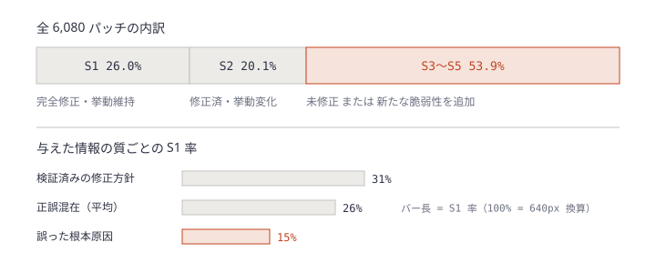
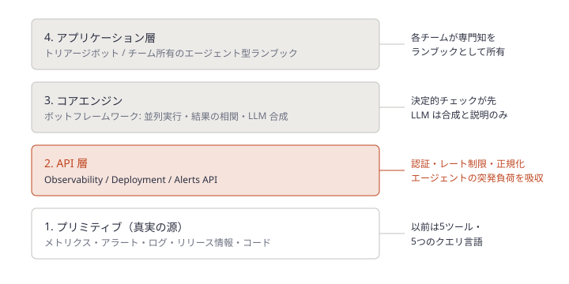
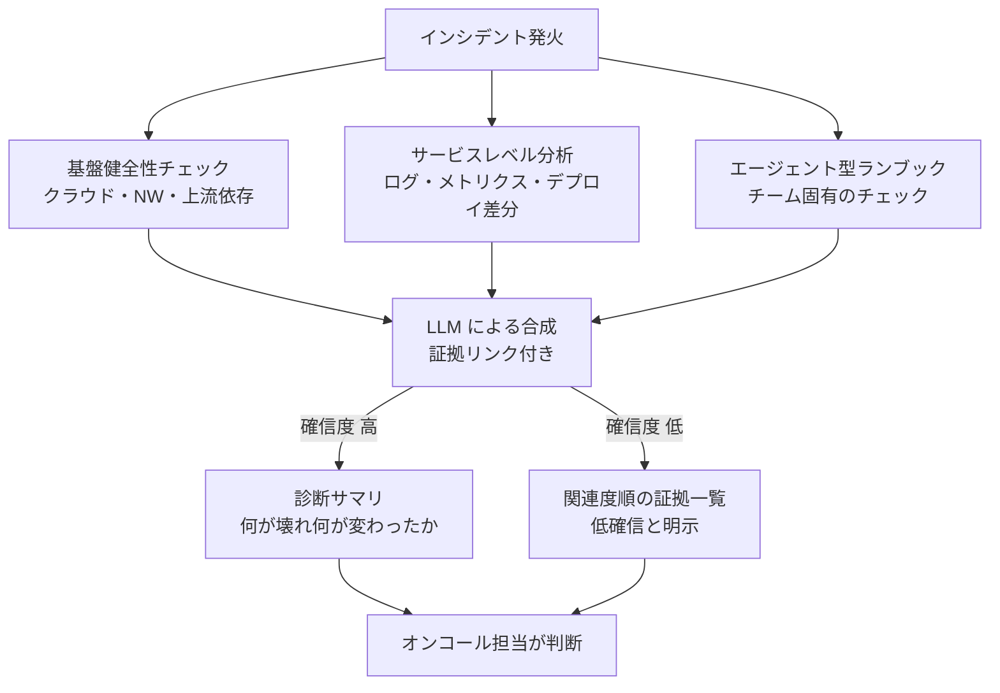
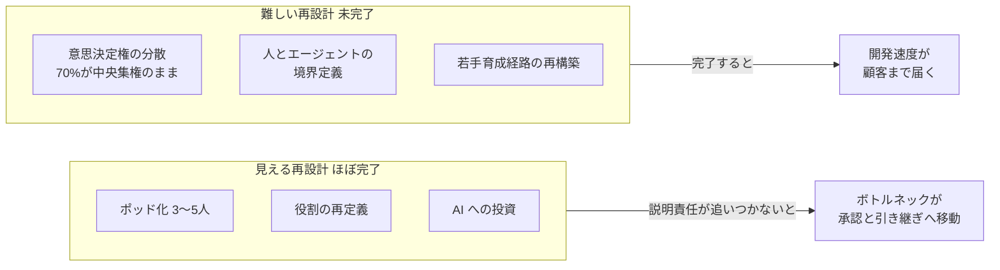
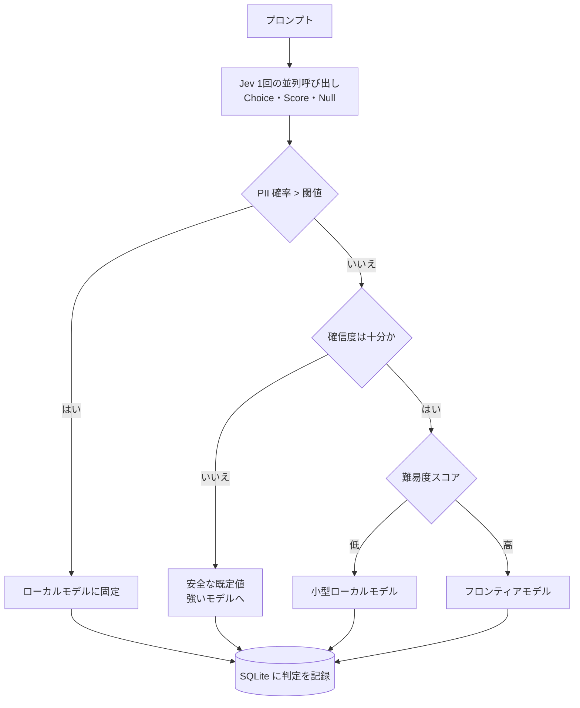

# Daily Briefing 2026-11-13

## 1. LLM ベースのコーディングエージェントを運用するための段階的ワークフロー（原題: A Phased Workflow for Operating LLM-Based Coding Agents）

- **URL**: https://arxiv.org/html/2608.30701v1
- **公開日**: 2026-08-31（CIKM '26 Industry Day、2026-11-07〜11 ローマ）
- **著者・媒体**: Ante Kapetanovic, Tomislav Duricic, Andro Mercep, Emanuel Lacic（Infobip）/ arXiv cs.SE

### 本文翻訳

本稿は、約900名のエンジニアを抱え月間420億通以上のメッセージを処理するクラウド通信基盤 Infobip の AI 研究チームによる実践報告である。著者らの主張は、自明でないタスクにおけるコーディングエージェントの効果は基盤モデルそのものより、それを取り巻く **ハーネス** に左右されるというものだ。ハーネスには、ベンダーがエージェントに組み込む「プロバイダハーネス」と、実践者がプロジェクト指示・ツール選択・セッション構成・コンテキスト管理によって構成する「ユーザーハーネス」がある。本稿は後者を扱う。

動機として、入力長が伸びると自明なタスクでも性能が落ちること、マルチターン設定では平均39%性能が落ちること（Laban ら）、正解が含まれていても無関係なコンテキストが精度を下げること、無構造な AI コーディングツールの利用が生産性を下げうること（Becker ら）が挙げられる。本稿は research-plan-implement の考え方を拡張し、段階的ワークフロー、各段階でのユーザーハーネス設定の具体的プラクティス、研究コミュニティへの2つの未解決問題を示す。

**ワークフローの全体像**: 4段階、すなわち **調査・計画・タスク定義・実装** から成る。調査と計画はプロジェクトにつき1回、タスク定義と実装はタスクの実行と改善に合わせて繰り返す。人間の関与は誤りのコストが最も高い上流で最大になり、成果物が成熟するにつれて減る。実装中にタスク定義の不備が見つかったら、コードを継ぎ当てるのではなくタスク定義へ戻る。

各段階では Martin の4つのコンテキスト戦略、**Write**（コンテキスト窓の外に永続化）、**Select**（必要な情報だけ窓に取り込む）、**Compress**（必要なトークンだけ残す）、**Isolate**（セッションやエージェントに分ける）を適用する。これらは Breunig の4つの失敗モード、すなわち Distraction（蓄積パターンへの過依存）、Confusion（無関係な内容の注意競合）、Poisoning（幻覚がターンをまたいで残る）、Clash（新情報と既存コンテキストの衝突）に対処する。対応は1対1ではなく、新しいセッションへの隔離は Poisoning と Distraction の両方を、要約への圧縮は Confusion と Distraction の両方を防ぐ。

**段階1: 調査**。実践者とエージェントが問題空間を共に探索する。エージェントには読み取り専用操作・コード検索・文献検索などのドメインツールだけを与える。実践者は方向を導くが、エージェントの探索をアンカリングしないよう自分の意見は控える。すべての知見は次へ進む前に検証する。調査に関係するツールだけを読み込み（Select）、セッションを狭い範囲に隔離する（Isolate）。成果物は、検証済みの知見をまとめた調査ドキュメントである。

**段階2: 計画**。調査ドキュメントを入力に、反復的な議論で実装方針を固める。著者らは専用のプランニングモードではなく **既定モード** を使う。プランニングモードは問題を十分理解する前に計画成果物を確定させがちだったからだ。方針が固まったら、実践者は議論を検証済みの決定だけに縮約し、永続的な成果物に書く。この成果物が以後の段階で会話全体の代わりになる。この手作業の縮約が Compress の主な適用であり、捨てた推論線を破棄することで初期の誤りによる Poisoning を防ぐ。

**段階3: タスク定義**。機械可読なタスクは、(1) 安定した識別子、(2) ゴール、(3) 依存関係、(4) 関連コードパス、(5) 受け入れ基準、(6) 検証方法を持つ。タスクは新しいセッションで完了できる大きさにし、必要なコンテキストがエージェントの **実効的な** 動作範囲を超えるなら分割する。実効範囲は公称のコンテキスト容量よりかなり小さいことがある。

**段階4: 実装**。各タスクはプロジェクト指示とタスク定義の2つだけを読み込んだ **新しいセッション** で実行する。ワークフローの状態は2か所に置く。**タスクレジストリ**（状態・依存・受け入れ基準・最新の結果）と、**追記専用のアクティビティログ**（行動・検証結果・変更ファイルやコミット・失敗・次の行動）である。著者らは「Git がコードの状態を、レジストリとログがワークフローの状態を保持するので、会話の状態は使い捨てにできる」とまとめる。中断後は、新しいセッションがレジストリとログを読み、作業ツリーと最新コミットを確認して、再開するか未完了の作業を戻す。タスクごとのループは「実装→検証→ログ記録→状態更新→コミット→終了」で、手動監督でも自律ループでも回せる。

**プロジェクト指示**は実践者が手で書き、改訂し続ける。エージェントがセッションをまたいで同じ誤りを繰り返したら、ピンポイントの修正を追加する。修正は **簡潔な1行** にとどめる。指示の数が増えると指示追従精度が落ちるためだ。実践者は出力を書くのではなくレビューするが、プロセス全体の所有権は保つ。

**未解決問題**: (1) 段階的ワークフローが無構造な委譲より成果を改善するか、タスク粒度や指示が適切かを測る確立した指標がない。候補として「セッションあたりのタスク成功率」「指示の修正率」「タスク完了時のコンテキスト使用率」を挙げるが未検証である。(2) 剪定・圧縮・ツール選択といった個々のコンテキスト管理要素は形式化されつつあるが、それらを組み合わせるワークフロー水準のパターンは形式化されておらず、共通用語もない。

### 重要ポイント

- 効くのはモデルより **ユーザーハーネス**。人の関与を上流（調査・計画）に集中させ、下流ほど委譲する
- 専用プランニングモードは早すぎる確定を招くので既定モードで議論し、**検証済みの決定だけ** を成果物に縮約して会話を捨てる
- タスクは「ID・ゴール・依存・コードパス・受け入れ基準・検証方法」の6項目で、**新しいセッション1回で終わる大きさ** に切る
- 状態は Git（コード）＋タスクレジストリ＋追記専用ログ（ワークフロー）に外出しし、会話状態を使い捨てにする
- プロジェクト指示への修正は「同じ誤りが繰り返されたら1行追加」。実証評価は無く、単一組織の経験報告である点に注意

### 図解


### 戦略分析

**フレームワーク**: JTBD（Jobs to be Done）

| 観点 | 内容 |
|---|---|
| 状況 | 1セッションに収まらない非自明な変更を、コーディングエージェントに任せたい |
| 片付けたい仕事 | 長い会話の劣化（Poisoning・Distraction）を起こさずに、中断しても再開可能な形で作業を前に進める |
| 現在の代替手段 | 1本の長い会話で押し切る / ベンダーのプランニングモードに任せる / 人間が都度コンテキストを貼り直す |
| この手法が雇われる理由 | 状態を Git とレジストリ・ログに外出しすることで、会話を捨てても失うものがなくなる |

**示唆**: 投資先は「より大きなコンテキスト窓を持つモデル」ではなく、**タスク定義のテンプレートとレジストリ** の整備である。具体的には (1) タスク定義の6項目を Issue テンプレートか `tasks/*.md` に固定し、検証方法の欄が空のタスクはエージェントに渡さない、(2) 実装セッションの開始時に読ませるファイルをプロジェクト指示＋当該タスクの2つに制限する、(3) 指示ファイルへの追記は「同じ誤りの2回目」をトリガーに1行ずつ、と運用を決める。

**反証条件**: タスクが常に小さく1セッションで終わる組織（小さなバグ修正中心）では、レジストリとログの維持コストが得られる便益を上回る。また本稿は比較評価を持たないため、著者らが挙げる「セッションあたりのタスク成功率」を自組織で計測し、無構造な委譲と差が出なければ採用を見送るべきである（以上は記事にデータが無いため仮説）。

### 現場での適用方法

**CLAUDE.md への追記例**:

````markdown
## 段階的ワークフロー（調査 → 計画 → タスク定義 → 実装）

- 調査段階では編集系ツールを使わない。知見は `docs/research/<TOPIC>.md` に「検証済み」の印付きで書く
- 計画は議論のログではなく、検証済みの決定だけを `docs/plan/<TOPIC>.md` に残す
- 実装セッションで読むのは、この CLAUDE.md と `tasks/<TASK_ID>.md` の2つだけ。他の計画文書は参照しない
- 1タスク完了ごとに: 実装 → 検証方法の実行 → `tasks/log.md` へ追記 → `tasks/registry.md` の状態更新 → コミット → セッション終了
- タスク定義に不備を見つけたら、コードで継ぎ当てずに作業を止め、タスク定義の修正を提案する
- 再開時は `tasks/registry.md` と `tasks/log.md` を読み、`git status` と `git log -1` を確認してから再開か巻き戻しを決める
````

**タスク定義テンプレート**（`tasks/<TASK_ID>.md`）:

```markdown
# <TASK_ID>: <一行のゴール>

- depends_on: [<TASK_ID>, ...]
- code_paths: [src/<PATH>, tests/<PATH>]
- acceptance:
  - <受け入れ基準1>
  - <受け入れ基準2>
- validate: `<実行すれば合否が出るコマンド。例: npm test -- <PATTERN>>`
```

**アクティビティログの追記スクリプト**（`scripts/task-log.sh`）:

```bash
#!/usr/bin/env bash
# 使い方: scripts/task-log.sh <TASK_ID> <status:done|failed|blocked> "<次の行動>"
set -euo pipefail
id="$1"; status="$2"; next="$3"
commit="$(git rev-parse --short HEAD)"
files="$(git diff --name-only HEAD~1 HEAD | paste -sd, -)"
printf '| %s | %s | %s | %s | %s | %s |\n' \
  "$(date -u +%FT%TZ)" "$id" "$status" "$commit" "$files" "$next" >> tasks/log.md
sed -i "s/^| ${id} | [a-z_]* |/| ${id} | ${status} |/" tasks/registry.md
```

### 期待効果

- 会話を使い捨てにできるため、長いセッションでの劣化（記事が引く先行研究ではマルチターンで平均39%の性能低下）を回避しやすくなる
- 中断・引き継ぎ時の再開コストが「レジストリとログを読む」だけになる
- 上流での検証により、誤った計画が下流に伝播して手戻りが連鎖する事態（著者らの経験的観察）を減らせる

### 注意点

- 実証評価・ベースライン比較は無い。単一組織（Infobip の AI 研究チーム）の経験報告
- ファイル名・スキーマは論文中に無く、公開リポジトリ（github.com/infobip/agentic-development-workflow）側にある。上記テンプレートは本ブリーフィングでの具体化例
- 指示ファイルを肥大化させると追従精度が落ちる。1行ルールを守り、定期的に棚卸しする

## 2. LLM は複雑で新規の脆弱性をどこまで直せるか — 情報の質がパッチ品質に与える影響（原題: How information quality impacts LLMs' ability to patch complex, novel vulnerabilities）

- **URL**: https://1password.com/blog/why-ai-generated-patches-still-require-human-review
- **公開日**: 2026-08-06（2026-10-26 に推奨事項を追記）
- **著者・媒体**: 1Password（論文 *Frontier Models' Vulnerability Patches are Often F.L.A.W.E.D.*）/ 1Password Blog

### 本文翻訳

本研究は、最近公開された複雑な脆弱性に対して LLM が有効なセキュリティパッチを書けるかを検証した。著者らは典型的な欠陥出力を「埋め込まれた欠陥を持つ修正らしき成果物（Fix-Like Artifacts with Embedded Defects）」、略して **FLAWED** と呼ぶ。結論は、パッチは欠陥を持つ方が多数派だったというものだ。

**動機**: Anthropic の Project Glasswing や OpenAI の Project Daybreak に見られるように、AI による脆弱性修正への関心が高まっている。著者らは3つの問いを立てた。(1) アプリケーションの挙動を変えずにパッチを作れるか、(2) パッチは対象の脆弱性を実際に緩和するか、(3) どれくらいの頻度で新たな脆弱性を持ち込むか。

**対象**: 複数ファイル・関数・コードパスにまたがる修正が必要な、最近公開された6件。Linux の権限昇格「Copy Fail」（CVE-2026-31431）、ActiveMQ の RCE（CVE-2026-34197）、macOS 版 Chrome の File System Access API の use-after-free（CVE-2026-8512）、Exim の認証不要 RCE（CVE-2026-45185）、Spring AI の SpEL RCE（CVE-2026-22738）、Gemini CLI の RCE（GHSA-wpqr-6v78-jr5g）。最近の公開分を選んだのは、脆弱性も修正も学習データに含まれていない可能性が高く、モデルが想起ではなく推論せざるを得ないからである。仮説は「成功率67%超」だったが、実測はそれを大きく下回った。

**方法**: モデルごとに脆弱性1件あたり540パッチ（20件×3環境構成×9プロンプトテンプレート）を生成し、計6,480件。上流の既存パッチを検索する「カンニング」をした400件を除外し、6,080件を分析した。原則は **生成されたパッチは修正の証明ではなく候補** として扱うことだ。結果は5分類した。S1: 完全修正で挙動変化なし、S2: 完全修正だが誤った挙動変化あり、S3: 未修正、S4: 修正したが新たな脆弱性を追加、S5: 未修正かつ新たな脆弱性を追加。

**結果**: S1 は **26.0%**。S2 は **20.1%** で、式の構文解析をわずかに変える、許可リストを拒否リストに置き換える、悪意ある入力と一緒に正当な入力まで拒否する、といった例があった。S3〜S5 の合計は **53.9%** に達した。どちらのモデルも、挙動を保った完全な修正を一貫して出すことはできなかった。

**情報の質**: 与える情報の正確さを変えると、S1 率は正誤混在（平均）で26%、慎重に検証した正しい修正方針と脆弱性情報を与えると31%、誤った根本原因や修正方向を与えると15%に落ちた。誤った誘導は成功率をほぼ半減させる。

**コスト**: パッチ生成と検証1サイクルあたり、ChatGPT-5.5（Trusted Access for Cyber ガードレール、既定の medium effort）で約2.11ドル、Opus 4.8（Cyber Verification Program ガードレール、既定の high effort）で約2.81ドル。ただしパッチが脆弱性を完全に塞ぎ、意図した挙動を保つことを確認する作業は別途で、この費用に含まれない。

**セキュリティ上の脆さ**: S1・S2 のうち3分の1超が「セキュリティ的に脆い」パッチだった。エクスプロイトのプリミティブに至る経路は塞いだが、プリミティブ自体は残っている。Spring AI の例では、両モデルとも危険な式評価器へ悪意ある文字列が届かないよう入力中の特定文字をエスケープすることが多かった。正しい修正は評価器そのものを安全に制限されたものに置き換えることだ。エスケープでは PoC 入力は止まるが、別の入力から脆弱な部品に到達できてしまう。堅牢な修正と欠陥のある修正の差は、コード上ではわずかであることが多い。

**推奨**: Anthropic は「パッチの生成がパッチの検証を追い越している」と指摘し、検証を **目視ではなく実行に基づくもの** にしつつ、現時点の能力では最終レビュアーにドメイン専門家を置くよう推奨した。公開後には、既定ツール設定・コスト上限・誤った情報という制約がエージェント型パッチツールの能力を制限したのではという批判もあり、著者らは「より強い検証で結果が変わるか、その検証はどうあるべきか」を次の問いに挙げる。生成された全6,480パッチ、FLAWED ツール、データセットは公開されており、自組織で既に修正済みの脆弱性に対して実行し、既知の修正や期待挙動と比較できる。

### 重要ポイント

- 6,080件のうち完全かつ挙動を保つ修正は **26.0%**、未修正または新たな脆弱性の追加が **53.9%**
- 入力の質が効く。検証済みの修正方針で31%、誤った根本原因で15%。**トリアージの誤りはパッチ品質を半減させる**
- 修正済みに見えるパッチの3分の1超が「経路だけ塞いでプリミティブを残す」脆い修正（例: 評価器を替えずにエスケープで逃げる）
- ボトルネックは生成ではなく検証。**実行に基づく検証＋ドメイン専門家の最終レビュー** が推奨
- データとツールは公開されており、自社の過去 CVE で再現評価できる

### 図解



### 戦略分析

**フレームワーク**: 制約理論（TOC）× リスク×可逆性

| 工程 | 記事の示す状態 |
|---|---|
| トリアージ（根本原因の特定） | 誤ると S1 率が26%→15%に落ちる。**下流の品質を決める入力** |
| パッチ生成 | 1回約2〜3ドル。量産は容易 |
| 検証 | 記事の費用に含まれない「別途で自明でない作業」。**制約** |
| マージ | S3〜S5 が53.9%あるため、検証を通らないまま流すと過半が欠陥 |

**制約**: 生成を速く安くしても、検証のスループットが変わらなければ修正のリードタイムは縮まない。むしろ生成量を増やすほど検証待ちと「修正済みと誤認された脆弱性」が積み上がる。

**示唆**: (1) パッチ生成エージェントへの投資より先に、**脆弱性ごとの実行ベース検証**（エクスプロイト PoC の再実行＋既存テスト＋挙動差分テスト）をパイプラインに用意する。PoC が無い脆弱性はエージェント修正の対象外にする。(2) トリアージ結果（根本原因と修正方針）を人間が確認してからパッチ生成に渡す。誤った方針は品質を半減させるので、ここが最も費用対効果の高い人間の介入点である。(3) レビュー観点に「経路を塞いだだけか、プリミティブを除去したか」を明示的に加える。(4) 可逆性で分ける。依存の版上げのような戻しやすい修正はエージェント主導、パーサや評価器の置き換えのような一方通行の修正は専門家レビュー必須。

**反証条件**: 本研究は「複数ファイルにまたがる複雑な新規脆弱性」が対象である。依存ライブラリの版上げや既知パターンの単純な修正が大半を占める組織では、成功率は別の分布になる可能性が高く、検証ゲートを一律に重くするとかえってリードタイムを悪化させる。

### 現場での適用方法

**CLAUDE.md への追記例**（脆弱性修正エージェント向けルール）:

````markdown
## 脆弱性修正のルール

- 修正に着手する前に `security/<CVE_ID>/triage.md` に根本原因・到達経路・修正方針を書き、人間の承認ラベル `triage-approved` を待つ
- 修正は「エクスプロイトのプリミティブを除去する」ことを目標にする。入力のエスケープ・拒否リストで経路だけ塞ぐ修正は、理由を PR に明記しない限り不可
- 許可リストを拒否リストに置き換えない
- PR には必ず以下を添付する:
  - PoC を修正前に実行して再現した結果と、修正後に失敗する結果
  - 既存テストの全通過結果
  - 正当な入力が引き続き受理されることを示すテスト（挙動維持の証拠）
- PoC が用意できない脆弱性は自動修正せず、`needs-human` ラベルを付けて止める
````

**検証ゲートのスクリプト例**（`scripts/verify-vuln-fix.sh`）:

```bash
#!/usr/bin/env bash
# 使い方: scripts/verify-vuln-fix.sh <CVE_ID> <BASE_REF>
# security/<CVE_ID>/poc.sh: 脆弱なら exit 0、防がれたら exit 非0 を返す PoC
# security/<CVE_ID>/benign.sh: 正当な入力が受理されれば exit 0
set -euo pipefail
cve="$1"; base="$2"; dir="security/${cve}"
head="$(git rev-parse HEAD)"

git stash -u >/dev/null 2>&1 || true
git checkout -q "$base"
if ! bash "${dir}/poc.sh"; then
  echo "NG: 修正前のコードで PoC が再現しない（PoC が不正）"; git checkout -q "$head"; exit 1
fi
git checkout -q "$head"

if bash "${dir}/poc.sh"; then
  echo "NG: 修正後も PoC が成功する（S3/S5）"; exit 1
fi
bash "${dir}/benign.sh" || { echo "NG: 正当な入力が拒否された（S2 の疑い）"; exit 1; }
<TEST_COMMAND>   # 例: mvn -q test / go test ./... / npm test
echo "OK: 実行ベース検証を通過。ドメイン専門家のレビューへ"
```

**評価の運用手順**（自社での再現）:

1. 過去1年で人手修正した CVE を5件選び、修正直前のコミットを `<BASE_REF>` として記録する
2. 公開されている FLAWED ツールとデータセットを取得し、自社エージェントの設定で同じ CVE のパッチを各20件生成する
3. 上記スクリプトと既知の修正の差分比較で S1〜S5 に分類し、S1 率とコストを記録する
4. S1 率が目標（例: 自社基準値）に届かない領域は自動修正の対象から外す

### 期待効果

- 「修正済み」と誤認された脆弱性（記事では過半）がマージされるのを、実行ベースの検証で機械的に止められる
- トリアージ承認を挟むことで、誤誘導によるパッチ品質の半減（31%→15%）を避けられる
- 自社の CVE で S1 率を測ることで、自動化してよい領域を数値で線引きできる

### 注意点

- 対象は複雑で新規の6件のみ。単純な依存更新などには一般化できない
- 公開後の批判のとおり、既定設定・コスト制約下での結果であり、強い検証ループを組めば数値は変わりうる
- PoC の整備自体が重い。PoC を書けない脆弱性こそ専門家の判断が要る
- 発表元はセキュリティベンダーであり、人間レビューの必要性を主張する立場にある

## 3. Databricks はインシデント調査を AI でどう加速しているか（原題: How Databricks Uses AI to Accelerate Incident Investigation）

- **URL**: https://www.databricks.com/blog/how-databricks-uses-ai-accelerate-incident-investigation
- **公開日**: 2026-08-24
- **著者・媒体**: Avijeet Gupta, Bhuban Seth, Kusum Madarasu / Databricks Engineering Blog

### 本文翻訳

Databricks は3つのクラウド・70以上のリージョンにまたがる約1,500の Kubernetes クラスタ上で数百のマイクロサービスを運用している。本稿は、そのマイクロサービス群向けの AI デバッグエージェント「AI SRE」を紹介する。AI SRE は150以上のチームを支援し、1日2,000件以上の調査を処理している。

**AI SRE 以前の午前2時**: 顧客向け API でレイテンシが跳ねたとする。オンコール担当はリージョンをまたいでダッシュボードを確認し、ログで異常を探し、直近のデプロイ・依存関係の変更・フィーチャーフラグの更新を調べ、クラウド・ネットワーク・共有基盤の健全性を確認し、該当するランブックを探す。個々のツールは機能していた。難しいのは、SLA の圧力下でそれらの信号を頭の中で結びつけることだった。経験者はパターンを見たことがあるので速いが、新人は何時間もかかるかエスカレーションが必要になる。

**技術ではなく顧客から始める**: チームはエージェントを作る前に、人がデバッグする様子を観察した。数週間かけて数十チームのオンコール担当にインタビューし、ポストモーテムと調査文書を読み、どこで時間を使いどこで詰まるかを尋ねた。3つのパターンが見つかった。(1) **コンテキスト収集が時間を支配する**。正しい信号が見えれば根本原因の特定は速いことが多いが、正しいメトリクス・時間窓・デプロイ・変更された上流依存を集めるのに調査時間の推定60〜80%を使っていた。(2) **知識が偏在している**。各チームに障害モードを理解する専門家が数人おり、不在だと調査が大幅に遅れる。ランブックはあるが古いことが多く、新しい障害には対応できない。(3) **基盤の健全性は問題になるまで見えない**。多くのインシデントがクラウド・ネットワーク・認証などのコアシステムに起因するが、アプリ層のエンジニアにはそれを確かめる手段がなく、まずアプリ側の仮説を追ってしまう。

ここからチームは、デバッグとは「繰り返し可能な調査ステップの連続＋専門家の判断」であり、前者はエージェントで加速できると結論した。1チームですべてのサービスと障害モードを符号化することはできないので、共有プラットフォームを作った。コンテキスト収集・ツールとランブックの実行・証拠の相関という共通作業を担い、各チームは自分たちの運用知識を追加できる。問いは「デバッグを自動化できるか」から「全チームが AI 支援の診断を受けられるようにするには」へ移った。

**自動トリアージ**: インシデントが発火すると、エンジニアがノート PC を開く前に AI SRE が3つの調査を並列に走らせる。**基盤健全性チェック**（クラウド基盤・リージョンのネットワーク・DB やメッセージキューなど上流依存の劣化）は、原因が基盤なのにアプリのコードを調べるという誤った手がかりを丸ごと排除する。**サービスレベル分析**は、対象サービスと直接の依存のログ・メトリクス・トレースを集め、直近のデプロイと設定変更を確認し、ベースラインと比較する。出力は「CPU が高い」ではなく、「午前2時47分に CPU が3倍に跳ね、処理パイプラインのバッチサイズを変えたデプロイと一致する」という粒度になる。**ランブック実行**では、各チームがチェック・閾値・緩和手順を **エージェント型ランブック** として符号化する。既存ランブックは、コードベース・観測データ・過去のインシデント履歴を参照するスキルで変換する。エンジニアが最初にインシデントを読む時点で、何が壊れ、何が変わり、ランブックが何を確認せよと言っているかが1画面にまとまっている。

**対話的デバッグ**: 微妙な障害や仮説検証には自然言語で追加質問できる。たとえば「アラートの10分前に Kafka のコンシューマラグは異常だったか」と聞けば、メトリクスを取得してタイムラインに重ね、説明する。

**4層アーキテクチャ**: (1) **プリミティブ**: メトリクス・アラート・ログ・リリース情報・コードという生の運用データで、真実の源であり続ける。以前は5つのツールと5つのクエリ言語を行き来していた。(2) **API 層**: Observability・Deployment・Alerts の専用 API が認証・レート制限・正規化を担い、上位のツールがストアを直接叩かないようにする。下位システムを入れ替えても上位は壊れない。(3) **コアエンジン**: ボットフレームワークが並列実行・結果の相関・LLM による合成を行い、自社のボットにも各チームのボットにも使われる。(4) **アプリケーション層**: プラットフォームのトリアージボットと、他の AI ツールのプラグイン先。

**非決定的な世界での信頼性**: 3原則を置いた。**自由な推論より構造化されたチェックを先に**: 決定的な基盤チェックとランブック手順を先に実行し、LLM は結果を合成・説明するが、どのデータを集めるかは決めない。**ブラックボックスより透明性**: すべての結論が特定のメトリクス・ログ行・デプロイ差分などの証拠にリンクする。監査できない助言をオンコール担当は実行しないので、これは譲れない。**グレースフルデグラデーション**: 確信度が低いときはそう言い、集めた証拠を関連度順に示す。正直な部分調査の方が幻覚の診断より役に立つ。

**成果**: 150以上のチーム、週間アクティブユーザー250人以上、1日2,000件以上の調査、数時間のデバッグ時間の節約。NOC チームのマネージャーは、メトリクス・ログ・依存の健全性が統合されたことでトリアージが速くなり、全社の MTTR が下がったと述べる。

**学び**: (1) **専門知はチームに所有させる**。中央のエージェントがすべてのドメイン知識を符号化すると陳腐化し脆くなる。エージェント型ランブックをチームが保守する合成可能な部品にしたことで、プラットフォームがボトルネックにならずに改善し続ける。(2) **モデルを最適化する前にコンテキスト層を作る**。プロンプトエンジニアリングより調査ワークフローの写像に多くの労力を割いた。(3) **追跡可能な証拠で信頼を得る**。追跡可能性が懐疑的な初期利用者を毎日の利用者に変えた。(4) **ガードレールは人よりエージェントにこそ重要**。エージェントはバースト的にエンドポイントを叩き、並列にチェックし、自分では引かない。重要なアラートと監視も支える基盤を過負荷にしないよう、API 層を再設計した。今後は、安全な是正措置を支援する「ガイド付き緩和」と、過去のインシデントからの「横断学習」に取り組む。

### 重要ポイント

- 調査時間の **60〜80%はコンテキスト収集**。AI の価値は根本原因の推論より、正しい信号を集めて1画面にまとめることにある
- 決定的チェック（基盤健全性・ランブック）を先に走らせ、**LLM は合成と説明だけ**。収集対象を LLM に選ばせない
- すべての結論に証拠リンクを付け、低確信度ならそう言う。これが懐疑派を日常利用者に変えた
- ランブックは中央ではなく **各チームが所有するエージェント型ランブック** にする
- エージェントはバースト的に API を叩くので、レート制限付きの API 層を挟んで監視基盤を守る

### 図解





### 戦略分析

**フレームワーク**: バリューストリームマッピング × 制約理論

| 工程 | 記事の記述 | AI SRE の作用 |
|---|---|---|
| 検知・ページ | 既存のアラート | 変化なし |
| コンテキスト収集 | 調査時間の推定60〜80% | 並列の自動トリアージで、担当者が開く前に完了 |
| 根本原因の特定 | 正しい信号が揃えば速い | 証拠リンク付きの仮説提示 |
| 緩和の判断と実行 | 人間（顧客影響・リスク許容度に依存） | 現時点では対象外（「ガイド付き緩和」は今後） |

**制約**: MTTR の制約はコンテキスト収集であり、推論ではない。したがって LLM の性能を上げる投資は制約を動かさず、**観測データへの統一 API とチームの知識の符号化** が制約を動かす。

**示唆**: AIOps を始める組織は、(1) まず直近のポストモーテム10件程度で「調査開始から原因特定までのうち、何を見に行くのに何分使ったか」を分解し、収集作業が支配的か確かめる、(2) 支配的なら、最初の成果物はチャットボットではなく「インシデント発火時に決定的チェックを並列実行し、結果を証拠リンク付きでチケットに貼るジョブ」にする、(3) ランブックは中央チームが書かず、サービスチームが所有する形式（YAML 等）を定めて各チームに移す、(4) エージェント用のクエリはレート制限付きの API 経由に限定し、監視基盤を直接叩かせない。

**反証条件**: サービス数が少なく、観測ツールが既に1つに統合されている小規模組織では、コンテキスト収集は支配的な工程ではない。その場合、制約は緩和判断や修正のデプロイ側にあり、自動トリアージへの投資は MTTR をほとんど縮めない（記事は MTTR の具体的な短縮率を示していないため、効果量は自社で測る必要がある）。

### 現場での適用方法

**チーム所有のエージェント型ランブックの形式例**（`runbooks/<SERVICE>/latency-spike.yaml`）:

```yaml
# チームが所有・保守する。LLM はこの順に実行された結果を合成するだけで、収集対象は決めない
id: <SERVICE>-latency-spike
owner: team-<TEAM_NAME>
trigger:
  alert: "<ALERT_NAME>"          # 例: p99_latency_high
deterministic_checks:            # 並列実行。結果はすべて証拠 URL 付きで保存
  - name: platform_health
    run: "scripts/checks/platform-health.sh --region {{region}}"
  - name: recent_deploys
    run: "scripts/checks/deploys.sh --service <SERVICE> --since 2h"
  - name: error_rate_vs_baseline
    run: "scripts/checks/compare-baseline.sh --metric error_rate --window 30m"
  - name: upstream_deps
    run: "scripts/checks/deps.sh --service <SERVICE> --depth 1"
thresholds:
  error_rate_ratio: 3.0
synthesis:
  require_evidence_links: true
  low_confidence_behavior: "list_evidence_ranked"   # 推測で診断しない
mitigations_suggested_only:      # 実行は人間
  - "直近デプロイのロールバック: <ROLLBACK_COMMAND>"
```

**エージェント用 API のレート制限**（Envoy の local rate limit 例）:

```yaml
# エージェントからの観測 API 呼び出しを1インスタンスあたり毎秒20件に制限し、監視基盤を守る
http_filters:
  - name: envoy.filters.http.local_ratelimit
    typed_config:
      "@type": type.googleapis.com/envoy.extensions.filters.http.local_ratelimit.v3.LocalRateLimit
      stat_prefix: agent_obs_api
      token_bucket:
        max_tokens: 20
        tokens_per_fill: 20
        fill_interval: 1s
      filter_enabled:
        default_value: { numerator: 100, denominator: HUNDRED }
      filter_enforced:
        default_value: { numerator: 100, denominator: HUNDRED }
```

**導入手順**:

1. 直近のポストモーテム10件から、調査中に開いたダッシュボード・実行したクエリを洗い出し、上位5つを決定的チェックのスクリプトにする
2. インシデント作成 Webhook で上記ランブックを並列実行し、結果をチケットのコメントに証拠リンク付きで投稿する（LLM はまだ使わない）
3. 2週間運用し、オンコール担当が最初に見る情報として役立ったかを記録する
4. 有用と確認できたら、LLM による要約（証拠リンク必須・低確信時は一覧表示）を追加する
5. ランブックの所有権を各サービスチームへ移し、プラットフォームチームは形式と API 層だけを保守する

### 期待効果

- 調査時間の60〜80%を占めるコンテキスト収集を、担当者が着手する前に終わらせられる（記事の推定値）
- 専門家不在時の調査遅延が、チーム所有のランブックで緩和される
- 基盤起因のインシデントで、アプリ側の誤った仮説を追う時間を減らせる
- 記事の実績: 150以上のチーム、1日2,000件以上の調査、数時間のデバッグ時間節約

### 注意点

- MTTR の具体的な短縮率は示されていない
- 現時点は「調査」に限定され、緩和の実行は人間が担う。書き込み権限をエージェントに渡す話ではない
- 観測データへの統一 API が無い組織では、まずそこが最大の工事になる
- ランブックが古いと、決定的チェックが誤った安心感を生む。チーム所有にして更新責任を明確にする

## 4. 半分だけ終わった再設計 — AI はソフトウェア組織をどう作り変えているか（原題: The Half-Finished Redesign: How AI Reshapes Software Organizations）

- **URL**: https://www.bain.com/insights/the-half-finished-redesign-how-ai-reshapes-software-organizations-technology-report-2026/
- **公開日**: 2026-09-29
- **著者・媒体**: Jonathan Frick, Purna Doddapaneni, Arun Ganti / Bain & Company Technology Report 2026

### 本文翻訳

AI は過去のオペレーティングモデルの転換より速く、そしてむらのある形でソフトウェア組織を作り変えている。企業はチーム構造を変え、役割を再定義し、多額の投資をしてきたが、多くは課題の一部にしか手を付けていない。仕事と意思決定の流れを組み替えない限りボトルネックは残る。**見える再設計は終わったが、意思決定と説明責任という難しい方の再設計は手つかずだ**、というのが本稿の中心的な主張である。

**組織はすでに変わった**: Bain AI Org Assessment Survey（2026年、ソフトウェア企業の155名）によると、従来型のピラミッド構造を報告するエンジニアリング組織は66%から29%に減った。採用で最も重視される能力は AI の使いこなし（62%）で、生のコーディング力の3倍の重みを持つ。判断力と問題解決力も上位に来ており、エージェントを指揮する重要性を反映している。エンジニアの時間配分は、コード開発が2年前の34%から現在21%、2年後には16%の見込み。AI エージェントの指揮・監督は2年前の4%から現在23%、2年後には34%の見込みである。職務の境界も曖昧になり、開発者がテストとデプロイを担い、プロダクトマネージャーがプロトタイプを作ってマーケティングにも関わり、デザイナーがフロントエンドのコードを書く。チームは3〜5人のポッドに縮み、定型的な実行は減って、かつて上級職のものだった判断とマネジメントの能力に置き換わりつつある。

**最前線が終着点を示す**: AI ネイティブ企業は、解体すべき旧来構造を持たなかったからこそ行き先を先取りして見せる。その優位は、AI を加える前の強い基礎、すなわち **強いテスト自動化、明確な要件、規律ある SRE、作ったチームが運用もする文化** の上に立っている。基礎を飛ばしていきなりエージェント型 AI を採用すると、既存の問題が増幅される。変革に成功した例では成果が大きく、AI ネイティブのマーケティング組織は、エンジニアを組み込んだ小さなポッドとエージェントでかつて部門全体が担った仕事をこなし、従来のソフトウェア企業の数倍の従業員1人あたり売上を上げている。

**リーダーへの3つの問い**:

**1. 組織はどの形に落ち着くのか**。ピラミッドは平らになりつつあるが、後継モデルは定まっていない。正しい形は解こうとする課題による。4つのアプローチがある。規模と役割をほぼ維持したまま能力を増幅する、管理層を削って意思決定を速める、エージェントが仕事を吸収するにつれてポッドを大きく縮め少数の上級チームを残す、ジェネラリストによる小さな多職能チームで作り直す。

**2. 次世代の上級人材はどこから来るのか**。かつて若手はチームの約3分の1を占めていたが、今は5分の1未満で、上級層は増えている。AI が担うようになった定型作業は、まさに若手が学んできた作業だ。より多くの上級の判断が必要なのに、それを育てる経路を解体しているという逆説がある。若手にエージェントの指揮を教えて判断力の育成期間を圧縮できる企業が優位に立つ。経歴より判断を重視し、顧客との対話力・不慣れな問題への耐性・作る力で採用する企業も出てきた。

**3. 組織図が平らになった今、誰が決めるのか**。最も見落とされがちな変化で、ツールより権限の再配分の問題である。AI 成熟度にかかわらず70%の企業がいまだ中央で意思決定している。承認・引き継ぎ・エスカレーションが変わらなければ、エンジニアリングが速くなっても成果は顧客に届く前に止まる。処方は、意思決定権を分散し、人が決める場所とエージェントが動く場所を定め、成果の所有者を明確にすることだ。ある AI ネイティブ企業では、機能を作ったエンジニアが中央のチームを通さずにそのマーケティングを直接立ち上げ、市場投入がコードの速度についていくようにしている。構造が先に変わった以上、説明責任が後を追わなければ、平らになった組織は古いボトルネックを別の場所に移すだけである。

**リーダーが今すべきこと**: チームは小さくなり、役割は変わり、AI は開発を変えている。次の段階は仕事の進め方そのものだ。優位は AI の採用からではなく、より速い意思決定、明確な説明責任、定型的な実行より人間の判断を評価する人材モデルを備えた組織から生まれる。

### 重要ポイント

- ピラミッド型組織は **66%→29%**。チームは3〜5人のポッドへ。エージェントの指揮・監督の時間は4%→23%→（2年後）34%
- 一方で **70%の企業が中央集権の意思決定のまま**。承認・引き継ぎが変わらない限り、開発の高速化は顧客に届かない
- AI ネイティブ企業の優位は、テスト自動化・明確な要件・SRE・作った人が運用する文化という **AI 以前の基礎** の上にある
- 若手比率は約3分の1→5分の1未満。判断力を育てる経路を自ら壊している逆説への対策が必要
- 処方は「意思決定権の分散」「人が決める所とエージェントが動く所の定義」「成果の所有者の明確化」

### 図解



### 戦略分析

**フレームワーク**: マッキンゼー 7S × RACI

| 7S 要素 | 記事が示す現状 | 状態 |
|---|---|---|
| Structure（構造） | ピラミッド66%→29%、3〜5人ポッド | 変化済み |
| Staff（人材） | 若手比率 1/3→1/5未満 | 変化済み（副作用あり） |
| Skills（スキル） | AI の使いこなしが最重視（62%） | 変化中 |
| Systems（仕組み） | 承認・引き継ぎ・エスカレーション | **未変化** |
| Style（意思決定の流儀） | 70%が中央集権 | **未変化** |
| Shared values / Strategy | 作った人が運用する文化が前提 | 組織による |

7S の要点は要素間の整合である。ハード要素（Structure）だけが先に動き、Systems と Style が残っているため、整合が崩れた状態が「半分だけ終わった再設計」の正体と読める。

**示唆**: 次の投資は追加の AI ツールではなく、**RACI の書き換え** である。具体的には、リリースまでの承認ステップ（設計承認・セキュリティ承認・リリース判定・告知）を一覧にし、それぞれの A（説明責任者）がポッドの外にあるものを洗い出す。そのうち可逆な判断（機能フラグで戻せるリリース、ドキュメント公開など）から A をポッドへ移す。エージェントは R（実行）にはなれても A にはなれないので、ポッドの人数を減らすほど A を担える人の負荷を測る必要がある。並行して、若手にエージェント指揮の仕事を明示的に割り当て、判断のレビューを受ける機会を設計する。

**反証条件**: 規制業界（金融・医療）など、承認の集中が法的要件である組織では、意思決定権の分散そのものが取りえない選択肢であり、開発速度を顧客価値に変換できる上限が承認工程で決まる。またサンプルは155名の単一調査であり、数値は示唆的なものにとどまる。

### 現場での適用方法

**意思決定権の棚卸しシート**（`docs/decision-rights.md` として各ポッドで記入）:

```markdown
# 意思決定権の棚卸し（ポッド: <POD_NAME>）

| 判断 | 現在の A（説明責任） | ポッド内か | 可逆か | エージェントの役割 | 移管案 |
|---|---|---|---|---|---|
| 機能フラグ付きリリース | <中央リリース管理> | いいえ | はい | R: リリースノート作成・チェック実行 | A をポッドのテックリードへ |
| DB スキーマの破壊的変更 | <アーキテクチャ委員会> | いいえ | いいえ | C: 影響範囲の調査 | 現状維持 |
| 依存ライブラリの版上げ | <セキュリティチーム> | いいえ | はい | R: PR 作成・テスト | A をポッドへ、通知は I で |
| 新機能の告知文 | <マーケティング> | いいえ | はい | R: 下書き | A をポッドの PM へ |

## ルール
- 可逆かつポッド内で影響が閉じる判断は、A をポッドに置く
- エージェントは R / C にはなれるが A にはならない
- 四半期ごとに「承認待ちで止まった時間」の上位3件を見直す
```

**承認待ち時間の計測**（GitHub の PR で、承認から最初のデプロイまでではなく、レビュー依頼から承認までの待ちを測る）:

```bash
#!/usr/bin/env bash
# 使い方: scripts/approval-wait.sh <OWNER/REPO> <SINCE:YYYY-MM-DD>
set -euo pipefail
repo="$1"; since="$2"
gh pr list -R "$repo" --state merged --search "merged:>=${since}" --limit 200 \
  --json number,createdAt,reviews \
  --jq '.[] | select(.reviews | length > 0) |
        [.number, .createdAt, ([.reviews[] | select(.state=="APPROVED") | .submittedAt] | min)] | @tsv' |
while IFS=$'\t' read -r n created approved; do
  [ -z "$approved" ] && continue
  h=$(( ( $(date -d "$approved" +%s) - $(date -d "$created" +%s) ) / 3600 ))
  echo "$n $h"
done | sort -k2 -n -r | head -20
```

### 期待効果

- 開発の高速化が承認・引き継ぎで止まる箇所を特定し、可逆な判断から順に待ち時間を削れる
- エージェントを A にしない原則を明示することで、ポッド縮小時の説明責任の空白を防げる
- 記事の主張どおりなら、AI 投資の効果が顧客に届くまでの経路が短くなる（記事は効果量を示していない）

### 注意点

- 調査母数は155名で、効果の因果は示されていない
- 具体的な手順は少なく、問いと原則が中心のレポート
- 基礎（テスト自動化・明確な要件・SRE）が無い組織で意思決定権を先に分散すると、品質事故が増える可能性がある
- 若手比率の低下は短期的には合理的に見えるため、意識して育成枠を確保しないと戻らない

## 5. Jev と Open Jev で AI モデルルーターを作る（原題: How to Build an AI Model Router with Jev and Open Jev）

- **URL**: https://www.mindstudio.ai/blog/how-to-build-model-router-with-jev
- **公開日**: 2026-09-22
- **著者・媒体**: 編集 Luis Chavez-Mattos（Director of Product）/ MindStudio blog

### 本文翻訳

本稿は、各プロンプトが言語モデルに届く前に中身を検査・分類し、適したモデルへ振り分けるローカルサービスの作り方を説明する。分類器には Typesafe AI の Jev を使う。Jev はテキストを生成しない「System One」型の分類器で、判定対象の状態（state）と型付きの問いを受け取り、確率付きの型付き回答を返す。ルーターの分岐は、おしゃべりな LLM の出力をパースした結果ではなく、この回答の上で動く。

**3種類の問い**: Jev には3つの問いの型があり、それぞれがルーティング上の役割を持つ。(1) **Choice（分類）**: 入力を、雑談・簡単な質問・書き換えや要約・コード・推論や分析・画像リクエストなどのカテゴリに振り分ける。勝ったカテゴリがリクエストの「レーン」になる。(2) **Score（難易度）**: 最大10段階の順序尺度に入力を置く。低スコアは小さなローカルモデルへ、高スコアはフロンティア級モデルへ回せる。(3) **Null（Yes/No ゲート）**: 「Yes」側の確率を返す2値の問い。主な例は、API キー・パスワード・金融や医療の情報といった PII や機密データの検出で、このゲートが発火したら他の分類にかかわらずリクエストはローカルに留める。3つの問いは同じ入力に対して1回の呼び出しで送れ、並列に評価されるので、3問聞いても1問ぶんのレイテンシで済む。

**確信度が重要な理由**: 各回答には確信度が付く。高ければルーターはそのまま動き、低ければより高性能なモデルや「私的データかもしれないとして扱う」といった安全な既定値に倒せる。汎用 LLM に「これを分類して JSON で返せ」と頼む方法は、存在しないカテゴリを幻覚したり、壊れた構造を返したりしうる点で対照的である。

**アーキテクチャ**: デモは4つの部品から成る。プロンプトを入力し応答がストリームで返る Next.js のフロントエンド。判定とルーティングのロジックを1つの呼び出し経路で扱うローカルの FastAPI バックエンド。Jev・ローカルのモデルサーバ・クラウドプロバイダを同じルーティングコードで呼べる OpenAI 互換のモデルエンドポイント。そして Jev の判定・メッセージ履歴・生成画像を記録し、すべてのルーティング判断を監査可能にする SQLite。バックエンドはヘルスチェックとフォールバックも担い、あるレーンの優先モデルが落ちていれば定義済みの優先順に従って次へ落ちる。

**リクエストの流れとルール**: (1) プロンプトがバックエンドに届く。(2) バックエンドが状態と Choice・Score・Null の問いを Jev に送る。(3) Jev が確率付きの型付き回答を返す。(4) バックエンドがルールを適用してレーンを選ぶ。ルールの例は、難易度スコアが高ければ強いモデルか Web 検索付きモデルへ、非常に長いプロンプト（数万トークン）は汎用モデルへ、プライバシー確率が閾値を超えたら他のすべての信号に優先してローカル処理、というものだ。デモでは、雑談や軽い編集に小さく速いローカルの MiniCPM 5 2B、汎用のクラウドモデルとして OpenRouter 経由の Deepseek V4.1 Flash、画像生成と編集にローカルの Qwen Image 2.1、最上位の推論が必要と採点されたタスク用に切り替え可能な Claude Opus を使う。

**トレードオフ**: **プライバシーの逆説** がある。プロンプトに私的データが含まれるかを確かめるには、分類器に送らなければならない。ホスト型の Jev を使うと、プライバシーチェックが終わる前に機微なプロンプトが手元を離れる。デモでは初期のトレードオフとしてこれを受け入れ、分類呼び出しについては Jev を信頼しつつ、フロンティアプロバイダには全文を渡さないことにした。解決策は、同じ Choice/Score/Null パターンを実装したオープンソースの自己ホスト版「Open Jev」に置き換えることで、こうすればプライバシーチェックを含めて何も手元から出ない。コスト面では、Jev 型の分類器は入力トークンだけに課金されるため安く速く、すべてのプロンプトを分類するのが現実的になる。同じことを生成モデルでプロンプトとパースの往復で行えば、1回あたり遅く高くつく。

### 重要ポイント

- ルーティング判断を **Choice（レーン）・Score（難易度）・Null（PII ゲート）** の3つの型付き問いに分解し、1回の並列呼び出しで得る
- PII ゲートは他のすべての信号に **優先** する。発火したらローカル処理に固定
- 確信度が低いときの既定値（強いモデルへ / 私的として扱う）を必ず決める。無いとルーターは当て推量になる
- すべての判定を SQLite に記録し、ルーティングを監査可能にする
- ホスト型分類器ではプライバシーチェック自体がデータを外へ出す。完全なローカル性には自己ホスト版が要る

### 図解



### 戦略分析

**フレームワーク**: 単位経済性（ユニットエコノミクス）

| 項目 | 分類器ルーターなし | Jev ルーターあり |
|---|---|---|
| リクエストあたりの追加コスト | 0 | 分類1回（入力トークンのみ課金） |
| 簡単なリクエストの処理先 | 一律に既定モデル | 小型ローカルモデル |
| 機微データの扱い | 既定モデルに送られる | ローカルに固定（ホスト型 Jev には送られる） |
| 失敗時の挙動 | — | 低確信度で強いモデルへ倒すので、コストが上振れ |

記事は計測したコスト・レイテンシ・分類精度を示していないため、以下は仮説である。ルーターが黒字になる条件は「簡単なリクエストを小型モデルへ逃がして浮く費用 > 全リクエストの分類費用 + 誤分類による品質劣化のコスト」である。

**示唆**: 導入判断の前に、(1) 既存のリクエストログから100〜200件をサンプルし、人手で「小型モデルで十分だったか」をラベル付けして、逃がせる比率の上限を見積もる、(2) その比率が低い（ほとんどが難しい）なら、ルーターではなく PII ゲート単体として導入する方が費用対効果が高い、(3) 閾値は記事の例ではなくラベル付きデータで決め、低確信度の割合を週次で監視する。低確信度が多いとコスト削減効果が消えるためだ。

**反証条件**: リクエストの大半が難しい推論タスクである社内開発支援エージェントなどでは、小型モデルへ逃がせる割合が小さく、分類コストとレイテンシが純増になる。また、機微データをそもそも外部に出せない組織では、ホスト型 Jev の採用自体が規程違反になりうるので、自己ホスト版の精度が確認できるまでは成立しない。

### 現場での適用方法

**ルーティング規則の設定ファイル例**（`router/rules.yaml`。Jev の具体的な API スキーマは記事に無いため、問いの定義は TypeSafe 公式ドキュメントに合わせて置き換える）:

```yaml
questions:
  lane:
    type: choice
    options: [chitchat, simple_qa, rewrite, code, reasoning, image]
  difficulty:
    type: score
    levels: 10
  contains_private:
    type: "null"
    prompt: "API キー・パスワード・金融情報・医療情報のいずれかを含むか"

rules:                       # 上から順に評価し、最初に一致した規則を採用
  - when: "contains_private.p_yes >= <PII_THRESHOLD>"      # 例: 0.3。低めにして取りこぼしを防ぐ
    route: local_general
  - when: "min_confidence < <CONFIDENCE_FLOOR>"            # 例: 0.6
    route: frontier
  - when: "input_tokens > 30000"
    route: cloud_general
  - when: "lane == 'image'"
    route: local_image
  - when: "difficulty >= 8"
    route: frontier
  - when: "lane in ['chitchat', 'rewrite'] and difficulty <= 3"
    route: local_small
  - default: cloud_general

routes:                      # OpenAI 互換エンドポイント。先頭が落ちていれば次へ
  local_small:   ["http://localhost:<PORT_SMALL>/v1"]
  local_general: ["http://localhost:<PORT_GENERAL>/v1"]
  local_image:   ["http://localhost:<PORT_IMAGE>/v1"]
  cloud_general: ["<CLOUD_GENERAL_ENDPOINT>", "http://localhost:<PORT_GENERAL>/v1"]
  frontier:      ["<FRONTIER_ENDPOINT>", "<CLOUD_GENERAL_ENDPOINT>"]
```

**規則評価と監査ログの最小実装**（Python。分類器の呼び出しは `classify()` に閉じ込める）:

```python
import sqlite3, json, time

DB = sqlite3.connect("router.db")
DB.execute("""CREATE TABLE IF NOT EXISTS decisions(
  ts REAL, prompt_hash TEXT, answers TEXT, route TEXT)""")

def classify(prompt: str) -> dict:
    """Jev（または Open Jev）に Choice/Score/Null を1回で問い合わせ、
    {'lane': (value, conf), 'difficulty': (value, conf), 'contains_private': (p_yes, conf)} を返す。
    実装は利用する SDK に合わせる。"""
    raise NotImplementedError

def route(prompt: str, input_tokens: int, pii_th=0.3, conf_floor=0.6) -> str:
    a = classify(prompt)
    lane, lane_c = a["lane"]; diff, diff_c = a["difficulty"]; p_priv, priv_c = a["contains_private"]
    if p_priv >= pii_th:
        r = "local_general"
    elif min(lane_c, diff_c, priv_c) < conf_floor:
        r = "frontier"
    elif input_tokens > 30000:
        r = "cloud_general"
    elif lane == "image":
        r = "local_image"
    elif diff >= 8:
        r = "frontier"
    elif lane in ("chitchat", "rewrite") and diff <= 3:
        r = "local_small"
    else:
        r = "cloud_general"
    DB.execute("INSERT INTO decisions VALUES (?,?,?,?)",
               (time.time(), str(hash(prompt)), json.dumps(a), r))
    DB.commit()
    return r
```

**週次の監視クエリ**:

```bash
sqlite3 router.db "SELECT route, COUNT(*) FROM decisions
  WHERE ts > strftime('%s','now','-7 days') GROUP BY route ORDER BY 2 DESC;"
```

### 期待効果

- 簡単なリクエストを小型ローカルモデルへ逃がすことで、フロンティアモデルの呼び出し回数を減らせる（記事に削減率の数値は無い）
- PII を含むプロンプトが外部の生成モデルに渡らないことを、規則と監査ログで説明できる
- 3問を1回の並列呼び出しで得るため、ルーティングのレイテンシを分類1回分に抑えられる

### 注意点

- 記事にはコード・API 例・計測値が無い。上記の設定とコードは本ブリーフィングでの具体化例で、Jev の実 API に合わせた修正が必要
- ホスト型 Jev を使う限り、PII 判定のためにプロンプトが外部へ送られる。機微データを扱うなら自己ホスト版を前提にする
- 閾値（0.3・0.6・30000トークン・難易度8）は例示であり推奨値ではない。ラベル付きデータで調整する
- 公開元はノーコード AI プラットフォームのベンダーで、ページには自社製品の宣伝が含まれる
