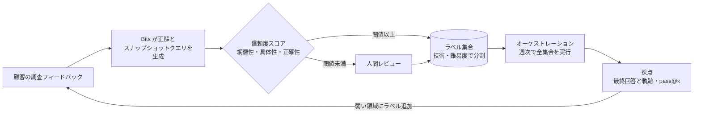
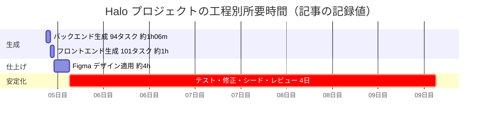
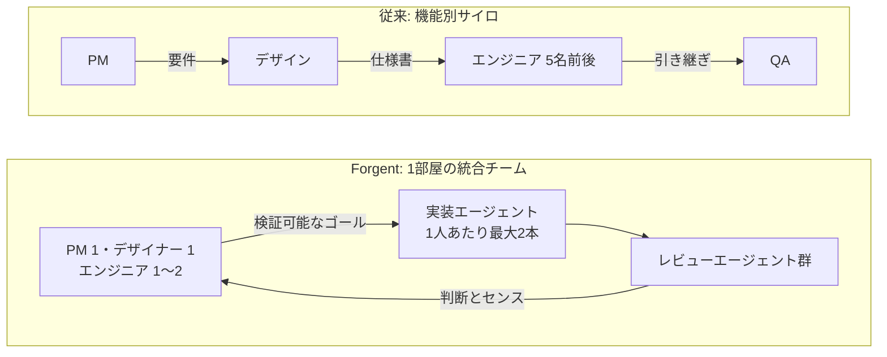
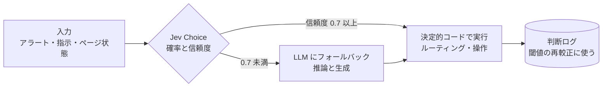
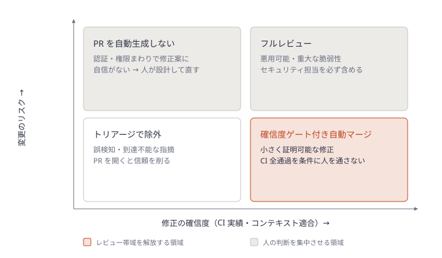

# Daily Briefing 2026-11-14

## 1. 自律型 SRE エージェントのための実環境評価プラットフォームをどう作ったか（原題: How we built a real-world evaluation platform for autonomous SRE agents at scale）

- **URL**: https://www.datadoghq.com/blog/engineering/bits-ai-eval-platform/
- **公開日**: 2026-04-07
- **著者・媒体**: Benjamin Barton / Datadog Engineering Blog

### 本文翻訳

Datadog の Bits Investigation チームは、本番インシデントを自律調査するエージェント Bits のためにオフライン評価基盤を構築した。発端は、ある改善が別の調査タイプを静かに劣化させた事件である。

**ある改善が微妙な退行を生んだ**: 調査対象のモニターからサービス名を取り出し、エージェントの初期コンテキストに入れる機能を追加した。社内テストではうまくいったが、別のシナリオでは無関係なシグナルが大量に流れ込み、推論を混乱させた。代表的な評価セットがなかったため、この退行は「社内調査の取りこぼしが広範に増える」という形でしか表面化しなかった。

**ツール単位テストもライブ再実行も足りなかった**: ツールを個別にテストしても、エージェントがツールをどう連鎖させ出力を組み合わせるか（例: 原因を誤ったコンポーネントに帰属させる）に起因する失敗は捕まえられない。実際の調査をオンライン評価として再実行する方法は、結果が集計されず、環境は変わり、シグナルは失効するためスケールしない。既製の評価フレームワークはクリーンで静的な入力を前提としており、ライブのテレメトリ上で推論するエージェントには合わない。解決策は、代表的な調査を集めた **キュレート済みラベル集合** と、それに対してエージェントを実行・採点する **オーケストレーション基盤** の2本立てである。

**ラベルの構造**: 各ラベルは2つの部分からなる。**正解**（例: Kubernetes の Pod が OOM Kill された）と、**ワールドスナップショット**（問題発生時に利用可能だったシグナル）である。後者は生データではなく、エージェントが必要とするクエリ（メモリメトリクス、コンテナログ、デプロイイベント）を保存する。エージェントは根本原因を決して見ない。ラベル集合は技術（Kubernetes、Kafka）・障害モード・複雑さにわたって多様でなければならない。狭くクリーンなデータセットは性能を水増しする。

**手作業ラベルから始める**: 最初は自社アラートからラベルを作るキャンペーンを行った。幅広いシナリオをカバーできたが、ラベルを生み出す速度よりエンジニア工数の消費が速く、代表性にもほど遠かった。

**ラベル作成を製品に埋め込む**: 調査結果への顧客フィードバックをラベル源にした。Bits がフィードバックと調査データから根本原因とスナップショットのクエリを構築する。すべての利用がラベル候補となり、作成速度は一桁増えた。

**人手レビューからエージェントによる検証へ**: 当初はシグナル再構成の前に人間のレビューを必須としたが、流入に追いつかなかった。そこで Bits 自身が関連シグナルを集約し、関係を導出し、曖昧なフィードバックを解消する（「遅かった」を「特定サービスのレイテンシ上昇」へ）ことで、トリガーから根本原因までの因果連鎖を組み立てるようにした。人間の判定者とのアラインメント調査で因果の正確さを確認し、各ラベルに **網羅性・具体性・正確性** の信頼度スコアを付け、閾値未満は人間レビューに回す。結果、ラベル1件あたりの検証時間は1週間で **95%超** 減り、生成ラベルの根本原因品質は約 **30%** 向上した。ラベル品質が上がったことで、最終回答だけでなく **調査の軌跡**（どこまで近づいたか、十分深く調べたか、有用なテレメトリを提示したか）も採点できるようになった。

**ノイズを持ち込め**: 最も直感に反する教訓は「シミュレーション環境は汚くなければならない」ことだ。根本原因のシグナルだけをスナップショットすると、関係するページだけを渡した持ち込み可の試験になり、評価が現実より良く見えた。そこで根本原因の連鎖から辿れる関連コンポーネント（同じプラットフォーム・チーム・モニター、似た名前）までスナップショットを広げた。スナップショットは一方通行の扉で、初期の狭いラベルは破棄・再生成するしかなかった。短期的には合格率が約 **11%** 下がりラベル数は **35%** 減ったが、評価は本番を予測できるものになった。

**セグメント化・採点・退行検知**: ラベルは技術・問題種別・モニター種別・難易度で分割でき、変更する領域だけをテストできる。全シナリオの全実行のスコアを保存し、合否推移と pass@k を追う。全集合は毎週実行する。ある新しいツール推論戦略は小さな部分集合では良く見えたが、全実行で即座に退行が検出された。

**またやること・もっと早くやること**: ラベル収集・処理に早く投資する（手作業は線形にしかスケールしない）、最初から拡張可能に作る、評価データで製品の方向を決める。否定的フィードバックを掘り、まだ対応していない能力のラベルも作る。「重要なラベルは Bits が合格するものではない」。現在、基盤は他のエージェントにも使われ、新モデルが出ると数日以内に全集合で評価して、どの調査タイプが改善・退行したかを特定している。毎週、実インシデント由来の数万シナリオに対して Bits を実行している。

### 重要ポイント

- エージェントの機能追加は **別シナリオを静かに劣化させる**。代表的な評価セットがないと「取りこぼし増」としてしか気づけない
- ラベル＝「正解」＋「当時のシグナルを取りに行くクエリ」。生データではなくクエリを保存し、正解はエージェントに見せない
- ラベル作成を製品フィードバックに埋め込み、検証をエージェント自身に担わせ、低信頼度だけ人間に回すことで検証時間を95%超削減
- 評価環境には **関連するノイズを意図的に入れる**。合格率が11%下がっても本番予測力の方が価値がある
- 全集合を週次で回し、部分集合だけの好結果を信じない。新モデルも全集合で比較する

### 図解



### 戦略分析

**フレームワーク**: ケイパビリティ成熟度モデル（AIDO の評価能力）

| 段階 | 状態 | 完了条件（記事から抽出） |
|---|---|---|
| 1. 体感評価 | 社内で使って良し悪しを判断 | ― （記事の出発点。退行は「取りこぼし増」でしか気づけない） |
| 2. 手作業ラベル | 自社アラートから人がラベル作成 | 技術・障害モードを跨いだ最小限の集合がある |
| 3. 製品埋め込み | 利用フィードバックが自動でラベル候補に | 作成速度が一桁向上、低信頼度のみ人が検証 |
| 4. 現実的評価 | 関連ノイズ込みのスナップショット、軌跡採点 | 評価の合格率が本番の成績を予測する |
| 5. 組織的学習 | 他エージェント・新モデル選定にも共用 | 新モデルを数日で全集合評価できる |

**示唆**: 自社で AI SRE（あるいは任意の調査系エージェント）を作り始めるなら、**最初の投資先はエージェント本体ではなく段階2→3の仕組み** である。具体的には、(1) 調査結果に 👍/👎 と「実際の原因」入力欄を付けてラベル源を確保し、(2) ラベルを「正解＋当時のクエリ」の形で保存し始める。これがないまま機能追加を重ねると、記事冒頭の退行と同じ状況に陥る。またベンダー製 AI SRE を選ぶ場合も、自社インシデント50件程度の再生集合で比較するという評価手順を調達条件に入れるべきだ。

**反証条件**: テレメトリの保持期間が短すぎて当時のクエリが再実行できない環境、またはインシデントが月に数件しかなくラベルが統計的に意味を持たない小規模組織では、段階3以降の投資は回収できない。その場合は段階2の手作業ラベル数十件で止めるのが合理的である。

### 現場での適用方法

**スクリプト化の例**: インシデントのポストモーテムから評価ラベルを作り、エージェントを再生評価する最小構成。

```yaml
# evals/labels/2026-11-02-checkout-oom.yaml
id: 2026-11-02-checkout-oom
segments:
  technology: kubernetes
  problem_type: resource_exhaustion
  difficulty: medium
ground_truth:            # エージェントには渡さない
  root_cause: "checkout-api の Pod が OOMKilled。11/02 のデプロイでキャッシュ上限が外れた"
  culprit_component: checkout-api
world_snapshot:          # 生データではなく「当時を再現するクエリ」を保存する
  time_window: ["2026-11-02T03:10:00Z", "2026-11-02T03:40:00Z"]
  queries:
    - kind: metrics
      query: 'avg:kubernetes.memory.usage{service:checkout-api} by {pod_name}'
    - kind: logs
      query: 'service:checkout-api status:error'
    - kind: events
      query: 'source:kubernetes reason:OOMKilled'
  # 「持ち込み可試験」にしないため、関連コンポーネントのノイズも入れる
  related_noise:
    - kind: metrics
      query: 'avg:kafka.consumer.lag{team:payments}'
    - kind: logs
      query: 'service:checkout-web status:warn'
```

```bash
#!/usr/bin/env bash
# evals/run.sh — 全ラベルでエージェントを k 回実行し、pass@k をセグメント別に出す
set -euo pipefail
K="${K:-3}"
AGENT_CMD="${AGENT_CMD:-<YOUR_AGENT_CLI> investigate}"   # 例: 自社エージェントの CLI
OUT="evals/results/$(date +%F)"
mkdir -p "$OUT"

for label in evals/labels/*.yaml; do
  id=$(basename "$label" .yaml)
  for i in $(seq 1 "$K"); do
    # ground_truth を除いた入力だけをエージェントに渡す
    yq 'del(.ground_truth)' "$label" \
      | $AGENT_CMD --stdin --json > "$OUT/$id.$i.json" || echo '{}' > "$OUT/$id.$i.json"
  done
done

# 採点: culprit_component が回答に含まれるか（最低限の判定。軌跡採点は LLM judge で追加）
python3 - "$OUT" <<'PY'
import sys, json, glob, yaml, collections
out = sys.argv[1]
seg = collections.defaultdict(lambda: [0, 0])
for path in glob.glob("evals/labels/*.yaml"):
    lab = yaml.safe_load(open(path))
    ok = any(lab["ground_truth"]["culprit_component"] in json.dumps(json.load(open(f)))
             for f in glob.glob(f"{out}/{lab['id']}.*.json"))
    key = lab["segments"]["technology"]
    seg[key][0] += ok; seg[key][1] += 1
for k, (p, n) in sorted(seg.items()):
    print(f"{k:12s} pass@k = {p}/{n}")
PY
```

運用: 週次で全ラベルを実行し、前週比で pass@k が下がったセグメントを Slack に通知する。機能追加の PR では変更領域のセグメントだけを先に回し、マージ前に全集合も回す。

### 期待効果

- 機能追加による他シナリオの退行を、本番の取りこぼしになる前に検出できる
- 記事の実績では、エージェント支援の検証でラベル1件あたりの検証時間が95%超減、ラベル品質が約30%向上
- 新モデルの採否を「どの調査タイプが良くなり、どれが悪くなったか」で数日以内に判断できる

### 注意点

- テレメトリには TTL がある。ラベル化はインシデント直後に行わないとクエリの再現先が消える
- ノイズを入れると合格率は下がる（記事では約11%）。数字の悪化を「劣化」と誤読しないよう、移行時は旧集合と並走させる
- エージェント自身にラベル検証をさせる場合、自己採点の甘さを防ぐため人間判定とのアラインメント調査を定期的に行う

## 2. AI による仕様駆動開発: Spec Kit + Claude Code のケーススタディ（原題: Spec-Driven Development with AI: A Spec Kit + Claude Code Case Study）

- **URL**: https://orangeloops.com/2026/05/spec-driven-development-with-ai-a-spec-kit-claude-code-case-study/
- **公開日**: 2026-05-19
- **著者・媒体**: Alejandro Wurm / OrangeLoops

### 本文翻訳

本稿は、OrangeLoops が 2026 年初頭に、GitHub の Spec Kit を Claude Code 内で使った仕様駆動開発（SDD）でフルスタックのモバイルアプリを構築した実験の報告である。結論を先に言えば、**コード生成は速かったが、安定化にはそれよりはるかに長くかかった**。

**要約**: Spec Kit と Claude Code は、記録された生成時間約2時間で 195 個の構造化タスク、動作するバックエンド、モバイルフロントエンドを生成した。しかし統合デバッグ、デザイン忠実度、DB シーディング、レビューにはさらに4日かかった。この手法は、生成開始前にスコープ・API 契約・デザイン要件・受け入れ基準が定義されているときに最も機能する。

**SDD と Spec Kit とは**: SDD は緩いプロンプトではなく、機能・データモデル・API 契約・実装要件を含む形式的な仕様から始める。AI の作業は仕様に駆動され、計画・タスク分解・実装・検証と進む。構造がアドホックなプロンプトではなく仕様に宿るので、プロセスは再現可能かつ監査可能になる。

**実験**: 仮名「Halo」というモバイルアプリで、バックエンドとフロントエンドは別リポジトリ。ツールは Claude Code と Spec Kit（モデルは Claude Sonnet 4.6）、ベースは自社の NestJS バックエンドと Expo/React Native フロントのテンプレート。初期段階では Figma デザインはなく、既存ドキュメントだけを入力にした。作業は4つのフェーズで順に進めた。

**フェーズ1: バックエンド**。バックエンドの全スコープを Spec Kit の仕様化ワークフローに通した。Claude は 94 タスクを生成し、約1時間6分で実装した。セッションのコンテキストは約95%を使った。Swagger でエンドポイントを確認できる動作するバックエンドができた。

**フェーズ2: フロントエンド**。フロント用に別の Spec Kit 構成を作った。フロントのサービス層の参照には、バックエンドの OpenAPI/Swagger 契約を使い、Claude にバックエンドのソースは直接読ませなかった。101 タスクを生成し、記録上の実装は約1時間だったが、これは12フェーズ中8フェーズ分だけである。再生成時にタイミング記録ファイルが上書きされ、4フェーズ分のデータが失われた。著者はこれを「完全には信頼できない最初の指標」と明記している。

**フェーズ3: Figma デザインの適用**。アプリが動いた後に、コンテキストを管理可能に保つため1機能ずつデザインを適用し、約4時間かかった。Claude はレイアウトと配置はよく再現したが、フォントウェイト・色・余白といった視覚スタイルは毎回明示的に指示する必要があった。著者らは「デザイン忠実度は仕様の一部でなければならない」と結論する。独立した画面は、コンテキストとワークツリーを分離した並列サブエージェントで経過時間を縮められると見ているが、計測していないため未証明である。

**フェーズ4: テスト・バグ修正・シーディング**。E2E テスト、統合の修正、現実的なシードデータ、シニアレビュー、安定化を含み、**4日** かかった。記録されたコード生成時間の合計より長く、実コストの主因だった。人間のレビューと QA は別カテゴリとして計測していない。

**実数値**: タスク合計 195（バック 94・フロント 101）、記録上のコード生成 約2時間（フロントは部分的）、デザイン適用 約4時間、テスト・修正・シーディング・レビュー・安定化 4日、コンテキスト使用率 バック約95%・フロント約92%。従来手法の見積もり（社内推定）は開発者2名で約6週間、AI 支援での経過時間は2週間未満。欠陥数は示されておらず、6週間という基準は統制されたベンチマークではない。

**うまくいかなかったこと**: (1) **認証の失敗**。両層を作り終えると、リクエストがすべて UNAUTHORIZED を返した。生成されたクライアントが、ベーステンプレートにあった「認証トークンをリクエストヘッダに付ける」挙動を引き継いでいなかった。修正には何度も手作業のパスが要った。(2) **リポジトリ横断のデバッグ**。フロントとバックにまたがるバグは、別リポジトリでは診断しにくかった。開発者は別セッションのコンテキストを手で持ち込むか、Claude にもう一方のフォルダを開かせた。両側に触れる修正は2つのセッションの調整を要し、最も時間に敏感なフェーズを遅らせた。

**次にやるなら**: (1) 不完全でも Figma デザインを最初から仕様に含める、(2) フォントウェイト・余白・色・状態ごとの見た目を明示的に仕様化する、(3) 独立した画面には並列サブエージェントを使う（ただし先に検証する）、(4) 密結合なフロントとバックはモノレポか明示的なリポジトリ間コンテキストの橋を用意する、(5) 計測値は実装エージェントが編集する作業領域の外に記録して上書きを防ぐ、(6) 人間のレビュー・デバッグ・QA を別々に計測する。

**結論**: 問うべきは AI がコードを速く生成できるかではなく、出力が使えるソフトウェアになる前に何を仕様化・レビュー・統合・テスト・安定化する必要があるかだ。最大のリスクは **生成されたコードを納品されたソフトウェアと取り違えること** である。「圧縮は本物だ。だがその大半はコード生成に集中しており、デバッグには及ばない」。

### 重要ポイント

- 195 タスクのコード生成は約2時間、しかし安定化（統合・シード・レビュー）は4日。**リードタイムの主成分は生成後** にある
- 視覚スタイルとテンプレートの暗黙の挙動（認証ヘッダ付与）は仕様に書かないと再現されない
- フロントはバックのソースではなく OpenAPI 契約を参照させた。契約駆動は有効だったが、横断バグの診断は別リポジトリ構成で詰まった
- 計測ファイルをエージェントの作業領域に置くと上書きされる。メトリクスは作業ツリーの外へ
- 「2名6週間→2週間未満」は社内推定との比較であり、統制実験ではない

### 図解



### 戦略分析

**フレームワーク**: バリューストリームマッピング × 制約理論

| 工程 | 作業時間（記事） | 記事の観察 |
|---|---|---|
| 仕様化・タスク分解 | 記録なし | 195 タスクを自動生成 |
| コード生成 | 約2時間 | 圧縮効果が集中する工程 |
| デザイン適用 | 約4時間 | スタイルは毎回指示が必要 |
| 統合・テスト・シード・レビュー | **4日** | 認証欠落・リポジトリ横断デバッグで停滞 |

**制約**: 生成工程は時間単位、安定化は日単位で、制約は明確に後者にある。TOC の第2・第3ステップ（制約の徹底活用、他工程の従属）に当てはめると、生成をさらに速くする投資は全体のリードタイムをほとんど縮めない。

**示唆**: SDD の仕様テンプレートに「生成後に詰まった項目」を前倒しで書かせる方が効く。具体的には (1) 横断関心事（認証ヘッダ・エラーハンドリング・ロギング）をテンプレートから引き継ぐことを受け入れ基準に明記、(2) デザイントークン（ウェイト・余白・色）を仕様の必須欄に、(3) フロント・バック密結合ならモノレポで1セッションに収める。見積もりでは「生成時間×N」ではなく安定化バッファを最初から計上する。

**反証条件**: 既存の大規模コードベースへの小さな変更（ブラウンフィールド）では、統合面がすでに安定しており、安定化工程が短い可能性がある。その場合の制約は仕様化やレビューに移り、本分析は当てはまらない。

### 現場での適用方法

**CLAUDE.md への追記例**: Spec Kit 等で仕様を書くときに、記事で詰まった項目を必須チェックにする。

```markdown
## 仕様駆動開発（SDD）のルール

### 仕様（spec.md）に必ず含める項目
- 横断関心事: 認証トークンの付与方法、エラー応答の形、ロギング。
  「ベーステンプレート <TEMPLATE_REPO> の挙動を引き継ぐ」と書き、引き継ぐ関数名を列挙する
- デザイントークン: フォントウェイト・余白・色・状態（hover/disabled/error）を数値で。
  Figma が未完成でも、確定している画面のリンクを載せる
- API 契約: OpenAPI ファイルのパス（<OPENAPI_PATH>）。フロントはソースではなく契約を参照する

### 受け入れ基準に必ず含める項目
- 認証付きエンドポイントを1本、フロントから実際に叩いて 200 が返ること
- シードデータ投入後、主要画面が空表示にならないこと

### 計測
- タスクごとの所要時間は `../metrics/<PROJECT>.csv`（作業ツリーの外）に追記する。
  作業ツリー内のファイルに記録しない（再生成で上書きされるため）
- 人間のレビュー・デバッグ・QA の時間は別列で記録する
```

**スクリプト化の例**: 計測を作業ツリー外に追記する Claude Code の Stop フック。

```bash
#!/usr/bin/env bash
# ~/.claude/hooks/log-task-time.sh — セッション終了時に作業ツリーの外へ記録する
set -euo pipefail
METRICS_DIR="${METRICS_DIR:-$HOME/sdd-metrics}"
mkdir -p "$METRICS_DIR"
repo=$(basename "$(git rev-parse --show-toplevel 2>/dev/null || pwd)")
task="${SDD_TASK_ID:-unknown}"
printf '%s,%s,%s,%s\n' "$(date -Iseconds)" "$repo" "$task" "$(git rev-parse --short HEAD 2>/dev/null || echo none)" \
  >> "$METRICS_DIR/$repo.csv"
```

### 期待効果

- 記事の事例では、社内推定で2名6週間の作業が2週間未満に短縮
- 認証欠落・スタイル再指示といった「生成後の手戻り」を仕様段階で潰せる
- 生成と安定化を分けて計測することで、次の見積もりの精度が上がる

### 注意点

- 単一プロジェクトの事例で、欠陥数も統制群もない。数値は参考値として扱う
- コンテキスト使用率が 92〜95% に達している。より大きなスコープでは仕様の分割が必要
- 並列サブエージェントによる短縮は著者自身が未検証としている

## 3. 2026 年の AI 対応エンジニアリング・プロダクト・デザインチームの作り方（原題: Building AI-Enabled Engineering, Product & Design Teams in 2026）

- **URL**: https://forgent.ai/blog/building-ai-enabled-engineering-product-design-teams-in-2026
- **公開日**: 2026-04-08（ページのメタデータ上は 2026-08-05 公開）
- **著者・媒体**: Leonard Wossnig（Forgent AI 共同創業者・CTO）/ Forgent AI Insights

### 本文翻訳

2026 年1月以降、Forgent では1人のエンジニアが1週間で複数の機能を出荷するようになった。以前なら1か月以上かかった作業だ。著者はこれを漸進的な改善ではなく突然の段差であり、エンジニアリングの経済性を変えたと見る。Shopify の Tobi Lütke、コーチの Etienne de Bruin、Harvey の Gabe Pereyra も同様の観察をしており、Pereyra は「ボトルネックは実装からレビューと優先順位付けに移った」と言う。本稿は、自律型エージェントを中心にエンジニアリング組織を作り直した Forgent の6つの教訓を示す。

**能力の閾値**: 2026 年1月頃、コーディングエージェントは「一貫性の閾値」を越えた。計画、複数ファイルの編集、テスト実行、失敗の診断、テストが通るまでの反復という、持続的な多段推論ができるようになった。METR のベンチマーク（50%・80% の時間地平）はエージェントが完遂できるタスク長の指数的伸びを示す。要因は、テスト合格のような機械検証可能な結果で訓練する **RLVR**（検証可能な報酬による強化学習）と、難問に長く考えさせる **推論時計算のスケーリング** である。Karpathy の言う「agentic engineering」、すなわちエンジニアが自分でコードを書くのではなくエージェントを指揮する形がこれを表している。

**教訓1: 検証可能なゴールが鍵**。エージェントは、走らせて反復できるテストのような測定可能なゴールで最もよく働く。Lütke は一晩の自動コミット 93 件でレンダリングを 53% 高速化したという。Kent Beck は TDD が今こそ重要だと論じる。「直感的な UI を作る」のような曖昧なゴールは、特に UI/UX で依然として悪い結果を生む。

**教訓2: モデルよりハーネス**。効果はコンテキストの組み立て、ツールの公開、フィードバックループ（テスト・リンタ・評価器）で決まる。Forgent は CLAUDE.md、スキル定義、コーディング基盤（プレビューサーバ、自動テスト、評価）、業務情報への広いアクセスに投資した。LangChain はハーネスだけを変えて TerminalBench のスコアを 52.8% から 66.5% に上げたという。2025 年の DORA レポートは、AI は既存のプラクティスを増幅する、つまり弱いチームは技術的負債を速く積み上げると指摘している。

**教訓3: 速度よりガードレールと QA**。Stack Overflow の分析では、AI が作った PR は人間の PR より論理エラーが 75% 多かった。Amazon でも 2026 年初頭に AI 支援の変更に起因するサービス障害が報じられた。Forgent は継続的レビューにエージェント群（BUGBOT、Claude Code Review）を走らせ、レビューのトークン支出を高 ROI と見なしている。

**教訓4: ボトルネックは判断とセンスに移る**。今や最も高くつく誤りは「間違ったものを作ること」だ。プロダクトセンス、ユーザーリサーチ、「やらない」と言うことが最優先になった。ユーザー共感・プロダクトセンス・技術的素養を兼ねる「プロダクトエンジニア」という役割が生まれると予想する。一方 Anthropic のグロースチームは逆に PM を増やしており、適切なモデルはチーム規模と調整コスト次第だとする。

**教訓5: ツールではなく組織を変える**。機能ごとのサイロは、エージェントでは消えない引き継ぎコストを生む。Forgent のプロジェクトチームは現在、**エンジニア1〜2名、PM 1名、デザイナー1名**で、1部屋に収まる規模だ。プロダクト・デザイン・エンジニアリングはさらに融合していくと見る。Dorsey と Botha を引き、人間が「情報のルーター」である状態から、AI が調整を担い人間が判断を供給する全社的な「ワールドモデル」へ移るべきだとする。

**教訓6: 並列性を制限するのは計算資源ではなく人間の注意**。エージェントは並列に走れるが、人は無限に文脈切り替えできない。著者自身の限界は **独立した機能に2つのエージェントを並走させること** で、それを超えるとレビューの負担が節約時間を上回る。エンジニアは、エージェントの監督、AI が失敗する場所の見極め、何をレビューするかの選択、スケールでの管理を学ぶ必要がある。

**技術チームへの意味**: (1) モデルではなく基盤に投資する。構造化ルール、プレビューサーバ、自動評価、品質ガードレールをハーネスとして CI/CD に組み込む。ルールを1つ書くたびに将来のエージェント実行が信頼できるものになる。(2) コンテキストの組み立てを自動化する。Slack、Notion、GitHub、Figma、コードベースをつなぎ、キュレーションを継続業務として扱う。(3) 小さく統合されたチームに再編し、1人または小チームが発見から出荷までのライフサイクル全体を持つ。(4) 学習曲線は本物の仕事だと受け入れる。再編・知識の符号化・エージェント習熟は組織変革であって、ツールの入れ替えではない。

**最も重要なこと**: 変化だけが定数である。以前は組織を何年も同じやり方で運営できたが、見直しの周期は数か月になった。常に作り直すことは、もはや優位ではなく参加の条件である。

### 重要ポイント

- プロジェクトチームを **エンジニア1〜2・PM 1・デザイナー1** に縮め、発見から出荷までを1チームで持つ
- ハーネス（CLAUDE.md・スキル・プレビュー・評価）への投資がモデル選定より効く。LangChain はハーネスだけで 52.8%→66.5%
- AI 生成 PR は論理エラーが多い前提で、レビュー用エージェントへのトークン支出を惜しまない
- 1人が並走させるエージェントは2本が実用上限（著者の経験値）。人間の注意が並列度の制約
- 曖昧なゴール（UI の「直感性」）は依然として苦手。検証可能なゴールに落とせる仕事から委譲する

### 図解



### 戦略分析

**フレームワーク**: マッキンゼー 7S

| 要素 | Forgent の変化（記事の記述） |
|---|---|
| Structure | 機能別サイロ → エンジニア1〜2・PM1・デザイナー1 の統合チーム |
| Systems | ハーネス（CLAUDE.md・スキル・プレビュー・評価）を CI/CD に、レビューエージェント群 |
| Skills | 書く力 → 監督・失敗箇所の見極め・レビュー対象の選択 |
| Staff | 「プロダクトエンジニア」型を志向（ただし PM 増の逆事例もあると明記） |
| Style | 「やらない」と言う判断・優先順位付けを重視 |
| Strategy | 速度ではなくガードレールと QA に投資 |
| Shared values | 継続的な作り直しを前提にする |

**示唆**: 7S の整合で読むと、記事の主張は **Structure だけ先に変えても機能しない** ことを示している。チームを小さくしても、Systems（ハーネスとレビュー自動化）と Skills（監督能力）が伴わなければ、1〜2名のエンジニアがレビュー待ちで詰まる。順序としては (1) レビューエージェントとプレビュー環境を先に整備、(2) 1人あたり並走2本までという運用上限を明文化、(3) その上でチームを統合する。また、「何をやらないか」を決める PM・デザイナーの比率を下げない判断が必要になる。

**反証条件**: 規制・監査対応で職務分離（作る人と承認する人を分ける）が義務づけられている領域では、統合チームは採れず、サイロの一部は意図的に残る。また記事の数値の多くは他社事例の引用で、Forgent 自身の計測値（リードタイムや欠陥率）は示されていないため、本分析は仮説の域を出ない。

### 現場での適用方法

**運用手順**: 統合チームへの移行を4週間で試す。

```markdown
## AI ネイティブ統合チーム パイロット（4週間）

### 週0: 前提の整備（チーム編成より先）
1. 対象リポジトリに CLAUDE.md とスキルを置き、プレビュー環境を PR ごとに自動生成する
   - 例: `gh workflow run preview.yml -f pr=<PR_NUMBER>`
2. レビューエージェントを必須チェックに設定（GitHub の branch protection で required check 化）
3. ベースライン計測: 直近4週の PR リードタイム中央値、レビュー待ち時間、差し戻し率を記録

### 週1: 編成
- 1チーム = PM 1 / デザイナー 1 / エンジニア 1〜2 で、1つの顧客課題を発見から出荷まで担当
- ルール: 1人が同時に走らせる実装エージェントは2本まで
- ルール: チケットは「検証可能なゴール」（テスト or 受け入れ基準）がないと着手しない

### 週2〜3: 運用
- 毎日15分、PM とデザイナーが「今週やらないこと」を1つ決める
- UI の見た目に関するタスクはデザイナーがトークンを指定してから委譲する

### 週4: 振り返り
- ベースラインと比較: PR リードタイム、レビュー待ち、差し戻し率、本番障害数
- レビュー待ちが伸びていれば編成ではなくレビュー自動化側に戻って手を入れる
```

### 期待効果

- 引き継ぎコストの削減により、発見から出荷までの文脈損失が減る
- 記事の観察では、エンジニア1人が1週間で複数機能を出荷（以前は1か月以上）
- レビューエージェント併用で、AI 生成 PR に多い論理エラーを人間レビュー前に削れる

### 注意点

- 著者自身の会社の経験談で、定量的な前後比較は示されていない
- 小さなチームはバス係数が下がる。知識を CLAUDE.md・スキルに符号化し続けないと属人化が進む
- 並走2本は著者個人の限界であり、タスクの独立性や経験で変わる

## 4. Jev とは何か（原題: What Is Jev?）

- **URL**: https://browserbase.com/blog/what-is-jev
- **公開日**: 2026-09-21
- **著者・媒体**: Kyle Jeong / Browserbase Engineering Blog

### 本文翻訳

Jev は @typesafeai の発表をきっかけに X で広く話題になった。Typesafe は Jev を「ソフトウェアが直接使える、高速で構造化された意思決定のための AI モデルの一種」と説明する。同社の System One モデルは状態を受け取り、確率付きの型付き回答を返す。Typesafe のベンチマークでは LLM より 20〜200 倍速く、40〜400 倍安いとされる。本稿は Jev とは何か、なぜ存在するか、本番システムにどう組み込むかを説明する。

**Jev とは正確には何か**: 非構造の状態を入力に取り、型付きの確率的判断を返す関数呼び出しの一種である。3つのプリミティブがある。**Choice** は最大 255 個の定義済み選択肢から1つを選び、選択肢ごとの確率と信頼度を返す。**Score** は順序付きの記述的レベルに対して内容を評価し、レベルごとの確率と信頼度を返す。**Noul** は Yes/No の問いに対して Yes の確率を返す。

カスタマーサポートの例として、「サブスクリプションが二重請求された、返金してほしい」というメッセージに3つの問いを投げる。部署（Choice: billing / technical / account）は billing が確率1、返金要求（Noul）は Yes が 0.99、苛立ち度（Score: 冷静 / 苛立ち / 非常に苛立ち）は冷静が確率1。モデルは `jev-latest`、入力 442 トークン、出力 72 トークン、評価時間は約 163ms だった。

**単なる分類器ではないのか**: 答えは「イエスでもありノーでもある」。著者は「LLM と分類器の子ども」と表現する。従来の分類器は固定カテゴリの大量処理に強いが狭く領域特化的。LLM は実行時に定義される開かれたタスクに柔軟だが、遅く高く予測しにくい。Jev は「分類のための基盤モデル」で、新しいモデルを訓練せずに多くのタスクを扱え、コード・テキスト・ログ・UI 状態・イベントといった領域を横断する。出力を並列生成するので逐次生成の LLM より速い。

**なぜ Jev が存在するか**: Typesafe の CEO Diogo Almeida は OpenAI で RLHF と ChatGPT に関わった。Jev は **RLCD**（較正された判断による強化学習）で訓練され、答えだけでなく較正された信頼度と確率を出すよう学習している。RLHF は人間が好むものに最適化するが、それは常に客観的に正しいとは限らず、複数の正解がありうる場面で1つの答えに収束する「モード崩壊」も起こしうる。人間にとって説得力のある出力と、無人の自動化に足る信頼性は別の最適化目標である。

**Jev はエージェントを作るためのものではない**: 著者らは Jev 単体、および LLM＋Jev を試した。Jev エージェントのデモは速く印象的だが、最良のものでも本番には耐えない。推論・生成能力がないため、単体エージェントには不向きだ。Jev は決定的なコードの内部で判断を助ける「AI で動くソフトウェア」向けであり、サポートのルーティング、請求書処理、**セキュリティアラートのトリアージ**、エージェントの監視などが用途として挙がる。

**数値**: モデルは Jev 1.13.0、入力は100万トークンあたり $0.042、出力は $0。コンテキストは1リクエスト 64k トークンで、状態と最長の問いの合計が 32k に収まる必要がある。Typesafe の社内ベンチマークでは精度対コスト・精度対速度で OpenAI、Anthropic、DeepSeek を上回るとされる。

**どう使うか — Stagehand への組み込み**: Browserbase の OSS ブラウザ自動化フレームワーク Stagehand は約2年、Act（操作）、Extract（構造化抽出）、Observe（可能な操作の発見）の3プリミティブを提供してきた。セレクタを手書きする Playwright と違い、「送信ボタンをクリック」という自然言語から実行時にセレクタを選ぶので、DOM が変わってもスクリプトが自己修復する。従来は LLM がページ文脈と目的から次の操作を決めていたが、Jev の Choice で操作対象の要素を選ばせるようにした。

Act の流れは次のとおり。(1) ページを操作可能・不可の印を付けたハイブリッドなアクセシビリティツリーとして表現する。(2) Jev が指示を click / fill / scroll などの操作種別に分類する。(3) Stagehand が引数を解析し、周辺文脈付きの候補要素リストを作る。(4) Jev が最良の候補と「どれかが一致するか」を答え、受理閾値は **0.7**。(5) 受理されれば実行し、そうでなければ **LLM にフォールバック** する。初期テストでは Act のレイテンシ中央値が 1.97 秒から 0.46 秒に、約 4.3 倍（所要時間77%減）短縮した。

**現実世界への AI の普及**: Jev は本番級のコンピュータ操作エージェントを単独で作るものではないが、大きなシステムの有用な部品になる。AI はチャット UI に閉じる必要はなく、Jev のようなモデルはチャット欄なしにソフトウェアへ予測を加えられる。

### 重要ポイント

- Jev は生成しない。**Choice / Score / Noul** の3プリミティブで、確率と信頼度付きの型付き判断を返す
- 単体エージェントには不向き。決定的なコードの中の「賢い if 文」として使い、閾値未満は LLM にフォールバックする
- Stagehand では信頼度閾値 0.7 で LLM と切り替え、操作レイテンシ中央値を 1.97 秒→0.46 秒に短縮
- 用途例に **セキュリティアラートのトリアージ** やエージェント監視があり、AIDO の前段フィルタに使える
- 性能・コストの主張は Typesafe の社内ベンチマークと初期テストに基づく。自社データでの再検証が前提

### 図解



### 戦略分析

**フレームワーク**: 単位経済性（ユニットエコノミクス）× Cynefin

| 判断の種類（Cynefin） | 例 | 担当 | 1件あたりのコスト構造 |
|---|---|---|---|
| 明白（選択肢が定義済み） | アラートの担当チーム振り分け、重複判定 | Jev | 入力トークン課金のみ・出力 $0 |
| 煩雑（選択肢はあるが文脈依存） | 要素選択、優先度スコア | Jev → 閾値未満は LLM | Jev ＋ フォールバック率 × LLM 単価 |
| 複雑（探索が必要） | 根本原因の調査、修正案生成 | LLM ＋ 人間 | LLM の推論・生成コスト |

**示唆**: AIDO/AIDD のパイプラインで LLM を呼んでいる箇所のうち、**出力が列挙型で表せる判断** を棚卸しし、Jev 型の判断モデルに置き換える候補とする。単位経済性で見ると、1件あたりコスト ≒ 判断モデル単価 ＋ フォールバック率 × LLM 単価 になるため、フォールバック率を計測しない導入は効果が見えない。まず判断ログを取り、閾値（記事は 0.7）を自社データで較正してから本番切り替えを判断する。

**反証条件**: 判断の件数が少ない（1日数十件程度）なら、置き換えによる節約額は統合・検証コストを下回る。また選択肢が 255 を超える、あるいは状態が 32k トークンに収まらない判断には適用できない。社内ベンチマークの精度が自社ドメインで再現しない場合も前提が崩れる。

### 現場での適用方法

**スクリプト化の例**: セキュリティアラートのトリアージに「判断モデル＋LLM フォールバック」を入れる骨組み。API の具体的なエンドポイントやフィールド名は利用するサービスのドキュメントに合わせて置き換えること。

```python
# triage.py — 判断モデルで振り分け、信頼度が低いものだけ LLM と人間に回す
import json, os, urllib.request

DECISION_API = os.environ["DECISION_API_URL"]      # 例: <JEV_ENDPOINT>
API_KEY = os.environ["DECISION_API_KEY"]
THRESHOLD = float(os.environ.get("TRIAGE_THRESHOLD", "0.7"))  # 記事の Stagehand と同じ初期値
TEAMS = ["platform", "payments", "identity", "data", "not_actionable"]

def decide(state: str) -> dict:
    body = {
        "model": "<MODEL_NAME>",
        "state": state,
        "questions": [
            {"id": "team", "type": "choice", "options": TEAMS},
            {"id": "exploitable", "type": "noul", "question": "外部から悪用可能な脆弱性か"},
        ],
    }
    req = urllib.request.Request(DECISION_API, data=json.dumps(body).encode(),
                                 headers={"Authorization": f"Bearer {API_KEY}",
                                          "Content-Type": "application/json"})
    return json.load(urllib.request.urlopen(req, timeout=5))

def triage(alert: dict) -> dict:
    res = decide(json.dumps(alert, ensure_ascii=False))
    team = res["team"]
    route = {"alert_id": alert["id"], "team": team["choice"], "confidence": team["confidence"],
             "p_exploitable": res["exploitable"]["probability"]}
    if team["confidence"] < THRESHOLD:
        route["next"] = "llm_fallback"          # LLM に理由付きで判断させ、人間が確認
    elif route["p_exploitable"] > 0.5:
        route["next"] = "page_security_oncall"
    else:
        route["next"] = f"ticket:{team['choice']}"
    # 判断ログ: 後で閾値を較正するため全件保存する
    with open(os.environ.get("TRIAGE_LOG", "triage-log.jsonl"), "a") as f:
        f.write(json.dumps(route, ensure_ascii=False) + "\n")
    return route
```

```bash
# 2週間後: フォールバック率と、人間が修正した割合を確認して閾値を見直す
jq -s '{total: length,
        fallback_rate: (map(select(.next=="llm_fallback")) | length) / length}' triage-log.jsonl
```

### 期待効果

- 記事の Stagehand では Act のレイテンシ中央値が 1.97 秒→0.46 秒（約4.3倍）
- 列挙型の判断を LLM から外すことで、大量アラートでもトークンコストが線形に膨らみにくくなる
- 確率と信頼度が返るため、人間に回す基準を閾値として明示・監査できる

### 注意点

- 記事は Jev を統合した当事者（Browserbase）によるもので、性能値は Typesafe の社内ベンチマークと初期テスト
- 生成・推論はできない。根本原因の説明や修正案は LLM 側の仕事として残す
- 閾値 0.7 は Stagehand での値であり、自社の判断ログで較正し直すこと

## 5. 自動セキュリティ修正の 85% は却下される。解決策は修正を増やすことではない（原題: 85% of Automated Security Fixes Get Dismissed. The Fix Isn't More Fixes.）

- **URL**: https://www.pixee.ai/blog/merge-rate-problem-security-prs-ignored
- **公開日**: 2026-03-17
- **著者・媒体**: Pixee Team / Pixee Blog（ベンダーブログ。自社製品の宣伝を含む）

### 本文翻訳

Dependabot、Snyk、Renovate、AI コーディングアシスタントといったセキュリティツール群は、かつてないほど多くのプルリクエストを生成しているが、開発者はその大半を無視している。ボットが作った PR の受け入れ率は **37.38%** で、人間の 72.53% を大きく下回る。JavaScript の OSS プロジェクトで Dependabot のセキュリティ PR が採用されたのは **13%** にとどまる。業界は検出を改善してきたが、開発者がマージしない修正を生成したら何が起きるかは問わなかった。その結果は「リスクを減らさずに仕事を生む、高価な通知システム」である。あるエンジニアリングリーダーは「速くはならなかった。渋滞の場所が移っただけだ」と語る。

**開発者はなぜ自動修正を拒むのか**: 無関心が原因ではない。86% の開発者がセキュリティを最優先と見ていないという数字はあるが、これは過去のセキュリティツール体験に基づく合理的な資源配分である。問題は **シグナルの質** だ。Arnica の分析では、AI コードレビューが指摘した問題の 85% が却下される。69% の開発者がプロジェクトに脆弱な依存があることを知らないのは、ツールがリスクを伝えられていない証拠である。開発者が不信を抱くのは自動化そのものではなく、コードベースを理解していない自動化だ。汎用的な修正は文脈を考慮しない。

**AI が生んだボトルネック: コードは増え、レビューは遅くなる**: GitHub と Accenture の調査では、エンタープライズ導入で Copilot の提案受け入れは 30% だった。AI はボトルネックをコード作成からコードレビューへ移した。LinearB のデータでは、PR の半数がその寿命の半分以上を放置されている。セキュリティ PR は機能開発、AI 生成コード、依存更新、リファクタリングとレビュー帯域を奪い合い、文脈・説明・安全性の証拠を欠くものは後回しか放棄される。結果が「LGTM 反射」、つまりレビュー疲れによる素通し承認（セキュリティ変更では危険）か、キューの放棄（セキュリティ PR が滞留）である。

**既存ツールの届け方と限界**: Dependabot のマージ率は約 54% とされるが、PR はレビュー前に上書きされがちだ。Renovate はグルーピング、スケジューリング、CI 結果からのマージ信頼度スコアで部分的に助かるが、設定の手間が大きい。Flink の「DuneBot」は Renovate を基盤に、CODEOWNERS のボトルネックを外すことで 700 超のリポジトリで 12,000 件超の PR をマージした。依存更新のマージ率は解決可能だと示すが、SAST・DAST やコード理解を要する修正には広がらない。Snyk は互換性スコア付きの修正 PR を出すが、直接アップグレードが API を壊す場合に独自パッチを作ることがあり、保守性の懸念がある。SonarQube や Checkmarx はダッシュボード型で、IDE からの文脈切り替えを強いる。「特定済み」と「修正済み」の間の溝は「脆弱性が死にに行く場所」だ。すべてのツールに共通する失敗モードは、修正が安全か・正しいか・マージする価値があるかを決めるコードベースの文脈を理解せずに修正を生成することである。

**セキュリティ PR のマージ率をどう上げるか**: (1) **修正の前にトリアージする**。スキャナの指摘の多くは誤検知であり、全件に PR を開くと信頼が損なわれる。修正 PR は実在し悪用可能な脆弱性に限る。(2) **コードベースの文脈に合わせる**。依存バージョン、テストのパターン、コードスタイル、プロジェクト構造を尊重し、同僚が書いたように見せる。(3) **マージ信頼度のシグナルを出す**。ボットの主張ではなく、集約した CI 結果のような定量的証拠が要る。(4) **レビューの人間工学を尊重する**。脆弱性・修正の正しさ・変更点を明確に説明した、小さく焦点の絞れた PR にする。(5) **信頼を段階的に築く**。開発者が最初にレビューする修正が、次をレビューするかを決める。一括の中の1件の悪い修正が「ボット PR は全部無視」を強化する。(6) **摩擦をリスクに合わせる**。認証関連の変更はセキュリティ担当を交えたフルレビューに値する。証明可能に安全で確信度が高く CI が通るパッチは、確信度ゲートの背後で自動マージしてよい。重大で悪用可能な指摘はフルに精査する。

組織的な問題（教育不足、優先順位の不一致、セキュリティが別部門であること）も重要だが、てこの支点は修正そのものにある。「マージ率の問題は開発者の問題ではない。シグナルの質の問題だ。シグナルを直せば、開発者はコードを直す」。

### 重要ポイント

- KPI は「開いた修正 PR 数」ではなく **マージ率**。マージされない PR はリスクを減らさずレビュー帯域だけを消費する
- ボット PR 受け入れ率 37% 対 人間 73%、Dependabot セキュリティ PR の採用 13% と、自動修正の大半は使われていない
- 修正前に「到達可能・悪用可能」でトリアージし、PR を開く対象を絞る
- 確信度×リスクで摩擦を配分し、低リスク・高確信の修正は CI 通過を条件に自動マージ、認証系はフルレビュー
- 最初の数件の品質が以後のレビュー意欲を決める。一括投入より少数高品質から始める

### 図解



### 戦略分析

**フレームワーク**: 制約理論（TOC）× DORA Four Keys

**制約**: 記事の構図は、修正の **生成** が非制約工程、**レビュー帯域** が制約工程という典型的な TOC の状況である。制約工程の前に在庫（未レビュー PR）を積むほど、LGTM 反射やキュー放棄といった品質劣化が起きる。TOC の5ステップに当てはめると次のようになる。

| ステップ | 記事の打ち手 |
|---|---|
| 制約の特定 | セキュリティ PR はレビュー帯域を機能開発・AI 生成コードと奪い合う |
| 徹底活用 | 小さく説明付きの PR、CI 結果を信頼度シグナルとして添付 |
| 従属 | トリアージで誤検知を除外し、生成量をレビュー能力に合わせる |
| 制約の引き上げ | 低リスク・高確信の修正を自動マージし、レビュー対象から外す |

**示唆**: 脆弱性対応の自動化を評価する指標を、**マージ率と「検知からマージまでのリードタイム」** に変える。DORA の観点では、自動マージ領域を広げるならば変更失敗率（自動マージ後のロールバック率）を同時に監視しなければ片側だけの改善になる。具体的な順序は、(1) 現在のセキュリティ PR のマージ率と滞留日数を計測、(2) 到達可能性で PR 生成対象を絞る、(3) パッチバージョンの依存更新など低リスク領域から自動マージを開始し、ロールバック率が許容内なら範囲を広げる。

**反証条件**: レビュー帯域に余裕がある小規模チーム、あるいは規制上すべての変更に人間承認が必須の環境では、自動マージによる制約の引き上げが使えず、別の打ち手（修正品質の向上のみ）に限られる。また記事はベンダーの立場で書かれ、引用統計の多くが二次情報源である点は割り引く必要がある。

### 現場での適用方法

**スクリプト化の例**: Renovate で「低リスク・高確信」だけを自動マージし、残りはグルーピングして人間レビューへ回す設定。

```json
{
  "$schema": "https://docs.renovatebot.com/renovate-schema.json",
  "extends": ["config:recommended"],
  "prConcurrentLimit": 5,
  "vulnerabilityAlerts": {
    "labels": ["security"],
    "minimumReleaseAge": null
  },
  "packageRules": [
    {
      "description": "低リスク・高確信: パッチ更新で CI 全通過なら自動マージ",
      "matchUpdateTypes": ["patch", "pin", "digest"],
      "matchCurrentVersion": "!/^0/",
      "automerge": true,
      "automergeType": "pr",
      "platformAutomerge": true
    },
    {
      "description": "高リスク: 認証・暗号系はセキュリティ担当のレビュー必須",
      "matchPackageNames": ["<AUTH_LIBRARY>", "jsonwebtoken", "passport", "bcrypt"],
      "automerge": false,
      "reviewers": ["team:<SECURITY_TEAM>"],
      "labels": ["security", "needs-security-review"]
    },
    {
      "description": "それ以外のマイナー更新は週1でまとめてレビュー帯域の消費を抑える",
      "matchUpdateTypes": ["minor"],
      "groupName": "weekly minor updates",
      "schedule": ["before 9am on monday"]
    }
  ]
}
```

**マージ率の計測**（GitHub CLI）:

```bash
#!/usr/bin/env bash
# security-pr-merge-rate.sh <OWNER/REPO> — 直近90日のセキュリティ PR のマージ率と滞留日数
set -euo pipefail
REPO="$1"
SINCE=$(date -d '90 days ago' +%F)
gh pr list -R "$REPO" --state all --label security --search "created:>=$SINCE" \
  --json number,state,createdAt,mergedAt --limit 500 \
| jq -r '
  (map(select(.state=="MERGED")) | length) as $m
  | length as $n
  | "total=\($n) merged=\($m) merge_rate=\(if $n>0 then ($m*100/$n|floor) else 0 end)%",
    "median_days_to_merge=" + (map(select(.mergedAt)) 
      | map(((.mergedAt|fromdate)-(.createdAt|fromdate))/86400) | sort
      | if length>0 then (.[length/2|floor]|floor|tostring) else "n/a" end)'
```

### 期待効果

- レビュー対象を高リスク領域に集中させ、LGTM 反射による素通し承認を減らせる
- 記事の事例では、Flink が CODEOWNERS のボトルネックを外して 700 超のリポジトリで 12,000 件超の依存更新 PR をマージ
- マージ率を KPI にすることで、「PR を大量に開いたが何も直っていない」状態を可視化できる

### 注意点

- ベンダーブログであり、引用統計の多くは二次情報源経由。自社のマージ率を計測してから判断する
- 自動マージは CI の網羅性に依存する。テストが薄いリポジトリでは自動マージ範囲を広げない
- `0.x` 系のパッケージはパッチ更新でも破壊的変更がありうるため、上の設定では自動マージ対象から外している
