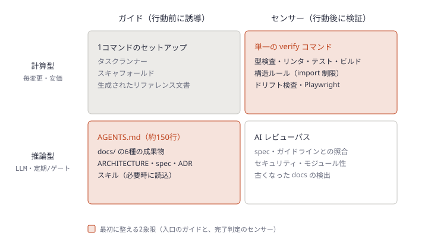
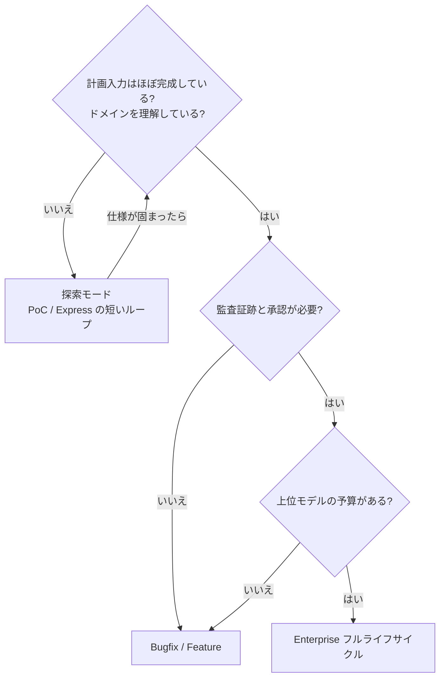
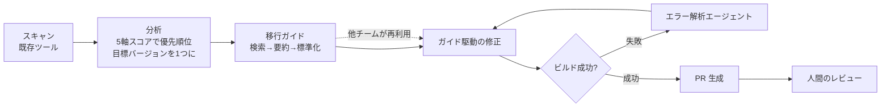
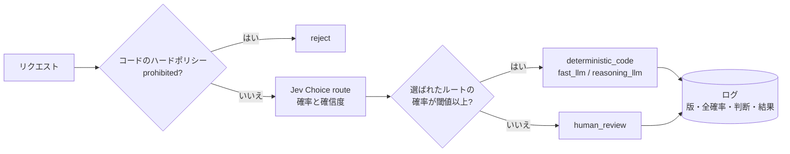

# Daily Briefing 2026-11-15

## 1. AI エージェントのためのソフトウェアプロジェクト設計法（原題: How to architect software projects for AI agents）

- **URL**: https://www.typefox.io/blog/software-projects-for-ai-agents/
- **公開日**: 2026-09-09
- **著者・媒体**: Dr. Miro Spönemann（TypeFox 共同リーダー）/ TypeFox Blog

### 本文翻訳

コーディングエージェントがコードベースの分析を毎回やり直したり、既存のヘルパーを再実装したりするとき、問題はたいていモデルではなくリポジトリの側にある。人間の開発者はオンボーディング後、プロジェクトの知識を頭の中に持ち歩く。エージェントはタスクごとにその文脈なしで始まるので、リポジトリが教えないことは再発見するか推測するしかない。本稿はこれを工学的な問題として扱い、プロジェクトを **ガイド**（行動前に誘導する）と **センサー**（行動後に検証する）から成る制御システムとして設計することを提案する。

**Agent Experience（AX）**。UX や DX になぞらえ、この分野を AX と呼ぶ。プロジェクトにおける問いは「エージェントがコードベースを理解できるか、自分の変更を検証できるか、安全に変更できるか」である。コンテキストエンジニアリングのうち、リポジトリに置かれてチームで共有・バージョン管理される部分がプロジェクト水準の AX にあたる。中心原則は **「リポジトリ内にあるか、さもなくば存在しない」**。Wiki、チケットのスレッド、同僚の記憶など、リポジトリの中から届かないものはエージェントにとって存在しないのと同じだ。実用的なテストは、人の助けなしにバックログのチケットをエージェントに渡し、検証スイートを緑にしてレビュアーが受け入れる diff を安定して出せるかを見ることである。

**制御システム**。Birgitta Böckeler のモデルに倣い、各施策を2軸に置く。タイミング（行動前のフィードフォワードか、行動後のフィードバックか）と実装（決定的な計算か、LLM による推論か）である。計算型ガイドは1コマンドのセットアップ・タスクランナー・スキャフォールド・生成されたリファレンス文書、計算型センサーは型検査・リンタ・テスト・構造ルール・ビルド、推論型ガイドは AGENTS.md・docs フォルダ・ADR・spec・スキル、推論型センサーは AI レビュー・セキュリティ／モジュール性レビュー・古い文書の検出である。センサーだけではエージェントは同じ誤りを繰り返し、ガイドだけではルールが守られている証拠がないまま積み上がる。ガイドは初回の試行を良くし、センサーは自己修正ループを与える。

この制御システムは保守し続ける必要がある。エージェントが誤ったら、直すべきはプロンプトではなく **再発を防ぐリポジトリの変更** である。2つの習慣が効く。新しいルールはそれを生んだ修正と同じ変更で追加し、インシデントを引用すること。そして実際に起きた誤りに対してのみルールを足すこと。

**ガイドの設計**。AGENTS.md は入口であり、ツールの説明・プロジェクトの基本ルール・より深い文書へのポインタを約150行に収める。各行について「この行を消したら、エージェントがしなかったはずの誤りを犯すか」を問う。エコシステムの既定どおりのことは書かず、既定から外れる点だけ書く。肥大化した指示ファイルは毎回トークンと注意を消費し、出力品質を下げうる。

docs フォルダは AGENTS.md が指す詳細文書であり、同時にエージェントの記憶でもある。6種類の成果物がそれぞれ1種類の問いに答える。**ARCHITECTURE.md**（どこに: 概念とモジュール依存）、**プロダクト spec**（何を: 期待する振る舞い）、**設計文書**（どうやって: インターフェースと不変条件、トレードオフ、却下案）、**ADR**（なぜ: 1記録1決定）、**実行計画**（作業: 複数セッションにまたがる進行中の状態）、**ガイドライン**（ツールがまだ強制できない規約）。ソフトウェアファクトリーの経験ではバグの大半は仕様の失敗であり、エージェントは書かれたものを作り、書かれていないものを見落とす。ただし全機能を spec から始める SDD とは区別し、新機能や意図が争点になる箇所に絞って書く。知識層はエージェントにコードベース・git 履歴・Issue から抽出させ、人の頭にしかない知識はエージェントに同僚を **インタビュー** させて集める。事実を出すのはエージェント、決めるのは人間である。

**センサーの設計**。速く決定的な計算型を優先し、判断が要る所だけ推論型を使う。例えば「ブラウザとサーバーで共有するコードはブラウザ専用モジュールを import しない」というルールは、ARCHITECTURE.md で説明し、構造テストで強制する。テストがあるから説明が信頼できる。エージェントにとって **エラーチャネルは誘導チャネル** でもあるので、エラーメッセージは「何が悪いか・なぜそのルールがあるか・代わりに何をすべきか」を書く。センサーは観測できるものしか捉えないので、描画されたページや API レスポンスといった観測可能な出力で検証する。Web UI なら Playwright がエージェントの「目」になる。センサーを作るには、文書に書かれたコマンドをすべて実行して食い違いを直す監査エージェントを走らせる。目標は、計算型センサーを全部回す **単一の検証ステップ** を作り、AGENTS.md に書いて、完了宣言の前に必ず実行させることだ。ただし、ソフトウェアが「正しいこと」をしているかはどのセンサーにも判定できず、意図を持つ人間が担う。

**agent-experience スキル**。著者はこの手順を MIT ライセンスのスキル `agent-experience` にまとめた。指示の棚卸しと強制状況の照合、文書化されたコマンドの実行検証、チームへのインタビュー、ガイドとセンサーの生成・保守を行う。導入は `npx skills add TypeFox/agent-skills -g -s agent-experience`。チャットで打った訂正と違い、この投資は残る。誤りの一つひとつがリポジトリのルールやセンサーになり、エージェントの実効的な記憶はセッションごとにリセットされず、タスクごとに育つ。

### 重要ポイント

- 判定基準は「人の助けなしにバックログのチケットから、検証が緑でレビューに通る diff を出せるか」
- 施策を **ガイド／センサー × 計算型／推論型** の2×2で棚卸しする。片側だけでは機能しない
- AGENTS.md は約150行、「消したら誤りが起きる行」だけ残す。詳細は docs の6種の成果物へ
- エラーメッセージを「何が・なぜ・代わりに何を」で書くと、それ自体がエージェントへのガイドになる
- 誤りへの対処はプロンプト修正でなく、インシデントを引用したルール／センサーの追加をコミットすること

### 図解



### 戦略分析

**フレームワーク**: ケイパビリティ成熟度モデル

| 段階 | 状態 | この記事での判定 |
|---|---|---|
| L1 個人依存 | 知識はプロンプトと同僚の頭にある | 「リポジトリ外＝存在しない」状態 |
| L2 ガイド整備 | AGENTS.md と docs がある | ルールが守られている証拠がない |
| L3 センサー整備 | 単一 verify コマンドが完了判定になる | エージェントが自己修正できる |
| L4 自己改善 | 誤りごとにルール／センサーがコミットされる | 実効的な記憶がタスクごとに育つ |

**示唆**: 「AI-Ready」を AGENTS.md の有無で測るのをやめ、**L3 到達（verify コマンド1本で完了判定できるか）** を最初の到達目標に据える。具体的には (1) 既存 CI の lint・型検査・テストを `make verify` 等1本に束ねて AGENTS.md に明記する、(2) 直近1か月にレビューで差し戻したエージェント由来の指摘を棚卸しし、計算型センサーにできるものから構造テスト化する、の順で投資する。AGENTS.md の追記はその後で十分である。

**反証条件**: 主な成果物が UI の見た目や業務判断など計算型センサーで観測しにくい領域に偏るプロジェクトでは、L3 の投資効率が落ち、推論型センサー（AI レビュー）や人手レビューへの依存が残る。また記事は効果の定量データを示していないため、成熟度を上げたときのレビュー受理率の改善は仮説である。

### 現場での適用方法

**AGENTS.md への追記例**（ガイドとセンサーを結ぶ最小構成）:

````markdown
# AGENTS.md

## 完了の定義
- タスク完了を宣言する前に必ず `<VERIFY_COMMAND>`（例: `make verify`）を実行し、全て緑であること。
- テストをスキップ・削除して緑にしてはならない。失敗が解消できない場合はその旨を報告して止まる。

## 深い文書（必要なときだけ読む）
- 構造と依存: docs/ARCHITECTURE.md
- 振る舞いの仕様: docs/specs/
- 決定の理由: docs/adr/
- 複数セッションの作業状態: docs/exec-plans/

## ルール追加の規約
- 新しいルールは、それを生んだ修正と同じコミットで追加し、Issue/PR 番号を末尾に書く。
- 実際に起きた誤りに対してのみ追加する。エコシステムの既定どおりのことは書かない。

## 既知の例外（既定から外れる点のみ）
- shared/ 配下はブラウザ専用 API（window, document）を import しない。構造テスト: tests/structure/shared-imports.test.ts（#<ISSUE_NO>）
````

**構造センサーの例**（エラーメッセージを「何が・なぜ・代わりに」で書く）:

```bash
#!/usr/bin/env bash
# scripts/check-shared-imports.sh — make verify から呼ぶ
set -euo pipefail
hits=$(grep -rnE "from ['\"](react-dom|<BROWSER_ONLY_MODULE>)['\"]|\bwindow\.|\bdocument\." <REPO_PATH>/shared || true)
if [ -n "$hits" ]; then
  echo "ERROR: shared/ がブラウザ専用の API を参照しています:"
  echo "$hits"
  echo "WHY:   shared/ はサーバーでも実行されるため、ブラウザ専用 API はサーバー側で落ちます（docs/ARCHITECTURE.md#shared）。"
  echo "FIX:   ブラウザ依存の処理は web/ 側へ移し、shared/ にはインターフェースだけを置いてください。"
  exit 1
fi
```

**運用手順**: 既存リポジトリの監査はスキルで始める。

```bash
npx skills add TypeFox/agent-skills -g -s agent-experience
# エージェントに: 「agent-experience スキルでこのリポジトリを監査し、
#  文書に書かれたコマンドを全部実行して食い違いを一覧にして」
```

### 期待効果

- エージェントが同じ誤りを繰り返す頻度が下がり、レビューでの差し戻しが「ルール追加」に変換されて蓄積する（記事に数値は無い）
- 完了判定が verify コマンドに一本化され、「テストを飛ばして成功報告」型の失敗が機械的に止まる

### 注意点

- AGENTS.md を肥大化させると逆効果。「消したら誤りが起きるか」で定期的に剪定する
- ルールを書くだけで強制しないと、守られている証拠のない文書が増えるだけになる
- 記事は TypeFox の自社スキルとコンサル案内を含む。手法は汎用だが、効果は定量検証されていない

---

## 2. AWS AI-DLC ワークフローを実プロジェクトで回してみた（原題: I Ran AWS AI-DLC Workflows on a Real Project）

- **URL**: https://builder.aws.com/content/3Jf8J3oSE6d92kkduSWNrmcAmAg/i-ran-aws-ai-dlc-workflows-on-a-real-project
- **公開日**: 2026-09-22
- **著者・媒体**: Seonwoo Kim（AWS Community Builder / User Group Leader）/ AWS Builder Center

### 本文翻訳

**TL;DR**。AI-DLC そのものはよく設計されている。承認ゲート、監査証跡、プロファイル選択はどれもきちんと機能する。しかし計画の入力が薄いと、重いプロセスは逆効果になる。私は前の段階のやり直しを繰り返した。安いモデルと重いライフサイクルの組み合わせも相性が悪かった。それは私の選択の責任である。

**AI-DLC とは**。AI-DLC は AI コーディングツールを構造化されたデリバリーワークフローで包む。ハーネス中立のコアと、ツールごとの薄いアダプタからなる。文書上の規模は 5フェーズ・33ステージ・14エージェント・11プロファイル・102の監査イベント。思想は「Small Mob, Broad Agents」、つまり多数の狭い専門家ではなく少数の汎用エージェントが文脈を運ぶというもので、私は今もこの考えが好きだ。起動は `/aidlc build me a REST API` のように簡単で（Codex では `$aidlc`）、`aidlc doctor` による診断、8ステージの PoC から33ステージの Enterprise までのプロファイルがある。ライセンスは MIT-0。導入はリリースページの `install.sh`（Windows は `install.ps1`）を1行で実行し、プロジェクトルートで `aidlc config --harness kiro` のようにハーネスを接続して `aidlc doctor` で確認する。私は Kiro を使った。

**フィールドテスト**。題材は AIF-C01 試験向けの韓国語学習教材リポジトリで、詳細で深い学習資料を作るタスクだった。モデルはトークン費用を抑えるために主に軽量モデルを選んだ。トークン最適化自体は正当なエンジニアリングであり、問題はその組み合わせだった。序盤はプロらしく見えた。質問が届き、各段階で承認し、成果物が積み上がった。

**何がうまくいかなかったか**。(1) **やり直しの反復**: 私は AIF の内容を深く知らなかったので、後段で学んだことが前段を覆し、内容と形式を何度も作り直した。(2) **実装前のオーバーヘッド**: 実作業の前に、質問への回答と決定の確認に2〜3日かかった。(3) **形式の全面反転**: 途中で形式を丸ごとひっくり返した。ワークフローがプロジェクトを引き留めている感覚があった。(4) **モデルの不適合**: ゲートとレビューは高価なモデルを前提に設計されているようだった。文書は上位クラスのモデルを推奨しており、私はそれを経験で学んだ。(5) **待ち**: 人の判断は必要だが、プログラムが止まっている間、私は待ち続けた。目を離すと停止に気づくのが遅れ、張り付くと手が空く。どちらにしても進みは遅くなった。

**リポジトリの原則**。README には、`docs/Refs` の57件の原典は変更・移動・削除しない、未確認の事実には「要検証」ラベルを付ける、試験問題は再現しない、という原則がある。これはコードに対する AI-DLC の姿勢、すなわち不変の原典・不確実性のラベル・監査可能な変更と一致する。プロセスは重かったが、成果物の規律は残す価値があった。

**原因の振り返り**。**方法論は入力の質を増幅する**。ゲートと監査証跡は決定を記録するが検証はしない。弱い計画はより多くの成果物に埋め込まれ、段階が進むほどやり直しの費用が増える。私の仕事は「何を作るか決める」探索だったのに、デリバリーのプロセスを当てていた。**学びながら作ることと重い儀式の組み合わせは悪い**。ドメインを学んでいる間の初期の回答は暫定的なのに、計画承認やロックされたレビューは速く確定した承認を前提にしている。**プロファイルの選択ミス**: Feature や Enterprise ではなく PoC や Express が合っていた。推奨プロファイルを受け入れるにも判断が要る。**モデルの階層と儀式の重さは合わせる**べきで、高価なモデル＋フル儀式か、安価なモデル＋軽いプロファイルのどちらかを選ぶ。**ゲートは注意を消費する**。human-in-the-loop の隠れた費用は判断する時間ではなく、応答可能な状態でい続ける時間であり、この方法論には非同期の選択肢がない。

**初心者への助言**。(1) 採用前に、ほぼ完全な計画入力を出せるか、ドメインを理解しているかを問う。そうでなければ PoC か Express から始める。(2) 仕事が探索かデリバリーかを見極める。探索は短いループ、デリバリーはフルライフサイクル。(3) モデル予算を先に決める。最悪は安いモデル＋フル儀式。(4) 質問と承認の時間をスケジュールに入れ、形式は変わる前提で初期段階を安く保つ。(5) Express→Bugfix→Feature と小さいプロファイルから進め、Feature や Enterprise から始めない。(6) Kiro ではプロバイダ設定を省けるぶん、モデルとトークンの選択が品質に直結する。(7) ゲートを自動承認しない。記録された承認は決定であって正しさの証明ではない。(8) ワークフロー途中で `aidlc config` を実行しない。状態が壊れうる。(9) ゲートの待ち時間をスケジュールに数える。張り付くか、段階を細かく割って中断を短くする。

**結論**。向いているのは、計画がしっかりしたコーディングプロジェクト、監査証跡と承認が必要なチーム、入力の質を信頼できるドメイン。向かないのは、学びながら作る仕事、計画が固まっていない仕事、モデル予算が厳しい仕事、質問に割く余裕のない日程。AI-DLC は AI と並走する組織運営の方法であり、計画・ドメイン知識・モデル予算の点で組織の準備ができてから採用すべきだ。

### 重要ポイント

- AI-DLC の承認ゲート・監査証跡は **決定を記録するが検証はしない**。弱い計画は成果物に固定化され、手戻り費用が段階ごとに増える
- 探索（何を作るか決める）にデリバリー用の儀式を当てると逆効果。探索は短いループ、デリバリーはフルライフサイクル
- 実装前の質問・承認だけで2〜3日。ゲートの隠れコストは「応答可能でい続ける時間」
- モデル階層と儀式の重さを揃える。「安いモデル＋33ステージ」が最悪の組み合わせ
- プロファイルは PoC/Express から段階的に。推奨を鵜呑みにしない

### 図解



### 戦略分析

**フレームワーク**: Cynefin

| 領域 | 作業の性質 | AI-DLC の適合 |
|---|---|---|
| 煩雑（Complicated） | 計画が揃い、専門知で正解を導ける | フルライフサイクルが効く。ゲートの記録が監査価値を生む |
| 複雑（Complex） | 作りながら答えが分かる（著者の教材作り） | 重い儀式は手戻りを固定化する。PoC/Express の短い探索ループが適合 |
| 単純（Clear） | 既知の修正・定型変更 | Bugfix プロファイル程度で十分 |

**示唆**: AI-DLC を組織標準として導入する際、「全案件に Feature 以上を適用」とするのではなく、**着手時に Cynefin で案件を仕分けるゲートを1つ追加** する。判定基準は記事の問い（計画入力はほぼ完成しているか、ドメインを理解しているか）をそのまま使える。複雑領域の案件は PoC で仕様を固めてから Feature へ昇格させる2段構えにし、承認ゲートの応答 SLA（例: 当日中）を承認者側に設定してゲート待ちを可視化する。

**反証条件**: 記事は1人・1プロジェクト・軽量モデルでの経験報告であり、上位モデル＋明確な要件のチームでは「2〜3日の前工程」が手戻り削減で十分に回収される可能性がある。チームで役割分担して承認を並列化できる組織では、ゲート待ちの問題は個人実行ほど深刻にならない。

### 現場での適用方法

**CLAUDE.md / steering への追記例**（プロファイル選択を明文化する）:

````markdown
## AI-DLC 運用ルール

### プロファイル選択（着手時に必ず判定し、判定理由を aidlc/decisions.md に1行記録する）
- 要件が未確定、またはドメイン知識が不足 → `PoC` または `Express`（探索）
- 要件確定・監査不要 → `Bugfix` / `Feature`
- 要件確定・監査証跡が必須・上位モデルを使える → `Enterprise`
- 軽量モデルで `Feature` 以上を走らせない

### ゲート
- ゲートを自動承認しない。承認は「決定の記録」であり正しさの証明ではない。
- 不確かな事実には「要検証」ラベルを付け、断定しない。
- 原典資料（docs/Refs/）は変更・移動・削除しない。

### 状態保護
- ワークフロー実行中に `aidlc config` を実行しない。実行完了 → 更新 → `aidlc doctor` → 設定変更の順で行う。
````

**運用手順**（初回導入）:

```bash
# 1. 導入（リリースページの install.sh を取得して実行）
curl -fsSL <AIDLC_RELEASE_URL>/install.sh | bash
# 2. プロジェクトルートでハーネスを接続し、診断
cd <REPO_PATH>
aidlc config --harness <kiro|claude|codex>
aidlc doctor
# 3. 最初は軽いプロファイルで小さな要求から
#    （エージェントに） /aidlc <小さな要求>  → プロファイルは Express を選ぶ
# 4. ゲート待ちを計測（承認依頼から承認までの時間を記録）し、週次で見直す
```

### 期待効果

- 探索的な案件で重い儀式を避けることで、記事で発生した「実装前2〜3日」「形式の全面反転」型の手戻りを抑えられる
- デリバリー案件では監査証跡・承認ゲートの価値を損なわずに済む

### 注意点

- 記事の数値は個人1件の体験に基づく。チーム導入では承認者の可用性が別のボトルネックになりうる
- 軽量モデル選択の影響と、方法論そのものの影響が分離されていない
- バージョンや CLI 仕様は変わるため、導入前に公式ドキュメントで最新のコマンドを確認する

---

## 3. 修正を速めるための AI 駆動 CVE 修復フレームワーク（原題: AI Powered CVE Remediation Framework for Faster Fixes）

- **URL**: https://www.talentica.com/blogs/ai-powered-cve-remediation-framework/
- **公開日**: 2026-02-02
- **著者・媒体**: Meenal Lohani / Talentica Software Blog

### 本文翻訳

セキュリティにおける AI の話題の多くは、高速なスキャンや賢いアラートといった「検出」に集中している。しかし大半のエンジニアリングチームにとって本当のボトルネックは **修復** である。本稿は実際の実行経験に基づく5段階の AI 支援パイプラインを示す。既存のセキュリティツールを置き換えるのではなく補完し、最終承認は人間に残す。

**問題: 発見が修復を上回る**。2025年に開示された CVE は 48,185件超で、過去最多だった2024年からさらに20.6%増えた。スキャナは膨大な検出結果を出すが、組織の62%はいまだ手作業の修復ワークフローに頼っている。期限内に修復できると「非常に自信がある」組織は10%未満。AI エージェントは1-day 脆弱性の87%を悪用できるのに、企業はパッチ適用に数か月かかることが多い。脆弱性管理で最も難しいのは存在を知ることではなく、何から直すかを決め、どう安全に直すかを判断し、それを何か月もの工数を使わずに行うことである。

**従来の修復が遅い理由**。スキャン後、開発者は CVE をネットで調べ、ライブラリのアップグレードを試し、アプリのコードを修正し、ビルドし、エラーを直し、コンパイルとテストが通るまで繰り返す。これは遅く反復的で並列化しにくい試行錯誤のループであり、正しい修正が分かっていても影響評価に時間がかかる。CVE が数百・数千あれば期間は急速に伸びる。

**5段階パイプライン**: スキャン → 分析 → AI 移行ガイド → AI 支援のコード修正 → 人間のレビュー。

**ステップ1: スキャン（変更なし）**。既存の OSS・商用スキャナがコードと依存関係を解析し、脆弱なライブラリ・CVE・深刻度・修正済みバージョン候補を報告する。AI はスキャナを置き換えず、その出力の上で動く。

**ステップ2: 分析（レポートを意思決定に変える）**。スキャナが解かない問題は2つある。第一に **どのバージョンに上げるか**。レポートは複数の修正済みバージョンを列挙するが選択基準を示さず、選び方を誤ると破壊的変更やリファクタ工数の増大、下流の障害を招く。第二に **どのライブラリから直すか**。深刻度ラベルだけで直すと、関連アップグレードをまとめる機会を逃し、影響の小さい変更に労力を使う。AI の解決策はスコアリングで、各ライブラリを **CVE の深刻度・悪用可能性・アプリとの依存関係・EOL 状態・アップグレードの影響** で評価し、優先順位付きリストと、ライブラリごとに1つの目標バージョンを推奨する。

**ステップ3: AI 移行ガイド（重複作業の排除）**。大組織では複数チームが同じライブラリに依存しながら、別々の時期に別々のサービスで作業するため、調査と修正が重複し知見が共有されない。そこでマルチエージェントで再利用可能な移行ガイドを作る。**検索エージェント**が特定ライブラリと目標バージョンのアップグレード情報を集め、**要約エージェント**が必要な変更を要約し、**標準化エージェント**が標準形式の移行ガイドにする。一度作れば、その依存を使う全チームが使える。

**ステップ4: AI 支援のコード修正（試行錯誤ループの除去）**。アプリのソースコードをベクトル DB に格納し、移行ガイドをシステムに与える。エージェントは (1) 移行ガイドから影響を受けそうなファイルを特定し、(2) 変更を適用し、(3) ビルドを起動し、(4) 失敗したら別のエージェントがエラーを解析して修正し、(5) ビルドが通るまで繰り返す。通ったら変更をバージョン管理に push し、PR を生成する。

**ステップ5: 人間のレビュー**。最終出力は PR であり、エンジニアは他の変更と同じようにレビューして、正しさ・設計判断・セキュリティと品質の基準を確認する。AI が実行を加速し、エンジニアが所有権を持つ。

**実績**。約 **2,000件の CVE** を抱えるプロジェクトに適用した。手作業の見積もりは **70〜90人月** で、大きなチームが数か月取り組んでもほとんど進まなかった。フレームワーク適用後は、CVE の優先順位付け、ライブラリアップグレードのバッチ化、移行知見の再利用、反復的なコード修正の自動化により、総工数は **約10人月** に下がった。著者はこれを近道ではなくプロセス再設計の成果だとする。脆弱性管理は場当たり的な火消しから予測可能なシステムへ移り、デリバリーを妨げなくなる。（記事末尾は同社サービスの案内）

### 重要ポイント

- ボトルネックは検出ではなく修復。特に「どのバージョンへ」「どれから」の2つの意思決定
- 優先度スコアは深刻度・悪用可能性・依存関係・EOL・アップグレード影響の5軸。ライブラリごとに目標バージョンを **1つ** に絞る
- 移行ガイドを組織共有の資産にすることで、同じライブラリを複数チームが別々に調べる重複を消す
- 実装はガイド駆動で「影響ファイル特定→修正→ビルド→エラー修正」をビルド成功まで回し、PR で人間に渡す
- 2,000 CVE で 70〜90人月 → 約10人月（ベンダー自己申告、内訳の記載なし）

### 図解



### 戦略分析

**フレームワーク**: バリューストリームマッピング × 制約理論

| 工程 | 従来の作業 | 待ち・ムダ | 記事の打ち手 |
|---|---|---|---|
| スキャン | 自動 | なし | 変更なし |
| 優先順位付け | 深刻度ラベルで手作業 | 低影響の変更に工数が流れる | 5軸スコアで順位と目標版を決定 |
| 調査 | 各チームが個別に CVE を調べる | **チーム間の重複** | 移行ガイドを共有資産化 |
| 修正 | 試行錯誤ループ | **ビルド失敗の反復** | ガイド駆動＋ビルドエラー自動修正 |
| レビュー | PR レビュー | 変化なし | 人間が保持 |

**制約**: 記事の工数削減（70〜90→約10人月）は、修正の高速化より **調査の重複排除とバッチ化** という上流の工程に効いていると読める（内訳は非公開のため仮説）。修正エージェントだけ導入しても、チームごとに同じライブラリを調べ直す構造が残れば効果は限定的になる。

**示唆**: 依存脆弱性の対応では、修正エージェントの導入より先に (1) **ライブラリ×目標バージョン単位の移行ガイドを置く共有リポジトリ** を作り、(2) 修復チケットを CVE 単位ではなく「ライブラリ×目標バージョン」単位にまとめ直す。そのうえで修正ループを自動化すると、後から PR レビューが制約として浮上するので、移行ガイドに沿った PR はレビュー観点をガイドに含めてレビュー時間を下げる。

**反証条件**: サービス数が少なく同一ライブラリを共有するチームがほとんどない組織では、移行ガイド共有による重複排除の効果は小さく、記事の削減幅は再現しない。また移行ガイドを生成するエージェントの情報源（リリースノート・Changelog）が貧弱なライブラリでは、ガイドの質が修正ループの成功率を下げる。

### 現場での適用方法

**スキル化の例**（移行ガイドを標準形式で生成し、共有リポジトリへ置く）:

````markdown
---
name: dependency-migration-guide
description: 脆弱な依存ライブラリを特定の目標バージョンへ上げるための移行ガイドを生成・更新する。スキャナの報告からアップグレード作業を始めるとき、または他チームが同じライブラリを上げるときに使う。
---

# 依存ライブラリ移行ガイドの作成

## 入力
- ライブラリ名、現在のバージョン、目標バージョン（1つに絞ること）
- 対象 CVE ID の一覧

## 手順
1. `<GUIDES_REPO>/guides/<library>/<from>-to-<to>.md` が既にあればそれを読み、不足分だけ更新する。
2. 公式リリースノート・CHANGELOG・移行ドキュメントを読み、破壊的変更を列挙する（出典 URL を必ず付ける）。
3. 次のテンプレートで書く。推測は「要検証」と明記する。

```
# <library> <from> → <to>
## 対象 CVE
## 破壊的変更（API 名 / 旧 → 新 / 出典）
## 影響を受けやすいコードパターン（grep 用の正規表現を添える）
## 設定・ビルドの変更
## 検証方法（実行するテスト・確認ポイント）
## レビュー観点
```

4. 影響パターンの正規表現で `<APP_REPO>` を検索し、該当ファイル一覧を PR 説明に添える。
````

**スクリプト化の例**（優先度スコアの最小実装、OSV/Trivy 等の JSON 出力を想定）:

```python
#!/usr/bin/env python3
# prioritize.py <scan.json> — 5軸の重み付けでライブラリ単位の優先順位を出す
import json, sys
from collections import defaultdict

W = {"severity": 0.35, "exploit": 0.25, "direct": 0.15, "eol": 0.15, "impact": 0.10}
SEV = {"CRITICAL": 1.0, "HIGH": 0.75, "MEDIUM": 0.4, "LOW": 0.1}

findings = json.load(open(sys.argv[1]))  # [{pkg, version, cve, severity, kev, direct, eol, major_bump}]
libs = defaultdict(list)
for f in findings:
    libs[(f["pkg"], f["version"])].append(f)

rows = []
for (pkg, ver), fs in libs.items():
    score = (W["severity"] * max(SEV.get(f["severity"], 0) for f in fs)
             + W["exploit"] * any(f.get("kev") for f in fs)          # 既知の悪用（CISA KEV 等）
             + W["direct"] * any(f.get("direct") for f in fs)
             + W["eol"] * any(f.get("eol") for f in fs)
             + W["impact"] * (0 if any(f.get("major_bump") for f in fs) else 1))  # 小さい上げ幅ほど先に
    rows.append((round(score, 3), pkg, ver, len(fs)))

for s, pkg, ver, n in sorted(rows, reverse=True):
    print(f"{s}\t{pkg}@{ver}\t{n} CVEs")
```

重みは記事に記載が無いため仮置き。自組織の過去の修復実績で調整すること。

### 期待効果

- 約2,000 CVE の案件で 70〜90人月 → 約10人月（記事の数値、ベンダー自己申告）
- 同一ライブラリの調査重複が消え、2チーム目以降のアップグレードが移行ガイドの再利用で短縮される

### 注意点

- 記事はベンダーのサービス紹介を兼ねており、効果の内訳や失敗率は示されていない
- 「ビルドが通るまで回す」ループは、テストが弱いと **ビルドは通るが挙動が壊れた PR** を量産する。テストカバレッジが前提
- ベクトル DB による影響ファイル特定は取りこぼしがありうる。移行ガイドの grep パターンで二重に確認する

---

## 4. エージェンティック・コーディング: 私たちが学んだこと（原題: Agentic Coding: What We Learned）

- **URL**: https://www.gehtsoftusa.com/blog/agentic-coding-what-we-learned/
- **公開日**: 2026-01-12
- **著者・媒体**: Grigorii Neginskii / Gehtsoft USA Blog

### 本文翻訳

私たちはエージェンティック・コーディングのツールを半年以上、毎日使ってきた。これは一般論ではなく「私たちにとってうまくいったこと」である。

エージェントはテストや定型コードをうまく書く。一方で制約がないと、動いていた機能を壊すことがある。長いファイルでは出力が劣化し、文脈を見失い、コード片を重複させる。十分なテストカバレッジのない AI 主導のリファクタリングは「予想どおり」悪い結果に終わる。

私たちの主な教訓は、プロンプトの書き方ではなく **品質をどう強制するか** に関するものだ。エージェントに「良いコードを書いて」と頼むべきではない。議論も交渉もプロンプトも通用しない品質基準を定めるべきだ。より良いプロンプトやプロジェクト指示ファイル（CLAUDE.md）は「少しは効くが、それほどではない」。基準を満たさないコードを出荷することを **構造的に不可能** にする。これは人間の同僚の PR を扱うのと何も変わらない。人間のエンジニアから 7,000行の PR が来たら騒ぎになるのに、同じ量が AI から来ると多くのレビュアーが甘くなる。ルールは書き手が誰であれ同じであるべきだ。

私たちは判断に基づく仕組みより、決定的で予測可能な仕組みを好む。決定的なアルゴリズムで検査できる性質は、そうすべきだ。目標指標を満たさないコードではビルドを自動的に失敗させ、自動ゲートで読みやすさ・保守性・正しさを保ち、CI でより詳細な検査も行う。

**効いた実践**:

1. **充実したテストスイート**。プラグインで **カバレッジ80%** を強制し、下回ればビルドを失敗させる。中核シナリオは可能な範囲で **Playwright の E2E テスト** で覆う。微妙なリグレッションは「なくなった」。
2. **コード複雑度の上限を強制**。CheckStyle（どの技術スタックにも同等のツールがある）で、ファイル最大 **150行**、メソッド最大 **30行**、循環的複雑度最大 **15**、ファンアウト複雑度最大 **20** などのハードリミットを課す。エージェントは長く複雑なファイルで性能が落ちるので、上限がコードを小さく保たせる。違反は即座にフィードバックされ、エージェントは作業中に自分で直せる。
3. **規律あるワークフロー**。大きな依頼ではなく **小さなプロンプト** に分け、**すべての変更を手でレビュー** し、次の作業に進む前に **安定したリビジョンごとにコミット** して、いつでも戻れる既知の良い状態を保つ。
4. **依存関係のセキュリティ**。エージェントは既知の脆弱性を持つ古いライブラリをよく持ち込む。**Dependabot**、**コンテナイメージスキャン**、ビルドパイプラインの **dependency-check プラグイン** で自動検出する。
5. **プロジェクト横断の分析**。コントラクトテストは良い実践だが、エージェントは複数サービスやバックエンドとフロントエンドを同時に文脈に持てば、人間が気づきにくいリポジトリ横断の不整合を捉えられる。そのため **git モノレポ** か **サブモジュール** を勧める。
6. **定期監査**。決定的な SAST に加え、定期的にエージェントに深い分析をさせ、コード重複・セキュリティ・性能の問題をレポートさせる。

**結論**。エージェントは「最も抵抗の少ない道を選ぶ」。エンジニアの仕事はエージェントの善意に頼ることではなく、信頼できる信号を出す検査群を作ることだ。目標は、検査が成果物の品質にとって **必要かつ十分** であること、つまり通ったものは出荷してよく、許容できるものが理由なく止められないことである。

### 重要ポイント

- 品質は「頼む」ものではなく「ビルドで強制する」もの。CLAUDE.md の効果は限定的
- 具体的な閾値: カバレッジ80%、ファイル150行、メソッド30行、循環的複雑度15、ファンアウト20
- 複雑度上限は人間向けの規約である以上に、**エージェントの長ファイル劣化を防ぐ** 仕掛けとして効く
- エージェントは古い脆弱ライブラリを持ち込みがち。依存スキャンをビルドに組み込む
- AI の PR にも人間と同じ基準を。7,000行の PR を AI だからと甘く通さない

### 図解

図解省略（理由: 6項目の実践と閾値のリストが主題で、要素間の順序・位置関係に意味がないため）

### 戦略分析

**フレームワーク**: 制約理論（TOC）

| 観点 | 内容 |
|---|---|
| 制約 | 人間のレビュー容量（すべての変更を手でレビューする方針） |
| 制約の活用 | レビュー前に決定的ゲート（カバレッジ・複雑度・依存スキャン）で機械判定可能な指摘を全て潰し、人間の注意を設計判断に集中させる |
| 従属 | エージェントへの依頼を小さなプロンプトに分割し、1レビュー単位を小さくする |
| 制約の強化 | 定期的なエージェント監査で、ゲートに乗らない重複・性能問題を後追いで拾う |

**示唆**: エージェント導入時の最初の投資を「CLAUDE.md の充実」ではなく **CI の閾値ゲート** に向ける。具体的には (1) 既存リンタに行数・複雑度の上限を追加し、新規・変更ファイルにだけ適用する（既存コードは段階的に）、(2) カバレッジ閾値でビルドを落とす、(3) 依存スキャンを PR ゲートにする。これでレビュアーが指摘する内容が「長すぎる・テストがない・古いライブラリ」から設計論に移るかを、レビューコメントの分類で確認する。

**反証条件**: 既存コードベースの大半が閾値を大きく超えている場合、上限の一括適用はエージェントに大規模リファクタリングを誘発し、テストが不足していれば記事自身が警告する「リファクタリングの失敗」を招く。また閾値は記事チームの経験値で、効果の定量データは示されていない。

### 現場での適用方法

**スクリプト化の例**（Java/Maven、CheckStyle の上限設定）:

```xml
<!-- config/checkstyle-agent-limits.xml -->
<?xml version="1.0"?>
<!DOCTYPE module PUBLIC "-//Checkstyle//DTD Checkstyle Configuration 1.3//EN"
  "https://checkstyle.org/dtds/configuration_1_3.dtd">
<module name="Checker">
  <module name="FileLength"><property name="max" value="150"/></module>
  <module name="TreeWalker">
    <module name="MethodLength"><property name="max" value="30"/></module>
    <module name="CyclomaticComplexity"><property name="max" value="15"/></module>
    <module name="ClassFanOutComplexity"><property name="max" value="20"/></module>
  </module>
</module>
```

```xml
<!-- pom.xml の build/plugins に追加: 違反でビルド失敗 -->
<plugin>
  <groupId>org.apache.maven.plugins</groupId>
  <artifactId>maven-checkstyle-plugin</artifactId>
  <version><CHECKSTYLE_PLUGIN_VERSION></version>
  <configuration>
    <configLocation>config/checkstyle-agent-limits.xml</configLocation>
    <failOnViolation>true</failOnViolation>
    <violationSeverity>warning</violationSeverity>
  </configuration>
  <executions><execution><phase>validate</phase><goals><goal>check</goal></goals></execution></executions>
</plugin>
<plugin>
  <groupId>org.jacoco</groupId>
  <artifactId>jacoco-maven-plugin</artifactId>
  <version><JACOCO_VERSION></version>
  <executions>
    <execution><id>prepare</id><goals><goal>prepare-agent</goal></goals></execution>
    <execution><id>check</id><goals><goal>check</goal></goals>
      <configuration><rules><rule><element>BUNDLE</element><limits>
        <limit><counter>LINE</counter><value>COVEREDRATIO</value><minimum>0.80</minimum></limit>
      </limits></rule></rules></configuration>
    </execution>
  </executions>
</plugin>
```

TypeScript なら ESLint の `max-lines: 150`、`max-lines-per-function: 30`、`complexity: 15` が対応する。

**CLAUDE.md への追記例**:

```markdown
## 品質ゲート（交渉不可）
- 作業後に必ず `mvn verify` を実行する。CheckStyle（ファイル150行・メソッド30行・複雑度15）とカバレッジ80%の違反は、閾値を変えずにコードを分割・テスト追加して解消する。
- 閾値設定ファイル（config/checkstyle-agent-limits.xml, pom.xml の jacoco 設定）は変更しない。
- 新しい依存を追加したら dependency-check の結果を確認し、既知の脆弱性がない最新安定版を使う。
- 1回の依頼で変更するのは1機能まで。安定したらコミットしてから次へ進む。
```

### 期待効果

- 微妙なリグレッションが「なくなった」（記事の定性的報告、数値なし）
- レビューで指摘すべき機械的問題がビルド段階で消え、レビューの焦点が設計に移る

### 注意点

- 既存コードに一括適用すると大量の違反が出る。新規・変更ファイル限定（差分適用）から始める
- 閾値の緩和をエージェントにさせないよう、設定ファイルの変更を CODEOWNERS で保護する
- カバレッジ閾値はテストの質を保証しない。アサーションの無いテストで数字だけ満たす挙動に注意

---

## 5. Jev AI レビュー: エージェントワークフローのための意思決定モデル（原題: Jev AI Review: Decision Models for Agent Workflows）

- **URL**: https://wavect.io/blog/jev-ai-decision-model-review.md
- **公開日**: 2026-09-18（2026-11-11 更新・レビュー）
- **著者・媒体**: Kevin Riedl / Wavect Blog

### 本文翻訳

**概要**。本稿は TypeSafe の意思決定モデル Jev を、エージェントの制御層を構成する部品としてレビューする。Jev はアプリケーションの状態と型付きの質問を受け取り、有界の選択・スコア・確率・確信度を返す。ルーティング・ランク付け・リトライ・エスカレーションだけを行う言語モデル呼び出しは Jev で置き換えられ、算術・権限・副作用はコードに残すべきだ、というのが著者の主張である。これは Jev 1.14 に基づく文書とアーキテクチャの分析であり、独立したベンチマークではない。Jev は2026年9月15日にアーリーアクセスで公開され、TypeSafe は初の公開「System One」モデルと呼ぶ。本番チームはバージョンを固定し、閾値を自社データで校正し、シャドーモードで走らせ、決定的なフォールバックを残すべきだ。

**状態を型付き判断に変える**。リクエストは状態（関連するアプリデータ）と質問（宣言された判断）の2部構成で、質問は同じ状態に対して独立・並列に評価される。プリミティブは3つ。**Choice**（選択肢・確率・確信度を返す。コード／専門モデル／人間へのルーティングに使う）、**Score**（ルーブリック上のスコア。緊急度・品質・レビュー優先度のランク付け）、**Yes/no 命題**（Yes の確率。返金依頼かどうかのような分岐のゲート）。質問は原子的にする。「この取引は安全か」のような広い質問は複数の判断を隠すので分解し、算術と不変条件はコードに残す。

**Jev・LLM・決定的コードの分担**。Jev は JSON モード付きのチャットモデルではない。決定的コードは算術・権限・上限・日付・状態遷移・副作用を担う。Jev は与えた状態に対する有界の選択・スコア・Yes/no 判断を担い、ユーザー向けの文章、正確な計算、オープンエンドの計画、最終的な認可はしない。言語モデルは説明・統合・起草・対話・オープンエンドの推論を担うが、影響の大きい行為に対する無監督の権限は持たない。

**モデルの事実**。`jev-1.14.0` は2026年10月14日公開、`jev-1.13.0` も利用可能。いずれも入力100万トークンあたり 0.042 USD、出力無料。既定の予算は状態＋全質問で64k、状態＋単一質問で32k トークン。`jev-latest` と `jev-preview` は現在 1.14.0 を指す。モデルを固定し、返ってきたモデル ID をログに残し、アップグレード前に閾値を再校正すること。

**モデルルーティングの例**。中心となる Python のスケッチは、まず確率的な判断の前に **コードでハードポリシーを検査** する（"prohibited" と印の付いたリクエストは reject）。次に `TypeSafeClient(model="jev-1.14.0")` に依頼内容とリスク区分を状態として渡し、`deterministic_code`・`fast_llm`・`reasoning_llm`・`human_review` の4択の Choice 質問「route」と、「最近変わった情報が必要か」の Yes/no 質問を投げる。ルートごとに最小確率の閾値を置き（決定的コード 0.90、高速 LLM 0.80、推論 LLM 0.75、人間レビュー 0.00）、選ばれたルートが閾値未満なら人間レビューへ回す。確信度は分布の要約にすぎないので、閾値は誤ルートのコストで重み付けしたラベル付き例で校正する。

**どのステップを判断に置き換えるか**。サポートワークフローでは、モデルの判断（これは返金依頼か）とコードの検査（適格性・過去の返金・支払上限）を分ける。判断とルールの結果は別々にログに残し、想定外のルートがどの層の責任か追えるようにする。ルーティング（Jev は意図・リスク区分、コードは宛先・クォータ・プロバイダの健全性）、承認（Jev は推奨、コードは認可・上限・コミット）、ランク付け（Jev はルーブリックスコア、コードはソート規則と必須項目）、リトライ／停止（Jev は出力が不完全そうか、コードはリトライ上限・冪等性・タイムアウト）、エスカレーション（Jev は曖昧さ・機微性、コードはポリシーとアクセス制御）。型付きインターフェースは判断を決定的にはしない。

**限界**。型付きは正しいことを意味しない。確率的は決定的ではない。確信度は認可ではない。状態は攻撃面であり、信頼できないテキストが判断に影響しうるので敵対的テストが要る。閉じた選択肢には明示的な「不明／人間レビュー」を入れる。言語ごとに品質が違うので個別に評価する。TypeSafe 自身も、文字どおりの解釈、算術と日付の不正確さ、状態による注意散漫、Choice の選択肢の順序への感度を挙げている。

**速度とコスト**。TypeSafe は 70〜500ms のエンドツーエンド遅延を報告する。193.6倍速く444.6倍安いという見出しの数字は同社の4ワークフロー評価によるもので、同社自身が実際の上限付近だろうとしている。著者は監査ではなくベンダー設計の証拠として扱い、普遍的な倍率を掲げないよう勧める。推奨指標は **受理された判断あたりのコスト** で、推論・リトライ・フォールバック・レビュー・エンジニアリング時間・誤ルートのコストを含める。

**本番パイロット計画**。頻度が高く可逆でラベル付きの結果がある判断（モデルルーティング等）1つから始め、既存のハンドラをフォールバックとして残す。(1) 判断の契約を定義する（許容する選択肢、不明ルート、ハードルール、副作用を持つコンポーネント）。(2) 通常・稀なケース、曖昧さ、多言語、プロンプトインジェクション、古い／矛盾した文脈を含む評価セットを作る。(3) モデル ID・スキーマ版・判断・全確率・確信度・選ばれたハンドラ・結果をログに残す。(4) 結果の重さで閾値を変える。FAQ の誤ルートと支払いの誤ルートは同じ閾値にしない。(5) シャドーモードで走らせ、不一致を調べ、品質と遅延の目標を満たした所だけ強制する。(6) 障害・レート制限・ドリフトに備え、決定的なバイパスと高速ロールバックを残す。(7) エイリアスは動くので、版ごとに再評価する。

### 重要ポイント

- Jev は「小さなチャットボット」ではなく **意思決定層**。ルーティング・トリアージ・ランク付け・エスカレーションの LLM 呼び出しを置き換える候補
- 3層分担: 算術・権限・副作用はコード、有界の判断は Jev、文章と開かれた推論は LLM。最終認可は誰にも委ねずコードと人間
- 確率的判断の **前に** コードでハードポリシーを検査し、ルートごとの閾値未満は人間レビューへ落とす
- モデル版を固定し、版・全確率・判断・結果をログ。閾値は誤ルートのコストで重み付けして校正
- 評価指標は呼び出し単価ではなく「受理された判断あたりのコスト」。ベンダーの倍率は鵜呑みにしない

### 図解



### 戦略分析

**フレームワーク**: リスク×可逆性マトリクス（Cynefin の併用候補）

| | 可逆（誤っても戻せる） | 不可逆（誤ると損害が残る） |
|---|---|---|
| **低リスク** | モデルルーティング、FAQ 振り分け → **パイロットの第一候補**、低い閾値で自動化 | 通知の送信先選択 → 高い閾値＋ログ監査 |
| **高リスク** | レビュー優先度のランク付け → シャドーで校正後に強制 | 返金承認・取引・権限付与 → Jev は推奨のみ、認可はコードと人間 |

**示唆**: Jev 系の意思決定モデルを導入するなら、エージェントのワークフロー内の LLM 呼び出しを棚卸しし、「出力をコードが分岐にしか使っていない呼び出し」を抽出して左上（低リスク・可逆）から置き換える。最初の1件は既存 LLM ルータと **並走させるシャドーモード** で2週間程度ログを取り、不一致率と受理された判断あたりのコストを比較してから切り替える。右下の判断には閾値に関係なく人間レビューを残すことを設計文書に明記する。

**反証条件**: 判断の頻度が低い（1日数十件程度）ワークフローでは、推論コストの削減額よりも評価セット作成・校正・二重運用のエンジニアリング工数が上回り、置き換えの経済性が成立しない。また状態に信頼できない外部テキストを多く含む場合、インジェクション耐性の評価コストが嵩む。

### 現場での適用方法

**スクリプト化の例**（ルーティング判断のシャドーモード実装の骨子。SDK の詳細なシグネチャは公式ドキュメントで確認すること）:

```python
# router_shadow.py — 既存ルータを本番に保ったまま Jev の判断をログに残す
import json, logging, time
from typesafe import TypeSafeClient  # 公式 SDK。インポート名・API は <SDK_DOCS> で確認

MODEL = "jev-1.14.0"                 # エイリアス(jev-latest)を使わず固定
THRESHOLDS = {"deterministic_code": 0.90, "fast_llm": 0.80,
              "reasoning_llm": 0.75, "human_review": 0.00}
client = TypeSafeClient(model=MODEL)
log = logging.getLogger("router.shadow")

def hard_policy(req) -> str | None:
    if req.get("risk_class") == "prohibited":
        return "reject"              # 確率的判断より先にコードで止める
    return None

def jev_route(req) -> dict:
    res = client.decide(              # <SDK_METHOD>: Choice 質問を送る呼び出し
        state={"request": req["text"], "risk_class": req["risk_class"]},
        questions=[{"name": "route", "type": "choice", "options": list(THRESHOLDS)}],
    )
    probs = res["route"]["probabilities"]
    choice = max(probs, key=probs.get)
    final = choice if probs[choice] >= THRESHOLDS[choice] else "human_review"
    return {"choice": choice, "final": final, "probs": probs, "model": res.get("model", MODEL)}

def route(req, legacy_router):
    if (r := hard_policy(req)):
        return r
    legacy = legacy_router(req)      # 本番の判断は既存ルータのまま
    try:
        t0 = time.monotonic()
        shadow = jev_route(req)
        shadow["latency_ms"] = int((time.monotonic() - t0) * 1000)
        log.info(json.dumps({"req_id": req["id"], "legacy": legacy, **shadow,
                             "agree": legacy == shadow["final"]}))
    except Exception as e:           # シャドー失敗は本番に影響させない
        log.warning("shadow_failed %s", e)
    return legacy
```

**運用手順**:

```bash
# 1. 評価セット: 過去のルーティング結果から正解ラベル付きで抽出（通常・稀・曖昧・多言語・インジェクションを含める）
# 2. シャドー運用を2週間、不一致を集計
jq -s 'group_by(.agree) | map({agree: .[0].agree, n: length})' <SHADOW_LOG>.jsonl
# 3. 誤ルートのコストで重み付けして閾値を再校正 → 低リスク・可逆ルートだけ切り替え
# 4. モデル版を上げる前に評価セットで再評価し、閾値を再校正
```

### 期待効果

- ルーティング等の判断で、生成型 LLM 呼び出しより低遅延・低コストになる可能性（TypeSafe 公称 70〜500ms、入力100万トークンあたり 0.042 USD。倍率はベンダー評価）
- 判断と規則の結果を分けてログに残すことで、誤ルートの原因層を特定しやすくなる

### 注意点

- レビュー記事は文書・設計の分析で、独立ベンチマークではない。自社データでの検証が必須
- 確信度は認可ではない。高リスク・不可逆の判断を Jev に委ねない
- 閉じた選択肢には必ず「不明／人間レビュー」を含める。選択肢の並び順で結果が変わりうる
