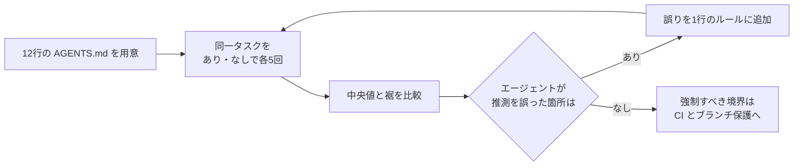
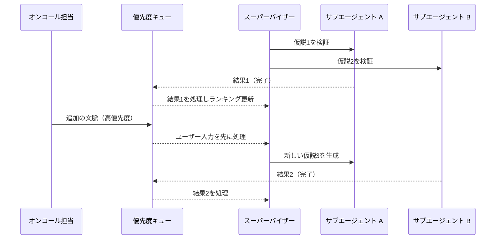
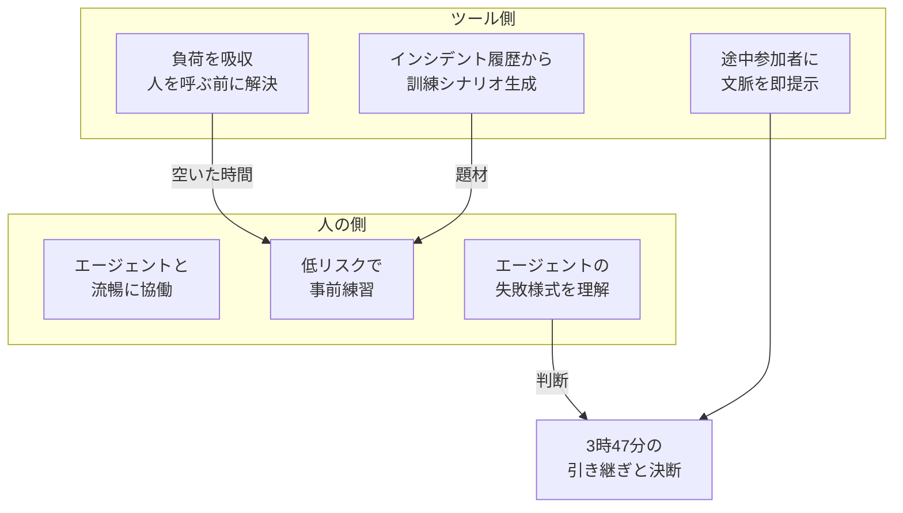
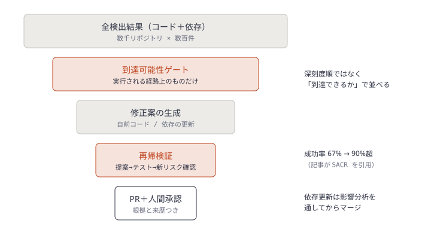
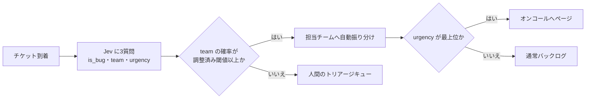

# Daily Briefing 2026-11-16

## 1. AGENTS.md を計測する: 1回では見えず5回で見えること（原題: Measuring AGENTS.md: What Five Runs Show That One Doesn't）

- **URL**: https://aaif.io/blog/measuring-agents-md-what-five-runs-show-that-one-doesn-t
- **公開日**: 2026-07-22
- **著者・媒体**: Andrea Griffiths / Agentic AI Foundation（AAIF）Blog

### 本文翻訳

AGENTS.md は義務化されたからではなく、実際に役立ったから広まった。本稿は、このファイルが本当にコーディングエージェントの振る舞いを変えるのかを検証する。答えは「変える。ただし、ノイズを除けるだけ計測を繰り返した場合に限る」である。1回ずつの比較は誤った方向を指し、5回の中央値をとると結論が反転した。

**普及と出自**。AGENTS.md は OpenAI が Codex 向けに始めた形式だ。どのベンダーも強制せず、標準化団体の承認もなかった。それでも Cursor、Amp、opencode、Warp、Claude Code、GitHub Copilot のコーディングエージェント、goose などが、リポジトリのルートに置くエージェント向けの素の Markdown という同じ形式を採用した。ただし普及しているだけでは効果の証明にならない。便利だから、オンボーディング文書が勧めるから、真似しただけ、という理由でも広まりうる。そこで実際の挙動をテストした。

**形式と約束**。AGENTS.md にスキーマや必須項目はない。README が普通は書かない、ビルドやテストのコマンド、触ってよいファイルの境界、規約といったリポジトリ固有の情報を置く。現在は Linux Foundation 傘下の AAIF が MCP、goose、agentgateway と並べて管理している。Claude Code は AGENTS.md ではなく独自の CLAUDE.md を読むが、ドキュメントは AGENTS.md を1行でインポートするかシンボリックリンクを張る方法を案内しており、正本を1つに保てる。

**検証環境**。対象は VS Code 拡張の teamxray。pnpm ではなく npm を使う、独特な pretest チェーン、postinstall のパッチスクリプト、編集してはいけない生成ファイル、といったありふれた固有事情を持つ。同一のクローンを2つ用意し、片方に12行の AGENTS.md を置き、もう片方には何も置かない。どちらも GitHub Copilot CLI の非対話モードで動かした。1回ごとにクレジット・トークン・実時間を報告し、スクリプトで繰り返し試行できるからだ。プロンプトと開始コミットは同一。

**2つのタスク**。1つ目は曖昧なタスクで、ユーティリティ関数を追加させ、規約はエージェントに推測させる。2つ目は実際の機能開発に近い複数ファイルのタスクで、2ファイルにまたがって新コマンドを登録する。変更を広げすぎるもっともらしいやり方が複数ある。

**誤解を招いた1回の結果**。最初は各条件1回ずつ走らせた。難しい方のタスクで、AGENTS.md ありは出力が同一なのに **44% 遅く、41% 高い** ように見えた。数字はきれいだったが間違っていた。実時間とトークン数は試行ごとのばらつきが大きく、1回の比較は誤った方向を、もっともらしく指しうる。

**5回の結果**。各条件5回走らせて中央値をとると方向が反転し、両タスクで AGENTS.md ありが上回った。曖昧なタスクでは実時間 **27% 減**、クレジット **24% 減**、diff は **26% 小さく** なった。diff が小さくなったのは、ファイル中の「変更をタスクの範囲に留めよ」という1行が、誰も頼んでいない防御的コードの追加を止めたためだ。複数ファイルのタスクでは中央値の改善は 9〜10% 程度にとどまったが、著者が重視するのは裾である。ファイルなしの5回中2回は、リポジトリ内で迷って方向を取り直したり、最後に頼まれてもいない本番ビルドを走らせたりして時間を浪費した。ファイルありの5回はすべてどちらも避けた。保護対象の postinstall スクリプトや webpack 設定はどちらの条件でも触られなかったので、利得はガードレールではなく文脈から来ている。

**試行を通じて保たれたパターン**。(1) 具体的な指示は抽象的な指示に勝つ。「ベストプラクティスに従え」は何も変えないが、具体的なコマンドとパス境界は挙動を大きく変える。(2) 短いほどよい。Cursor は500行未満、Claude Code は同等ファイルで200行未満を目安とし、Codex は指示チェーン全体を既定 32KiB で打ち切る（`project_doc_max_bytes` で変更可）。毎ターン読まれるので長さは繰り返しのコストになる。(3) モノレポではネストしたファイルが合う。最も近いファイルが優先され、ユーザーの明示的な指示はその両方に優先する。(4) ガイダンスは強制ではない。AGENTS.md はファイルを避けるよう頼めても保証はできない。強制は CI、ブランチ保護、サンドボックス実行の役割だ。

**推奨**。① パッケージマネージャ、主要コマンド、生成ファイルの境界1つ、「タスクの範囲に留まれ」の1行を書いた短いファイルから始める。12行で十分。② 小さなタスクをファイル追加の前後で走らせ、エージェントが推測を誤った箇所をそれぞれ1行にする。③ ネストは規約が本当に異なるサブフォルダだけ。④ 強制は CI とブランチ保護に置く。ファイルは導き、チェックがマージを決める。⑤ 平均ではなく、エージェントが迷う・方向を取り直す・触るべきでないものに触る回を最適化せよ。測れる利得はそこに現れた。

**限界**。1リポジトリ・1エージェント・少数試行の結果であり、より大規模での追試を呼びかけている。

### 重要ポイント

- 1回ずつの A/B 比較は逆の結論（44% 遅い）を出し、5回の中央値で反転した（27% 速い）。エージェント評価は最低でも複数回の中央値で見る
- 最も効いたのは「変更をタスクの範囲に留めよ」という1行で、diff を 26% 縮めた
- 利得は平均より裾（迷走・不要な本番ビルド）に出る。ファイルなしは5回中2回が迷走、ありは0回
- 12行で十分。具体的なコマンドとパス境界を書き、抽象的な心構えは書かない
- AGENTS.md は「お願い」であり、強制は CI・ブランチ保護・サンドボックスに置く

### 図解



### 戦略分析

**フレームワーク**: DORA Four Keys × Goodhart の法則への反証

| 観点 | 記事の計測 | Four Keys との対応 |
|---|---|---|
| 実時間 | 曖昧タスクで中央値 27% 減 | 変更のリードタイム（実装区間） |
| クレジット | 24% 減 | 直接の対応なし（単位コスト） |
| diff サイズ | 26% 縮小 | レビュー時間と変更失敗率の先行指標 |
| 裾の迷走 | なし 2/5 回 → あり 0/5 回 | 変更失敗率・手戻りの先行指標 |

**読み解き**: 記事の本当の発見は「AGENTS.md は効く」よりも「1回比較は誤った方向に確信させる」という計測論の方にある。中央値の改善は 9〜27% だが、裾の消失（迷走 2/5 → 0/5）は、人間が介入して止める回数、つまりレビューと手戻りの負荷に直結する。diff の縮小はレビュー時間の短縮に効くため、速度指標と安定性指標の両方に寄与しうる。

**示唆**: エージェント設定（AGENTS.md・スキル・プロンプト）の変更を評価するときは、(1) 同一タスクを最低5回ずつ走らせ中央値で比較する、(2) 平均ではなく「人間が止めた回数」「スコープ外変更が出た回数」を主指標にする、(3) diff 行数をレビューコストの代理指標として併記する。設定ファイルを肥大化させる前に、この計測ループを先に作る判断が先行する。

**反証条件**: タスクがほぼ決定的で試行間のばらつきが小さいリポジトリ（小さく規約が自明なもの）では、1回比較でも結論はぶれず、5回計測のコストに見合わない。また記事は1リポジトリ・1エージェントの結果で、大規模モノレポで同じ割合の改善が出る保証はない。

### 現場での適用方法

**スクリプト化の例**: AGENTS.md の有無で同一タスクを N 回ずつ実行し、実時間と diff 行数の中央値を比べる。エージェント CLI 部分は環境に合わせて差し替える。

```bash
#!/usr/bin/env bash
# agents-md-ab.sh — AGENTS.md あり/なしの A/B を N 回ずつ実行し中央値を出す
# 使い方: ./agents-md-ab.sh <REPO_URL> <BASE_COMMIT> "<PROMPT>" [N]
set -euo pipefail
REPO_URL="$1"; BASE="$2"; PROMPT="$3"; N="${4:-5}"
AGENT_CMD="${AGENT_CMD:-claude -p}"   # 例: "claude -p" / "codex exec" / "copilot -p"
WORK="$(mktemp -d)"; RESULTS="$WORK/results.csv"
echo "cond,run,seconds,diff_lines" > "$RESULTS"

for cond in with without; do
  for i in $(seq 1 "$N"); do
    dir="$WORK/$cond-$i"
    git clone -q "$REPO_URL" "$dir" && git -C "$dir" checkout -q "$BASE"
    [ "$cond" = without ] && rm -f "$dir/AGENTS.md" "$dir/CLAUDE.md"
    start=$(date +%s)
    (cd "$dir" && $AGENT_CMD "$PROMPT" >/dev/null 2>&1) || true
    secs=$(( $(date +%s) - start ))
    lines=$(git -C "$dir" diff --numstat | awk '{s+=$1+$2} END{print s+0}')
    echo "$cond,$i,$secs,$lines" >> "$RESULTS"
  done
done

python3 - "$RESULTS" <<'PY'
import csv, statistics, sys
rows = list(csv.DictReader(open(sys.argv[1])))
for cond in ("with", "without"):
    r = [x for x in rows if x["cond"] == cond]
    print(cond,
          "median_sec=", statistics.median(int(x["seconds"]) for x in r),
          "median_diff=", statistics.median(int(x["diff_lines"]) for x in r),
          "max_diff=", max(int(x["diff_lines"]) for x in r))
PY
```

**AGENTS.md の最小構成例**（記事の推奨①に沿った12行前後）:

```markdown
# AGENTS.md
- パッケージマネージャは npm。pnpm / yarn は使わない
- 依存導入: `npm ci` / テスト: `npm test`（pretest で lint と型検査が走る）
- `src/generated/` は生成物。編集せず `npm run codegen` で再生成する
- `scripts/postinstall-patch.js` と `webpack.config.js` は変更しない
- 変更は依頼されたタスクの範囲に留める。頼まれていない防御的コードやリファクタを足さない
- 完了前に `npm test` を実行する。本番ビルド（`npm run package`）は依頼がない限り実行しない
```

### 期待効果

- 曖昧なタスクで実時間 27%・クレジット 24%・diff 26% の削減（記事の5回中央値）
- 複数ファイルのタスクで中央値 9〜10% 改善、加えて迷走・不要な本番ビルドの発生が 2/5 → 0/5
- 設定変更の効果を「1回の印象」でなく計測で判断できるようになる

### 注意点

- 1リポジトリ・1エージェント（Copilot CLI）・5回の結果であり、自社リポジトリで追試が必要
- AGENTS.md は強制力を持たない。触られては困るファイルは CI・CODEOWNERS・サンドボックスで守る
- 行数を増やすほど毎ターンのコストが増える。誤りが観測された箇所だけを足す運用にする

## 2. PagerDuty SRE エージェントの内側: 深いインシデント調査をどう作ったか（原題: Inside PagerDuty's SRE Agent: How We Built Deep Incident Investigation）

- **URL**: https://www.pagerduty.com/eng/inside-pagerdutys-sre-agent-how-we-built-deep-incident-investigation/
- **公開日**: 2026-06-24
- **著者・媒体**: Viktor Vasylkovskyi、Micah Mayo、Ralph Bird / PagerDuty Engineering Blog

### 本文翻訳

目標は、オンコールのエンジニアが AI の調査をリアルタイムで見守り、途中で方向を変え、取り消せることだった。チームは AI ネイティブな製品を「AI こそがシステムである」ものと捉えている。

**単一エージェントが壊れた理由**。第一に **コンテキストの腐敗**（context rot）。アラート、過去のインシデント、ランブックが積み上がって文脈が肥大化すると推論品質が落ち、コストとレイテンシが上がった。第二に **指示の過負荷**。機能を足すたびに指示がモデルの注意を奪い合い、出力品質が下がった。第三に **逐次実行**。ログ検索と仮説検証を数珠つなぎにすると、中程度に複雑なインシデントで10分以上かかった。第四に **対話性の欠如**。ユーザーは実行中に文脈を足せず、エージェントを再起動するしかなかった。

**検討した実行モデル**。(1) 逐次: 単純だが、遅い仮説の後ろですべてが止まる。(2) 並列・全待ち: 速いが、メインエージェントは待っている間なにもできず、早く返った結果に反応できない。(3) **並列ファンアウト＋並行ファンイン**: 採用案。メインエージェントは動き続け、結果が届いた順に処理し、いつでも新しい入力を受け付ける。

**フレームワークの試行**。LangChain Deep Agents のサブエージェント機能を試したが、LangGraph のスーパーステップ（BSP）モデルは並列バッチがすべて終わるまで待つため、結果ごとの反応、実行中の入力受付、再起動なしのツール集合変更ができなかった。

**反応ループを手で作る**。サブエージェントをバックグラウンドタスクとして切り離し、完了時に親へ信号を返させた。最初のトランスポートは Webhook だった。素朴に並行して再開（resume）させると状態が壊れたので、到着をキューで受け、ロックで再開の重なりを防いだ。ユーザー入力は同じキューの **高優先度イベント** にし、滞留したサブエージェント結果を追い越して新しい作業を生成できるようにした。

**3つのプリミティブ**。① タスク識別: `task_id` と `thread_id` を一致させ、`parent_task_id` でサブエージェントを親に結ぶ。② イベント転送: ライフサイクル状態（working / completed / failed / canceled）、リアルタイム配信の PubSub、遅れて接続したクライアント向けの永続イベントストア。③ 反応ループ: 割り込み・再開グラフ、優先度キュー、ロック。

**最後の単純化**。調査は IO バウンドで、システムを所有するのは1チームなので、スーパーバイザーとサブエージェントを **単一プロセス** に収めた。スーパーバイザーは状態をチェックポイントする永続的な存在で、サブエージェントはステートレスで失敗したら再生成する。Webhook とブローカーは、各サブエージェントに注入するプロセス内の `asyncio.Queue` のメールボックスに置き換えた。

**ネイティブ代替の評価**。LangGraph の非同期サブエージェントも評価したが、プッシュでなくポーリングで、実行中の真の操舵と成果物の逐次出力が欠けていたため不十分と判断した。

**教訓**。コンテキストの腐敗と指示の過負荷はマルチエージェント設計への圧力になる。複雑な版を作って問題を理解し、単純な版を出荷せよ。ランタイムが何であれ、識別・イベント転送・反応ループの3つは必要であり続ける。

### 重要ポイント

- 単一エージェントの限界は「コンテキストの腐敗」「指示の過負荷」「逐次実行で10分超」「途中で口を挟めない」の4つ
- 採用したのは並列ファンアウト＋並行ファンインで、結果が届いた順に処理し、人間の入力はいつでも受け付ける
- 人間の入力を高優先度イベントとして同じキューに入れ、滞留した結果を追い越させる
- 識別（task_id / parent_task_id）・イベント転送・反応ループの3プリミティブはランタイムに依存せず必要
- 分散構成（Webhook・ブローカー）を一度作ったうえで、単一プロセス＋ `asyncio.Queue` に単純化して出荷した

### 図解



### 戦略分析

**フレームワーク**: 制約理論（TOC）

| 段階 | 制約 | 記事の打ち手 |
|---|---|---|
| 単一エージェント | 文脈の肥大化で推論品質が劣化 | サブエージェントに文脈を分割 |
| 逐次実行 | 遅い仮説がすべてを止める（10分超） | 並列ファンアウト |
| 全待ち並列 | 早く返った結果を使えない | 並行ファンイン（到着順処理） |
| 人間の介入 | 再起動しないと文脈を足せない | 高優先度イベント化 |

**読み解き**: 制約は「モデルの賢さ」ではなく、文脈の容量と待ちの構造に移っていった。制約を1つ解くたびに次の制約（全待ち → 人間の介入不能）が表に出ており、TOC の「繰り返す」ステップそのものになっている。

**示唆**: 自社で調査系エージェント（障害調査・脆弱性トリアージ）を作るなら、(1) 最初に「平均調査時間」と「途中で人が口を挟めるか」を要件として測る、(2) フレームワークの選定基準を「サブエージェントの結果に到着順で反応できるか」「実行中に入力を受けられるか」に置く、(3) 分散構成は最初から作らず、単一プロセス内キューで始めて、所有チームが複数になった時点で分割を検討する。

**反証条件**: 調査が CPU バウンドで、複数チームが別々にサブエージェントを所有・デプロイする組織では、単一プロセス構成はスケールと所有権の両面で成立せず、記事が捨てたブローカー構成の方が合う。また、記事は調査時間短縮の最終的な数値を示しておらず、効果の大きさは仮説である。

### 現場での適用方法

**スクリプト化の例**: 記事の「単一プロセス＋ asyncio.Queue メールボックス＋高優先度ユーザー入力」の骨格。LLM 呼び出し部分（`investigate`）は自社の実装に置き換える。

```python
# reactive_supervisor.py — 到着順に結果を処理し、人間の入力を優先する最小骨格
import asyncio, itertools, uuid

USER, RESULT = 0, 1            # 小さいほど優先
_seq = itertools.count()       # 同優先度の到着順を保つ

async def investigate(task_id: str, hypothesis: str, mailbox: asyncio.PriorityQueue):
    """サブエージェント: ステートレス。失敗したら再生成すればよい"""
    try:
        await asyncio.sleep(1 + len(hypothesis) % 3)   # <LLM・ログ検索の呼び出しに置換>
        payload = {"task_id": task_id, "state": "completed", "finding": f"{hypothesis}: 根拠あり?"}
    except Exception as e:
        payload = {"task_id": task_id, "state": "failed", "error": str(e)}
    await mailbox.put((RESULT, next(_seq), payload))

async def supervisor(initial: list[str], mailbox: asyncio.PriorityQueue):
    parent = str(uuid.uuid4())
    running: dict[str, asyncio.Task] = {}
    def spawn(h: str):
        tid = str(uuid.uuid4())
        running[tid] = asyncio.create_task(investigate(tid, h, mailbox))
        print(f"spawn task_id={tid[:8]} parent_task_id={parent[:8]} {h}")
    for h in initial:
        spawn(h)
    while running:
        prio, _, ev = await mailbox.get()             # 到着順（ユーザー入力は先頭）
        if prio == USER:
            print("user:", ev["text"]); spawn(ev["text"])  # 入力から新しい仮説を生成
        else:
            running.pop(ev["task_id"], None)
            print("result:", ev)                       # <仮説ランキングを更新・チェックポイント保存>

async def main():
    mailbox: asyncio.PriorityQueue = asyncio.PriorityQueue()
    sup = asyncio.create_task(supervisor(["DB接続枯渇", "直前のデプロイ"], mailbox))
    await asyncio.sleep(0.5)
    await mailbox.put((USER, next(_seq), {"text": "CDN 設定変更も疑って"}))  # 実行中の操舵
    await sup

asyncio.run(main())
```

### 期待効果

- 仮説検証を並列化し、逐次実行で10分以上かかっていた調査の待ちを削れる（記事は最終的な短縮幅を数値では示していない）
- 実行中に人が文脈を足せるため、再起動による手戻りがなくなる
- サブエージェントごとに文脈を分割することで、コンテキストの腐敗による品質低下を避けられる

### 注意点

- 並行再開は状態破壊を起こす。キュー＋ロック（または単一コンシューマ）で直列化すること
- 単一プロセス構成は「IO バウンド」「単一チーム所有」という前提に依存する
- サブエージェントをステートレスに保たないと、再生成による回復が成り立たない

## 3. AI が書き、AI が出荷した。では誰が所有するのか（原題: AI Coded It, AI Shipped It, Who Owns It?）

- **URL**: https://www.pagerduty.com/eng/ai-coded-it-ai-shipped-it-who-owns-it/
- **公開日**: 2026-08-27
- **著者・媒体**: Ralph Bird / PagerDuty Engineering Blog

### 本文翻訳

**冒頭のシナリオ**。2027年、午前3時47分。アラートがオンコールのエンジニアを起こす。原因は、AI エージェントが書き、別の AI エージェントが出荷したコードだ。人間は誰も diff を読んでいない。すべてのテストを通り、CI を抜けて本番に入った。4分後の3時51分、エンジニアはログインしたが、SRE エージェントはまだインシデントを解決できていない。エンジニアは事前に何をしておくべきだったのか。そしていま SRE エージェントに何を求めるのか。このシナリオの一部はすでに存在し、残りも多くの組織の予想より早く来る。

**ビルド側はすでに変わった**。AI エージェントが本番コードを書いて出荷することは、増えつつある企業で日常になった。より大きな変化は量・速度・品質だ。AI が書く変更は、かつて主な安全網だった人間のレビューを追い越し始めており、レビューにも AI を頼らざるを得ない。著者は、AI レビューは平均ではより良いが **裾ではより悪い** と予測する。人間も併せてレビューしていてもだ。人を夜中に起こすのは裾の失敗である。DX の 2026年 Q2 暫定データでは、参加組織全体で AI 作成コードが出力の 51.9% を占め、PR サイズも大きくなっている。PagerDuty 自身はまだエージェントにコードを出荷させていないが、その方向に取り組んでいる。

**次はラン側**。コーディングエージェントが作り方を変えるなら、SRE エージェントは解決の仕方を変える。今のエージェントはすでにトリアージし、システム横断でシグナルを相関させ、複数のダッシュボードを眺める人間より速く要約する。直接修正するエージェントも近い。結果として、対応者が自分で扱うインシデントは減る。これは良いことだ。しかし同時に、修正の仕方を学び、システムへの土地勘を保っていた日常的で低リスクのインシデントも失う。これは PagerDuty が DevOps の自社版として掲げてきた「Code It, Ship It, Own It」を揺さぶる。前の2つは自動化に移りつつある。3つ目はどうなるのか。作者が機械に移っても責任は人に残り、しかも触ったこともなく運用経験も少ないシステムに責任を負うことになる。

**自動化の歴史からの教訓**。1983年、Lisanne Bainbridge は『自動化の皮肉』で、自動化は日常業務を引き受け、最も難しいケースを運用者に残し、その難所に必要な技能を育てる日々の練習を奪うと論じた。航空はこの問題に数十年向き合ってきた。オートパイロットはパイロットをなくさず、その価値を例外・想定外・緊急の診断に集中させた。ただしそれはパイロットが技能を保っている場合に限る。Earl Wiener は、コックピットの自動化は作業負荷が低いときに負荷を下げ、高いときにさらに上げる傾向を見出した。航空の答えはパイロットが鋭さを保つことを祈ることではなく、シミュレータ訓練と手動操縦区間の義務化だった。

**類比が崩れる点**。ただしシミュレータだけで解決すると考えてはいけない。実際のインシデントはシナリオどおりに起きず、同じ形で繰り返すことは稀で、エージェントが能力を得るたびに故障面が変わる。インシデント対応のフライトシミュレータに相当するものも業界にはまだない。課題は「役立つ練習を作ること」と「インシデント中に人を支えるツールを作ること」の2つだ。

**答えの2つの半分**。ツール側の目標は、(1) 可能な限り負荷を吸収し、人を呼ぶ前に解決して、対応者が訓練に時間を使い、大規模障害に新鮮な状態で臨めるようにする、(2) 途中から入った人がゼロから始めずに済むよう文脈を素早く出す、(3) インシデント履歴から現実的な訓練を作り、対応プロセスを改善する。人の側の目標は、(1) エージェントを避けたり逆らったりせず流暢に協働する、(2) 高リスクの場面の前に低リスクで練習する、(3) エージェントがどう成功するかだけでなく **どう失敗するか** を理解する。良いツールと訓練されていない人は混乱を生み、訓練された人と弱いツールは燃え尽きを生む。

**PagerDuty の取り組み**。SRE エージェントは単独の対応者とコパイロットの2モードで動く。エスカレーションポリシー上に置かれ、即座に調査を始め、エンジニアがログインした時点で解決案を用意している。Scribe エージェントと並んで通話に参加し、議論を聞き、発見に反応する。再設計したポストインシデントレビューと、記憶を持ち過去インシデントを検索できる SRE エージェントを組み合わせ、構造化された履歴に対してリハーサルできる「フライトシミュレータの始まり」を目指している。

**月曜朝の3つの問い**。① 何を手動で飛ばせるか。ツールが落ちたら対応のどこを自力でこなせるか。② あなたのフライトシミュレータは何か。最も恐れるインシデントを起きる前に低リスクで予行できるか。エージェントがサービスを変えるのに合わせてメンタルモデルを更新しているか。③ シミュレータは何でプログラムされているか。実インシデント、他社の事例、恐ろしいシナリオから学んでいるか。

**結論**。エージェントは書き、出荷する。それでもシステムを所有するのはエンジニアだ。かつて所有は作者であることに従っていたが、その結びつきは切れつつある。残るのは、書いていないコードについてプレッシャー下で推論し、エージェントが失敗したときに引き継ぎ、3時47分に判断を下すという、より狭く、より難しい責任である。

### 重要ポイント

- AI レビューは「平均で良く、裾で悪い」。夜中に人を起こすのは裾の失敗である
- AI 作成コードは出力の 51.9%（DX、2026年 Q2 暫定）で PR サイズも増加。レビューが安全網として機能しなくなりつつある
- 自動化は日常業務を奪い、難所に必要な練習も奪う（Bainbridge『自動化の皮肉』）。航空は訓練の義務化で対処した
- 必要なのはツール（負荷吸収・文脈提示・履歴からの訓練）と人（協働・低リスク練習・エージェントの失敗理解）の両輪
- 月曜朝の3つの問い: 手動で何を飛ばせるか / シミュレータは何か / それは何でプログラムされているか

### 図解



### 戦略分析

**フレームワーク**: RACI（人とエージェントの責務分担）

| 活動 | コーディング<br/>エージェント | SRE エージェント | オンコール担当 | チーム<br/>リード |
|---|---|---|---|---|
| コード作成・出荷 | R | — | I | A |
| 初動調査・解決案 | — | R | I | — |
| エージェント失敗時の引き継ぎ | — | C | **R / A** | I |
| 訓練シナリオの整備 | — | C（履歴検索） | R | **A** |

**読み解き**: 記事の核心は、R（実行）がエージェントへ移っても A（説明責任）は人から動かせず、しかも A を果たす能力の源泉だった「日常的な R」が失われる点にある。RACI で見ると、新たに人の A として明示すべきは「訓練シナリオの整備」で、これは従来の表には存在しなかった行である。

**示唆**: (1) SRE エージェント導入と同時に、オンコール担当の「手動対応の練習」を業務として計上する（例: 月1回、エージェントを止めた状態で過去インシデントを再演する）。(2) ポストインシデントレビューに「エージェントがどこで失敗したか／人がどこで引き継いだか」の欄を追加し、失敗様式を蓄積する。(3) エージェントの自律範囲を広げる判断は、手動で対応できる範囲の棚卸し（問い①）を済ませてから行う。

**反証条件**: エージェントの対応範囲が十分狭く、人が日常的に一定量のインシデントを手で扱い続けている組織では、技能の摩耗は起きにくく、訓練を別建てする投資は過剰になる。また、記事は技能低下を定量的に示しておらず、航空からの類推に基づく仮説である。

### 現場での適用方法

**運用手順**: 「インシデント対応のフライトシミュレータ」を最小構成で始める。

1. 直近6か月のインシデントから、影響が大きく原因が非自明だったものを3件選ぶ
   ```bash
   # 例: ポストモーテムが Markdown で管理されている場合
   ls <POSTMORTEM_DIR> | sort -r | head -50
   grep -l -E "Severity: (SEV1|SEV2)" <POSTMORTEM_DIR>/*.md | head -10
   ```
2. 各インシデントについて「最初の5分で見えていたシグナル」だけを抜き出したシナリオカードを作る（原因は書かない）
3. 月1回60分、SRE エージェントを使わずに1件、使って1件を再演する。進行役だけが原因を知っている
4. 振り返りで、次の3点をポストインシデントレビューのテンプレートに追記する

```markdown
## エージェントと人の引き継ぎ（追記欄）
- エージェントが最初に出した仮説と、その正誤:
- 人が介入した時刻と、介入を決めたシグナル:
- エージェントの失敗様式（文脈不足 / 誤った相関 / ツール権限不足 / その他）:
- 手動で同じ判断に至れたか（はい / いいえ / 部分的に）:
```

5. 「手動で至れなかった」判断が出た領域を、次回のシナリオの題材とランブック整備の優先対象にする

### 期待効果

- エージェントが解けないインシデントに当たったとき、引き継ぎまでの時間を短縮できる（記事は定量値を示していない）
- エージェントの失敗様式が蓄積され、自律範囲の拡大・縮小を根拠をもって判断できる
- 日常インシデントがエージェントに吸収されても、対応者の土地勘を維持できる

### 注意点

- 訓練時間は可処分時間から捻出される。エージェントが実際に負荷を吸収していることを先に確認する
- 実インシデントはシナリオどおりに繰り返さない。訓練の目的は手順の暗記でなく、未知の状況での推論の練習である
- 記事は PagerDuty 製品の紹介を含む。手法自体は製品に依存しない形で取り入れる

## 4. エージェント型修復とは何か: 完全ガイド（原題: What Is Agentic Remediation? The Complete Guide）

- **URL**: https://www.endorlabs.com/learn/what-is-agentic-remediation-guide
- **公開日**: 2026-07-31
- **著者・媒体**: Endor Labs（著者名の記載なし）

### 本文翻訳

**序論**。攻撃者による AI 利用と、開発者による AI でのコード作成がともに増え、セキュリティアラートの量は増える一方で処理に使える時間は減った。本稿はエージェント型修復（agentic remediation）を提案する。AI コーディングエージェントが継続的に動き、悪用可能な脆弱性を見つけ、修正を起草・テストし、変更をすべて記録する。エージェントは行動し、自分の仕事を検証し、出荷するものは人間が承認する。

**エージェント型修復とは**。従来のツールは脆弱性を指摘してバックログに積み、開発者を待つ。エージェント型修復は、問題を検出し、修正候補を起草し、テストし、理由を説明する。複数の専門エージェントが分担する。脆弱なコードを見つける群、修正を生成・検証する群、修正を適用して人間のレビュー用に PR を開く群だ。単一の大規模モデルには死角があり、それが出力に伝播するが、互いに検証しあう別々のエージェントなら本番前に誤りを捕まえられる、というのが論拠である。

**なぜ修復が変わるのか**。攻撃者は AI を使う。Check Point は攻撃者が HexStrike-AI フレームワークで NetScaler のゼロデイを悪用し、公開から悪用までの窓が縮んだと報告している。また、エンタープライズのコードの 30〜50% を AI が生成しており（2025年の GitHub Octoverse と Stack Overflow 調査を引用）、AI が書くコードは人間が書くコードの2倍以上の外部依存を持ち込み、攻撃面を広げると本稿は主張する。開発者は自分が書いていないコードを直すのをためらうので、修正は遅れ、コストは事業が負う。

**ステップ1: 悪用可能なものを見つける**。中規模企業でも数千のリポジトリがあり、それぞれにコードと依存をまたいで数百の脆弱性があり、合計は数十万件に達しうる。IDC の調査では、多くのチームが100万件超のアラートを扱っており、そのほとんどは本番で実行されない。処方は **到達可能性分析** だ。深刻度スコアで並べるのではなく、アプリケーションが実際に実行するコード経路上にある脆弱性を特定する。呼ばれない関数の Critical より、インターネットに面した稼働経路上の Moderate の方が緊急である。

**ステップ2: 修正を生成し検証する**。自前のコードの修正と、取り込んだ依存の修正は分けて考える。自前の修正はアプリケーションの他の部分と整合しなければならない。生成だけでは不十分で、**再帰的検証** を提案する。1つのエージェントがパッチを提案し、2つ目がテストし、3つ目がその変更が新しいリスクを持ち込まないことを確認する。修正が持ちこたえるまでこのループを回す。2025年の SWE-bench 結果のレビューでは、AI パッチの 43% が対象の問題を直したものの、厳しい条件下で新たな失敗を起こした。多層検証で修正成功率が **67% から 90% 超** に上がり、誤検知が半分以上減ったという（SACR を引用）。修正は不透明な diff ではなく明確な理由を伴うべきで、それが開発者の信頼につながる。

**ステップ3: 壊さずに出荷する**。OSS 依存の修正は通常アップグレードであり、アップグレードはビルドを壊しうる。**アップグレード影響分析** は、マージ前にバージョン変更の影響範囲を写像し、何が壊れるかと最も安全な経路を示す。到達可能性が何を直すかを決め、パッチ生成が修正を作り、影響分析が安全に出荷する。影響分析なしの自動依存更新は、大規模に本番を壊しうる。

**従来のパッチ適用との比較**。起点は「スキャナのアラートがチケットになる」から「エージェントが悪用可能な問題を検出する」へ。優先順位は深刻度スコアから到達可能性・悪用可能性へ。修正の作者は「後で開発者が」から「今エージェントが、人間のレビュー用に」へ。検証は「手動、あれば」から「提案・テスト・確認の再帰」へ。記録は「閉じたチケット」から「署名された監査可能な証跡」へ。速度はバックログ時間からループ時間へ。

**評価基準**。① 到達可能性ゲート: 自前コードから推移的依存までの呼び出しグラフを作り、パッチやアップグレードが稼働中のアプリにどう影響するかを予測できること。② 再帰的検証: マージ前にデータフロー解析と統合テストを通すこと。③ 説明可能性と来歴: 変更ごとに理由を説明し、コミットからデプロイまで追跡できること。④ ヒューマン・イン・ザ・ループ: 自律性より制御が重要で、高リスクの変更は人が承認し、その承認は速くあるべき。赤信号は、自律性の誇張、検証層の欠如、説明可能性の欠如。計測は検出からマージまでの MTTR で行う。

### 重要ポイント

- 優先順位は深刻度スコアではなく到達可能性で決める。100万件超のアラートの大半は本番で実行されない（IDC）
- 修正は「提案・テスト・新リスク確認」の別エージェントによる再帰検証を通す。AI パッチの 43% が新たな失敗を起こしたという SWE-bench レビューが根拠
- 多層検証で修正成功率 67% → 90% 超、誤検知半減（SACR を記事が引用）
- 依存のアップグレードはマージ前に影響分析で影響範囲を写像する
- 計測は検出からマージまでの MTTR。高リスク変更の人間承認は残し、承認は速くする

### 図解



### 戦略分析

**フレームワーク**: バリューストリームマッピング × 制約理論

| 工程 | 従来 | エージェント型（記事の主張） |
|---|---|---|
| 検出→優先順位付け | 深刻度スコア順、件数過多 | 到達可能性で絞り込み |
| 修正作成 | 開発者が後で（他人のコードを直すのをためらう） | エージェントが即時 |
| 検証 | 手動、あれば | 提案・テスト・確認の再帰 |
| 依存更新のマージ | 破壊を恐れて滞留 | 影響分析で安全経路を提示 |
| 承認 | チケットのクローズ | 根拠・来歴つき PR を人が承認 |

**制約**: 記事の構造から読み取れる制約は「修正作成」ではなく、その前後の2点である。前段は件数過多（何から直すか決まらない）、後段は信頼不足（壊れるのが怖くてマージされない）。生成を速めても、この2点が動かなければ MTTR は縮まない。

**示唆**: 修正生成エージェントへの投資より先に、(1) 既存の SCA/SAST 結果に到達可能性の判定を付け、「到達可能なものだけ」を自動修正の対象にする、(2) 依存更新 PR に「影響を受ける呼び出し箇所」と「テスト結果」を必ず添付するテンプレートを作る、の2点を先に整える判断が合理的。MTTR は検出からマージまでで測り、生成までの時間では測らない。

**反証条件**: 依存が少なく、テストカバレッジが高く、依存更新が既に日次で自動マージされている組織では、後段の信頼不足は制約になっておらず、記事の多層検証は過剰投資になる。また、67% → 90% 超の数値は記事が引用する第三者（SACR）の値で、ベンダー記事であることを割り引く必要がある。

### 現場での適用方法

**CLAUDE.md への追記例**: 脆弱性修正をエージェントに任せる際の規則。

```markdown
## 脆弱性修正の規則
- 着手前に、対象の CVE が到達可能か判定する。判定方法: 脆弱な関数・モジュールを `rg` で検索し、
  呼び出し元が本番コード（`src/`）にあるかを確認する。テストのみ・未使用なら PR を作らず理由を報告する
- 修正は1件1PR。依存更新では lockfile 以外の変更を最小限にする
- PR 本文に必ず次の4点を書く:
  1. 到達可能性の判定結果と根拠（呼び出し箇所のパス:行）
  2. メジャーバージョンを跨ぐかどうか、跨ぐ場合は CHANGELOG の破壊的変更の要約
  3. 実行したテストコマンドとその結果
  4. 修正が新たに導入しうるリスク（なしの場合も「なし」と明記）
- テストが落ちたらテストを変更せず、修正方針を見直す。3回試して通らなければ人間に引き継ぐ
- 認証・暗号・権限まわりの変更は高リスクとして PR に `needs-security-review` ラベルを付ける
```

**スクリプト化の例**: Go プロジェクトなら `govulncheck` が呼び出しグラフに基づく到達可能性を判定できる。到達可能なものだけを修正キューに入れる。

```bash
#!/usr/bin/env bash
# reachable-vulns.sh — 到達可能な脆弱性だけを抽出して修正キューにする（Go の例）
set -euo pipefail
cd "<REPO_PATH>"
go install golang.org/x/vuln/cmd/govulncheck@latest
# -format json の finding で trace の先頭に関数がある = 自前コードから呼ばれている
govulncheck -format json ./... \
  | jq -r 'select(.finding != null and (.finding.trace[0].function // "") != "")
           | .finding.osv' \
  | sort -u > reachable-osv.txt
echo "到達可能な脆弱性: $(wc -l < reachable-osv.txt) 件"
# 例: 各 ID について修正エージェントを起動（コマンドは環境に合わせる）
# while read -r id; do claude -p "CLAUDE.md の脆弱性修正の規則に従い $id を修正して PR を作成" ; done < reachable-osv.txt
```

### 期待効果

- 対象を到達可能なものに絞ることで、修正作業量と誤検知対応が減る（記事は誤検知半減を引用）
- 再帰検証により修正成功率の向上が見込める（記事引用値: 67% → 90% 超）
- 根拠つき PR により、他人のコードを直すことへの心理的抵抗とレビュー時間が下がる

### 注意点

- ベンダー（Endor Labs）の解説記事であり、数値は第三者資料の引用で独立検証されていない
- 到達可能性判定は言語・ツールで精度が大きく異なる。動的ディスパッチやリフレクションは見逃されうる
- 「到達不能」と判定したものも放置せず、定期的に再判定する（コード変更で到達可能になりうる）

## 5. Jev チュートリアル: OpenRouter で最初の判定呼び出しを行う（原題: Jev Tutorial: Make Your First Decision Call on OpenRouter）

- **URL**: https://openrouter.ai/docs/guides/community/jev-tutorial
- **公開日**: 不明（直近数週間以内。レスポンス例のモデル版は 2026-09-17）
- **著者・媒体**: OpenRouter Docs（コミュニティガイド、著者名の記載なし）

### 本文翻訳

Jev は TypeSafe の判定モデル（decision model）で、OpenRouter では `typesafe/jev-1.13` として使える。テキストを生成するのではなく、**送った状態（state）について型付きの質問に答え**、各回答に確率を付ける。理由づけや説明は返さない。

**質問の型**は3つある。**Choice** は定義した選択肢の集合から1つを選び、各選択肢の確率を返す。**Noul** は yes/no に答え、yes の確率を返す。**Score** は定義した順序尺度の上に入力を置き、確率で重み付けした位置を返す。

**手順1: API キーを取得する**。OpenRouter で API キーを作って環境変数に入れる。キーはサーバー側に置く。課金はモデルの入力単価で行われる。

**手順2: 判定リクエストを送る**。`https://openrouter.ai/api/alpha/decisions` に、モデル名、`state` オブジェクト、`questions` オブジェクトを送る。例ではサポートチケットのルーティングとして、1回のリクエストで3つの質問をする。バグ報告か（Noul）、どのチームが担当か（Choice）、どれだけ緊急か（Score）。state にはエンタープライズ顧客の「Pay を押すとチェックアウト画面が真っ白になる。ブラウザを2つ試した」というチケットを入れる。Noul の `criteria` には true / false それぞれの意味を、Choice の `criteria` には payments / frontend / account それぞれの担当範囲を、Score の `criteria` には「次のリリースまで待てる」「今週中に直すべき」「今まさに売上を止めている」の順序付きリストを書く。curl、TypeScript、Python の例が用意されている。

**手順3: 回答を読む**。各質問は型付きの回答を返し、コードはその値で直接分岐できる。例の応答では、is_bug の Noul は 0.96、team は payments（confidence 0.67、確率 payments 0.78 / frontend 0.22 / account 0）、urgency は score 1.99（confidence 0.99、「今まさに売上を止めている」に確率1）だった。usage は入力 476 トークン、出力 70 トークン、コストは約 0.00002 ドル。確率は実行ごとにわずかに変わる。

**閾値の考え方**。Noul の 0.5 付近は「yes と no が同程度にありうる」という意味で、「中程度の深刻度」ではない。Choice の confidence は選択肢間の分布がどれだけ集中しているかの要約であり、自動で行動してよいかを示すものではない。閾値は切りのよい数字ではなく、**誤りの種類ごとのコスト** に基づいて決め、ラベル付きサンプルで調整する。閾値を `typesafe/jev-1.13` で調整したなら、そのバージョンを固定する（`~typesafe/jev-latest` は最新リリースを追う）。ルーティングの例としては、調整済み閾値を超えたチケットは自動振り分けし、それ以外は人間のキューへ送る。

**その他**。TypeSafe の JavaScript / Python SDK はベース URL を変えるだけで OpenRouter で使える。OpenRouter の TypeScript / Python / Go SDK も Decisions API に対応する。入力トークンのみ課金で出力は無料、各応答は `usage.cost` にコストを報告する。1回のリクエスト内の複数の質問は並列に答えられ、互いの回答を参照できないので、依存する判定は別の呼び出しに分ける。

### 重要ポイント

- Jev は生成ではなく判定のモデル。Choice / Noul / Score の3型で、確率付きの型付き回答を返す
- 1リクエストに複数の質問を入れられるが、互いの回答は見えない。依存する判定は別呼び出しにする
- Noul 0.5 は「わからない」であり「中程度」ではない。Choice の confidence は「自動実行してよい」の意味ではない
- 閾値は誤りのコストから決め、ラベル付きサンプルで調整し、調整したモデル版を固定する
- 入力のみ課金・出力無料。例の3質問で約 0.00002 ドル

### 図解



### 戦略分析

**フレームワーク**: 単位経済性（ユニットエコノミクス）

| 項目 | 記事の値・記述 |
|---|---|
| 1判定あたりコスト | 約 0.00002 ドル（入力 476 トークン、3質問） |
| 課金対象 | 入力トークンのみ（出力無料） |
| 誤りのコスト | 誤ルーティング（担当違い）と見逃し（緊急度の過小評価）で非対称 |
| 自動化率を決めるもの | 誤りのコストから決めた閾値 |

**読み解き**: 判定1回のコストはほぼゼロに近く、単位経済性を支配するのは API 料金ではなく **誤りのコスト × 誤り率** と **人間キューに回る割合 × 人手の単価** である。閾値を上げれば誤りは減るが人間キューが増え、下げれば逆になる。記事が「切りのよい数字でなく誤りのコストで閾値を決めよ」と言うのは、この2項の和を最小化せよという意味になる。

**示唆**: Jev を導入する前に、(1) 現在のトリアージ結果を200件程度ラベル付きで用意する、(2) 誤りの種類ごとに「1件あたり何分の手戻りか」を見積もる、(3) 閾値を変えたときの「自動化率」と「誤り件数」の曲線を描き、その上で閾値を決める。生成 LLM で同じ判定をしている箇所は、プロンプト改善より先に、判定の型（Choice / Noul / Score）に分解できるかを検討する。

**反証条件**: 判定に長い推論や外部ツールの参照が必要なタスク（例: ログを読んで根本原因を推定する）では、理由を返さず互いの回答も参照できない Jev の形式は合わず、単位経済性の比較対象にならない。また、記事は精度の数値を示しておらず、自社データでの精度は未知である。

### 現場での適用方法

**スクリプト化の例**: ラベル付きサンプルで Choice の閾値ごとの自動化率と誤り率を出す。`labeled.jsonl` は `{"ticket": "...", "tier": "...", "team": "payments"}` 形式。

```python
#!/usr/bin/env python3
# jev_threshold.py — 閾値ごとの自動化率と誤り率を出して閾値を決める
import json, os, sys
import requests

URL = "https://openrouter.ai/api/alpha/decisions"
MODEL = "typesafe/jev-1.13"          # 閾値を調整したバージョンを固定する
HEADERS = {"Authorization": f"Bearer {os.environ['OPENROUTER_API_KEY']}",
           "Content-Type": "application/json"}
QUESTIONS = {
    "team": {
        "type": "choice",
        "instructions": "Which team should own this ticket?",
        "criteria": {
            "payments": "Checkout, billing, or payment processing issues.",
            "frontend": "Rendering, layout, or browser compatibility issues.",
            "account": "Login, permissions, or profile issues.",
        },
    }
}

def decide(row):
    body = {"model": MODEL,
            "state": {"customer_tier": row["tier"], "ticket": row["ticket"]},
            "questions": QUESTIONS}
    r = requests.post(URL, headers=HEADERS, json=body, timeout=30)
    r.raise_for_status()
    ans = r.json()["answers"]["team"]
    return ans["choice"], ans["probabilities"][ans["choice"]]

rows = [json.loads(l) for l in open(sys.argv[1] if len(sys.argv) > 1 else "labeled.jsonl")]
preds = [(decide(r), r["team"]) for r in rows]

print("threshold  auto_rate  error_rate_in_auto  human_queue")
for th in [0.5, 0.6, 0.7, 0.8, 0.9, 0.95]:
    auto = [(c, gold) for (c, p), gold in preds if p >= th]
    err = sum(1 for c, gold in auto if c != gold)
    print(f"{th:>9}  {len(auto)/len(rows):>9.0%}  {err/max(len(auto),1):>18.1%}  {len(rows)-len(auto):>11}")
```

```bash
export OPENROUTER_API_KEY=<YOUR_KEY>
python3 jev_threshold.py labeled.jsonl
# 出力表から「誤り1件のコスト × 誤り件数 + 人間キュー件数 × 1件の人手コスト」が最小の閾値を選ぶ
```

### 期待効果

- 判定1回あたりのコストがほぼ無視できる水準（例で約 0.00002 ドル）になり、全件に判定をかけられる
- 型付き回答でコードが直接分岐でき、生成テキストのパース失敗がなくなる
- 閾値を誤りのコストから決めることで、自動化率と誤りのトレードオフを説明可能にできる

### 注意点

- `api/alpha/decisions` はアルファ版のエンドポイントであり、仕様変更の可能性がある
- 理由を返さないため、監査で「なぜその判定か」を求められる用途には別途記録の仕組みが要る
- `~typesafe/jev-latest` を使うと調整済みの閾値が無断でずれる。本番では版を固定する
- 1リクエスト内の質問は互いの回答を参照できない。「バグなら担当チームを選ぶ」のような依存判定は2回に分ける
