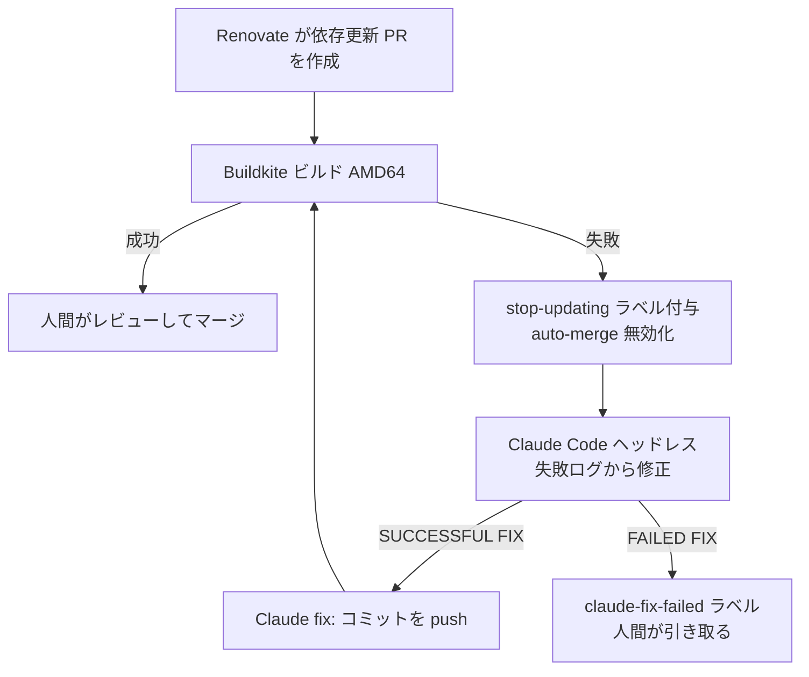
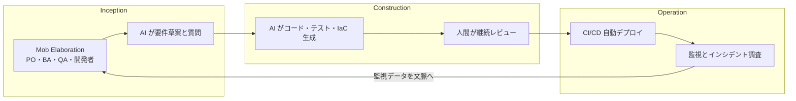
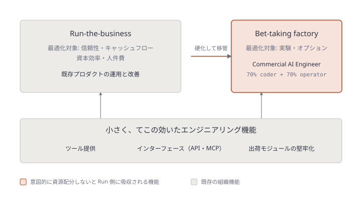
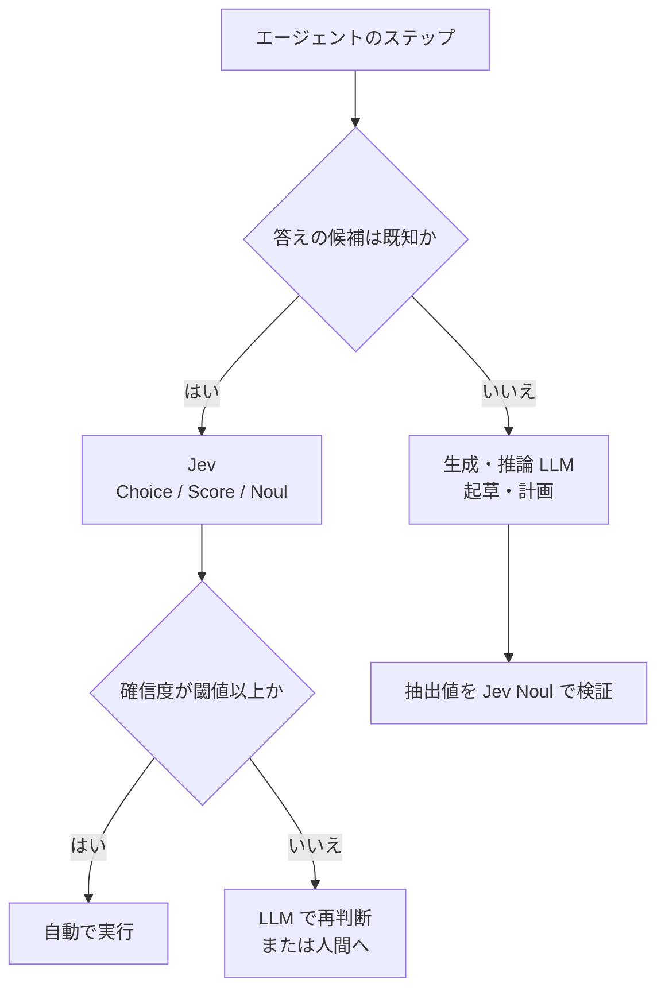
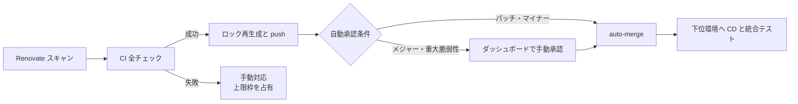

# Daily Briefing 2026-11-17

## 1. エージェント型 AI で CI/CD を自己修正するモノレポにする（原題: CI/CD pipelines with agentic AI: How to create self-correcting monorepos）

- **URL**: https://www.elastic.co/search-labs/blog/ci-pipelines-claude-ai-agent
- **公開日**: 2025-09-30
- **著者・媒体**: Pablo Pérez Hidalgo / Elasticsearch Labs（Elastic Control Plane チーム）

### 本文翻訳

Elastic Control Plane チームは cloud.elastic.co（Elastic Cloud Hosted）と Elastic Cloud Enterprise を支える大規模モノレポを保守している。コアサービスだけで**約500の依存関係**を能動的に更新し続ける必要があり、既知脆弱性ゼロはセキュリティ基準上の必須要件だ。手作業で追いかければ週に数百時間のエンジニア工数を消費しかねない。

依存更新そのものは、Engineering Productivity チームが提供する Renovate ベースの社内ボットが担っている。依存カタログと上流リポジトリを比較して PR を自動で開き、約6か月で依存の41%を更新した。ボトルネックは**壊れた PR** だった。依存更新でコンパイルやユニット／統合テストが落ちる。原因が微妙なランタイム挙動の変化であることもある。たとえば ZooKeeper 3.8.3→3.8.4 で ACL の挙動が変わり、Apache Curator 側に波及した。修正自体は自己完結的で短時間で終わることが多いが、そのたびにエンジニアのコンテキストスイッチが発生していた。

そこで「PR ブランチに修正コミットを積んでくれるチームメイト」として AI エージェントを置いた。自由に作業させるのではなく、**特定のビルドエラーを渡して直させる**。著者は、開発者がコードに書いた範囲でしか動かない決定的な「従来型の自動化」と、非決定的で人間の監督を要する「生成 AI の自動化」を明確に区別している。

**パイプライン設計**: Buildkite に「Claude Fix Build (AMD64)」ステップを追加し、`publishPlatformIndependent-amd64` が失敗したときだけ実行する。タイムアウトは240分、依存ステップの失敗を許容する。計算資源とトークン節約のため AMD64 のみで走らせ、修正は ARM64 にも効く前提とした。ラッパースクリプト `claude-fix-build.sh` は次の順で動く。

1. Claude と GitHub の認証情報を読み込む
2. リポジトリを clone し、既存のビルドスクリプトで Gradle 環境を準備する
3. 失敗したステップの Gradle ログを成果物としてダウンロードし、エージェントがまずそれを分析できるようにする
4. Node 22 と Claude Code CLI を入れる
5. 許可ツールを制限する（シェルは git・gradlew・chmod のみ、ファイル編集と検索、Web 取得と検索）。**ツール制限が主要な安全策**
6. エージェントの行動ログを stdout に流し、Buildkite 上で追えるようにする
7. PR に `stop-updating` ラベルを付け、Renovate が rebase や push をしないようにする。著者はここを従来型自動化と生成 AI 自動化が「握手する」地点と呼ぶ
8. PR の GitHub auto-merge を無効化する。人間の監督なしに AI の作業をコミットしないのがチームのルールで、無効化できなければスクリプトは中断する
9. ヘッドレスモードで Claude にプロンプトを渡す
10. 後処理として行動ログをアップロードし、成功マーカーを確認し、`claude-fix-success` / `claude-fix-failed` ラベルを付けて終了コードを決める

push すればパイプラインが再実行され、新しいビルドが落ちたときだけエージェントがもう一度走る。

**プロンプト**の要点は、失敗ステップの Gradle ログから始める（無ければフルビルド）、失敗したサブタスクから順に直す、CLAUDE.md に従う、全行動をタイムスタンプ付きでログに書く、最後に「SUCCESSFUL FIX」か「FAILED FIX」を書く、成功時のみ「Claude fix:」接頭辞で1修正1コミットとして push する、修正に必要な範囲以外は変えない、の7点。そして**main のバージョンカタログで依存をダウングレードしない**。エージェントがバージョンを戻すことでビルドを「直す」事例があったためで、ダウングレードするくらいなら失敗の方がよい。

**結果**: 最初の1か月（依存の約45%をカバー）で壊れた PR を24件修正し、7/22〜8/22 に22コミットを積んでリポジトリの上位コントリビュータになった。節約工数は約20人日と見積もる。部分的な修正でも探索範囲を狭める価値がある。

**教訓**: 最も効いたのはチューニングで、チームの慣習とルールを CLAUDE.md に足すと望ましくないコードパターンが止まり、エージェントが勤勉になった。「教育されていないコーディングエージェントほど怠惰なものはない」。一方で出力は非決定的なので人間のレビューは必須で、正しく見えるコードの裏に「異質な間違い方」が潜む。今後は全 Renovate PR、さらに全 PR への拡大、API 仕様の再生成や lint の後始末をエージェントに任せること、人間がインターフェースとユニットテストを書き実装をエージェントに任せる方式を検討している。

### 重要ポイント
- 依存更新の「検知と PR 作成」は決定的な Renovate に残し、AI は**壊れた PR の修復だけ**に限定している
- `stop-updating` ラベルと auto-merge 無効化で、2つの自動化が同じブランチを奪い合わないようにした
- 「ダウングレード禁止」「成功マーカー必須」「1修正1コミット」など、AI の逃げ道を塞ぐ明示ルールが実効性の鍵
- 1か月で24 PR を修正、約20人日を節約（記事の見積もり）
- CLAUDE.md へのルール追記がエージェントの品質を最も大きく変えた

### 図解



### 戦略分析

**フレームワーク**: 制約理論（TOC）

| TOC のステップ | 記事での対応 |
|---|---|
| 制約の特定 | PR 作成ではなく「壊れた PR の修復」と、それに伴う人間のコンテキストスイッチ |
| 制約の徹底活用 | 失敗ログを先に渡し、修正範囲を失敗サブタスクに限定 |
| 他を制約に従属 | `stop-updating` で Renovate を止め、AMD64 のみで実行して資源を絞る |
| 制約の引き上げ | エージェントが修復、人間はレビューだけ（24 PR／月、約20人日） |
| 繰り返し | 全 PR への拡大を計画。次の制約はレビュー側に移る見込み |

**示唆**: 依存更新の自動化が「PR は出るが溜まる」状態で止まっている組織は、ボット追加や PR 頻度の調整ではなく、**失敗した PR だけを AI に渡す1ステップ**を CI に足すのが最短の打ち手になる。その際、AI の出力を受け入れる条件（成功マーカー、ダウングレード禁止、1修正1コミット）を先に決め、auto-merge を必ず切る。

**反証条件**: 壊れる PR の原因が主にテストの不安定さ（flaky）やインフラ障害である場合、エージェントは「直せないものを直そうとして」トークンと時間を浪費する。修正対象が依存 API 変化に起因する割合が低い組織ではこの投資は回収できない。

### 現場での適用方法

**スクリプト化の例**（GitHub Actions 版。Buildkite 以外でも構造は同じ）

```yaml
# .github/workflows/agent-fix-dep-pr.yml
name: agent-fix-dependency-pr
on:
  workflow_run:
    workflows: ["ci"]
    types: [completed]
jobs:
  fix:
    if: >
      github.event.workflow_run.conclusion == 'failure' &&
      startsWith(github.event.workflow_run.head_branch, 'renovate/')
    runs-on: ubuntu-latest
    timeout-minutes: 120
    permissions:
      contents: write
      pull-requests: write
      actions: read
    steps:
      - uses: actions/checkout@v4
        with:
          ref: ${{ github.event.workflow_run.head_branch }}
      - name: Download failed logs
        env: { GH_TOKEN: "${{ github.token }}" }
        run: gh run view ${{ github.event.workflow_run.id }} --log-failed > failed.log || true
      - name: Hand over from Renovate
        env: { GH_TOKEN: "${{ github.token }}" }
        run: |
          PR=$(gh pr list --head "${{ github.event.workflow_run.head_branch }}" --json number -q '.[0].number')
          echo "PR=$PR" >> "$GITHUB_ENV"
          gh pr edit "$PR" --add-label stop-updating
          gh pr merge "$PR" --disable-auto || { echo "auto-merge を無効化できない"; exit 1; }
      - name: Run agent
        env:
          ANTHROPIC_API_KEY: ${{ secrets.ANTHROPIC_API_KEY }}
        run: |
          npm i -g @anthropic-ai/claude-code
          claude -p "$(cat .github/agent-fix-prompt.md)" \
            --allowedTools "Bash(git:*),Bash(./gradlew:*),Edit,Read,Grep,Glob" \
            | tee agent.log
      - name: Label result
        env: { GH_TOKEN: "${{ github.token }}" }
        run: |
          if grep -q "SUCCESSFUL FIX" agent.log; then
            git push && gh pr edit "$PR" --add-label agent-fix-success
          else
            gh pr edit "$PR" --add-label agent-fix-failed
          fi
```

`.github/agent-fix-prompt.md` の骨子:

```markdown
failed.log を最初に読み、失敗したタスクだけを特定して修正せよ。
- CLAUDE.md の規約に従う
- 依存バージョンを下げて解決してはならない。下げるしかないなら FAILED FIX と書いて終了
- 修正に必要な範囲以外のファイルを変更しない
- 1つの修正につき1コミット、メッセージは "agent fix: <要約>"
- 最終行に SUCCESSFUL FIX または FAILED FIX を必ず出力する
```

Renovate 側は `stop-updating` ラベルで rebase を止める（`renovate.json` に `"stopUpdatingLabel": "stop-updating"`）。

### 期待効果
- 記事では1か月で24件の壊れた依存更新 PR を修復し、約20人日を節約
- 部分修正でも原因の絞り込みが済んだ状態で人間に渡るため、引き取り時間が短くなる
- 依存の更新率（記事では6か月で41%）を引き上げ、脆弱性の滞留を減らす

### 注意点
- AI がダウングレードやテスト削除で「緑」にする逃げ道を、プロンプトとレビューの両方で塞ぐ
- auto-merge を残すと人間の監督なしに AI のコードがマージされる。無効化に失敗したら中断する設計にする
- 実行時間（記事は240分上限）とトークンコストの上限を CI 側で設ける
- 認証情報を持つジョブなので、許可ツールを最小にし、外部 PR（fork）では動かさない

## 2. 金融サービスのための AI 駆動開発ライフサイクル（原題: AI-Driven Development Lifecycle for Financial Services）

- **URL**: https://aws.amazon.com/blogs/industries/ai-driven-development-lifecycle-for-financial-services/
- **公開日**: 2026-05-26
- **著者・媒体**: Silvia Prieto, Jean-Francois Landreau, Richard Caven / AWS for Industries Blog

### 本文翻訳

Amazon CEO Andy Jassy の2025年株主書簡は、Amazon Bedrock の推論エンジン（Mantle）を6人のエンジニアが Kiro を使って76日で作り直した事例を紹介している。当初見積もりは40人で1年だった。

金融機関はリアルタイムでパーソナライズされたサービスを求められる一方、規制、レガシーシステム、大規模な開発組織が提供速度を落とす。従来のアジャイルは、コードを書き、レビューし、テストし、デプロイするのを結局すべて人間に依存しており、「速度の天井」がある。

これに対する2つの安易な答えはどちらも欠陥がある。完全自律の AI 開発は信頼性・説明可能性に欠け、規制業種には向かない。AI をオートコンプリートとして使うだけなら統制は効くが、AI の潜在力はほとんど取り込めない。AI-DLC はその中間で、AI がライフサイクルを編成し、人間が監督・意思決定権限・説明責任を保持する。

**3つのステージ**

1. **Inception（Mob Elaboration）**: 開発者・プロダクトマネージャー・ビジネスアナリスト・QA がモブ形式で集まり、Kiro などで設計を詰め、ユーザーストーリーを書き、小さな作業単位に分割する。AI エージェントは要件の草案を書き、追加の質問を投げる。AI の出力品質は入力の具体性で決まる
2. **Construction（Mob Construction）**: AI エージェントがコード、テスト（セキュリティ・レジリエンステストを含む）、IaC を生成し、人間が継続的にレビューして磨く。「書いてからレビュー」から「継続的にレビュー」へ。ドキュメントは変更ごとに自動更新される
3. **Operation**: AI 生成の IaC を CI/CD で自動デプロイし、インシデント時は DevOps Agent が根本原因を調査する。監視データはコーディングエージェントのコンテキストに戻り、次の Inception に反映される

**チーム構造の変化**: 約7人の Scrum チームから、2〜3人がモブで動く AI Pod へ。2週間スプリントから数日単位の小さなバッチへ。レビューは完成後から継続的（LLM＋人間）へ。テストは低忠実度のモックから高忠実度のシミュレータとセキュリティ・ペネトレーションテストへ。Inception では同期的な人間と AI の協働がコンテキスト品質を決めるため、同じ場所か同じ時間帯で働くことが特に重要になる。

**インフラとガバナンス**: すべての変更に委員会承認を求める運用はボトルネックになる。リスクベースの変更分類で、重要な変更だけを人間が承認し、定型変更は自動検証で流す。小さく頻繁で元に戻せるリリースでリスクを下げる。セキュリティは継続的に行い、自動スキャン、自動ペンテスト、AI が生成し検証済みの修正を回す。ステアリングファイルにセキュリティポリシー、アーキテクチャ標準、承認済み依存、EU AI Act 要件、責任ある AI の原則を構造化して書き込む。ビジネス意図→ユーザーストーリー→コード→テストまでのトレーサビリティを保ち、テスト失敗時に AI が自己修正した痕跡もログに残して、リスク・監査部門が確認できるようにする。KPI はデプロイまでの平均時間、平均復旧時間、デプロイ失敗率、重大度別イベント、技術的負債、顧客 NPS で、**互いに牽制し合うよう設計**して単一指標のゲーム化を防ぐ。

**事例と数値**: 欧州のある金融機関では、PO1人＋開発者12人でスプリントあたり15機能だった体制が、PO1人＋開発者3人で35機能になり、外部委託9人分が不要になった。また開発者1,000人（1人13万ドル、計1.3億ドル）の組織で Cost-to-Serve-Software を15%改善すれば、200万ドルの投資で約2,000万ドルのコスト回避になる、という試算を示す。

**導入ロードマップ**: (1) 経営層の合意。AI-DLC が従来のアジャイルとどう違うかを理解させ、測定可能な事業成果に結びつける。(2) 技術的な準備。アーキテクトとリードを Kiro や Claude Code で訓練し、チャンピオンチームを決める。(3) 実地パイロット。各チームが自分のコードベースを持ち込み、2〜3日のスプリントで実物を作って証拠を出す。展開は分散型（広くアクセス・セルフサービス研修）でも集中型（統制されたウェーブ）でもよい。ただし AI-DLC は既存能力を増幅するものであり、**成熟した DevSecOps は譲れない前提条件**である。

### 重要ポイント
- AI-DLC は「完全自律」と「オートコンプリート」の中間で、AI が編成し人間が説明責任を持つ
- 約7人の Scrum チーム → 2〜3人の AI Pod、2週間スプリント → 数日のバッチ
- 委員会承認はボトルネック。リスクベースの変更分類で定型変更を自動検証に流す
- KPI を互いに牽制する組み合わせで設計し、単一指標のゲーム化を防ぐ
- DevSecOps の成熟が前提。AI-DLC は弱いパイプラインを救わない

### 図解



### 戦略分析

**フレームワーク**: ケイパビリティ成熟度モデル

| 段階 | 状態 | 次段階への完了条件（記事の記述に基づく） |
|---|---|---|
| 0. DevSecOps 未成熟 | 手動承認・遅いビルド | 自動品質ゲートと高速パイプライン。記事はこれを「譲れない前提」とする |
| 1. AI オートコンプリート | 個人の補完利用 | チャンピオンチームが自分のコードで2〜3日パイロットを完遂 |
| 2. AI Pod パイロット | 2〜3人のモブ、Inception/Construction | ステアリングファイル整備、意図→テストのトレーサビリティ |
| 3. 統制付き AI-DLC | リスクベース承認、継続セキュリティ | 牽制し合う KPI で監査部門が判断できる |

**示唆**: AI-DLC の導入判断は「どのツールを入れるか」ではなく、**今どの段階にいるか**から始まる。段階0の組織が AI Pod を作っても、委員会承認とビルド待ちがボトルネックのまま残る。最初の投資先はリスクベースの変更分類（定型変更の自動承認ルール）と、パイプラインの品質ゲートである。

**反証条件**: 記事の数値（12人→3人で15→35機能）は単一事例かつベンダーの発表であり、統制群がない。機能の大きさや定義が変わっていれば比較は成立しない。統合アーキテクチャがボトルネック（記事自身が「最大の足かせ」と認める）の組織では、Pod 化しても速度は上がらない。

### 現場での適用方法

**CLAUDE.md（ステアリングファイル）への追記例**: 記事のリスクベース変更分類をエージェント向けルールに落とす。

```markdown
## 変更リスク分類（AI-DLC ガバナンス）

すべての PR の本文に `risk: low | material` を明記すること。

### low（自動検証のみでマージ可）
- 依存のパッチ・マイナー更新で、テストがすべて通るもの
- ドキュメント、コメント、テストの追加のみ
- feature flag で無効状態のまま入るコード

### material（人間の承認が必須）
- 認証・認可・決済・個人データに触れる変更
- DB スキーマ、IaC のネットワーク・IAM 変更
- 承認済み依存リスト（docs/approved-deps.md）にない依存の追加

### トレーサビリティ
- PR 本文に元のユーザーストーリー ID（<TICKET_PREFIX>-123）を書く
- 追加したテストがどの受け入れ条件を検証するかを1行ずつ対応付ける
- テストが失敗して自己修正した場合、その経緯を PR 本文の「Self-correction log」に残す
```

**運用手順（パイロット）**

1. チャンピオンチームを1つ選び、PO・QA を含めた2〜3人の Pod を組む
2. 初日午前に Mob Elaboration（2〜3時間）。AI に要件草案と質問リストを出させ、全員でその場で答える
3. 2日目〜3日目に Mob Construction。PR は小さく保ち、上記 `risk` ラベルで振り分ける
4. 最終日に、デプロイまでの時間・失敗率・復旧時間を記録し、従来スプリントの値と並べて報告する

### 期待効果
- 記事の事例では開発者12人→3人で、スプリントあたり15→35機能
- 定型変更を自動検証に流すことで、委員会承認の待ち時間を削減できる
- 意図→ストーリー→コード→テストのトレーサビリティにより、規制当局や監査への説明コストが下がる

### 注意点
- AWS の発表であり、Kiro など自社製品の文脈で書かれている。数値は独立検証されていない
- Inception の品質は同期的な参加に依存する。承認者が欠けると止まる
- DevSecOps が未成熟な組織が先に AI Pod を作っても効果は出にくい
- 人員削減の数値だけが独り歩きしないよう、KPI は速度と安定性の両方で見る

## 3. 未来のエンジニアリング組織 ― 賭けの工場とコマーシャル AI エンジニア（原題: The engineering-org of the future: Bet-taking factories and commercial AI engineers）

- **URL**: https://www.foundamental.com/perspectives/the-engineering-org-of-the-future-bet-taking-factories-and-commercial-ai-engineers
- **公開日**: 2026-04-30
- **著者・媒体**: Patric Hellermann, Shub Bhattacharya / Foundamental「Practical Nerds」

### 本文翻訳

**1. 組織を2つに分ける**。AI 時代のエンジニアリング組織は、全員が同じことを AI 付きでやるのではなく、2つの機能に分けるべきだ。

- **Run-the-business**: 信頼性、安定したキャッシュフロー、資本効率、人件費に最適化する
- **Transform-the-business（賭けの工場）**: 実験、新しい機会、オプション性に最適化する

1つのチームが両方をやると目標が衝突する。分割は個人ではなく**チーム単位**で行うべきだ。会社が成長すると、意図的に分けない限り Run 側が賭けの機能を飲み込んでしまう。先例として Lockheed Martin の Skunk Works、Honda の研究組織、Revolut の「crazy bets」チーム、Uber の地域・プロダクトローンチ組織、Rocket Internet を挙げる。

**2. 賭けの工場にはコマーシャル AI エンジニアを置く**。STEM や CS の教育を受けながら、キャリアの大半を RevOps、グロース、ローンチ担当、投資、事業プロジェクト管理、創業などの事業側で過ごした人を指す。AI コーディングツールがあれば、こうした人は「70%のコーダー」かつ「70%の事業オペレーター」になれる、と著者らは見積もる。価値の源泉は、エンジニアリング・プロダクト・事業の間の**引き継ぎをなくす**ことにある。ディープテックの研究ボトルネックには向かない。採用シグナルは、STEM 学位と高強度の事業経験の組み合わせ、そして曖昧な問題を**1週間程度で動くプロトタイプ**にできる能力だ。

**3. エンジニアリング機能は小さく、てこを効かせる**。役割は3つ。

- ツールを提供する（コーディングエージェント、デプロイパイプライン、標準）
- インターフェースを提供する（API、MCP）。賭けの工場の成果が作り直しなしに接続できるようにする
- 賭けの工場が出したモジュールを堅牢化し、信頼できてスケールするものにする

個々人が最適化した AI ワークフローは、誰かが統合しない限り互換性のない「群島」に分裂する、と著者らは警告する。

**4. 人材の世代**。あるVCファンドの観察として、経験5〜15年のエンジニアが AI への移行で最も苦労する傾向があるという（例外は認めている）。一方、アーキテクチャの進化を見通し、層ごとにエージェントで置き換えられる20年以上のベテランと、AI に自然に慣れた新卒はうまくいく。

**5. エンジニアリング責任者の採用**。人のマネジメントから、対人スキル・ツール・インターフェースの仕事へ重心が移る。面接では、(a) 個人として手を動かす状況での対人・文脈ストレステスト、(b) コマーシャル AI エンジニア機能との接触、(c) できれば外部の強い CTO による深い技術評価、(d) 小さく支援的なエンジニアリングという役割への合意、を行う。

**6. 3ステップの枠組み**。Run と Transform を分けて賭けに意図的に資源を割く。賭けの工場を主にコマーシャル AI エンジニアで構成する。エンジニアリング責任者は、コーディングエージェントを受け入れた20年以上のベテランか AI に慣れた新卒から採り、5〜15年層には慎重になる。著者らはこれで出荷速度が上がり、成果が複利で積み上がり、エンジニアリングが乗数になると主張するが、唯一の正解ではないとも述べている。

### 重要ポイント
- Run-the-business と Bet-taking factory をチーム単位で分ける。分けなければ Run が賭けを飲み込む
- 賭けの工場は「70%コーダー＋70%事業オペレーター」のコマーシャル AI エンジニアで構成し、引き継ぎをなくす
- エンジニアリングは小さくなり、ツール・インターフェース（API/MCP）・堅牢化の3役に集中する
- 個人最適の AI ワークフローは「群島」化する。統合する役割を明示的に置く
- 世代論（5〜15年層が苦労）は1ファンドの観察にすぎない

### 図解



### 戦略分析

**フレームワーク**: マッキンゼー 7S

| 要素 | Run-the-business | Bet-taking factory |
|---|---|---|
| Strategy | 信頼性・資本効率 | 実験・オプション性 |
| Structure | 既存のプロダクトチーム | 分離された小チーム、エンジニアリングはプラットフォーム化 |
| Systems | 既存 CI/CD・運用 | 共通ツール・API/MCP の上で高速試作 |
| Staff | 既存エンジニア | コマーシャル AI エンジニア |
| Skills | 深い技術と運用 | 曖昧な問題を1週間で試作、事業判断 |
| Style | 安定性重視の管理 | 責任者は対人・ツール・インターフェース中心 |
| Shared values | 「壊さない」 | 「賭けて学ぶ」 |

7S で並べると、**Shared values が2つの機能で正反対**であることがはっきりする。同じチームに両方を課すと Style と Systems が Run 側に引っ張られる、という記事の主張と一致する。

**示唆**: 「全員に AI ツールを配る」施策と並行して、少数の Transform チームを Run の評価指標（障害件数・稼働率）から切り離して立てる。同時に、プラットフォームチームの責務に「試作の堅牢化と移管」を明示的に加える。これがないと賭けの成果が本番に乗らない。

**反証条件**: 記事は定性的な主張とVC の観察に基づき、成果データは示していない。規制や安全性の要求が強く、試作の出荷に重い審査が必要な業種では、賭けの工場の速度が審査で相殺される。また世代論を採用基準に直接使うと年齢差別の法的リスクがあり、そのまま適用はできない。

### 現場での適用方法

**運用手順（90日パイロット）**

1. 事業課題を3つ選び、各課題に「1週間で動く試作」を求める賭けのチケットを作る
2. 事業経験のあるエンジニア（または STEM 背景の事業側人材）2〜3人で Transform チームを組む。評価は「検証した仮説の数」と「本番移管数」にし、稼働率は評価しない
3. プラットフォームチームは以下を提供する: テンプレートリポジトリ、標準 CI、社内 API の MCP サーバー
4. 4週ごとに試作をレビューし、継続・移管・廃棄を決める。移管するものはプラットフォームチームが堅牢化する

**CLAUDE.md 追記例**（Transform チームのテンプレートリポジトリ用。「群島」化を防ぐ）

```markdown
## Bet-taking プロトタイプの規約

- 社内データへのアクセスは必ず `<INTERNAL_MCP_SERVER>` 経由とし、DB へ直接接続しない
- 新しい外部サービスを追加する場合は README の「依存一覧」に追記する
- 本番移管を想定し、以下を最初から用意する:
  - `make test` で全テストが走る
  - 環境変数は `.env.example` に列挙
  - 認証は共通ライブラリ `<AUTH_LIB>` を使い、独自実装しない
- 試作の目的・検証したい仮説・撤退条件を `BET.md` に1ページで書く
```

### 期待効果
- 事業・プロダクト・エンジニアリング間の引き継ぎがなくなり、仮説検証の速度が上がる（記事は定性的な主張にとどまる）
- 賭けの機能が Run 側に吸収されるのを防ぐ
- プラットフォームが API/MCP を標準化することで、個人最適のワークフローの分裂を防げる

### 注意点
- VC の視点で書かれたオピニオンで、実証データはない
- 経験年数で人材を分類する主張は、採用・評価に使えば差別リスクがある。スキル基準に読み替える
- Transform チームの成果を本番に移す堅牢化の工数を見積もっておかないと、試作が放置される
- 2つの組織の間で価値観が対立しやすく、経営層による明示的な資源配分が必要

## 4. TypeSafe の Jev ― AI エージェントのための「幻覚しない」判断モデル（原題: Jev by TypeSafe: The Non-Hallucinating Decision Model for AI Agents）

- **URL**: https://beam.ai/agentic-insights/jev-typesafe-ai-agents
- **公開日**: 2026-09-18
- **著者・媒体**: Fredrik Falk / Beam AI「Agentic Insights」

### 本文翻訳

AI エージェントの多くのステップは「書く」ことではなく「決める」ことだ。チケットを振り分ける、文書を分類する、入力を審査する、ツールを選ぶ。記事は、こうした判断ステップ用のツールとして TypeSafe が早期アクセスで提供する Jev を紹介する。

Jev はテキストを生成しない。呼び出し側が渡した選択肢からの1つ（Choice）、ルーブリックに基づくスコア（Score）、はい／いいえ（Noul）のいずれかを、**較正された確信度**付きで返す。TypeSafe は「System One」モデルと呼ぶ。創業者の Diogo Almeida は OpenAI の出身だ。

TypeSafe は、フロンティア LLM の40〜200倍の速度、非常に低いトークン単価、幻覚や型エラーがないことをうたう。著者の読みはもっと狭い。Jev は選択肢の外を返したり、不正な形式の出力を返したりすることはできないが、**間違った選択肢を選ぶことはありうる**。これが重要なのは、ツール名の幻覚のようなツール選択の誤りが、エージェント実行の「静かな失敗」のよくある原因だからだ。

**どこに合うか**
- **適している**: ルーティングとトリアージ、分類、ルーブリック採点、ツール選択の検証、ジェイルブレイクやポリシー違反の審査
- **ハイブリッド**: フィールド抽出。LLM が値を抜き出し、Jev が型付きの yes/no と確信度で検証する
- **適さない**: 返信の起草や多段の計画。生成・推論モデルが必要

著者は、答えの候補が既知で、判断が繰り返し発生し、確信度に応じて行動を変えられる場面で Jev を使うことを勧める。

**注意点**: 性能とコストの数値は TypeSafe 自身のもので、独立した検証が必要だ。確信度は、**自分のデータで較正されている場合に限り**役に立つ。Jev は特化した層であって汎用モデルではない。

記事はこれを、ステップごとのモデル選択、判断ステップを「判断器」に回すことによるコストと信頼性の利点と結びつけ、Beam のようなパイプライン型エージェント基盤に合うと位置づけている。

### 重要ポイント
- エージェントのステップを「生成」と「判断」に分け、判断を型付きの判断モデルに回す
- Jev は選択肢外や不正形式を返さないが、誤った選択はありうる。「幻覚しない」と「正しい」は別
- 確信度は自社データで較正して初めて閾値として使える
- 適用の3条件: 答えの候補が既知 / 判断が反復 / 確信度で行動を変えられる
- 起草や多段計画には使わない

### 図解



### 戦略分析

**フレームワーク**: Cynefin

| 領域 | エージェントの判断の例 | 適したモデル |
|---|---|---|
| 明白 | 既知カテゴリへのチケット振り分け、ツール選択 | Jev（Choice）で自動実行 |
| 煩雑 | ルーブリックによる重大度採点、ポリシー審査 | Jev（Score/Noul）＋確信度閾値、低確信度は人間 |
| 複雑 | 未知のインシデントの原因仮説、方針の起草 | 生成・推論 LLM ＋人間の判断 |
| カオス | 進行中の障害の初動 | 人間が主導、エージェントは情報収集のみ |

**示唆**: エージェントのワークフローを棚卸しし、「明白・煩雑」に当たる判断ステップを洗い出して判断モデルに置き換える候補とする。置き換えの前に、過去ログから正解付きデータを数百件作り、確信度の較正（確信度0.9のとき実際に9割当たるか）を測ってから閾値を決める。記事の速度・コスト数値はベンダーの主張なので、この較正測定を導入判断の根拠にする。

**反証条件**: 選択肢の集合が頻繁に変わる（ツールやチームが増減する）環境では、毎回の再較正コストが速度とコストの利点を上回る。また、ステップ数の少ないエージェントでは判断ステップの比率が小さく、置き換えの効果が誤差に埋もれる。

### 現場での適用方法

**スキル化の例**

```markdown
---
name: decision-step-audit
description: エージェントのワークフロー定義を読み、生成ステップと判断ステップを分類して、判断モデル（Jev 等）へ置き換える候補と較正計画を出力する。エージェントのコスト削減や信頼性向上を検討するときに使う。
---

# 判断ステップの棚卸し

## 手順
1. `<AGENT_CONFIG_PATH>` のワークフロー定義からステップを列挙する
2. 各ステップを次の3つに分類する
   - choice: 既知の選択肢から1つ選ぶ（ルーティング、ツール選択）
   - score / yes-no: ルーブリック採点、ポリシー判定
   - generate: 起草、計画、要約
3. choice と score / yes-no について、以下を表にする
   - 選択肢の数と変化頻度
   - 1日あたりの呼び出し回数
   - 誤判断時の影響（可逆か）
4. 置き換え候補ごとに較正計画を書く
   - 過去ログから正解付きサンプルを最低200件抽出
   - 確信度帯（0.5-0.7 / 0.7-0.9 / 0.9-）ごとの正解率を測る
   - 自動実行の閾値と、閾値未満のフォールバック先を決める
5. 返却されるモデルバージョンをログに残す設定を必ず含める（エイリアスの変更に備える）

## 出力
`docs/decision-steps.md` に表と較正計画を書く。
```

### 期待効果
- 判断ステップを軽量モデルに移すことで、エージェント全体のレイテンシとコストが下がる（TypeSafe は40〜200倍高速と主張。独立検証が必要）
- 選択肢外や不正形式の出力が原理的に起きないため、ツール名の幻覚などの静かな失敗が減る
- 確信度による分岐で、人間へのエスカレーションを定量的に設計できる

### 注意点
- 早期アクセス段階のモデルであり、ベンダーロックインと仕様変更のリスクがある
- 「幻覚しない」は「正しい」を意味しない。誤選択の監視が要る
- 確信度は自社データで較正するまで閾値として使わない
- 権限チェックは判断モデルの外（アプリケーションコード）で必ず強制する

## 5. Renovate と CI/CD で依存関係・脆弱性管理の70%を自動化する（原題: Automating 70% of Dependency & Vulnerability Management with Renovate and CI/CD）

- **URL**: https://engineering.salesforce.com/automating-70-of-dependency-vulnerability-management-with-renovate-and-ci-cd/
- **公開日**: 2025-08-29（本文に年の明記なし。画像パスから推定）
- **著者・媒体**: Sai Saketh Nakkina（共著 Vikram Nunia） / Salesforce Engineering Blog「Engineering Energizers」

### 本文翻訳

Salesforce のこのチームは Agentforce、Einstein Bots、社内 LLM を支える ML パイプラインを保守している。AI/ML 機能を安全に出荷し続けるには、依存関係と脆弱性の管理を止められない。記事は Q&A 形式で、その自動化の仕組みと教訓を語る。

**自動化の流れ**

1. **スキャン**: Renovate がリポジトリを走査し、チームが定めたルールに従って古い依存の PR を開く。実行は日次または12時間ごと
2. **CI ビルド**: PR が webhook で CI を起動し、すべてのステータスチェックの通過を求める
3. **独自ツール**: リポジトリ固有の手順で推移的依存を再生成する（pip-compile、PDM）
4. **自動コミット**: ビルドが成功したら、更新したロックファイルを PR に push し戻す
5. **自動承認**: 事前に定めた条件を満たす PR を、GitHub ラベルに基づいてボットが承認する
6. **自動マージ**: チェック通過後、GitHub ネイティブの auto-merge でマージする
7. **成果物生成**: マージをきっかけにビルドが走り成果物を公開する
8. **継続デプロイ**: 下位環境へデプロイし、統合テストで回帰を確認する

**設定上の工夫**: プロジェクトごとの同時依存 PR は10件まで。PR 作成は1件ずつ、マージは順番に行う。boto3 と botocore のような関連パッケージはグループ化して1つの PR にする。メジャー更新と重大脆弱性の修正は、依存関係ダッシュボードから手動承認する。

**数値**: 脆弱性の約70%がエンジニアの介入なしに処理される。処理能力は3.3倍（同じ時間で手動10件に対し約33件）。月に約15時間を節約（手動では1リポジトリの更新に平均約6時間、月に約3リポジトリ）。

**教訓**
- **Renovate の既定動作は攻撃的すぎることがある**。すべてを更新しようとするが、成熟したプロジェクトはコミュニティの最新版より安定性を必要とする
- **リポジトリ非依存のフレームワークが、画一的な設定より有効**。各リポジトリは固有のスクリプトを持ち、パイプラインは全プロジェクトで共通にする
- **PR の逐次処理は衝突を防ぐがマージを遅くする**。5件の同時 PR の処理に数日かかることもある
- **関連パッケージのグループ化**で PR 数と処理負荷が減る
- **失敗時の対応はまだ手動**。5件を超える PR が失敗すると自動化の処理能力は50%落ちる。ある主要 Python ライブラリのメジャー更新では、8件の失敗 PR が上限の大半を占め、手動介入するまで詰まった。自動復旧は開発中である

### 重要ポイント
- スキャン→CI→ロック再生成→ラベル承認→auto-merge→CD の8段で、脆弱性の約70%を無人処理
- 同時 PR 上限10件、逐次マージ、関連パッケージのグループ化で衝突と負荷を抑える
- メジャー更新と重大脆弱性は意図的に人間の承認に残す
- 失敗 PR が上限を占有すると処理能力が半減する。**失敗処理が次の制約**
- 第1記事（Elastic）の「失敗 PR を AI が修復する」設計は、まさにこの残された制約への答えになる

### 図解



### 戦略分析

**フレームワーク**: 制約理論（TOC）× 待ち行列

| 項目 | 記事の記述 |
|---|---|
| スループット | 同じ時間で手動10件 → 自動約33件（3.3倍） |
| WIP 上限 | プロジェクトあたり同時 PR 10件 |
| 制約 | 失敗した PR。5件超の失敗で処理能力が50%低下 |
| 事例 | 主要 Python ライブラリ更新で失敗8件が枠を占有、手動介入まで停止 |

WIP 上限は衝突を防ぐ一方、失敗 PR が枠を占有すると後続の正常な更新まで止まる。待ち行列で言えば、失敗 PR はサービス時間が無限大の客で、その数がサーバ数（上限）に近づくと系全体が詰まる。

**示唆**: 依存更新の自動化を進める組織は、成功率を上げる前に**失敗 PR の滞留時間に上限を設ける**ことが効く。具体的には、失敗後 N 時間で自動的にクローズしてラベル付きの Issue に移す、または失敗 PR を WIP 上限の計算から外す。そのうえで失敗 PR の修復を AI エージェントに試させる（第1記事の手法）と、上限の占有自体が減る。

**反証条件**: 依存の数が少なく、失敗が月に数件しか起きないリポジトリでは、WIP 上限に達すること自体がなく、この制約は顕在化しない。記事の約15時間／月の節約規模なら、失敗処理の自動化に投資するより手動対応の方が安いこともある。

### 現場での適用方法

**設定ファイルの例**（`renovate.json`。記事の運用ルールを再現）

```json
{
  "$schema": "https://docs.renovatebot.com/renovate-schema.json",
  "extends": ["config:recommended"],
  "schedule": ["before 6am", "after 6pm"],
  "prConcurrentLimit": 10,
  "prHourlyLimit": 1,
  "dependencyDashboard": true,
  "stopUpdatingLabel": "stop-updating",
  "packageRules": [
    {
      "matchPackageNames": ["boto3", "botocore"],
      "groupName": "aws sdk"
    },
    {
      "matchUpdateTypes": ["patch", "minor"],
      "automerge": true,
      "automergeType": "pr",
      "addLabels": ["auto-approve"]
    },
    {
      "matchUpdateTypes": ["major"],
      "dependencyDashboardApproval": true
    }
  ],
  "vulnerabilityAlerts": {
    "labels": ["security"],
    "dependencyDashboardApproval": true
  }
}
```

**失敗 PR の滞留を防ぐスクリプト**（cron で1日1回実行）

```bash
#!/usr/bin/env bash
# close-stale-failed-renovate-prs.sh
# CI が失敗したまま <HOURS> 時間以上経った Renovate PR をクローズし、Issue に移す
set -euo pipefail
REPO="<OWNER>/<REPO>"
HOURS="${HOURS:-48}"
cutoff=$(date -u -d "-${HOURS} hours" +%s)

gh pr list -R "$REPO" --author "app/renovate" --state open \
  --json number,title,updatedAt,statusCheckRollup \
  -q '.[] | select([.statusCheckRollup[]?.conclusion] | index("FAILURE")) | [.number, .title, .updatedAt] | @tsv' |
while IFS=$'\t' read -r num title updated; do
  if [ "$(date -u -d "$updated" +%s)" -lt "$cutoff" ]; then
    gh issue create -R "$REPO" --label dependency-failed \
      --title "Failed dependency update: $title" \
      --body "Renovate PR #$num の CI が ${HOURS} 時間以上失敗したままのためクローズした。修正方針を検討すること。"
    gh pr close -R "$REPO" "$num" --comment "WIP 枠を空けるため自動クローズ。Issue に移管済み。"
  fi
done
```

### 期待効果
- 記事では脆弱性の約70%を無人処理し、処理能力3.3倍、月約15時間の節約
- 失敗 PR の自動クローズで WIP 枠の占有を防ぎ、正常な更新が止まらなくなる
- メジャー更新と重大脆弱性だけに人間の注意を集中できる

### 注意点
- auto-merge を使う前提として、テストカバレッジと下位環境での統合テストが十分であること
- 逐次マージは衝突を防ぐが遅い。5件の同時 PR に数日かかることがある
- 推移的依存の再生成（pip-compile 等）はリポジトリ固有のため、共通パイプラインからフックとして呼べる形にする
- 失敗 PR の自動クローズは、修正されないまま放置される脆弱性を生みうる。Issue 側の SLA を決めておく
