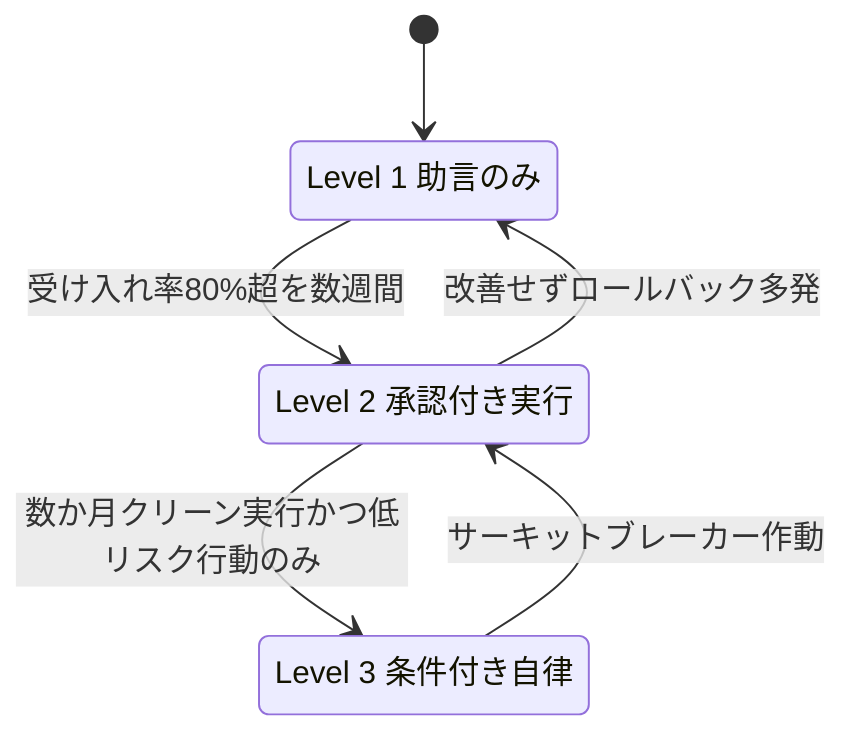
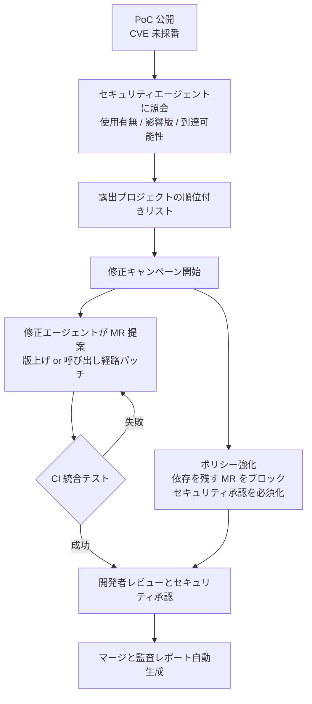
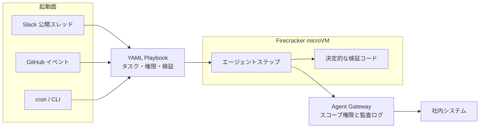
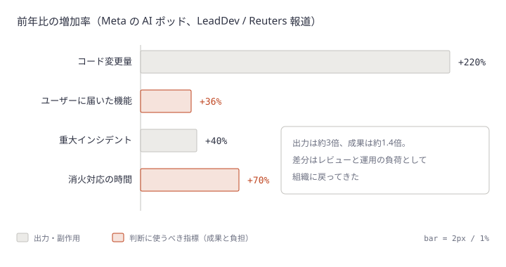
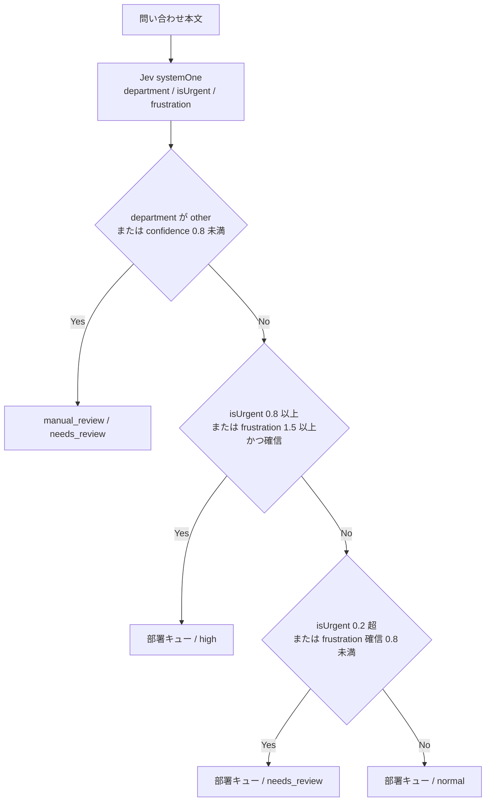

# Daily Briefing 2026-11-18

## 1. AI によるインシデント対応: オンコール・エージェントに Runbook を渡せ（原題: AI-Assisted Incident Response: Giving Your On-Call Agent a Runbook）

- **URL**: https://tianpan.co/blog/2026-04-12-ai-assisted-incident-response-giving-your-on-call-agent-a-runbook
- **公開日**: 2026-04-12
- **著者・媒体**: Tian Pan / TianPan.co

### 本文翻訳

AI によるインシデント対応エージェントが失敗するのは、人間のオンコールに課しているのと同じ厳密さを与えずに投入しているからだ。Runbook も、エスカレーション経路も、影響範囲（blast radius）の上限も無い。これはモデル能力の問題ではなくシステム工学の問題であり、解決策は構造化された Runbook と制約された権限をエージェントに与えることである。

**泥沼の中間地帯: なぜ AI は仕事を減らさず増やしたのか。** 2025 年、エンジニアリング組織の運用トイルは 30% に上昇し、5年ぶりに増加に転じた。AI ツールへの大型投資にもかかわらずだ。AI が下した判断の 69% は依然として人間の検証を必要とするという数字もある。原因は、インシデント対応を「アラートをエージェントに流し込む」分類問題として扱っていることにある。実際には、時間的圧力のもとで制約された行動を順に実行する問題だ。データベースが落ちている最中に熟考するエージェントは邪魔でしかない。

**エージェント向け Runbook とは何か。** Runbook は行動の有向グラフにし、3つの性質を持たせる。

1. **型付きの入出力**: 各ステップが何を受け取り何を出すか（メトリクスクエリ、ログパターン、サービス名）を明示する。LLM 呼び出しが型付き関数のように振る舞う
2. **明示的な分岐点**: 雰囲気ではなく閾値で書く。例「エラー率が 3 分間 5% を超えたら」
3. **ステップごとの権限スコープ**: ログ検索は自動実行、Pod 再起動は通知付き、DB フェイルオーバーは人間の明示的承認が必要

「役に立つエージェントと危険なエージェントの違いは知能ではなく、制約である」。

**3段階の自律性モデル。** Level 1（助言）ではエージェントが直近のデプロイ、ログ異常、メトリクス推移を集めて診断と推奨を投稿し、人間が実行する。すべてのチームはここから始める。Level 2（承認付き実行）では、再起動・スケール・ロールバックなどの提案を Slack やインシデントツールに承認カードとして出し、承認後に実行して監視する。所定の時間内にメトリクスが改善しなければロールバックしてエスカレーションする。Level 3（条件付き自律）では、事前承認済みの低リスク Runbook のみを人間抜きで実行する。例は「5分間に3回クラッシュループしたステートレスサービスの再起動」だ。重要なのは、**自律レベルはエージェントではなく行動に付く**ということ。同じエージェントがキャッシュ無効化は Level 3、サービス再起動は Level 2、DB に触れるものは Level 1、で動いてよい。

**ガードレールの4層。** (1) ID とアクセス制御: エージェントごとに専用サービスアカウントを用意し、特定ツールにスコープし、短命で自動ローテーションされる認証情報を使う。インフラに直接触れさせず、安全なツール API を経由させる。(2) 影響範囲チェック: 依存関係、トラフィック比率、冗長性といったトポロジーを理解させる。50 個中 1 個の Pod の再起動と、唯一の Pod の再起動は違う。(3) サーキットブレーカー: 同一行動の繰り返し、異常な API 呼び出しパターン、確信度の閾値割れで遮断してエスカレーションする。修復ループを止めるためのもの。(4) 監査証跡: すべての判断・根拠・行動を、ポストモーテムで使える形で記録する。

**「このアラートを調べて」が危険なプロンプトである理由。** 非構造の指示は3つの失敗を生む。存在しないメモリリークのような幻覚診断（真因はロードバランサの設定ミス）。コンテキストウィンドウが大きいほど悪化しうる。行動空間が無制限であることによる危険な操作。そして無関係なメトリクスやサービスを探索して危機の最中に時間を浪費すること。対処法は、**直近 50 件のインシデントを監査して上位 10 パターンを特定し、それぞれに診断手順・判断基準・許可された修復手段を、エージェントが必要とする前に定義しておく**ことだ。

**効果の測り方。** 定義済みパターンに合致するインシデントでは MTTR が 30〜70% 短縮したという報告があるが、MTTR だけでは不十分だ。診断精度（ポストモーテムの根本原因との一致率。70% 未満ならノイズを足しているだけ）、提案の受け入れ率（低いなら Runbook がチームの運用と合っていない）、自律解決率（初年度の目標は 10〜30%。早期にそれより高いならリスク分類が緩すぎる）、オンコール満足度（悪い提案の検証と後始末が節約を上回るなら、MTTR に関係なく正味マイナス）を追う。人間によるオーバーライドは理由付きで記録し、次バージョンのテストケースにする。

**厳しく始めて広げる。** 成功した組織は、1サービス・1インシデント種別・1 Runbook から始めた。数週間は助言モードで回し、エージェントと人間の診断を比較し、受け入れ率が 80% を超えるまで調整した。そこで初めて Level 2 に進み、数か月のクリーンな実行を経てから、最も低リスクな行動に限って Level 3 を検討した。「エージェントに Runbook を渡せ。読み取り専用で始めよ。信頼を得たら昇格させよ」。

### 重要ポイント
- 失敗の原因は「調べて」という非構造の指示。Runbook を**型付き入出力・閾値による分岐・ステップ単位の権限**を持つ有向グラフにする
- 自律レベル（助言／承認付き実行／条件付き自律）は**エージェントではなく行動ごと**に割り当てる
- 着手は「直近50件のインシデントから上位10パターンを抽出し、事前に Runbook 化」
- 指標は MTTR だけでなく診断精度（70% 未満はノイズ）・受け入れ率・自律解決率（初年度 10〜30%）・オンコール満足度
- 昇格条件は受け入れ率 80% 超。人間のオーバーライドはテストケースに変換する

### 図解



自律レベルの昇格・降格は「行動の種類」単位で管理する。DB に触れる行動は常に Level 1 に留め置く。

### 戦略分析

**フレームワーク**: Cynefin × ケイパビリティ成熟度

| Cynefin 領域 | インシデントの例 | 記事の自律レベル | 前提となる成果物 |
|---|---|---|---|
| 明白 | ステートレスサービスのクラッシュループ | Level 3 | 事前承認済み Runbook と遮断条件 |
| 煩雑 | 直近デプロイ起因のエラー率上昇 | Level 2 | 閾値付き分岐と承認カード |
| 複雑 | 原因不明の性能劣化、DB 関連 | Level 1 | 情報収集の型と診断ログ |
| カオス | 大規模障害の初動 | 対象外（人間が主導） | — |

記事の「上位10パターンを Runbook 化する」作業は、インシデントを**煩雑以下に落とせるものと、そうでないものに仕分ける**作業と読める。Runbook に書けた時点で、そのパターンは明白か煩雑の領域に移り、委譲の候補になる。成熟度の段階は「Runbook 化率 → 受け入れ率 → 自律解決率」の順で進み、前段の数値が閾値に達するまで次段に進まない。

**示唆**: AIOps ツールの選定より先に、**直近50件のポストモーテムを読み、パターン別件数の表を作る**ことに工数を割く。上位10パターンが全体の何割を占めるかで投資判断が変わる。上位10で過半を覆えるなら Runbook 化の費用対効果は高い。ロングテールが大半なら Level 1 の情報収集支援に絞り、自律化には投資しない。

**反証条件**: インシデントの大半が一回限りの新規障害（新規サービスの立ち上げ期、頻繁なアーキテクチャ変更期）である組織では、パターン化できる割合が小さく、Runbook 整備のコストが回収できない。記事の 30〜70% 短縮も「定義済みパターンに合致した場合」に限られる数値である（記事中の引用値で、記事自体の実測ではない）。

### 現場での適用方法

**スクリプト化の例**: Runbook を YAML で型付きグラフとして書き、行動ごとに自律レベルを持たせる。

```yaml
# runbooks/stateless-crashloop.yaml
id: stateless-crashloop
match:
  alert: KubePodCrashLooping
  labels: { tier: stateless }
inputs:
  service: string
  namespace: string
steps:
  - id: gather
    action: query_logs            # 読み取り専用
    autonomy: L3
    args: { since: 15m, pattern: "panic|OOMKilled" }
    outputs: [log_summary]
  - id: check_blast_radius
    action: get_topology
    autonomy: L3
    outputs: [replicas_ready, traffic_share]
  - id: decide
    when: "restarts_5m >= 3 && replicas_ready >= 2"
    then: restart
    else: escalate
  - id: restart
    action: rollout_restart
    autonomy: L3                  # 条件付き自律（低リスク）
    verify: { metric: error_rate, below: 0.01, within: 5m }
    on_verify_fail: rollback_and_escalate
  - id: escalate
    action: page_human
    autonomy: L1
circuit_breaker:
  max_same_action: 2              # 同一行動の繰り返しで遮断
  min_confidence: 0.7
audit:
  sink: <AUDIT_LOG_BUCKET>
```

**運用手順**（パターン抽出）:

```bash
# 1. 直近50件のポストモーテムから根本原因カテゴリを集計する（例: Markdown に "Root cause category:" 行がある前提）
grep -h "^Root cause category:" <POSTMORTEM_DIR>/*.md | tail -50 \
  | sort | uniq -c | sort -rn | head -10 > top10-patterns.txt

# 2. 上位10が全体の何割を占めるか
awk '{s+=$1} END {print s "/50"}' top10-patterns.txt

# 3. 1パターンだけ Runbook 化し、数週間 L1（助言のみ）で運用。
#    エージェント診断とポストモーテムの根本原因の一致率を週次で記録し、
#    受け入れ率 80% を超えたら当該行動のみ L2 に昇格する
```

### 期待効果
- 定義済みパターンに合致するインシデントで MTTR 30〜70% 短縮（記事が引用する報告値）
- 「このアラートを調べて」型の幻覚診断・危険操作・時間浪費の3つの失敗を構造的に防げる
- 監査証跡がそのままポストモーテムとエージェント改善のテストケースになる

### 注意点
- 記事の統計（トイル 30%、69%、43% など）は二次引用で、ベンダー出典を含む
- 閾値（診断精度 70%、受け入れ率 80%、自律解決率 10〜30%）は著者の推奨値で、業界標準ではない
- トポロジー情報（レプリカ数・トラフィック比率）が取れない環境では影響範囲チェックが機能しない。先に観測基盤を整える必要がある

## 2. AI が発見するゼロデイに備えてパイプラインを整える（原題: Prepare your pipeline for AI-discovered zero-days）

- **URL**: https://about.gitlab.com/blog/prepare-your-pipeline-for-ai-discovered-zero-days/
- **公開日**: 2026-04-20
- **著者・媒体**: Omer Azaria / GitLab Blog

### 本文翻訳

Anthropic の Mythos Preview モデルは、主要 OS とブラウザで数千件のゼロデイを発見したと報じられている。27 年前の OpenBSD のバグも含まれる。テストでは4つの脆弱性を連鎖させ、サンドボックスを脱出するブラウザエクスプロイトを組み立てた。Anthropic はアクセスを制限しているが、同社の攻撃的サイバー研究の責任者は、同等のツールが6〜12か月で出回ると見ている。本稿の主張は「セキュリティチームを最後の防衛線にしてはならない」ということだ。セキュリティはすべてのマージリクエスト（MR）でパイプライン内で走り、ポリシーで強制され、可能なところは自動修正し、それ以外は人間へ速く回す。

**既知の脆弱性ですら修正が追いつかない。** 2025 年の Verizon DBIR によれば、侵害の 60% はパッチが存在する既知脆弱性が関わっていた。開発者はリリース後の修正に月 11 時間を費やす。半数以上の組織にインターネットに露出した未修正の脆弱性があり、その半分を閉じるまでの中央値は 361 日だ。AI 生成コードは 2025 年 6 月までに Fortune 50 のリポジトリで月 1 万件超の新規セキュリティ指摘を生み、半年で 10 倍になった。Georgia Tech は 2026 年 3 月に 34 件の CVE を AI 生成コードに帰属させた（1月は6件）。AI アシスタントはパッケージ名を幻覚し、古いパターンを使い、安全でない例を写す。防御側は、フロンティア AI を残りのチームと同じポリシー・承認・監査証跡の内側に置く必要がある。

**AI コーディングの速度でのセキュリティ。** 4つの能力が必要だ。(1) **変更の時点での強制**: ポリシーは一度定義してすべてのグループ・プロジェクトに適用し、MR を強制点にする。例外はレビュー・承認・記録を必須とする。(2) **MR 前の IDE での検出**: ハードコードされたシークレット、既知の脆弱なインポート、非推奨 API の呼び出しをコミット前に指摘し、レビューを到達可能性・悪用可能性・アーキテクチャ上のリスクに集中させる。(3) **既定での自動トリアージ**: 誤検知判定、到達可能性、悪用可能性の文脈、深刻度評価を、開発者が見る前に AI が済ませる。(4) **統制された修正**: 自動修正は確信度スコア付きで MR として提案され、MR には適用ポリシー、実行したスキャン、指摘、承認者が記録される。AI 生成コードも人間のコードも同じプロセスを通る。

**準備ができたパイプラインとはどういうものか（シナリオ）。** ある人気 OSS パッケージの PoC エクスプロイトがセキュリティメーリングリストに出る。CVE も NVD エントリもスキャナのシグネチャもまだ無く、チームは Slack で知る。セキュリティエンジニアはセキュリティエージェントに、このパッケージを使っているか、影響バージョンを持つプロジェクトはどれか、脆弱な呼び出し経路は本番で到達可能か、を尋ねる。エージェントは数分で露出プロジェクトの順位付きリストを返す。エンジニアは修正キャンペーンを開始する。修正エージェントは、パッチがあればバージョン更新を、無ければ呼び出し経路を狙った局所パッチを提案する。SOC 2 タグ付きプロジェクトにはスキャン実行ポリシーが既に効いており、エンジニアはそれを強化して、当該依存を持ち込む・残す MR のマージをブロックし、すべての修正にセキュリティのサインオフを必須とする承認ポリシーを追加する。エージェントの最初のパッチは統合テストで落ち、エージェントが修正した2回目は通った。開発者がレビューし、セキュリティがサインオフし、キャンペーン全体でマージが進んだ。監査時には、すべての MR についてスキャン結果・適用ポリシー・承認者・マージ時刻をまとめたレポートがあった。証跡は後から集めたのではなく、作業中に生成されていた。

**今すぐ穴を塞ぐ。** 同等のモデルは1年以内に攻撃者に届く。自問すべき5つの問いがある。すべての MR でスキャンをどう強制しているか。侵害された依存をビルド前に捕まえられるか。重大な指摘は修正が始まるまでに何個のツール境界をまたぐか。AI が提案した修正はどんなレビューを通り、監査可能か。ポリシー強制の証拠を出すのに何時間かかるか。

### 重要ポイント
- 「セキュリティチームを最後の防衛線にしない」。強制点は**マージリクエスト**に置き、ポリシーは一元定義して全プロジェクトに適用する
- CVE もシグネチャも無い段階で「使っているか／どのバージョンか／到達可能か」を数分で答えられることが初動の差になる
- 修正エージェントの最初のパッチは統合テストで落ちた。**既存の CI がエージェントを差し戻す**構造が品質を担保する
- 監査証跡は作業中に自動生成させる。後から集める運用では AI の速度に追いつかない
- 準備度を測る5つの問い（強制・依存の事前遮断・ツール境界数・AI 修正のレビュー・証拠作成時間）

### 図解



### 戦略分析

**フレームワーク**: バリューストリームマッピング × 制約理論

| 工程 | 記事が描く従来の状態 | 記事が描く準備済みの状態 |
|---|---|---|
| 検知 | CVE・シグネチャ待ち | Slack の一報から照会開始 |
| 影響範囲の特定 | 複数ツールを横断し手作業 | エージェントが数分で順位付きリスト |
| 修正作成 | 開発者のバックログ待ち | エージェントが MR を提案、CI で差し戻し |
| レビュー・承認 | チケットで受け渡し | 同一 MR 上で開発者とセキュリティが承認 |
| 監査 | 後から証跡を収集 | 作業中に自動生成 |

記事が示す「半分を閉じるまで中央値 361 日」は、作業時間ではなく**待ち時間とツール境界の受け渡し**で膨らんでいると読める（記事は工程別の時間を示していないため、ここは仮説）。5つの問いのうち「修正開始までに何個のツール境界をまたぐか」がまさに VSM の待ち時間を数える問いになっている。修正の生成が数秒になった後の制約は**レビュー・承認**に移る。記事がセキュリティ承認を同じ MR に載せているのはこの制約への対処である。

**示唆**: 新しいスキャナやエージェントを買う前に、**直近の重大脆弱性1件について「一報から本番反映まで」の工程と受け渡し回数を書き出す**。受け渡しが3回以上あるなら、修正生成の自動化より先に、スキャン結果・修正・承認を1つの MR に集約する方に投資する。

**反証条件**: 依存の数が少なく、モノレポ1つで SBOM も整備済みの小規模組織では、影響範囲の特定が既に数分で終わっており、制約は別の場所（テストの不足など）にある。また記事はベンダーブログで、シナリオは実測ではなく想定である。

### 現場での適用方法

**スクリプト化の例**: GitLab に限らず使える「MR を強制点にする」最小構成。GitHub Actions で、脆弱性スキャンを必須チェックにし、AI が作った修正 PR にはセキュリティチームのレビューを必須にする。

```yaml
# .github/workflows/security-gate.yml
name: security-gate
on: pull_request
jobs:
  scan:
    runs-on: ubuntu-latest
    steps:
      - uses: actions/checkout@v4
      - name: Dependency scan (fail on HIGH/CRITICAL)
        uses: aquasecurity/trivy-action@0.28.0
        with:
          scan-type: fs
          severity: HIGH,CRITICAL
          exit-code: "1"
          format: sarif
          output: trivy.sarif
      - name: Block denylisted package (zero-day campaign)
        run: |
          # キャンペーン中の依存を持ち込む・残す PR をブロックする
          if grep -RqsE '"<PACKAGE_NAME>"\s*:\s*"[~^]?<VULN_VERSION_PREFIX>' package-lock.json; then
            echo "::error::<PACKAGE_NAME> の影響バージョンが残っています"; exit 1
          fi
      - uses: github/codeql-action/upload-sarif@v3
        if: always()
        with: { sarif_file: trivy.sarif }
```

```text
# .github/CODEOWNERS（AI 修正が触る依存定義にはセキュリティ承認を必須化）
package.json        @<ORG>/security-team
package-lock.json   @<ORG>/security-team
```

ブランチ保護で `security-gate / scan` を必須チェックにし、「Require review from Code Owners」を有効化する。

**運用手順**（準備度の自己診断）: 記事の5つの問いを四半期ごとに測る。

```bash
# 問い3: 重大指摘が修正開始までにまたぐツール境界数
#  -> 直近の重大脆弱性1件について、通知元・トリアージ・チケット・PR の各ツールを列挙し数える
# 問い5: ポリシー強制の証拠作成時間
#  -> 監査人役が「直近30日の全マージで scan が通った証拠」を要求し、出せるまでの時間を計測
gh pr list --state merged --search "merged:>=$(date -d '30 days ago' +%F)" --json number \
  --jq '.[].number' | while read n; do
    gh pr checks "$n" --json name,state --jq ".[] | select(.name==\"scan\") | \"$n \(.state)\""
  done
```

### 期待効果
- CVE 採番前の段階から影響範囲を特定し修正キャンペーンを開始できる
- 監査証跡の後付け作業が不要になる（記事のシナリオでは監査時にレポートが既にあった）
- AI 生成コードが増やす指摘（記事引用: 半年で10倍）を、開発者が見る前のトリアージで吸収できる

### 注意点
- ベンダー（GitLab）ブログで、シナリオは実例ではなく想定。自社製品への誘導を含む
- 統計は Verizon DBIR や他社調査からの引用。Mythos Preview の数値も報道ベース
- 「呼び出し経路を狙った局所パッチ」は上流の修正が出た際に版上げで置き換える運用が要る。放置すると独自パッチが技術的負債になる

## 3. DoorDash の Flux: クラウド上のエージェントで月13万件のエンジニアリング作業を実行（原題: DoorDash's Flux Runs 130,000 Engineering Tasks through Cloud-Based Agents）

- **URL**: https://infoq.com/news/2026/08/doordash-flux-cloud-agent
- **公開日**: 2026-08-31
- **著者・媒体**: Leela Kumili / InfoQ（DoorDash エンジニアリングブログの解説記事）

### 本文翻訳

DoorDash は、エンジニアリング用エージェントの実行を開発者のノート PC から自社のクラウド基盤 Flux へ移した。2026 年のある1か月に Flux は 13 万件のエンジニアリング作業を自動化した。週 2 万 5000 件超の自動コードレビュー、300 超の Playbook、週 1 万回超の呼び出しを支え、ワークフローは無人かつ並列で走る。

**なぜノート PC から離れたのか。** ローカル実行には4つの限界があった。計算資源は開発者の CPU とメモリに縛られる。可用性は端末が接続され続けることに依存する。セキュリティ面では、自律エージェントが開発者のアクセスできる認証情報と社内システムすべてに届いてしまう。可視性の面では、エージェントがどこで動き、どのシステムに触れ、誰の代理で動いているかが見えにくい。セキュリティアーキテクトの Radoslav Krehlik は LinkedIn で、Flux は性能・稼働時間・セキュリティの限界に当たったあとに作られたと述べ、エンジニアは企業のガードレールを保ったまま Slack、GitHub、定期ジョブからエージェントを起動できると説明している。

**アーキテクチャ: 4つのプラットフォーム基本要素。**

1. **クラウドサンドボックス**: 各サンドボックスは Firecracker microVM で動き、作業に必要なリポジトリ、開発ツール、シークレット、ランタイム依存を備えた状態で用意される。microVM の起動、リポジトリの clone、ビルドツールの導入、エージェントハーネスの設定までを含む環境準備の **p95 SLO は 5 秒未満**
2. **MCP ゲートウェイ**: 社内製の Agent Gateway がエージェントから社内システムへのアクセスを仲介し、**スコープされた権限**を強制し、監査とポリシー強制のために**活動を記録**する
3. **再利用可能な Playbook**: YAML で定義し、タスク、必要なツール、権限、検証ステップ、安全境界を指定する。予測可能な実行や検証が必要な箇所では**決定的なコード**をエージェントのステップと混在させられる
4. **起動面（Invocation surfaces）**: Slack、GitHub、cron、CLI、対話インターフェースからワークフローを開始できる

**業界の文脈。** TOP GROUP Vietnam の共同創業者 Duy Nguyễn は、エージェントがバックグラウンド作業、コードレビュー、社内ツール、並行実行を担うようになると、難題はモデル選びではなく制御（ID、権限、サンドボックス、監査ログ、クォータ、キルスイッチ）になると述べている。GitHub Copilot もローカルとクラウドのサンドボックスを両方サポートし、ファイルシステム・ネットワーク・システムアクセスを制御できる。

**展開と普及。** 最初のユースケースは自動コードレビューだった。頻度が高く測定しやすいワークフローだからである。その後 CI トリアージ、オンコール作業、保守ワークフロー、チケット駆動の開発へと広げた。Slack 連携はプライベートチャンネルから**公開スレッド**へ移し、エンジニアがエージェントの実行を見て結果をレビューし、他チームがどう作業を委譲しているかを見られるようにした。

### 重要ポイント
- ノート PC 実行の4つの限界（計算資源・可用性・認証情報の過剰到達・可視性）がクラウド移行の理由
- 基本要素は**サンドボックス／MCP ゲートウェイ／YAML Playbook／起動面**の4つ。環境準備 p95 は5秒未満
- Playbook は「エージェントのステップ」と「決定的コード」を混在させ、検証は決定的側に寄せる
- 最初のユースケースは**高頻度で測定しやすい自動コードレビュー**。そこから CI トリアージ・オンコール・保守へ拡大
- 実行を公開スレッドに出すことで、委譲の型がチーム間に伝播する

### 図解



### 戦略分析

**フレームワーク**: Make/Buy と TCO × Wardley マップ

| 構成要素 | Wardley 上の位置（2026 時点の仮説） | DoorDash の選択 | 一般組織への含意 |
|---|---|---|---|
| コーディングエージェント本体 | Product〜Commodity | 外部（ハーネスを設定） | 内製しない |
| サンドボックス（microVM） | Product | Firecracker を採用 | 既製のクラウドサンドボックスで足りる場合が多い |
| MCP ゲートウェイ（権限・監査） | Custom | 内製（Agent Gateway） | 社内システムとの接続面なので差別化余地が残る |
| Playbook 群 | Custom（自社固有） | 内製 300 超 | 業務知識そのもの。内製以外の選択肢がない |

記事が示す配分は「エージェントは買い、**権限・監査の境界と Playbook** は作る」である。Wardley の観点では、コモディティ化が進むエージェント本体やサンドボックスへの内製投資は回収しにくく、社内システムと業務知識に接する層に投資が集中するのが合理的と言える（位置付けは記事の記述から推定した仮説）。

**示唆**: 自社でエージェント基盤を検討する場合、**最初に作るのはサンドボックスではなく Playbook 1本とゲートウェイの権限表**にする。ユースケースは DoorDash と同じく「頻度が高く結果を測れるもの」（自動コードレビュー、依存更新の失敗修正など）から選ぶ。サンドボックスは GitHub Actions ランナーや既製のクラウドエージェントで代用し、月数千件規模になるまで自前の microVM 基盤は作らない。

**反証条件**: エンジニアが数十人規模で、エージェント実行が月数百件程度なら、ノート PC 実行の限界（計算資源・可用性）は顕在化せず、専用基盤の固定費が便益を上回る。13 万件・25,000 件などの数値は DoorDash の自己申告で、何を1件と数えるかは記事に定義がない。

### 現場での適用方法

**スクリプト化の例**: DoorDash の Playbook 構造（タスク・ツール・権限・検証・安全境界、エージェントと決定的コードの混在）を真似た YAML の雛形。自前の実行器か CI から読み込む想定。

```yaml
# playbooks/fix-failing-dependency-pr.yaml
name: fix-failing-dependency-pr
trigger:
  - github: { event: check_suite, conclusion: failure, label: dependencies }
  - slack: { command: "/agent fix-deps", thread: public }   # 実行は公開スレッドに出す
sandbox:
  image: <SANDBOX_IMAGE>
  repos: [ "<ORG>/<REPO>" ]
  secrets: [ GITHUB_TOKEN_SCOPED ]     # このタスクに必要なものだけ
  timeout: 30m
permissions:                            # ゲートウェイで強制する権限表
  allow: [ "git:push:pr-branch", "ci:read-logs", "mcp:issue-tracker:read" ]
  deny:  [ "git:push:main", "secrets:list", "deploy:*" ]
steps:
  - id: collect
    type: deterministic
    run: gh run view --log-failed --repo <ORG>/<REPO> > /work/failed.log
  - id: fix
    type: agent
    prompt_file: prompts/fix-deps.md
    max_turns: 40
  - id: verify
    type: deterministic                 # 検証は必ず決定的コードで
    run: ./gradlew build test
  - id: guard
    type: deterministic
    run: ./scripts/check-no-downgrade.sh   # 依存のダウングレードを禁止
on_failure:
  label: agent-fix-failed
  notify: slack-thread
```

**運用手順**: 

```bash
# 1. 候補ユースケースを「頻度 × 測定容易性」で並べる（週あたり件数を数える）
gh pr list --state all --label dependencies --search "created:>=$(date -d '7 days ago' +%F)" --json number --jq 'length'
# 2. 最上位1件だけ Playbook 化し、実行ログを公開 Slack スレッドに流す
# 3. 4週間後、成功率と人手修正時間の削減を集計し、2本目に進むか判断する
```

### 期待効果
- 開発者の端末・認証情報からエージェント実行を切り離し、権限と監査を一元化できる
- Playbook の再利用で、同種作業の委譲が組織内に横展開される（DoorDash は 300 超、週1万回超）
- 公開スレッドでの実行により、委譲の型がチーム間で学習される

### 注意点
- 記事は2分程度の短い解説記事で、DoorDash の一次記事の詳細（Playbook の実例など）は含まない
- 数値は自己申告で定義が不明確
- 公開スレッドへの移行は、扱うデータの機密度によってはそのまま真似できない

## 4. Meta は AI を前提にエンジニアリングチームを縮小しようとした。そして裏目に出た（原題: Meta tried to shrink engineering teams around AI）

- **URL**: https://leaddev.com/ai/meta-tried-to-shrink-engineering-teams-around-ai
- **公開日**: 2026-09-07
- **著者・媒体**: Chris Stokel-Walker / LeadDev

### 本文翻訳

（要点ボックス）Meta の AI「ポッド」はコード変更を 220% 増やしたと報じられたが、出荷された機能は 36% 増にとどまり、インシデントは 40% 増えた。500 超の組織で PR スループットは 37% 増えた一方、開発者体験は低下した。適正なチーム規模は5〜8人で、縮小は最初ではなく最後にやるべきだ。

**Meta のポッドモデル。** Meta は 10〜20 人の従来型プロダクトグループを、AI ツールとエージェントに支えられた3〜5人の「ポッド」に置き換える計画だった。Reuters によれば、Meta の社内プラットフォームとインフラへのコード変更は前年比 220% 増えた。だが数字はすべてを語らない。

**見出しの数字の向こう側。** ユーザーに届いた機能は 36% 増にとどまった。重大な技術インシデントとセキュリティインシデントは 40% 増え、それらの消火に従業員が費やした時間は 70% 増えた。AI は開発者により多くを生産させられるが、組織がより多くの有用なものを生産するとは限らない。

**数字以上のこと。** 開発者インテリジェンス企業 DX の著名研究者 Brian Houck は、組織が成果（outcome）指標ではなく出力（output）の数字に過度に注目していると言う。DX の 500 超の組織を対象とした調査では、週あたり PR スループットの中央値は4四半期で 37% 増えた。一方、開発者がどれだけ効果的かつ摩擦なく働けるかの合成指標である Developer Experience Index は 67 から 65 に下がった。新しい能力の構築に使う時間の割合はほぼ横ばいだった。Houck は、良いエンジニアリングシステムの基本は今も有効だが、AI は小さな問題を大きな問題に変えると指摘する。かつてはすべてをレビューできたシニア開発者が、今は AI 生成の変更の洪水に直面しうる。

**再考が必要だ。** Gather.dev の創業者兼 CTO で、O'Reilly から『Scaling AI Adoption in Engineering』を出す Peter Bell は、重要性が増す2つの役割を挙げる。顧客とドメインを理解するプロダクトエンジニアと、AI 生成の仕事を安全に保つシステムを作るプラットフォーム／開発者体験エンジニアだ。後者の仕事はハーネス、評価、pre-commit フック、マージキューを作ることである。Bell は理想のチームを5〜8人程度と考える。同じリポジトリで働くのが1〜2人だけでもだ。理由の一つは、エージェントを使う複数のエンジニアが、管理しきれない数の同時変更を生み出しうること。もう一つは人間的な理由で、5〜8人の集団は人に合い、つながりの感覚を生む。

**ミクロキッズ（Honey, I shrunk the engineering team）。** 管理職は依然として効率化を求めるだろう。縮小するなら、AI 変革の最初ではなく終盤であるべきだ。Bell は、どのタスクを安全にエージェントへ渡せるかを見極める小さく低リスクな段階的実験を行い、可能なところから人間のレビューを徐々に外していくことを勧める。Meta は逆をやった。組織を先に再設計し、技術が増えた負荷を担ってくれることを期待した。それが裏目に出たようだ。Bell は「正しくやるのは非常に難しいという兆候で、最初は成功するより失敗する人の方が多いだろう」と認める。チームの再編は AI 時代への適応として依然重要だが、順序が重要である。

### 重要ポイント
- コード変更 **+220%** に対して出荷機能 **+36%**、重大インシデント +40%、消火時間 +70%。出力の増加は成果に比例しない
- DX の 500 組織調査: PR スループット +37% だが DXI は 67→65 に低下、新機能構築の時間比率は横ばい
- 重要性が増すのはプロダクトエンジニアと、ハーネス・評価・pre-commit フック・マージキューを作るプラットフォームエンジニア
- チームは5〜8人を維持。**縮小は AI 変革の最後**に、低リスク実験で委譲範囲を確かめてから

### 図解



### 戦略分析

**フレームワーク**: DORA Four Keys（と Goodhart の法則への反証）

| 指標 | 記事の数値 | 読み方 |
|---|---|---|
| 出力（コード変更・PR 数） | +220%（Meta）、+37%（DX 中央値） | Four Keys に含まれない。目標にすると Goodhart の法則が働く |
| 成果（ユーザーに届いた機能） | +36% | デプロイ頻度・リードタイムに近い成果側の代理指標 |
| 変更失敗率に相当するもの | 重大インシデント +40% | 安定性側が明確に悪化 |
| 復旧負荷 | 消火時間 +70% | 復旧時間そのものではないが、MTTR 系の負担増を示唆 |

速度2指標と安定性2指標の**両方**を見ると、Meta の事例は「出力は伸びたが、成果の伸びは小さく、安定性は悪化した」状態であり、Four Keys 的には改善と言えない。DX の DXI 低下と新機能時間の横ばいも同じ方向を指す。

**示唆**: AI 導入の効果測定とチーム規模の議論で、**PR 数・コード変更量を KPI から外し、Four Keys の安定性2指標を必ず並べて報告する**。人員計画は「低リスクな作業の委譲実験 → 人間レビューを外せる範囲の確認 → 余力の再配置 → 最後に規模見直し」の順に固定する。余力はまずプラットフォームエンジニア（ハーネス・評価・マージキュー）に振り向ける。

**反証条件**: 自動テストとマージキュー、段階的ロールアウトが既に成熟した組織では、出力増がそのまま成果増に変換され、インシデントも増えない可能性がある。Meta の事例は「ガードレール整備前に組織を縮めた」ケースであり、順序を守った縮小まで否定する根拠にはならない。数値は Reuters 経由の報道で独立検証されていない。

### 現場での適用方法

**運用手順**: AI 導入レポートに「出力」と「成果・安定性」を並べて出すための集計スクリプト（GitHub と自社のインシデント記録を前提）。

```bash
#!/usr/bin/env bash
# ai-impact-report.sh <OWNER/REPO> <SINCE:YYYY-MM-DD>
set -euo pipefail
REPO="$1"; SINCE="$2"

# 出力（参考値。KPI にはしない）
prs=$(gh pr list -R "$REPO" --state merged --search "merged:>=$SINCE" --limit 1000 --json number --jq length)

# 成果: 本番デプロイ回数（GitHub Deployments の production 環境）
deploys=$(gh api "repos/$REPO/deployments?environment=production&per_page=100" --paginate \
  --jq "[.[] | select(.created_at >= \"$SINCE\")] | length" | awk '{s+=$1} END {print s}')

# 安定性: revert / hotfix の比率を変更失敗率の代理に
reverts=$(gh pr list -R "$REPO" --state merged --search "merged:>=$SINCE revert in:title" --limit 1000 --json number --jq length)

# 安定性: インシデント件数（<INCIDENT_LABEL> ラベルの issue）
incidents=$(gh issue list -R "$REPO" --state all --label "<INCIDENT_LABEL>" --search "created:>=$SINCE" --limit 1000 --json number --jq length)

printf "| 区分 | 指標 | 値 |\n|---|---|---|\n"
printf "| 出力（参考） | マージ PR 数 | %s |\n" "$prs"
printf "| 成果 | 本番デプロイ数 | %s |\n" "$deploys"
printf "| 安定性 | revert PR 比率 | %s/%s |\n" "$reverts" "$prs"
printf "| 安定性 | インシデント件数 | %s |\n" "$incidents"
```

**CLAUDE.md への追記例**（組織のエージェント運用ルールとして）:

````markdown
## 変更量の上限
- 1人のエンジニアがエージェント経由で同時に開く PR は最大 <N> 本まで。
  レビュー待ちが <N> 本を超えたら新規タスクを開始せず、既存 PR の分割・レビュー対応を優先する
- 1 PR の差分は原則 400 行以内。超える場合は分割案を先に提示する
````

### 期待効果
- 「PR が増えた」報告が「成果が増えた」と誤読されるのを防ぐ
- 組織縮小の判断を、委譲実験とガードレール整備の後ろへ順序付けられる
- 記事の数値が示すインシデント増（+40%）・消火時間増（+70%）型の失敗を早期に検知できる

### 注意点
- 報道ベースの記事で、Meta の内部事情の全体像は示されていない
- DX はベンダーであり、DXI は独自の合成指標
- 5〜8人という規模は Bell の実務的見解で、普遍的な最適値ではない

## 5. TypeSafe AI の Jev を TypeScript で試す: 問い合わせルーティング（原題: Trying TypeSafe AI's Jev with TypeScript）

- **URL**: https://azukiazusa.dev/en/blog/jev-support-routing
- **公開日**: 不明（直近数週間以内）
- **著者・媒体**: azukiazusa.dev（ページ上に著者名・日付の表記なし）

### 本文翻訳

**はじめに: LLM と制御フロー。** LLM は人が読むためのテキストを生成するので、その出力を分岐のような決定的なアプリケーションロジックに使うのは難しい。よくある回避策は、構造化された判断を出すようプロンプトで指示するか、出力をパースすることだ。TypeSafe AI の Jev は、与えられた状態について型付きの問いに答えるモデルである。TypeSafe はこの種のモデルを、Kahneman の「システム1」（速く直感的な判断）にちなんで「System One」と呼ぶ。本記事の例は顧客問い合わせのルーティング、つまりどの部署が担当し、どれほど緊急かの判断である。例として、二重請求に対し当日の返金を求める問い合わせに対し、Jev は部署 `billing`（confidence 1）、緊急度の noul 値 0.97 を返す。

**3種類の問い。** Jev には3種類の問いがある。**Choice** は順序の無い候補から1つを選び、選択結果、候補ごとの `probabilities`（合計1）、分布の集中度を表す `confidence` を返す。**Noul** は Yes/No の命題が真である確率（0〜1）を返し、`confidence` は持たない。**Score** は順序付きの段階で評価し、段階番号の確率加重平均である `score`（小数になりうる）、段階ごとの確率、`confidence`、段階と説明の対応表 `legend` を返す。

**State: 文脈の渡し方。** `state` には判断対象と背景情報をまとめる。文字列、JSON オブジェクト、配列のいずれでもよい。`ticket` や `order` のような名前付きキーにすると各要素の役割が明確になる。返金判断なら、注文データと返金ポリシーを同じ state に入れて Jev に照合させられる。リクエストでは `state.ticket` に問い合わせ本文を入れ、3つの問いを定義する。`department`（choice: billing / technical / sales / other、それぞれ説明付き）、`isUrgent`（noul: 迅速な対応や期限の明示的な要求を含むか）、`frustration`（score: 0 平静、1 苛立っているが丁寧、2 強い怒りや解約の示唆）。

**TypeScript での実装。** Node.js プロジェクトを `"type": "module"` で初期化し、`@typesafe-ai/sdk` を正確なバージョン 0.6.0 で入れる。`.env` に `TYPESAFE_API_KEY` を置く。Jev は従量課金で、入力トークン 10 億あたり 42 ドルといった単価が示されている。`src/triage.ts` では `TypeSafeClient` を、`baseURL`、`logLevel: "off"`（結果だけ表示）、`retry: { maxRetries: 0 }`（検証中はリトライ無効。本番では有効化を推奨）で作る。`choice()`・`noul()`・`score()` ヘルパーで問いを定義すると SDK が回答の型を推論し、`department.choice` は4つの候補名の型になる。`evaluateTicket(ticket)` は `client.systemOne()` をモデル `jev-latest` で呼ぶ。クライアントの既定値は `timeout` 10000ms、408・429・500〜599 で2回リトライ、`logLevel` は `warn`。

ルーティング関数 `decideRoute` は回答から `queue` と `priority` を返す。規則は順に、(1) 部署が `other` か部署の confidence が **0.8 未満**なら `manual_review` / `needs_review`、(2) 緊急度が **0.8 以上**、または苛立ちの confidence が 0.8 以上かつ score が **1.5 以上**なら部署のキュー / `high`、(3) 緊急度が **0.2 超**、または苛立ちの confidence が 0.8 未満なら部署 / `needs_review`、(4) それ以外は部署 / `normal`。`src/run.ts` はサンプルを評価して JSON と経路を表示し、エラー時は「評価できなかったので未分類として確認してほしい」と表示して非ゼロで終了する。実行は `node --env-file=.env --import tsx src/run.ts`。

**4件の問い合わせでの結果。** 二重請求・当日返金は billing / high。ログインの 500 エラー・急ぎではないは technical / normal。有料機能が動かないが請求か不具合か曖昧なものは technical（confidence 0.57）と判定されたが、苛立ち 0.99 でも confidence の閾値で manual_review / needs_review に回った。「先日の件」の続報は other なので manual_review。

**まとめ。** Jev は状態と型付きの問いを受け取り、選択・段階スコア・真である確率を返す。confidence は人間レビューへの閾値として機能し、3種類の問いの組み合わせで部署・緊急度・苛立ちを扱え、回答の confidence とスコアでルーティングを駆動できる。

### 重要ポイント
- 判断を「テキスト生成」ではなく**型付きの問い**（Choice / Noul / Score）として投げ、候補外の値が返らない構造にする
- `confidence` を**人間レビューへ回す閾値**として使う。曖昧な問い合わせ（confidence 0.57）が自動で手動キューに落ちた
- ルーティング規則（閾値）はモデルではなく**自分のコード側**に置く
- 検証時はリトライ無効、本番は有効化。`jev-latest` 指定でも応答は `jev-1.13.0` だったため、バージョン固定と記録が要る

### 図解



### 戦略分析

**フレームワーク**: Cynefin（委譲範囲の線引き）

| 判断の性質 | 例（記事） | Jev の扱い | 最終判断 |
|---|---|---|---|
| 明白（候補が確定し confidence が高い） | 二重請求→billing、ログイン障害→technical | 自動ルーティング | コード上の規則 |
| 煩雑（候補は確定だが判定が割れる） | 請求か不具合か曖昧（confidence 0.57） | manual_review へ | 人間 |
| 複雑（候補に当てはまらない） | 「先日の件」→other | manual_review へ | 人間 |

記事の設計は、**候補集合を閉じることで「明白」の領域を機械に渡し、confidence で「煩雑・複雑」を検出して人間に返す**構造になっている。生成型 LLM に JSON で答えさせる方式との違いは、候補外の値や壊れた出力が原理的に出ない点と、確信度が判断の一部として返る点にある。

**示唆**: 社内で LLM を「分類器」として使っている箇所（チケット振り分け、アラートの担当チーム判定、脆弱性指摘の到達可能性の一次判定など）を洗い出し、**候補が閉じていて同じ判断を繰り返すもの**だけを型付き判断モデルの候補にする。閾値（記事では 0.8 / 0.2 / 1.5）は記事の値をそのまま使わず、過去チケット数百件で人手ラベルと突き合わせて決める。

**反証条件**: 候補が頻繁に増減する（部署改編が多い、新製品で問い合わせ種別が流動的）場合、候補集合の維持コストが上がり、生成型 LLM による自由記述分類＋後処理の方が安くつく。また記事は4件の例しか示しておらず、閾値の妥当性は検証されていない。

### 現場での適用方法

**スクリプト化の例**: 記事の構成（3種類の問い・confidence 閾値・コード側のルーティング規則）に沿った TypeScript 実装例。SDK の API 名は記事の記述に基づくが、利用前に最新の公式ドキュメントで確認すること。

```typescript
// src/triage.ts
import { TypeSafeClient, choice, noul, score } from "@typesafe-ai/sdk";

export const client = new TypeSafeClient({
  baseURL: "https://api.typesafe.ai",
  logLevel: "warn",
  retry: { maxRetries: 2 },          // 本番ではリトライを有効化
});

export const questions = {
  department: choice({
    question: "この問い合わせを担当すべき部署は？",
    candidates: {
      billing: "請求・支払い・返金",
      technical: "ログイン・不具合・障害",
      sales: "契約・見積もり・プラン変更",
      other: "上記に当てはまらない、または判断材料が不足",
    },
  }),
  isUrgent: noul({
    question: "迅速な対応や期限の明示的な要求を含む",
  }),
  frustration: score({
    question: "顧客の苛立ちの度合い",
    levels: ["平静", "苛立っているが丁寧", "強い怒りまたは解約の示唆"],
  }),
};

export async function evaluateTicket(ticket: string) {
  return client.systemOne({ model: "<PINNED_JEV_VERSION>", state: { ticket }, questions });
}

type Answers = Awaited<ReturnType<typeof evaluateTicket>>["answers"];

const T = { deptConf: 0.8, urgentHigh: 0.8, urgentLow: 0.2, frustHigh: 1.5, frustConf: 0.8 };

export function decideRoute(a: Answers) {
  const { department, isUrgent, frustration } = a;
  if (department.choice === "other" || department.confidence < T.deptConf) {
    return { queue: "manual_review", priority: "needs_review" } as const;
  }
  if (isUrgent.noul >= T.urgentHigh ||
      (frustration.confidence >= T.frustConf && frustration.score >= T.frustHigh)) {
    return { queue: department.choice, priority: "high" } as const;
  }
  if (isUrgent.noul > T.urgentLow || frustration.confidence < T.frustConf) {
    return { queue: department.choice, priority: "needs_review" } as const;
  }
  return { queue: department.choice, priority: "normal" } as const;
}
```

**運用手順**（閾値のキャリブレーション）:

```bash
# 1. 過去チケットを人手ラベル付きで用意（id, text, true_department）
# 2. 全件を評価し、confidence と正誤を CSV に出す
node --env-file=.env --import tsx scripts/calibrate.ts <LABELED_TICKETS.csv> > results.csv
# 3. confidence の閾値ごとに「自動化率」と「誤ルーティング率」を出し、許容誤り率を満たす最小閾値を採用
awk -F, 'NR>1 { for (t=0.5; t<=0.95; t+=0.05) if ($3>=t) { n[t]++; if ($4=="ok") ok[t]++ } }
  END { for (t in n) printf "%.2f auto=%d err=%.3f\n", t, n[t], 1-ok[t]/n[t] }' results.csv | sort
# 4. 応答の model バージョンを毎回ログに残し、jev-latest の自動更新による挙動変化を検知する
```

### 期待効果
- 候補外・不正形式の出力が出ないため、ルーティングのパース処理と例外処理が単純になる
- 曖昧な案件が confidence によって自動で人間に回り、誤ルーティングの事後対応が減る
- 判断ロジック（閾値）がコードに残るため、レビュー・テスト・監査が可能になる

### 注意点
- 閾値 0.8 / 0.2 / 1.5 は記事の例示で、4件でしか確かめられていない
- `jev-latest` は移動するエイリアスで、記事の応答は `jev-1.13.0` だった。本番ではバージョンを固定し記録する
- 従量課金（記事記載の単価は入力トークン10億あたり42ドル）。全問い合わせに掛ける前に件数あたりコストを試算する
- 記事の例・問いは日本語で、他言語での精度は示されていない
- 記事のエラー処理は詳細を出さない実装。本番ではエラー内容をログに残すこと
