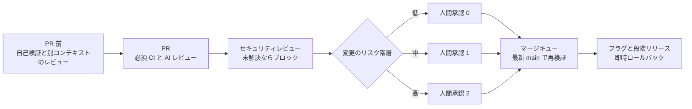
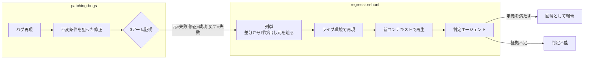
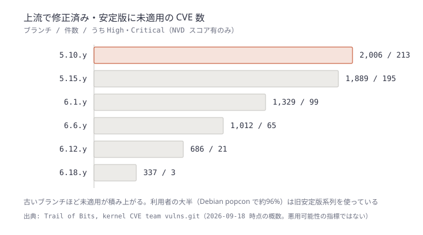
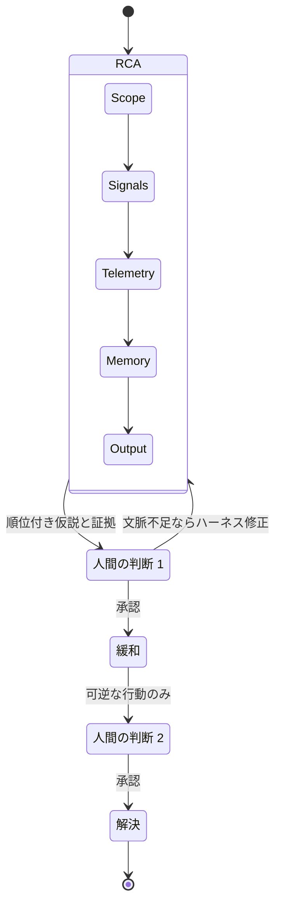
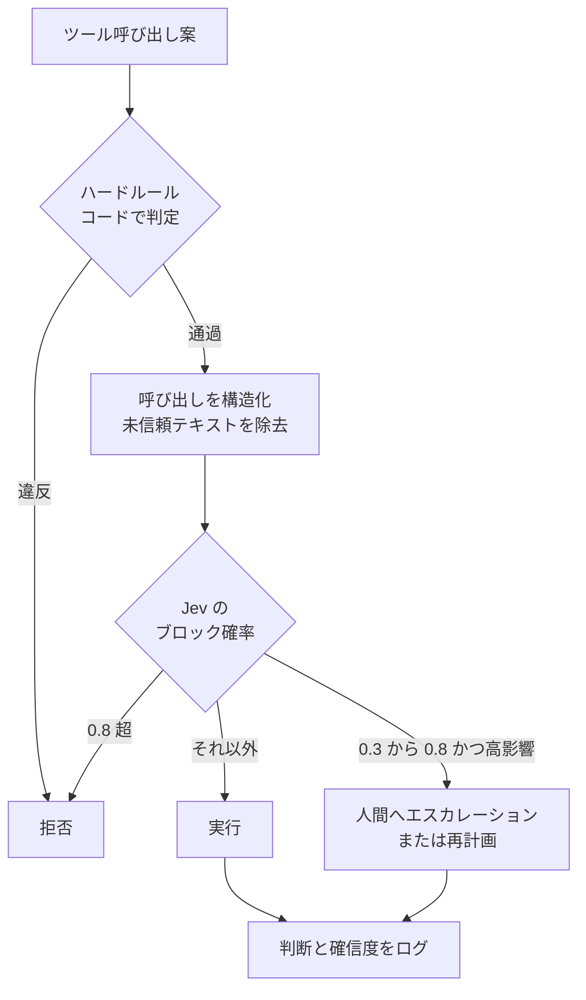

# Daily Briefing 2026-11-20

## 1. Claude Code チームはコードレビューをどう回しているか（原題: How the Claude Code team does code review）

- **URL**: https://claude.dev/blog/solving-code-review-at-anthropic/
- **公開日**: 2026-10-15
- **著者・媒体**: Addy Osmani, Morgan Westlee Lunt, Qing Wang / Claude Blog（Anthropic）

### 本文翻訳

Claude Code のコードは約90%を Claude 自身が書いている。6月から9月にかけてマージ済み PR は2倍超に増え、リバートが必要な変更の割合は40%以上下がった。Anthropic のモノレポ全体では、1日に取り込まれる変更が5月の約2,500件から9月には30,000件超になった。行単位の人手レビューでは追いつかない。チームはレビューを廃止したのではなく、読む作業の大半を機械に移し、**リバートやインシデントを増やさない範囲で人間のレビュー時間を最小化する**ことを目標に据えた。

**レビューの目的の再定義。** レビューには「出荷前に問題を見つけて直す」と「チームで文脈を共有する」の2つの役割がある。問いを「人間がコードを読んだか」から「この変更で何が壊れうるか、それを捕まえるのに適したチェックは自動か人間か」へ変えた。レビューは最後の関門ではなく、書いている最中のスペルチェックのように継続的に走る。

**計測。** PR あたりの人間の承認数（中央値と p95）、人間のコメント数、PR が人を待つ時間を追う。リバート率とインシデント率がガードレールで、これが上がれば人の時間を「移した」だけで「節約した」ことにはならない。

**変更のライフサイクル。** PR 前: Claude がテスト・ビルド・リンタを実行し、別エージェントが新しいコンテキストで差分をレビュー。PR ごと: 必須 CI、Claude によるコードレビュー、セキュリティレビュー、リスクベースの人間承認。マージ: マージキューが最新 main に対して再チェック。マージ後: フィーチャーフラグ（社内先行）、`latest` → `stable` の段階リリース、オンコール監視と即時ロールバック。

**レイヤーごとの詳細。**
1. *レビュー前の検証*: Claude に実行できるもの（テスト、ビルド、デザインとのスクリーンショット比較）を与え、成功を主張させず出力を見せさせる。Boris Cherny は、検証手段を与えると結果が2〜3倍良くなると見積もる。繰り返し出る指摘は発生源（スキル、lint ルール、指示ファイル）で潰す。`CLAUDE.md` は短く保ち、コードオーナーが書く `REVIEW.md` で領域ごとに「何が失敗か」（ドキュメントなら「嘘をつく」、設定なら「誤ルーティング」）、nit の上限、スキップするパス、ファイルと行の証拠の要求を定める。
2. *全 PR への AI レビュー*: リサーチプレビュー開始時、実質的コメントが付く社内 PR の割合は16%から54%に上がった。リポジトリごとに Quick / Standard / Deep を選ぶ。複数エージェントが並列にバグを探し、別グループが投票し、合意が十分なものだけを **Important / Nit / Pre-existing** のタグ付きで投稿する。全指摘に「直す」か「理由を書いて解決」で応答する。
3. *ブロックするセキュリティレビュー*: 未解決の指摘がある限りマージ不可。
4. *リスクベースの人間承認*: 低リスク（ドキュメント、フラグ裏の追加的変更など）は自動チェック通過で人間承認ゼロ、中リスクは1名、高リスクは2名。**階層は作者ではなく変更が決める。** 分類器が階層を決め、別の分類器が「それでも人が要るか」を問う。CI ワークフローファイルと所有者指定の機微パスは常に1名必要。軽い経路は信頼された作者のみ。エージェントの承認は人間の承認枠を埋めない。エージェントに指示した人は必須レビュアーになる。承認は特定コミットに紐づき、新しいコミットで再承認が要る。
5. *マージキュー・フラグ・段階リリース*、そして *検知とロールバック*。ただし、リバートやインシデントが増えたら承認を自動的に厳しくするサーキットブレーカーはまだ無く、ゼロ人間マージを広げる前に欲しいと認めている。

**レビュアー自体の改善。** 過去にインシデントを起こした PR を評価セットにし、プロンプト・ツール・モデルを変えるたびに全件で採点する。ノイズは作者の反応（修正した／誤りと言った／意図的と言った／重要でないと判断）で分類して測る。エージェント作者とエージェントレビュアーは無限ループしうる。ある PR は一晩で50往復超し、git blame では指摘の約59%が初回時点で既に存在したコードだった。対策として3往復で設計の再考を促す上限、数回以降は差分のみ再レビュー、バグクラス単位での指摘、重複指摘の禁止を入れた。結果、1往復で通る割合は65%→78%、5往復以上は8.9%→1.5%、平均レビュー回数は2.08→1.32。

**人間が残る場所**は、作るかどうかの判断、リスクの高いコード（課金、自動更新、CI）、他者が真似るアーキテクチャ、証拠の確認、そして全変更への説明責任。「取り込んだ人が持ち主」という原則が成り立つのは、変更が小さく、フラグと段階リリースで数分以内に巻き戻せるからだ。

### 重要ポイント
- 目標は「人間のレビュー時間の最小化」、ガードレールは **リバート率とインシデント率**。人が読んだかどうかは指標にしない
- 承認階層は作者ではなく変更内容が決める。CI ワークフローと機微パスは常に人間1名、エージェント承認は人間枠に数えない
- `REVIEW.md` でコードオーナーが「この領域の失敗とは何か」を定義し、nit 上限と証拠要求を明文化する
- レビュー往復に上限（3回）を設けると、1往復通過率 65%→78%、平均レビュー回数 2.08→1.32
- 過去のインシデント PR を評価セットにして、レビュアーの変更ごとに回帰採点する

### 図解



### 戦略分析

**フレームワーク**: 制約理論（TOC）× DORA Four Keys

| TOC の段階 | 記事での対応 |
|---|---|
| 制約の特定 | 1日3万件の変更に対し、人間のレビュー時間が制約 |
| 制約の徹底活用 | 人間には投票で絞った指摘とリスク階層「中・高」だけを回す |
| 他を制約に従属 | PR 前の自己検証、`REVIEW.md`、往復上限で人に届く前に品質を上げる |
| 制約の引き上げ | 低リスクは人間承認ゼロでマージ（自動チェック通過が条件） |

DORA の観点では、デプロイ頻度（マージ数2倍超）と変更失敗率（リバート率40%超減）の **両方** が改善したと記事は主張している。速度だけの主張ではない点が重要。

**示唆**: 「AI レビューを入れるか」ではなく「どの変更から人間承認を外すか」を先に決める。具体的には (1) 自社でリバート率・インシデント率をベースライン計測し、(2) ドキュメントとフラグ裏の追加変更だけを人間承認ゼロにし、(3) リバート率が悪化しないことを確認してから範囲を広げる。CI ワークフローと認証・課金パスは CODEOWNERS で最初から除外する。

**反証条件**: フィーチャーフラグと数分でのロールバックが無い組織では、「取り込んだ人が持ち主」と低リスクの無承認マージは成立しない。巻き戻しコストが高い（モバイルアプリのストア審査、DB マイグレーション中心）プロダクトでは、記事の数値は再現しないと考えるべき。

### 現場での適用方法

**`REVIEW.md` の雛形**（コードオーナーが領域ごとに書く）:

```markdown
# REVIEW.md — <AREA_NAME>（owner: @<TEAM>）

## この領域での「失敗」とは
- 認可チェックを経ずにテナント境界を越えるデータを返す
- マイグレーションが本番データを不可逆に変更する

## 必ず確認すること
- 変更された API のすべての呼び出し元（ファイル:行 を根拠として示す）
- 新しい設定キーのデフォルト値が安全側か

## 指摘しないこと
- 命名・書式（lint が担当）
- nit は最大3件まで

## スキップするパス
- `generated/**`, `vendor/**`

## 出力形式
- 冒頭に「重要 N 件 / nit N 件」。指摘が無ければ「修正不要」と明記
- 推測で書かない。ファイルと行の証拠が無い指摘は出さない
```

**GitHub でのリスク階層の強制**（`.github/CODEOWNERS` と merge queue 対応）:

```text
# .github/CODEOWNERS — ここに該当するパスは常に人間の承認が必要
/.github/workflows/   @<ORG>/platform-owners
/src/auth/            @<ORG>/security-owners
/src/billing/         @<ORG>/billing-owners
```

```yaml
# .github/workflows/ci.yml — merge queue で再検証されるよう merge_group を必ず含める
on:
  pull_request:
  merge_group:
    types: [checks_requested]
```

ブランチ保護では「Dismiss stale pull request approvals when new commits are pushed」と「Require review from Code Owners」を有効化する。

### 期待効果
- 記事の実績: マージ PR 2倍超、リバート率40%超減、AI の実質的コメント付与率 16%→54%
- 往復上限の導入で 5往復以上の PR が 8.9%→1.5%、平均レビュー回数 2.08→1.32
- 人間の注意をリスク階層「中・高」に集中できる

### 注意点
- 記事自身が、リバート増加時に承認を厳しくする **サーキットブレーカーが未整備** と認めている。ゼロ人間マージの拡大はそれを作ってから
- 分類器が階層を決めるため、分類器や CI ワークフローの変更自体を高リスクとして扱わないと抜け道になる
- 文脈共有（チームがコードを理解し続けること）は正式なプロセスが無いと記事も認めている。オンボーディングや設計判断の継承は別途手当てが要る

## 2. AI エージェントはバグを直した。では他に何を変えたのか（原題: Your AI agent fixed the bug, but what else did it change?）

- **URL**: https://blog.trailofbits.com/2026/10/21/your-ai-agent-fixed-the-bug-but-what-else-did-it-change/
- **公開日**: 2026-10-21
- **著者・媒体**: Anish Naik, Marcelo Morales / Trail of Bits Blog

### 本文翻訳

Trail of Bits は、エージェント駆動のパッチ作成のために2つのプラグイン **patching-bugs** と **regression-hunt** を公開した。patching-bugs は報告されたバグを再現し、修正を作り、テストする。regression-hunt は、変更が「以前は正しく動いていて今も サポート対象の挙動」を壊していないかを調べる。エンジニアが指揮し、結果をレビューする。メンテナは自分たちのセキュリティ前提とパッチ規約を与えられ、エージェントをプロジェクトの制約内に留められる。

両プラグインは OpenAI との共同イニシアチブ Patch the Planet から生まれた。同プロジェクトは広く使われる OSS に数百のセキュリティパッチを共著している。

**パッチ作成の標準化。** 9月の記事で一部のパッチに回帰があったことを報告して以来、エンジニアが書き上流にマージされた全パッチを見直した。**130件超のマージ済み PR から21件の回帰を確認**した（機能16、性能1、ビルド・テスト4）。セキュリティ保護を壊したものは無かった。回帰の定義は「変更によって持ち込まれた新しい欠陥で、実際のユーザーや攻撃者が到達できる経路上の、以前は正しくサポートされていた挙動を壊すもの」。

問題はノイズだった。1回のエージェント実行で候補が58件出て、本物は21件、精度は約36%。エージェントはやり方も結論も毎回違うので、実行のたびに手で仕分ける候補が増える。そこで2つの結論に至った。(1) パッチの書き方を標準化し同じチェックを毎回かければ回帰は減る。(2) 検出方法と「何を回帰と呼ぶか」を明文化すれば残りも捕まる。標準化すると実行が再現可能・比較可能になる。エンジニアのセッションからエージェントの軌跡を集め、前バージョンが失敗したタスクを次バージョンのベンチマークにしている。

**設計原則。** (1) 最小限で意見の強いガイダンス: 自由度は広く与え、「良いパッチ」「本物の回帰」の判断基準だけを符号化する。(2) モジュール化: 端から端まで通しても、個別スキルだけ使ってもよい。(3) 厳格な入出力スキーマ: 各ステップは主張・コードリビジョン・必要なチェック・生の証拠・未解決の問いを含む構造で受け渡す。次のステップは前のステップの要約を信じず、検証し直せる。(4) すべての主張にライブ PoC: ビルドして起動したプロジェクトに、実際のユーザーインターフェース経由で PoC を当てる。PoC を作れなければ結果は「判定不能」。

**regression-hunt** は4段階。列挙（差分を呼び出し元から実インターフェースまで辿って候補を出す）→ 再現（ライブ環境で再現）→ 再生（新しいコンテキストのエージェントが PoC を再実行）→ 判定（証拠が定義を満たすか）。立証責任は判定エージェント側にあり、偽陽性・不完全な修正・潜在バグ・既存バグを除外するゲートを通ったものだけを報告する。`THREAT_MODEL.md` があれば全ステップに渡す。21件の既知回帰で評価したところ、ベースラインの Codex プロンプトより **偽陽性が25%少なかった**（95%信頼区間 14〜38%）。代償として、厳しい証拠要件のため一部の既知回帰が「ボーダーライン」止まりになった。

**patching-bugs** は数千の Codex セッションから実践を抽出した。核は **3アーム証明**: 同じ再現を、元のコード（失敗すべき）・パッチ後（成功すべき）・パッチを完全に戻したもの（再び失敗すべき）の3つに当てる。戻すとバグが再発することで、無関係な環境やテストの変化ではなくパッチが直したと示せる。さらに、症状ではなく破られた **セキュリティ不変条件** を狙って直すことで同種の変異もカバーし、全パッチに regression-hunt を必須でかける。

**推奨。** 資産・信頼境界・アクセス制御・サポート構成・何を脆弱性／回帰と呼ぶか・有効なバグ報告に必要な証拠を定義した `THREAT_MODEL.md` を書く。ビルドとテスト方法、修正の想定サイズ、修正を置く場所、変更の示し方、回帰テストが示すべきことを書いた `PATCHING_GUIDELINES.md`（または `AGENTS.md`）を用意する。

### 重要ポイント
- 専門家が監督した AI パッチでも **130件超中21件に回帰**（ただしセキュリティ保護の破壊はゼロ）
- 素朴な「回帰を探して」プロンプトの精度は約36%。回帰の定義とライブ PoC 必須化で偽陽性を25%削減
- 3アーム証明（元=失敗 / 修正後=成功 / 修正を戻す=再び失敗）で「パッチが直した」ことを示す
- ステップ間は構造化スキーマで受け渡し、次ステップは前の要約を信じず再検証する
- `THREAT_MODEL.md` と `PATCHING_GUIDELINES.md` がエージェントを制約内に留める入力になる

### 図解



### 戦略分析

**フレームワーク**: 品質のコスト（予防・評価・失敗コスト）

| 区分 | 記事での具体策 | 効く場所 |
|---|---|---|
| 予防コスト | パッチ手順の標準化、不変条件ベースの修正、`PATCHING_GUIDELINES.md` | 回帰の発生自体を減らす |
| 評価コスト | regression-hunt、3アーム証明、ライブ PoC | 人手で仕分ける候補（精度36%）を削る |
| 内部失敗コスト | 候補58件の手作業トリアージ | 偽陽性25%減で縮小 |
| 外部失敗コスト | 上流マージ後に見つかった回帰21件 | メンテナの信頼を損なう最大のコスト |

**示唆**: AI 修正 PR の自動化を進める組織は、修正生成の精度より先に **回帰の定義と証拠要件** を文書化するべき。具体的には、Dependabot／エージェント修正の PR テンプレートに「修正前に失敗するテスト」「修正後に成功」「修正を戻すと再び失敗」の3つの実行ログ添付を必須にし、満たさない PR はレビューキューに入れない。これは人間レビュアーの評価コストを直接下げる。

**反証条件**: プロジェクトを「ビルドして起動し、実インターフェース経由で叩ける」環境が無い場合（組込み、特定ハードウェア依存、本番相当データが無いと再現しない業務システム）、ライブ PoC 必須の方針は判定不能を量産し、かえってスループットを落とす。

### 現場での適用方法

**`THREAT_MODEL.md` と `PATCHING_GUIDELINES.md` の骨子**（記事の推奨項目をそのまま章立てにしたもの）:

````markdown
# THREAT_MODEL.md

## 資産
- <ASSET_1>（例: 顧客の認証トークン）

## 信頼境界
- 外部入力: <HTTP API / ファイルアップロード / CLI 引数>
- 信頼する入力: <内部設定ファイル>

## サポート対象の構成
- <OS / ランタイムバージョン / ビルドフラグ>

## 脆弱性とみなすもの / みなさないもの
- みなす: 未認証での任意ファイル読み取り
- みなさない: ローカル管理者権限を前提とする攻撃

## 回帰の定義
- 変更で新たに入った欠陥で、実ユーザーまたは攻撃者が到達可能な経路上の、
  以前は正しくサポートされていた挙動を壊すもの

## 有効なバグ報告に必要な証拠
- ビルド済み・起動済みインスタンスに実インターフェース経由で当てた PoC
````

````markdown
# PATCHING_GUIDELINES.md

## ビルドとテスト
```
<BUILD_COMMAND>
<TEST_COMMAND>
```

## 修正の方針
- 想定サイズ: 原則 <N> 行以内。超える場合は理由を PR に書く
- 症状ではなく破られた不変条件を直す。同種の変異を grep で洗い出す

## 3アーム証明（PR 本文に3つの実行ログを貼る）
1. 修正前: 再現テストが失敗する
2. 修正後: 再現テストが成功する
3. 修正を revert: 再現テストが再び失敗する

## 回帰テストが示すべきこと
- 変更した関数の全呼び出し元の既存挙動が変わらないこと
````

**3アーム証明のスクリプト化例**:

```bash
#!/usr/bin/env bash
# three-arm.sh <FIX_COMMIT> <REPRO_CMD>
set -uo pipefail
FIX="$1"; REPRO="$2"
run() { bash -c "$REPRO" >/dev/null 2>&1; echo $?; }

git checkout -q "${FIX}~1"; before=$(run)
git checkout -q "${FIX}";   after=$(run)
git revert --no-commit "${FIX}"; reverted=$(run); git revert --abort

echo "before=$before after=$after reverted=$reverted"
[ "$before" -ne 0 ] && [ "$after" -eq 0 ] && [ "$reverted" -ne 0 ] \
  && echo "PASS: パッチが修正したことを確認" || { echo "FAIL"; exit 1; }
```

### 期待効果
- 回帰検出の偽陽性を約25%削減（記事の評価、95%CI 14〜38%）
- 手作業トリアージ対象（1回の実行で58候補、本物21件）の縮小
- 上流メンテナへの「直したが他を壊した」PR の減少

### 注意点
- 厳格な証拠要件は偽陽性を減らす代わりに、既知の回帰の一部を「ボーダーライン」に落とす。見逃しとのトレードオフを理解して使う
- 評価は21件の既知回帰に対するもので小規模。patching-bugs 自体の効果は記事でも「今後の課題」とされている
- 記事は個別の回帰事例を詳述していないため、自社でどの種類の回帰が出るかは自分で計測する必要がある

## 3. Codex でセキュリティ修正のバックポートを大規模に回す（原題: Backporting security fixes at scale with Codex）

- **URL**: https://blog.trailofbits.com/2026/11/02/backporting-security-fixes-at-scale-with-codex/
- **公開日**: 2026-11-02
- **著者・媒体**: Artem Dinaburg / Trail of Bits Blog

### 本文翻訳

Trail of Bits は Codex（GPT-5.6）を使い、上流の最新コードで入ったセキュリティ修正を古い安定版リリースへ移植（バックポート）する作業を、1件あたり数日から数時間に短縮した。2026-10-29 時点で、**149件の異なる CVE の修正** を Linux カーネルの安定版リリースに届け、Fedora と Ubuntu のパッケージにもいくつか修正を出している。

**問題: 修正は間違った場所に先に入る。** バグは通常、最新版で直され、多くの場合そこでしか直されない。バックポートは忙しいボランティアに頼ることが多く、評価もされにくいので後回しになる。XFS 開発者 Dave Chinner は「実質フルタイムの仕事」だが資源が無ければ放置されると述べている。一方、利用者は安定版を好む。Ubuntu インストールの約95%は LTS で、Debian の popcon ではインストール済みカーネルパッケージの約96%が最新系列ではない旧安定版だ。利用者は「慣れた安定版を既知の欠陥ごと使う」か「アップグレードして望まない変更を受け入れる」かの偽りの二択を迫られる。著者は「安定性とセキュリティのどちらかを選ばされるべきではない」と書く。

**未バックポートの規模。** カーネル CVE チームの vulns.git（2026-09-18 時点）で、新しいブランチでは修正済みだが古いブランチに無い CVE を数えると、5.10.y が2,006件（High/Critical 213）、5.15.y が1,889件、6.1.y が1,329件、6.6.y が1,012件、6.12.y が686件、6.18.y が337件。ディストリビューションでは Debian 13 で1,128ソースパッケージ・4,562 CVE、Ubuntu 26.04 で1,028パッケージ・770 CVE が未修正（メタデータ上の数で、個別に確認したものではない）。これらは概数で、悪用可能性の指標ではない。AI によるバグ探索で古いコードの欠陥も見つけやすくなるので、このバックログは一層危険になる。

**ワークフロー。** エージェントは、欠けている修正の特定、古いコードへのパッチ適合、依存関係の確認、検証証拠の収集、テスト実行、提出パケットの準備を担う。エンジニアはパッチをレビューしメンテナに提出する。プロジェクト固有の初期設定を除けば、単純なバックポートは人間の注意約30分、込み入ったものは約3時間で済む。ただしこれは準備とレビューだけで、回帰テストとメンテナの受け入れは別に必要だ。

**カーネルでの段階的展開。** (1) まず **クリーンに当たる修正** から。安定版ツリーにそのまま当たるのに一度も取り込まれていなかった既知 CVE の修正を見つけた。著者は「歩道に落ちているお金を拾うようなもの」と呼ぶ。メンテナはそれを適用した。(2) 次にそのままでは当たらないが単純なバックポートを、検証とレビューが容易なものから。(3) より複雑な変更へ徐々に進む。適用済みの修正は公開トラッカーで一覧できる。ディストリビューションでも同じ方法で既知脆弱性を探し、バックポートと検証を行い、最初のバッチを Fedora と Ubuntu に送り始めた。

記事はプロンプトや詳細設定を公開していない。検証として、古いコードへの適合、依存確認、新たなバグを持ち込まないことの確認、検証証拠の収集、テスト、全パッチの人間レビュー、メンテナの受け入れを挙げている。

### 重要ポイント
- 149件の CVE 修正を Linux 安定版に適用。1件あたり人間の注意は単純なもので約30分、複雑なもので約3時間
- 利用者の大半（Ubuntu の約95%、Debian カーネルの約96%）は旧安定版を使う。最新版だけ直しても大半は守られない
- 着手順は「クリーンに当たる未取り込み修正」→「単純な非クリーン」→「複雑」。検証とレビューが容易な順
- エージェントは特定・適合・依存確認・証拠収集・提出準備まで、提出判断は人間
- 未バックポート CVE はカーネル 5.10.y で2,006件。AI による発見の加速でこのバックログの危険度が上がる

### 図解



### 戦略分析

**フレームワーク**: Cost of Delay / WSJF

記事の3段階の着手順は、WSJF（遅延コスト ÷ 作業規模）で並べた結果と読める。以下は記事の記述を WSJF に当てはめた整理で、数値の重みは仮説。

| 段階 | 遅延コスト | 作業規模（記事の人間時間） | WSJF |
|---|---|---|---|
| クリーンに当たる未取り込み修正 | 既知 CVE が放置（高） | 極小（適用のみ） | 最大 |
| 単純な非クリーンバックポート | 高 | 約30分 | 大 |
| 複雑なバックポート | 高 | 約3時間＋回帰テスト | 中 |

**示唆**: 自社が古い LTS のベースイメージやフォーク版ライブラリを抱えているなら、新規の脆弱性スキャンより先に「上流で修正済み・自社ブランチに未適用」の差分を棚卸しする方が費用対効果が高い。具体的には、(1) 上流の修正コミットを自社ブランチに `git cherry-pick --no-commit` して衝突しないものを列挙し、(2) それを最初のバッチとしてエージェントにテストと PR 準備をさせ、(3) 衝突するものは人間時間の見積り順に並べる。

**反証条件**: 自社のソフトウェアが常に最新版へ追随していて（コンテナを毎週再ビルドする、ライブラリを Renovate で即時更新する）、旧ブランチを保守していない組織では、このバックポート戦略の価値は小さい。また、上流と自社ブランチの乖離が大きいフォーク（大規模な独自パッチ）では「クリーンに当たる」修正が少なく、第1段階の収穫が出ない。

### 現場での適用方法

**「上流で修正済み・自社ブランチに未適用」の修正を洗い出し、クリーンに当たるものを列挙するスクリプト**:

```bash
#!/usr/bin/env bash
# find-clean-backports.sh
# 前提: <UPSTREAM_REMOTE>/<UPSTREAM_BRANCH> に修正があり、<STABLE_BRANCH> に未適用
# 入力: fixes.txt に「CVE-ID 修正コミットSHA」を1行ずつ（例: 社内の脆弱性台帳から出力）
set -uo pipefail
STABLE="<STABLE_BRANCH>"
OUT_CLEAN=clean.txt; OUT_CONFLICT=conflict.txt
: > "$OUT_CLEAN"; : > "$OUT_CONFLICT"

git fetch -q <UPSTREAM_REMOTE>
git checkout -q "$STABLE"

while read -r cve sha; do
  # パッチ ID で既に取り込み済みか判定（cherry-pick 済みの別 SHA も検出）
  if git cherry "$STABLE" "$sha" "${sha}~1" | grep -q '^-'; then
    continue
  fi
  if git cherry-pick --no-commit "$sha" >/dev/null 2>&1; then
    echo "$cve $sha" >> "$OUT_CLEAN"
  else
    echo "$cve $sha" >> "$OUT_CONFLICT"
  fi
  git reset -q --hard "$STABLE"
done < fixes.txt

echo "クリーンに当たる: $(wc -l < $OUT_CLEAN) 件 / 衝突: $(wc -l < $OUT_CONFLICT) 件"
```

**CLAUDE.md への追記例**（バックポート用エージェント向け）:

```markdown
## セキュリティ修正のバックポート
- 入力は clean.txt / conflict.txt の CVE と上流コミット。clean.txt から着手する
- 1 CVE = 1 PR。PR 本文に: 上流コミット URL、適合のために変えた箇所、依存関係の差分、
  実行したテストとその出力、未検証の事項
- 古いブランチに無い API を使う修正は、新 API を持ち込まず既存 API で書き直す。
  持ち込みが避けられない場合は実装せず「要人間判断」として報告する
- PR は draft で作成し、マージは人間が行う
```

### 期待効果
- 記事の実績: バックポート1件あたり数日 → 数時間。単純なもので人間の注意約30分
- 第1段階（クリーンに当たる修正）はメンテナにそのまま受け入れられ、低摩擦で成果が出る
- 旧安定版を使う大多数の利用者に修正が届く

### 注意点
- 時間見積りは準備とレビューのみ。回帰テストとメンテナ受け入れの時間は含まれない
- CVE 数は概数で過大・過小の両方の誤差がある。ディストリビューションの数値はメタデータ上の値
- 記事はプロンプトや設定を公開していないため、ワークフローの再現は自前で設計が必要

## 4. Shift-AI: AI で強化するインシデント対応のパターン（原題: Shift-AI: Patterns for AI-Augmented Incident Response）

- **URL**: https://www.mercedes-benz.io/blog/2026-06-02-shift-ai-patterns-for-ai-augmented-incident-response
- **公開日**: 2026-06-02
- **著者・媒体**: João Aires / Mercedes-Benz.io Blog

### 本文翻訳

チームはインシデント対応に AI エージェントを使う試みを行った。中心の主張は、価値は自律的な修正を追うことではなく、エージェントの周りに「ハーネス」（ツール、コンテキスト、スキル、ガードレール）を作ることにある、というものだ。現在も主に根本原因分析（RCA）に集中している。定量的な指標は示していない。

**従来の対応が崩れた理由。** (1) コンテキストスイッチ: ダッシュボード、ログ、デプロイ履歴、設定、ドキュメント、チケットを行き来し、毎回同じ手作業の一巡から始まる。(2) 知識の集中: アーキテクチャ、うるさいサービス、危ないデプロイ、症状ごとの典型原因の頭の中のモデルを少数が持ち、オンコールが脆い。(3) 方法が文書化されず蓄積しない: ポストモーテムは書かれるが実践に戻らない。

**ランブックからエージェントへ。** ランブックは、圧力下で人が正しく従うことに依存する。エージェントは、方法が明示されコンテキストに到達できれば、誰がオンコールでも同じ方法を一貫して実行できる。過去のインシデント、サービス知識、ランブック、デプロイ履歴、調査手順を、エージェントが読める形にする必要がある。チャットや人の頭の中の知識は見えない。この符号化の作業は多くのチームの想定より大きい。

**実際の調査の流れ。** 最も明確な効果は RCA に出た。最初の一巡は5段階: *Scope*（アラートやチケットから時間帯・影響コンポーネント・症状・影響を抽出）、*Signals*（直近のデプロイ、リリース内容、設定差分を相関）、*Telemetry*（ログ、トレース、メトリクス、依存関係）、*Memory*（ランブック、Wiki、過去インシデントを照合）、*Output*（確信度・裏付け証拠・次のアクション付きの順位付き仮説レポート）。エンジニアは組み立て済みのコンテキストと仮説から始め、それを検証・反証する作業に移る。うまくいった構成では、主要な主張ごとに具体的なデータへのリンクがあり、自信ありげな要約を信じる代わりに監査できた。

**驚きと失敗。** 良い驚きは速さ。CrashLoopBackOff のサービスでは、コンテナ再起動パターンとアプリケーションログを相関させ、タブを1つずつ見る手作業より速く診断できた。厳しい驚きは盲点で、「エージェントは自分が知らないことを知らない」。ハーネスにデータソースや組織的文脈が欠けていると、もっともらしいが間違った分析を出す。ある RCA では、本当の原因は新しく追加された直接依存だったのに、エージェントは1つのサービス内を調べ続けた。アーキテクチャとインフラの文脈が欠けていたためだ。うまくいった構成は、仮説ごとの確信度、欠けている文脈と反証の明示的チェック、見逃し時の人間によるハーネス修正、を明示していた。

**人間が主導権を持つ。** 対応を RCA・緩和・解決のフェーズに分け、フェーズ内はエージェントが支援し、フェーズ間の移行には人間を置く。分析から行動へ移る前に人間の判断を必須にする。行動・証拠・根拠を完全にログする。全結果に名前のある人間のオーナーを置く。不可逆・高影響の行動は承認（human-in-the-loop）、低リスクで可逆なものは監督（human-on-the-loop）。監督の強さは範囲と可逆性で決め、デモの出来で決めない。

**最もよくある誤りはツールだけつなぐこと。** 可観測性やチケットへの接続は必要だが不十分で、暗黙知と運用手順を符号化した Agent Skills との組み合わせが要る。ハーネスは一度きりのプロジェクトにしない。スキルはコードのようにバージョン管理し、インシデントごとに更新する。導入順はジュニアエンジニアのオンボーディングに似て、行動より検索から、提案モードで、ロールバック経路がある狭い低リスク行動だけを許し、悪い提案はフィードバックとして扱い、信頼を得てから範囲を広げる。SRE の役割は、手作業の調査からハーネスの設計・保守（調査とエスカレーションの手順、安全境界、ドメイン知識の整備、重要判断の主導、エージェントの仕事の評価）へ移る。

### 重要ポイント
- 価値はエージェントそのものではなく **ハーネス**（ツール＋コンテキスト＋スキル＋ガードレール）にある
- RCA の一巡を Scope → Signals → Telemetry → Memory → Output の5段に固定し、出力は確信度と証拠リンク付きの順位付き仮説
- 失敗の典型は「知らないことを知らない」。欠けている文脈を明示的に問うチェックを入れる
- RCA・緩和・解決のフェーズ移行に人間を置き、監督の強さは可逆性で決める
- スキルはコードとしてバージョン管理し、インシデントごとに更新する

### 図解



### 戦略分析

**フレームワーク**: ケイパビリティ成熟度モデル

記事は定性的な記述にとどまるため、以下の段階区分は記事の記述から組み立てた仮説。

| 段階 | 完了条件（記事の記述から） | 記事の到達点 |
|---|---|---|
| 1. ツール接続 | 可観測性・チケットにエージェントが読み取りアクセス | 通過 |
| 2. 方法の符号化 | RCA 5段階とドメイン知識がスキルとして版管理されている | 通過 |
| 3. 監査可能な RCA | 仮説ごとに確信度と証拠リンク、欠落文脈チェック | 現在地 |
| 4. 提案型の緩和 | ロールバック・設定変更・フラグ操作を提案し、回復を確認 | 未到達 |
| 5. 限定的な自律行動 | 可逆な低リスク行動を監督下で実行 | 未到達 |

**示唆**: 多くの組織は段階1（ツール接続）からいきなり段階4〜5を狙うが、記事は「ツールだけつなぐのが最大の誤り」と言う。次の四半期の投資は、エージェント製品の追加ではなく、直近 N 件のポストモーテムから「最初の30分に人がやった確認」を抜き出してスキル化する作業に充てる。段階3の完了条件（証拠リンク付き仮説）を満たすまで書き込み権限は与えない。

**反証条件**: インシデントの大半が単一サービス内で完結し、オンコールが少人数で知識が既に共有されている小規模組織では、符号化コストに見合う効果が出ない可能性がある。また、ハーネスの保守担当（記事で言う SRE の新しい役割）を置けない組織では、スキルが陳腐化して誤った RCA を量産するリスクの方が大きい。

### 現場での適用方法

**RCA 一巡のスキル化例**（`.claude/skills/incident-rca/SKILL.md`）:

````markdown
---
name: incident-rca
description: アラートやインシデントチケットを受けて、根本原因の仮説を確信度と証拠付きで提示する。読み取り専用で、緩和操作は行わない。
---

# インシデント RCA（読み取り専用）

## 手順
1. **Scope**: アラート/チケットから時間帯・影響コンポーネント・症状・影響範囲を抽出
2. **Signals**: 該当時間帯の前後 <N> 時間のデプロイ、リリース内容、設定差分を列挙
   ```
   <DEPLOY_HISTORY_COMMAND> --since "<START>" --until "<END>"
   ```
3. **Telemetry**: ログ・トレース・メトリクス・依存関係を確認。
   **直接依存先の変更も必ず調べる**（単一サービス内に閉じない）
4. **Memory**: `runbooks/` と `postmortems/` から類似インシデントを検索
5. **Output**: 下記形式で出力

## 出力形式
| 順位 | 仮説 | 確信度 | 証拠（クエリ/リンク） | 反証のための次の確認 |
|---|---|---|---|---|

- **欠けている文脈**: 参照できなかったデータソースを列挙する
- 確信度が中以下の仮説しか無い場合は「人間の調査が必要」と明記する

## 禁止
- 再起動、ロールバック、設定変更、スケール変更などの書き込み操作
````

**インシデント後のハーネス更新手順**:

```bash
# ポストモーテム完了時に実施（担当: インシデントオーナー）
# 1. エージェントの RCA 出力と実際の根本原因を比較し、差分を記録
cat >> harness/misses.md <<'MD'
## <INCIDENT_ID>
- エージェントの第1仮説: <...>
- 実際の原因: <...>
- 欠けていた文脈: <例: 新規追加された依存サービスのアーキテクチャ情報>
- 対処: <スキル/ランブック/データソースの追加内容>
MD
# 2. スキルを更新して PR（スキルはコードとしてレビューする）
git checkout -b harness/<INCIDENT_ID>
git add .claude/skills/incident-rca/ harness/misses.md runbooks/
git commit -m "harness: <INCIDENT_ID> の見逃しを反映"
```

### 期待効果
- 毎回の手作業の一巡（ダッシュボード・ログ・デプロイ履歴の巡回）の削減
- 知識の属人化の緩和。誰がオンコールでも同じ方法で一次調査が走る
- 記事は定量値を示していない。CrashLoopBackOff の事例で手作業より速く診断できたという定性報告のみ

### 注意点
- 符号化（過去インシデント、サービス知識、手順をエージェントが読める形にする）作業は想定より大きい
- ハーネスに欠落があると、もっともらしいが誤った RCA を自信ありげに出す。確信度と証拠リンクを必須にする
- 書き込み操作を許すのは、ロールバック経路がある狭い行動に限り、信頼を得てから

## 5. Jev の使い方: AI エンジニア向け実践ガイドとユースケース（原題: How to Use Jev: A Practical Guide + Use Cases for AI Engineers (2026)）

- **URL**: https://aiengineerinsights.com/blog/how-to-use-jev/
- **公開日**: 2026-09-23
- **著者・媒体**: Gurram Poorna Prudhvi / AI Engineer Insights

### 本文翻訳

Jev は TypeSafe AI の「System One」モデルで、非自己回帰型だ。テキストを生成せず、型付きの判断と較正された確信度を返す。著者は、モデルルーティング、ツール呼び出しのゲート、ラベル付けといったエージェントループ内の判断点に向くと主張する。

**入手方法。** 2026-09-15 にアーリーアクセス開始、09-21 頃にウェイトリスト撤廃。経路は4つ: TypeSafe API 直接（LangChain と Pydantic 連携はこれが前提）、OpenRouter、Cloudflare Workers AI（モデル ID `typesafe/jev`、TypeSafe のキー不要で最も手軽）、Composio。価格はローンチ時点で入力100万トークンあたり $0.042、出力無料、コンテキスト32,000トークン。SDK は新しいので正確なシグネチャは最新ドキュメントを確認すること。

**出力型。** Choice（最大255ラベルから1つ）、Score（数値）、較正済み確率（Yes/No の確率。0.8 ならおよそ80%当たることを意図）。すべての回答に確信度が付く。注意点として、**保証されるのは形であって値ではない**（ラベルは間違いうる）。測定された期待較正誤差は約0.107。確信度は 0.3〜0.8 の中間帯で最も信頼できず、0 や 1 に近い値ほど使える。理由や自由文は返さない。数を数えることや日付比較は苦手なので、算術はコードで行いフィールドとして渡す。

**連携。** LangChain の `TypeSafeClassifier` はエージェント状態と質問を受け取り型付き判断を返す。Pydantic のスキーマを出力制約に使える。Workers AI ではオリジンに届く前のエッジでゲートや分類ができる。MCP はツールの発見と呼び出しを担い、Jev はその呼び出しを進めるべきかを判断する。両者は組み合わさる。

**ユースケース。** ルーティング（単純か複雑か。レイテンシ約70〜500ms。中間の確信度は大きいモデルへ）、ツール呼び出しガードレール（プロンプトインジェクションで判定が動くので破壊的操作にはハードルールか人間を残す）、分類・モデレーション（ラベルは常に有効だが正しいとは限らない。サンプル監査する）、ゲームやロボットのリアルタイムループ。TypeSafe は最大約193.6倍速い・444.6倍安いと主張するが、ベンダーが選んだワークフローでの数値で、444.6倍は他2モデルとの一致度を基準にしており正解データに対する精度ではない。

**実践パターン: ルーティング＋ツール呼び出しガードレール。** (1) 到着時にルーティング: 確信度が高い「単純」だけ小さいモデルへ、中間帯を含む残りは大きいモデルへ。(2) 計画モデルが通常どおりツール呼び出しを提案。(3) 実行前にゲート: 生のユーザーテキストではなく、構造化した呼び出し（ツール名・引数・組み立てた文脈）を渡して「ブロックすべきか」の確率を聞く。(4) **ハードルールを先に適用**: リポジトリ削除、送金、本番操作はモデルと無関係なコードのチェックで止める。(5) 中間帯はエスカレーション: 高影響の操作で 0.3〜0.8 なら人間に渡すか再計画。(6) 判断と確信度をログし、精度と分布変化を測る。閾値は、ルーティングは確信度0.9、ゲートは0.8超で拒否、0.3〜0.8かつ高影響なら人間へ。

**セキュリティ上の注意: プロンプトインジェクション。** 出力が構造化されていても、敵対的な入力は判定を動かす。VentureBeat の報道では、Octomind のエンジニアが偽の `user pre-approved` フィールドを足しただけで、コマンドは同じまま「このコマンドをブロックすべきか」の確率が **0.76 から 0.48** に下がった。TypeSafe の制限事項ページも敵対的コンテンツは答えを動かしうると書く。ルール: 信頼できない入力（ユーザー文、スクレイピングした Web、ファイルやツールの出力）を、コードで構造化・除去・要約せずに実行ゲートへ渡さない。高影響のゲートには必ずハードルールか人間を置く。確信度は操作されうるとみなし、閾値をセキュリティ境界にしない。「pre-approved」のようなフィールドは、Jev が読むテキストではなく認証済みのコードから来るようにする。

**使うべきでない場面。** 説明が必要なとき、算術的な判断、敵対的入力かつ不可逆な操作（許可リストを使う）、自社のラベル付きトラフィックで測る前、正規表現や表引きで既に正しく動くとき。

### 重要ポイント
- Jev が保証するのは **出力の形** で、値の正しさではない。期待較正誤差は約0.107、0.3〜0.8 の中間帯は信頼性が低い
- ルーティングは確信度0.9超の「単純」だけ小モデルへ。中間帯は大モデルに倒す
- ツールゲートは「ハードルール（コード）→ Jev の確率 → 中間帯かつ高影響なら人間」の順
- 偽の `user pre-approved` フィールドでブロック確率が 0.76→0.48 に低下した実例。閾値はセキュリティ境界ではない
- 判断と確信度は全件ログし、サンプルにラベルを付けて自社データでの精度を測る

### 図解



### 戦略分析

**フレームワーク**: リスク×可逆性マトリクス

| | 可逆（読み取り、ドラフト作成） | 不可逆（削除、送金、本番変更） |
|---|---|---|
| 入力が信頼できる（構造化済み） | Jev 単独で判定してよい | ハードルール＋Jev、中間帯は人間 |
| 入力が信頼できない（Web、ユーザー文） | Jev ＋サンプル監査 | 許可リストのみ。Jev を境界にしない |

**示唆**: Jev を導入する際の最初の作業は、閾値の調整ではなく、自社エージェントのツールをこの4象限に仕分けることだ。右下（未信頼入力×不可逆）に入るツールは、Jev を挟む前にコードの許可リストへ移す。左上から導入し、シャドーモードで判断ログを1〜2週間取り、ラベル付きサンプルで 0.3〜0.8 帯の誤り率を自社データで測ってから閾値を決める。記事の 0.9 / 0.8 / 0.3 はあくまで出発点。

**反証条件**: エージェントのツール呼び出し頻度が低く（1タスク数回程度）、レイテンシやコストが問題になっていない場合、Jev を挟む利点は小さく、既存の LLM による判定や単純な許可リストで十分な可能性が高い。また、判断に理由の説明が必要な監査要件がある業務（金融の与信判断など）では、理由を返さない Jev は主要な判定器になれない。

### 現場での適用方法

**Python 実装の骨子**（記事は擬似コードのみのため、SDK 呼び出し部分は `<JEV_CLIENT>` をプレースホルダとし、最新ドキュメントで置き換える）:

```python
# tool_gate.py
from dataclasses import dataclass
import json, logging, time

HIGH_IMPACT_TOOLS = {"delete_repo", "transfer_funds", "deploy_prod", "bash"}
ROUTE_THRESHOLD = 0.9    # 記事の出発点。自社データで再調整する
BLOCK_THRESHOLD = 0.8
ESCALATE_LOW = 0.3

log = logging.getLogger("tool_gate")

@dataclass
class Decision:
    action: str   # "execute" | "block" | "escalate"
    reason: str

def violates_hard_rule(call: dict) -> str | None:
    """モデルを使わないコードのチェック。最初に必ず実行する。"""
    if call["tool"] == "delete_repo":
        return "repo deletion is never automated"
    if call["tool"] == "bash" and any(
        p in call["args"].get("cmd", "") for p in ("rm -rf /", "git push --force")
    ):
        return "destructive shell pattern"
    return None

def structured(call: dict) -> dict:
    """未信頼テキストを渡さない。承認フラグはここで付けず、認証済みコードからのみ来る。"""
    return {
        "tool": call["tool"],
        "arg_keys": sorted(call["args"].keys()),
        "target_env": call.get("target_env", "unknown"),
    }

def gate(call: dict, jev) -> Decision:
    if (why := violates_hard_rule(call)):
        return Decision("block", f"hard rule: {why}")

    verdict = jev.decide(                       # <JEV_CLIENT> の実 API に置き換える
        question="Should this tool call be blocked?",
        input=structured(call),
    )
    p = verdict.probability
    log.info(json.dumps({"ts": time.time(), "tool": call["tool"], "p_block": p}))

    if p > BLOCK_THRESHOLD:
        return Decision("block", f"p_block={p:.2f}")
    if p > ESCALATE_LOW and call["tool"] in HIGH_IMPACT_TOOLS:
        return Decision("escalate", f"uncertain p_block={p:.2f} on high-impact tool")
    return Decision("execute", f"p_block={p:.2f}")
```

**導入手順**:
1. エージェントの全ツールをリスク×可逆性の4象限に仕分け、右下を許可リスト化する
2. `gate()` をシャドーモード（判定をログするだけで実行は止めない）で1〜2週間動かす
3. ログから 0.3〜0.8 帯を中心に 100〜200 件をサンプリングして人手でラベル付けし、誤り率を測る
4. 閾値を自社データで決め直してから、ブロックとエスカレーションを有効化する

### 期待効果
- 記事の数値: 入力 $0.042/100万トークン・出力無料、ルーティングのレイテンシ約70〜500ms
- 大きなモデルへの一律送信を減らし、単純なリクエストを小さいモデルへ回せる
- ツールゲートの判断が全件ログに残り、精度と分布変化を継続的に測れる

### 注意点
- 193.6倍・444.6倍はベンダーが選んだワークフローでの主張で、自社の誤り率を示さない
- プロンプトインジェクションで判定は動く。高影響ゲートにはハードルールか人間を必ず残す
- SDK は新しく API が変わりうる（LangChain のミドルウェアは experimental 扱い）。バージョン固定と回帰テストを
