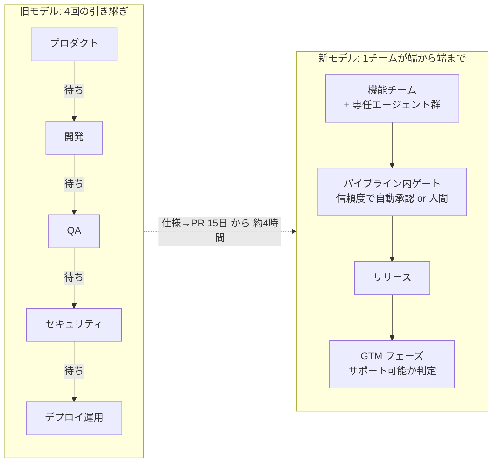
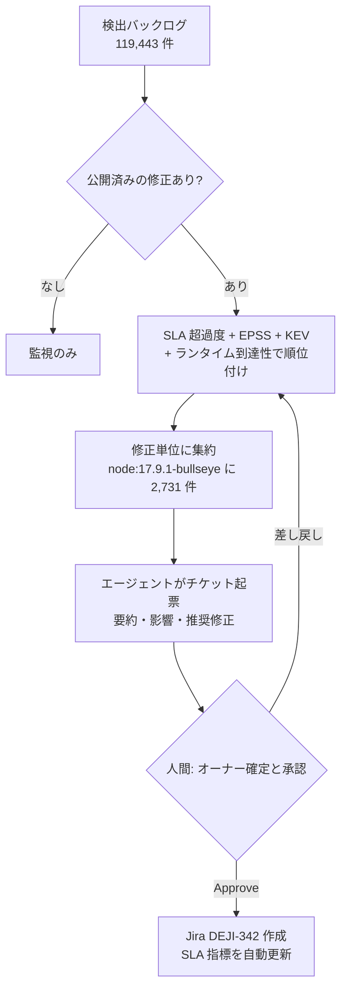
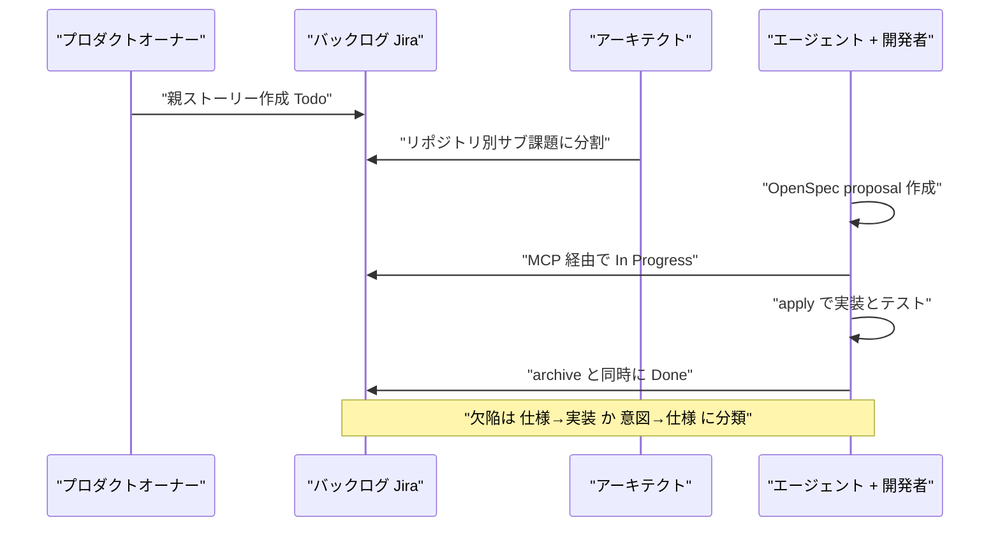
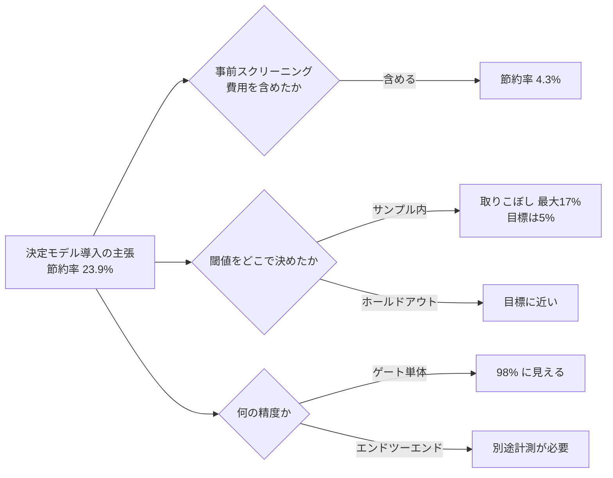

# Daily Briefing 2026-11-21

## 1. 18か月でソフトウェア開発の産出量を3倍にするのに必要だったこと（原題: What it took to triple our software engineering output in 18 months）

- **URL**: https://www.infoworld.com/article/4212172/what-it-took-to-triple-our-software-engineering-output-in-18-months.html
- **公開日**: 2026-09-07
- **著者・媒体**: Greg Ingino（Litera CTO）/ InfoWorld New Tech Forum

### 本文翻訳

リーガル AI プラットフォームを提供する Litera の CTO が、18か月の変革を振り返る。結論から言えば、最大の生産性向上は「AI がコードを速く書いたこと」ではなく、**チーム間で仕事がどう流れるかを組み替えたこと**から来た。「最大の効果は、工程間の引き継ぎ（ハンドオフ）を無くしたことから生まれた」。

**18か月の結果**: R&D 全体でエンジニア1人あたりの産出量はおよそ3倍。四半期あたりのリリース数はほぼ倍増し、デプロイ数は 82 回から 155 回超へ。顧客報告の欠陥は 100 万行あたり 65% 減少した。計測には DORA メトリクス、サイクルタイム、開発者1人あたりのマージ済み PR 数と変更行数を、固定のベースラインと比較して用いた。

**1. ハンドオフを除去する**: 旧来のモデルには少なくとも4つの引き継ぎがあった。プロダクト→開発、開発→QA、QA→セキュリティ、セキュリティ→デプロイ運用。コードが1日で書き上がっても、機能はキューで2週間眠ることがあった。新しいモデルでは1つのチームが機能をエンドツーエンドで受け持ち、各段階の定型作業は AI エージェントが担う。仕様から動く PR までの時間は **15日から約4時間**に縮んだ。助言: 生成されたコード行数ではなく「アイデアからデプロイまでの総時間」を測り、仕事が止まっている場所を探せ。

**2. スケールの前にガバナンス**: パイロットチームを超えて広げる前に、AI 生成コードに対するコードレビュー・セキュリティスキャン・品質の基準を定めた。信頼度スコアリングで定型的な変更は自動承認し、閾値未満は人間に回す。セキュリティと品質のゲートはライン末端のチェックポイントではなく、パイプラインの中で走らせる。その結果、AI 支援の PR は約 3% から 68% に増え、全エンジニアが AI を使い、**脆弱性密度は 76% 低下**した。普通は「採用が先、ガバナンスが後」だが、逆順にしたことが効いたという。

**3. ツールを少数に絞る**: 初期に多数のツールを評価したのち、少数のコーディングエージェントに標準化した。新リリースを追いかけるより、得意・不得意の癖を深く知ることのほうが重要だった。ツールを替えるたびに信頼と作業習慣がリセットされるからだ。

**4. ライフサイクル全体を自動化する**: 要件定義、スプリント計画、コード生成、テスト作成、セキュリティスキャン、デプロイ、SRE のそれぞれに専任エージェントを置き、**各エージェントは1つの仕事を持ち、1つの成果で測られる**。プロダクトとエンジニアリングが共同で保守する中央の知識リポジトリ（RAG 付き）が、全エージェントに同じプロダクト文脈・ドメインルール・過去の意思決定を与える。要件定義では、エージェントが手厳しいステークホルダーのように生のアイデアを問い詰め、仕様が固まるまで続ける。このフェーズは数週間から午後半日になった。テストは新規分の 99%（1年前は 47%）を AI が生成し、スイートには AI が作ったテストが 39,000 件以上ある。テストは PRD の機能要件と照合される。エンジニアはテストの初稿を書く代わりに、レビューと強化を担う。助言: 全領域に一斉展開して後で作り直すより、1領域で正しく作ってから広げよ。

**5. 野心的な目標を公言する**: 「12か月で R&D 生産性を倍にする」と社内外に宣言した。1年以内に達成し、その後も伸び続けている。

**6. ボトルネックは下流へ移った**: エンジニアリングが速くなると、制約はゴートゥーマーケット側（ドキュメント、イネーブルメント資料、カスタマーサクセス向けブリーフィング、顧客の受け入れ準備）に移った。現在は GTM もライフサイクルの自動化フェーズに組み込み、「組織がサポートできるまで何も出荷しない」をルールにしている。著者の後悔は、この能力を最初から作らなかったことだ。

**結論**: 変革は組織的なものだった。ワークフローの再設計、信頼を生むガバナンス、少数に絞ったツール、変化を強いるほど野心的な目標。そうした組織の地ならしが、モデル改善のたびにその効果を吸収できる土台になる。パイロット段階で止まっているリーダーは、まずそこから始めるべきだ。

### 重要ポイント
- 効果の源泉はコード生成速度ではなく **4つのハンドオフの除去**。仕様→動く PR が 15日→約4時間
- ガバナンス（レビュー・スキャン・品質基準、信頼度スコアによる自動承認）を **採用拡大より先に** 置き、AI 支援 PR 68% と脆弱性密度 76% 減を両立
- エージェントは「1つの仕事・1つの成果指標」で分割し、共通の知識リポジトリで文脈を揃える
- 新規テストの 99% を AI が生成し、PRD の機能要件と照合。人間はテストのレビューと強化へ
- 開発が速くなると制約は GTM（ドキュメント・顧客準備）へ移る。「サポートできるまで出荷しない」

### 図解



### 戦略分析

**フレームワーク**: バリューストリームマッピング × 制約理論（TOC）

| 工程 | 旧モデルの状態（記事） | 打ち手 | 結果（記事の数値） |
|---|---|---|---|
| 要件定義 | 数週間 | 問い詰めエージェント | 午後半日 |
| 開発→QA→セキュリティ | 引き継ぎごとにキュー待ち、最大2週間 | 1チーム化 + パイプライン内ゲート | 仕様→PR 約4時間 |
| テスト | 新規テストの AI 生成 47% | PRD と照合する AI テスト | 99% |
| リリース後の GTM | 意識されていなかった | GTM を自動化フェーズに | 新たな制約として顕在化 |

**制約の移動**: 記事は TOC の教科書どおりの経過を示している。開発内部の待ち（引き継ぎキュー）を潰した結果、制約は組織の外縁である GTM に移った。開発のスループットだけ上げても、顧客がサポートを受けられなければ価値は届かない。

**示唆**: (1) AI 導入の効果測定を「仕様からデプロイまでの経過時間」と「工程間の待ち時間」に切り替え、まず引き継ぎの回数を数える。4回あれば4つのキューがある。(2) 採用率 KPI を追う前に、信頼度スコアによる自動承認の閾値とパイプライン内ゲートを決める。(3) 開発速度が2倍になった時点で、次の制約候補であるドキュメント・サポート準備を先回りしてバリューストリームに組み込む。

**反証条件**: 記事は単一企業の自己申告であり、対照群がない。引き継ぎが元々少ない小規模チーム（1チームで完結している組織）では、ハンドオフ除去の効果はほとんど得られず、むしろレビュー能力が制約になるはずである。

### 現場での適用方法

**運用手順: 引き継ぎ待ち時間を計測するスクリプト**（GitHub の PR で「作成→初回レビュー→マージ→デプロイ」の各待ちを出す）

```bash
#!/usr/bin/env bash
# handoff-wait.sh — 直近 N 件のマージ済み PR について工程間の待ち時間（時間）を出す
# 使い方: ./handoff-wait.sh <OWNER/REPO> [N]
set -euo pipefail
REPO="${1:?usage: $0 OWNER/REPO [N]}"
N="${2:-50}"

gh pr list -R "$REPO" --state merged --limit "$N" \
  --json number,createdAt,mergedAt,reviews \
| jq -r '
  def h(a;b): ((b|fromdateiso8601) - (a|fromdateiso8601)) / 3600;
  ["pr","to_first_review_h","review_to_merge_h"],
  (.[] | select(.reviews|length>0) |
    [.number,
     (h(.createdAt; .reviews[0].submittedAt) | floor),
     (h(.reviews[0].submittedAt; .mergedAt) | floor)])
  | @tsv'
```

**CLAUDE.md への追記例**（「1エージェント1成果」を明文化する）

```markdown
## エージェントの責務分割
- 要件エージェント: 生のアイデアを、受け入れ基準が書ける状態になるまで質問で詰める。
  受け入れ基準が3つ未満の仕様は「未完成」として返す
- テストエージェント: PRD の機能要件 ID ごとに最低1件のテストを生成し、
  テスト名に要件 ID（例: REQ-012）を含める
- 自動承認の対象は「依存の patch 更新」「ドキュメントのみ」「テストのみ」の変更に限る。
  それ以外は必ず人間のレビューを要求する
```

### 期待効果
- 記事の数値: 仕様→動く PR が 15日→約4時間、デプロイ 82→155 回超、顧客報告欠陥 65% 減、脆弱性密度 76% 減
- 待ち時間を可視化することで、AI 投資の対象を「書く速度」から「流れ」へ移せる

### 注意点
- 単一企業の自己報告で、産出量の指標（PR 数・変更行数）は水増しされやすい。DORA の変更失敗率と並べて見ること
- 自動承認の閾値を緩めすぎると、ガバナンス先行の利点が消える
- 開発が速くなったら GTM 側の受け入れ能力を同時に計画しないと、未出荷在庫が積み上がる

## 2. エージェント型脆弱性管理をエンドツーエンドで: 2,731件の検出を1件の承認済み修正へ（原題: Agentic vulnerability management, end to end: 2,731 findings, one approved fix）

- **URL**: https://sysdig.com/blog/agentic-vulnerability-management-end-to-end-2-731-findings-one-approved-fix
- **公開日**: 2026-08-04
- **著者・媒体**: Blair Howard / Sysdig Blog

### 本文翻訳

Sysdig Secure AI のライブセッションで、エージェントが 119,443 件の検出バックログをトリアージし、SLA を超過した 2,731 件を**たった1つのベースイメージ修正**へ追跡した。人間が生成された Jira チケット DEJI-342 を承認した。同じエージェントは Sysdig の MCP サーバ経由で Claude 上でもヘッドレスに動く。

**中心の主張**: 脆弱性を見つけることは難しくない。難しいのは「知っている」と「動く」の間のギャップだ。CVE を影響ワークロードに対応づけ、オーナーを見つけ、チケットを切り、SLA を追う。このギャップはアナリストの工数で測られる。攻撃者がゆっくり動いていた時代には許容できたが、今は公開された脆弱性が数時間で武器化される（Sysdig の JADEPUFFER 調査と 2026 Cloud-Native Security Report を引用）。

**ワークフロー**:

1. **作戦命令を決める**: 高価値資産にタグを付け、重大度ごとの SLA 期間を定義する。この環境では critical と high は 30 日以内に是正が必要。
2. **常設プラン**: ポリシーを「SLA Compliance」「Reduce Exposure Time」のような継続的プランにする。エージェントは有限のタスクリストではなく、成果を追い続ける。
3. **指標駆動**: SLA Compliance プランは現在値（28.3%、前日比 +2.9 ポイント）を表示し、何を追跡し、キューをどう順位付けしているかを説明し、指標を最も動かすジョブの順位付きリストを維持する。
4. **判定**: 最上位のジョブは Node.js イメージ `node:17.9.1-bullseye` 1つで、SLA 超過 2,731 件（うち critical 273 件）を抱え、最古のものは期限を 90 日超過。修正は保守されている Node 17 ベースイメージへの差し替え。プランは「最悪の SLA 超過」で順位付けし、**公開済みの修正が存在する検出だけ**を含める。
5. **ランタイム到達性**: 静的到達性（依存グラフ上の理論的な経路）と、ランタイム到達性（脆弱なパッケージが今まさに実行中プロセスにロードされている）を区別する。ワークロードの露出は別のシグナルとして採点する。
6. **人間の承認**: エージェントは是正チケット（要約・影響・推奨修正）を起票し、1つだけ質問する。「誰がオーナーか」。人間がレビューし、Approve を押す。
7. **チケット作成**: 承認の数秒後に Jira チケット DEJI-342 が作られ、オーナーに割り当てられ、`generated-by-sysdig` ラベルが付き、推論の全過程と SLA 計算が添付される。
8. **ヘッドレス利用**: Sysdig MCP サーバ（GitHub でオープンソース）がランタイムデータを AI アシスタントに公開する。3層構成で、サーバ（アクセス）、スキル（符号化された専門知識）、エージェント型ワークフロー（誰かが尋ねる前に仕事を浮上させる常設プラン）。
9. **権限のスコープ**: Claude では各ツール呼び出しに明示的な許可が必要。例では「List Vulnerability Findings」を critical・上限5件・修正なし・エクスプロイトフィルタなしで呼び出している。
10. **ライブの回答**: 上位5件の critical はすべて ECS Fargate 上の1つの nginx サービスにあった。EPSS の悪用確率で順位付けし、CISA KEV の掲載有無も確認する。
11. **ガードレール**: Sysdig Remediate スキルは最初にルールを宣言する。**やること**: イメージの critical/high CVE を取得し、チェーン分析で安全な修正バージョンを解決し（新たな critical を持ち込むアップグレードを避ける）、パッチを起草し、追跡チケットを更新する。**やらないこと**: リポジトリへの commit/push、認証情報のログ出力・表示、明示的な承認なしの変更。前提条件が欠けていれば、PR を開くかローカルのパッチファイルを作るかを尋ねる。

**Before / After（記事の提示）**: 影響ワークロードの特定は手作業で 8〜16 時間 → 数分。オーナー割り当ては手探り → 自動。是正の着手は 1〜2 日 → 承認後即時。SLA 追跡は手作業 → 自動。経営層への可視化は人を追いかける → リアルタイムの指標。

**経済性（Sysdig 社内分析）**: 人間だけのチームは年間およそ 925 件の調査が上限だが、エージェント型は年 10,000 件超。人間のみの調査1件は約 135 ドル、エージェント型は AI トークン費用込みで約 16 ドル（88% 減）。環境と単価によって変わると断っている。

**アーキテクチャ上の教訓**: 同じエージェント・プラン・ランタイムデータが UI とヘッドレスの MCP ツールの両方に供給される（「1つの頭脳、あらゆるインタフェース」）。エージェントの質はデータの質で決まり、現状を映すのはランタイムデータだ。MCP の配管は真似しやすいが、符号化された専門知識は真似しにくい。

### 重要ポイント
- 問題は「検出」ではなく「検出→オーナー→チケット→SLA 追跡」のギャップ。そこにエージェントを当てる
- 優先度は CVSS 単独でなく **EPSS・KEV・ランタイム到達性**。かつ「修正が公開済み」の検出だけをキューに入れる
- 2,731 件が1つのベースイメージに集約された。検出単位ではなく **修正単位** でキューを組む
- エージェントは起票まで、承認と commit/push は人間。スキル冒頭に「やる／やらない」を宣言する
- ベンダー社内分析で、調査単価 135→16 ドル（88% 減）、年間処理能力 925→10,000 件超

### 図解



### 戦略分析

**フレームワーク**: 制約理論（TOC）× RACI

| 活動 | エージェント | セキュリティ担当 | サービスオーナー |
|---|---|---|---|
| 影響ワークロードの特定・順位付け | R | A | I |
| 修正バージョンの解決（チェーン分析） | R | C | I |
| チケット起票 | R | A | I |
| オーナー確定・承認 | C | R/A | C |
| commit / push / デプロイ | — | I | R/A |

**制約**: 記事の Before/After 表で最も時間を食っていたのは「影響ワークロードの特定（8〜16 時間）」と「着手（1〜2 日）」で、修正作業そのものではない。つまり脆弱性対応の制約は **調査と所有者探し** にある。エージェントはそこに当てられている。

**示唆**: (1) 脆弱性キューを「CVE 単位」から「修正単位（ベースイメージ・依存パッケージ）」へ組み替える。これだけで 2,731 件が1件になりうる。(2) 「修正公開済み」でないものをキューから外し、別の監視リストへ分ける。(3) エージェントへの権限は起票までに留め、RACI の「A」は人間側に固定したまま、調査単価を下げる投資を優先する。

**反証条件**: ベースイメージが統一されておらず、各サービスが独自の依存を持つ組織では、修正単位への集約がほとんど効かない（1修正＝数件にしかならない）。また 88% のコスト削減はベンダー社内分析であり、ランタイムデータを持たない環境では到達性判定の精度が落ちるため、同じ効果は期待できない。

### 現場での適用方法

**スキル化の例**: 修正単位で脆弱性をまとめ、起票案だけを作るスキル

````markdown
---
name: vuln-fix-grouping
description: コンテナイメージや依存の脆弱性スキャン結果を「修正単位」に集約し、SLA 超過の大きい順にチケット起票案を作る。commit / push / チケット作成は行わない。
---

# 脆弱性の修正単位集約

## やること
1. `<SCAN_RESULT_JSON>`（Trivy / Grype などの出力）を読み、各検出に
   `fix_available`（修正版があるか）と `fixed_version` を付ける
2. `fix_available=false` の検出はキューから外し `watchlist.md` に移す
3. 残りを「ベースイメージ」または「直接依存パッケージ」単位でグループ化する
4. 各グループに以下を計算する
   - SLA 超過日数の最大値（critical/high は 30 日）
   - CISA KEV 掲載件数、EPSS の最大値
5. 超過日数 → KEV 件数 → EPSS の順に並べ、上位 3 グループの起票案を出力する

## やらないこと
- リポジトリへの commit / push
- チケットの実作成（起票案の Markdown を出すまで）
- 認証情報の表示・ログ出力
- 修正版へ上げることで新たな critical が入る場合の自動選択（人間に判断を返す）

## 出力形式
```
### <グループ名>（例: node:17.9.1-bullseye）
- 検出数: N（critical: n）
- 最大 SLA 超過: D 日
- 推奨修正: <修正後のイメージ/バージョン>
- オーナー: 不明（要確認）
```
````

**スクリプト化の例**: Trivy の JSON から修正単位で件数を出す

```bash
#!/usr/bin/env bash
# group-by-fix.sh — Trivy のイメージスキャン結果を「パッケージ→修正版」単位に集約
# 使い方: trivy image -f json -o scan.json <IMAGE>; ./group-by-fix.sh scan.json
set -euo pipefail
jq -r '
  [.Results[]?.Vulnerabilities[]? | select(.FixedVersion != null and .FixedVersion != "")]
  | group_by(.PkgName + "@" + .FixedVersion)
  | map({fix: (.[0].PkgName + " -> " + .[0].FixedVersion),
         total: length,
         critical: (map(select(.Severity=="CRITICAL")) | length)})
  | sort_by(-.critical, -.total)[]
  | "\(.critical)\t\(.total)\t\(.fix)"' "$1" \
| (printf "critical\ttotal\tfix\n"; cat)
```

### 期待効果
- 記事の提示: 影響ワークロード特定 8〜16 時間 → 数分、着手 1〜2 日 → 承認後即時
- ベンダー社内分析: 調査単価 約 135 ドル → 約 16 ドル（88% 減）、年間処理能力 925 → 10,000 件超
- 修正単位の集約で、オーナーへの依頼件数そのものが減る

### 注意点
- 数値はすべてベンダー自己申告。ランタイム到達性は Sysdig の実行時データ前提で、静的スキャンだけの環境では代替できない
- 「修正公開済みのみ」に絞ると、修正のない critical が視界から消える。別リストで KEV 掲載を監視すること
- エージェントにツール権限を与える際は、記事のように呼び出しごとの明示許可とフィルタ範囲の限定を保つ

## 3. エンタープライズ規模での仕様駆動開発の導入（原題: Spec-Driven Development: Adoption at Enterprise Scale）

- **URL**: https://www.infoq.com/articles/enterprise-spec-driven-development
- **公開日**: 2026-02-19
- **著者・媒体**: Hari Krishnan（レビュー: Thomas Betts）/ InfoQ

### 本文翻訳

**中心の主張**: 仕様駆動開発（SDD）は技術的プラクティスであると同時に、組織の能力である。その最大の便益は、1人の開発者が仕様を使うときではなく、プロダクト・アーキテクチャ・エンジニアリング・QA が仕様を介して協働するときに生まれる。

**AI 支援コーディングの変遷**: (1) **Vibe coding** — 1プロンプトずつ対話的に操縦し、実装そのものが文脈になる。(2) **Plan mode** — AI がコーディング前に計画を起草し人間がレビューする。冒頭に「キックオフ」の工程が入ったが、計画は通常残らない。(3) **SDD** — 仕様は指示書ではなく、人間と AI の間で継続する共有の対話になる。長時間自律的に働くエージェントに向いている。

**エンタープライズにとっての価値**: エージェントの長時間実行やトークン・コンテキスト管理の改善に加え、著者は最大の利得は文化的なものだと言う。仕様はステークホルダー間の会話の媒体であり、同時にエージェントのコンテキストエンジンになる。

**ワークフローの分解**: Discover（ビジネス文脈＝What）、Design（技術的アプローチ＝How）、Tasks（エージェントが並列化できる検証可能な実行ステップ）。

**著者が挙げる導入上の課題**: 開発者中心のツールが PM やアナリストを締め出す。モノレポ前提がマイクロサービス構成に合わない。寿命の異なる成果物（戦略的アーキテクチャと戦術的タスク）が分離されていない。どこから始めるかが不明で、Jira や Azure DevOps などのバックログツールと統合されていない。協働パターンと承認フローが定義されていない。ツールごとに仕様のスタイルと粒度がばらばら。仕様と実装の整合を検証する道筋が不明。既存コード（ブラウンフィールド）への適用方法が不明。

**推奨プラクティス**:
- **MCP によるバックログ統合**: OpenSpec の変更が proposal → apply → archive と進むのに合わせて、Jira / Linear / Azure DevOps の課題を Todo → In Progress → Done に動かす。
- **マルチリポジトリのオーケストレーション**: プロダクトオーナーはバックログで作業し、アーキテクトが親ストーリーをリポジトリごとのサブ課題に分割し、開発者が各リポジトリでタスクを詳細化する。
- **役割別ハーネス**: インフラ・性能・セキュリティの専門家が、入ってくるストーリーにエージェントが適用するドメイン制約を足す。
- **仕様スタイルの基準**: 最上位のステアリング文書をサポートし、仕様の全体像を提供し、仕様を人間がレビューできる小ささに保つ。
- **ブラウンフィールドへの段階導入**: レガシーシステム全体を最初から仕様化するのではなく、変更対象のコードの周辺から、バグ修正や機能追加を機会に少しずつ仕様を足す。

**長期的な方向性**: 仕様をエージェントを指揮する主インタフェースとし、変更はコードの直接編集ではなく仕様を通して流す。著者はこれを、サーバへの直接アクセスを廃してリリースパイプラインに一本化した歴史になぞらえる。Leigh と Ray が InfoQ で提唱した「SpecOps」を使い、仕様にもバージョニング・レビュー・継続的改善を適用する。欠陥を **仕様→実装のギャップ**（検証を強化すべき）と **意図→仕様のギャップ**（要求の引き出しを改善すべき）に分類し、ハーネスの品質指標として扱う。品質活動の重心を、実装のレビューから、エージェントを導くハーネスの検証へ移す。

**結び**: SDD を技術導入として扱うチームはトークン効率やハルシネーション減少といった技術的便益を得る。組織変革として扱うチームは、エージェント群を指揮し、人を戦略的な仕事へ解放する能力を得る。

### 重要ポイント
- SDD の便益は個人利用ではなく **役割横断の協働** で最大化する。開発者専用ツールは PM を締め出す
- 仕様の状態遷移（proposal / apply / archive）をバックログの状態（Todo / In Progress / Done）と MCP で同期する
- 親ストーリー→リポジトリ別サブ課題への分割をアーキテクトが担い、マルチリポに対応する
- ブラウンフィールドは「触る場所から」仕様を足す。全体の一括仕様化はしない
- 欠陥を「仕様→実装」「意図→仕様」の2種に分類し、ハーネスの品質指標にする

### 図解



### 戦略分析

**フレームワーク**: JTBD（Jobs to be Done）

| 利用者 | 片付けたいジョブ | 開発者中心 SDD での状態 | 記事の打ち手 |
|---|---|---|---|
| プロダクトオーナー | 意図が実装まで歪まずに届くことを確かめたい | 仕様がリポジトリ内にあり触れない | バックログ統合（MCP） |
| アーキテクト | 複数サービスにまたがる変更を整合させたい | モノレポ前提 | 親→サブ課題の分割 |
| 専門家（セキュリティ等） | 自分の制約を毎回伝えずに守らせたい | 個別レビューで指摘 | 役割別ハーネス |
| 品質責任者 | 欠陥の原因を工程に帰属させたい | 実装レビューで場当たり対処 | 欠陥の2分類 |

**示唆**: SDD ツールの選定基準を「開発者の体験」から「PO とアーキテクトが同じ仕様に触れるか」に変える。具体的には、(1) 仕様の状態とバックログの状態が自動同期するかを PoC の合格条件にする、(2) 欠陥チケットに「仕様→実装／意図→仕様」のラベルを追加し、月次で比率を見る。前者が多ければ検証（テスト・レビューゲート）へ、後者が多ければ Discover フェーズへ投資する。

**反証条件**: 1チーム・1リポジトリで PO と開発者が同席している組織では、バックログ統合や親子分割の手間が便益を上回る。記事は定性的な提言にとどまり効果の数値を示していないため、以上は仮説である。

### 現場での適用方法

**CLAUDE.md への追記例**（欠陥分類とバックログ同期のルール）

```markdown
## 仕様駆動開発の運用ルール
- 変更は必ず `openspec/changes/<CHANGE_ID>/` の proposal から始める。コードの直接編集で始めない
- proposal 作成時に、対応するバックログ課題 `<ISSUE_KEY>` を proposal.md 冒頭に記載し、
  課題を In Progress に移す
- archive したら課題を Done に移し、archive 先のパスを課題コメントに残す
- バグ修正の PR には次のどちらかのラベルを付ける
  - `defect:spec-to-impl` … 仕様は正しいが実装が仕様と違った
  - `defect:intent-to-spec` … 仕様そのものが意図と違った
- 既存コードを触るときは、触った関数の振る舞いだけを仕様に追記する（全体を仕様化しない）
```

**スクリプト化の例**: 欠陥ラベルの比率を月次で出す

```bash
#!/usr/bin/env bash
# defect-ratio.sh — 直近 30 日にマージされたバグ修正 PR の欠陥分類比率
set -euo pipefail
REPO="${1:?usage: $0 OWNER/REPO}"
SINCE="$(date -d '30 days ago' +%F)"
for L in defect:spec-to-impl defect:intent-to-spec; do
  n=$(gh pr list -R "$REPO" --state merged --label "$L" \
        --search "merged:>=$SINCE" --limit 500 --json number | jq length)
  printf "%s\t%s\n" "$L" "$n"
done
```

### 期待効果
- 記事は数値を示していない。期待されるのは、PO・アーキテクトが仕様に参加することによる「意図→仕様」欠陥の早期発見と、欠陥比率に基づく投資配分の明確化
- ブラウンフィールドでの段階導入により、初期コストを変更対象に限定できる

### 注意点
- 公開は 2026-02 とやや古く、OpenSpec などツールの仕様は変わっている可能性がある
- 欠陥ラベルは付け忘れが多い。PR テンプレートで必須化しないと比率が意味を持たない
- 仕様を主インタフェースにする方針は、緊急修正（ホットフィックス）の経路を別途用意しないと現場で破られる

## 4. AI コーディングエージェントのためにコードベースを最適化する（原題: Optimizing Your Codebase for AI Coding Agents）

- **URL**: https://www.aaron-gustafson.com/notebook/optimizing-your-codebase-for-ai-coding-agents/
- **公開日**: 2025-10-21
- **著者・媒体**: Aaron Gustafson / 個人ブログ（Notebook）

### 本文翻訳

著者は GitHub Copilot を自律エージェントとして自分のサイト開発に使ってみた。結果はまちまちだが全体としては前向きだった。ある作業でエージェントの推論過程を読み込むと、苦戦の大半は **コードではなく、組織とドキュメントの問題** だった。著者の結論は、AI エージェントへの最適化とは主に曖昧さを取り除き、暗黙知を明示することであり、それは一般的に良いエンジニアリングそのものだ、というものだ。

**問題1: ドキュメントの散乱**。エージェントは時間のおよそ 40% を「どのドキュメントを信じるべきか」の判断に費やしていた。指示はワークフローのコメント、README、タスク別ファイルに分散し、互いに矛盾する箇所もあった。**対策**: すべてを1つの包括的なガイドに統合し、参照をすべてそこへ向け、廃止したドキュメントは削除またはリダイレクトする。

**問題2: エージェントは自分で最適化しない**。エージェントは Markdown ファイルの書式が正しいかを確かめるだけのために、画像処理やテンプレートコンパイルを含む本番ビルド（毎回 30〜60 秒）を実行していた。**対策**: 1つの仕事に1つの、速く焦点を絞った検証スクリプトを書く。各ユーティリティが何をするか、どこにあるか、どう使うかをエージェントに伝え、フルビルドよりそれらを優先するよう指示する。

**問題3: 曖昧さは混乱とトークンの浪費を生む**。テスト用のフォーム送信データを拒否すべきか、受理すべきか、プレースホルダにすべきか、指示に書かれていなかったため、エージェントは 15 分以上も議論を続けた。**対策**: テストフォーム送信の扱いを専用のセクションとして追加する。

**根底にあるパターン**: 3つの問題はすべて暗黙の前提から来ている。「5つではなく1つのドキュメントを見ればよいと誰でもわかるだろう」「検証とビルドの違いは自明だろう」。人間も同じ前提を置いているが、本人が思う以上にうまくやり過ごしているだけだ。

**初期の結果**（期待値で、初期テストで裏付けられたもの）: 処理時間 約 40% 減、トークン使用量 約 75% 減、混乱と堂々巡りの推論 80% 超減。

これらの変更は誰にとっても役に立つ。統合されたドキュメント、速い検証スクリプト、明示的なエッジケースの扱いは人間のチームメイトにも有用だ。著者はこれを「ロボット向けに書く」のではなく、ドキュメント負債の返済と位置づける。

**あとがき**: AI エージェントは、チームが抱えたまま暮らしていた技術的負債を見つけて片付けるのに役立った。ときには、家が散らかっていると指摘してくれる杓子定規なロボットが必要なのだ。

### 重要ポイント
- エージェントの時間の約 40% が「どのドキュメントを信じるか」に消えていた。**単一の正本** に統合する
- 検証は用途別の高速スクリプトに分け、エージェントにフルビルドより優先させる
- エージェントの推論ログで「迷っている箇所」を探し、そこに専用セクションを足す
- 結果（初期値）: 処理時間 約 40% 減、トークン 約 75% 減、堂々巡り 80% 超減
- AI-Ready の作業は「ロボット向けの執筆」ではなく、ドキュメント負債の返済

### 図解

図解省略（理由: 3つの問題と対策が1対1に対応する Tips 形式で、要素間の構造や順序が主題ではないため。重要ポイントの箇条書きで足りる）

### 戦略分析

**フレームワーク**: 制約理論（TOC）

| エージェントの時間の使い道 | 記事の観測 | 制約の種類 |
|---|---|---|
| どのドキュメントを信じるかの判断 | 約 40% | 情報の矛盾（方針制約） |
| 書式確認のためのフルビルド | 毎回 30〜60 秒 | 道具の欠如（物理制約） |
| 仕様にない判断の議論 | 15 分超 | 方針の欠落（方針制約） |

**示唆**: エージェントの生産性の制約は、モデル性能でもプロンプトの巧拙でもなく、リポジトリ側の「方針制約」にあることが多い。したがって最初の打ち手は、モデルやツールの切り替えではなく、(1) エージェントの推論ログを1本読み、迷っている時間の内訳を取る、(2) 矛盾するドキュメントを1本化する、(3) フルビルドの代わりになる 5 秒以内の検証スクリプトを用意する、の順に行う。これはモデルを替えても効果が持ち越される投資である。

**反証条件**: 数値は個人サイトでの初期テストの期待値で、対照実験ではない。すでにドキュメントが1本化され、高速な検証コマンドが整備されているリポジトリでは改善余地が小さい。また過去のブリーフィングで扱った AGENTS.md の計測研究のように、コンテキストファイルの効果は条件次第で、書き足すほど良くなるわけではない。

### 現場での適用方法

**スクリプト化の例**: エージェント用の高速検証コマンドを1か所にまとめる

```bash
#!/usr/bin/env bash
# scripts/check.sh — エージェント向けの用途別・高速検証（フルビルドの代替）
# 使い方: scripts/check.sh <md|links|lint|types> [FILES...]
set -euo pipefail
cmd="${1:?usage: $0 <md|links|lint|types> [FILES...]}"; shift || true
case "$cmd" in
  md)    npx --yes markdownlint-cli2 "${@:-**/*.md}" ;;
  links) npx --yes lychee --offline "${@:-**/*.md}" ;;
  lint)  npx eslint "${@:-.}" ;;
  types) npx tsc --noEmit ;;
  *) echo "unknown: $cmd" >&2; exit 2 ;;
esac
```

**CLAUDE.md への追記例**

```markdown
## ドキュメントの正本
- 開発手順の正本は `docs/CONTRIBUTING.md` のみ。README や workflow のコメントと食い違う場合は
  CONTRIBUTING.md を正とし、食い違いを報告する

## 検証コマンド（フルビルドより優先すること）
| 目的 | コマンド | 所要 |
|---|---|---|
| Markdown の書式 | `scripts/check.sh md <FILE>` | 数秒 |
| リンク切れ | `scripts/check.sh links <FILE>` | 数秒 |
| 型 | `scripts/check.sh types` | 〜20秒 |
- `npm run build` はリリース前の最終確認でのみ実行する

## 迷いやすいケースの決定事項
- テスト用のフォーム送信（`<TEST_MARKER>` を含む）は受理するが保存しない
```

### 期待効果
- 記事の初期値: 処理時間 約 40% 減、トークン使用量 約 75% 減、混乱・堂々巡り 80% 超減
- 正本の一本化と検証スクリプトは人間の新メンバーのオンボーディングにも効く

### 注意点
- 2025年10月の記事で、Copilot エージェントの挙動は当時のもの。数値は期待値と初期テスト
- 正本を1本化しても、古いドキュメントを削除・リダイレクトしないと矛盾は残る
- 「迷いやすいケース」を書き足し続けると CLAUDE.md が肥大化する。決定事項は定期的に棚卸しする

## 5. 速いモデル、遅い証拠: LLM エージェントハーネス向け System-1 決定モデルの対応比較と自己監査（原題: Fast Models, Slow Evidence: A Paired and Self-Audited Evaluation of System-1 Decision Models for LLM Agent Harnesses）

- **URL**: https://arxiv.org/abs/2610.02267
- **公開日**: 2026-10-01
- **著者・媒体**: Jiawei Li / arXiv（cs.AI）

### 本文翻訳

**背景**: エージェントハーネスは1つのタスクの中で、多数の小さな型付きの意思決定を行う。モデル選択、ツール選択、取得したテキストの関連性判定、プロンプトインジェクション検出などだ。System-1 決定モデルはこうした判断に1回の順伝播で答え、LLM 呼び出しに比べて大幅なコスト・レイテンシ削減を約束する。

**方法**: 本論文はオープンウェイトのモデル Laya と、ホスト型モデル Jev を、18 の公開ソースから構築した 11 のエージェント決定ポイントで比較する。評価はベースケース 7,283 件と頑健性バリアント 6,640 件（選択肢の順序反転、候補集合のサイズと類似度の変化）からなる。両モデルにはバイト単位で同一の入力を与え（対応のある設計）、対応のある統計検定を行い、ハードウェアと日をまたいだ再現性も確認した。コード・データ・生出力は GitHub で公開されている。

**結果**: Jev は 11 の決定ポイントのうち 9 で Laya より有意に正確で、その差は +10.8〜+46.0 ポイント。ただし **ゼロショットのモデルルーティングでは、どちらのモデルもチャンスレベルを超えなかった**。RAG の関連性ゲートでは有意差なし。Laya は選択肢の順序を反転すると回答の 30% が変わり、候補が多い・似ている状況（50 個の近傍ツール）で 31% まで大きく劣化する。Jev は正解ツールが一意に定まる項目で 98% に達する。

**自己監査**: 著者は自身のパイプラインを監査し、導入効果の主張を水増ししていた誤りを見つけた。(1) 事前スクリーニングのコストを計上し忘れており、これを含めると推定節約率は **23.9% から 4.3%** に下がった。(2) ゲート単体の精度（58% 対 98%）をエンドツーエンドの品質として報告していた。(3) サンプル内でチューニングした閾値は、5% の目標に対し、ホールドアウトで最大 17% の取りこぼしを出した。(4) インジェクション誤検知における見かけの「チャネル効果」は、チャネル本来の形式のコンテンツを使うと消えた。他の2つの交絡疑いは結論を変えなかった。

### 重要ポイント
- Jev は 11 決定ポイント中 9 で Laya に有意に勝つ（+10.8〜+46.0pt）。正解ツールが一意な項目で 98%
- **ゼロショットのモデルルーティングはどちらもチャンスレベル**。ルーティング用途には向かない
- 事前スクリーニング費用を入れると節約率は 23.9% → 4.3%。コストは全経路で数える
- ゲート精度とエンドツーエンド品質は別物。閾値はホールドアウトで決めないと取りこぼしが 17% に
- オープンモデルは選択肢の順序・候補の多さ／類似に脆い。順序反転テストを必須にすべき

### 図解



### 戦略分析

**フレームワーク**: 単位経済性（ユニットエコノミクス）

| 項目 | 当初の見積もり | 自己監査後 |
|---|---|---|
| 1タスクあたり節約率 | 23.9% | **4.3%**（事前スクリーニング費用を計上） |
| 品質の根拠 | ゲート精度 98% | エンドツーエンドは別計測が必要 |
| 取りこぼし率 | 目標 5% | ホールドアウトで最大 17% |
| ルーティング精度 | — | チャンスレベル |

**示唆**: 決定モデルの導入判断は「1回の判断が LLM より何倍安いか」ではなく、「パイプライン全体での1タスクあたり総コストと品質」で行う。具体的には、(1) PoC の合格条件に、事前処理・フォールバック（LLM への差し戻し）を含めた1タスク単価を入れる、(2) 閾値はチューニング用と別のホールドアウトで検証し、取りこぼし率を報告する、(3) モデルルーティングは決定モデルの用途から外し、一意解のあるツール選択・承認ゲートに限定する。節約率が 4.3% 程度なら、運用・監視コストを加えると導入が正当化されない組織も多い。

**反証条件**: 決定ポイントの通過量が極めて大きく（1タスクで数十〜数百回の判断）、かつ事前スクリーニングが不要な構成では、単価差がそのまま効いて節約率は論文の値より大きくなりうる。また本論文は単著・v1 の段階で査読前であり、数値は今後変わりうる。

### 現場での適用方法

**運用手順: 決定モデル PoC の評価チェックリストをスクリプト化**

```python
#!/usr/bin/env python3
"""eval_gate.py — 決定ゲートの PoC 評価: 順序反転・ホールドアウト閾値・総コストを一括で出す
入力: cases.jsonl  各行 {"options": [...], "label": "...", "split": "tune|holdout"}
      predict(options) -> (answer, confidence) を <YOUR_MODEL_CLIENT> で実装すること
"""
import json, sys

COST_PRESCREEN = float("<PRESCREEN_COST_PER_CASE>")   # 事前スクリーニング単価
COST_GATE      = float("<GATE_COST_PER_CASE>")        # 決定モデル単価
COST_LLM       = float("<LLM_COST_PER_CASE>")         # フォールバック LLM 単価

def predict(options):
    raise NotImplementedError("<YOUR_MODEL_CLIENT> を呼ぶ")

cases = [json.loads(l) for l in open(sys.argv[1])]
tune = [c for c in cases if c["split"] == "tune"]
hold = [c for c in cases if c["split"] == "holdout"]

# 1) 順序反転で回答が変わる率
flip = sum(predict(c["options"])[0] != predict(c["options"][::-1])[0] for c in hold)
print(f"order_flip_rate={flip/len(hold):.1%}")

# 2) 閾値は tune で決め、holdout で取りこぼし率を測る
def miss_rate(data, th):
    out = [predict(c["options"]) for c in data]
    accepted = [(a, c) for (a, conf), c in zip(out, data) if conf >= th]
    wrong = sum(a != c["label"] for a, c in accepted)
    return wrong / max(len(accepted), 1), len(accepted) / len(data)

th = min((t / 100 for t in range(50, 100)), key=lambda t: abs(miss_rate(tune, t)[0] - 0.05))
miss, coverage = miss_rate(hold, th)
print(f"threshold={th:.2f} holdout_miss={miss:.1%} coverage={coverage:.1%}")

# 3) 総コスト: 事前スクリーニング + ゲート + 閾値未満は LLM へフォールバック
total = COST_PRESCREEN + COST_GATE + (1 - coverage) * COST_LLM
print(f"saving_vs_llm_only={(1 - total / COST_LLM):.1%}")
```

### 期待効果
- 論文の自己監査が示すとおり、総コスト計上とホールドアウト検証を入れるだけで、導入効果の過大評価（23.9% → 4.3% のような差）を事前に検出できる
- 順序反転テストで、オープンモデルの脆さ（回答の 30% が変化）を本番前に把握できる

### 注意点
- 単著の v1 プレプリント。評価対象の 11 決定ポイントは公開データ由来で、自社のドメインに一致するとは限らない
- Jev はホスト型で、利用条件・価格は公式ドキュメントで確認すること
- 上記スクリプトの閾値探索は単純な線形走査。ケース数が少ないと閾値が不安定になる
