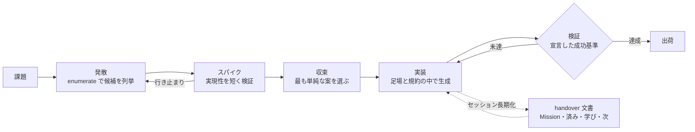
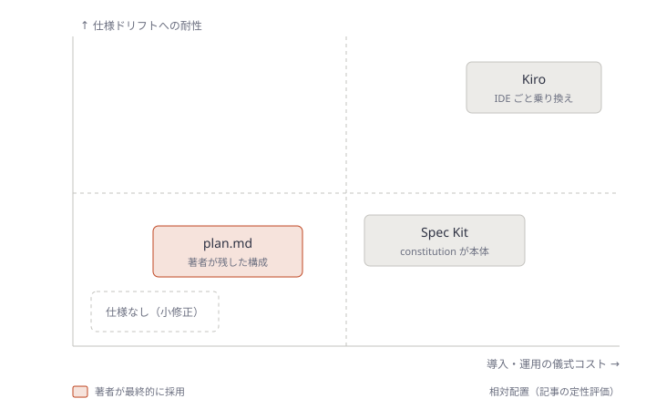
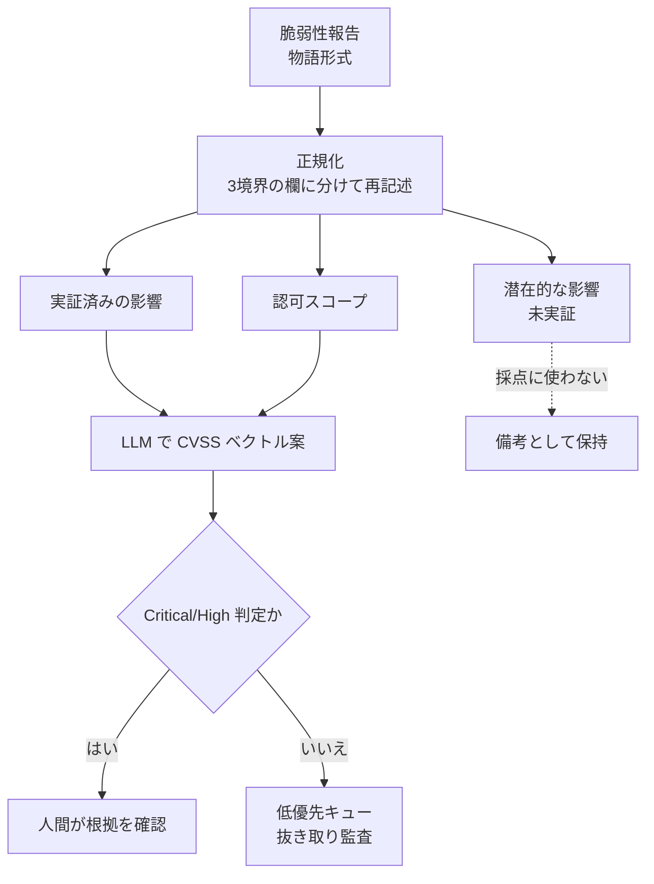
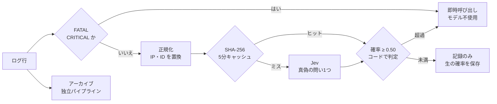
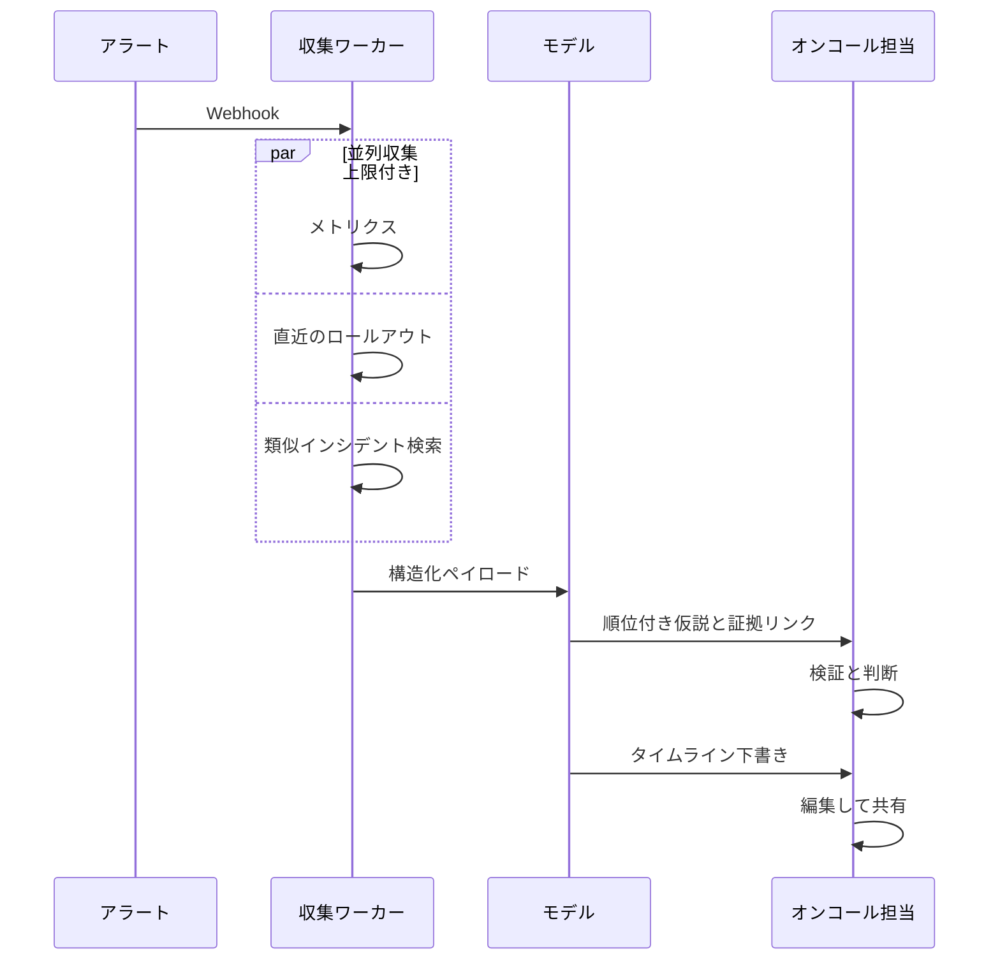

# Daily Briefing 2026-11-22

## 1. LLM 支援コーディングを9か月試して学んだこと（原題: Lessons from 9 months of experiments with LLM-assisted coding）

- **URL**: https://discourse.ubuntu.com/t/lessons-from-9-months-of-experiments-with-llm-assisted-coding/88588
- **公開日**: 2026-09-30
- **著者・媒体**: astrojuanlu / Ubuntu Discourse（Project Discussion）

### 本文翻訳

著者はこの9か月で、VS Code 上の Copilot から Zed と OpenCode へ、さらに OpenRouter 経由のオープンウェイトモデルを Pi ハーネスで使う形へ移ってきた。これらのツールは Multipass の VM の中で動かしており、ツールや設定の入れ替えが簡単にできる。著者は自分をパワーユーザーだとは考えておらず、LLM によるレビューを使うとしても、**出荷するコードを自分で理解し続けたい**という立場を取っている。そのうえで得た教訓を4つにまとめる。

**1. 発散と収束のプロセス**: LLM は候補となる解をすばやく出すが、使い捨てのコードが残っていることが多く、最初の出力は刈り込みや手直しが要る。著者はこれを Shape Up の「仕事は丘のようなもの」（前半は不確実性を潰す上り坂、後半は実行の下り坂）という考え方や、デザインのダブルダイヤモンドになぞらえる。実践としては次の3つを挙げる。
- 「列挙して（enumerate）」のような動詞でプロンプトし、決める前に解空間を探索させる
- 実現可能性を確かめる短いスパイクを回し、行き止まりは早めに捨てる
- 収束の段階では、成立する選択肢のうち最も単純なものを選ぶ

**2. 解空間を制約する**: 著者は後でコードを読むつもりなので、強い理由がない限り慣れた技術、主に Python を選ぶ。足場として `uv` と `ruff`（自分の好みのルール付き）、`tox`、`pytest`、基本的なディレクトリ構成を最初に用意する。エージェントには「Pydantic モデルは `models.py` に置く」「`cli.py` はビジネスロジックを包む薄いラッパーに留める」といったルールを与える。制約が無いと出力は構造の無い「スパゲッティコード」になった。足場を置いたことで生成を誘導しやすくなった。

**3. 検証を必ずループに入れる**: エージェント時代になっても、小さなバッチサイズと速いフィードバックループは重要なままだ。エージェントには「成功をどう測るか」（単体テスト、結合テスト、ブラウザ自動化など）を明言させる。例として、Pi と GLM 5.3 Flash モデルで Miro のボードを Excalidraw に変換した事例を挙げる。エージェントは自分の出力をレンダリングし、エクスポートした PDF と比較して「十分に」近づいたところで止まった。結果は完璧ではないものの、テキストと図形は保たれ、作業の出発点としては使えるものになった（リポジトリ: astrojuanlu/miro-to-excalidraw）。

**4. コンテキストウィンドウと自動コンパクション**: 自動コンパクションの要約は質が低かった。解決済みの問題を残し、構造が乏しく、現在必要な詳細を落とした。モデルは最大 100 万トークンのコンテキストを謳うようになったが、"Flash" 系モデルの長いセッションで突然性能が落ちる現象を見た。原因はアーキテクチャ、量子化、キャッシュの扱い、配信インフラなどが考えられる。対策として著者は Pi の拡張 `@astrojuanlu/pi-handover` を作った。これは **Mission / What has been done / What we have learned / What is next** の4節からなる構造化された引き継ぎ文書を書き出し、それでコンテキストを置き換えてエージェントに作業を続けさせる。初期の結果は良好だという。

**結び**: これらの教訓が誰にでも当てはまるとは限らない。ベンチマークを超えた実環境での証拠に基づく評価が必要であり、読者にも自分で実験してコメント欄で教訓を共有してほしい、と締めくくる。

### 重要ポイント
- 生成は「発散」に使い、`enumerate` で選択肢を出させてから最も単純な案に「収束」させる
- 慣れた言語・リンタ・テスト・ディレクトリ規約を先に置くと、生成がスパゲッティ化しにくい
- 成功の測り方（テスト、レンダリング比較など）をエージェント自身に宣言させ、ループ内で検証させる
- 自動コンパクションに任せず、**Mission / 済み / 学び / 次** の4節で明示的な引き継ぎ文書を作る

### 図解



### 戦略分析

**フレームワーク**: Cynefin（どの局面をエージェントに任せるか）

| 局面 | Cynefin 領域 | 記事での扱い | 人間の役割 |
|---|---|---|---|
| 解の探索（発散） | 複雑 | `enumerate` で候補を出させ、スパイクで感知 | 捨てる判断をする |
| 解の選択（収束） | 煩雑 | 「最も単純な案」を選ぶ | 選ぶ（委譲しない） |
| 足場内での実装 | 明白〜煩雑 | 規約とテストで誘導して生成 | 規約を書く |
| 長いセッションの継続 | 煩雑 | handover 文書で明示的に引き継ぐ | 4節の中身を確認する |

**示唆**: エージェント利用のルールを「作業種別」ではなく「局面」で分けて書くべきである。具体的には (1) 探索フェーズでは複数案の列挙を必須にして、最初の案に飛びつかせない、(2) 実装フェーズに入る前に、リンタ設定・ディレクトリ規約・テストランナーを含むテンプレートリポジトリを用意する、(3) 一定ターン数を超えたら自動コンパクションではなく handover 文書を作り直す運用を入れる。記事は個人の9か月の経験であり定量データは示していないため、効果の大きさは仮説である。

**反証条件**: 書き捨ての検証用コードや、出荷後に人間が読まない成果物（データ変換の一回限りのスクリプトなど）では「慣れた技術に限定する」制約のコストが利益を上回る。また、モデル側のコンテキスト保持が十分に改善されれば handover 文書の価値は下がる。

### 現場での適用方法

**CLAUDE.md / AGENTS.md への追記例**:

````markdown
## 作業の進め方（発散 → 収束 → 検証）

### 1. 発散
- 設計判断が必要なタスクでは、実装前に候補案を3つ以上列挙する。各案に
  「前提」「捨てる条件」「必要な依存」を1行ずつ書く
- 実現性が不明な案は 30 分以内のスパイクで確かめ、結果を `docs/spikes/` に残す

### 2. 収束
- 成立する案のうち、新しい依存が最も少ない案を選ぶ。選ばなかった理由も書く

### 3. 実装の制約
- 言語: Python 3.12。パッケージ管理は `uv`、整形・lint は `ruff`、テストは `pytest`
- Pydantic モデルは `<PKG>/models.py` に置く
- `<PKG>/cli.py` はビジネスロジックを呼ぶ薄いラッパーに限る。ロジックを書かない

### 4. 検証
- 着手時に「成功の測り方」を宣言する（例: `uv run pytest tests/test_x.py` が通る、
  出力画像と期待画像の差分が閾値以下、など）。宣言した基準を満たすまで完了としない
````

**引き継ぎ文書のテンプレート**（`HANDOVER.md`。コンテキストが長くなったら作り直し、新しいセッションの最初に読ませる）:

````markdown
# HANDOVER

## Mission
<このタスクで最終的に達成したいこと。1〜3文>

## What has been done
- <完了した変更。ファイル名・コミットハッシュ付き>

## What we have learned
- <試して駄目だったこととその理由>
- <判明した制約・仕様>

## What is next
1. <次にやること。検証方法も添える>
````

### 期待効果
- 最初の案への早すぎるコミットが減り、使い捨てコードの刈り込みにかかる手戻りが減る
- 解決済みの問題を引きずったコンパクション要約による迷走が減る（記事では初期結果が「良好」とされるのみで、数値は無い）
- 規約が先にあることで、出荷前に人間がコードを読んで理解する負担が下がる

### 注意点
- 記事は個人の実験記録であり、チーム規模での検証はされていない
- 「Flash」系モデルの長セッション劣化の原因は特定されていない。モデルや配信事業者で挙動が変わる
- handover 文書の質はそれを書くモデルに依存する。「学び」節が空なら人間が補う

## 2. Spec Kit・Kiro・素の plan.md を比べて残した仕様駆動の構成（原題: Spec Kit vs Kiro vs a Plain plan.md: The Spec-Driven Setup I Kept (2026 Field Log)）

- **URL**: https://www.devmoment.dev/journal/spec-kit-vs-kiro-field-log-2026
- **公開日**: 2026-08-02（2026-08-10 更新）
- **著者・媒体**: Dani Reyes / DevMoment

### 本文翻訳

**結論**: 同じ「チーム招待」機能を Claude Code 上で3通りの方法で作り、最終的に残したのは素の plan.md だった。Spec Kit はプロジェクトの共有ルールを書くのに最も向き、Kiro は仕様とコードのずれ（ドリフト）を減らすのに最も向き、手書きの plan.md は導入コストが最も低い。

**題材**: トークン付きのメール招待フロー、受諾ページ、ロール割り当て、有効期限。エッジケースを持つ程度には大きく、最後まで作り切れる程度には小さい機能を選んだ。

**3つのやり方**:
- **GitHub Spec Kit**: スラッシュコマンドで constitution（プロジェクトのルール）→ spec → plan → tasks の4段階を進むツールキット。constitution を書くことで、普段は頭の中にしか無かったルールが表に出た。たとえば「クライアント側の有効期限は信用しない」「トークンは1回限り」。欠点は儀式の重さで、新機能には合うがバグ修正には合わない。
- **Kiro**: AWS の仕様ファースト IDE。作業を requirements / design / tasks に分け、コードの横のサイドパネルに表示する。ドリフトに気づきやすい。IDE ごと乗り換える必要があり、最も重い選択肢である。
- **Claude Code 上の素の plan.md**: ゴール、制約、受け入れチェック、タスクリストを書いた Markdown ファイルを plan モードと組み合わせる。新しいツールは不要。欠点は、コードとの同期を保つ仕組みが何も無いこと。

**効いたこと**: 最大の利点は、曖昧な判断を前もって文字にすることを強制される点だった。有効期限の長さ、再招待時の挙動、トークンの再利用などだ。その結果、「違う、そうじゃない」という修正の往復が減った。

**時間を無駄にしたこと**: 2ファイルのバグ修正に Spec Kit のフルプロセスを適用したら、約30分余計にかかり、明確さは何も増えなかった。また、小さな変更がドキュメントを飛ばすと仕様は古くなる。著者の見解では**古い仕様は仕様が無いより悪い**。そして重いツールほど、腐るドキュメントが多く残る。

**推奨**:
- **Spec Kit** は、共有ルールを書き出す必要がある新規プロジェクトに使う。constitution はタスクごとではなく、プロジェクトに一度書けば価値がある
- **Kiro** は、ドリフトが主な問題で、IDE の乗り換えを受け入れられるときに使う
- **素の plan.md** は、エージェントをすでに信頼していて、最小の準備で利益の大半を得たいときに使う
- 小さな修正や、すでに理解している変更では儀式を省く
- 仕様は「更新するコスト」が「無視するコスト」より小さくなるほど小さく保つ

**FAQ から**: 仕様駆動開発（SDD）にツールは必須ではない。TDD との違いは、より上位の振る舞いの契約を定める点にある。両者は併用でき、仕様が受け入れチェックを定め、テストがそれをコードに落とす。

### 重要ポイント
- SDD の価値の中心は**曖昧な判断の前倒しでの文書化**で、ツールの機能ではない
- Spec Kit の constitution は「プロジェクトに1回」で価値がある。タスクごとに回すと儀式化する
- 2ファイルのバグ修正にフルプロセスを当てると約30分の無駄。小修正は仕様を省く
- 古い仕様は仕様が無いより悪い。重いツールほど腐るドキュメントが増える
- 仕様は「更新コスト < 無視コスト」になる大きさに保つ

### 図解



位置は記事の定性評価に基づく相対配置であり、計測値ではない。

### 戦略分析

**フレームワーク**: JTBD（Jobs to be Done）

| 状況 | 片付けたい仕事 | 雇うもの | 現在の代替手段 |
|---|---|---|---|
| 新規プロジェクトの立ち上げ | 暗黙のルールを全員とエージェントに共有する | Spec Kit の constitution（1回） | 口頭・レビューコメント |
| 中規模の新機能 | 曖昧な判断を実装前に潰し、修正の往復を減らす | plan.md（ゴール・制約・受け入れ・タスク） | 実装後の手戻り |
| 仕様とコードのずれが事故を生んでいる | ドリフトを目に見える状態にする | Kiro | 定期的な仕様レビュー |
| 2ファイル程度のバグ修正 | 速く直す | 仕様なし | — |

**示唆**: SDD の導入判断は「どのツールを全社標準にするか」ではなく、**タスクの状況ごとに雇うものを決めるルール**として設計すべきである。具体的には (1) プロジェクト単位の constitution を1つだけ書き、CLAUDE.md から参照させる、(2) 中規模以上の新機能だけ plan.md を必須にし、受け入れチェックをテストに対応付ける、(3) 変更ファイル数が小さい修正は plan.md を免除する閾値をルールに明記する。Kiro のような IDE 乗り換えは、ドリフトが実際に事故を起こしている証拠が出てから検討する。記事は1人が1機能で比較した結果であり、ここでの閾値設計は仮説である。

**反証条件**: 規制対応などで仕様と実装の追跡可能性が監査要件になっている組織では、「小修正は仕様を省く」が成り立たず、ドリフト耐性の高いツールの儀式コストを払う価値がある。

### 現場での適用方法

**plan.md テンプレート**（`docs/plans/<FEATURE>.md`）:

````markdown
# Plan: <機能名>

## Goal
<ユーザーから見た成果を1〜2文>

## Constraints
- <例: 招待トークンは1回限り。受諾時に無効化する>
- <例: 有効期限はサーバー側で判定する。クライアントの時刻を信用しない>

## Open decisions（実装前に埋める）
| 論点 | 決定 | 理由 |
|---|---|---|
| 有効期限の長さ | <72h> | <...> |
| 再招待時の挙動 | <旧トークンを失効> | <...> |

## Acceptance checks（テストに1対1で対応させる）
- [ ] 期限切れトークンで受諾すると 410 を返す → `tests/test_invite.py::test_expired`
- [ ] 同じトークンの2回目の受諾は失敗する → `tests/test_invite.py::test_reuse`

## Tasks
1. <...>
````

**CLAUDE.md への追記例**（どのタスクに仕様を要求するか）:

````markdown
## 仕様駆動のルール

- プロジェクト共通ルールは `docs/constitution.md` に1つだけ置く。全タスクで最初に読むこと
- 次のいずれかに当たる変更は、着手前に `docs/plans/<FEATURE>.md` を作り、
  Open decisions をすべて埋めてから実装する
  - 新しいエンドポイント・画面・データモデルを追加する
  - 変更対象のファイルが 3 つ以上になる見込み
- 上記に当たらないバグ修正・小変更は plan.md を作らない。コミットメッセージに理由を書く
- 実装中に plan.md と食い違う判断をした場合は、同じコミットで plan.md を更新する
  （古い plan.md は削除する。放置しない）
````

### 期待効果
- 実装前に曖昧な判断が文字になり、「そうじゃない」の修正往復が減る（記事は定性的な記述のみ）
- 小修正に儀式を課さないことで、記事が経験した「2ファイル修正に約30分の追加」のような無駄を避けられる
- constitution を1回書くことで、暗黙のセキュリティルール（期限のサーバー判定、1回限りトークン）がエージェントに伝わる

### 注意点
- 比較は1人の開発者・1機能によるもので、チームでの再現性は検証されていない
- plan.md はコードとの同期を保つ仕組みを持たない。「同じコミットで更新する」ルールとレビューでの確認が前提になる
- 「変更ファイル3つ以上」などの閾値は本稿での提案であり、記事の数値ではない

## 3. 物語は誤らせる: LLM はバグバウンティ報告の CVSS 深刻度をどう読み違えるか（原題: Narratives Mislead: An Empirical Study of How LLMs Misjudge CVSS Severity in Bug Bounty Reports）

- **URL**: https://arxiv.org/abs/2610.24623
- **公開日**: 2026-10-17
- **著者・媒体**: Ruitao Feng, Yuekang Li, Yao Zhang / arXiv（cs.CR, cs.SE）

### 本文翻訳

**背景**: バグバウンティプラットフォームには、ベンダーがトリアージできる速さを超えて脆弱性報告が届く。そこで、優先順位付けを左右する CVSS 深刻度の付与に LLM を使うことが検討されている。先行研究は短い CVE 説明文に深刻度を付けさせ、正解率を報告してきた。著者らは、実運用で問題になるのは「どれだけ間違うか」だけでなく「**どう間違うか**」だと主張する。CVSS は各メトリクスを形式的に定義するが、報告者は影響を物語として記述する。著者らは、誤りはこの2つが食い違う場所に集中すると考えた。

**方法**: Huntr と HackerOne から公開済みの報告 4,281 件を収集し、そのうちベンダーが検証した CVSS ベクトルを持つ Huntr の報告 240 件でベンチマークを作った。8種類の LLM を4つのプロンプト戦略で評価し、ファインチューニングも試した。深刻度クラスとスコアの誤りに加え、サブベクトル単位の分析と、モデルの根拠文の質的分析を行った。

**結果**: 最良のプロンプト構成でも深刻度レベルの正解率は **49.58%** にとどまった。これは常に最頻レベルを答える場合より約10ポイント高いだけである。7B モデルをファインチューニングしても最大 **56.25%** で、著者らはこれを楽観的な上限と位置づけている。誤りには方向性があった。**過大評価が過小評価よりはるかに多く**、低深刻度の脆弱性を正しく低と判定することはほとんど無かった。

**原因**: 著者らは誤りの原因を、CVSS 仕様は線を引いているのに物語が曖昧にする3つの境界に求める。
1. **潜在的な影響と実際に実証された影響**の境界
2. **影響の大きさと認可スコープ**（Scope の変化）の境界
3. **不確実性と最悪ケース**の境界

報告者が「アカウント乗っ取りにつながりうる」と書けば、実証されていなくてもモデルはそれを実現した影響として採点してしまう。

**事例研究**: 4件の報告で、境界に沿って書き直し、エクスプロイトを含めない構造にしたところ、あるフロンティアモデルのスコアは、物語が主張されていないアカウント乗っ取りを示唆していた箇所で下がった。ただし、公開されている2つのラベル同士が4件中3件で食い違っており、正解そのものの揺れも大きい。

### 重要ポイント
- 最良のプロンプトでも CVSS レベル正解率は 49.58%。7B のファインチューニングでも最大 56.25%
- 誤りは**過大評価に偏る**。低深刻度はほぼ低と判定されない
- 誤りは「潜在 vs 実証」「影響の大きさ vs 認可スコープ」「不確実性 vs 最悪ケース」の3境界に集中する
- 報告文の書き方（物語）がスコアを動かす。境界に沿った構造化で過大評価が下がる兆候がある
- 公開ラベル同士も4件中3件で不一致。正解データ自体が揺れている

### 図解



### 戦略分析

**フレームワーク**: リスク×可逆性マトリクス（どの判定を LLM に任せるか）

| LLM の判定 | 誤りの傾向（記事） | 誤ったときの帰結 | 可逆性 | 扱い |
|---|---|---|---|---|
| Critical / High | 過大評価が多い | 緊急対応のキューが膨らむ、本当の緊急案件が埋もれる | 中（人手で戻せるが工数を食う） | 人間が根拠を確認してから SLA を起動 |
| Medium | 一部は本来 Low | 優先度が多少前後する | 高 | LLM の判定を採用、定期監査 |
| Low | ほぼ出てこない | 出たときは信頼度が高いとは言えない | 高 | 抜き取り監査 |

**示唆**: LLM による深刻度付与を導入する場合、**正解率ではなく誤りの方向で設計する**。過大評価に偏るなら、LLM を「下げ方向のフィルタ」としては使えず、「上げ方向の判定には人間のゲートを置く」構成になる。具体的には (1) 報告を「実証済み影響 / 潜在的影響 / 認可スコープ」の3欄に分けてから採点させる前処理を入れる、(2) LLM が High 以上を付けた場合だけ人間が CVSS ベクトルの AV/PR/S/C/I/A を1項目ずつ確認する、(3) 評価データセットでは正解率と同時に過大評価率・過小評価率を別々に記録する。

**反証条件**: 自社の SCA / SAST 出力のように、物語ではなく構造化された所見を入力とする場合は、本研究の「物語が誤らせる」メカニズムが働かず、誤りの傾向は別物になりうる。また EPSS や KEV で優先度を決めており CVSS を使っていない組織には直接の影響は小さい。

### 現場での適用方法

**スクリプト化の例**: 報告を3境界に分解してから採点させるプロンプトと、偏りを計測する評価スクリプト。

```python
# cvss_triage_eval.py — LLM の CVSS 判定の「誤りの方向」を測る
# 使い方: python3 cvss_triage_eval.py <LABELED_JSONL>
#   各行: {"id": "...", "label": "High", "pred": "Critical"}
import json, sys
from collections import Counter

ORDER = {"None": 0, "Low": 1, "Medium": 2, "High": 3, "Critical": 4}

def main(path: str) -> None:
    c = Counter()
    n = 0
    for line in open(path, encoding="utf-8"):
        r = json.loads(line)
        d = ORDER[r["pred"]] - ORDER[r["label"]]
        c["exact" if d == 0 else ("over" if d > 0 else "under")] += 1
        if r["label"] == "Low":
            c["low_total"] += 1
            c["low_hit"] += int(r["pred"] == "Low")
        n += 1
    print(f"n={n}")
    for k in ("exact", "over", "under"):
        print(f"{k:6s} {c[k] / n:6.1%}")
    if c["low_total"]:
        print(f"Low recall {c['low_hit'] / c['low_total']:.1%}")

if __name__ == "__main__":
    main(sys.argv[1])
```

**前処理プロンプトの骨子**（採点の前段で使う）:

````markdown
以下の脆弱性報告を、CVSS 採点の前に次の3欄へ分解してください。推測で埋めないこと。

1. demonstrated_impact: 報告内で再現手順・PoC により実証された影響のみ
2. potential_impact: 報告者が「〜につながりうる」と述べているが実証されていない影響
3. authorization_scope: 攻撃に必要な権限、および影響が及ぶ権限境界（Scope の変化の有無と根拠）

CVSS ベクトルは demonstrated_impact と authorization_scope のみから作成し、
potential_impact は採点に使わないこと。各メトリクスに根拠となる報告文の引用を付けること。
````

### 期待効果
- 過大評価による緊急キューの膨張を、人間ゲートの位置を絞ることで抑えられる
- 「誤りの方向」を計測しておくことで、モデルやプロンプトを替えたときの退行に気づける
- 報告の3欄化は人間のトリアージ担当にとっても判断材料の整理になる（論文の事例研究は4件のみで、効果は探索的）

### 注意点
- ベンチマークは Huntr の 240 件で、言語やプロダクトの偏りがありうる
- 正解ラベル自体が揺れる（公開ラベル同士が4件中3件で不一致）。自社の評価データも、2人以上で付けて一致率を確認する
- 3欄化による改善は4件の探索的事例に基づくもので、効果の大きさは未検証

## 4. ログトリアージで TypeSafe Jev をアラートストームなしに調整した方法（原題: How we tuned TypeSafe Jev for log triage without alert storms）

- **URL**: https://dev.to/reachjalil/how-we-tuned-typesafe-jev-for-log-triage-without-alert-storms-1ei0
- **公開日**: 2026-09-18
- **著者・媒体**: jalil laaraichi / DEV Community（初出は Hugging Face）

### 本文翻訳

**主張**: Jev は Vercel AI Gateway 上で入力 100 万トークンあたり $0.042（出力は無料）の型付き評価モデルで、オンコール呼び出しのためのログストリームの選別や、大きなモデルに渡す前の事前フィルタに使える。ただし実用にするには、**判断ロジックをプロンプトの外に出す**必要があった。

**検証データ**: 決済・チェックアウトの合成ログ 3,000 行と、Loghub データセットから 5,000 行（うち HDFS のサンプル 2,500 行）。

**教訓1: 離散的な緊急度ラベルは失敗した**。最初の版では Jev に各ログを page（呼び出す）/ ticket / ignore に分類させた。誤報はゼロだったが、INFO レベルで記録された **47分間の DB レプリカ遅延**を見逃した。確率スコア自体は危険を反映していた（遅延ログで 0.24〜0.31、通常の12秒遅延で 0.11）が、離散ラベルにした時点でその信号が捨てられていた。

**教訓2: プロンプト調整はアラートストームを生んだ**。「顧客データが危険にさらされているときは、INFO であってもアラートを止める理由にならない」と Jev に伝えたところ過敏になり、3,000 行中 189 件の誤呼び出しが出た。うち 122 件は通常のデプロイ通知だった。

**教訓3: アプリケーションコード側の閾値が効いた**。「このログで今すぐエンジニアを呼ぶべきか？」という真偽の問いを1つだけ投げ、連続値の確率を読み、JavaScript 側で 0.50 の閾値を当てた。これで 500 件のインシデントすべて（レプリケーション遅延の 57 行すべてを含む）を捕捉し、3,000 行で誤報はゼロだった。単一の問いにしたことでコストも下がった（複数フィールドの出力で $0.087、単一の問いで $0.062）。

**ベンチマーク（3,000 行）**:

| 方式 | 呼び出し再現率 | 適合率 | 誤呼び出し | INFO の遅延捕捉 | 費用 |
|---|---|---|---|---|---|
| ERROR 深刻度フィルタ | 49.2% | 33.0% | 500 | 0/57 | $0.00 |
| Jev v1 離散緊急度 | 88.6% | 100% | 0 | 0/57 | $0.072 |
| Jev v2 緩めたプロンプト | 100% | 72.6% | 189 | 57/57 | $0.087 |
| Jev v3 確率 ≥ 0.50 | 100% | 100% | 0 | 57/57 | $0.062 |
| GPT-5.6 Luna 構造化出力 | 96.2% | 100% | 0 | 46/57 | $0.320 |

深刻度ベースの呼び出しはインシデントの半分以上を見逃し、想定内のバリデーションエラー 500 件で呼び出した。Luna は遅延インシデントを 57 件中 46 件捕捉し、検索インジェクション文字列を含む 130 行をコンテンツフィルタで落とした。Jev は全行をエラーなく処理した。

**事前フィルタの経済性**: 100 万ログを Luna だけで処理すると約 $120。Jev は1ログあたり約 537 入力トークンで、100 万ログあたり約 $22.55。損益分岐にはストリームの 18.8% 以上を落とす必要がある。HDFS データでは Jev は 99.16% の行を残し（0.84% しか落とさず）、総額は $120 から約 $142 に増えた。事前フィルタは、相当な割合のログを除去できる場合にだけ割に合う。

**繰り返しテンプレートのキャッシュ**: ログ本文の IP アドレスやブロック ID をプレースホルダに置き換えて正規化し、その SHA-256 ハッシュを5分間のインメモリキャッシュと照合してから Jev を呼ぶ。HDFS の 2,500 行では 2,412 行が既出のテンプレートに一致し、モデル呼び出しは 2,500 回から 88 回に、トークンは約 135 万から約 4.8 万に減った。

**本番向けの推奨ルール**:
1. FATAL と CRITICAL はモデルを呼ばずにローカルで振り分ける
2. 複数フィールドのスキーマではなく、真偽の問いを1つだけ投げる
3. 連続値の確率を読み、閾値はコードで強制する
4. アーカイブ用パイプラインとトリアージ用パイプラインを分け、独立した OpenTelemetry プロセッサにする。モデルのタイムアウトで監査記録が落ちないようにする

コメント欄では、AI エンジニアの Tae Kim がドキュメント取り込みパイプラインで同じく「ラベルから生の確率への閾値」へ移った経験を報告し、閾値を超えたときだけでなく**毎回の生の確率を記録する**ことを勧めている。呼び出しに至らない分布のドリフトは、誤報が出る数日前に現れるからだ。

### 重要ポイント
- 離散ラベルは確率に含まれていた信号を捨てる。47分の INFO 遅延を見逃した原因
- プロンプトで感度を調整すると誤呼び出し 189 件のアラートストーム。**閾値はコードに置く**
- 単一の真偽の問い + 確率 ≥ 0.50 で再現率・適合率とも 100%、費用も最小（$0.062）
- 事前フィルタは 18.8% 以上落とせないと赤字。HDFS では逆に $120 → $142
- 正規化 + SHA-256 キャッシュでモデル呼び出しを 2,500 → 88 回に削減

### 図解



### 戦略分析

**フレームワーク**: 単位経済性（ユニットエコノミクス）

| 構成 | 100万ログあたり費用（記事の数値） | 成立条件 |
|---|---|---|
| Luna 単体 | 約 $120 | — |
| Jev 事前フィルタ + Luna | 約 $22.55 + Luna × 残存率 | 18.8% 以上を落とせること |
| HDFS での実測 | 約 $142 | 0.84% しか落とせず赤字 |
| Jev + テンプレートキャッシュ | 呼び出し 2,500 → 88 回（HDFS） | ログのテンプレート反復率が高いこと |

**示唆**: 安価な判定モデルを「前段フィルタ」として入れるかどうかは、モデル単価ではなく**自社ストリームの除去率**で決まる。導入前に (1) 自社ログ1日分で除去率を測り、18.8%（記事の価格条件での分岐点。自社の単価で再計算する）を下回るなら前段フィルタ構成をやめ、Jev を最終判定（呼び出し判断）に直接使う構成にする、(2) 正規化 + ハッシュキャッシュを先に入れ、テンプレート反復率を測る。HDFS のように反復率が高ければ、フィルタより先にキャッシュがコストの大半を消す。

**反証条件**: ログの大半が一意な内容（ユーザー入力を含む自由記述ログなど）でテンプレート反復率が低い場合、キャッシュの効果は小さく、記事の HDFS の数値は再現しない。また、ラベル付きインシデントが少なく閾値を検証できない組織では、0.50 という閾値をそのまま流用できない。

### 現場での適用方法

**スクリプト化の例**（TypeScript。`<GATEWAY_URL>` と `<API_KEY>`、Jev の呼び出し部分は利用中の SDK に合わせて置き換える）:

```typescript
// log-triage.ts — 判断は Jev、閾値とルーティングはコード
import { createHash } from "node:crypto";

type Verdict = { page: boolean; prob: number; source: "local" | "cache" | "jev" };

const THRESHOLD = Number(process.env.PAGE_THRESHOLD ?? "0.50");
const TTL_MS = 5 * 60 * 1000;
const cache = new Map<string, { prob: number; at: number }>();

const QUESTION = "Should this log line page an on-call engineer right now?";

function normalize(body: string): string {
  return body
    .replace(/\b\d{1,3}(\.\d{1,3}){3}\b/g, "<IP>")
    .replace(/blk_-?\d+/g, "<BLOCK>")
    .replace(/\b[0-9a-f]{8}-[0-9a-f-]{27}\b/gi, "<UUID>");
}

// 利用中の SDK / ゲートウェイに合わせて実装する。戻り値は「はい」の確率 0..1
async function askJev(question: string, input: string): Promise<number> {
  const res = await fetch("<GATEWAY_URL>", {
    method: "POST",
    headers: { Authorization: `Bearer <API_KEY>`, "Content-Type": "application/json" },
    body: JSON.stringify({ question, input }),
    signal: AbortSignal.timeout(2000),
  });
  const json = await res.json();
  return json.probability as number;
}

export async function triage(level: string, body: string): Promise<Verdict> {
  if (level === "FATAL" || level === "CRITICAL") {
    return { page: true, prob: 1, source: "local" };
  }
  const key = createHash("sha256").update(normalize(body)).digest("hex");
  const hit = cache.get(key);
  if (hit && Date.now() - hit.at < TTL_MS) {
    return { page: hit.prob >= THRESHOLD, prob: hit.prob, source: "cache" };
  }
  const prob = await askJev(QUESTION, body);
  cache.set(key, { prob, at: Date.now() });
  // 閾値を超えたかどうかに関わらず生の確率を記録する（分布ドリフトの早期検知用）
  console.log(JSON.stringify({ metric: "triage_prob", prob, key: key.slice(0, 12) }));
  return { page: prob >= THRESHOLD, prob, source: "jev" };
}
```

**運用手順**:
1. 過去のインシデントに対応するログ行にラベルを付け、ERROR フィルタとの比較表（再現率・適合率・誤呼び出し）を作る
2. 閾値を 0.3〜0.7 で掃引し、誤呼び出しゼロを保てる最大再現率の点を選ぶ。プロンプトは変えない
3. アーカイブは OpenTelemetry Collector の別パイプラインに分け、トリアージ側のタイムアウトが監査記録に影響しないことを確認する
4. `triage_prob` の分布を日次で可視化し、非呼び出し側の分布の移動を監視する

### 期待効果
- 記事のデータでは、ERROR フィルタ（再現率 49.2%・誤呼び出し 500 件）から再現率 100%・誤呼び出し 0 件へ
- INFO レベルに埋もれた長時間のレプリカ遅延のような「深刻度ラベルが嘘をつく」障害を拾える
- テンプレートキャッシュでモデル呼び出しを大幅に削減（HDFS で 2,500 → 88 回）

### 注意点
- 評価の 3,000 行は合成ログで、インシデントの種類は限られている。自社データで再評価が必要
- 0.50 はこのデータセットでの閾値。プロンプト・モデル版・ログ形式が変わったら掃引をやり直す
- 事前フィルタとしての利用は除去率次第で赤字になる（HDFS で $120 → $142）
- 2秒のタイムアウト時の扱い（呼び出す側に倒すか）を決めておく。記事はアーカイブ分離のみ言及

## 5. SRE のための AI インシデントトリアージ: オンコールで実際に効くこと（原題: AI Incident Triage for SREs: What Works On-Call）

- **URL**: https://stackgen.com/blog/ai-incident-triage-for-sres-what-works-on-call
- **公開日**: 2026-07-20
- **著者・媒体**: Sabith K Soopy / StackGen

### 本文翻訳

AI によるインシデントトリアージの「デモ版」と、曖昧なアラート、欠けたテレメトリ、サービス同士の責任の押し付け合いが渦巻くオンコールの現実は違う。StackGen は、SRE チームがインシデントの最初の30分を失っているのを見て、自社製品 Aiden にトリアージ機能を組み込んだ。本稿はその過程で効いたこと、撤回したことの記録である。

**問題**: トリアージは修正ではなく、**探索範囲を絞ること**だ。調査のたびに同じ手順が繰り返される。直近のデプロイを引く、エラー率を確認する、似た過去のインシデントを探す、アラートとダッシュボードを突き合わせる、タイムラインを組み立てる。午前3時の疲労がこれをさらに難しくする。

**エンジン**: アラートが Webhook で届くと、ランタイムは並行度に上限を設けたコンテキスト収集ワークフローを走らせる。メトリクス、直近のロールアウト、類似インシデントを同時に分析し、モデルが推論する前に構造化されたペイロードへ統合する。例として決済ゲートウェイのアラートを挙げる。
- 12:04 UTC に p99 レイテンシが 45ms から 4200ms に上昇
- DB コネクションプールの飽和度 98%
- イメージ v2.4.1-rc3 のデプロイが 12:00 UTC に完了
- 類似の過去インシデント INC-1842 の類似度 0.82
- 順位付けされた仮説: 上流 DB のコネクションプール枯渇（可能性高）、デプロイは時間的に相関するが因果は未証明（可能性中）

「収集」フェーズと「推論」フェーズを分けることで、トークン使用量を抑えられた。

**最も効いたこと**:
- **システム横断のシグナル相関**: デプロイ時刻とエラー急増、飽和度とキュー深さ、顧客報告と地域障害を結び付ける。エージェントは根本原因ではなく、順位付きの「仮説ボード」を提示する
- **インシデントタイムラインの下書き**: 監査ログとアラート履歴からタイムラインを組み、人間が編集する。Slack での状況共有が一貫する
- **類似の過去インシデントの提示**: ポストモーテムとインシデント要約に対するセマンティック検索。結果の質は文書の質に依存し、埋め込みモデルよりもチャンクの衛生状態とメタデータ（サービス、深刻度、期間）のほうが効いた
- **RCA の骨組みの準備**: 実行トレースから構成、タイムライン、影響、寄与要因、未解決の問いを下書きする。結論は人間が書く

**撤回したこと**:
- **ガードレールなしの自動修復**: Pod の再起動のような操作は根本原因を覆い隠し、変更ポリシーに違反しうる。トリアージエージェントはまず調査する
- **自信満々の根本原因ナラティブ**: エンジニアが欲しいのは洗練された文章ではなく検証可能なデータだった。単一の断定的な結論から、テレメトリへのリンク付きの順位付き仮説へ切り替えた
- **ブリッジコールの代替**: エージェントは参加者に状況を説明できるが、サービスオーナー同士の意見対立は解決できない

**教訓**:
- トリアージは「次にどこを見るか」を絞ることで、インシデントの解決宣言ではない
- 雄弁な要約より証拠へのリンクのほうが役に立つ
- 下書きは自動公開せず、人間が編集してから送る
- インシデント履歴に対する AI 検索の価値の上限は、ポストモーテムの質で決まる
- ページャーを持つのは人間。エージェントはデータを引く側であり、対応を指揮する側ではない

（本稿は「収集」と「語り」を分ける設計の説明とともに、Aiden for SRE とその Community Edition の宣伝で締めくくられている。）

### 重要ポイント
- トリアージの目的は**探索範囲の絞り込み**。根本原因の断定ではなく、証拠リンク付きの順位付き仮説を出す
- 「収集（並列・上限付き・構造化ペイロード）」と「推論（モデル）」を分けるとトークンが抑えられる
- 類似インシデント検索の質は、埋め込みモデルよりポストモーテムのチャンク衛生とメタデータで決まる
- ガードレールなしの自動修復と、断定的な RCA ナラティブは撤回した
- タイムラインと RCA の骨組みは下書きまで。結論と公開は人間が担う

### 図解



### 戦略分析

**フレームワーク**: RACI（人とエージェントの責務分担）

| 活動 | エージェント | オンコール担当 | サービスオーナー | 関係者 |
|---|---|---|---|---|
| コンテキスト収集・相関 | R | A | I | — |
| 仮説の順位付け | R | A | C | — |
| 修復操作（再起動等） | —（撤回） | R / A | C | I |
| タイムライン・状況共有 | R（下書き） | A（編集・送信） | I | I |
| 根本原因の結論 | R（骨組みのみ） | A | C | I |
| オーナー間の対立解消 | — | R | A | C |

**示唆**: AI SRE の導入範囲は「どこまで自動修復させるか」ではなく、**どの成果物を下書きまでに留めるか**で決めるべきである。具体的には (1) エージェントに本番の書き込み権限を与えず、出力を「証拠リンク付き仮説」と「タイムライン下書き」に限定する、(2) 類似インシデント検索に投資する前に、ポストモーテムテンプレートにサービス・深刻度・期間のメタデータ欄を必須化する、(3) 断定的な RCA 文を出させるプロンプトを禁止し、各仮説に確度とテレメトリへのリンクを必須にする。記事は効果を定量化していないため、30分短縮などの効果は仮説である。

**反証条件**: 変更の大半がステートレスで、再起動が安全かつ変更ポリシー上も許可されている環境（たとえば自己修復を前提に設計された Kubernetes ワークロード）では、限定的な自動修復を早期に入れたほうが MTTR を下げられる可能性がある。また、記事はベンダーが自社製品の文脈で書いたものであり、撤回の判断がその顧客層に特有である可能性がある。

### 現場での適用方法

**スキル化の例**（`.claude/skills/incident-triage/SKILL.md`）:

````markdown
---
name: incident-triage
description: アラート発生時にコンテキストを収集し、証拠リンク付きの順位付き仮説とタイムライン下書きを作る。修復操作は行わない。オンコール中に「このアラートを調べて」と言われたときに使う。
---

# インシデントトリアージ

## 禁止事項
- 本番環境への書き込み操作（再起動、スケール変更、ロールバック、設定変更）を実行しない
- 根本原因を断定する文を書かない。必ず「仮説」として確度を付ける
- 下書きを Slack 等に自動投稿しない

## 手順
1. 収集（並列で実行し、結果を JSON にまとめる）
   - 対象サービスの直近 2 時間のエラー率・p99・飽和度: `<METRICS_CLI> query ...`
   - 直近 24 時間のデプロイ: `<DEPLOY_CLI> history --service <SERVICE> --since 24h`
   - 類似インシデント: `docs/postmortems/` を service と症状で検索し、上位 3 件
2. 相関: 時刻を UTC に揃え、デプロイ・メトリクス変化・アラートを1本の時系列に並べる
3. 出力（Markdown）
   - 仮説ボード: 仮説ごとに「確度（高/中/低）」「根拠の数値」「ダッシュボード/ログへのリンク」
     「この仮説を否定するには何を確認すればよいか」
   - タイムライン下書き
   - 未解決の問い
````

**ポストモーテムのテンプレートに追加するメタデータ**（類似インシデント検索の質を上げるため）:

```yaml
# docs/postmortems/<YYYY-MM-DD>-<slug>.md の front matter
service: payment-gateway
severity: SEV2
started_at: 2026-07-14T12:04:00Z
resolved_at: 2026-07-14T12:51:00Z
symptoms: [p99-latency, db-pool-saturation]
trigger: deploy        # deploy / config / dependency / traffic / unknown
related_incidents: [INC-1842]
```

### 期待効果
- 記事が問題視する「インシデントの最初の30分」の定型的な情報収集を短縮する（記事は短縮量を示していない）
- 仮説に証拠リンクが付くため、エンジニアが調査をやり直す手間が減る
- ポストモーテムのメタデータ整備により、類似インシデント検索の精度が上がる

### 注意点
- 記事は StackGen の製品 Aiden の宣伝を含むベンダーブログであり、効果の定量データは無い
- 類似インシデント検索は、書かれていないポストモーテムを補えない。文書化の習慣が先に要る
- エージェントに読み取り権限を与える範囲（ログに含まれる個人情報など）を事前に決める
