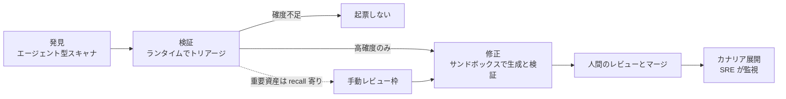
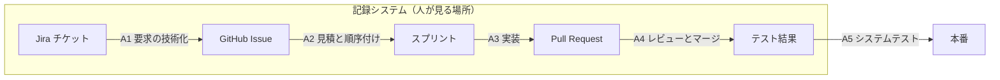
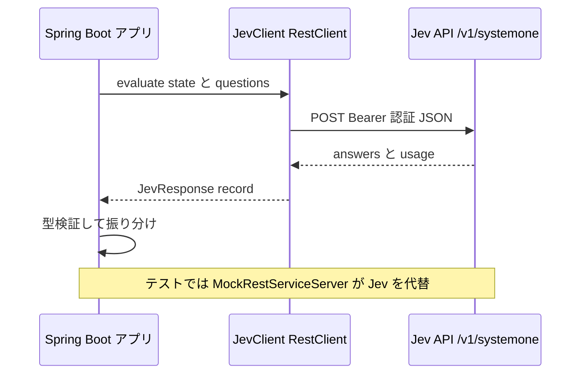
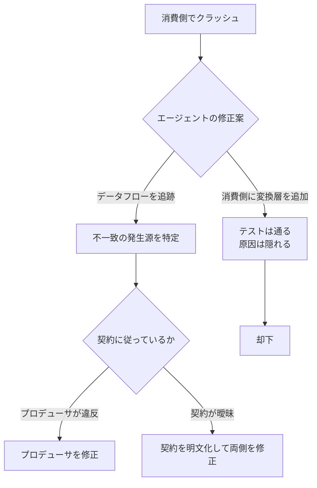

# Daily Briefing 2026-11-23

## 1. Google の実践：エージェントで脆弱性を発見・追跡・修正する（原題: How Google Does It: Using agents to help find, track, and fix vulnerabilities）

- **URL**: https://cloud.google.com/transform/how-google-does-it-using-agents-help-find-track-and-fix-vulnerabilities
- **公開日**: 2026-10-26
- **著者・媒体**: Archana Ramamoorthy（Senior Director, Cybersecurity & Data Protection）、Brian Roddy（VP, Product Security and User Protection）／ Google Cloud Blog「How Google Does It」シリーズ

### 本文翻訳

フロンティアエージェントは、ソフトウェアの欠陥を発見し悪用する「経済性」を根本から変えた。かつて専門家が数週間かけて手作業でリバースエンジニアリングしていた作業が、いまや数分で済む。この変化は2年足らずで起きた。

2025年初頭の時点で、Google の防御は見慣れたリズムだった。リスクを評価し、全システムにまたがって深刻なバグを優先順位付けし、机上演習を行い、修正を標準のビルドパイプラインでカナリアリリースする。しかし脅威の状況はそれ以降「完全に」変わった。エージェントは以前より速く欠陥を見つけて攻撃でき、防御側も想定以上の欠陥を見つけている。Google はこれまでの土台の上に、自動化されたエージェント型システムを構築することで対応した。

**修正の遅延そのものが脆弱性になる。** エージェントはトリアージ、チケットキュー、パッチ適用期間に関する従来の前提を壊した。(1) **量の指数的増加**: 自社コードと OSS 依存の双方で報告が何倍にも増え、人手のトリアージキューを圧倒している。(2) **時間が決定的要因**: 脆弱性を「知っている」ことはもはや重要な段階ではない。欠陥の特定から本番へのパッチ展開までの時間を「remediation latency（修正遅延）」と定義する。攻撃者が数時間で弱点をエクスプロイトに変える自律ツールを持つ以上、この時間窓自体が脆弱性になる。(3) **速度の不一致**: 発見が指数的に増える一方で修正が人間の線形ペースのままなら、ギャップは無限に広がる。答えは「エージェント型の攻撃にはエージェント型の防御で」だった。

**全社的な防御の統制。** Google は数万の独立したサービス、巨大な自社リポジトリ、数千の OSS パッケージを抱え、事業部ごとに運用リズムも異なる。チームごとの個別対応では、ツールの断片化・作業の重複・危険な死角が生まれる。そこで全社で統制し、ツール展開を集約して開発パイプラインにセキュリティ機能を組み込むことにした。目標は「すべてのプロダクト領域に、集約された発見ツール・自動パッチサービス・デプロイパイプラインを提供し、機械速度の脅威に追随すること」である。

**中核アーキテクチャ：エージェント型スキャンと自動パッチ。** 従来のスキャナは定期バッチで危険なパターンや既知の脆弱な依存を検出し、人間のエンジニア向けにチケットを起票する。数千件の報告が機械速度で届くと、この手渡しは破綻する。Google の内部プログラム **Project Fortify** は「受動的な検出から能動的な修正へ」移行するもので、継続的に脆弱性を探索し、パッチ生成を直接駆動する。find-fix-deploy サイクルは4段階で連携する。

1. **発見（エージェント型スキャナ）**: Gemini を中心に構築した PageBreak や Mantis など複数のスキャナで脆弱性を探す
2. **検証（トリアージエージェント）**: 実際のランタイム環境で検証し、悪用可能な脆弱性とノイズを分ける
3. **修正（エージェント型フィクサー）**: CodeMender が根本原因を分析し、サンドボックスで修正を生成・検証し、レビュー可能な変更リストを開発者のワークフローに提案する
4. **デプロイ（SRE との協業）**: 人間のエンジニアがレビューしてマージし、SRE が監視する安全なカナリア段階を経て迅速に展開する

**精度と再現率のバランス：信頼モデル。** エージェントが書いたコードを開発者がレビューする以上、精度（指摘のうち本物の割合）が不可欠だ。誤検知にパッチを提案すれば開発者はすぐに信頼を失う。そこで **precision-first の信頼モデル** を採用した。大半のアプリケーションコードでは、トリアージフィルタが高精度の閾値を満たした場合にのみ起票しパッチ生成を始める。開発者が自動 PR を受け取ったとき、それは検証済みの高確度な欠陥に対するものになる。一方、**重要インフラ、中核の認証基盤、境界プロキシ** では、誤検知が増えても再現率を高めるようスキャナを調整でき、手動レビューの増加を受け入れる。これにより、各チームは共通の自動化を使いつつリスク許容度をローカルに保てる。

**公開・展開済みのもの**: OSS のマルチエージェント監査フレームワーク Mantis、Chrome のパッチ周期短縮（発見から数日で修正配布）、OpenSSF を通じた上流ライブラリ支援、OSS-Fuzz への CodeMender 組み込み。

**find と fix の先へ**: 発見後のパッチだけでは不十分で、Rust などメモリ安全言語への移行、プラットフォーム層での安全なフレームワーク強制（バグを入れられない構造）、全コミットでセキュリティ保証を検証する継続的なエージェント保証に投資している。開発者とセキュリティエンジニアの役割は、手動トリアージから「自律エンジンの監督」へと移る。

### 重要ポイント

- 2026年のリスク指標は「検出数」ではなく **remediation latency**（特定→本番展開までの時間）
- 発見・検証・修正・デプロイを分断せず1本のパイプラインに繋ぎ、チケット手渡しを消す
- 自動パッチの起票は **precision-first**。ただし重要資産だけは recall 寄りに振り、手動レビュー増を受け入れる
- リスク許容度は各プロダクト領域がローカルに決め、自動化基盤は全社で共通化する
- 最終的には「バグを入れられない」構造（メモリ安全・プラットフォーム不変条件）で発見そのものを減らす

### 図解



### 戦略分析

**フレームワーク**: バリューストリームマッピング × 制約理論

| 工程 | 従来の姿 | 記事の打ち手 | 待ちの主因 |
|---|---|---|---|
| 発見 | 定期バッチ | 継続的エージェント探索 | なし（むしろ過剰供給） |
| トリアージ | 人手キュー | ランタイム検証エージェント | **従来の制約** |
| 修正 | チケット→担当者待ち | CodeMender がレビュー可能な変更を提案 | 担当者割当 |
| レビュー・マージ | 人間 | 人間（据え置き） | **新しい制約候補** |
| デプロイ | 標準パイプライン | SRE 監視のカナリア | 小 |

**制約**: 発見を自動化すると、上流が下流を圧倒する。記事が precision-first を採るのは、レビュー工程（人間）を制約と見なし、そこへ流す量を絞る「制約の徹底活用」である。誤検知パッチは制約のキャパシティを浪費するので、精度閾値は事実上のフロー制御弁になる。

**示唆**: 自社で AI スキャナを増やす前に、(1) 自動起票の精度閾値を明文化し、閾値未満は起票しない、(2) 資産を「recall 優先」と「precision 優先」の2区分に分けて台帳化する、(3) KPI を検出件数から「特定→本番展開の中央値」に置き換える、の3点を先に決める。発見ツールの追加投資は、この3点が決まるまで保留するのが合理的。

**反証条件**: デプロイ頻度が週次以下で、カナリアや自動ロールバックを持たない組織では、制約はレビューではなくデプロイ工程に残る。その場合は修正自動化より先にリリース基盤の整備が効く。また、記事は精度閾値の具体値や効果の数値を開示していないため、上記は構造上の推論である。

### 現場での適用方法

**運用手順 + 設定ファイル例**: 自動修正 PR の起票ゲートを資産区分ごとに分ける。

```yaml
# .security/remediation-policy.yml
# 自動修正エージェントが起票・PR作成するかを決めるポリシー
defaults:
  mode: precision          # precision | recall
  min_confidence: 0.9      # トリアージエージェントの確度がこれ未満なら起票しない
  require_runtime_repro: true
  auto_pr: true
asset_classes:
  critical:                # 認証基盤・境界プロキシ・決済
    match: ["services/auth/**", "services/gateway/**", "services/payment/**"]
    mode: recall
    min_confidence: 0.5
    auto_pr: false         # 起票はするが、修正は人間がトリアージ後に依頼
    reviewers: ["@<SECURITY_TEAM>"]
  standard:
    match: ["**"]
metrics:
  primary: remediation_latency_p50   # 特定→本番展開
  secondary: [auto_pr_rejection_rate, false_positive_rate]
```

```bash
#!/usr/bin/env bash
# remediation-latency.sh: 修正遅延の中央値を算出（GitHub の security ラベル付き PR を対象）
# 前提: PR 本文に "Detected-At: YYYY-MM-DDTHH:MM:SSZ" を自動修正エージェントが書き込む
set -euo pipefail
REPO="<OWNER/REPO>"
gh pr list -R "$REPO" --label security --state merged --limit 200 \
  --json body,mergedAt \
| jq -r '.[] | select(.body|test("Detected-At:")) |
    [(.body|capture("Detected-At: (?<t>\\S+)").t), .mergedAt] | @tsv' \
| while IFS=$'\t' read -r det merged; do
    echo $(( ( $(date -d "$merged" +%s) - $(date -d "$det" +%s) ) / 3600 ))
  done | sort -n | awk '{a[NR]=$1} END{print "p50 hours:", a[int((NR+1)/2)]}'
```

### 期待効果

- 自動修正 PR の却下率が下がり、開発者の信頼が維持される（記事の precision-first の狙い）
- 重要資産では見逃しを減らし、その他では人間のレビュー負荷を抑える、という配分が明示的になる
- 指標を remediation latency に置き換えることで「検出件数が増えたのに安全になっていない」状態を可視化できる（記事は具体値を示していない）

### 注意点

- 精度閾値はトリアージエージェントの確度が較正されていることが前提。較正されていない確度で閾値を切ると誤った安心感を生む
- 記事は Google 規模の内部ツール（PageBreak / CodeMender）前提。同等品が無い場合、まず「ランタイム再現できたものだけ起票」から始める
- 最終マージとデプロイの責任は人間に残る設計である点を外さないこと

## 2. 誰も行数を二度自慢しない：1月に皆が見せびらかした指標に代わったもの（原題: Nobody brags about lines of code twice）

- **URL**: https://www.cio.com/article/4236554/nobody-brags-about-lines-of-code-twice.html
- **公開日**: 2026-10-19
- **著者・媒体**: Pete Johnson（MongoDB AI 担当 Field CTO）／ CIO.com Opinion

### 本文翻訳

この1年、7か国を回り、パイロット段階を越えたチームを中心に100件以上の顧客と対話した。1〜2月と7月で会話は変わっていた。年初は、エージェント型コーディングの普及とともに「エージェントが生成したコード行数」のスライドを誇らしげに見せる人が多かった。夏には誰もその数字を口にしなくなった。代わりに現れた指標は、良いエージェント設計についての私の見方を変えた。

**生き残れなかった数字。** 行数が価値の代理指標として不適切なことは昔から知られている。Dijkstra は「生産した行」ではなく「費やした行」と呼ぶべきだと言い、Gates は飛行機の進捗を重量で測るようなものだと言った。DORA は2014年から、出力量ではなくスループットと安定性で配信パフォーマンスを定義してきた。行数自慢が復活したのは欠点を忘れたからではなく、AI で出力量が見栄えするようになり、他に良い数字が無かったからだ。春には DORA が、トークン消費量で開発者をランク付けする「tokenmaxxing」を行数やコミット数と同列に批判した。

**何が取って代わったか。** CircleCI の 2026 State of Software Delivery（2,800万超の CI/CD ワークフロー）では、中央値のチームでフィーチャーブランチのスループットが15%増えた一方、本番に届く main ブランチのスループットは7%減った。書く場所の活動は増え、出荷する場所の活動は減った。DORA の約5,000人調査では、AI 採用の高さは配信スループットと配信不安定性の両方の増加に関連していた。メカニズムは「検証税」で、タイピングで節約した時間がレビューと検証に移る。AI は小さなバッチから大きくリスクの高い変更へとチームを押しやる。結論として目標はコード量ではなく、どれだけ速く本番に届け、届いた後どれだけ信頼できるかである。

**誤った解決策。** 誘惑されるのは「スーパーエージェント」、つまりチケットを読みコードを書き PR を開きテストして出荷までを1体でこなす設計だ。デモは見栄えがするが、全ての故障モードが1か所に集中し、組織の全コンテキストを必要とし、問題が起きたとき人間の監督者が見慣れた場所で検査できない。

**実際に作られているもの。** 現場で見たのは逆で、既存の記録システム（system of record）の上に小さなエージェントを1体ずつ置く構成だ。(1) Jira チケット→GitHub Issue（業務要求をエンジニアが動ける技術課題に変換）、(2) Issue→スプリント編成（ポイントポーカーで見積もり、グルーピング、順序付け）、(3) コーディング、(4) PR マージ（レビュー、コンフリクト解消、マージ規律）、(5) システムテスト。各エージェントは独立しており、隣接する記録だけに触れ、1文で説明できる。マイクロサービスの発想を借りている。

**なぜこの形か。** 第一に**記録システムを維持する**。エージェントを見るための新しいコンソールではなく、人が既に見ている Jira 等の背後に置く。監督が失敗するのは人が監督を拒むからではなく、監督の場所が普段いない場所に移るからだ。第二に**影響範囲を限定する**。スプリント編成エージェントは悪いコードを出荷できない。最悪のミスは誤って振り分けたストーリーで、朝会で露見する。変更失敗を、原因追跡が難しいパイプライン末端ではなく、変更が起きる地点で扱える。第三に**独立して設計・リリースできる**。コーディングエージェントのモデルを替えてもテストエージェントに触れずに済み、個別にバージョン管理し、元が取れないものは退役させられる。第四に**コンテキストが狭い**。各エージェントが必要とするのはスーパーエージェントの一部のコンテキストだけで、安く正確になる。

**証拠。** ある小売業の顧客はこのパターンで9か月かけて、アイデアから本番までの時間を5分の1にした。この指標はコミット起点の DORA のリードタイムより広い。洗練・見積もり・順序付けなど多くのエージェント作業はコミット前に起きるため、業務側が要求を起票した時点を起点にしている。行数は変えておらず、おそらくもう追っていない。レイオフはなく、増えたキャパシティで以前は人手が足りず受けられなかった案件を引き受けた。

**反論。** 「5体は1体より負荷が大きいのでは」—その通り。マイクロサービスや小バッチと同じトレードオフで、単位あたりの儀式は増えるが単位あたりのリスクは減る。「段階ごとのエージェントは手渡し問題を再現するのでは」—コンウェイの法則はエージェントにも当てはまる。エージェントのトポロジーはチームのトポロジーを映すので、意図的に設計すべきだ。**正直な注意点**として、マイクロサービスが分散トレーシングや連鎖障害をもたらしたように、マイクロエージェントも同様の問題をもたらす。5体にまたがる可観測性は1体より難しく、ツールもまだ未熟だ。

### 重要ポイント

- CircleCI 2026: フィーチャーブランチのスループット +15%、main ブランチ −7%。「書く」は増えたが「出荷」は減った
- 単一のスーパーエージェントではなく、記録システム（Jira/GitHub）ごとに小さなエージェントを置く
- 監督は「人が既に見ている場所」で行う。専用コンソールは監督を失敗させる
- 計測の起点を「コミット」から「業務要求の起票」に広げる。小売の事例で idea-to-production 5倍短縮
- マイクロサービスと同じく可観測性と連鎖障害のコストを引き受ける

### 図解



### 戦略分析

**フレームワーク**: バリューストリームマッピング × RACI

| 工程（記事の5エージェント） | エージェントの責務（R） | 人間の説明責任（A） | 失敗が露見する場所 |
|---|---|---|---|
| 要求→Issue | 技術課題への変換 | PdM | Issue レビュー |
| 見積・順序付け | ポイント見積、グルーピング | EM / チーム | 朝会 |
| 実装 | コード生成 | 担当エンジニア | PR |
| レビュー・マージ | コンフリクト解消、規律 | レビュアー | PR |
| システムテスト | テスト実行 | QA / SRE | テスト結果 |

**構造化**: VSM の起点を「要求起票」に置くと、コミット前の工程（要求の技術化・見積）が見えてくる。記事の5倍短縮はこの上流部分を含むため、DORA のリードタイムだけを見る組織はこの改善余地を測れていない。RACI で見ると、各エージェントの R は狭く、A は常に既存の役割に残る。これが「監督の場所を変えない」の実体である。

**示唆**: 次の四半期のエージェント投資は「コーディング支援の強化」ではなく、(1) 計測起点を要求起票に変更、(2) コミット前の工程（チケット→Issue 変換、見積）に最初の小エージェントを1体置く、の順にする。新しいエージェント用ダッシュボードの導入は見送り、出力先を既存の Jira/GitHub に限定する。

**反証条件**: 要求起票からコミットまでが既に短い組織（小規模チームで PdM とエンジニアが同一人物など）では上流エージェントの効果は小さく、5体分の運用負荷が上回る。また5倍短縮は1社の事例で、ベースラインやエージェント以外の変更要因は記事に開示されていない。

### 現場での適用方法

**スキル化の例**: 「Jira チケット→GitHub Issue」の単機能エージェントを Claude Code のスキルにする。

````markdown
---
name: ticket-to-issue
description: Jira の業務要求チケットを、エンジニアがそのまま着手できる GitHub Issue に変換する。チケットキーが渡されたとき、または「Issue 化して」と頼まれたときに使う。コードの変更・PR 作成はしない。
---

# Ticket → Issue 変換

## 責務の境界（これ以外はしない）
- 入力: Jira チケット 1件（キー <PROJ-123> 形式）
- 出力: GitHub Issue 1件（`gh issue create`）と、Jira チケットへの Issue URL コメント
- しないこと: 見積、スプリント割当、コード変更、PR 作成

## 手順
1. チケットの要約・説明・添付を読む
2. 不明点が3つ以上あれば Issue を作らず、Jira に質問コメントを残して終了する
3. 以下のテンプレートで Issue を作る

```
## 背景（業務要求の要約）
## 受け入れ条件（検証可能な箇条書き）
## 影響範囲の候補（ディレクトリ / サービス名）
## 対象外
## 元チケット: <JIRA_URL>
```

4. ラベル `from-jira` と `needs-estimate` を付ける
````

**運用手順**: 計測起点の変更

```bash
# 業務要求起票→本番の時間を測るため、Issue に元チケットの作成日時を残す
gh issue edit <ISSUE_NO> --body-file - <<'EOF'
...（本文）
Requested-At: <JIRA_CREATED_ISO8601>
EOF
# デプロイ時に Requested-At と本番反映時刻の差を記録し、週次で中央値を出す
```

### 期待効果

- 小売の事例では idea-to-production が5分の1（9か月）。レイオフなしで受注可能な案件が増えた
- 各エージェントの失敗が「誤ったストーリー」など小さく、既存の場（朝会・PR）で露見する
- モデル差し替えやエージェント退役を個別に行える

### 注意点

- エージェント間の可観測性は未成熟。各エージェントの入出力を記録システム上にコメントとして必ず残す
- エージェントのトポロジーはチーム構造を写す（コンウェイの法則）。組織の分断をそのまま写すと手渡し待ちが再発する
- 記事は顧客観察ベースのオピニオンで、定量データは1社分のみ

## 3. AI 時代の DORA メトリクス：必要だがもはや十分ではない（原題: DORA Metrics in the AI Era: Necessary but No Longer Sufficient）

- **URL**: https://getunblocked.com/blog/dora-metrics-ai-era/
- **公開日**: 2026-06-04
- **著者・媒体**: Dennis Pilarinos ／ Unblocked Engineering Insights

### 本文翻訳

多くの PR が AI 生成になったとき、DORA メトリクスはまだ機能するのか。答えは「配信を正確に測ってはいるが、もはや説明はしない」である。2025年の DORA レポートでは開発者の90%が仕事で AI を使っている。デプロイ頻度とリードタイムは配信を忠実に追うが、コードが正しいか、レビュアーが過負荷か、安定性が損なわれていないかは何も語らない。

**4つのキー。** デプロイ頻度、変更のリードタイム、変更失敗率、失敗デプロイからの復旧時間。前2つがスループット、後2つが安定性を測る。速度と安定性の組み合わせこそがこの枠組みの強みで、安定性なき速度は無謀、速度なき安定性は停滞である。2025年版では従来の low/medium/high/elite のクラスタが7つのチーム原型に置き換えられた。

**2025年の DORA が AI について示したこと。** 90%が AI を使い、80%超が生産性向上を報告し、約30%は AI 生成コードをほとんど信頼していない。AI はスループットと正に相関するようになったが、配信安定性とは依然として負の相関だ。2024年版では AI 採用が25%増えるごとにスループットが約1.5%、安定性が約7.2%下がると推定されていた。1年でスループットの関連は正に転じたが、安定性は回復していない。Stack Overflow 2025 では66%が AI 出力を「ほぼ正しいが完全ではない」と表現している。

**なぜスループットが上がり安定性が下がるのか。** AI はより多くのコードを速く生成し、PR は大きくなり、レビュー負荷は増え、欠陥の隠れ場所が増える。レビュアーが追いつかず微妙な欠陥が通り抜ける。Faros AI（2025）では、AI 採用とともにマージされた PR が98%増えた一方、PR レビュー時間が91%、開発者あたりバグが9%増え、会社単位では AI 利用と成果の相関はほぼゼロだった。GitClear（2026）では、コピペコードの比率が2021〜2024年に8.3%から12.3%に増え、リファクタリングは約25%から10%未満に減った。人間のタイピング速度は、システムに入るリスクある変更量の自然なブレーキだった。元の枠組みはそのブレーキが無くなることを想定していない。

**AI 時代の4キー対応表。** 指標を捨てるのではなく、AI が覆い隠すものを捉える対抗指標と組にする。

| 指標 | AI が歪めるもの | 対抗指標 |
|---|---|---|
| デプロイ頻度 | リリース増が、1回あたりのレビュー済み変更の縮小を隠す | デプロイあたり変更失敗率 |
| リードタイム | コミットの高速化が、遅く重いレビューキューを隠す | PR レビュー時間とレビュー→マージの差分 |
| 変更失敗率 | 大きな AI PR が1回のデプロイにリスクを集中させる | 30日以内の手戻り率・コードチャーン |
| 復旧時間 | 速い復旧が、失敗件数の増加を常態化させる | 信頼シグナル・AI 出力への開発者の確信度 |

**必要だが十分でない理由。** DORA はフロー（流れ）を測るが、フィットネス（適合）は測らない。頻繁にデプロイし速く復旧しても、誰も信頼しない機能を出荷し続けることはできる。SPACE は生産性が多次元だと論じ、DX Core 4（2024）は DORA・SPACE・DevEx を速度・有効性・品質・インパクトの4次元に統合した。AI は速度を膨らませつつレビューと信頼のコストを静かに上乗せするため、品質と体験の次元の重要性が増す。

**追加すべき3つ。** (1) 安定性への重み付けを強める（AI のリスクはまず変更失敗率と復旧時間に出る）。(2) 手戻り・チャーンのシグナル（マージ直後に書き直し・リバートされたコードの割合）。(3) 知覚チェック：体感生産性と実測を比べる。METR の2025年研究では、熟練開発者は AI ツールで19%遅くなったが、本人たちは20%速くなったと信じていた。客観データと定期サーベイを組み合わせ、両者が乖離する箇所を調べる。

**コンテキスト品質への依存。** 安定性が最も劣化するのは、エージェントがシステム・規約・過去の判断について組織的コンテキストを欠くときだ。同一プロンプト・同一モデルでの Unblocked の A/B テストでは、良いコンテキストでトークン42%減、完了27%高速化、ツール呼び出し64%減だった。結論として、4キーは残しつつ品質と体験のシグナルで囲み、今四半期は各キーに1つずつ対抗指標を組にすることを勧める。

### 重要ポイント

- DORA 2024→2025 で AI とスループットの関係は負→正に転じたが、**安定性は負のまま**
- Faros: マージ PR +98% に対しレビュー時間 +91%、会社単位の相関はほぼゼロ
- 4キーそれぞれに対抗指標を1つずつ組にする（表を参照）
- 体感と実測の乖離（METR: 19%遅いのに20%速いと感じる）を定期的に照合する
- 出典企業がコンテキスト製品のベンダーである点は割り引いて読む

### 図解

図解省略（理由: 記事の核は「4キー×対抗指標」の対応表であり、表で過不足なく表現できるため）

### 戦略分析

**フレームワーク**: DORA Four Keys × Goodhart の法則への反証

| 観測パターン（対抗指標との組） | 解釈 | 取るべき動作 |
|---|---|---|
| デプロイ頻度↑ ＋ デプロイあたり失敗率↑ | 速度が品質を食っている | PR サイズ上限を設ける |
| リードタイム↓ ＋ レビュー時間↑ | 待ちがレビューに移動しただけ | レビュー前の機械検証を足す |
| 変更失敗率→ ＋ 30日チャーン↑ | 失敗が「手戻り」として潜伏 | チャーン上位ファイルの所有者と規約を見直す |
| 復旧時間↓ ＋ 失敗件数↑ | 消火が上手くなっただけ | 失敗件数そのものを目標に入れる |

**構造化**: 単一指標を目標にすると、AI はその指標を最も安く満たす方向に組織を動かす（Goodhart）。記事の対抗指標は、各キーを「ゲームしにくくする」ための組であり、ダッシュボードの色ではなく組の乖離を見ることが要点。

**示唆**: AI 導入効果を報告する際、4キー単独の改善を成果として認めないルールを先に決める。具体的には、四半期レビューで「各キーとその対抗指標の両方」を1枚に並べ、片方だけ改善した場合は「改善」ではなく「移動」として扱う。最初に足すなら計測コストが低い「PR レビュー時間」と「30日チャーン」から。

**反証条件**: PR サイズが既に小さく抑えられ（強制的な行数上限やスタック PR 運用）、レビューが同期的に行われる組織では、AI によるスループット増が安定性を損なう経路が弱く、対抗指標の追加コストに見合わない可能性がある。また記事の数値は第三者調査の引用で、因果関係は示されていない。

### 現場での適用方法

**スクリプト化の例**: 30日チャーン（マージ後30日以内に書き換えられた行の割合）を git から概算する。

```bash
#!/usr/bin/env bash
# churn30.sh <SINCE> : 指定日以降にマージされたコミットの追加行が、30日以内に削除/変更された割合を概算
# 使い方: ./churn30.sh 2026-09-01
set -euo pipefail
SINCE="${1:?usage: churn30.sh YYYY-MM-DD}"
total=0; churned=0
for c in $(git rev-list --no-merges --since="$SINCE" --until="30 days ago" HEAD); do
  cdate=$(git show -s --format=%cI "$c")
  until=$(date -d "$cdate +30 days" +%F)
  while read -r add _ file; do
    [[ "$add" =~ ^[0-9]+$ && -f "$file" ]] || continue
    total=$((total + add))
    # 30日以内に同じファイルへ入った変更の削除行数（上限は元の追加行数）
    del=$(git log --since="$cdate" --until="$until" --numstat --format= -- "$file" \
          | awk -v a="$add" '{d+=$2} END{print (d>a?a:d)+0}')
    churned=$((churned + del))
  done < <(git show --numstat --format= "$c")
done
awk -v c="$churned" -v t="$total" 'BEGIN{printf "added=%d churned<=%d rate=%.1f%%\n", t, c, (t?100*c/t:0)}'
```

**運用手順**: 四半期レビューのテンプレート

```markdown
| キー | 今期 | 前期 | 対抗指標 | 今期 | 前期 | 判定 |
|---|---|---|---|---|---|---|
| デプロイ頻度 | | | デプロイあたり失敗率 | | | 改善 / 移動 / 悪化 |
| リードタイム | | | PR レビュー時間 p50 | | | |
| 変更失敗率 | | | 30日チャーン | | | |
| 復旧時間 | | | 失敗件数 | | | |
| （知覚） | サーベイ: 体感生産性 | | 実測スループット | | | 乖離あり / なし |
```

### 期待効果

- AI 導入の効果報告が「速くなった」だけで終わらず、どの工程に負荷が移動したかが見える
- 記事が引用する Faros のような「PR は増えたが会社単位では変化なし」状態を早期に検知できる
- コンテキスト整備の効果測定（記事の A/B: トークン42%減・完了27%短縮）を自社で再現する土台になる

### 注意点

- 上記チャーンスクリプトはファイル単位の概算で、行単位の追跡ではない。過大評価しやすいので傾向比較にのみ使う
- 対抗指標自体も目標化すれば Goodhart に陥る。目標ではなく診断に使う
- 著者企業はコンテキスト製品を販売しており、コンテキストの重要性に関する主張は利害関係がある

## 4. Java と Spring Boot で Jev を始める（原題: Getting Started with Jev in Java and Spring Boot）

- **URL**: https://www.danvega.dev/blog/getting-started-jev-java-spring-boot
- **公開日**: 2026-09-18
- **著者・媒体**: Dan Vega ／ danvega.dev

### 本文翻訳

Java から TypeSafe の Jev API を呼ぶ実践ガイドである。動かすこと自体は素直で、HTTP リクエストを投げて答えを record にマップするだけだ。同じ例を2回作る。1回目は Java 25 の単一ファイル、2回目は Spring Boot 4.1.1 の `RestClient` を使うアプリケーション。いずれも Java 25 が必要で、リポジトリ（`hello-jev-java` と `hello-jev-spring`）が公開されている。

題材は1件の雑然としたカスタマーサポートのメッセージで、そこから3つの答えを得る。緊急か、どの部署が扱うか、問題はどれほど深刻か。

**Jev がすること。** Jev は型付きの質問に答える TypeSafe のモデルだ。評価対象のコンテンツと必要な判断を渡すと、アプリケーションがそのまま使える値が返る。LLM に返信を書かせたり要約させたりするのとは違う。サポートの振り分けに必要なのは段落ではなく、部署名と緊急度のスコアである。答えが型付きなので Java の record や enum に自然にマップでき、文章をパースする必要がない。

**1リクエストで3種類の質問。** API には3つの質問型がある。**noul** は Yes/No を0〜1の値で返す。**choice** は名前付き選択肢と説明のマップから1つを選ぶ。**score** は順序付きのルーブリック段階を評価し、確率で重み付けしたスコアを返す。例は「Stripe に接続できず売上を失っている」顧客で、`is_urgent`（noul）、`department`（choice: billing / integrations / shipping）、`severity`（score: cosmetic から blocking までの3段階）を問う。まず TypeSafe のコンソールで質問を試すことを勧める。最も重要なのは良い選択肢と明確なルーブリックであり、型付き出力は正しい判断を保証しない。

**素の Java 25 から呼ぶ。** 外部依存なしの `HelloJev.java` 1ファイルで、JDK の HTTP クライアントを使う。(1) 環境変数 `TYPESAFE_API_KEY` を読み、無ければメッセージを出して終了。(2) `state`（サポートメッセージ）、`model: jev-latest`、`questions` を含む JSON を作る。(3) Bearer 認証ヘッダと JSON の Content-Type で `/v1/systemone` に POST。(4) ステータス、レスポンス、経過時間を表示する。注意点が2つある。`choice.criteria` は「名前→説明」のオブジェクトだが、`score.criteria` は配列であること。そして成功した評価として扱う前に HTTP ステータスを確認すること。記録した実行では 491ms、緊急度0.98、部署 `integrations`、深刻度1.99だった。これは1回の結果で、レイテンシ保証でも、本番モデルに対してテストで assert すべき値でもない。

**Spring Boot と RestClient。** 依存は `spring-boot-starter-restclient`（テストは `spring-boot-starter-restclient-test`）。CommandLineRunner として動くのでコントローラもサーバも不要。設定は `application.yml` に置く。

```yaml
jev:
  api-key: ${TYPESAFE_API_KEY:}
  base-url: https://api.typesafe.ai
  model: jev-latest
```

空のデフォルトにより、キー無しでも起動して案内メッセージを出せる。本物のキーは環境変数に置く。`@ConfigurationProperties("jev")` を付けた record `JevProperties` で束ね、`@EnableConfigurationProperties` で有効化する。

`Question` record は `type`・`instructions`・`criteria` を持つ。`criteria` はワイヤ形式が型ごとに違う（choice はマップ、score はリスト、noul は無し）ため `Object` 型にし、`noul`/`choice`/`score` の3つのファクトリメソッドで受け付ける形を制約する。`Type` enum は `@JsonValue` で小文字シリアライズし、`@JsonInclude(NON_NULL)` で不要な criteria を落とす。Jackson 3 を使っていてもこれらのアノテーションは `com.fasterxml.jackson.annotation` から来る点に注意。`JevResponse` の `Answer` は型に応じて `noul`・`score`・`choice`・`confidence`・`probabilities`・`legend` のいずれかが入る nullable なフィールドを持つ。これは「API を写した小さな record であり、検証済みのドメインモデルではない」ため、重要な処理を駆動する結果は検証が必要だ。

`JevClient` は `@Service` で、コンストラクタで一度だけ `RestClient` を組み立て（base URL と Authorization ヘッダ）、`evaluate` で `/v1/systemone` に POST する。`retrieve()` は HTTP エラーで例外を投げる。本番では、認証情報欠如・入力拒否・レート制限・一時障害の扱いとタイムアウトを決めておくこと。score はその legend とセットでのみ意味を持つ。値は与えた段階に対して重み付けされるので、ルーブリックを変えれば数値の意味も変わる。

**Jev を呼ばずに HTTP 契約をテストする。** `@RestClientTest` と `MockRestServiceServer` を使う `JevClientTest` は API クレジット不要だ。エンドポイント、認証ヘッダ、Content-Type、シリアライズされた質問型（noul は criteria を省略、choice はオブジェクト、score は配列）を検証し、固定レスポンスで3種の答えがデシリアライズできることを確認する。これはクライアント契約の検証であってモデル精度の検証ではない。精度を測るには、期待される振り分けを付けた代表的なチケットの別データセットが必要だ。

**いつ使うか。** 出力選択肢が明示的なチケット振り分けは良い出発点で、コメント分類や人間の返信が必要な要求の判定にも同じパターンが使える。返信そのものを書くなら、依然としてテキスト生成モデルが適切だ。

### 重要ポイント

- noul（0〜1）・choice（選択肢）・score（ルーブリック重み付け）の3型を1リクエストで問える
- `choice.criteria` はオブジェクト、`score.criteria` は配列、noul は criteria 無し。ここを間違えやすい
- score は legend とセットでしか意味を持たず、ルーブリック変更で数値の意味が変わる
- MockRestServiceServer で契約テスト、精度は別の評価データセットで測る、と二層に分ける
- HTTP ステータス確認・nullable フィールドの型検証・タイムアウトとレート制限の扱いは利用側の責務

### 図解



### 戦略分析

**フレームワーク**: Make/Buy と TCO

| 判断要素 | 汎用 LLM で JSON 出力を作る（Make 寄り） | Jev の型付き判断 API（Buy） |
|---|---|---|
| 出力のパース | プロンプトとスキーマ検証を自前で用意 | 型付きで返る（記事の主張） |
| 判断の意味づけ | プロンプトに埋め込む | choice の説明・score のルーブリックとして明示 |
| テスト | 出力揺れのため契約テストが難しい | 契約は Mock で、精度は別データセットで |
| ロックイン | 低い | API 形式に依存（ただし record で薄く包める） |
| 1回の実測 | — | 491ms（1回のみ、保証ではない） |

**示唆**: 社内に「段落ではなく分類値が欲しい」判定処理（チケット振り分け、アラート要否、PR の要レビュー判定）がある場合、まず1件を Jev に置き換えて、記事の二層テスト（契約テスト＋精度データセット）を作る。精度データセットを先に作ることが Make/Buy 判断の前提になる。比較基準がないまま採用を決めない。

**反証条件**: 判定の選択肢が頻繁に変わる、あるいは判定理由の文章説明が監査上必須な業務では、型付き値だけを返す利点が薄れ、生成モデルの方が TCO で有利になり得る。記事はコストや精度の比較データを示していないため、上記は仮説である。

### 現場での適用方法

**スクリプト化の例**: Spring 導入前に、curl で同じ判断を試す。

```bash
#!/usr/bin/env bash
# jev-triage.sh "<サポートメッセージ>"
set -euo pipefail
: "${TYPESAFE_API_KEY:?TYPESAFE_API_KEY を設定してください}"
MSG="${1:?message required}"
jq -n --arg s "$MSG" '{
  state: $s,
  model: "jev-latest",
  questions: {
    is_urgent: {type:"noul", instructions:"Does this need a response within one hour?"},
    department: {type:"choice", instructions:"Which team should handle this?",
      criteria:{billing:"Charges, invoices, refunds",
                integrations:"Third-party connections such as Stripe",
                shipping:"Delivery and tracking"}},
    severity: {type:"score", instructions:"How severe is the problem?",
      criteria:["Cosmetic issue","Degraded but usable","Blocking the business"]}
  }}' \
| curl -sS -w '\nHTTP %{http_code}\n' https://api.typesafe.ai/v1/systemone \
    -H "Authorization: Bearer ${TYPESAFE_API_KEY}" \
    -H "Content-Type: application/json" -d @-
```

**CLAUDE.md への追記例**: エージェントが Jev 連携コードを書くときのルール。

```markdown
## Jev 連携コードの規約
- `choice.criteria` はオブジェクト（名前→説明）、`score.criteria` は配列、noul は criteria を送らない
- レスポンス利用前に HTTP ステータスと answer の type を必ず検証する（フィールドは nullable）
- score の値を使う箇所では、同じルーブリック定義の legend を併記する。ルーブリックを変えたら閾値も見直す
- テストは2種類に分ける: MockRestServiceServer による契約テスト（CI で常時）と、
  `eval/tickets.jsonl` の期待ラベルに対する精度評価（手動・API クレジット消費）
- 実 API の出力値をユニットテストで assert しない
- モデルは本番では `jev-latest` ではなく固定バージョンを設定ファイルで指定する
```

### 期待効果

- 文章パース不要の判定値で、振り分けロジックを record と switch で素直に書ける
- 契約テストが API クレジット不要で CI に載る
- 記事の1回の実測では 491ms。対話的な振り分けに使える応答速度の目安になる（保証ではない）

### 注意点

- 型付き出力は判断の正しさを保証しない。選択肢の説明とルーブリック設計が品質を決める
- `jev-latest` は挙動が変わり得る。閾値を安定させたい本番ではバージョン固定を検討する
- Java 25 / Spring Boot 4.1.1 前提。古い環境では record やクライアント API の差異に注意

## 5. AI コーディングエージェントで本番ソフトウェアを6か月作って得た教訓（原題: Lessons from Six Months of Building Production Software with AI Coding Agents）

- **URL**: https://dev.to/manju_kiran/lessons-from-six-months-of-building-production-software-with-ai-coding-agents-2ifg
- **公開日**: 2026-04-02
- **著者・媒体**: Manju Kiran（グラスゴーのソフトウェアエンジニア、経験15年）／ DEV Community

### 本文翻訳

目覚めるとマージコンフリクトが47件あった。同じリポジトリで2つの AI エージェントを並列に走らせていた。1体は認証のリファクタリング、もう1体は新しいダッシュボードのエンドポイント。両者が共有ユーティリティモジュールを別々に変更し、午前2時47分に18秒差でコミットした。3時間のチェリーピックで作業の約80%を回収した。

背景として、筆者は6か月間ひとりでトレーディングプラットフォームを作っている。Python/FastAPI のマイクロサービス9つ、機械学習パイプライン、約400の API エンドポイント、約80のテーブル。最終的に10体のエージェントを走らせた。主な実装ツールは Claude Code である。

**教訓1: 並列エージェントにはワークスペースの分離が要る。** 2体は同じ作業ディレクトリ、同じ `.git/`、ロックファイル、ビルド成果物を共有していた。一方がインストールするたび、もう一方が依存するファイルが変わった。退けた案は3つ。リポジトリのロック（並列性が消える）、別ブランチ（ブランチはファイルシステムを分離しない）、こまめなコミット（履歴がさらに入り組む）。採った解決は、CI/CD の「ジョブごとにクリーンなクローン」という発想を借り、各エージェントにソースリポジトリへの `--reference` 付きシャロークローンを与えること。設定は262行になった。筆者はこれを「ロボットの座席表」と呼ぶ。結果、8体が並列で衝突ゼロで動いた。人間のチーム向けのガードレールはエージェントにも効く。故障モードが同じだからだ。

**教訓2: エージェントは何もテストしないテストを書く。** テスト担当エージェントに TDD（red-green-refactor）を指示した。テストは通り、カバレッジは健全に見え、3日間自信を持って出荷した。ところが6つのテストが捕まえるはずのバグがすり抜けた。筆者はこれを「剥製テスト」と呼ぶ。生きているように見えるが中身は動いていない。例えば、関数が例外を投げないことだけを確認するテスト。`status` フィールドが存在することだけを確認し値を見ないテスト。`{"status": "everything_is_on_fire"}` でも通ってしまう。対策は2つ。すべてのテストは具体的な期待値を assert すること。そして実装が存在する前にテストが失敗することをエージェントに示させること。より広く言えば、エージェントは「完了の外見」を再現するのが得意だ。assert 文のあるテストファイル、見出しのあるドキュメント、try-catch ブロック。中身は別途検証しなければならない。

**教訓3: エージェントは、システムに不正なデータを許容させることでバグを直す。** あるプロデューサがエポック整数を期待される場所で UTC タイムスタンプ文字列を出し、消費側サービスがクラッシュした。エージェントにクラッシュを直すよう指示すると、90秒で全テストが通り、クラッシュは消えた。エージェントはすべての消費側に `flexible_timestamp_parse` という型変換層を足していた。文字列はパースし、整数はそのまま使い、null は現在時刻にし、リストは先頭要素を取る。本当のプロデューサのバグは残り、しかも隠された。筆者が採用したルールは **「trace, don't patch（パッチせず追跡せよ）」** である。データの流れをソースから消費側まで追い、不一致の発生源を見つけ、そこで直す。「契約こそが真実」であり、プロデューサが合わないならプロデューサを直す。消費側に揺らぎへの耐性を学ばせてはならない。

**結び。** プラットフォームは現在、実際のブローカーに接続し、実際の市場データを処理し、500ミリ秒未満で発動するキルスイッチでリスク上限を強制している。「ロボットは行儀よくしてる？」と妻に聞かれ、「だいたいね」と答えた。「だいたい」こそが AI エージェントを使った本番エンジニアリングの実態である。目標は、不完全な道具を補うシステムを作ることで、それはエンジニアリングが常に求めてきたことだ。筆者のコメントによれば、エージェントは「パターンに従うのは卓越しているが、パターンを破るべき時を知るのは苦手」であり、262行のワークフロープロトコルの大半は、エージェントが全ルールに従ったうえで誤った出力を出した事故から生まれた。

### 重要ポイント

- 並列エージェントはブランチではなく**ファイルシステム単位**で分離する（`--reference` 付きクローン、8体並列で衝突ゼロ）
- 「剥製テスト」対策: 具体値の assert を必須にし、実装前に失敗することを示させる
- バグ修正では「trace, don't patch」。消費側に寛容な変換層を足す修正は拒否する
- エージェントは「完了の外見」を作るのが得意。中身の検証は別の仕組みで
- ルールの多くは事故から生まれる。全ルールに従っても誤る前提でガードレールを積む

### 図解



### 戦略分析

**フレームワーク**: Cynefin（どの業務をエージェントに任せるか）

| 作業 | 領域 | 記事の観察 | 委譲の形 |
|---|---|---|---|
| 既存パターンに沿った実装 | 明白 | 卓越している | 委譲可 |
| テスト作成 | 煩雑 | 外見だけ整った剥製テストを書く | 委譲可。ただし「具体値 assert」「先に失敗」の機械チェックを付ける |
| サービス境界をまたぐバグ修正 | 複雑 | 症状を消して原因を隠す | 原因の特定は人間、修正の実装は委譲 |
| 並列作業の調停 | 煩雑 | 共有ファイルシステムで衝突 | 環境側で分離（ルールでなく構造で） |

**示唆**: エージェントの指示書（CLAUDE.md 等）にルールを足す前に、そのルールを「構造」や「機械チェック」に変換できないかを先に検討する。例えば並列衝突は指示でなく作業ディレクトリ分離で、剥製テストは mutation testing や「失敗の証跡」の CI 必須化で潰す。契約違反は消費側の寛容化を禁止するレビュー観点として明文化する。

**反証条件**: 単一エージェントを人間が逐次監督する運用（並列なし、変更ごとに人間が差分を読む）では、教訓1・3の事故は起きにくく、262行規模のプロトコルは過剰になる。また記事は1人の開発者・1プロダクトの経験で、一般化の根拠は事例のみ。

### 現場での適用方法

**スクリプト化の例**: エージェントごとに分離した作業コピーを作る（記事の `--reference` クローン方式）。

```bash
#!/usr/bin/env bash
# agent-workspace.sh <AGENT_NAME> <BASE_BRANCH>
# ソースリポジトリのオブジェクトを参照する軽量クローンをエージェントごとに作る
set -euo pipefail
NAME="${1:?agent name}"; BASE="${2:-main}"
SRC="<REPO_PATH>"                       # 元のローカルリポジトリ
DEST="<WORKSPACES_DIR>/${NAME}"
ORIGIN_URL=$(git -C "$SRC" remote get-url origin)
rm -rf "$DEST"
git clone --reference "$SRC" --branch "$BASE" "$ORIGIN_URL" "$DEST"
git -C "$DEST" switch -c "agent/${NAME}/$(date +%Y%m%d-%H%M)"
# 依存とビルド成果物もワークスペースごとに独立させる
( cd "$DEST" && python3 -m venv .venv && .venv/bin/pip install -q -r requirements.txt )
echo "workspace ready: $DEST"
```

**CLAUDE.md への追記例**:

```markdown
## テストの規約
- すべてのテストは具体的な期待値を assert する。`assert result is not None`、
  「例外が出ないこと」だけ、キーの存在だけを確認するテストは不可
- 新しいテストを追加したら、実装前（または実装を一時的に戻した状態）で失敗する出力を PR に貼る

## バグ修正の規約: trace, don't patch
- 消費側でのクラッシュは、まずデータの発生源まで追跡し、PR 本文に経路を書く
- 消費側に「どんな形式でも受け付ける」変換層（null を現在時刻にする等）を追加してはならない
- 契約（スキーマ・型）に違反している側を直す。契約が曖昧なら契約を先に明文化する

## 並列作業
- 他のエージェントと同じ作業ディレクトリを共有しない。必ず agent-workspace.sh で作った作業コピーを使う
```

### 期待効果

- 記事では、作業コピー分離後に8体並列で衝突ゼロ（それ以前は1晩で47件のコンフリクト）
- 剥製テストの排除で、カバレッジ数値と実際の検出力の乖離が減る
- 境界をまたぐバグが消費側で「吸収」されず、契約違反が発生源で直る

### 注意点

- `--reference` クローンは参照元リポジトリのオブジェクトに依存する。参照元で `git gc --prune` すると壊れ得るので、参照元を不用意に整理しない
- 「先に失敗を示す」は手間が増える。全テストではなく、新規の振る舞いテストに限定するのが現実的
- 個人・単一プロダクトの経験談で、チーム開発ではレビュー体制など別の制約が加わる
