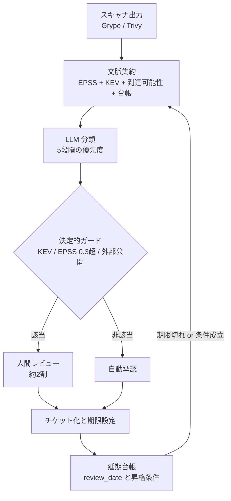
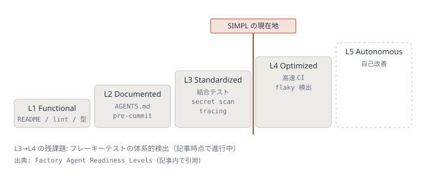
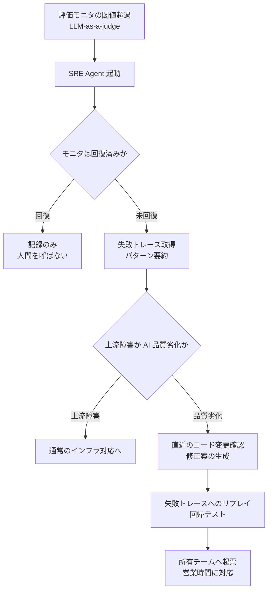
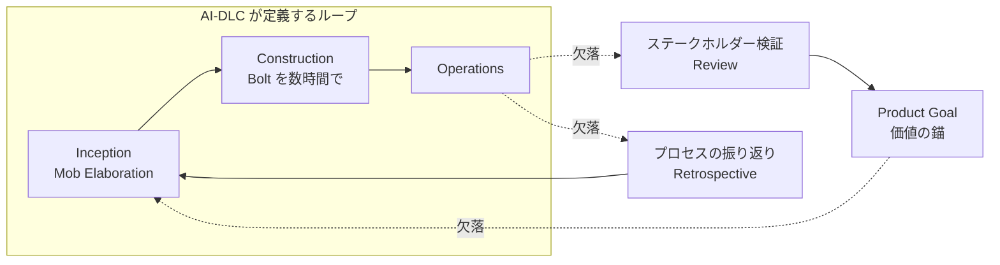

# Daily Briefing 2026-11-24

## 1. AI 支援による CVE パッチ優先順位付け：EPSS・到達可能性・ビジネス文脈（原題: AI-Assisted CVE Patch Prioritisation: EPSS, Reachability, and Business Context）

- **URL**: https://www.systemshardening.com/articles/ai-landscape/ai-patch-prioritization/
- **公開日**: 2026-05-12
- **著者・媒体**: 著者名記載なし ／ systemshardening.com（AI & Security Landscape、中級）

### 本文翻訳

**問題。** 50 サービス規模の組織では、Grype や Trivy などのスキャナが数百件の未対応 CVE を積み上げる。CVSS だけでは「リンクされているが一度も呼ばれないパッケージ」と「外部公開されたホットパス上の脆弱な関数」を区別できない。深刻度だけで優先順位を付けるとパッチ疲れが起き、やがて「実際に悪用されていなければ後回し」という非公式ルールが生まれる。一方、手作業のトリアージはスケールしない。300 件の CVE を調べるにはアナリストの数週間が必要で、品質もばらつく。

そこで AI に CVE ごとに6つの入力を統合させる。(1) EPSS スコア（30日以内に悪用される確率）、(2) CISA KEV 掲載の有無、(3) 到達可能性（静的／動的解析）、(4) デプロイ文脈（インターネット公開か、PII を扱うか、特権的クラウドアクセスがあるか）、(5) 補償統制（WAF ルール、ネットワーク制限、設定変更）、(6) パッチの複雑さ（バージョンを上げるだけか、大規模なリファクタか）。出力例は「EPSS が高く、外部公開で WAF の保護がないのでこの CVE は今週パッチ」「EPSS が極めて低く、コードは呼ばれず、内部サービスなので別の CVE は 90 日延期」といった形になる。最大のリスクは過信であり、**自動的な延期はすべてレビュー可能かつ取り消し可能でなければならない**。対象は、未対応 CVE が 100 件超、本番サービスが 10 超、SCA ツールを使い、パッチ速度に制約がある組織である。

**脅威モデル。** 優先順位付けの誤りは4種類ある。(1) 誤った低優先度：悪用可能な重大 CVE を延期し、その期間中に悪用される。(2) 誤った高優先度：高優先度が多すぎてアラーム疲れを起こし、本物が遅れる。(3) 古い文脈：補償統制が撤去されたのに CVE が延期されたまま残る。(4) 到達可能性の幻覚：リフレクションや動的ディスパッチを見落とし、AI がコールグラフを読み違える。対策は、AI の出力を人間レビュー必須の「推奨」として扱い、延期に有効期限を付けることだ。

**実装。** ステップ1（`cve_context.py`）では `CVEContext` データクラスに CVE ID、CVSS、EPSS スコアとパーセンタイル、KEV フラグ、影響パッケージと修正版、影響サービス、到達可能性（`reachable` / `unreachable` / `unknown`）、3つのデプロイ文脈フラグ、補償統制、NVD 説明を保持する。`fetch_epss` は FIRST の EPSS API を、`check_cisa_kev` は CISA KEV の JSON フィードを参照し、影響サービスはサービス台帳から突き合わせる。

ステップ2（`prioritiser.py`）では LLM に分類させる。優先度と期限は CRITICAL＝24時間、HIGH＝7日、MEDIUM＝30日、LOW＝90日、DEFER＝明示的なレビュー日付き延期。システムプロンプトの閾値は、CRITICAL＝KEV 掲載・外部公開・悪用可能・補償統制なし、HIGH＝EPSS 0.3 超または外部公開または PII／特権アクセス、MEDIUM＝EPSS 0.05〜0.3・到達可能・内部、LOW＝EPSS 0.05 未満・到達可能・内部・補償統制あり、DEFER＝EPSS 0.01 未満・到達不能または不明・内部のみ。さらに「KEV 掲載、EPSS 0.3 超、補償統制のない外部公開サービスは決して DEFER にしない」という絶対ルールを置き、「文脈が不確かなときは高い優先度へ倒す」よう指示する。モデルは優先度・理由・主要リスク・パッチ推奨・延期期限・エスカレーション条件の6項目を返す。CVSS 7.0 以上、KEV 掲載、EPSS 0.3 超のいずれかなら `requires_human_review` を真にする。

ステップ3のバッチ処理は結果を「自動承認」と「要レビュー」に分け、アナリストは承認・保留・理由付きで優先度上書きのいずれかを選ぶ。ステップ4では延期ごとに YAML 記録（根拠、担当アナリスト、90日後の `review_date`、検証日付きの補償統制、エスカレーション条件＝EPSS が 0.1 超、KEV 追加、外部公開化、VPN 制限の撤去）を残し、`check_deferral_expiry` が期限切れを洗い出す。

**期待される挙動。** 100 件のトリアージは手作業で 8〜20 アナリスト時間、AI 支援で 1〜2 時間。人間レビューが必要なのは 100 件中約 20 件。すべての延期に `review_date` が付く。検証として「Log4Shell（KEV 掲載）は延期されない」ことをテストで確認する。

**障害モード。** EPSS フィードが落ちると全件 0.0 になるため、ゼロ EPSS のバッチを検知したら自動承認を止める。到達可能性の偽陰性に備え `unknown` は到達可能として扱う。補償統制の撤去は変更管理と延期台帳を連携させて検知する。LLM の再実行ぶれにはモデルバージョン固定、`temperature=0`、出力ログで対処する。

### 重要ポイント

- 優先度の入力は CVSS 単独ではなく **EPSS・KEV・到達可能性・露出・補償統制・修正コスト** の6つ
- 「延期」を一級の状態として扱い、**レビュー日とエスカレーション条件を必ず付ける**
- 到達可能性が `unknown` なら到達可能とみなす（保守側に倒す）
- 人間レビュー対象を約2割に絞るのが効率化の本体。全件 AI 自動判定ではない
- 記事のコードは絶対ルールをプロンプトにしか書いていない。**決定的なガードはコード側で強制すべき**（下記の適用例で補う）

### 図解



### 戦略分析

**フレームワーク**: 制約理論（TOC）× リスク×可逆性マトリクス

| 判断 | リスク | 可逆性 | 記事の扱い |
|---|---|---|---|
| 高優先へ引き上げ | 低（工数の無駄だけ） | 高 | 自動でよい |
| LOW / DEFER へ引き下げ | **高**（悪用の窓が開く） | 中（期限で戻る） | 人間レビュー＋期限付き |
| KEV・外部公開の延期 | 致命的 | 低 | 禁止（絶対ルール） |

**制約**: 記事の前提では、脆弱性対応のボトルネックは修正作業ではなく **アナリストのトリアージ時間**（100件で 8〜20 時間）にある。AI はここを 1〜2 時間に縮め、人間の注意を 20 件に集中させる。TOC の「制約の徹底活用」にあたる。

**示唆**: (1) まず全 CVE を AI に分類させるのではなく、「引き下げ方向の判定だけ人間を通す」非対称な承認ルールを決める。(2) 延期台帳をチケットシステムと週次セキュリティ定例に接続し、期限切れを自動で起票する。これが無いと延期は事実上の放置になる。(3) トリアージが速くなると次の制約はパッチ適用（ビルド・テスト・デプロイ）に移るので、自動パッチ PR の仕組みを並行して用意する。

**反証条件**: 未対応 CVE が数十件程度でサービス数も少ない組織では、6入力の収集と台帳運用のコストが手作業トリアージを上回る。また到達可能性解析が導入できない言語・構成では入力の大半が `unknown` になり、保守側に倒す規則のせいで優先度が一律に上がって効果が出ない。

### 現場での適用方法

**スクリプト化の例**: LLM の出力に対し、記事の絶対ルールと延期期限をコード側で決定的に強制するガード。LLM 呼び出し部分は既存の実装に差し込む。

```python
#!/usr/bin/env python3
"""cve_guard.py - LLM の優先度判定に決定的ガードをかけ、延期台帳の期限切れを検出する。
使い方:
  python3 cve_guard.py enforce <llm_results.json>   # ガード適用後の結果を標準出力へ
  python3 cve_guard.py expired <deferrals.yaml>      # 期限切れ延期を列挙（あれば exit 1）
"""
import json, sys, datetime
import yaml  # pip install pyyaml

ORDER = ["DEFER", "LOW", "MEDIUM", "HIGH", "CRITICAL"]

def enforce(item: dict) -> dict:
    """item: {cve_id, priority, epss, in_kev, internet_facing, compensating_controls, reachability, cvss}"""
    p = item["priority"]
    reasons = []
    # 1. EPSS フィード障害の検知（0.0 は「取得失敗」の可能性として扱う）
    if item.get("epss", 0.0) == 0.0:
        item["requires_human_review"] = True
        reasons.append("epss=0.0: フィード障害の可能性")
    # 2. 絶対ルール: DEFER 禁止条件
    forbid_defer = (
        item.get("in_kev")
        or item.get("epss", 0) > 0.3
        or (item.get("internet_facing") and not item.get("compensating_controls"))
    )
    if p == "DEFER" and forbid_defer:
        p = "HIGH"
        reasons.append("DEFER 禁止条件に該当したため HIGH へ引き上げ")
    # 3. KEV かつ外部公開かつ補償統制なしは CRITICAL 固定
    if item.get("in_kev") and item.get("internet_facing") and not item.get("compensating_controls"):
        p = "CRITICAL"
    # 4. 到達可能性 unknown は reachable 扱い: LOW/DEFER なら MEDIUM へ
    if item.get("reachability") == "unknown" and ORDER.index(p) < ORDER.index("MEDIUM"):
        p = "MEDIUM"
        reasons.append("reachability=unknown は到達可能とみなす")
    # 5. 引き下げ方向・重大案件は必ず人間レビュー
    if p in ("LOW", "DEFER") or item.get("cvss", 0) >= 7.0 or item.get("in_kev") or item.get("epss", 0) > 0.3:
        item["requires_human_review"] = True
    item["priority"] = p
    item["guard_notes"] = reasons
    return item

def expired(path: str) -> int:
    today = datetime.date.today()
    records = yaml.safe_load(open(path)) or []
    late = [r for r in records if datetime.date.fromisoformat(str(r["review_date"])) < today]
    for r in late:
        days = (today - datetime.date.fromisoformat(str(r["review_date"]))).days
        print(f'{r["cve_id"]}\t{r["package"]}\toverdue {days}d')
    return 1 if late else 0

if __name__ == "__main__":
    cmd, path = sys.argv[1], sys.argv[2]
    if cmd == "enforce":
        print(json.dumps([enforce(i) for i in json.load(open(path))], ensure_ascii=False, indent=2))
    elif cmd == "expired":
        sys.exit(expired(path))
```

延期台帳（`<REPO_PATH>/security/deferrals.yaml`）の形式:

```yaml
- cve_id: CVE-2026-XXXXX
  package: example-lib
  version: 1.4.2
  priority: LOW
  rationale: "EPSS 0.008; production 設定で関数に到達しない; 内部サービスのみ"
  analyst: <ANALYST_NAME>
  review_date: 2026-08-12
  compensating_controls:
    - control: "社内 VPN 経由のみアクセス可"
      verified: 2026-05-12
      verify_every: monthly
  escalate_if:
    - "EPSS > 0.1"
    - "CISA KEV に追加"
    - "サービスが外部公開化"
    - "VPN 制限の撤去"
```

週次ジョブ（GitHub Actions 例）:

```yaml
name: cve-deferral-expiry
on:
  schedule: [{ cron: "0 0 * * 1" }]
jobs:
  check:
    runs-on: ubuntu-latest
    steps:
      - uses: actions/checkout@v4
      - run: pip install pyyaml
      - run: python3 security/cve_guard.py expired security/deferrals.yaml
```

### 期待効果

- 記事の見積もりで、100 件のトリアージが 8〜20 アナリスト時間から 1〜2 時間へ、人間レビュー対象は約 20 件へ
- すべての延期に期限と昇格条件が付き、「暗黙の永久延期」が消える
- KEV 追加などの外部イベントで優先度が自動的に見直される

### 注意点

- EPSS は事後的な指標で、公開直後の新規 CVE は低く出る。外部公開サービスでは EPSS 単独で判断しない
- 記事のコードには `from typing import list`（import エラー）や `temperature=0` 未設定など不備があるため、そのまま使わない
- AI の理由付けが流暢だとアナリストが追認しがちになる。「主要リスク」を明示的に確認したことを記録させる
- 補償統制は撤去されうる。変更管理（ファイアウォール・WAF 設定変更）と延期台帳の連携が前提

## 2. エージェンティック・エンジニアリングの教訓 Vol.2（原題: Agentic Engineering: Lessons Learned Vol. 2）

- **URL**: https://dev.to/duske/agentic-engineering-lessons-learned-vol-2-7mh
- **公開日**: 2026-03-23
- **著者・媒体**: Dustin（SIMPL CTO／共同創業者）／ DEV Community（初出は engineering.simpl.de）

### 本文翻訳

Vol.1 から半年。機能を出荷し、インフラをリファクタリングし、当初の推奨のうちどれが本番で通用したかが分かってきた。以下は 2026 年 3 月時点の知見であり、各自のユースケースで検証してほしい。

**Vol.1 から変わらないこと。** コアスキルは依然としてコンテキストエンジニアリングだ。Drew Breunig が整理したコンテキストの失敗モード（汚染・注意散漫・混乱・衝突）を知っておけば、失敗しそうなタスクを事前に委譲しないで済む。

**コンテキストの防火壁としてのサブエージェント。** Vol.1 では「サブエージェントは実装者ではなく調査役が向く」と書いた。前半は正しいが後半はもっと微妙だ。サブエージェントは読み取り専用の役ではなく、タスクを隔離して文脈汚染を防ぐ **防火壁** と考えるべきだ。grep、ログ解析、ドキュメント読解のような調査は、小さく蒸留された知見を返すので向いており、並列でも衝突しない。例えば `ops-investigation` スキルは本番障害を受け取ると、Grafana のログとメトリクス、Sentry の issue、直近のデプロイを並列のサブエージェントで調べる。インフラとコードがモノレポなのでコードも grep でき、根本原因分析が大幅に速くなった。書き込みタスクも、構造化された計画と **段階的実装** があれば任せられる。メインエージェントが各段階の境界を明確にし、全体の文脈を保持して出力に口を出す。ノイズの多い調査には安いモデルを当て、蒸留した知見を高価なメインモデルに渡すとコストも下がる。

**寄り道：セッションの分岐。** セッションを git ブランチのように扱い、実験やデバッグは分岐させてメインを汚さない。手法は4つ。(1) ハンドオフ：`handoff.md` に文脈を書き出し新セッションで読み込む（能動的な圧縮）。(2) フォーク：並行して走らせ、デバッグ側は用が済んだら捨てる。(3) リワインド：印を付けて調査・修正し、会話だけ印まで巻き戻す（コード変更は残る）。(4) サイドクエリ：`/btw` などで作業を止めずに質問する。価値ある文脈を築いたら守ること。

**計画は小さなタスクでも必須。** 今やチームで最も厳しいルールは「計画なくして実装なし」だ。省いた時間は無駄なトークンと壊れた文脈として返ってくる。大きな作業は `research/spec → plan → implement`、小さな作業でも探索サブエージェントが変更前に関連コードを調べる **グラウンディング** を挟む。

**エージェント対応のコードベース。** コードベースはエージェントが「見る」ものを決めるので、庭のように手入れし続ける。可能ならモノレポ。`AGENTS.md` は毎回読まれるので **100 行未満**。テストとリントは速く（ts-go、oxlint、Turborepo や Nx の出力キャッシュ）。テスト・リンタ・型チェックの実行方法は全パッケージで1つに統一。成功したテストが数千行を出力しないよう **出力を静かに** する。外部ツール接続は MCP より主にスキルで行う。Factory の Agent Readiness Levels（L1 Functional〜L5 Autonomous）で見ると、自チームは L3 と L4 の間にいる。フレーキーテストの体系的検出がまだ進行中だからだ。

**フロントエンド検証で視覚的フィードバックを閉じる。** エージェントは画面を見られないので、人間が「目」になる手作業ループが生じる。Claude の Chrome 拡張は導入が簡単だがトークンを食う。agent-browser（構造化スナップショットと認証保管庫を持つヘッドレス CLI）が現在の本命で、dev-browser スキルは CI で最初に使った。課題はヘッドレス環境、トークンコスト、認証とセットアップ、そしてプロダクト知識の欠如（フォームを作るには先に設定画面でテンプレートが必要、など）だ。

**スキルとドキュメント。** `SKILL.md` は最大約 200 行に収め、残りは `references` に逃がす。`description` は人間ではなくエージェントのための欄だ。何度も説明していることはスキル候補。ただしスキルは「なぜ」を書かないので、ドキュメントの代わりにはならない。

**レビューを楽にする。** 生成が速くなるとレビューがボトルネックになる。全 PR に例外なく厳格な CI を通し、PR 前に新しいセッション（できれば別モデル）でセルフレビューさせ、CI でもエージェントレビューを走らせる。visual-explainer スキルで差分を HTML の図と説明に変換すると、生の diff より読み始めやすい。エージェントのコードを未レビューで公開することはない。

### 重要ポイント

- サブエージェントは「読み取り専用」ではなく **文脈の防火壁**。段階が分離されていれば書き込みも任せられる
- 「計画なくして実装なし」。小タスクでも **グラウンディング**（探索サブエージェントによる事前調査）を挟む
- `AGENTS.md` は 100 行未満、`SKILL.md` は約 200 行。成功時のテスト出力は静かに
- Agent Readiness Levels で現在地を測る。L3→L4 の鍵は高速 CI とフレーキーテスト検出
- 生成の高速化はレビューを制約にする。厳格 CI・別セッションのセルフレビュー・視覚的差分で吸収する

### 図解



### 戦略分析

**フレームワーク**: ケイパビリティ成熟度モデル（Factory Agent Readiness Levels）

| 段階 | 完了条件（記事の例示） | 次段階へ進むための打ち手 |
|---|---|---|
| L1 Functional | README・リンタ・型・単体テスト | 手動セットアップの排除 |
| L2 Documented | AGENTS.md・devcontainer・pre-commit・ブランチ保護 | 実行コマンドを全パッケージで統一 |
| L3 Standardized | 結合テスト・シークレットスキャン・トレーシング | CI 高速化、出力の静音化 |
| L4 Optimized | 高速 CI・定期デプロイ・フレーキー検出 | 計画→実装の自動分解 |

**示唆**: エージェントの性能を上げる投資（モデル・ツール追加）より先に、コードベース側の段階を1つ上げる方が効く、というのが記事の立場である。具体的な順序は (1) `AGENTS.md` を 100 行未満に削る、(2) `make test` 相当の単一コマンドに統一し、成功時の出力を1行にする、(3) フレーキーテストを検出・隔離して CI 結果を信頼できる信号にする。(3) が無いとエージェントは失敗が自分の変更か環境起因かを判断できず、自己検証ループが回らない。

**反証条件**: 記事はスタートアップ規模のモノレポでの経験である。多数のリポジトリに分散し、所有チームが異なる大企業では、コマンド統一やモノレポ化そのものが組織横断の調整コストとなり、成熟度を上げる打ち手の順序が変わる（まずリポジトリ横断の規約配布が先になる）。

### 現場での適用方法

**スクリプト化の例**: 記事の行数予算とテスト出力の静音化を pre-commit で強制するフック。

```bash
#!/usr/bin/env bash
# .githooks/pre-commit  (有効化: git config core.hooksPath .githooks)
set -euo pipefail

fail=0
# 1. AGENTS.md / CLAUDE.md は 100 行未満
for f in AGENTS.md CLAUDE.md; do
  if [ -f "$f" ] && [ "$(wc -l < "$f")" -ge 100 ]; then
    echo "NG: $f が $(wc -l < "$f") 行あります（上限 99 行）。詳細は docs/ かスキルへ移してください" >&2
    fail=1
  fi
done
# 2. SKILL.md は 200 行以内、description 必須
while IFS= read -r s; do
  n=$(wc -l < "$s")
  [ "$n" -gt 200 ] && { echo "NG: $s が ${n} 行（上限 200 行）。references/ に分割" >&2; fail=1; }
  grep -q '^description:' "$s" || { echo "NG: $s に description がありません" >&2; fail=1; }
done < <(git ls-files '*SKILL.md')
exit $fail
```

**CLAUDE.md への追記例**:

````markdown
## 作業の進め方
- 計画なくして実装なし。変更前に必ず計画を提示する。小さな修正でも、
  Explore サブエージェントで関連コードを調べてから着手する（グラウンディング）
- 大きな作業は research/spec → plan → implement の3段で進める
- ログ解析・grep などノイズの多い調査はサブエージェントに任せ、要約だけ受け取る
- 寄り道（無関係なバグ調査など）が必要になったら handoff.md に文脈を書き出し、
  別セッションに切り出すことを提案する

## 検証
- テストは `make test` のみを使う（成功時は1行しか出力しない）
- PR 作成前に、新しいセッションでのセルフレビューを依頼すること
````

### 期待効果

- 記事では、障害調査の並列サブエージェント化で根本原因分析が「大幅に」速くなったと報告（定量値の記載なし）
- 文脈の汚染が減り、長いセッションでの品質低下や手戻りが減る
- 成熟度の現在地が共有され、次に何を整備するかの議論が具体化する

### 注意点

- 2026 年 3 月時点の知見であり、著者自身が「各自で検証せよ」と書いている
- ブラウザによる視覚検証はトークンコストが高い。対象を絞り、隔離したサブエージェントで行う
- Readiness Levels は「より成熟したモデルが出るまでの目安」として引用されている。外部評価基準として固定しない

## 3. PagerDuty for AI：SRE Agent は AI インシデントをどうトリアージするか（原題: PagerDuty for AI: How the SRE Agent Triages AI Incidents）

- **URL**: https://www.pagerduty.com/eng/pagerduty-for-ai-how-the-sre-agent-triages-ai-incidents/
- **公開日**: 2026-07-21
- **著者・媒体**: Irena Grabovitch-Zuyev、Antonio Correia、Everaldo Aguiar、Murilo Venturin、Derek Barnes ／ PagerDuty Engineering Blog

### 本文翻訳

本稿は、AI インシデントを定義し Arize でエージェントを計装した 2025 年の記事の続編である。前回は「検知」を扱い、今回は「対応」を扱う。

**前提：AI エージェントは静かに壊れる。** 劣化したエージェントはダッシュボードを赤くしない。検知は LLM-as-a-judge の評価に頼ることになり、それが出すのは「何かが壊れている」ではなく「何かがおかしい **かもしれない**」という確率的な信号だ。これは当番の対応者が何をすべきかを変え、そもそもこのアラートで人間を呼び出すべきかという問いを生む。

**課題。** 第一に、失敗の種類ごとに直し方が違う。関連性スコアの低下には、プロンプト変更、検索の調整、モデルの差し替え、評価の再チューニングが要る。悪いデプロイと違い、人間が 15 分で直せることはまれで、深夜 2 時に起こしても解決しない。第二に、誤帰属。関連性の低下は AI 自体の品質劣化ではなく、上流サービスの障害から来ていることがある。AI 出力のドリフトと通常のアプリケーション障害を切り分ける必要がある。第三に、新規性。多くのチームにとって AI インシデントは未知なので、素早い判断には追加の文脈が要る。

**目標。** 当番負荷を下げ解決を速めるため、(1) そのインシデントに人間のエスカレーションが必要かを分類し、(2) 事前承認された修復手順を実行し、(3) AI 機能を所有するチームにフォローアップチケットを起票する。

**アーキテクチャ。** AI オブザーバビリティ基盤（PagerDuty では Arize）が、エージェントへの各リクエストを LLM 呼び出し・ツール呼び出し・検索・出力を含むトレースとして記録する。SRE Agent はこの基盤に接続し、インシデントの一次対応を担う。モニタの状態を取得し、関連トレースを提示し、診断と順位付けした次の一手を対応者に渡す。トリアージループは「モニタ閾値超過 → SRE Agent 起動 → モニタ状態確認 → 失敗トレースの取得 → パターン要約 → 直近のコード変更確認 → 診断と次の一手」で、得られた学びはループに戻る。

**対応者としての SRE Agent。** チームは Runbook やプロセスを **スキル** として符号化する。PagerDuty は既存の Runbook から `create-pagerduty-skill` ツールで自社スキルを作った。データ源には **コネクタ** で接続する（オブザーバビリティ＝Arize、コード＝GitHub、ドキュメント）。対応者はインシデントページで直接エージェントとやりとりする。

**実例：Insights Agent。** Insights Agent は「SEV-1 は何件か」といった運用上の質問に分析ツールを呼んで答える社内チャットアシスタントで、複数の Arize モニタが閾値超過時に PagerDuty インシデントを作る。ある日、ツール選択の性能が閾値を割った。エージェントは (1) モニタが回復したかを確認、(2) Arize で問題のトレースを絞り込み、(3) 評価の説明文を読みパターンを要約、(4) 回帰を説明しうる直近のコード変更を確認した。結論は「本物だが軽微な劣化」で、ツール呼び出しの改善をフォローアップとしてインシデントを閉じるよう推奨した。さらに GitHub へのアクセスと、チームが定めた範囲に制約されたコード提案スキルを使い、失敗トレースを狙ったシステムプロンプトの修正案を出した。提案は失敗トレースへのリプレイと、エージェント自己改善プロセスでの回帰テストで検証する予定だ。

**ロードマップ。** (1) LLM ジャッジは小サンプルでノイズが多いので、境界付近の結果を自動で再採点し、本物は呼び出しノイズは抑える。(2) 幻覚・ツール呼び出しエラー・モデル遅延などの種類に分類し、種類ごとに適切な修正へ回す。(3) 自動化の拡大。例えば遅延インシデントでは事前承認済みのフォールバックモデルへ一時的に切り替え、非同期で済む変更は営業時間に回す。(4) 任意の AI オブザーバビリティツールからデータを取り込める設計にする。

### 重要ポイント

- AI 品質劣化の検知信号は **確率的**。深夜に人間を起こすかどうか自体をエージェントに分類させる
- 「AI 出力のドリフト」と「上流障害による見かけの劣化」を切り分けるのが一次対応の要
- Runbook を **スキル** に変換し、オブザーバビリティ・GitHub・ドキュメントを **コネクタ** で繋ぐ
- 修正案は失敗トレースへのリプレイと回帰テストで検証してから採用する
- 遅延などはフォールバックモデルへの事前承認済み切り替えで止血し、根本修正は営業時間に回す

### 図解



### 戦略分析

**フレームワーク**: Cynefin

| 領域 | AI インシデントでの例 | 対応の型 | 担い手 |
|---|---|---|---|
| 明白 | モニタが既に回復、評価のノイズ | 記録して閉じる | エージェント単独 |
| 煩雑 | 上流障害による見かけの劣化、遅延超過 | 切り分け → 既知の手順（フォールバック切替） | エージェント＋事前承認 |
| 複雑 | ツール選択性能の本物の劣化 | 探索（トレース分析）→ 修正案 → リプレイ検証 | 人間が判断、エージェントが準備 |
| カオス | 誤回答が顧客に大量露出 | まず止血（機能停止） | 人間 |

**示唆**: 従来のオンコール設計は「アラート＝人間を呼ぶ」だったが、AI 品質インシデントの大半は「明白」か「煩雑」であり、「複雑」に属するものも深夜に直せる性質ではない。したがって意思決定は「AI 品質モニタはページングせず、エージェントの分類結果で起票先と時間帯を決める」に変わる。具体的には (1) 評価モニタのアラートを人間のページングから外し、SRE エージェント経由のチケット起票に切り替える、(2) 遅延・エラー率系だけはフォールバックモデル切替を事前承認しておく、(3) 修正提案はリプレイ検証を通ったものだけ PR 化する。

**反証条件**: 記事は自社の社内向けアシスタント（Insights Agent）の例で、効果の定量値（MTTR やページ数の削減）を示していない。顧客向けで誤回答が即座に金銭・法的被害に繋がる AI 機能（決済・医療など）では、品質劣化が「カオス」に近く、ページングを外す判断は成立しない。

### 現場での適用方法

**スキル化の例**: 既存 Runbook を AI 品質インシデントの一次トリアージスキルに変換する。

````markdown
---
name: ai-incident-triage
description: AI 機能の評価モニタ（関連性・ツール選択精度・幻覚率・遅延）が閾値を割ったインシデントの一次トリアージ。人間を呼ぶべきか、上流障害か AI 品質劣化かを判定し、修正案と起票内容を作る。インシデント ID かモニタ名を受け取ったときに使う。
---

# AI インシデント一次トリアージ

## 手順
1. モニタの現在値を取得し、回復済みなら「記録のみ」で終了する
2. 直近 <WINDOW_MINUTES> 分の失敗トレースを最大 <N> 件取得し、評価の説明文を要約する
3. 上流依存（検索 API、DB、外部 LLM プロバイダ）のステータスとエラー率を確認する
   - 上流に障害があれば「インフラ障害」として通常オンコールへ回す。AI 側の修正は提案しない
4. 直近 7 日のデプロイ・プロンプト変更・モデル変更を列挙し、劣化開始時刻と突き合わせる
5. 種別を1つに分類する: hallucination / tool-call-error / latency / retrieval / eval-noise

## 種別ごとの動作
| 種別 | 動作 | 人間を呼ぶか |
|---|---|---|
| latency | 事前承認済みフォールバック <FALLBACK_MODEL> へ切替を提案 | 切替失敗時のみ |
| eval-noise | サンプルを再採点し、再度閾値割れなら起票 | 呼ばない |
| tool-call-error / retrieval / hallucination | 修正案を作成し所有チームへ起票 | 顧客影響ありの場合のみ |

## 修正案の制約
- 変更してよいのは `<PROMPTS_DIR>/` 配下のシステムプロンプトとツール説明文のみ
- 修正案は失敗トレースへのリプレイ結果（改善件数／悪化件数）を必ず添える
- リプレイで悪化が1件でもあれば PR を作らず、起票のみとする

## 出力
- 判定（人間を呼ぶ／呼ばない）と理由
- 種別、根拠となるトレース ID 3件
- 起票先チーム <OWNER_TEAM> と推奨対応時間帯
````

### 期待効果

- 確率的な評価アラートで深夜に人間を呼ぶ回数が減る（記事は定量値を示していない）
- 上流障害の誤帰属による無駄な AI 側調査が減る
- 修正提案がリプレイ検証付きで届くため、所有チームの初動が速くなる

### 注意点

- 前提として AI 機能のトレース（LLM 呼び出し・ツール呼び出し・検索）が取得できている必要がある
- LLM ジャッジは小サンプルでノイズが多い。再採点の仕組みなしにエージェントへ判定を任せると誤判定が増える
- コード提案の範囲はチームが明示的に制限すること。記事でも「チームが定めた境界」に制約している

## 4. AWS の AI-DLC：AI コーディングにも人間の説明責任が要る理由（原題: The AWS AI-DLC: Why AI Coding Still Needs Human Accountability）

- **URL**: https://www.scrum.org/resources/blog/aws-ai-dlc-why-ai-coding-still-needs-human-accountability
- **公開日**: 2026-08-04
- **著者・媒体**: Dave West ／ Scrum.org Blog

### 本文翻訳

新しい手法を評価するとき、私はまず「何が書かれていないか」を探す。AWS の AI-Driven Development Lifecycle（AI-DLC）の論文には良いアイデアがある。スプリントを時間単位で測る「Bolt」に置き換え、ドメイン駆動設計などの設計技法を手法に組み込み、AI が計画を提案して人間が承認する。だが最大の問題は、ライフサイクルから **価値** の問いが抜けていることだ。

**速さは価値と同じではない。** AI-DLC は成功を速度で測る。Bolt は数時間で終わり、Mob Elaboration は数週間分の作業を午後のうちに圧縮する。しかし Product Goal に相当するもの、つまり作業が仕えるべき成果を持続的に言明するものがない。イベントはすべて内向きで、モブは AI の出力を確認するが、市場やステークホルダーのもとへ行って検証することはない。結果として、チームは手法を完璧に運用しながら、間違ったものをより速く作りうる。

**レトロスペクティブはどこへ行ったのか。** 論文は、デイリースクラムとレトロスペクティブは長い反復の副産物であり、AI 支援の高速サイクルでは重要性が下がると主張する。代わりに「継続的でリアルタイムの検証とフィードバックの仕組み」を提案するが、それを具体的な技法として定義していない。レトロスペクティブが点検するのはプロダクトではなく、プロセスとチームの提供能力だ。これを捨てると、チームは悪いワークフローをより速く固定化しかねない。効果的なレトロには、人が集まること、境界のある問題（スプリントゴールとインクリメント）、そして実データ（スプリントがどうだったか）が要る。定期的なチェックポイントはチームを集める強制力になる。私の経験では「継続的な」レトロは実際には行われない。いつも他のことが優先されるからだ。

**役割をまとめてもチームにはならない。** AI-DLC はインフラ、フロントエンド、バックエンド、DevOps、セキュリティの作業を1つの開発者ロールに統合し、専門的な判断を AI に任せる。プロダクトオーナーと開発者は「監督、検証、戦略的意思決定」のために残る。しかし論文は開発者に「何を」検証するかは示しても、「どうやって」互いを信頼するか、AI の推奨がチームメイトの判断と食い違ったときにどう上手く対立するか、AI がほとんどの判断を下す中でジュニアエンジニアがどう判断力を育てるか、は示さない。これだけの変化をチームが吸収できるのは、心理的安全性、スキル育成、チームとしての説明責任があるからだが、AI-DLC はそれらを範囲外として扱っている。

**Scrum から始める。** 私は Scrum.org の人間なので偏りがあることは認める。以前は Rational Unified Process（RUP）のプロダクトマネージャーで、AI-DLC は RUP の2つのフェーズから借用していると感じる。Scrum はゴールを中心に計画・実行・レビューする構造を持ち、イベントと成果物による透明性、明確な説明責任を提供する。Scrum を土台にし、AI の実践で拡張することを提案する。

**結論。** AI は Bolt を計画し、コードを書き、テストをはるかに速く回せる。しかし正しいものを作ったかを判断することも、自ら判断を下せると信頼し合えるチームを作ることもできない。SDLC は作業を支える道具ではなく、人間を中心に設計されるべきだ。

### 重要ポイント

- AI-DLC には Product Goal に相当する **価値の錨** がなく、外部ステークホルダーでの検証イベントもない
- レトロ廃止の代替として示された「継続的フィードバック」は具体的な技法として定義されていない
- 振り返りには「人が集まる・境界のある問題・実データ」の3条件が要る。継続的なレトロは実際には起きない
- 役割統合は「何を検証するか」を示すが、信頼・対立の扱い・ジュニアの判断力育成を扱わない
- 著者は Scrum.org 所属で利害関係があることを自ら明示している

### 図解



### 戦略分析

**フレームワーク**: JTBD（Jobs to be Done）

| 開発手法が雇われる「仕事」 | AI-DLC の対応 | 記事の指摘 |
|---|---|---|
| 意図を素早く動くコードにする | Mob Elaboration、Bolt、AI の計画提案 | 強い（評価している） |
| 正しいものを作っているか確かめる | 該当なし（内向きのイベントのみ） | **欠落** |
| 仕事の進め方自体を改善する | 「継続的フィードバック」（未定義） | **事実上の欠落** |
| 判断できるチームを育てる | 範囲外 | **欠落** |

**既存の代替手段**: 多くの組織では、後半3つの仕事はスプリントレビュー・レトロ・1on1 が片付けている。AI-DLC へ移行してこれらを外すと、片付ける手段がなくなる。

**示唆**: AI-DLC や SDD を導入する際、「Bolt に置き換える」ことと「既存イベントを捨てる」ことを同時に決めない。具体的には (1) Bolt を何本回しても、週1回の固定時刻でステークホルダーに増分を見せる場を残す、(2) レトロは「AI の出力品質」ではなく「人と AI の分担・プロンプトや仕様の粒度・手戻り」を議題に固定し、実データ（手戻り回数、仕様変更回数）を持ち込む、(3) ジュニアには AI の計画を承認する前に自分で代替案を1つ書かせる。

**反証条件**: 記事は論文の読解と著者の経験に基づく批判で、AI-DLC 導入チームの実測データは示していない。プロダクトの方向性がすでに外部で強く固定されている案件（受託開発、規制対応、移行プロジェクト）では「価値の問い」は手法の外で処理されており、AI-DLC に Product Goal がないことは欠陥にならない。

### 現場での適用方法

**運用手順**: AI-DLC／SDD を導入したチームに、価値検証と振り返りを差し込む。

1. 仕様リポジトリに Product Goal を置き、すべての spec から参照させる

```bash
mkdir -p <REPO_PATH>/specs
cat > <REPO_PATH>/specs/PRODUCT_GOAL.md <<'EOF'
# Product Goal（四半期ごとに見直す）
- 対象ユーザー: <TARGET_USER>
- 達成したい成果: <OUTCOME>
- 成果の計測: <METRIC>（現在値 <BASELINE> → 目標 <TARGET>）
EOF
```

2. Mob Elaboration の冒頭で「この spec は Product Goal のどの成果に効くか」を1行で書けない spec は着手しない（CLAUDE.md にルール化）

````markdown
## 仕様の扱い
- specs/ 配下の各 spec の冒頭に `goal:` 行を置き、specs/PRODUCT_GOAL.md の成果のどれに
  寄与するかを1行で書くこと。書けない spec の実装計画は作らず、人間に確認する
````

3. 週1回の固定時刻（30分）に振り返りを行う。テンプレート:

````markdown
# 週次振り返り <YYYY-MM-DD>
## 実データ
- 完了 Bolt 数: <N> / うち手戻り発生: <N>
- spec の差し戻し回数: <N>
- ステークホルダーに見せた増分と反応: <...>
## 問い
1. AI の計画と人間の判断が食い違った場面はどこか。どちらが正しかったか
2. 仕様・プロンプトの粒度は適切だったか（細かすぎ／粗すぎ）
3. ジュニアが自分で判断した場面は何回あったか
## 来週変えること（1つだけ）
- <ACTION>
````

### 期待効果

- 高速サイクルのまま「間違ったものを速く作る」リスクを週次で検出できる
- 振り返りに実データを持ち込むことで、悪いワークフローの固定化を防ぐ
- 記事は定量値を示していないため、効果は上記の実データで自チームが測る必要がある

### 注意点

- 著者は Scrum.org 所属であり、Scrum を土台にする結論には利害がある（著者自身が明記）
- AI-DLC の利点（Bolt、DDD の組み込み、AI の計画提案）は否定されていない。全否定として読まない
- イベントを足しすぎると Bolt の速度を殺す。追加は「週1回・30分」程度から始める

## 5. Python エンジニアのための Jev（原題: Jev for Python engineers）

- **URL**: https://vercel.com/blog/jev-for-python-engineers
- **公開日**: 2026-10-02
- **著者・媒体**: Yury Selivanov ／ Vercel Blog

### 本文翻訳

Jev は、狭い意思決定タスクで人気の新しい種類の AI モデルだ。多肢選択式の質問に答え、各回答への確信度を報告する。速いが間違えることもあるので、自分のユースケースで十分な精度かを試す必要がある。本稿では AI SDK for Python の実験的な `evaluate()` API を紹介する。

**はじめ方。** `uv add ai` でインストールし、AI Gateway のキーを作って環境変数 `AI_GATEWAY_API_KEY` に設定する。あとはモデル `typesafe-ai/jev`、状態（文字列または構造化データ）、名前付きの質問の対応表を渡して `evaluate()` を呼ぶ。

```python
from ai.ops import experimental as jev
result = await jev.evaluate(
    ai.get_model("typesafe-ai/jev"),
    "You're Neil deGrasse Tyson",
    {"bigger": jev.ChoiceQuestion(
        instructions="Which is bigger, the Sun or the Earth?",
        criteria={"Sun": None, "Earth": None},
    )},
)
print(result.value["bigger"])
```

**Jev を一言で言うと。** Jev は「万能分類器」だ。従来の分類器はタスクごとにラベル付きデータで学習する必要があったが、Jev は大規模言語モデルから作られているのでタスク固有の学習が要らない。安くて速く、自由文ではなく、こちらが定義した選択肢に従う構造化出力を返す。

**API。** 関数は `evaluate()` ひとつと補助型だけ。質問は3種類ある。`ChoiceQuestion`（選択肢から1つ選ぶ）、`ScoreQuestion`（自分で定義した尺度で状態を評価する）、`NoulQuestion`（ある言明が真である確率を推定する）。詳細は SDK のドキュメントにある。

**例1：Python か英語か。** 入力に応じて自動でモードを切り替える REPL を作るため、入力が Python コードか英語かを判定したかった。手作りの分類器は入力途中の文字列を誤判定してちらついた。Jev ははるかに良かったが、まだ穴がある。例えば文字列連結を含む打ちかけの Python 式を英語と判定した。

**例2：Jev に Python を書かせる。** Jev は自由文を書けないので、コード生成をさせてみた。1文字ずつ選ばせる方法はほとんど機能しなかったため、抽象構文木（AST）を組み立てる方式に切り替えた。(1) LLM（例では GPT-5.6）がユーザーのプロンプトを Jev 向けの詳細な計画に展開する。(2) Jev は現在のプログラム、埋めようとしているフィールド、各選択肢のプレビューを見せられながら、AST ノードを1つずつ選ぶ。(3) ホスト側が木を Python に描画し、句読点やインデントを処理する。結果は構文的には正しいが、ほとんどが誤ったコードだった。ソースは GitHub にある。

**結論。** どちらの実験も期待には届かなかったが、このモデル群には楽観的だ。最後に、コーディングエージェントにそのまま渡せるプロンプトを載せておく。「Vercel の AI SDK for Python で Jev の最小プレイグラウンドを作れ。`uv`（Python 3.12 以降）でプロジェクトを初期化し `uv add ai` で SDK を入れる。`ai.get_model("typesafe-ai/jev")` を使い、入力を1行ずつ読むループの `main.py` を書き、`ai.ops.experimental.evaluate()` と `ChoiceQuestion` で各行を Python か英語かに分類し、選択・確率・確信度・レイテンシを表示する。Ctrl+C できれいに終了する。AI Gateway キーの作り方と `AI_GATEWAY_API_KEY` の設定方法をユーザーに案内する。その後 `uv run python main.py` で実行できる。」

### 重要ポイント

- Jev は自由文を生成せず、**定義した選択肢の中から確信度付きで選ぶ** 「万能分類器」
- Python からは `ai.ops.experimental.evaluate()` 1関数で使える。質問型は Choice / Score / Noul の3種
- 狭い判定（入力種別の判定）では手作り分類器より良いが、境界ケース（打ちかけの式）で誤る
- コード生成のような自由度の高いタスクに無理に使うと、構文は正しくても中身が誤る
- 自分のユースケースでの精度検証が前提（著者自身が強調）

### 図解

図解省略（理由: API の使い方と2つの実験報告で構成されており、関係・順序・位置で表す構造がないため）

### 戦略分析

**フレームワーク**: Cynefin（どの判断を Jev に任せるか）

| 領域 | 開発・運用での判断例 | Jev の適性（記事からの推論） |
|---|---|---|
| 明白 | 入力が Python か英語か、PR がドキュメントのみの変更か | 高い。選択肢が閉じており、誤りのコストが小さい |
| 煩雑 | PR のリスク区分、アラートの振り分け先 | 条件付き。確信度の閾値と人間へのフォールバックが要る |
| 複雑 | 設計の良し悪し、コード生成 | 低い。記事の AST 実験は「構文は正しいが誤り」に終わった |

**示唆**: 記事の2つの実験は、Jev の使いどころが「閉じた選択肢・誤りが安い・大量に呼ぶ」判定に限られることを示している（実験は2件のみで、以下は仮説）。したがって導入判断は「LLM を Jev に置き換えるか」ではなく、「既存パイプライン中の分岐（PR の振り分け、ログの分類、入力ルーティング）のうち、選択肢が列挙できるものを Jev に移す」になる。具体的には (1) 選択肢が5個以下で列挙できる分岐を棚卸しする、(2) 過去データ 100 件程度で正解率を測る、(3) 確信度が低い結果だけ LLM か人間に回す2段構成にする。

**反証条件**: 判定の誤りが高コスト（セキュリティ例外の承認、本番デプロイの可否）で、件数も少ない業務では、速さと安さの利点が効かず、通常の LLM か人間の判断の方が合理的である。

### 現場での適用方法

**スクリプト化の例**: PR のタイトルと変更ファイル一覧から、レビュー経路を Jev で振り分ける最小スクリプト。API は記事の `evaluate()` / `ChoiceQuestion` の用法に合わせている。確率・確信度の属性名は SDK ドキュメントで確認すること。

```python
#!/usr/bin/env python3
# pr_router.py  実行: uv add ai && AI_GATEWAY_API_KEY=<KEY> uv run python pr_router.py <PR_TITLE> <CHANGED_FILES_TXT>
import asyncio, sys, time
import ai
from ai.ops import experimental as jev

async def route(title: str, files: str) -> str:
    state = f"PR title: {title}\nChanged files:\n{files}"
    t0 = time.perf_counter()
    result = await jev.evaluate(
        ai.get_model("typesafe-ai/jev"),
        state,
        {
            "route": jev.ChoiceQuestion(
                instructions="Which review route fits this pull request?",
                criteria={
                    "docs-only": None,        # ドキュメントのみ: 自動承認候補
                    "low-risk-code": None,    # テスト・リファクタ等: 通常レビュー1名
                    "security-sensitive": None,  # 認証・権限・暗号・依存更新: セキュリティレビュー必須
                    "infra-change": None,     # IaC / CI / デプロイ設定: SRE レビュー必須
                },
            )
        },
    )
    latency_ms = (time.perf_counter() - t0) * 1000
    print(f"route={result.value['route']} latency={latency_ms:.0f}ms", file=sys.stderr)
    return result.value["route"]

if __name__ == "__main__":
    title, files_path = sys.argv[1], sys.argv[2]
    print(asyncio.run(route(title, open(files_path).read())))
```

GitHub Actions での利用例（ラベル付与のみ。マージ判断には使わない）:

```yaml
- run: git diff --name-only origin/${{ github.base_ref }}... > files.txt
- run: echo "ROUTE=$(uv run python pr_router.py "${{ github.event.pull_request.title }}" files.txt)" >> "$GITHUB_ENV"
  env: { AI_GATEWAY_API_KEY: "${{ secrets.AI_GATEWAY_API_KEY }}" }
- run: gh pr edit ${{ github.event.pull_request.number }} --add-label "route:${ROUTE}"
  env: { GH_TOKEN: "${{ secrets.GITHUB_TOKEN }}" }
```

導入前に、過去の PR 100 件程度にスクリプトを流し、人手のラベルとの一致率を測ってから有効化する。

### 期待効果

- 閉じた選択肢の分岐を LLM より安く・速く処理できる（記事は具体的な速度・コストの数値を示していない）
- 自由文を返さないため、後段のコードで出力をパースし損ねる失敗がなくなる
- 確信度を使えば「迷ったものだけ人間へ」という2段構成が組みやすい

### 注意点

- `evaluate()` は **実験的 API**（`experimental`）であり、仕様が変わりうる
- 記事の例1でも境界ケースを誤判定している。セキュリティ判断を Jev 単独に任せない
- 自由度の高い生成タスク（コード生成）には向かない。記事の AST 方式は誤ったコードを量産した
- API キーはサーバー側／CI シークレットで扱い、クライアントコードに埋め込まない
