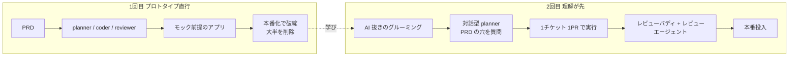
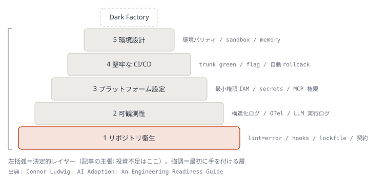
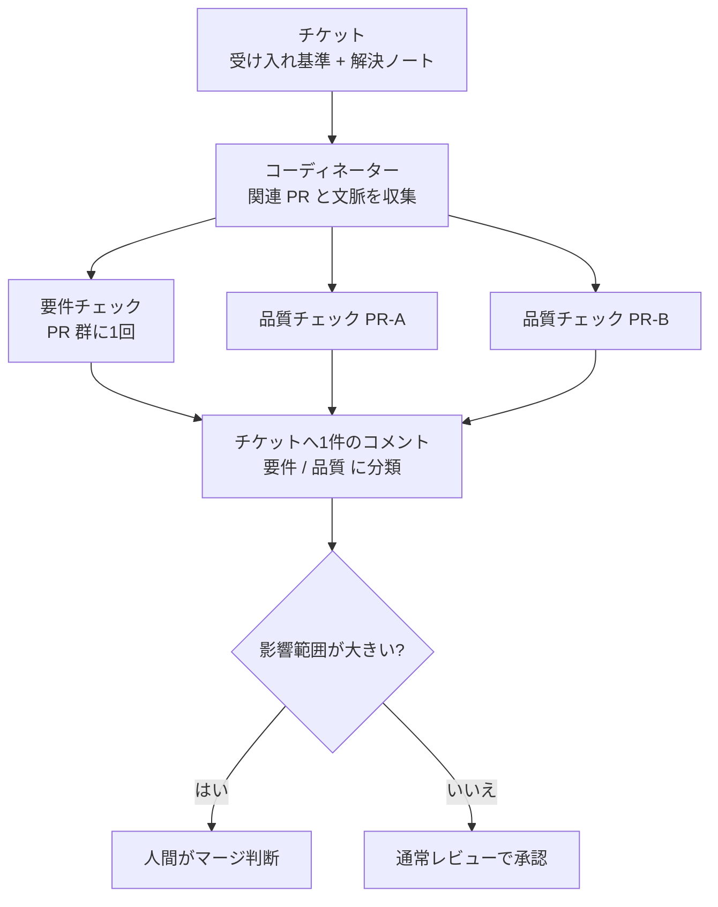
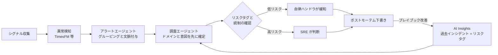
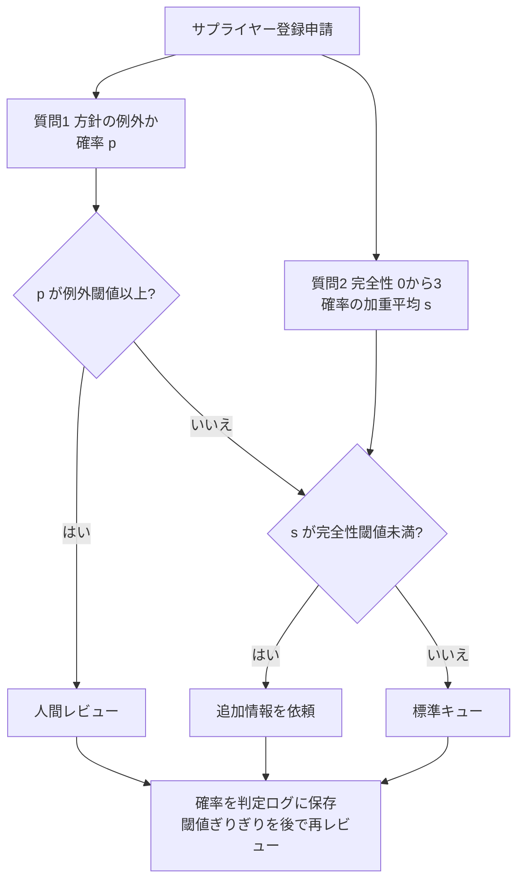

# Daily Briefing 2026-11-25

## 1. プロトタイプから本番へ：AI が作ったソフトウェアをエンタープライズ規模に持っていって学んだこと（原題: From prototype to production: lessons learned taking AI-built software to enterprise scale）

- **URL**: https://www.atlassian.com/blog/jira/ai-built-prototype-to-production
- **公開日**: 2026-08-26
- **著者・媒体**: Anand Shastri（Atlassian Principal Software Engineer）／ Atlassian Blog

### 本文翻訳

**はじめに。** 5人のチームが、週末に作ったプロトタイプを約5か月でエンタープライズ品質のプロダクトとして本番投入した。エンジニア1人あたりの成果は従来型の同等開発の約5倍である。vibe-coding はホビーや PoC の期間を縮めたが、機密データ・厳格なロールベースアクセス・監査要件・数千人のユーザーを抱えるエンタープライズで何が要るのかを知りたかった。結論は「vibe-coding と従来の SDLC の中間」が正解だというものだ。

**第1章 マルチエージェントでプロトタイプを作る。** 業務ルール、ペルソナ、アクセスレベル、機能要件、データモデル、非機能要件を含む PRD と技術スタック・ユーザージャーニーを用意した。1セッションでは PRD 全体を実装できないため、(1) PRD を作業項目に分解する planner、(2) 実装する coder、(3) 別個の reviewer（git 操作付き）、(4) エージェント間の衝突を解く人間、の構成にした。エージェントは共有メッセージボードで行動の根拠を述べ、意見が割れたら人間にエスカレーションする。認証などの外部連携は許容するモックを明示した。約15時間、約250セッション、100回超のレビュー差し戻し、10回超のエスカレーションで、実 DB を持つ動くアプリができた。

**第2章 本番化で壊れた理由。** 置き換えによるサイレントな退行を防ぐため先に E2E テストで振る舞いを固定したが、失敗した。実スキーマがモックと違い、プロトタイプは誤った前提と近道だらけだった。基盤の変更のたびに E2E テストも書き換わり、ドメイン知識が薄いチームにはどちらが正しいか判断できなかった。要件も動き続け、そしてアーキテクチャがなかった。ドメインが不自然に結合し、循環依存が繰り返し生まれた。残す価値のある部分以外は削除した。**コード生成はもはや難所ではなく、ボトルネックは人間の文脈理解だった。**

**第3章 問題を小さくする。** 1回目の反復では、2週間で出せる1機能に絞り、並行実行できるチケットに分解し、各チケットを事前に計画し、1作業項目＝1PR にした。しかしドメイン理解が薄いままなので、エッジケースはマージ後に見つかり、チーム全体を通さずに決めた設計はレビュアーが理解できないか別案を出した。2回目の反復では「理解と計画が先、実行は後」に切り替えた。(1) **AI を使わない**従来型のグルーミングで機能を検討しエッジケースを洗い出す、(2) コードベース・PRD 等にアクセスでき、明確化の質問で PRD の穴を示す対話型 planner、(3) PR・PRD・作業項目を参照して質問に答える PR レビューバディ。これが転機になった。

**第4章 本番と計測。** 本番投入は問題なく、数か月その運用を続けた。5倍という数字は推定ではなく、2年前に同じ技術スタックで従来型チームが作った同クラスの製品を社内ベースラインにし、両者の最初のコミットからの同等期間を同じスクリプトで計測した。DB スキーマ規模・外部連携面・主要言語・手書きコード量が同じ「階級」であることを先に確認している。

**第5章 学び。** ドメインと意思決定は人間が持ち、エージェントは実行を加速する。「チームメイトが必要とする情報はエージェントも必要とする」。議事録エージェントが会議の決定を、チャットエージェントが方針転換を長期メモリに記録した。一発生成や本番アプリのループ実行は機能しない——アプリをつなぎ止めている重要な数行こそエージェントが真っ先に変える。手作業はすべてスキル候補で、環境構築・テスト実行・開発 DB 接続・モック起動・デザインからの UI 生成をスキル化した。単一エージェントは自分を信じすぎるので、別のレビューエージェントと人の手動レビューを重ねる。モノレポなら UI 変更から DB まで影響を追える。

**第6章 新しい働き方。** 計画とレビューは人間中心、実行は AI 中心で人間が舵を取る。既存のアジャイル SDLC に近い中庸に落ち着いた。

### 重要ポイント

- 一発生成のプロトタイプはモック前提・アーキテクチャ不在のため本番化で**大半を捨てる**ことになった
- ボトルネックはコード生成ではなく**人間のドメイン理解**。グルーミングは AI 抜きでやり直した
- 対話型 planner（PRD の穴を質問で示す）と PR レビューバディ（差分について質問に答える）が転機
- 5倍の生産性は、同スタック・同規模の過去製品と「同じ期間」を同じスクリプトで比べた実測
- 会議の決定・方針転換をエージェントの長期メモリへ流し込む運用が成果物の質を上げた

### 図解



### 戦略分析

**フレームワーク**: 制約理論（TOC）× Cynefin

| 局面 | Cynefin 領域 | 記事での扱い | 結果 |
|---|---|---|---|
| PRD からの一括生成 | 複雑（Complex）を煩雑（Complicated）と誤認 | エージェントに丸投げ | モック前提が露呈し削除 |
| 1機能だけ切り出して実行 | 依然として複雑 | 計画はしたがドメイン理解は薄い | エッジケースがマージ後に発覚 |
| グルーミング後の実装 | 煩雑（専門知で解ける） | 人間が決め、エージェントが実行 | 本番投入、5倍 |

**制約**: 記事は明確に「エージェントがドメインを理解するより速くコードを生む」と書いている。制約は実装でもレビューでもなく、その手前の**ドメイン知識の獲得**にある。TOC の手順に沿えば、制約（人間の理解）を徹底活用するためにグルーミングを AI 抜きで行い、従属させるために planner に「質問させる」役割を与えた。

**示唆**: エンタープライズ案件で AI 開発を始めるなら、最初の投資先はエージェントのオーケストレーションではなく、(1) エッジケース洗い出しのグルーミング枠を必ず確保する、(2) 会議の決定をエージェントが読めるストアに残す仕組みを先に作る、の2点。プロトタイプは「捨てる前提の探索ツール」と位置付け、そのまま本番化する計画を立てない。

**反証条件**: 領域知識がすでにチーム内に十分あり、要件が安定している案件（既存製品の定型拡張など）では、グルーミングを厚くするほど待ちが増え、一括生成のほうが速い可能性がある。記事のベースライン比較も1製品同士の比較で、他領域への一般化は仮説である。

### 現場での適用方法

**CLAUDE.md への追記例**（計画フェーズのエージェント向けルール）:

````markdown
## 計画フェーズのルール

- 実装に入る前に、PRD・既存コード・チケットを読み、**不明点を質問リストとして出力して停止する**。
  自分で仮定を置いて実装を始めてはいけない。
- 質問は「エッジケース」「権限・監査」「データモデル」「外部連携」の4分類で出す。
- 回答済みの決定は `docs/decisions/YYYY-MM-DD-<slug>.md` に1件1ファイルで追記する。
- 1チケット＝1PR。PR 説明にはチケット ID と参照した decision ファイルを列挙する。
- 外部連携のモックを使う場合は `MOCK:` コメントで明示し、PR 説明の「本番化で置き換えるもの」に列挙する。
````

**スキル化の例**（PR レビューバディ）:

````markdown
---
name: pr-review-buddy
description: レビュアーが PR の差分について質問したときに使う。PR・紐づくチケット・PRD・docs/decisions を読み、変更の意図と影響範囲を答える。コードは変更しない。
---

# PR レビューバディ

1. `git diff origin/main...HEAD --stat` で変更ファイルを把握する
2. PR 説明からチケット ID を取り、`docs/decisions/` の関連ファイルを読む
3. 質問に対し「どの決定に基づく変更か」「影響するレイヤー（UI/API/DB）」を引用付きで答える
4. 決定に根拠がない変更を見つけたら「未決定の設計判断」として列挙する
5. 書き込み操作はしない
````

### 期待効果

- 記事の実測で、同規模の従来開発比 **エンジニア1人あたり約5倍** の成果（5人・約5か月で本番投入）
- エッジケースのマージ後発覚が減り、レビューで「設計の理解」に費やす時間が下がる
- 決定ログが残るため、新メンバー・新セッションの立ち上がりが速くなる

### 注意点

- 5倍は Atlassian 社内ツール（Rovo・Jira・Bitbucket のレビューエージェント）込みの数値。同等の文脈連携がない環境では再現しない可能性がある
- プロトタイプの一括生成は「探索」には有効だが、モック前提をそのまま本番に持ち込むと記事と同じく作り直しになる
- 決定ログを残す仕組みは、書く負担が人間側に乗ると続かない。議事録エージェント等で自動化する前提で設計する

## 2. AI 導入：ソフトウェア組織のためのエンジニアリング準備ガイド（原題: AI Adoption: An Engineering Readiness Guide for Software Orgs）

- **URL**: https://cjlludwig.github.io/blog/ai-readiness/
- **公開日**: 2026-05-02
- **著者・媒体**: Connor Ludwig ／ 個人ブログ

### 本文翻訳

**はじめに。** AI 駆動開発の議論は完全自動化に偏っている。Slack や JIRA から起動したヘッドレスエージェントがサンドボックスで本番品質のコードを書いて出荷するデモは多いが、デモはそこで止まり、「AI 以前から SDLC が高度に自動化・計測され、信頼できた」という前提を隠している。完全自動化の実装は、制約が少なく影響範囲の小さいグリーンフィールドと、人間でも AI でも改修が難しい既存コードベースに分かれる。本稿は大多数のチームが属する後者向けである。

**用語。** AI Native・AI Ready・AI Transformation はいずれも、変更が自律エージェントに担われていく移行を指す。極端な形が完全自動の「Dark Factory」だ。これらは Harness Engineering に収束するが、その議論の大半は非決定的なレイヤー（エージェントがエージェントを起動して仕様を作り評価する）に集中している。筆者は、より大きな機会は周囲の**決定的レイヤー**——CI/CD、テスト、可観測性、リポジトリ構造——にあり、多くのチームがここに投資不足だと主張する。

**AI-Readiness のピラミッド。** 下から、リポジトリ衛生、可観測性、プラットフォーム設定、堅牢な CI/CD、環境設計、頂点に Dark Factory。

**1. リポジトリ衛生。** エージェントは毎セッション初日の新人で、立ち上がり期間がない。ディレクトリ構成のパターンを決めて揃える。SCM で main への直接 push と force push を禁止し、別レビュアー・CODEOWNERS・ブランチ命名を強制する。エージェントは開いている境界を必ず試すからだ。PR テンプレートは監査ログにもなる。README と AGENTS.md は出力の欠落を継続的にフィードバックして育て、AGENTS.md は対象ディレクトリの隣に置く（段階的開示）。ロックファイル必須、バージョンは上限付きで固定し、ランタイムは `engines`・`.nvmrc`・`pyproject.toml` で明示する。**lint 駆動開発**は、モデルやプロンプトに関係なく検証可能な決定的な舵取りである。警告を無くしすべてエラーにし、`--fix` で自動修正し、ドキュメントも lint する。循環的複雑度の閾値、デッドコード、依存の循環（`madge`・`dpdm`）、カバレッジ閾値をエラーとして強制する。ローカルはキャッシュで即時に、成功時は何も出力しない（冗長な出力は数百回の実行で隠れたコストになる）。pre-commit で静的解析・単体テスト・gitleaks によるシークレット検査を走らせる。OpenAPI・Zod・Prisma などで API・DB・イベントの契約を明示する。

**2. 可観測性。** 意味のないログは出さない。相関 ID 付きの構造化ログ、OpenTelemetry の分散トレース、エラー率と SLA 逸脱のアラート、ベースライン指標。ヘッドレス実行のエージェントについては、何を推論し何を呼びどこで失敗したかを検査・再生できる仕組みが要る。

**3. プラットフォーム設定。** ペルソナ別の最小権限 IAM。過剰な権限のエージェント認証情報はエージェント関連インシデントの最大要因である——人間は危険なコマンドを知らないことで守られていたが、エージェントにはそれがない。シークレットマネージャを使いローテーションを先に決める。MCP 連携は権限で制限し、無制限の書き込み・削除を与えない。読み取りだけ与え、書き込みはエージェントが根拠を整えて人間に依頼する形が良い。暗黙知はコードの隣に Markdown で置く。

**4. 堅牢な CI/CD。** リモートの PR チェックはキャッシュなし・全範囲・詳細出力で、唯一信頼できるゲートとする。PR と無関係な失敗は別 Issue にする。trunk は常に green、フレーキーなゲートは最優先インシデント扱い。依存更新の全自動承認は保護にならない。フィーチャーフラグで再デプロイ不要の約30秒ロールバック、デプロイ後検証、自動ロールバック。

**5. 環境設計。** 環境パリティ、エージェント用の再現可能なサンドボックス、エージェントの記憶（AGENTS.md・永続化文脈）。

**6. Dark Factory？** 上記すべてが揃うまで完全自律パイプラインを真剣に検討すべきではない。1,000件のエージェント PR は1,000人の開発者の同時提出と同じで、希少なエッジケースに頼った防御はもたない。各層は変更が正しい確率を高め、層を飛ばすと結果の分布が広がる。

### 重要ポイント

- 投資すべきは非決定的なエージェント編成より、**決定的レイヤー**（lint・テスト・CI・可観測性・権限）
- **lint 駆動開発**: 警告ゼロ・全エラー化・複雑度/循環/デッドコード/カバレッジをゲートにする
- ローカルは「キャッシュ・静か・差分のみ」、リモート CI は「キャッシュなし・全範囲・詳細」と役割を分ける
- エージェント事故の最大要因は**過剰な権限の認証情報**。書き込みは人間に依頼させる
- フレーキーなゲートは最優先インシデント。赤に慣れた人とエージェントは失敗を無視し始める

### 図解



### 戦略分析

**フレームワーク**: ケイパビリティ成熟度モデル

| 層 | 未達の典型症状 | 到達の判定基準（記事から抽出） |
|---|---|---|
| 1 リポジトリ衛生 | エージェントが毎回同じ規約違反をする | lint 警告ゼロ・全エラー化、pre-commit でシークレット検査 |
| 2 可観測性 | エージェントの修正が本番で効いたか分からない | 相関 ID 付き構造化ログと分散トレース |
| 3 プラットフォーム設定 | エージェントが削除系 API を叩ける | ペルソナ別の最小権限、MCP の書き込み制限 |
| 4 堅牢な CI/CD | 赤いビルドが放置される | trunk 常時 green、フラグで約30秒ロールバック |
| 5 環境設計 | ローカルでは通るが CI で落ちる | 環境パリティ、再現可能なサンドボックス |

**示唆**: 「自律エージェントをどこまで任せるか」の判断を、モデル性能ではなく**下位層の到達度**で決める運用に変える。具体的には、各リポジトリを上表で採点し、層3（権限）が未達のリポジトリではヘッドレス実行を許可しない、層4（ロールバック）が未達なら自動マージを許可しない、といった**ゲート条件**として明文化する。エージェント編成ツールへの追加投資は、層1〜4が揃うまで後回しにする。

**反証条件**: 記事自身が認めるように、グリーンフィールドで影響範囲が小さいプロジェクトでは、下位層を揃える前に自律実行しても損失が小さく、学習速度の利益が上回る。また記事は定量データを示しておらず、層の順序は筆者の経験則（仮説）である。

### 現場での適用方法

**スクリプト化の例**（層1の自己採点を CI で毎週出す）:

```bash
#!/usr/bin/env bash
# readiness-check.sh — AI-Readiness 層1〜4 の簡易チェック（Node.js リポジトリ想定）
set -u
REPO="${1:-<REPO_PATH>}"
cd "$REPO" || exit 1
pass=0; total=0
check() { total=$((total+1)); if eval "$2" >/dev/null 2>&1; then pass=$((pass+1)); echo "OK   $1"; else echo "MISS $1"; fi; }

check "AGENTS.md がある"               "test -f AGENTS.md"
check "ロックファイルがある"            "ls package-lock.json pnpm-lock.yaml yarn.lock 2>/dev/null | grep -q ."
check "ランタイム明示 (.nvmrc/engines)" "test -f .nvmrc || grep -q '\"engines\"' package.json"
check "pre-commit フック"              "test -d .husky || test -f .pre-commit-config.yaml || test -f lefthook.yml"
check "gitleaks 設定/実行"             "grep -rqs gitleaks .husky .pre-commit-config.yaml lefthook.yml .github/workflows"
check "lint で警告を許さない"           "grep -rqs -- '--max-warnings[= ]0' package.json .github/workflows"
check "依存循環チェック"               "grep -rqs -E 'madge|dpdm|import/no-cycle' package.json .eslintrc* eslint.config.*"
check "CODEOWNERS"                    "test -f .github/CODEOWNERS || test -f CODEOWNERS"
check "PR テンプレート"                "ls .github/pull_request_template.md .github/PULL_REQUEST_TEMPLATE 2>/dev/null | grep -q ."
check "OpenTelemetry 依存"            "grep -q '@opentelemetry' package.json"

echo "score: $pass/$total"
```

### 期待効果

- フィーチャーフラグ導入で、再デプロイが必要なロールバックを**約30秒**に短縮（記事の記述）
- lint・型・テストが決定的に舵を取るため、プロンプトやモデル差による出力のばらつきが小さくなる
- 権限を絞ることで、エージェント関連インシデントの最大要因（過剰権限）を構造的に潰せる

### 注意点

- 記事は Node.js/TypeScript/GitHub 前提の例示。他スタックでは対応ツールに読み替える
- 警告を一斉にエラー化すると既存コードで CI が全滅する。差分スコープで段階的に厳格化する
- 依存更新の自動化は「全部自動承認」にしない。重要アラートが埋もれる

## 3. コードレビュー危機と、レビューモデルの作り直し方（原題: The code review crisis and how you should rebuild review models）

- **URL**: https://www.cio.com/article/4207438/the-code-review-crisis-and-how-you-should-rebuild-review-models.html
- **公開日**: 2026-08-11
- **著者・媒体**: Vittesh Sahni（Coherent Solutions, Senior Director of AI Engineering）／ CIO（Opinion）

### 本文翻訳

ある中堅ソフトウェア企業のエンジニアリング VP は「かつてないほどコードを生成しているのに、シニアエンジニアはレビューで溺れている」と言う。AI はデリバリーを改善するはずだったが、ボトルネックを移動させただけだ。CloudBees の 2026 年調査では、エンタープライズの技術リーダーの **81%** が AI 生成コード起因の本番障害の増加を報告し、**92%** が出荷前にそのコードを本番品質だと確信していた。この確信と現実の差が警告である。過去2年、組織は全開発者の前に AI アシスタントを置いたが、その背後のワークフローはほとんど設計し直していない。

**ボトルネックは移動した。** GitHub Octoverse 2025 によればマージされる PR は月 4,320 万件、前年比 **23%** 増。かつての難題は良いコードを十分に作ることだったが、今はどのコードをマージし、どれを作り直し、どんなリスクが本番に入るかを決めることだ。DORA 研究は、AI 導入がスループットを上げつつ安定性を下げうることを示す。AI の変更は大きく、1差分あたりの変更ファイルが多いため、レビュー判断の不確実性が増す。約400行の差分を流し読みするシニアはスタイルに注目し、セキュリティと正しさへの注意を失う。

**AI ネイティブ時代のレビューの作り直し。** Stack Overflow 2025 調査では AI への信頼は前年の 40% から **29%** に下がり、**66%** が AI 出力を「ほぼ正しいが、完全ではない」と表現する。レビューにおいて「ほぼ正しい」は危険だ。例として、割引エンドポイントを追加する PR が入力を検証し、きれいな JSON を返し、エージェント自身が書いた単体テストに通る。しかしロジックは適格性チェックの**前に**割引を適用しており、チケットのルールと逆になっている。組織は通常、リスクの異なる問いすべてに1人のレビュアーで答えようとする。レビューはもはや単一の仕事ではない。

**レビューの分割方法。** 1つの連結したワークフローに役割を定義する。(1) **コーディネーター**エージェントがチケットに紐づくすべての PR を見つけ文脈を集める。(2) **要件チェック**は関連 PR 全体に1回だけ走り、チケットの解決ノートと受け入れ基準を読み、「頼まれたものを作ったか」だけを問う。(3) **品質チェック**は PR ごとに並列で走り、セキュリティ・エラー処理・アーキテクチャ・欠落/陳腐化したテストを見る。サービス種別ごとのベストプラクティスルールを事前に適用する。(4) 結果はチケットに1件のコメントとして「要件」と「品質」に分けて集約され、人間はスコープの問題かコード品質の問題かをすぐ判別できる。人間は自分のスタックにとっての「重大」を定義し、同じ違反が繰り返されたらルールを調整し、影響範囲の大きい変更のマージ判断を持つ。

**必要な文脈。** 各リポジトリをサービス種別に対応付けたサービスカタログと、アーキテクトが書くチケットごとの解決ノート（契約、スキーマ、スコープ境界）。初期パイロットでは、変更が触れていない古いコードの問題をエージェントが指摘した。技術的には正しくても役に立たない。指摘を変更行にスコープすることで防いだ。

**自律と統制。** 自律を増やすほど境界が要る。影響範囲の大きい経路では最終段は人間のままにする。筆者のパイロットでは、エージェント指摘の受け入れ率は **35〜40%** から始まり、文脈の改善で **60%** 超に上がった。初期値でもリンタの繰り返しではない実際の問題を捉えていることを示す。適用範囲を広げるのは、受け入れ率が上昇し**かつ**マージ後の欠陥率が横ばいか低下しているときだけ。片方だけ動くのは危険信号である。

**人間の側。** シニアエンジニアは「検証戦略家」になり、QA は何をサンドボックスで走らせ、何を人間専用にし、どの証拠を監査証跡に残すかを設計する。グリーンフィールドの小チームは早く採用するが、ブラウンフィールドでは1件の事故で「AI レビューは使えない」と判断されやすい。まず実機能でパイロットし、受け入れられた指摘とマージ後の欠陥を追跡することから始めよ。

### 重要ポイント

- レビューを **要件チェック（PR 群に1回）** と **品質チェック（PR ごと並列）** に分割し、結果を1コメントに集約する
- 要件チェックには**アーキテクトが書く解決ノート**とサービスカタログが前提として要る
- 指摘は**変更行にスコープ**する。触れていない古いコードの指摘はノイズになる
- 拡大の判断は「受け入れ率の上昇」と「マージ後欠陥率の横ばい/低下」の**両方**で行う
- 受け入れ率は 35〜40% 開始、文脈改善で 60% 超（筆者のパイロット）

### 図解



### 戦略分析

**フレームワーク**: 制約理論（TOC）× DORA Four Keys

**制約**: 記事の前提では、制約はコード生成から**レビュー判断**に移った。しかもレビューは「要件の整合」と「コード品質」という性質の違う2つの問いを1人が同時に処理しており、制約資源（シニアの注意）が低価値な作業（スタイル指摘）に浪費されている。分割は TOC の「制約の徹底活用」——人間の注意を影響範囲の大きい判断だけに使う——にあたる。

| Four Keys | AI 導入の影響（記事） | 分割レビューで狙う変化 |
|---|---|---|
| デプロイ頻度 | 上昇（PR 増） | 維持 |
| 変更のリードタイム | レビュー待ちで伸びる | 要件チェック1回化で短縮（仮説） |
| 変更失敗率 | 上昇（81% が障害増を報告） | 要件不整合の早期検出で低下（仮説） |
| 復旧時間 | 記述なし | — |

**示唆**: AI レビューツールを導入するときの成功指標を「指摘件数」ではなく**受け入れ率×マージ後欠陥率**の2軸に固定し、片方だけ改善したら適用範囲の拡大を止める運用にする。導入順は「チケットに受け入れ基準と解決ノートを書く習慣」→「要件チェック」→「品質チェック」とし、解決ノートがないチームには要件チェックを入れない。

**反証条件**: チケットが薄い（受け入れ基準がない、口頭で仕様が決まる）組織では、要件チェックは比較対象を持たず機能しない。その場合の制約はレビューではなく要件の明文化であり、分割レビューへの投資は効かない。

### 現場での適用方法

**スキル化の例**（要件チェック専用レビュー）:

````markdown
---
name: requirements-check
description: PR がチケットの受け入れ基準を満たすかだけを判定する。コード品質・スタイルは見ない。チケット ID が分かっている PR のレビュー時に使う。
---

# 要件チェック

## 入力
- チケットの受け入れ基準と解決ノート（`docs/tickets/<TICKET_ID>.md`）
- 関連 PR の差分（`git diff origin/main...HEAD`）

## 手順
1. 受け入れ基準を1行1項目に分解し、番号を振る
2. 各項目について、差分中の実装箇所をファイル:行で示す。見つからなければ「未実装」
3. 処理順序・条件分岐の向きがルールと一致するかを確認する
   （例: 適格性判定 → 割引適用 の順か）
4. 受け入れ基準にない振る舞いの追加は「スコープ外」として列挙する

## 出力
| # | 受け入れ基準 | 判定 | 根拠（ファイル:行） |

## 禁止
- 変更されていない行への指摘
- 命名・フォーマットへの指摘（品質チェックの担当）
````

**運用手順**（受け入れ率の計測）:

```bash
# 指摘コメントに [req] / [quality] ラベルを付け、解決時に accepted / rejected を記録する前提
# 週次で受け入れ率を出す（GitHub CLI がある環境）
gh api "repos/<OWNER>/<REPO>/pulls/comments?since=$(date -d '7 days ago' +%FT%TZ)" --paginate \
  | jq -r '.[] | select(.body | test("^\\[(req|quality)\\]")) | .body' \
  | awk '/accepted/{a++} /rejected/{r++} END{printf "accept rate: %.0f%% (%d/%d)\n", 100*a/(a+r), a, a+r}'
```

### 期待効果

- エージェント指摘の受け入れ率 **35〜40% → 60% 超**（筆者のパイロット、文脈改善による）
- 割引適用順序のような「テストは通るが仕様と逆」の不整合を、要件チェックで機械的に拾える
- シニアエンジニアの時間をスタイル指摘から設計・リスク判断へ移せる

### 注意点

- 81%・92% などの数値は CloudBees・GitHub・Stack Overflow の調査の引用で、筆者のパイロット値ではない
- 解決ノートを書くアーキテクトの工数が新たに発生する。ノートの質が要件チェックの上限になる
- ブラウンフィールドでは1件の誤指摘で信頼を失いやすい。影響範囲の小さいサービスから始める

## 4. SRE における AI：Google はどこでどのようにエージェント型 AI を運用改善に投入しているか（原題: AI in SRE: Where and how Google is deploying agentic AI to improve operations）

- **URL**: https://cloud.google.com/blog/products/devops-sre/how-google-sre-is-using-agentic-ai-to-improve-operations
- **公開日**: 2026-05-28
- **著者・媒体**: Stevan Malesevic（Distinguished Software Engineer）、Christopher Heiser（Distinguished SRE）／ Google Cloud Blog

### 本文翻訳

Google は20年以上 SRE で Search・Gmail・Maps・YouTube・Google Cloud の信頼性を守ってきた。近年、システムの複雑さは段階的に増した。マイクロサービスの地理的・ハードウェア的な分散、エンタープライズ製品の幅、規制・業務要件の多様化と継続的デプロイによる絶え間ない変更、そして AI により開発者が「桁違いに多くのコード」を出せるようになったこと。AI は SRE の仕事を難しくする一方、SDLC と本番運用を理解・改善する新しい手段にもなる。Google SRE は「AI を力の倍増器として使いつつ統制を保つ」方針で全面採用を進めており、これを **SRE AI** と呼ぶ。

**機会の全体像。** 最も明白なのは調査と緩和（RCA）だが、計画はそれを超えて SDLC 全体に及ぶ。

**1. 信頼性設計。** 設計・ローンチ・デプロイの各段階に信頼性を組み込む取り組みに、エージェントを入れる。高リスクのサービスでは人を外さないが、多くの問題が人のレビュー前に検出・対処されるため人の時間は大幅に減る。プレイブック（ランブック）は重要な本番成果物であり、Google SRE はインシデント中の**使われ方に基づいてプレイブックと本番ドキュメントを継続的に監視・改善するエージェント**を作った。インシデントから新しいプレイブックも生成する。

**2. 異常検知とアラート。** SLI/SLO に対するアラートは利用パターンが均一なら機能するが、多様なワークロードを持つ Cloud 製品では単一の静的閾値が合わない。そこで静的閾値ではなく通常の振る舞いからの逸脱でアラートする。エージェントがシグナルを集めて TimesFM などのモデルで異常を検知し、過去の顧客ケースから顧客視点の SLO を予測し、顧客フィードバックなどサービス外の情報も使う。検知したらアラートを出し、アラートエージェントがグルーピング・前処理・文脈付与を行い、自律的なハンドラが多くの問題を対処・緩和する。前提は、何のデータをどう評価したかについてエージェントが一貫して透明であることと、本番状態の意図しない変更を防ぐ一貫した統制である。

**3. インシデント管理。** 確立された IMAG プロセスの上にエージェントのオーケストレーション層を置く。インシデント対応ツール・チャット・ビデオ・追跡文書を監視して要約し、SRE 間の引き継ぎ文書を作り、ポストモーテムを自動で下書きし、社内外の連絡を管理する。

**4. インシデント調査。** 仮説や緩和策を出す前に、可観測性データ（ログ・メトリクス・トレース）とシステムのトポロジー/分類・依存関係データで**ドメインと意図を確定**させる。調査エージェントは、プレイブックの実行、アラートへのアクセス、異常検知、インシデント知見の導出を担う部品エージェントに依存する。

**5. 知見とリスク管理。** エージェントには、共通のトポロジー/分類体系、よく文書化された本番用 MCP ツールとスキル、そして過去のインシデントを継続的にレビューして情報を抽出しエージェントに提供する **AI Insights**（Gemini 埋め込みとベクトル DB）が必要だ。各インシデントに**リスクカテゴリをタグ付け**し、エージェントは緩和策の適用前にこれを参照する。

**設計原則。** 古典的手段で十分自動化できているプロセスは置き換えない。新しい AI システムは既存の方針・手続きに従い、人間や既存システムと同じセキュリティ・安全・プライバシー要件を満たす。エージェントは強いアイデンティティと割り当てられたロール・権限を持つ。高い信頼性 SLO と、自動または手動の明確なバックアップ手段を持つ。**なぜどのように行動したか、どの選択肢を検討し却下したかを説明できる**こと——「ブラックボックスの自動化より透明性を選ぶ」。事業継続計画に AI 障害時の備えを含める。品質フレームワークで継続評価し、監査と報告に対応する。目標は、反復作業からの解放、意思決定の質と速度の向上、予防・検知・緩和の改善、自律的なフィードバックループ、運用コスト削減のいずれかを達成すること。基盤は Gemini（社内データでファインチューン）、ADK、MCP サーバ、既存の可観測性基盤であり、非決定的な自律システムがどこまで自律しているかを把握するため**自律レベルを追跡**する方法も開発した。

### 重要ポイント

- 適用範囲は RCA に留まらず、**信頼性設計・異常検知・インシデント管理・調査・リスク管理**の5領域
- プレイブックを「インシデントでの使われ方」から継続改善・新規生成するエージェント
- 調査エージェントは仮説を出す前に、可観測性データとトポロジーで**ドメインと意図を確定**する
- 過去インシデントに**リスクカテゴリをタグ付け**し、緩和適用前にエージェントが参照する
- 設計原則: 強いアイデンティティ、明確なバックアップ、却下した選択肢まで説明できる透明性、自律レベルの追跡

### 図解



### 戦略分析

**フレームワーク**: RACI × リスク×可逆性マトリクス

| 活動 | エージェント | SRE | 記事の根拠 |
|---|---|---|---|
| シグナル収集・異常検知 | R | A | 静的閾値の代替 |
| アラートのグルーピング・文脈付与 | R | I | アラートエージェント |
| 調査（仮説提示） | R | A | ドメインと意図を先に確定 |
| 低リスクの緩和 | R | A（事後） | 自律ハンドラ |
| 高リスクサービスの緩和 | C | R/A | 高リスクでは人を外さない |
| ポストモーテム・引き継ぎ文書 | R | A | 自動下書き |
| プレイブック改善 | R | A | 使われ方から継続改善 |

**示唆**: 自社で AIDO を始める際、エージェントに任せる範囲を「機能」ではなく**リスクタグ×可逆性**で切る。そのためにまず、過去インシデントにリスクカテゴリ（データ損失・課金・認証など）を後付けでタグ付けするバックフィル作業を行い、エージェントの自律緩和はタグが「低リスク」かつ可逆（ロールバック可能）な操作に限定する。並行して、エージェントの出力に「検討して却下した選択肢」欄を必須にする。

**反証条件**: 記事には定量結果（アラート削減率や解決時間）が一切なく、効果はすべて「期待」として書かれている。インシデント件数が少ない組織では、過去インシデントからの知見抽出やリスクタグが統計的に意味を持たず、エージェントの判断材料にならない可能性がある。

### 現場での適用方法

**CLAUDE.md への追記例**（インシデント調査エージェント向けルール）:

````markdown
## インシデント調査のルール

1. 仮説を出す前に、必ず以下を確定して出力する（「ドメインと意図」）:
   - 影響サービスとその上流/下流依存（`<SERVICE_CATALOG_PATH>` を参照）
   - 発生時刻 ±30分のデプロイ・設定変更
   - 該当する過去インシデント（`incidents/` を検索）とそのリスクタグ
2. 緩和策を提案するときは、次の3欄を必ず埋める:
   - 推奨する操作と、それが可逆かどうか（ロールバック手順）
   - 検討して却下した選択肢と却下理由
   - 該当リスクタグ（data-loss / billing / auth / none）
3. リスクタグが none 以外、または不可逆な操作は実行せず、SRE に判断を依頼する。
4. 収束後、使用したプレイブックの「実際と違った手順」を `playbooks/<NAME>.md` への差分提案として出す。
````

**スクリプト化の例**（過去インシデントへのリスクタグのバックフィル）:

```bash
#!/usr/bin/env bash
# incidents/*.md の front matter に risk: が無いものを列挙し、タグ付け候補を出す
for f in <INCIDENTS_DIR>/*.md; do
  grep -q '^risk:' "$f" && continue
  tag=none
  grep -qiE 'data loss|削除|corrupt' "$f" && tag=data-loss
  grep -qiE 'billing|課金|invoice' "$f"   && tag=billing
  grep -qiE 'auth|login|token|認証' "$f"   && tag=auth
  echo "$f -> 候補: $tag （人間が確認して front matter に追記）"
done
```

### 期待効果

- 記事は定量値を示していないが、期待効果として「解決の高速化」「SRE が見るアラート数の大幅削減」を挙げる
- 引き継ぎ・ポストモーテムの下書き自動化で、インシデント後の文書作業が軽くなる
- プレイブックが使われ方に応じて更新され続けるため、陳腐化が起きにくい

### 注意点

- Google 規模のトポロジー/分類体系・MCP ツール群・ファインチューンモデルが前提。小規模組織では同じ構成を真似ない
- 古典的自動化で足りている処理は AI に置き換えない（記事の原則そのもの）
- エージェントに独立したアイデンティティと最小権限を与えずに本番に触れさせない

## 5. Decision model 第2回：自分のプロセスに合うモデルの選び方（原題: Decision models, part 2: how to choose the right one for your process）

- **URL**: https://www.dataiku.com/tech-blog/decision-models-part-2
- **公開日**: 2026-10-29
- **著者・媒体**: Christiaan Burrett、Youssef Jouini ／ Dataiku Tech Blog

### 本文翻訳

第1回では TypeSafe の Jev を Dataiku の Structured Visual Agent に組み込み、比較した2つの LLM より速く安いが精度は LLM が上回ることを示した。Jev の発表後1か月で OpenAI、Microsoft、Cloudflare、Perplexity、AWS、NVIDIA が相次いで decision model を出し、TypeSafe も Jev 1.14 を出した。decision model はテキストを生成せず、yes/no・カテゴリ・段階スコアといった型付きの問いに答え、各回答の確率を返す。公表値の多くはベンダー発で、Artificial Analysis Decision Index も汎用タスクしか見ない。そこで本稿は同じタスクで8つの decision model を比較した。

**モデル。** ベースラインの LLM は GPT-6.1 Sol と GPT-6 Luna。decision model は Jev、Clef、Clef-flash、Perplexity Decider、Strands Decider、GPT-6 Luna Decisions、Mercury Decide、Microsoft-Decision-1。うち Clef・Clef-flash・Perplexity Decider・Strands Decider はオープンウェイト。

**タスク。** エージェントがサプライヤー登録申請を受け取り、モデルに3つの質問をし、ルーティングルールで (1) 人間レビュー、(2) 追加情報の依頼、(3) 標準キューのどれかに振り分ける。テストセットは正解ルート付きの **248件**（Claude の助けで作成しレビューした合成データ）。変えるのはモデルだけで、Dataiku ではエージェントの設定1つで差し替えられる。

**2つの閾値。** 例外閾値：decision model は「方針の例外か」に確率で答え、閾値を超えたら人間へ。直感的な初期値は **0.7**。完全性閾値：全モデルが完全性を0〜3で採点（0＝ほぼ文脈なし、1＝目的や要点が欠落、2＝サプライヤー・行為・目的が揃い一部未確定、3＝すべて明確）。decision model は各レベルの確率の加重平均、LLM は1つの値を選ぶ。直感的な閾値は **2**。検証は、半分で閾値を当てはめ、残り半分で採点し、**200回**分割の中央値を報告する。

**結果。** GPT-6 Luna Decisions は **91%**、GPT-6.1 Sol は **92%**。互いに十数件ずつ相手が間違えたものを正解した。Luna Decisions は Sol の約 **4%** のコストで約 **0.1秒**、Sol は約5秒。Perplexity Decider・Clef・Jev・Mercury Decide・Microsoft-Decision-1 は約 **86%**、Clef-flash は 77%、Strands Decider は 65%。

**教訓1：確率は確信度ではない。** 例外閾値は確率を確信度と読めることを前提にするが、それは較正されている場合だけだ。全体では較正は数ポイントのずれに見えるが、ほぼゼロに張り付く明白な標準申請に平均が助けられている。閾値が実際に効く **0.2〜0.8** では大半のモデルが例外について**過小な確信**を示し、0.7 では多くの例外が標準キューに流れた。一方、順位付けはほぼ正しい。最適な閾値は 0.7 よりかなり低い。Clef では 0.7→0.3 で例外の再現率が **49%→84%**（43件中）に上がり、誤警報は **7件**増えただけ。なお評価は見逃しと不要なレビューを同じ重みで扱っている。

**教訓2：decision model は迷いを見せ、LLM は見せない。** 目的だけが曖昧な境界事例 **14件**で、Sol は全件にちょうど閾値の2を付け標準キューへ流した。Luna Decisions は迷いで平均が2を下回り、**14件中10件**で追加情報を依頼した（中央値 1.76）。Sol の閾値を2の少し上にすれば14件を拾えるが、完全な申請4件も差し戻される。

**教訓3：万能モデルはない。** 閾値の当てはめで精度は最大 **10ポイント**変わる。未調整の比較は、各モデルがたまたまその値に合うかを測っているにすぎない。

**選び方。** データ方針で候補を絞り（ホスト型 API は全リクエストがベンダーへ、Microsoft-Decision-1 は Azure 内、オープンウェイトは自前 GPU・最小のものは CPU）、量と速度（月100万件なら LLM の数分の一のコストで1秒未満）を見て、**数百件の自前ラベル付きデータ**で評価する（decision model なら全件で数セント）。閾値は見逃しと不要レビューの相対コストに合わせ、LLM も含め自データで当てはめる。各判定に確率を保存すれば、閾値ぎりぎりの案件を後でレビューできる。

### 重要ポイント

- 同一タスクで decision model 最上位（91%）は LLM 最上位（92%）とほぼ同等、コスト約4%・応答約0.1秒
- 確率は順位付けには使えるが、**閾値が効く帯域（0.2〜0.8）では過小確信**。直感の 0.7 は高すぎる
- Clef で閾値 0.7→0.3 にすると例外の再現率 49%→84%、誤警報は +7件
- LLM は境界事例を1つの値に潰すが、decision model は確率分布で「迷い」を出せる
- 閾値の当てはめだけで精度は最大10ポイント動く。モデル比較は**当てはめ後**の値で行う

### 図解



### 戦略分析

**フレームワーク**: Make/Buy と TCO × 実オプション

| 判断層（記事の順序） | 問い | 選択肢を狭める条件 |
|---|---|---|
| 1 データ方針 | 申請データを外部 API に出してよいか | 不可ならオープンウェイト自前運用か Azure 内 |
| 2 量と速度 | 月何件、許容遅延は | 大量・同期処理なら decision model、少量なら LLM でも可 |
| 3 自データ評価 | 数百件のラベル付きで何%か | 上位数モデルに絞る（評価コストは数セント） |
| 4 閾値 | 見逃しと不要レビューのコスト比 | 自データで当てはめ（最大10pt 差） |
| 5 追跡性 | 境界事例を後で拾えるか | 確率を保存できる方式を選ぶ |

**示唆**: モデル選定の意思決定を「ベンチマーク表を見て選ぶ」から「**数百件の自社ラベル付きデータ＋閾値当てはめ**で選ぶ」に変える。評価コストが数セントなので、選定は一度きりの調達判断ではなく、四半期ごとに再評価できる**実オプション**として扱える。具体的には、ルーティング用の評価セット（200〜300件）と、見逃し/不要レビューのコスト比を先に決め、それを入札条件にする。

**反証条件**: 記事の評価データは合成で「実キューよりきれい」と著者自身が書いている。実データでノイズが多い場合や、判定が自由記述の理由を必要とする場合（監査で説明文が要るなど）は、LLM のほうが総コストで有利になりうる。

### 現場での適用方法

**スクリプト化の例**（自前ラベル付きデータで閾値を当てはめる）:

```python
#!/usr/bin/env python3
"""fit_threshold.py — 判定ログ(CSV: id,prob,label)から例外閾値を当てはめる。
label は 1=例外(人間レビューが正解), 0=非例外。
MISS_COST / FALSE_ALARM_COST で見逃しと不要レビューの重みを変えられる。
"""
import csv
import random
import statistics
import sys

MISS_COST = float(sys.argv[2]) if len(sys.argv) > 2 else 1.0
FALSE_ALARM_COST = float(sys.argv[3]) if len(sys.argv) > 3 else 1.0
SPLITS = 200

rows = [(float(r["prob"]), int(r["label"])) for r in csv.DictReader(open(sys.argv[1]))]
grid = [i / 100 for i in range(5, 96)]


def cost(data, t):
    return sum(MISS_COST if (y == 1 and p < t) else FALSE_ALARM_COST if (y == 0 and p >= t) else 0
               for p, y in data)


def accuracy(data, t):
    return sum((p >= t) == (y == 1) for p, y in data) / len(data)


best_ts, test_accs = [], []
for seed in range(SPLITS):
    random.Random(seed).shuffle(rows)
    half = len(rows) // 2
    fit, test = rows[:half], rows[half:]
    t = min(grid, key=lambda x: cost(fit, x))
    best_ts.append(t)
    test_accs.append(accuracy(test, t))

print(f"median threshold: {statistics.median(best_ts):.2f}")
print(f"median held-out accuracy: {statistics.median(test_accs):.1%}")
print(f"accuracy at 0.70 (untuned): {accuracy(rows, 0.70):.1%}")
```

```bash
# 見逃しを不要レビューの3倍重く扱う場合
python3 fit_threshold.py <DECISION_LOG.csv> 3 1
```

### 期待効果

- decision model 上位は LLM 上位とほぼ同精度（91% 対 92%）で、コスト約4%・応答約0.1秒（記事の実測）
- 閾値を自データで当てはめるだけで精度が最大10ポイント改善しうる
- Clef の例では例外の再現率が 49%→84% に上がる（誤警報 +7件）

### 注意点

- 評価データは合成248件で、実キューよりきれい。自社データで再評価せずに数値を流用しない
- 「確率」をそのまま確信度として閾値に使わない。較正を確認するか、閾値を当てはめる
- ホスト型 API は全リクエストがベンダーに送られる。個人情報を含む申請では先にデータ方針で候補を絞る
