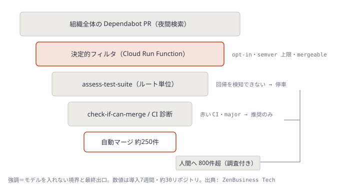
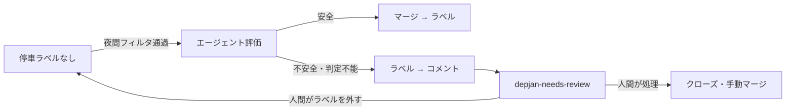
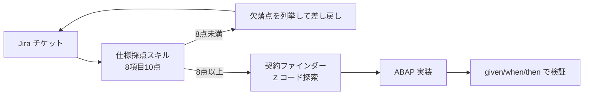
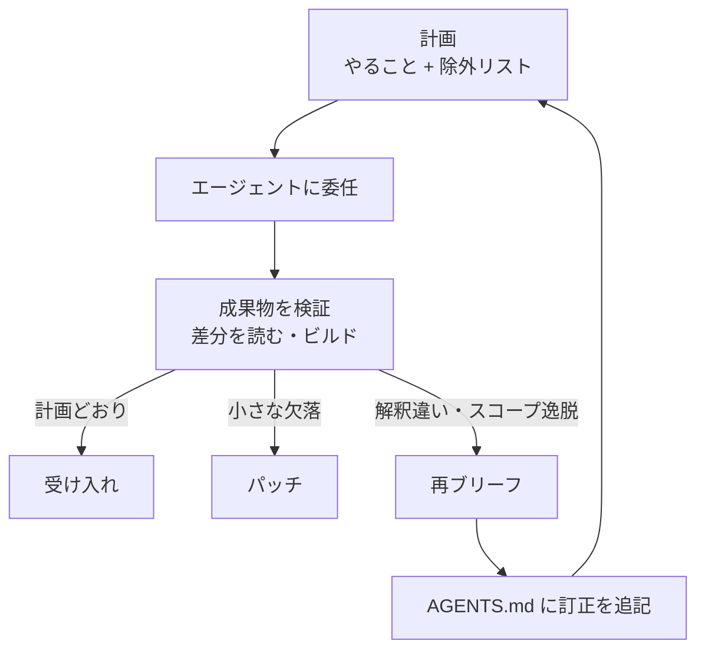
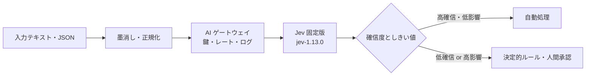
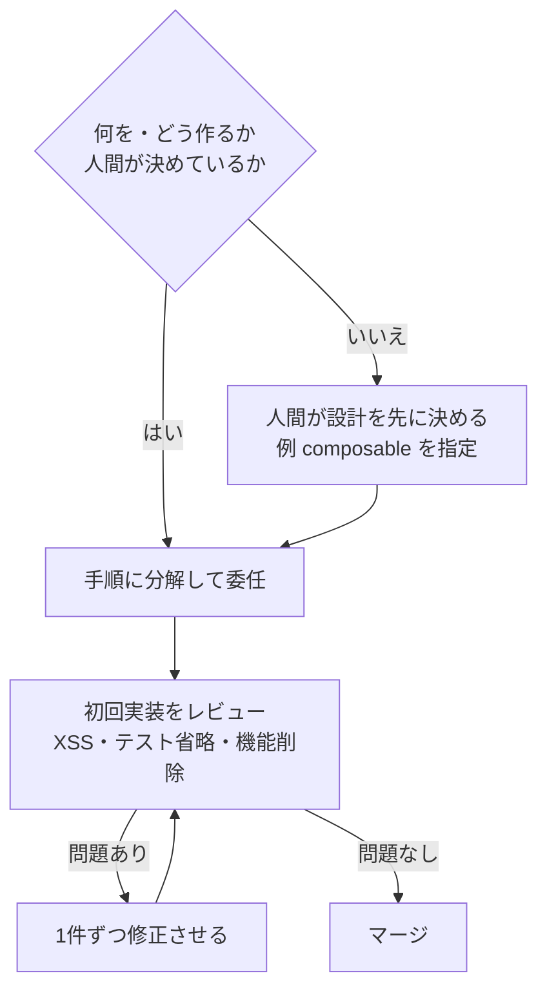

# Daily Briefing 2026-11-26

## 1. キーを投げ渡し、キャッチは見ない: AI に Dependabot PR を夜間マージさせた方法（原題: Toss the Keys & Don't Watch the Catch: How We Let AI Merge Dependabot PRs Overnight）

- **URL**: https://tech.zenbusiness.com/toss-the-keys-dont-watch-the-catch-how-we-let-ai-merge-dependabot-prs-overnight/
- **公開日**: 2026-08-14
- **著者・媒体**: Austin Witt / ZenBusiness Tech

### 本文翻訳

ZenBusiness では「Dependabot Janitor」と呼ぶ夜間システムを運用している。GitHub 組織全体の Dependabot PR のうち、**パッチ／マイナーの定型的なバンプだけ**を、必須チェックが通り、かつ回帰を検知できるテストスイートがあるリポジトリに限ってマージする。それ以外はすべて人間のレビュー待ちに「停車」させる。メジャーバンプは決して自動マージしない。エージェントは調査して推奨を出せるが、マージはできない。

**アーキテクチャ: 決定的な半分と判断の半分。** 両者の間には硬い境界がある。決定的な半分は Google Cloud Run Function で、組織横断の夜間検索で集めた PR を単純な比較でふるいにかける。(1) リポジトリはオプトイン済みか (2) PR はオプトアウトされていないか (3) リポジトリごとに設定した semver 上限の範囲内か（上限を超えるメジャーはエージェントへの入力を組み立てる前に落とす） (4) コンフリクトなくマージ可能か。停車ラベル付きの PR もセッションを作る前に落とす。残った PR はリポジトリ単位に束ね、CI のテスト計画情報を添える。こうして **エージェントは対象外の PR を一切見ない**。

判断の半分は Claude Managed Agent で、リポジトリごとに夜1セッション、5つの Agent Skill を順に実行する。`assess-test-suite` は、PR をゲートするチェックが「バンプが触るコードの回帰を実際に捕まえられるか」を判定する。テストの有無やカバレッジ率ではない。判定は依存解決ルート単位で出し、PR が触る全ファイルが合格ルートにあるときだけ先へ進む。影響範囲を対応付けられない場合は**閉じる側に倒す**（fail closed）。`check-if-can-merge` は機械的なマージ可否、`check-if-should-merge-major` は出力が「推奨」か「保留」しかない、`diagnose-failing-ci` は CI が赤いときに原因がバンプか既存の故障かを判断、`execute-batch-actions` はラベル・コメント・承認・マージを行い、メジャーをマージツールに渡すことを拒否する。

自動化の前に、まず Dependabot 設定を中央集約し、PR の形を予測可能にした。

**封じ込め。** エージェントは資格情報の文字列を持たない。行動はデフォルト拒否の MCP ツール許可リスト（承認、squash マージ、コメント、ラベル、CI 状態の読み取り等）と、読み取り専用のリポジトリクローンだけ。`gh` CLI もファイル push ツールもない。メジャーバンプ禁止は3箇所で強制する: 決定的フィルタで「渡さない」、プロンプトの規則で「宣言する」、実行スキルの書き込み境界で「検証する」。

**ラベルを状態として使う。** `depjan-needs-review` は、夜間フィルタのオフスイッチ、作業リスト、再開機構（ラベルを外せばキューに戻る）を兼ねる。書き込みの順序も設計した。「マージしてからラベル」（マージ済み未ラベルは無害、ラベル済み未マージは誤解を生む）、停車時は「ラベルしてからコメント」（コメント済み未ラベルだと毎晩キューに戻ってスパムになる）。

**ヒヤリハット。** WordPress リポジトリでは、唯一のゲートがセキュリティスキャナだと判断して停車させたが、`.github/workflows/` 外の Tugboat プレビューを見落としていた。メンテナが開いたままのセッションに質問すると、エージェントは見落としを認めて判定を更新したが、「プレビューはデプロイできることを示すが正しさは示さない」ため結論は no-go のままだった。また数百のテストが通るサービスで、DB を触るモジュールにテストが無いことを検出した。

**結果。** 6月中旬から約30リポジトリを登録。7週間で約250件を自動マージし、800件超を調査付きで人間に返した。そのうち約245件はチームが Janitor の推論に従って処理済み。

**教訓。** 決定性はまず封じ込めの仕組みであり、コスト最適化は二の次。重要な不変条件は複数地点で強制する（渡さない・宣言する・検証する）。片方の失敗方向が安いときに限り、「安全側への偏り」が評価ハーネスの代わりになる。

### 重要ポイント
- 決定的フィルタでスコープを先に削り、**モデルには対象内の PR しか見せない**。決定性はコスト削減より封じ込めのため
- テスト判定は「テストがあるか」ではなく「このバンプが触るコードの回帰を捕まえられるか」。判定不能は閉じる側に倒す
- メジャー禁止を「入力から除外・プロンプトで宣言・書き込み境界で検証」の3重で強制
- ラベルを状態機械として使い、書き込み順序をクラッシュ時に無害な状態が残るよう並べる
- 7週間で約250件自動マージ、800件超を調査付きで差し戻し、うち約245件が処理済み

### 図解





### 戦略分析

**フレームワーク**: リスク×可逆性マトリクス（どの業務をエージェントに任せるか）

| 区分 | 失敗時の影響 | 可逆性 | Janitor の扱い |
|---|---|---|---|
| パッチ／マイナー＋回帰検知可能なテスト | 小 | 高（revert 容易） | 自動マージ |
| パッチ／マイナー＋テストが影響範囲を覆わない | 中 | 中 | 停車（調査付き） |
| CI が赤い | 不明 | — | 原因診断のみ |
| メジャー | 大 | 低 | 推奨／保留のみ、3重に禁止 |

**示唆**: 依存更新の自動化を検討するとき、最初の投資先は「エージェントの賢さ」ではなく、(1) Dependabot 設定の中央集約、(2) リポジトリごとの semver 上限とオプトインの宣言、(3) 決定的フィルタの3つ。エージェントは右上（低リスク・高可逆）の区画だけを担い、残りは「調査メモ付きで人間に返す」ことに価値を置く。記事でも停車した800件超の多くがその調査メモで処理されており、**自動マージ件数より差し戻しの質**が KPI になる。

**反証条件**: テストスイートが薄いリポジトリが大半の組織では、ほぼ全件が停車し、人間の作業量はむしろ「調査メモを読む」分だけ増える。その場合はエージェント導入より先にテスト整備への投資が合理的になる。また「片方の失敗方向が安い」前提（誤停車は安い）が崩れる、つまり停車が積み上がってセキュリティパッチが遅れる組織では、安全側の偏りがリスクそのものになる。

### 現場での適用方法

**スクリプト化の例**: GitHub Actions で決定的フィルタ部分を実装し、エージェントに渡す前段を作る。

```yaml
# .github/workflows/dep-janitor-filter.yml
name: dep-janitor-filter
on:
  schedule:
    - cron: "0 17 * * *"   # 02:00 JST
  workflow_dispatch:
permissions:
  contents: read
  pull-requests: read
jobs:
  filter:
    runs-on: ubuntu-latest
    steps:
      - uses: actions/checkout@v4
      - name: Collect eligible Dependabot PRs
        env:
          GH_TOKEN: ${{ secrets.JANITOR_READ_TOKEN }}
          ORG: <ORG_NAME>
        run: |
          set -euo pipefail
          # opt-in 一覧と semver 上限（例: "patch" / "minor"）を中央設定から読む
          # .janitor/repos.tsv:  <repo>\t<ceiling>
          : > eligible.jsonl
          while IFS=$'\t' read -r repo ceiling; do
            gh pr list -R "$ORG/$repo" --author app/dependabot --state open \
              --json number,title,labels,mergeable,url \
            | jq -c --arg ceiling "$ceiling" --arg repo "$repo" '
                .[]
                | select([.labels[].name] | index("depjan-needs-review") | not)
                | select([.labels[].name] | index("depjan-opt-out") | not)
                | select(.mergeable == "MERGEABLE")
                | . as $pr
                | ($pr.title | capture("from (?<from>[0-9.]+) to (?<to>[0-9.]+)")) as $v
                | ($v.from | split(".")) as $f | ($v.to | split(".")) as $t
                | (if $f[0] != $t[0] then "major"
                   elif $f[1] != $t[1] then "minor" else "patch" end) as $kind
                | select(($kind == "patch") or ($kind == "minor" and $ceiling == "minor"))
                | {repo: $repo, number, url, kind: $kind}'
          done < .janitor/repos.tsv >> eligible.jsonl
          wc -l eligible.jsonl
      - uses: actions/upload-artifact@v4
        with:
          name: eligible-prs
          path: eligible.jsonl
```

**CLAUDE.md への追記例**（エージェント側に渡すルール）:

```markdown
## Dependency Janitor ルール
- 入力 eligible.jsonl に無い PR には一切触れない
- メジャーバンプは絶対にマージしない。出力は "recommend" か "hold" のみ
- テスト判定は「このバンプが触るファイルの回帰を PR ゲートのチェックが捕まえるか」で行う。
  影響範囲を特定できなければ hold
- 書き込み順序: マージ → ラベル。停車は ラベル(depjan-needs-review) → コメント
- コメントには機械可読の判定 JSON とセッションへのリンクを必ず含める
```

### 期待効果
- 記事では7週間・約30リポジトリで約250件を自動マージし、800件超を調査付きで差し戻し、約245件がその調査をもとに処理された
- 「定型バンプを人間が1件ずつ開く」作業が消え、人間はメジャーや危険な PR の判断に集中できる
- テスト判定の副産物として「通るがカバーしていないテスト」が可視化される

### 注意点
- 決定的フィルタの前に **Dependabot 設定の中央集約** が必要。PR の形がバラバラだとフィルタが書けない
- `.github/workflows/` 外のゲート（外部プレビュー環境等）は見落とされうる。リポジトリごとに「ゲートの一覧」を宣言させるとよい
- Renovate ブランチは Actions の secrets を受け取る点に注意（Dependabot ブランチは読み取り専用トークン）
- エージェントに push 権限や汎用 CLI を与えない。許可リストは PR 操作の動詞だけに絞る

## 2. 仕様駆動開発で SAP チームが 71% 速くなった方法（原題: How Spec-Driven Development Helped an SAP Team Move 71% Faster）

- **URL**: https://hackernoon.com/how-spec-driven-development-helped-an-sap-team-move-71percent-faster
- **公開日**: 2026-11-10
- **著者・媒体**: Marian Kamenistak（Mews VP of Engineering）/ HackerNoon

### 本文翻訳

**ボトルネックは ABAP ではなくチケットだった。** 18人の SAP チームで、実装フェーズのサイクルタイム中央値が5週間で19日から約5.5日に下がった（71%減）。SLA 関連の解決時間も2.72日から約1.4日（49%減）。チームが最も効いたと考えているのは、ABAP を1行書く前にまともな仕様を書くことだった。ただし同じ週にほかの施策も始めたので、効果をきれいに分離することはできない。

**すべての仕様を採点し、8点未満はスプリントに入れない。** AI スキルが Jira チケットを読み、10点満点のルーブリックで採点して欠けている点を列挙する。基準は8項目: ビジネス目標と受益者（1点）、影響する SAP オブジェクト＝テーブル・汎用モジュール・BAdI・インターフェース（2点）、現状と目標の振る舞い（1点）、given/when/then のテスト可能な受け入れ基準（2点）、テストデータとエッジケース（1点）、権限と個人データ（1点）、依存と副作用＝インターフェース・バッチジョブ・移送（1点）、スコープ外（1点）。オブジェクトと受け入れ基準が2点なのは、そこが欠けると一番痛いからだ。合格ラインは8点で、2点までは落としてよい。チームの平均は当初 **3.3点** だった。

**1つのチケットの前後。**（著者が作った例示であり実データではない）「与信保留中の受注は出荷してはならない」という依頼。修正前は「直してください」の一行で、目標の振る舞いしかなく2点。修正後は受益者（財務）、夜間ジョブの現状と目標、与信ステータス項目・受注ヘッダ・バッチジョブ・出荷 BAPI の名前、given/when/then の基準、エッジケース2つ（実行途中での与信解除、部分解除）、夜間の与信解除ジョブへの依存、スコープ外（与信限度額の変更）が揃い9点。権限の記載が無いので10点ではない。

**それから AI が ABAP を速くした。** 2つ目のスキル「コードベース契約ファインダー」が、チケットの背後にある実際の Z コードから契約と関連バグを探す。2つのスキルはプラグインとして一緒に動く。チームは1つのセットアップとインストールガイドを共有する。

**インシデントエージェントは3時間で作れた。** サポートインシデントの分類は1人の知識に依存していた。その知識をエージェントにし、構築は3時間。低確信度の約20%は今もサポート担当が手で分類しており、自動修正はまだ無い。

**初心者を AI ネイティブと組ませる。** AI に不慣れな人それぞれに、AI に習熟したバディを付けて一緒に進める。知識が速く広がるうえ、AI への移行に抵抗する人も見えてくる。

**月曜から、SAP に触れずに始める。** (1) Jira から実装フェーズのサイクルタイム中央値を測る (2) 過去の仕様20件を採点する (3) ゲートを閉じる (4) ABAP 開発者全員を1つのセットアップに揃える。

Birgitta Böckeler は「マークダウンの山より、コードをレビューしたい」と述べ、小さな問題には仕様駆動は過剰だとした。2行の修正なら彼女が正しい、と著者も認める。ただ SAP では権限や移送依存の見落としが高くつくため、トレードオフが違う。

### 重要ポイント
- ボトルネックは実装ではなく**入力（チケット）の品質**。平均3.3/10から8点ゲートへ
- ルーブリックは8項目10点。痛い欠落（影響オブジェクト・受け入れ基準）に重みを置く
- 仕様採点スキル＋コードベース契約ファインダーの2スキル構成
- 着手手順は「中央値の計測 → 過去20件の採点 → ゲート → セットアップ統一」で、SAP 本体に触れない
- 71%減は複数施策の合算で、因果は分離できないと著者自身が明記

### 図解



### 戦略分析

**フレームワーク**: 制約理論（TOC）

| TOC の手順 | 記事での対応 |
|---|---|
| 制約を見つける | 実装でなくチケットの曖昧さ（平均3.3/10） |
| 徹底活用 | 採点スキルで欠落を機械的に列挙 |
| 従属させる | 8点未満はスプリントに入れない（下流を上流品質に従属） |
| 引き上げる | 契約ファインダーで実装側の調査も短縮 |
| 繰り返す | 次の制約はインシデント分類 → 3時間でエージェント化 |

**示唆**: AI コーディング支援の追加投資を決める前に、過去チケット20件を同じルーブリックで採点するだけで「制約が入力側にあるか」を判定できる。平均が低ければ、投資先はコード生成ではなく仕様ゲートとその採点スキルになる。ゲートは全チケットではなく、**権限・移送・外部インターフェースを含む変更**から適用すると Böckeler の批判（小変更には過剰）を回避できる。

**反証条件**: チケットがすでに高品質（過去20件の平均が7点以上など）な組織では、ゲートは待ち時間を増やすだけで効果は出ない。また記事の71%は同時導入の施策の合算であり、仕様ゲート単体の効果は仮説にとどまる。

### 現場での適用方法

**スキル化の例**:

````markdown
---
name: spec-gate
description: Jira チケットや Issue 本文を読み、8項目10点のルーブリックで仕様品質を採点する。実装着手前、スプリント計画時、またはチケットを開発に回す前に使う。8点未満なら欠落項目と追記例を返し、着手させない。
---

# 仕様ゲート

## ルーブリック（合計10点、合格8点）
| # | 項目 | 点 |
|---|---|---|
| 1 | ビジネス目標と受益者 | 1 |
| 2 | 影響するオブジェクト（テーブル・モジュール・API・インターフェース名） | 2 |
| 3 | 現状と目標の振る舞い | 1 |
| 4 | given/when/then の受け入れ基準 | 2 |
| 5 | テストデータとエッジケース | 1 |
| 6 | 権限と個人データ | 1 |
| 7 | 依存と副作用（バッチ・移送・外部連携） | 1 |
| 8 | スコープ外 | 1 |

## 手順
1. チケット本文を読み、各項目を 0 / 満点 で判定する（部分点なし）
2. 項目2は名前が実在するか、リポジトリを grep して確認する
3. 出力形式:
   ```
   SCORE: 6/10  (GATE: FAIL)
   MISSING:
   - [2] 影響オブジェクト: テーブル名が無い
   - [6] 権限: 誰が実行できるかが無い
   SUGGESTED ADDITIONS:
   - ...
   ```
4. 8点未満なら「着手不可」と明記し、実装を始めない
````

**運用手順**（最初の1週間）:

```bash
# 1. 過去90日の実装フェーズのサイクルタイム中央値を測る（Jira の例）
jira issue list -q 'project = <PROJECT> AND status changed to "Done" after -90d' \
  --plain --columns key,created,resolved > done.tsv
# 2. 過去チケット20件を spec-gate スキルで採点し、平均点を記録
# 3. 平均が低ければゲートを有効化（ワークフローの "In Progress" 遷移に条件を付ける）
```

### 期待効果
- 記事では実装フェーズのサイクルタイム中央値が19日→約5.5日（71%減）、SLA 関連解決時間が2.72日→約1.4日（49%減）
- インシデント分類の属人化を3時間の構築で解消し、80%を自動化
- 仕様品質の数値化により、手戻りの原因を「実装者」ではなく「入力」に帰属できる

### 注意点
- 71%減は仕様ゲート・スキル・ペアリング・インシデントエージェントの合算。単体効果は未検証
- 2行の修正にまでゲートをかけると過剰。対象を変更種別で絞る
- ルーブリックは著者独自のもの。自組織の「一番痛い欠落」に合わせて重みを変える
- 採点が形式チェックに堕ちないよう、オブジェクト名の実在確認などを機械的に入れる

## 3. この6か月でエージェント型 AI の使い方について学んだこと（原題: What I learned in the past 6 months about using agentic AI）

- **URL**: https://flaviocopes.com/agentic-ai-lessons/
- **公開日**: 2026-09-14（2026-11-04 更新）
- **著者・媒体**: Flavio Copes / flaviocopes.com

### 本文翻訳

**ボトルネックは「作る」から「決める」へ移った。** 実装は速くなったので、本当の仕事は「これは作る価値があるか」「最小のバージョンは何か」という問いになった。作ること自体が、もっともらしい先延ばしにもなりうる。

**エージェントのツールはシンプルに保つ。** 大きなスキル集は、その複雑さが出力に漏れ出すのでやめた。単一目的の小さなスキルだけを作った。そのひとつが、コードを削ることだけが仕事の「simplify」スキルだ。

**やらないことを書く。** 計画には必ず明示的な除外リストを入れる。エージェントはスコープを広げがちだからだ。レビューでは差分を計画と比べ、「足りない作業」と「承認していない作業」の両方を探す。

**記憶を持つのはチャットではなくリポジトリ。** 繰り返す訂正は `AGENTS.md` に、設計上の理由は決定記録（decision record）に書く。最も価値のある行は、エージェントが再発見するのにコストがかかる「妙な事実」だ。

**エージェントを増やしてもソフトウェアは増えない。** 並列エージェントは同じタスクを別々に解釈する。5つ走らせれば5つの解釈になる。マネージャーとワーカーの構成をとり、独立したファイルは並列化し、共有する契約は順番に作る。基本は1つずつやる。

**要約ではなく成果物を検証する。** ファイルと差分を読み、ビルドを走らせる。委任した結果には「受け入れ」「パッチ」「再ブリーフ」の3つの判定のどれかを付ける。失敗した委任を黙って自分で直すと、同じ失敗が繰り返される。直すべきはブリーフだ。

**書く前にコードに質問する。** 既存コードについて的を絞った質問をし、答えを「確認済みの振る舞い」「未検証の仮定」「それを解決する確認方法」に分けて返させる。

**ルールはプロンプトではなくコードで強制する。** プロンプトは助言、境界はコード。あるプロジェクトでは LLM は価格を決めず、価格は決定的なコストモデルから来る。ドメイン購入エージェントはサーバー側の上限の下で動き、見積もりは期限切れになり、具体的な品目と価格を人間が承認する。

**出力の肥大を抑える。** 別のクリーンアップパスで AI 特有の癖を取り除く。「短く」は漂流するので、長さではなく形を指定する。

**サーバーも実行場所のひとつ。** エージェントは SSH 越しにサーバー移行をやり遂げたが、微妙な問題は後から出たので、結果は監視し続ける必要があった。

**罪悪感なくツールを替える。** ツールはまず勢いで選び、普通に1週間使ってから評価する。

**喜びの場所が移った。** 満足感のあるルーチン作業はエージェントがやる。残るのは決めること、レビューすること、センスを使うことだ。

残る問い: 手でコードを書く価値はまだあるか、並列エージェントのワークフローは定着するか、最初のバージョンが安くなったときソフトウェアの価値は何か。

### 重要ポイント
- 計画に**除外リスト**を書き、レビューは「不足」と「未承認の追加」の両方を差分で探す
- 委任結果には「受け入れ／パッチ／再ブリーフ」の3判定。黙って直すと同じ失敗が再発する
- 繰り返す訂正は AGENTS.md、設計理由は決定記録へ。チャットに記憶させない
- 価格・購入のような不変条件は**コード**（サーバー側上限・決定的モデル）で強制する
- 並列化は独立ファイルだけ。共有契約は直列

### 図解



### 戦略分析

戦略分析省略（理由: 個人の作業習慣の集合であり、記事に組織データや比較がない。組織判断に接続するのは「ルールはコードで強制」の1点で、それは記事1・4の分析と重複するため）

### 現場での適用方法

**CLAUDE.md への追記例**:

```markdown
## 計画と委任のルール
- 計画には必ず「やらないこと（Out of scope）」節を書く。空欄で出さない
- 実装後、差分を計画と照合し、以下を報告する:
  - 計画にあって未実装のもの
  - 計画に無いのに変更したもの（ファイル単位）
- 既存コードについて答えるときは3つに分ける:
  - 確認済み（ファイル:行 を示す）
  - 未検証の仮定
  - 仮定を確かめるコマンド
- 価格・権限・課金・削除に関わる値はコード上の定数／設定から読む。推測で埋めない
- 「短く」ではなく形式を指定されたら、その形式を守る
```

**スクリプト化の例**: 計画ファイルと差分の照合をフックで機械化する。

```bash
#!/usr/bin/env bash
# scripts/check-scope.sh  — plan.md の "Files" 節に無いファイルを変更していたら警告
set -euo pipefail
PLAN="${1:-plan.md}"
BASE="${2:-origin/main}"
allowed=$(awk '/^## Files/{f=1;next} /^## /{f=0} f && /^- /{print $2}' "$PLAN")
changed=$(git diff --name-only "$BASE"...HEAD)
status=0
for file in $changed; do
  if ! grep -qxF "$file" <<<"$allowed"; then
    echo "UNPLANNED CHANGE: $file"
    status=1
  fi
done
exit $status
```

### 期待効果
- 除外リストと差分照合で「頼んでいない変更」がレビュー前に検出される
- 再ブリーフの記録が AGENTS.md に蓄積し、同種の失敗がセッションをまたいで減る
- 不変条件をコードに置くことで、プロンプトの漂流による事故（誤価格・誤購入）を構造的に防ぐ

### 注意点
- 数値データは無い個人の経験則。チームに展開する前に1〜2週間の試行で効果を確かめる
- AGENTS.md は肥大化すると効きが落ちる。「再発見コストが高い妙な事実」に絞って書く
- 並列化を避ける方針は、独立性の高い作業が多いチームでは過度に保守的になりうる

## 4. Jev（TypeSafe AI）エンタープライズ・セキュリティガイド（原題: Jev TypeSafe AI: Enterprise Security Guide）

- **URL**: https://neuraltrust.ai/blog/jev-typesafe-ai-security
- **公開日**: 2026-10-06（2026年10月更新）
- **著者・媒体**: Roger Howroyd / NeuralTrust blog

### 本文翻訳

**Jev とは何か。** TypeSafe AI が2026年9月15日に早期アクセスで公開した「System One」モデル。テキストではなく、確率付きの型付き判断を返す。質問の型は Choice（選択）、Score（スコア）、Noul（yes/no）。チャットも、ツール呼び出しも、答えの説明もできない。ワークフローの制御はこちらのコードが持つ。

**性能とコスト**（特記なきものはベンダー公表値）。価格は入力100万トークンあたり $0.042、出力は無料。レイテンシは 70〜500ms。第三者レビューでは200問のベンチマークで正答率72.5%と、比較対象のフロンティアモデルより低かった。

**プロンプトインジェクションのリスク。** 自由文の出力もツール権限も無いからといって安全とは言えない。注入された、あるいは誤解を招く内容は Jev の判定を動かす。ある報告されたテストでは、偽の「事前承認済み」メモを混ぜると、破壊的コマンドをブロックすべき確率が下がった。コミュニティのテストでも、選択肢の順序や権威の主張に対する感度など、同様の弱点が見つかっている。結論として、出力が型付きでもインジェクションのリスクは残る。

**データの扱い。** TypeSafe AI は顧客のプロンプトで学習しないと述べている。保持期間の記述は曖昧で固定期間がない。ホスティングは米国、DPA には72時間以内の侵害通知がある。SOC 2 Type II は第三者インデックスが報告しているがベンダー未確認。

**推奨する統制。**
- 浮動エイリアス `jev-latest` ではなく、バージョン（`jev-1.13.0`）を固定し、アップグレード前に再テストする
- モデルに送る状態から個人データを墨消しする
- 説明が返らないので、入力・質問・モデルバージョン・出力をログに残す
- 低確信度や高影響の判定は、決定的ルールか人間の承認に回す
- 自社ワークフローに対してインジェクションや権威の主張のシナリオをテストし、しきい値は自社の結果から決める
- 鍵・ポリシー・レート制限・墨消しを管理するため、AI ゲートウェイ経由で呼び出す

**使いどころ。** 向いているのは、件数が多く範囲が限られ、誤ったラベルから回復できる判断（ルーティング、トリアージ）。向いていないのは、破壊的コマンドや支払いを Jev の判定だけでゲートすること、推論・ツール・書面の理由が必要なタスク。

### 重要ポイント
- 型付き出力・ツール無しでも**インジェクションで判定は動く**（偽の承認メモでブロック確率が低下した報告）
- `jev-latest` ではなくバージョン固定＋アップグレード前の再テスト
- 説明が返らないので、入力・質問・バージョン・出力の完全ログが監査の唯一の手段
- 用途は「誤っても回復できる大量判断」に限定し、破壊的操作・支払いの単独ゲートにしない
- 価格・レイテンシはベンダー値、正答率72.5%は第三者値

### 図解



### 戦略分析

**フレームワーク**: リスク×可逆性マトリクス

| 用途 | 誤判定の影響 | 可逆性 | 記事の判断 |
|---|---|---|---|
| チケット・ログのルーティング | 小 | 高 | 適する |
| アラートのトリアージ | 中 | 高 | 適する（低確信は人へ） |
| 破壊的コマンドの許可判定 | 大 | 低 | 単独では不可 |
| 支払いの承認 | 大 | 低 | 単独では不可 |

**示唆**: Jev を導入する判断は「どの判断に使うか」の線引きと同時に行う。具体的には、(1) 用途一覧を上の表に当てはめ、右下（大影響・低可逆）を対象外として明文化する、(2) 対象内の用途ごとにインジェクション・権威主張のテストケースを10件程度作り、しきい値をその結果から決める、(3) 本番投入はゲートウェイとバージョン固定が揃ってから。コストが安いぶん「とりあえず全部に」が起きやすいので、用途の線引きが統制の中心になる。

**反証条件**: 入力が完全に社内生成で外部テキストを含まない用途（例: 社内メトリクスの JSON だけを判定する）では、インジェクションの攻撃面がほぼ無く、ここで挙げた統制の多くは過剰になる。また記事の数値は大半がベンダー値と単一の第三者ベンチマークであり、自社タスクでの精度は検証するまで仮説である。

### 現場での適用方法

**スクリプト化の例**（TypeScript、バージョン固定・ログ・しきい値エスカレーション）:

```typescript
// jev-gate.ts
import { appendFileSync } from "node:fs";

const JEV_ENDPOINT = process.env.JEV_GATEWAY_URL ?? "<AI_GATEWAY_URL>/v1/systemone";
const JEV_MODEL = "jev-1.13.0";          // jev-latest は使わない
const AUTO_THRESHOLD = 0.9;              // 自社テストの結果から決める

type Decision = { label: string; probability: number };

function redact(text: string): string {
  return text
    .replace(/[\w.+-]+@[\w-]+\.[\w.]+/g, "<EMAIL>")
    .replace(/\b\d{2,4}-\d{2,4}-\d{3,4}\b/g, "<PHONE>");
}

export async function classify(input: string, question: string, choices: string[]) {
  const body = {
    model: JEV_MODEL,
    input: redact(input),
    question: { type: "choice", text: question, choices },
  };
  const res = await fetch(JEV_ENDPOINT, {
    method: "POST",
    headers: { "content-type": "application/json", authorization: `Bearer ${process.env.JEV_API_KEY}` },
    body: JSON.stringify(body),
  });
  const out = (await res.json()) as Decision;
  // 説明が返らないため、判断の再現に必要なものを全部残す
  appendFileSync("jev-audit.jsonl", JSON.stringify({ ts: Date.now(), ...body, out }) + "\n");
  const route = out.probability >= AUTO_THRESHOLD ? "auto" : "human";
  return { ...out, route };
}
```

**CLAUDE.md への追記例**:

```markdown
## Jev 利用規約
- 破壊的操作（削除・本番デプロイ・権限変更）と支払いの可否を Jev の判定だけで決めない
- モデルは `jev-1.13.0` に固定。変更する PR には tests/jev-injection/ の再実行結果を添付する
- 外部由来テキストを渡す用途には、"pre-approved" 等の権威主張を混ぜたテストケースを必ず追加する
```

### 期待効果
- 型付き判断を安価・低レイテンシ（ベンダー値 70〜500ms）でルーティングやトリアージに使える
- バージョン固定と監査ログで、判定の変化を追跡・再現できる
- 用途の線引きにより、インジェクションが通っても被害が「回復可能な誤ラベル」に限定される

### 注意点
- 第三者ベンチマークの正答率は72.5%で、フロンティアモデルより低い。精度要件の高い用途には不向き
- 確率の較正は予測の集団に対して成り立つもので、個々の答えには保証されない（関連ガイドの指摘）
- データ保持期間が曖昧。個人データは送る前に墨消しする
- SOC 2 Type II はベンダー未確認。調達時に確認する

## 5. 本番環境でのエージェント型コーディング、地に足のついた見方（原題: A grounded take on agentic coding for production environments）

- **URL**: https://iximiuz.com/en/posts/grounded-take-on-agentic-coding/
- **公開日**: 2026-01-19
- **著者・媒体**: Ivan Velichko / iximiuz Labs

### 本文翻訳

15年以上の経験を持つ開発者として、エージェント型コーディングの生産性には感心した。一方で「専門知識がほとんどなくても誰でも何でも作れる」という誇大宣伝には懐疑的だ。エージェントが保守性を損なうほど速くコードを生成できる以上、ドメイン知識とコードベースへの慣れは**これまで以上に**重要になる。

**前提。** 1か月で、本番コードベース iximiuz Labs（約10万行→約15万行）に AI 支援で約5万行を書いた。主に使うエージェントは2025年10月頃に Cursor から Claude Code へ移り、月200ドルのプランにした。変更はすべてレビューが必要で、複数エージェントは共有の開発環境で衝突するため、基本は前面に1エージェントだけ。動く開発環境なしにエージェントを走らせると有用性の約9割が失われる。

**事例1: GCS クライアント（単純なインフラ機能）。** S3 クライアントを Google Cloud Storage に置き換える作業は、良いテストがあったにもかかわらず Claude Code でも Codex CLI でも失敗した。GCS の S3 互換 XML API は AWS SDK の署名に対応しておらず、SSE-C ヘッダも異なっていた。より単純な実装に SSE-C 対応を求める形にして、ようやく動くものができた。手で書けば1週間の見積もりだった。

**事例2: 著者プロフィールページ（フルスタック）。** 公開ページは約30分。社内ダッシュボードは2営業日かかった。Claude Code の最初の実装には XSS 脆弱性（`javascript:` URL を検証しない）、場当たり的なスキーマ項目、一意制約のテスト省略があった。包括的な修正プロンプトはうまくいかず、1つずつ直した。

**事例3: ダッシュボードのペイン再設計（フロントエンド）。** データ取得をする Vue コンポーネントの分割に失敗した。最初は兄弟コンポーネントと props のバケツリレー、次は provide/inject。解決策は著者が指定した composable で、それを Claude Code は数分で実装した。

**事例4: カタログのレイアウト変更（些細なフロントエンド）。** 高レベルのプロンプトは失敗。手順に分けると動いたが、エージェントはコレクションをハードコードし、機能を1つ削除した。最初のカタログの手直しに丸1日、残り5つを類推で移すのは30分だった。

**全体の所感。** Claude Code はコピペ的なコードを書き、直近のプロンプトに最適化し、成功に寄りすぎる（テストを飛ばす、機能を消す）。高レベルの製品的プロンプトは苦手だが、開発者が「何を・どう作るか」を分かっているときは非常に有効で、体感で10〜100倍速い。再現できるバグの調査が得意。エージェントは目にしたコードを複製するので、テストとリファクタリングは安くなり、価値も上がる。

**フロー状態。** 深い集中は残るが、一段上に移る。コードブロックから、モジュール・要件・欠けている部品へ。

**結論。** 「SaaS を1日で」の誇大宣伝の大半は根拠がない。実地経験はミクロ（コードの臭いや危険なデータ形式変更を見抜く）とマクロ（要件をエージェントサイズのタスクに分解する）の両面で効く。1月のコードは Claude Code が生成したが、「すべてはまだ**私が書いたもの**だ」。

### 重要ポイント
- 「何を・どう作るか」を人間が決めているときだけ 10〜100倍。高レベルの製品プロンプトは失敗しやすい
- 初回実装に XSS・テスト省略・機能削除が混入。**成功志向バイアス**を前提にレビューする
- 包括的な修正プロンプトより、指摘を1つずつ直させる方が効いた
- 設計（例: composable）を人間が指定すれば実装は数分。分解と設計が人間の仕事
- エージェントは見たコードを複製するので、リファクタリングとテストの価値が上がる

### 図解



### 戦略分析

**フレームワーク**: Cynefin

| 領域 | 記事の事例 | エージェントの成績 | 人間の役割 |
|---|---|---|---|
| 明白 | 公開プロフィールページ、類推での5カタログ移植 | 30分前後で完了 | 確認のみ |
| 煩雑 | 管理ダッシュボード、再現できるバグ調査 | 完了するが欠陥混入 | 欠陥の1件ずつの指摘 |
| 複雑 | GCS の S3 互換 API 差異、Vue の責務分割 | 失敗 | 設計・制約の特定を先に行う |

**示唆**: タスクをエージェントに渡す前に「明白／煩雑／複雑」のどれかを担当者がラベル付けし、複雑なものは**人間が設計を1つ決めてから**渡す運用にする。事例3・4が示すとおり、設計が決まった瞬間にタスクは「明白」に落ち、実装は数分〜30分で終わる。見積もりも領域ごとに分けて扱い、複雑なタスクにエージェント前提の短い見積もりを付けない。

**反証条件**: 対象が新規の小規模コードベースで、保守期間が短い（プロトタイプ、使い捨てツール）場合、著者の懸念する保守性の劣化は問題にならず、高レベルプロンプトでの一括生成のほうが合理的になりうる。また記事は1人の開発者・1コードベースの観察であり、チーム規模での一般化は仮説である。

### 現場での適用方法

**CLAUDE.md への追記例**:

```markdown
## 本番コードベースでの作業規約
- 実装前に、新しく足す抽象（コンポーネント・composable・モジュール）の名前と責務を1段落で提示し、承認を得る
- 既存の機能・テストを削除する変更は、削除理由を PR 本文に列挙する。黙って削除しない
- テストを skip / 削除して緑にしない。失敗するテストは失敗のまま報告する
- ユーザー入力を URL・HTML に出力する箇所は、許可スキーム（http/https）を明示的に検証する
- 外部 API の「互換」実装を使うときは、署名方式とヘッダの差異を公式ドキュメントで確認してから書く
- 指摘を受けたら、まとめて直さず1件ずつ修正してコミットを分ける
```

**運用手順**（タスク投入前のチェック）:

```bash
# タスク Issue のテンプレートに Cynefin ラベルを必須にする
mkdir -p .github/ISSUE_TEMPLATE
cat > .github/ISSUE_TEMPLATE/agent-task.yml <<'EOF'
name: Agent task
description: エージェントに渡すタスク
body:
  - type: dropdown
    id: domain
    attributes:
      label: 領域
      options: ["明白: そのまま委任", "煩雑: 委任し1件ずつレビュー", "複雑: 人間が設計を決めてから委任"]
    validations:
      required: true
  - type: textarea
    id: design
    attributes:
      label: 設計の決定（複雑の場合は必須）
      description: 新しい抽象の名前と責務、使う API と既知の差異
EOF
```

### 期待効果
- 著者の体感では、何をどう作るかが決まっているタスクで 10〜100倍の速度
- 1か月で約5万行を本番コードベースに追加（約10万→15万行）しつつ、著者が設計の主導権を保持
- 成功志向バイアス（テスト省略・機能削除・XSS）を前提にしたレビュー観点の明文化

### 注意点
- 動く開発環境なしでエージェントを走らせると有用性の約9割を失う。まず環境を整える
- 共有開発環境では複数エージェントが衝突する。並列化するなら環境の分離が前提
- 公開は2026年1月で、使用ツールのバージョンは当時のもの。失敗事例の一部は現行モデルで改善している可能性がある
